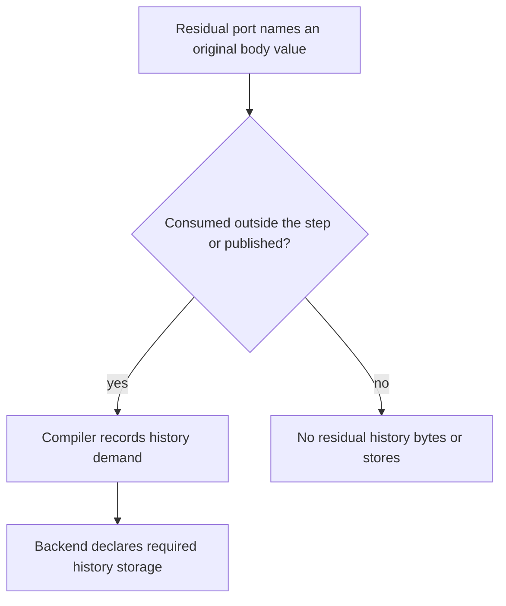

# [General differentiable scan](../glossary.md#general-differentiable-scan)

> [`ARCHITECTURE.md`](../../ARCHITECTURE.md) is authoritative. The incorporated
> [recurrent-scan contract](contracts/recurrent-scan.md#general-differentiable-scan)<span data-glossary-navigation="true"> ([scan glossary](../glossary.md#term-cumulative-scan))</span> is the sole
> complete scan semantic owner; this page distinguishes current ordinary PURE CPU composition
> and selected FLOAT32/FLOAT64 first-order AD from historical bounded qualification and
> independently gated cold persistence/workflow/resource migration.<span data-glossary-navigation="true"> ([owner glossary](../glossary.md#term-owner); [PURE glossary](../glossary.md#term-pure); [CPU glossary](../glossary.md#term-cpu); [FLOAT32 glossary](../glossary.md#term-float32); [FLOAT64 glossary](../glossary.md#term-float64); [AD glossary](../glossary.md#autograd); [qualification glossary](../glossary.md#term-qualification); [persistence glossary](../glossary.md#term-persistence))</span>

## Purpose and [mental model](../glossary.md#term-mental-model)

A fixed-count [scan](../glossary.md#term-cumulative-scan) repeats ordinary [Tensor](../glossary.md#tensor) algebra while explicitly carrying values from one
step to the next. Users describe that algebra once. [Compiler](../glossary.md#term-compiler) [automatic differentiation](../glossary.md#autograd) ([AD](../glossary.md#autograd)) makes
an ordinary reverse sibling scan before [capture](../glossary.md#term-capture-meanings); qualified [CPU](../glossary.md#term-cpu) preparation emits the loop instead
of interpreting the body at [runtime](../glossary.md#term-runtime). This avoids a source [graph](../glossary.md#graph) that grows once per time step
without introducing general while loops or another executor.

The **body** is the calculation repeated at each step. A **[carry](../glossary.md#term-carry)** is the state passed to the next
step; a **sequence** supplies one time [slice](../glossary.md#slice) per step; an **[invariant](../glossary.md#term-invariant)** is supplied unchanged to
every step. An **emission** is a step result collected at original time positions. **[PURE](../glossary.md#term-pure)** means
the body's ordinary calculation has no hidden mutation or random-state effect. “First-order AD”
means constructing first [derivatives](../glossary.md#term-derivative), not derivatives of those derivatives.

The page uses T for time steps, B for [batch](../glossary.md#term-batch-machine-learning-and-hyperparameters) rows, and F/H for [feature](../glossary.md#term-feature)/state widths. ROW([axis](../glossary.md#term-axis))
records which local axis follows batch rows; SHARED has no row axis. A **binder** connects the
body's declared inputs to an [occurrence](../glossary.md#term-occurrence)'s actual values. A source-valid body, a generated
derivative, a saved file and an executable [backend route](../glossary.md#backend-route) are separate admissions, not four names
for the same support claim.

### Follow the template, actual values and execution separately

The application (or an NN recurrent component) constructs storage-free formal Tensors,
builds one `ScanBody` from them, then calls `Scan.apply` with actual initial carries, sequences
and invariants. These calls describe a loop; neither reads the actual values or executes a
Java callback at every time step. A formal is a leaf because it has no producing expression,
not because it owns a buffer. Undeclared outer leaves must be explicit invariants, so the body
cannot silently capture the application's weight storage.

Compiler receives the outer expression through Engine and captures the body's independent
scope, constructing selected reverse expressions first when requested. Shared Prepare calls
backend analysis with that body description and demanded saved-value roles. CPU finalization
emits reusable loop code; Runtime later supplies one run's representations. Actual input
storage remains borrowed through result closure; writable carries, staging and demanded
histories belong to that run, not the reusable body. The
[copy/borrow table](../explanation/ownership.md#which-call-borrows-or-copies) and
[CPU's current Scan composition](../backend-guide/cpu-backend.md#current-general-scan-composition)
connect the source abstraction to physical execution.

The task-numbered passages below preserve their individual source/qualification checkpoints.
In particular, a historical bounded CPU body inventory is not today's complete provider domain,
and a cold file-format admission is not an execution guarantee.


```text
Model: source body + original canonical result/residual wrappers
  -> Compiler: first-order reverse Tensor body, then one combined scoped capture
  -> Planning: complete-body capability and one owner
  -> Prepare: scoped validation + exact body/role/demand projection
  -> qualified CPU analysis: exact resources -> existing shared slots
  -> CPU finalization: emitted time loop + admitted typed step code
  -> execution: one logical run, one RunState
```

Read downward: meaning belongs to [Model](../glossary.md#term-model), derivatives to Compiler, resources to staged preparation,
and [mutable](../glossary.md#term-mutable) execution state to the [run](../glossary.md#term-run).
Current [admission](../glossary.md#term-admission) composes every ordinary CPU-supported PURE unit under ordinary [dtype](../glossary.md#data-type--datatype)/[layout](../glossary.md#layout),
value-[validation](../glossary.md#term-validation) and selected derivative guards, not a [finite](../glossary.md#term-finite) operator list. All-valid bodies
use WholeTensor. Length-aware body values may be proved ROW(axis) values or arbitrary-[shape](../glossary.md#shape)
SHARED tensors. Lengths is a separate final non-[gradient](../glossary.md#term-gradient) [INT64](../glossary.md#data-type--datatype) `[B]` control actual with no body
formal, not a [scalar](../glossary.md#term-scalar) alternative. Original AD carries/sequences and emission boundaries remain
ROW(0); intermediate/history ROW axes and ranks follow their proofs. Supported row-mixing
[materialization](../glossary.md#materialization) requires exactly the same length values, not Tensor [identity](../glossary.md#term-identity-meanings). Structural absence
differs from a present all-zero [seed](../glossary.md#term-seed); cross-Scan materialization is explicit. Families without backward retain
that limit; non-gradient [primal](../glossary.md#term-primal) paths may contain ordinary nondifferentiable units. Model remains
the logical-layout [owner](../glossary.md#term-owner). CPU reuses ordinary [lowering](../glossary.md#lowering)/emitters under the existing loop, direct
same-class helpers and run-owned staging, not a second executor or universal copy-free/zero-allocation
behavior. Partial smokes/numeric receipts do not establish final unified [release](../glossary.md#term-release) [qualification](../glossary.md#term-qualification).
Reviewed [borrowed](../glossary.md#ownership-borrowing-and-lease)-source APIs do not prove production cutover or passing end-to-end T0 caller
[publication](../glossary.md#term-publication); qualification remains pending. The task chronology below is historical qualification.

The architecture was accepted on 2026-10-21 in
[ADR 0045](../design/decisions/0045-general-differentiable-scan.md)<span data-glossary-navigation="true"> ([ADR glossary](../glossary.md#term-architecture-decision-record-adr))</span>. Model0035 implements and validates
the source body, [canonical](../glossary.md#term-canonical-form) result/[residual](../glossary.md#scan-residual-port-and-history-demand) wrappers, scalar header and structural compiled-body
attachment. Planning0008 adds optional compiled-body query transport and whole-occurrence provider
contract tests. Compiler0011 implements scoped capture/[inference](../glossary.md#term-inference), first-order reverse-scan AD and
final body-bearing query/demand emission. Prepare0010 implements scoped projection, static [binding](../glossary.md#term-binding)
checks and complete-graph demand validation through the existing resource [handoff](../glossary.md#term-handoff). CPU0030 implements
same-shape [FLOAT32](../glossary.md#term-float32) [pointwise](../glossary.md#term-pointwise) forward execution and its actual Compiler-generated reverse when both
bodies independently qualify. The [CPU route](../backend-guide/cpu-backend.md#bounded-float32float64-general-scan)
documents its finite algebra, binder budgets, exact resources and evidence. CPU0031 additionally
implements FLOAT32 broadcast, SUM/sumToShape, [rank](../glossary.md#term-rank)/shape [views](../glossary.md#term-view-meanings), [rank-two](../glossary.md#axis-rank-scalar-vector-and-matrix) [transpose](../glossary.md#term-transpose) and [contiguous](../glossary.md#term-contiguous)
closure, with actual independently qualified Compiler reverse. CPU0032 adds static [homogeneous](../glossary.md#term-homogeneous)
FLOAT32 rank-two [MATMUL](../glossary.md#matrix-multiplication--matmul) within that emitted loop, including independently qualified actual
Compiler reverse bodies. CPU0033 implements homogeneous [FLOAT64](../glossary.md#term-float64) across the complete bounded
declared algebra and actual first-order reverse closure. Both dtypes require static T, canonical
formals/writes, canonical or CPU0037 dense-view actual reads plus proved zero-offset all-zero-[stride](../glossary.md#term-stride)
scalar reads, and independent qualification of each actual body and binder. This is not
all-[operation](../glossary.md#operation) or arbitrary-layout support. Existing
fixed [RNN](../glossary.md#term-recurrent-neural-network-rnn)/[GRU](../glossary.md#term-gated-recurrent-unit-gru)/[LSTM](../glossary.md#term-long-short-term-memory-lstm) CPU
execution, fixed [persistence](../glossary.md#term-persistence) and static [NN](../glossary.md#neural-network-module-parameter-buffer-and-forward-context) routes remain implemented and unchanged. Source
admission is not a provider support answer.

<a id="approved-dense-actual-reads-implementation-pending"></a>
<a id="dense-actual-reads-implemented-final-gates-pending"></a>

### Dense actual reads: implemented and qualified

[CPU0037](../planning/backends/cpu/tasks/0037-general-scan-dense-read-views.md) adds only the
[scan owner's read exception](contracts/recurrent-scan.md#traversal-empty-domains-and-declared-qualification)<span data-glossary-navigation="true"> ([scan glossary](../glossary.md#term-cumulative-scan); [owner glossary](../glossary.md#term-owner))</span>.
A [view](../glossary.md#term-view-meanings) flag records [metadata](../glossary.md#term-metadata); it does not by itself change the address of a cell. For example,
a resolved [F32](../glossary.md#floating-point-precision-and-rounding)/[F64](../glossary.md#floating-point-precision-and-rounding) sequence `[3,2,4]` with [strides](../glossary.md#term-stride) `[8,4,1]`, offset zero and `isView=true`
has the same addresses `0..23` as its non-view [canonical](../glossary.md#term-canonical-form) twin. Conv1d's [singleton](../glossary.md#term-singleton)-[axis](../glossary.md#term-axis) removal
can produce this [descriptor](../glossary.md#term-descriptor). The approved path reads those cells directly; it does not clear
the flag, rewrite the [Tensor](../glossary.md#tensor) or insert a [contiguous](../glossary.md#term-contiguous) copy. CPU0037 implements this read [admission](../glossary.md#term-admission)
with forward and actual [Compiler](../glossary.md#term-compiler)-reverse [qualification](../glossary.md#term-qualification); main accepted the final capability gates
on 2026-10-24.

The same proof applies to actual initial carries and invariants, not to internal formals or
output/write boundaries. A `[3,2,4]` descriptor with offset one or strides `[8,1,2]` is not this
exception. Existing all-zero-stride [scalar](../glossary.md#term-scalar) reads remain separate: every logical cell reads the
same stored scalar. Descriptor equality, cold substitutions and storage lifetimes are unchanged.
Singleton CONCAT can likewise generate a dense reverse [seed](../glossary.md#term-seed). Focused tests execute real Conv1d
and singleton-CONCAT workflows in both traversals and both [dtypes](../glossary.md#data-type--datatype), comparing outputs and connected
[gradients](../glossary.md#term-gradient) with ordinary [unrolling](../glossary.md#term-unrolling) over the same input and [parameter](../glossary.md#term-parameter) [leaves](../glossary.md#term-leaf). Separate capability
tests assert that the Conv1d view reaches the forward/reverse [primal](../glossary.md#term-primal) role and the CONCAT view
reaches the actual reverse emission-seed role. This is actual reverse evidence, not an [inference](../glossary.md#term-inference)
from forward support. This [CPU](../glossary.md#term-cpu) extension does not migrate the fluent [RNN](../glossary.md#term-recurrent-neural-network-rnn) builder or alter its
cold descriptor.

Eighteen canonical/view pairs retain identical complete [lowering](../glossary.md#lowering) facts, access [bindings](../glossary.md#term-binding), resources,
[IR](../glossary.md#term-intermediate-representation-ir), canonical and both [specialization](../glossary.md#term-specialization) [identities](../glossary.md#term-identity-meanings), generated bytes and cached [artifact](../glossary.md#term-artifact) reuse.
Generator and physical binding are unchanged, so CPU0036's specialized clean-Java/Class-File and
bounded performance evidence is reused with its existing limitations; this is not a new timing or
parity claim. The [CPU0037 result](../planning/backends/cpu/tasks/0037-general-scan-dense-read-views.md#result)
records focused evidence and main's accepted final gates separately.

## Source expressions and independent scopes

Implemented cold-source reconstruction supports only the
[constructor-backed Compiler inventory](contracts/compiler-autograd.md#bounded-general-scan-cold-reconstruction),
not every [Model](../glossary.md#term-model)-valid [PURE](../glossary.md#term-pure) body. Cold [admission](../glossary.md#term-admission) is independent of [CPU](../glossary.md#term-cpu) execution [qualification](../glossary.md#term-qualification),
including for low floating bodies. Separate call-local tables and fresh formals preserve lexical
scopes; this is not a new [graph](../glossary.md#graph) or execution [owner](../glossary.md#term-owner). [Checkpoint](../glossary.md#term-checkpoint)'s implemented in-memory copy/[rebind](../glossary.md#capture-graph-ports-and-reconstruction)
preserves [immutable](../glossary.md#term-immutable) body attachments while normalizing outer IDs, then delegates fresh reconstruction
to [Compiler](../glossary.md#term-compiler). Its v1/v2/v3 save/load stays body-free. Owned [NN](../glossary.md#neural-network-module-parameter-buffer-and-forward-context) graph/definition acquisition now
uses this same bounded cold inventory, without a CPU [dtype](../glossary.md#data-type--datatype), [operation](../glossary.md#operation) or [layout](../glossary.md#layout) predicate. The
[extension owner](contracts/extensions-training.md#generic-graph-source-and-values) defines these
separate admissions. The implemented all-valid graph/defineTensor → compute/configureTraining/train
workflow uses one private working state and cached public [Engine](../glossary.md#term-engine)/[TrainingSession](../glossary.md#training-session--trainingsession) owners; it does
not reconstruct bodies per [batch](../glossary.md#term-batch-machine-learning-and-hyperparameters). Execution follows the independently qualified CPU forward
and actual first-order reverse closure, including [BFLOAT16](../glossary.md#term-bfloat16), [FLOAT16](../glossary.md#term-float16) and both [FP8](../glossary.md#term-fp8) formats;
low-output training objectives explicitly cast to [FLOAT32](../glossary.md#term-float32) or [FLOAT64](../glossary.md#term-float64). All-valid means every
static time step participates; [padding](../glossary.md#padding) remains excluded. Bounded body [persistence](../glossary.md#term-persistence) is implemented
under [graph-model v4](contracts/extensions-training.md#canonical-graph-model-version-4) for its
original domain; FP8 sources require v7, independently of [backend](../glossary.md#backend) qualification. The
[owned workflow example](../user-guide/running-models.md#train-an-all-valid-general-scan) shows the
public calls and observable values. Fixed [RNN](../glossary.md#term-recurrent-neural-network-rnn)/[GRU](../glossary.md#term-gated-recurrent-unit-gru)/[LSTM](../glossary.md#term-long-short-term-memory-lstm) Models may train when their actual
Compiler-[AD](../glossary.md#autograd)/backend closure qualifies, retaining their fixed-cell [rounding](../glossary.md#term-rounding) semantics.

<a id="approved-cold-persistence-implementation-pending"></a>

### Bounded cold [persistence](../glossary.md#term-persistence)

[Checkpoint](../glossary.md#term-checkpoint) v4 stores the same bounded cold source: ordered input [descriptors](../glossary.md#term-descriptor), ordinary outer
[provenance](../glossary.md#provenance), one independently scoped inline body per [scan](../glossary.md#term-cumulative-scan) and reachable named raw state. For the
three-step `tanh(carry + step * weight)` example, only the [weight](../glossary.md#term-weight) has a [payload](../glossary.md#artifact-envelope-and-atomic-publication); sequence/[carry](../glossary.md#term-carry)
[prototypes](../glossary.md#term-prototype) and [residual](../glossary.md#scan-residual-port-and-history-demand) descriptors are [metadata](../glossary.md#term-metadata), not saved [batches](../glossary.md#term-batch-machine-learning-and-hyperparameters) or [activation](../glossary.md#term-activation) histories.
Changing T does not time-unroll the body. [Compiler](../glossary.md#term-compiler) remains the sole constructor [owner](../glossary.md#term-owner) after full
descriptor-only [preflight](../glossary.md#term-preflight); Checkpoint owns the wire, bounds and [publication](../glossary.md#term-publication).

This adds no ModelBuilder recipe, public [API](../glossary.md#term-application-programming-interface-api), [backend route](../glossary.md#backend-route) or [AD](../glossary.md#autograd) rule. The existing [NN](../glossary.md#neural-network-module-parameter-buffer-and-forward-context) save/load
methods consume the same cold boundary, while loaded compute/train still require each actual
forward/reverse body and binder to qualify. Old body-free sources retain exact selective v1/v2/v3
bytes and readers. A valid [PURE](../glossary.md#term-pure) body outside Compiler's inventory still rejects, rather than gaining
an exporter fallback. See [ADR 0047](../design/decisions/0047-bounded-general-scan-graph-persistence.md)<span data-glossary-navigation="true"> ([ADR glossary](../glossary.md#term-architecture-decision-record-adr))</span>
for alternatives and costs. Focused independent-wire, malformed-format and loaded consumer tests
are recorded in [CP0013](../planning/extensions/checkpoint/tasks/0013-general-scan-graph-persistence-decision.md#frozen-implementation-handoff--2026-10-23);
main accepted final [module](../glossary.md#term-module)/[Javadoc](../glossary.md#term-javadoc), integration, architecture and configured root gates.

The current [Model](../glossary.md#term-model) surface is ScanBody, Scan.apply and ScanResult, ScanKind/ScanAttrs and
CompiledScanBody, with optional attachments on existing [TensorProducer](../glossary.md#producer--tensorproducer)/CompiledNode.
The [normative inventory](contracts/recurrent-scan.md#source-body-attachments-and-scoped-identities)<span data-glossary-navigation="true"> ([normative glossary](../glossary.md#term-normative))</span>
is exhaustive; this explanation selects no extra type, module or [dependency](../glossary.md#term-dependency). The
[Tensor API example](../reference/tensor/general-scan.md#complete-metadata-construction-example) constructs source
metadata with these current APIs; it does not [run](../glossary.md#term-run) a scan.

A formal is a storage/provenance-free [Tensor](../glossary.md#tensor) standing for a declared carry, sequence step or
[invariant input](../glossary.md#term-invariant-input). It is not a captured [ValueId](../glossary.md#logical-valueid-versus-physical-memory-slot) placeholder. Formals are [identity](../glossary.md#term-identity-meanings)-distinct and
[canonical](../glossary.md#term-canonical-form) when static, with unresolved numeric [layouts](../glossary.md#layout) when symbolic; actual outer positions may repeat the same Tensor. Declaring the same [parameter](../glossary.md#term-parameter) in
two roles does not remove either position or its [derivative](../glossary.md#term-derivative) contribution. Body results name next
carry and emissions; one value can fill both roles without duplicating a [graph value](../glossary.md#graph-value).

Only declared formals may be body [leaves](../glossary.md#term-leaf), with unused formals allowed. A captured outer weight or
hidden [scalar](../glossary.md#term-scalar) Tensor [constant](../glossary.md#term-constant) is a free leaf and rejects; pass it explicitly as an [invariant](../glossary.md#term-invariant).
Scalar [operation](../glossary.md#operation) attributes remain ordinary algebra. [RNG](../glossary.md#graph-rng-state--graphrngstate), [host](../glossary.md#term-host)-backed constants, mutation and
nested/recursive bodies reject. The same [immutable](../glossary.md#term-immutable) template/[producers](../glossary.md#term-producer) can serve several scan
occurrences, captured independently. Reusing that template is legal; escaping a body [producer](../glossary.md#term-producer) into
the outer [graph](../glossary.md#graph) or sharing it across different lexical templates is not. Local numeric IDs may
coincide between scopes without [aliasing](../glossary.md#term-aliasing); no outer ValueId belongs inside a body.

Source [admission](../glossary.md#term-admission) is not an execution whitelist. Under the
[owning source contract](contracts/recurrent-scan.md#source-body-attachments-and-scoped-identities),
existing known PURE Tensor semantics and applicable Model [dtypes](../glossary.md#data-type--datatype) may construct when all source
rules hold. For example, valid [FLOAT16](../glossary.md#term-float16) [TANH](../glossary.md#term-tanh) and [FLOAT32](../glossary.md#term-float32) RELU bodies are admissible source even
though the first [CPU](../glossary.md#term-cpu) execution domain does not cover them. Unknown/custom operations remain
excluded; unsupported differentiation or execution still fails in its owning stage. No generic
scan execution follows from source construction.

Local [validation](../glossary.md#term-validation) shares ordinary descriptor guards without constructing temporary Tensor outputs
or consuming identities. The internal [synchronous](../glossary.md#term-synchronous) metadata-check [callback](../glossary.md#term-callback) is discarded after the
check; it is not a retained user body, time-step callback, interpreter or new execution layer.
When [binding](../glossary.md#term-binding) an [occurrence](../glossary.md#term-occurrence), Model rechecks [mutable](../glossary.md#term-mutable) host-storage associations on declared formals
and retained values before allocating any outer result ID. These point-in-time checks do not
freeze Tensor storage. Collective producer escape/cross-template [capture](../glossary.md#term-capture-meanings) validation remains a
Compiler responsibility, not a Model [registry](../glossary.md#term-registry). Capture now performs that collective check and
allocates all formals first in each independent local graph, including unused declarations.
Canonical siblings and original residual role order survive capture and outer graph rebuilds.

### Static and named-[batch](../glossary.md#term-batch-machine-learning-and-hyperparameters) source foundation

Model0042 implements construction through the existing `ScanBody` and all-valid `Scan.apply`,
independently reviewed and MAIN accepted 2026-10-25. Both static and symbolic source remain available.
The following complete construction-only program describes `next=tanh(h+step)` for static batch 32
and named batch `Rows`, with fixed T=10 and [feature](../glossary.md#term-feature) width 16. It needs no input storage or [backend](../glossary.md#backend).

```java
import io.github.pho001.synaptik.model.datatype.DataType;
import io.github.pho001.synaptik.model.layout.LayoutDescriptor;
import io.github.pho001.synaptik.model.shape.*;
import io.github.pho001.synaptik.model.tensor.*;
import java.util.List;
import java.util.Optional;

public final class ScanSourceShapes {
    private static Tensor leaf(Shape shape) {
        // A storage-free placeholder has no producer; it can serve a formal or an outer input.
        return TensorFactory.create(new TensorDescriptor(DataType.FLOAT32, shape,
                shape.isFullyStatic() ? Optional.of(LayoutDescriptor.contiguous(shape))
                        : Optional.empty(), false));
    }

    public static void main(String[] args) {
        for (Dimension batch : List.of(new StaticDimension(32), new DynamicDimension("Rows"))) {
            Shape row = Shape.ofDimensions(batch, new StaticDimension(16));
            Tensor h = leaf(row), step = leaf(row);
            // Keep body-local inputs distinct from the outer actual input placeholders below.
            ScanBody body = new ScanBody(List.of(h), List.of(step), List.of(),
                    List.of(h.add(step).tanh()), List.of(h));
            Shape sequence = Shape.ofDimensions(new StaticDimension(10), batch, new StaticDimension(16));
            // Scan.apply describes repetition; no numerical step executes in this program.
            ScanResult result = Scan.apply(List.of(leaf(row)), List.of(leaf(sequence)), List.of(), body, false);
            // Inspect metadata only: symbolic Rows intentionally has no numeric layout yet.
            System.out.println(result.outputs().getFirst().descriptor().shape());
            System.out.println(result.outputs().getFirst().descriptor().layout().isPresent());
        }
    }
}
```

The static form prints `Shape[10, 32, 16]` and `true`; the symbolic form prints
`Shape[10, Rows, 16]` and `false`. Named-[axis](../glossary.md#term-axis) equality is structural, so a separately constructed
`DynamicDimension("Rows")` matches. Supplying a numeric `[32,16]` [carry](../glossary.md#term-carry) to the symbolic template
does not bind it and fails. The [API example](../reference/tensor/general-scan.md#static-and-symbolic-construction-through-the-same-api)<span data-glossary-navigation="true"> ([API glossary](../glossary.md#term-application-programming-interface-api))</span>
also shows a fixed shared [weight](../glossary.md#term-weight) and its [canonical](../glossary.md#term-canonical-form) `[T,F,H]` history beside symbolic row ports.

The source validator checks unused declarations and canonical siblings, not only live roots.
Feature-only reshape preserves the fixed products before/after the named [coordinate](../glossary.md#axis-rank-scalar-vector-and-matrix); changing
`[B,6]` into `[B,3]` or `[6,B]`, or expanding B to fixed 32, is not a proof and rejects. Ordinary
[PURE](../glossary.md#term-pure)/[dtype](../glossary.md#data-type--datatype) guards still apply: no [CPU](../glossary.md#term-cpu) [opcode](../glossary.md#term-opcode) whitelist is introduced. Static [descriptors](../glossary.md#term-descriptor) and
all-valid [scalar](../glossary.md#term-scalar) headers keep their existing meaning; no B, [sample](../glossary.md#term-sample-machine-learning-and-hyperparameters) size or length role is added.

The bounded family sweep separates ordinary exact guards from additional named-[shape](../glossary.md#shape) proof:

| Source family | Shape proof used at construction |
|---|---|
| [Pointwise](../glossary.md#term-pointwise), selection and [masked reduction](../glossary.md#masked-reduction) | Reuse ordinary exact shapes and strict right-aligned broadcast guards. |
| Reshape, expand, sumToShape and crop/update | Prove the named coordinate's feature products, directional [singleton](../glossary.md#term-singleton) expansion/reduction and complete zero-prefix crop/update. |
| Attention | Prove all three operand batch broadcasts, [embedding](../glossary.md#embedding)/sequence equalities and directional [mask](../glossary.md#term-boolean-mask) expansion, including unused weights siblings. |
| Layer/[RMS normalization](../glossary.md#rms-normalization) and BatchNorm | Validate normalized-shape attributes against the exact input suffix and every [parameter](../glossary.md#term-parameter) against the exact [channel](../glossary.md#term-channel) [dimension](../glossary.md#dimension). |
| [Convolution](../glossary.md#term-channels-first-convolution-layers) and [losses](../glossary.md#loss) | Prove grouped input-channel/[bias](../glossary.md#term-bias) relations and exact dense or class-axis-removed index-[target](../glossary.md#term-target) shapes. |
| [Gather](../glossary.md#gather)/scatter, composition and fold | Reuse existing structural batch/update/channel/window equality guards; fold target shapes also pass the declared-[symbol](../glossary.md#term-symbol) vocabulary check. |
| Other movement, ordering, window and reduction operations | Reuse ordinary family guards and validate every resulting shape; no independent or derived [batch dimension](../glossary.md#batch-dimension) is admitted. |

Every shape-bearing attribute in the dispatched source inventory is checked, including normalized,
target, crop-prefix and fold-output shapes. This prevents an independent hidden symbol even when
all operand/result shapes are static. Thus attention with query `[B,2,6]` and fixed-batch-32
key/value rejects rather than erasing B into static output `[32,2,4]`; matching named or singleton
batch operands remain source-valid, including applicable low dtypes. These are [metadata](../glossary.md#term-metadata) proofs,
not a CPU [operation](../glossary.md#operation) whitelist or a general numerical-domain prover. [Runtime](../glossary.md#term-runtime) index values,
statistical counts and other ordinary value/domain obligations retain their existing [owners](../glossary.md#term-owner).

The source example proves construction, not backend support. Compiler0014 implements independent
scoped [inference](../glossary.md#term-inference), actual [FLOAT32](../glossary.md#term-float32)/[FLOAT64](../glossary.md#term-float64) first-order reverse construction and fresh all-port
metadata [binding](../glossary.md#term-binding), independently reviewed and MAIN accepted after compatibility [validation](../glossary.md#term-validation).
For X `[3,B,2]`, binding B=40 yields canonical `[3,40,2]` actual row ports, while a shared
`[3,2,3]` history stays fixed. Every invocation checks dead local declarations and numeric-domain
obligations too; an [Engine geometry memo](../glossary.md#engine-geometry-memo) cannot replace that proof. Actual generated [derivatives](../glossary.md#term-derivative)
are tested against independent ordinary [Tensor](../glossary.md#tensor) [unrolling](../glossary.md#term-unrolling), including B=0/1 and separate T=0 plans.
Cold [capture](../glossary.md#term-capture-meanings)/reconstruction still reject even an unused symbolic formal with entirely static
public outputs. The historical Prepare0014 layer implemented bounded all-valid FLOAT32 forward
and actual [Compiler](../glossary.md#term-compiler) reverse with fixed T/features/state widths, generated scalar and single-range
execution; its [task](../planning/modules/prepare/tasks/0014-symbolic-scan-cpu-vertical.md) retains
that evidence. Current ordinary CPU [general Scan](../glossary.md#general-differentiable-scan) qualifies named-batch FLOAT32/FLOAT64 forward
and actual selected VJPs under single-B, fixed-T/features guards, without [widening](../glossary.md#term-widening) ordinary
symbolic [F64](../glossary.md#floating-point-precision-and-rounding) [MATMUL](../glossary.md#matrix-multiplication--matmul) or arbitrary symbolic geometry. The [CPU explanation](../backend-guide/cpu-backend.md#symbolic-scan-cpu-execution)
describes actual read/time [strides](../glossary.md#term-stride), parameter-shaped reverse accumulation and exact saved sites.
Compiler0015 additionally implements one-B plus [INT64](../glossary.md#data-type--datatype)[B] lengths for independent FLOAT32/FLOAT64
inference, actual first-order siblings and fresh scoped all-port binding. This is Compiler metadata
and Tensor-expression support, not execution. Prepare0015 separately implements bounded symbolic-length
[Prepare](../glossary.md#prepare)/CPU/[Engine](../glossary.md#term-engine) execution. Owning validation and independent code/structural review passed;
root validation and the sole bounded probe completed;
[Prepare0015 Result](../planning/modules/prepare/tasks/0015-symbolic-length-scan-cpu-vertical.md#result) records
evidence and limits; final MAIN acceptance remains pending.
Symbolic cold/copy/wire and [NN](../glossary.md#neural-network-module-parameter-buffer-and-forward-context)/training remain unsupported. Geometry [memoization](../glossary.md#term-memoization)
remains unimplemented: every call performs fresh complete metadata/numeric/storage [admission](../glossary.md#term-admission).

### Why outer construction flags are conservative

This conceptual [pseudocode](../glossary.md#term-pseudocode), not runnable current Java, demonstrates a [dependency](../glossary.md#term-dependency) across time.
Take [canonical](../glossary.md#term-canonical-form) [scalar](../glossary.md#term-scalar) [FLOAT32](../glossary.md#term-float32) `h0=0` with `requiresGrad=false`, canonical FLOAT32 sequence
`x=[1,2]` of [shape](../glossary.md#shape) `[2]` with `requiresGrad=true`, no invariants, T=2 and forward traversal.
The scalar formals `h` and `xStep` retain false and true flags respectively.

```text
nextCarry = h + xStep
emit = h
```

The first step emits `0` and updates [carry](../glossary.md#term-carry) to `1`; the second emits `1` and updates carry to `3`.
Final carry is `3` and emissions are `[0,1]`. Although source `emit=h` has a false flag, the
second emission depends on the first sequence [element](../glossary.md#term-element). Copying that source flag to the stacked
outer emission would hide the temporal dependency.

Instead, the [owner](../glossary.md#term-owner)'s outer-input OR `G` is true here, so final carry, emissions and every
[differentiable](../glossary.md#derivative-and-chain-rule) [residual](../glossary.md#scan-residual-port-and-history-demand) receive true construction flags, including the previous-carry residual.
This does not change the formals or promise a [derivative](../glossary.md#term-derivative) rule, [backend](../glossary.md#backend) support or a nonzero
derivative for each output element. An unused true-flag [invariant](../glossary.md#term-invariant) would also keep G true. With
T=0, the same flags remain: final carry preserves h0's represented values/[raw bits](../glossary.md#storage-mapping-contiguity-and-injectivity), not its wrapper
[identity](../glossary.md#term-identity-meanings) or false flag, and emissions/residuals are empty. Thus the flag is deliberately more
conservative than the values' actual dependencies. Nondifferentiable
result [dtypes](../glossary.md#data-type--datatype) always retain false flags. Residual-root differentiation still rejects.

## [Residual](../glossary.md#scan-residual-port-and-history-demand) [metadata](../glossary.md#term-metadata) is not history memory

A residual names an original body value that reverse formulas may need. ScanBody derives a stable,
[identity](../glossary.md#term-identity-meanings)-unique inventory by [producer](../glossary.md#term-producer) postorder/output slot, including unused [canonical](../glossary.md#term-canonical-form) siblings
and previous-[carry](../glossary.md#term-carry) formals. Step/[invariant](../glossary.md#term-invariant) values bind explicitly from outer inputs rather than
duplicating saved sequences. Original [Scan](../glossary.md#term-cumulative-scan).apply construction reserves canonical residual wrappers
after final carry and emissions. It neither replaces the producer later nor allocates stacked
storage. This is Synaptik's [immutable](../glossary.md#term-immutable)-producer choice, not an industry mandate or a user-authored
saved-[tensor](../glossary.md#tensor) recipe.

[Compiler](../glossary.md#term-compiler) derives port demand from outer [publication](../glossary.md#term-publication) and actual ordinary input edges after rewrites,
then refreshes it after final logical-[layout](../glossary.md#layout) closure. [Model](../glossary.md#term-model) neither computes demand nor allocates
history. Retaining all siblings in [dead-code elimination](../glossary.md#term-dead-code-elimination-dce) does not demand them. Internal body uses require
step temporaries, not time histories. Demand flows through query/projection and is revalidated
after rewrites. A live saved site preserves its exact original-time value and restricts [fusion](../glossary.md#term-fusion)/
recomputation. A dead residual has zero history bytes/stores and no residual fusion restriction,
including the reverse scan's own dead residuals. Other ordinary observable boundaries still hold.
Compiler carries these logical facts and [Prepare](../glossary.md#prepare) revalidates them. The bounded [CPU](../glossary.md#term-cpu) [FLOAT32](../glossary.md#term-float32)/[FLOAT64](../glossary.md#term-float64)
[pointwise](../glossary.md#term-pointwise), broadcast/SUM/layout and [rank-two](../glossary.md#axis-rank-scalar-vector-and-matrix) [MATMUL](../glossary.md#matrix-multiplication--matmul) paths declare and execute exactly demanded
history; other domains need their own [qualification](../glossary.md#term-qualification). A previously demanded exact next-value frame
can also back a carry without creating
another history or duplicate bank store.
Body [graphs](../glossary.md#graph) are preserved, not recursively optimized, so live saved sites retain exact identity
and [rounding](../glossary.md#term-rounding) boundaries. A [descriptor](../glossary.md#term-descriptor)-only [primal](../glossary.md#term-primal) reference does not make its history live.

Read this conceptual diagram from top to bottom: metadata is always present for the retained ports,
but only a real consumer or requested publication creates [history demand](../glossary.md#scan-residual-port-and-history-demand). A step-local use
alone needs a temporary, not a saved value for every time step.



## Conceptual forward and reverse example

### Goal, initial state and inputs

This is a semantic walkthrough, not executable [backend](../glossary.md#backend) code. Show joint
final-[carry](../glossary.md#term-carry) and emission differentiation with one [scalar](../glossary.md#term-scalar) [FLOAT32](../glossary.md#term-float32) carry `h0=0`, sequence
`x=[1,2]` of [shape](../glossary.md#shape) `[2]`, [invariant](../glossary.md#term-invariant) scalar `w=2`, and static T=2. All boundaries are [canonical](../glossary.md#term-canonical-form)
and every time [coordinate](../glossary.md#axis-rank-scalar-vector-and-matrix) is valid. Here h0, x and w require [gradients](../glossary.md#term-gradient); [cotangent](../glossary.md#cotangent) [seeds](../glossary.md#commit-release-distribution-log-and-seed-meanings) do not.
Scalar formals are `(h, xStep, wStep)`.

### Body and forward result

```text
p = xStep * wStep
nextCarry = h + p
emit = nextCarry
```

The declared [weight](../glossary.md#term-weight) formal closes the body; using an undeclared outer w instead would reject.
Multiplication produces a step temporary and addition updates [carry](../glossary.md#term-carry). The same nextCarry value
also fills the emission role. Forward traversal gives:

For the mathematical reading, use zero-based time $t\in\{0,1\}$, initial scalar state
$h_0=0$, sequence values $x_0=1,x_1=2$, and invariant scalar weight $w=2$.
Let $p_t=x_tw$, $h_{t+1}=h_t+p_t$ and emission $e_t=h_{t+1}$.
Then $h_1=2$, $h_2=6$, and $(e_0,e_1)=(2,6)$. The values are dimensionless and finite.
This real-number recurrence explains the table; the executed FLOAT32 body retains separate
multiplication/addition rounding sites. It grants no new empty, padded or non-finite domain.


| Original time | Previous h | xStep | p | Next h / emission |
|---|---|---|---|---|
| 0 | 0 | 1 | 2 | 2 |
| 1 | 2 | 2 | 4 | 6 |

Read each row as one transition. Final carry is `6`, emissions are `[2,6]`. [Canonical](../glossary.md#term-canonical-form) [residual](../glossary.md#scan-residual-port-and-history-demand)
[metadata](../glossary.md#term-metadata) exists for the body values and previous carry. Forward-only [inference](../glossary.md#term-inference) with no residual
consumer/[publication](../glossary.md#term-publication) allocates/stores no history. For this [linear](../glossary.md#term-linear-meanings) body's [derivative](../glossary.md#term-derivative) formulas,
step/[invariant](../glossary.md#term-invariant) inputs suffice; latent h/p/nextCarry histories need not become live.

### Joint [seeds](../glossary.md#commit-release-distribution-log-and-seed-meanings), reverse body and result

Treat final carry as output role $f=h_2$ and emissions as separate output roles $e_0,e_1$.
Select $L(f,e)=f+\sum_{t=0}^{1}e_t=6+2+6=14$.
At this output boundary, $\partial L/\partial f=1$ and each $\partial L/\partial e_t=1$.
These are separate seeds even though $e_1$ and $f$ have the same numerical state.
Compiler combines them before one capture. The reverse sibling visits original time indices
$1,0$, starting with carry sensitivity $g=1$ and weight-contribution accumulator $s=0$.
In the pseudocode below `localG` adds the current emission's seed to the sensitivity from
later steps; `nextS` accumulates weight contributions in that reverse traversal order.

```text
localG = g + emissionSeedStep
dXStep = localG * wStep
nextG = localG
nextS = s + localG * xStep
emit dXStep at the original time index
```

At $t=1$, the combined sensitivity is $2$, giving $dX_1=2w=4$ and weight contribution
$2x_1=4$. At $t=0$, it is $3$, giving $dX_0=3w=6$ and contribution $3x_0=3$.
Thus $\partial L/\partial h_0=3$, $\partial L/\partial x=(6,4)$ in original time order,
and $\partial L/\partial w=4+3=7$.
The result demonstrates original-index emissions, joint seeds and ordered [parameter](../glossary.md#term-parameter) accumulation,
not [backend](../glossary.md#backend) execution or a proof for all floating inputs. Compiler tests independently compare
three-step reverse-scan [derivatives](../glossary.md#term-derivative) with [gradients](../glossary.md#term-gradient) of ordinary [unrolled](../glossary.md#backpropagation-through-time-and-recurrent-state) [Tensor](../glossary.md#tensor) expressions in
both traversal directions and both [FLOAT32](../glossary.md#term-float32)/[FLOAT64](../glossary.md#term-float64) types. If w occupies several actual input
positions or is shared across scans, ordinary Tensor.add sums each positional/cross-[occurrence](../glossary.md#term-occurrence)
term afterward; [identity](../glossary.md#term-identity-meanings) sharing must not discard a term.

### [Nonlinear](../glossary.md#term-nonlinear) variation: exact saved output

For a nonlinear variation let $z=h+x_{\mathrm{step}}w_{\mathrm{step}}$ and $y=\tanh z$.
For finite real $z$, the chain rule gives incoming sensitivity $g$ times
$dy/dz=1-y^2$, namely $g(1-y^2)$. In actual derivative Tensor algebra, `one - y*y`
retains its declared typed multiplication/subtraction sites; it is not an exact real identity
that authorizes recomputing a differently rounded $y$.
Every primal operand must bind from its exact original Tensor to a reverse formal.
The saved $y$ therefore demands its canonical residual history rather than replaying TANH.
Previous carry is available through its own residual, saved before the step when a formula needs it.
Constants such as TANH/SIGMOID `oneLike` close through explicit non-gradient invariant
formals bound to [Compiler](../glossary.md#term-compiler)-created outer registered splats; expand remains ordinary algebra.
Zero [seeds](../glossary.md#commit-release-distribution-log-and-seed-meanings)/[accumulator](../glossary.md#accumulator-type) initializers use registered outer splats/expressions, not free body [leaves](../glossary.md#term-leaf).
Reverse residuals themselves remain history-free unless separately demanded. This variation
explains why exact saved [rounding](../glossary.md#term-rounding) sites matter and why replay is not the selected bridge.

## Capability, resources and generated code

The implemented [Planning transport](contracts/foundational-modules.md#profile-free-capability-queries)
can [carry](../glossary.md#term-carry) an optional [immutable](../glossary.md#term-immutable) scoped body, [descriptors](../glossary.md#term-descriptor), role [bindings](../glossary.md#term-binding) and demanded outer-port
indices, never source [Tensors](../glossary.md#tensor). Only `ScanKind.SCAN` may carry a body; missing-body and semantic
mismatch questions remain representable for provider rejection. The query does not perform
descriptor [inference](../glossary.md#term-inference) or demand analysis. [Compiler](../glossary.md#term-compiler) now supplies independently validated complete
body/role/descriptor/demand facts in all [compile](../glossary.md#compile) modes. A provider must support the header, every
body/generated [occurrence](../glossary.md#term-occurrence) and the loop binder together. Individually supported children with an
unsupported binder reject.
[Planning](../glossary.md#term-planning) chooses one complete-body [owner](../glossary.md#term-owner), not a mixed-[backend](../glossary.md#backend) body [partition](../glossary.md#partition) or [kernel](../glossary.md#kernel) route.

[Prepare](../glossary.md#prepare) now preserves the exact attachment and ordered roles without flattening the body. It checks
every local descriptor for static [shape](../glossary.md#shape) or the occurrence's single named B, including unused
formals and [canonical](../glossary.md#term-canonical-form) siblings, then
validates positional formal/actual and outer-role descriptors separately from outer IDs. Formals
keep their positional [gradient](../glossary.md#term-gradient) flags; [differentiable](../glossary.md#derivative-and-chain-rule) outer roles use the conservative OR of all
actual-input flags, including unused inputs and T=0. Complete-[graph](../glossary.md#graph) projection rejects stale demand
against final graph outputs and every outer input use before any analyzer runs. A directly built
[PrepareContext](../glossary.md#prepare-context-preparecontext) checks locally visible use and supplied logical obligations, not unseen graph edges.
Static formal/result [layouts](../glossary.md#layout) remain canonical; symbolic ones remain unresolved until binding.
Bounded [rank](../glossary.md#term-rank)-three outer projection and explicit [batch](../glossary.md#term-batch-machine-learning-and-hyperparameters)-required mode do not evaluate [CPU](../glossary.md#term-cpu) recipes
or choose per-B [topology](../glossary.md#term-topology). Valid [FLOAT16](../glossary.md#term-float16) [TANH](../glossary.md#term-tanh) and [FLOAT32](../glossary.md#term-float32) RELU bodies remain projectable;
this grants no [AD](../glossary.md#autograd) or backend support.

Prepare tests exercise exact [buffer](../glossary.md#term-buffer)/workspace declarations, shared slot/representation assignment
and finalization with bounded test collaborators. Buffers name only projected outer values;
analysis-local workspaces represent scratch without promoting local body IDs into outer storage
[identities](../glossary.md#term-identity-meanings). These checks do not prove physical zero-history bytes/stores, numerical final carry,
[scan](../glossary.md#term-cumulative-scan) execution or detection of hidden allocations inside an [opaque](../glossary.md#term-opaque) backend plan.

CPU0030 analysis prepares the bounded [pointwise](../glossary.md#term-pointwise) body once and declares exact output, carry-bank
and demanded-history bytes before slots; staging and body-array temporaries are zero for this
[slice](../glossary.md#slice). After assignment, finalization emits the outer time loop with inline [scalar](../glossary.md#term-scalar)/[carrier](../glossary.md#term-storage-carrier) code
and explicit invocation-versus-step setup, typed locals, byte bases and ranges. It hoists [invariant](../glossary.md#term-invariant)
setup and uses original-time offsets. CPU0032 originally used the generation-only
`CpuGeneralScanMatmulEmitter`; CPU0071 retires it after moving cursor/indexed K control and math
to `CpuMatmulEmitter`. `CpuGeneralScanEmitter.Shaped` retains temporal/activity/store adaptation,
not ordinary entry-slot/batch decoding. A pointwise no-staging result does not remove live saved histories
or necessary [matrix](../glossary.md#term-matrix-meanings) storage, and does not prove universally copy-free execution.

There is no [runtime](../glossary.md#term-runtime) body interpreter, per-op [lookup](../glossary.md#term-lookup), per-step [callback](../glossary.md#term-callback)/allocation, T-fold code
expansion or second [RunState](../glossary.md#run-state--runstate). Changing carry/addresses/geometry are [run](../glossary.md#term-run)-owned, never shared [mutable](../glossary.md#term-mutable)
prepared fields. Direct static helpers need a technical clean-Java-[oracle](../glossary.md#term-test-oracle) rationale, not a giant
method requirement. CpuKernelIr excludes extents/slots/run bindings; appropriate generated keys
must include every baked body/role/demand fact and reject stale meaning/format [artifacts](../glossary.md#term-artifact).
Prepare0014's separate symbolic branch retains canonical `:symbolic-batch-v1`. CPU0039 advanced
only the baked [payload](../glossary.md#artifact-envelope-and-atomic-publication) to `|scan-symbolic-batch-v2=`. CPU0041 advances it to the current
`|scan-symbolic-batch-v3=` in both [specialization](../glossary.md#term-specialization) streams, rejecting symbolic baked v1/v2
artifacts. Produced cuts backed by demanded ports now borrow immutable entry carriers directly,
without workspace initialization and later reference rebinding. Byte bases, independent formal
old/new selection and checked foreign-memory accesses remain unchanged. Recipe coefficients and
named-[axis](../glossary.md#term-axis) [provenance](../glossary.md#provenance) prove B-independent
geometry without fixing actual B or confusing scalar initial reads with evolving dense carries.
Relative affine offsets are shared only during [code generation](../glossary.md#term-code-generation); symbolic int K uses the existing
checked [extent](../glossary.md#term-extent) bounds and long byte addressing. This specializes existing owners, not a new
pipeline or a timing guarantee. Actual B, resolved bytes, assigned slots and addresses stay
excluded; [schema](../glossary.md#term-schema)/family 71 and static shaped/[MATMUL](../glossary.md#matrix-multiplication--matmul) v4, pointwise/fixed/ordinary keys and generated
bytes remain unchanged. The [CPU guide](../backend-guide/cpu-backend.md#symbolic-scan-cpu-execution)
explains the fixed-versus-dynamic proof and its limits.

CPU0030
uses current global envelope 71 and general-scan family projection 71. CPU0031 retains those
identities and the old pointwise bytes: its additive shaped-v1 canonical projection remains
geometry-free, while actually baked local extents, [stride](../glossary.md#term-stride) magnitudes and resource byte facts
append only to the existing specialization compatibility/class-[identity](../glossary.md#term-identity-meanings) payloads. Assigned slots,
addresses and run bindings remain outside both. CPU0032 adds a MATMUL-only `scan-matmul-v1`
specialization payload to both identity streams, preserving the old pointwise and shaped bytes
and schema/family 71. Its canonical projection records ordered operands and access/storage
topology without geometry magnitudes. Compatible T can reuse identical staged code.
CPU0033 adds typed [F64](../glossary.md#floating-point-precision-and-rounding) variants inside the same schema/family 71 and existing staged payloads.
Arithmetic/boundary [dtype](../glossary.md#data-type--datatype) and baked eight-byte resource facts distinguish them in both identity
streams; accepted [F32](../glossary.md#floating-point-precision-and-rounding) pointwise, shaped and MATMUL keys/bytes remain unchanged.
That retention is CPU0033's historical result. CPU0034 advanced the staged generator's sole baked
payloads to `scan-shaped-v2` and `scan-matmul-v2` in both specialization streams. CPU0035 advanced
those same payloads to `scan-shaped-v3` and `scan-matmul-v3` for proved factor/address/binding
cleanup in both dtypes. CPU0036 advances them to `scan-shaped-v4` and `scan-matmul-v4` for
top-tested staged loop control and dominating final-copy bases. Staged [binary](../glossary.md#term-binary-descriptor-and-metadata) names, [cache](../glossary.md#term-cache) keys
and generated bytes change. Current tests retain historical identity/[hash](../glossary.md#term-hash) provenance separately,
check v4 loop edges, and reject real v1/v2/v3 classes through definition/cache seams, including
checksummed stale classes under current keys without mutating old-key entries.
Global schema/family 71 and geometry-free canonical `shaped-v1`/`matmul-v1` projections stay
unchanged, as do pointwise, fixed and unrelated identities. Compatible T still reuses staged code.
No universal no-copy claim, [JIT](../glossary.md#term-just-in-time-compilation-jit) equivalence or
speed/parity result follows. See the
[handoff explanation](runtime-prepare-backend-boundary.md#general-differentiable-scan-handoff)<span data-glossary-navigation="true"> ([handoff glossary](../glossary.md#term-handoff))</span>.

For shape-changing bodies, a [transpose](../glossary.md#term-transpose) can read cells that a [coordinate](../glossary.md#axis-rank-scalar-vector-and-matrix)-local in-place update
would already have overwritten. CPU0031 therefore derives whole-step temporal [liveness](../glossary.md#term-liveness) and
disjoint old/new carry versions before assignment, preferring demanded next frames and direct
next-bank stores. Only necessary cross-stage values receive body scratch; dead cuts can reuse
regions after their inclusive last use. [Fused](../glossary.md#specialization-and-fusion) [producer](../glossary.md#term-producer)/SUM/same-cell accumulation loops retain
each represented producing site in the admitted dtype without contribution arrays or the ordinary
aggregate entry [ABI](../glossary.md#term-application-binary-interface-abi).
[Epilogue](../glossary.md#term-epilogue) [fusion](../glossary.md#term-fusion) requires proved same-cell inputs: contributor [fan-out](../glossary.md#term-fan-out) or a permuted SUM [view](../glossary.md#term-view-meanings)
retains the full [materialization](../glossary.md#materialization) boundary, even when a SUM history is demanded. Generation-only
cell scopes share affine offsets without reusing a local across loop/branch initialization.
An empty contributor domain still emits a nonempty typed-zero SUM result. These are derived
generation facts inside the existing scan types, not another body [DAG](../glossary.md#term-directed-acyclic-graph-dag) or runtime executor.

CPU0034 uses int coordinate induction only for proved nonnegative static extents through
`Integer.MAX_VALUE`. The last increment reaches the extent without overflowing; a zero extent
emits no body, and a [singleton](../glossary.md#term-singleton) needs no increment. Larger legal extents retain long induction.
Every int coordinate widens to long before stride/address products, including SUM bindings and
MATMUL row/column accesses. Time, byte bases and cursors remain long; the independent MATMUL
[contraction](../glossary.md#contraction-dimension) counter is unchanged. Large endpoints are checked by generation and Class-File
inspection, not huge allocations or executions.

CPU0035 also reuses the forward long iteration as original time, [aliases](../glossary.md#aliasing-and-arena) already initialized
loop/frame/carrier bindings, and omits address additions only under a dominating zero-base proof.
Mutable carry bases keep their selection or post-step transition; no zero-base proof crosses
that [lifetime](../glossary.md#term-lifetime). Empty/singleton, scalar-read and matrix cases retain real initialized zero bindings
where needed. A nonempty scalar-to-dense carry keeps its zero-then-one factor across load, dense
copy and MATMUL consumers; a fixed scalar MATMUL operand needs [constant](../glossary.md#term-constant) zero strides instead.
These are generation-only reductions of redundant work, not new capability or resource policy.

CPU0036 moves staged time, coordinate, full-K and dense-copy bounds tests before their bodies,
with unconditional backedges to the tests. Zero domains still omit cell work and singleton axes
still bind zero without a loop. A verifier can follow the time loop's zero-trip edge even after
the separate T=0 [guard](../glossary.md#term-guard), so final-copy source bases cannot depend only on body stores. Generation
initializes only the bank or shared frame-base locals consumed by nonempty final copies before
that test; each step updates those same locals. Existing formal bindings, scalar factors, static
scratch bases and hoisted scalar reads already dominate their uses. Empty copies need no extra
initialization. Real zero bindings remain available for empty/singleton, scalar and matrix
consumers; the unused negative marker never becomes an address load. Arithmetic order, saved
sites, resources, carry transitions and the separate T=0/final-[publication](../glossary.md#term-publication) tails are unchanged.

For an exact produced value backed by a demanded dense emission/[residual](../glossary.md#scan-residual-port-and-history-demand) frame, a narrow proof
permits `initial binding -> complete step/read/save/write -> next-carry binding`, matching the
specialized clean Java oracle. All publications and simultaneous bank copies finish before
rebinding. Tied carries may share that proved frame, but distinct final wrappers still receive
copies. Forwarded views, bank-backed carries and other unproved cases keep their selection
fallback. In particular, with `next=(h+xStep*w, h)` and the first next value emitted, a demanded
second final still needs old h after the last step: the first formal must not be rebound early.
The same exclusion follows a view such as `h.permute(1,0)`. T=0 retains raw initial values, and
scalar initializers retain their zero-stride factor until the first completed step.

Matrix stages extend that proof to both ordered operands. Each [rank-two](../glossary.md#axis-rank-scalar-vector-and-matrix) `[M,K] @ [K,N]` stage
uses a represented F32 or F64 [accumulator](../glossary.md#accumulator-type) and two advancing byte cursors per output cell. Proved
internal transposes/views do not grant arbitrary outer read layouts or relax canonical writes.
Same-cell scalar tails can consume the represented product directly; cross-coordinate consumers
and demanded saved sites
keep necessary cuts. A dead product may disappear only after complete occurrence [qualification](../glossary.md#term-qualification),
without discarding a live independent [scalar tail](../glossary.md#term-scalar-tail). Direct invariant products with no fused tail,
history backing or next-carry role can execute once after the nonempty-time guard; their scratch
stays live across all steps. A zero contraction still produces nonempty typed-zero cells when
M and N are positive. Empty output domains do not skip downstream nonempty reductions.

<a id="approved-future-static-matmul-setup-cutover"></a>

### Implemented static [MATMUL](../glossary.md#matrix-multiplication--matmul) setup cutover

CPU0071's [owning compatibility exception](contracts/backend-execution.md#cpu0071-approved-static-matmul-compatibility-cutover)
was independently approved and MAIN accepted on 2026-10-29 and is implemented by CPU0071.
It separates static [constant](../glossary.md#term-constant) [stride](../glossary.md#term-stride) setup from the time loop while retaining changing temporal
[bindings](../glossary.md#term-binding). For example, a fixed dense MATMUL operand's byte strides can bind before time iteration;
an initially [scalar](../glossary.md#term-scalar) [carry](../glossary.md#term-carry) that becomes dense must still select its evolving scalar-to-dense factor.
Hoisting that changing selection would address later steps incorrectly.

The ClassFile change uses the narrowly versioned static MATMUL [artifact](../glossary.md#term-artifact) [identities](../glossary.md#term-identity-meanings) in
the owning exception, rather than reusing an old class under unchanged keys. Only a retained
MATMUL stage selects the static-length exception. Existing retention results above remain historical
evidence; unchanged namespaces still require byte-preservation [validation](../glossary.md#term-validation), not an assumption that
common emission produces identical classes. [Scan](../glossary.md#term-cumulative-scan) activity, saved values and resource [ownership](../glossary.md#term-ownership) do
not change. The [CPU0071 Result](../planning/backends/cpu/tasks/0071-common-matmul-binding-foundation.md#result)
records frozen-corpus checks, qualified [vector](../glossary.md#term-vector) coverage and the sole completed diagnostic.
Timing transitions prevent steady-state or speed/parity claims; the measurement budget is closed.

<a id="accepted-row-map-fusion-design-not-execution-availability"></a>

### Implemented bounded row-map [fusion](../glossary.md#term-fusion)

The user approved CPU0073's design on 2026-10-30; its implementation, independent review and
MAIN's named [conformance](../glossary.md#term-conformance)/[Engine](../glossary.md#term-engine) gates are now accepted. The [task result](../planning/backends/cpu/tasks/0073-row-map-multi-reduction-fusion.md#result)
records [validation](../glossary.md#term-validation) and limitations. The
[backend-owned mechanism](contracts/backend-execution.md#cpu0073-accepted-row-map-and-multiple-terminal-reduction-fusion)<span data-glossary-navigation="true"> ([backend glossary](../glossary.md#backend))</span>
defines the exact internal types, proof/resource limits and selective [identities](../glossary.md#term-identity-meanings). The
[Scan contract](contracts/recurrent-scan.md#general-differentiable-scan) still owns meaning,
activity and saved values; [ADR 0052](../design/decisions/0052-row-map-multi-reduction-fusion.md)<span data-glossary-navigation="true"> ([ADR glossary](../glossary.md#term-architecture-decision-record-adr))</span>
explains the choice. This explanation does not broaden either contract.

A row map computes a pure local expression once per ordered row R. Several terminal outputs
can consume that expression, but cannot send a completed reduction back into row work in the
same pass. [CPU](../glossary.md#term-cpu) analysis recognizes a physical fusion region before cuts/resources;
finalization emits it inside the current [Scan](../glossary.md#term-cumulative-scan) time loop. That is a wrapper around existing
[operation](../glossary.md#operation) math, not a new semantic [DAG](../glossary.md#term-directed-acyclic-graph-dag), body interpreter or [Runtime](../glossary.md#term-runtime) executor. Ordinary [graphs](../glossary.md#graph)
use the same core in one complete lowered execution unit. A computed [producer](../glossary.md#term-producer) must reach a
terminal and another retained or terminal sink; sharing an input or movement alone does not qualify.

Conceptual mechanism example, not runnable [API](../glossary.md#term-application-programming-interface-api) code: for one active Scan time with disjoint static
[F32](../glossary.md#floating-point-precision-and-rounding) storage, let X=`[[1],[2]]` and compute D=`X+2`, giving `[[3],[4]]` at its represented ADD sites.
The increasing-row loop computes each D row once, stores a demanded row output and
contributes to `X.T@D` and represented `SUM_R(D)`. After row 0 the contributions are 3 and 3;
after row 1 they finish as 11 and 7. A shared [carry](../glossary.md#term-carry) ADD then consumes each completed contribution
once, outside the row loop. Inactive time preserves carry raw; a demanded D history still stores
its exact producing value. The example explains sharing/completion, not [dtype](../glossary.md#data-type--datatype)/[layout](../glossary.md#layout) [admission](../glossary.md#term-admission)
or performance. A reduction feeding `D[r]/SUM_R(D)` cannot join this single pass.

Outside Scan, ordinary SUM remains the exact algorithm: a dense-[gradient](../glossary.md#term-gradient) `db=SUM_R(D)` still
needs its D [materialization](../glossary.md#materialization) and separate exact workspace/unit. Row fusion does not replace it
with Scan's represented fold or change [rounding](../glossary.md#term-rounding). Selected Scan groups append the new
row-fusion suffix to their existing baked [payload](../glossary.md#artifact-envelope-and-atomic-publication) while retaining projection 71; noneligible
groups keep old keys/ClassFiles/resources. This is [scalar](../glossary.md#term-scalar), single-range fusion only within the
already admitted [homogeneous](../glossary.md#term-homogeneous) domains, not broader dtype/layout/[carrier](../glossary.md#term-storage-carrier), [SIMD](../glossary.md#simd) or parallel support.
Performance is unmeasured; across-time carry promotion remains separate future work, and no
new measurement budget follows.

<a id="accepted-but-unimplemented-row-fusion-simd-and-workers"></a>

<a id="implemented-row-fusion-simd-and-workers-final-validation-pending"></a>

### Implemented and accepted row-[fusion](../glossary.md#term-fusion) [SIMD](../glossary.md#simd) and workers

CPU0074 extends the selected fusion region, not all [Scan](../glossary.md#term-cumulative-scan) operations. Its
[CPU mechanism](contracts/backend-execution.md#cpu0074-selected-row-region-execution-exception),
[terminal arithmetic exception](contracts/recurrent-scan.md#cpu0074-selected-terminal-grouping-exception)
and [run reservation](contracts/runtime-prepare-engine.md#cpu0074-run-owned-synchronous-reservation)
had authority APPROVE and MAIN's [Ready](../glossary.md#term-ready) receipt before implementation on 2026-10-30.
MAIN accepted CPU0074 as Complete after final [CPU](../glossary.md#term-cpu)/[Javadoc](../glossary.md#term-javadoc), named integration and the sole
bounded performance campaign. The [task Result](../planning/backends/cpu/tasks/0074-row-fusion-simd-parallel.md#result)
records evidence and [JIT](../glossary.md#term-just-in-time-compilation-jit) [compilation](../glossary.md#compiler-engine-and-execution-stage-names)-pressure limitations; steady-state profitability remains unqualified.
CPU0073 [scalar](../glossary.md#term-scalar) v1 and all no-region Scan paths remain unchanged.

The implemented [binding](../glossary.md#term-binding) works as follows: an admitted F3/H2 reverse consumes exact
saved [activation](../glossary.md#term-activation)/previous-[carry](../glossary.md#term-carry) values. [Feature](../glossary.md#term-software-feature) SIMD evaluates H2/F3 cells within one active row,
retaining full feature-K order; masked tails exclude nonexistent feature loads/stores. A proved
raw W/U [transpose](../glossary.md#term-transpose) costs ten cells (40 [F32](../glossary.md#floating-point-precision-and-rounding) / 80 [F64](../glossary.md#floating-point-precision-and-rounding) bytes before [alignment](../glossary.md#term-alignment)). True invariants stage
once per [run](../glossary.md#term-run) inside any-active gating. Changing cuts or SHARED histories stage at the proper
active original time, or fall back; a previous time's transpose is not reusable without proof.

Under explicit eligible worker configuration, each fixed row range computes private terminal
partials; the caller joins, skips invalid empty/inactive partials, merges in range-index order,
then performs one separate shared-carry ADD at each active time. The outer T loop stays emitted
and time stays sequential. A single run-owned [dispatch](../glossary.md#term-dispatch) context bridges to existing [synchronous](../glossary.md#term-synchronous)
workers under one sufficient [borrowed](../glossary.md#ownership-borrowing-and-lease) reservation; it is not a second executor or body interpreter.
Scheduler [metadata](../glossary.md#term-metadata) per dispatch is allowed only by that narrow exception. Ordinary exact
SUM/[MEAN](../glossary.md#term-mean), raw [singleton](../glossary.md#term-singleton)/empty [identities](../glossary.md#term-identity-meanings) and selected saved sites remain exact. Different trees
need test-only [finite](../glossary.md#term-finite) tolerances and special/raw checks, not cross-strategy bitwise claims.

A genuinely [fused](../glossary.md#specialization-and-fusion) forward [fixture](../glossary.md#term-fixture) qualifies separately. Ordinary [RNN](../glossary.md#term-recurrent-neural-network-rnn) forward `x@W+h@U+b+tanh`
need not contain a terminal region and stays scalar; SIMD emitters alone do not grant it one.
Production scalar/thread-count-one defaults stay fixed. [ADR 0053](../design/decisions/0053-row-fusion-simd-parallel.md)<span data-glossary-navigation="true"> ([ADR glossary](../glossary.md#term-architecture-decision-record-adr))</span>
explains the staging and reservation tradeoffs; [CPU0074](../planning/backends/cpu/tasks/0074-row-fusion-simd-parallel.md)
records final evidence and recommended separate JIT/steady-state investigation. Eligibility
still belongs to each proved region: the [nonlinear](../glossary.md#term-nonlinear) static all-valid F64 reverse exceeds the
existing live-value bound; a separate admitted `h+xW` F3/H2 closure exercises that domain.
The optimal Java reference retains twelve typed [parameter](../glossary.md#term-parameter)-carry cells across T with one ADD
per active time. Generator carry promotion across T remains a non-goal, not a reason to weaken
the reference or claim identical traffic, universal performance or cross-strategy bitwise parity.

## [Qualification](../glossary.md#term-qualification) and migration limits

The [serial gates](contracts/recurrent-scan.md#qualification-performance-and-migration-gates) start
after independent Class C authority review/main acceptance and separately [Ready](../glossary.md#term-ready) [Model](../glossary.md#term-model) source/[IR](../glossary.md#term-intermediate-representation-ir),
then query, [Compiler](../glossary.md#term-compiler) and [Prepare](../glossary.md#prepare) plumbing. A complete bounded [pointwise](../glossary.md#term-pointwise) [F32](../glossary.md#floating-point-precision-and-rounding) forward/automatic-
reverse milestone comes before remaining declared forms/closure and [homogeneous](../glossary.md#term-homogeneous) F32/[F64](../glossary.md#floating-point-precision-and-rounding) domain
completion. All-valid, static T and [canonical](../glossary.md#term-canonical-form) boundaries come first. DIV is included, alongside
ADD/SUB/MUL, existing [scalar](../glossary.md#term-scalar) forms, NEG/[TANH](../glossary.md#term-tanh)/[SIGMOID](../glossary.md#term-sigmoid), [rank-two](../glossary.md#axis-rank-scalar-vector-and-matrix) [MATMUL](../glossary.md#matrix-multiplication--matmul) and `[1,0]` PERMUTE. The whole
generated reduction/sumToShape/expand/[view](../glossary.md#term-view-meanings)/[contiguous](../glossary.md#term-contiguous)/[constant](../glossary.md#term-constant)/cast closure is implemented for
both [dtypes](../glossary.md#data-type--datatype), still subject to whole-[occurrence](../glossary.md#term-occurrence) qualification
under existing family [NaN](../glossary.md#term-nan)/Inf, zero-divisor, [signed-zero](../glossary.md#nan-infinity-and-signed-zero), [overflow](../glossary.md#term-overflow)/[underflow](../glossary.md#term-underflow) and empty rules.
Compiler's first-order inventory accepts this homogeneous [FLOAT32](../glossary.md#term-float32)/[FLOAT64](../glossary.md#term-float64) algebra and the required
SUM/sumToShape, expand, reshape, [rank](../glossary.md#term-rank)-edit, contiguous and floating-cast closure through existing
rule [owners](../glossary.md#term-owner). Source construction/[inference](../glossary.md#term-inference) still accept valid pure operations outside that [AD](../glossary.md#autograd)
inventory, such as [FLOAT16](../glossary.md#term-float16) TANH and FLOAT32 RELU. Unsupported body occurrences in any original [scan](../glossary.md#term-cumulative-scan),
including unrelated forward branches, reject before [seeds](../glossary.md#commit-release-distribution-log-and-seed-meanings) or reverse formals are allocated.
Low-type AD and execution need later independent qualification under existing [rounding](../glossary.md#term-rounding)/saved-state rules.

F64 arithmetic, scalar attributes and SUM/MATMUL accumulators remain double, with eight-byte
spans, [strides](../glossary.md#term-stride), history frames, [carry](../glossary.md#term-carry) banks and cuts. No F64 arithmetic site applies
[denormals-are-zero](../glossary.md#subnormal-daz-ftz-overflow-and-underflow) or [flush-to-zero](../glossary.md#subnormal-daz-ftz-overflow-and-underflow). Exact saved/raw/state values do not acquire arithmetic
[tolerance](../glossary.md#term-tolerance); [finite](../glossary.md#term-finite) arithmetic comparisons in tests are qualification evidence, not a [runtime](../glossary.md#term-runtime)
[certificate](../glossary.md#formal-proof-certificate-and-trusted-assumptions) or a Compiler rewrite permission.

T=0 executes no body, produces empty emissions/histories and exact initial final carry, routes
dFinalCarry to dInitialCarry and returns zero [invariant](../glossary.md#term-invariant) sums. Other empty [dimensions](../glossary.md#dimension) do not excuse
nonempty reductions or unsupported operations. [Residual](../glossary.md#scan-residual-port-and-history-demand)-root and every scan higher-order/createGraph
request reject before [derivative](../glossary.md#term-derivative) allocation, even with unsupported occurrences on unrelated branches.

Compiler tests cover independent reused scopes, escape, constant closure, tied roles/occurrences,
two carries, joint/missing seeds, exact saved [activation](../glossary.md#term-activation) [bindings](../glossary.md#term-binding), special/empty domains and
whole-body binder [handoff](../glossary.md#term-handoff). Varying T from 0 through 3 to 100000 leaves Compiler [graph](../glossary.md#graph) size unchanged.
CPU0030 adds focused overflow/overlap/cleanup/retry/[concurrency](../glossary.md#term-concurrency) and exact bytes/store-count
witnesses, actual reverse execution, an independent specialized clean Java algorithm/hot-loop/[dataflow](../glossary.md#term-dataflow)
[oracle](../glossary.md#term-test-oracle), Class-File inspection and short matched-work generated/direct diagnostics. The [CPU](../glossary.md#term-cpu) guide
records the observed [JIT](../glossary.md#term-just-in-time-compilation-jit)/mixed-[carrier](../glossary.md#term-storage-carrier) limitations; these are not a speed/parity claim. Main's named
runtime [conformance](../glossary.md#term-conformance)/integration/architecture [checkpoint](../glossary.md#term-checkpoint) remains a separate acceptance gate.
CPU0033's focused F64 tests compare actual reverse bodies with ordinary [unrolled](../glossary.md#backpropagation-through-time-and-recurrent-state) [Tensor](../glossary.md#tensor) AD across
both directions, optimization settings and [seed](../glossary.md#term-seed) classes, and separately probe raw/special,
[subnormal](../glossary.md#term-subnormal), empty, resource and binding cases. Its six emitted forward/reverse classes have the
same [hashes](../glossary.md#term-hash) in the initial and follow-up short diagnostics. The follow-up still shows an
unexplained shaped-forward gap of roughly 28–29 microseconds generated versus 0.32–0.35 Java;
some reverse [samples](../glossary.md#term-sample-machine-learning-and-hyperparameters) are [nonstationary](../glossary.md#term-nonstationary). Algorithm/dataflow inspection found no concrete extra
logical work, but neither that inspection nor timing diagnoses a JIT tier or establishes parity.
Those diagnostics describe CPU0033's staged v1 classes, not the changed CPU0034 v2 classes.
At CPU0034's historical independent-review freeze, its prepared bounded protocol compared only
F64 shaped forward `next=h+xStep*w` at
T=8, B=4, H=8 against `CpuGeneralScanCleanJavaOracle.broadcastForwardFloat64`. Both sides use
the same shared native input/output [scope](../glossary.md#term-scope) policies, distinct outputs, final-carry plus stacked
emission work and zero workspace. The reviewed protocol requires exactly three valid fresh
sequential measurement JVMs, each generating/defining production v2 and collecting 100 [warmup](../glossary.md#term-warmup) plus
300 measured pairs of 10,000 calls per side, alternating order. All samples and early/late
[distributions](../glossary.md#commit-release-distribution-log-and-seed-meanings) are retained with exact output checks and correlated [compilation](../glossary.md#compiler-engine-and-execution-stage-names) evidence.
The first launch stopped in optional `Compiler.codelist` diagnostics after warmup and before any
measured pair; it is retained and disclosed as failed setup, not timing evidence. Both optional
calls and their unused helper have been removed; [Java Flight Recorder](../glossary.md#term-java-flight-recorder-jfr) ([JFR](../glossary.md#memory-management-atomic-counters-and-complexity)), LogCompilation
and clock/block correlation remain. One explicitly authorized recovery uses a new nonoverwriting campaign directory for
three valid sequential measurement JVMs; any further workload failure stops, without automatic
retry. Recovery had not launched at that historical freeze. The task's
[Result](../planning/backends/cpu/tasks/0034-general-scan-coordinate-loops-and-carry-transition.md#result)
records the eventual outcome and evidence.
CPU0035 introduced the test-only matched comparator `broadcastForwardFloat64B4H8`:
static B=4/H=8 and runtime-long T through the same five-segment entry [ABI](../glossary.md#term-application-binary-interface-abi) and [borrowed](../glossary.md#ownership-borrowing-and-lease) geometry.
The generic oracle stays unchanged. Both matched sides use the same represented multiply/add,
emission-backed carry and complete final [publication](../glossary.md#term-publication), including raw initial values at T=0.
The [current CPU probe](../backend-guide/cpu-backend.md#entry-lifetime-and-validation) retains the
bounded three-[JVM](../glossary.md#term-java-virtual-machine-jvm) protocol and shared native policy. The
[CPU0035 result](../planning/backends/cpu/tasks/0035-general-scan-emission-cleanup-and-specialized-oracle.md#result)
records that historical v3 campaign and its limitations: roughly 385 ns generated versus 125 ns
oracle, an unexplained roughly threefold gap, not a diagnosed loop-control cause.
CPU0036 keeps that entire oracle source byte-unchanged and compares current v4 against it under
the same bounded protocol. Source-matched CPU [module](../glossary.md#term-module)/[Javadoc](../glossary.md#term-javadoc) and conformance/[Engine](../glossary.md#term-engine) gates passed,
and the single authorized three-JVM campaign completed with exact output checks. All 900 measured
pairs remain primary and show narrowly observed near-reference timings. The unchanged analyzer
reports `INSUFFICIENT STABLE EVIDENCE` in every [fork](../glossary.md#term-fork-meanings): the guarded subsets span less than the
required one second. Insufficient recorded tail excludes some pairs from that supplementary
guarded subset; it is not proof of unstable JIT execution or permission to relax the gate or rerun.
The [CPU guide](../backend-guide/cpu-backend.md#entry-lifetime-and-validation) summarizes current
structure and bounded observations; the [CPU0036 result](../planning/backends/cpu/tasks/0036-general-scan-javac-loop-control.md#result)
records detailed results and evidence limits. Historical v1/v2/v3 [metrics](../glossary.md#machine-learning-and-hyperparameters) do not qualify v4 or
establish a causal speedup or parity claim.
Cold generation, definition and first entry remain separate; neither binding/Engine costs nor
universal parity may be inferred. Missing JIT correlation is a reported limitation, not permission
for additional timing runs.
Existing fixed tests and CPU0029 timing evidence prove no generic capability. The Model foundation's
source/IR tests do not qualify a generated loop or timing claim. Remaining slices own focused/module
tests and Javadoc, and main owns one source-matched native-enabled root gate at the low-level join.

Length mode now has Model source, bounded Compiler construction and static Prepare projection,
not execution capability; see the following
section. [NN](../glossary.md#neural-network-module-parameter-buffer-and-forward-context)'s bounded all-valid workflow is implemented, but low-level AD does not grant arbitrary
Model training or body save/load [admission](../glossary.md#term-admission). Fixed/static routes stay intact.
Arbitrary regions, while/if, nesting/recursion and parallel/associative general scans remain excluded.

<a id="accepted-length-aware-design-implementation-pending"></a>
<a id="length-aware-source-foundation-execution-pending"></a>
<a id="length-aware-source-and-compiler-support-execution-pending"></a>

<a id="length-aware-construction-and-projection"></a>

## Length-aware construction, projection and [CPU](../glossary.md#term-cpu) execution

The user selected [ADR0049](../design/decisions/0049-length-aware-general-scan.md) on 2026-10-24.
The [sole semantic owner](contracts/recurrent-scan.md#length-aware-whole-batch-scan) defines this
extension; MAIN accepted the coordinated authority on 2026-10-24 after Hume's final overall
independent Class C APPROVE, zero open P1/P2. Model0038's source/structural-[IR](../glossary.md#term-intermediate-representation-ir) implementation and
independent review are finished; MAIN accepted the task Complete on 2026-10-24 after the combined
integration retry passed following a test-only ledger repair. Compiler0013 now implements
independent length [inference](../glossary.md#term-inference), first-order reverse construction and final role/demand queries.
Prepare0011 adds static boundary [validation](../glossary.md#term-validation) and exact projection through the existing staged
resource [handoff](../glossary.md#term-handoff). CPU0042 separately implements fixed T/B/[features](../glossary.md#term-feature) [FLOAT32](../glossary.md#term-float32)/[FLOAT64](../glossary.md#term-float64) forward and
actual [Compiler](../glossary.md#term-compiler)-generated first-order reverse through the existing generated CPU path. Its
[Result](../planning/backends/cpu/tasks/0042-length-aware-general-scan-execution.md#result)
records independent review, MAIN's accepted gates and [nonstationary](../glossary.md#term-nonstationary) timing limits. Compiler0015
adds symbolic-B plus lengths inference/actual first-order [AD](../glossary.md#autograd)/all-port [binding](../glossary.md#term-binding); that task is Complete.
Prepare0015 implements bounded combined [Prepare](../glossary.md#prepare)/CPU/[Engine](../glossary.md#term-engine) execution; owning validation and
independent code/structural review passed. Root validation and the sole bounded probe completed (evidence and
limits: [Prepare0015 Result](../planning/modules/prepare/tasks/0015-symbolic-length-scan-cpu-vertical.md#result)
); final MAIN acceptance remains pending;
cold/v5 and owned length-aware [NN](../glossary.md#neural-network-module-parameter-buffer-and-forward-context) workflows remain unsupported.

The implemented execution [scope](../glossary.md#term-scope) is one named B, fixed T/features and [homogeneous](../glossary.md#term-homogeneous) [F32](../glossary.md#floating-point-precision-and-rounding)/[F64](../glossary.md#floating-point-precision-and-rounding);
forward plus actual Compiler reverse reuse the existing [owners](../glossary.md#term-owner). For T=4/F=3/H=2 and
`next=tanh(xStep@Wx+h@Wh+bias)`, B=32→7 changes final `[B,2]`, emissions `[4,B,2]` and
dX `[4,B,3]` resources, not [parameter](../glossary.md#term-parameter)-[gradient](../glossary.md#term-gradient) [shapes](../glossary.md#shape), code, routes or slots. Length values
control active prefixes only; `mean(finalCarry)` still counts B×H. Real Engine tests cover
repeated B with different L, both traversals/[dtypes](../glossary.md#data-type--datatype) and direct or produced lengths, while a separate
ordinary [Tensor](../glossary.md#tensor) AD [unrolling](../glossary.md#term-unrolling) checks mixed ROW(1) histories and shared [transpose](../glossary.md#term-transpose). See the
[public length-aware example](../user-guide/running-models.md#symbolic-length-scan-with-changing-batch-size).
Existing header, row/AD guards,
saved bits, activity and resource rules below are unchanged.

The [mental model](../glossary.md#term-mental-model) remains a whole-[batch](../glossary.md#term-batch-machine-learning-and-hyperparameters) Tensor body. Explicit row roles identify which local [axis](../glossary.md#term-axis)
tracks one batch row; a [dimension](../glossary.md#dimension) merely having size B is not evidence. ScanAttrs now
adds rowCarryCount and ordered optional step-axis entries. Lengths is a final non-gradient [INT64](../glossary.md#data-type--datatype)
`[B]` actual, not another [invariant](../glossary.md#term-invariant) formal. Existing all-valid construction remains unchanged.
The historical Model0038/Model0044 source subset required homogeneous F32/F64 over the [owner](../glossary.md#term-owner)'s
closed algebra. [Model0045 per-value source typing](contracts/recurrent-scan.md#accepted-per-value-typed-length-aware-source)
now admits ordinary per-value dtypes and explicit CAST within that same algebra. Source [admission](../glossary.md#term-admission)
is not [backend](../glossary.md#backend)-driven or a general axis-proof framework, and grants no CPU or Compiler [qualification](../glossary.md#term-qualification).
Broader old all-valid [PURE](../glossary.md#term-pure)/type source admission remains unchanged.

Tied actual positions must identify the same outer batch axis, or both be SHARED; a step axis r
becomes actual axis r+1 after the time axis. At B=1, same-shape sumToShape preserves the row role,
whereas an explicit row-axis SUM creates a terminal shared contribution. Each shared [accumulator](../glossary.md#accumulator-type)
uses its own `old.add(contribution)` with exactly matching contribution shape/dtype, not an
implicit broadcast. Neither its updated state nor a row-reduced [dependency](../glossary.md#term-dependency) may feed row feedback.
The [source-construction API example](../reference/tensor/general-scan.md#length-aware-source-only-construction)<span data-glossary-navigation="true"> ([API glossary](../glossary.md#term-application-programming-interface-api))</span> builds
and inspects this [metadata](../glossary.md#term-metadata) without compiling or running it.

For example, take the conceptual body `next = h + x*w`, emitting next, with T=3/B=3,
L=[3,1,0], h0=[10,20,30], w=2 and x=[[1,4,[NaN](../glossary.md#term-nan)],[2,NaN,NaN],[3,NaN,NaN]]. Four row
transitions execute. Emissions are [[12,28,0],[16,0,0],[22,0,0]], final [carry](../glossary.md#term-carry) [22,28,30].
The third row never loads padded x or enters arithmetic. Replacing its transition by `0*x`
would still consume NaN and would violate skipping. The full-length row still uses ordinary
arithmetic; lengths do not sanitize active NaN/Inf. This is a conceptual numerical walkthrough;
the separately qualified execution fixtures and their results are linked from CPU0042.

For [loss](../glossary.md#loss)=sum(emissions)+sum(final)=158, the same conceptual first-order protocol gives dw=24,
dh0=[4,2,1], dx=[[8,4,0],[6,0,0],[4,0,0]]. Each active time reduces active batch contributors,
then adds one contribution to the shared [scalar](../glossary.md#term-scalar) w accumulator. It does not allocate one gradient
bank per batch row. Original AD qualification requires all carries row-leading and **every**
original sequence ROW(0), even unused/non-gradient positions; generated reverse histories may
mix ROW(0), ROW(1) and SHARED. Higher-order rejection is unchanged.

Shared transposed [weight](../glossary.md#term-weight) history `[T,F,H]` has no batch axis, even when F=B. Explicit roles
survive reverse pruning; zero-filled [padding](../glossary.md#padding) never licenses padded reverse loads. [Runtime](../glossary.md#term-runtime) must
validate all lengths after [producers](../glossary.md#term-producer) and before any [scan](../glossary.md#term-cumulative-scan)-local write, including invalid-last
and T=0 cases. Shared hoisting also needs an any-active gate.

Compiler0013 constructs the reverse through existing family formulas and exact saved primals,
without replay. Every incoming [cotangent](../glossary.md#cotangent) for a SHARED value is normalized before accumulation,
including shared intermediates at B=1. Disconnected ROW zeros and shaped literals are explicit
typed sequence bindings, not `0*x` or a SHARED expansion reinterpreted as ROW. [Feature](../glossary.md#term-software-feature) SUM and
sumToShape adjoints restore ROW(1) through row-leading transpose/[rank](../glossary.md#term-rank)-edit/expand compositions;
these [layout](../glossary.md#layout) operations add no arithmetic or saved-[primal](../glossary.md#term-primal) load. Outer [CSE](../glossary.md#term-common-subexpression-elimination-cse) and exact rewrites
preserve length actual-binding sites so distinct same-shape ROW/SHARED values cannot become an
incompatible tie. Ordinary all-valid formulas and rewrite eligibility remain unchanged.

Prepare keeps the final INT64 lengths actual outside body formals and the outer gradient OR.
Its implemented baseline checks static T/B, homogeneous floating locals, declared row extents, compatible tied positions
and [canonical](../glossary.md#term-canonical-form) formal/result bindings, including unused declarations and empty domains, before
any analyzer. It retains outer actual layouts without CPU read restrictions. Complete-[graph](../glossary.md#graph) demand
includes publications and every outer consumer; a direct context checks only locally knowable
uses and supplied external obligations. [Model](../glossary.md#term-model)/Compiler still own body row-algebra proof and
original-source AD admission, which is not imposed on generated reverse projections.

For one named B, Compiler0015 compares Dimensions and explicit roles without [sampling](../glossary.md#term-sampling-machine-learning-and-hyperparameters) B. Its
existing binder checks every actual, scoped obligation and latent port on every call, but reads
no lengths. The test-local evaluator compares actual generated siblings with independent
active-prefix ordinary Tensor unrolling, including overridden saved [activation](../glossary.md#term-activation) sites. A metadata-only
test provider permits these Compiler-only checks. Prepare0015 additionally qualifies the real CPU
provider and ordinary Engine path through static-or-one-B projection, bounded ordinary outer
F64/control/ROW(1) closure and combined generated execution, not a production evaluator or new protocol.
The [CPU qualification](contracts/backend-execution.md#accepted-ordinary-symbolic-batch-cpu-contract)
uses explicit [occurrence](../glossary.md#term-occurrence) predicates with identical answers inside/outside Scan; it does not grant
arbitrary rank-three algebra, ordinary F64 [MATMUL](../glossary.md#matrix-multiplication--matmul) or all-valid symbolic F64. Owning tests and
independent source/Class-File review passed; no performance claim follows from these checks.

Test-only analyzers exercise exact lengths, boundary, carry/staging/temporary and demanded-history
declarations through assignment and finalization. Histories keep their original local shapes;
dead residuals declare no history, and shared parameter banks gain no B axis. The fixtures invoke
no creators or executable, so they prove metadata/[ownership](../glossary.md#term-ownership-meanings) handoff, not allocation or skipping.
CPU0042's real backend independently checks row algebra, binds the separate eight-byte control
span and validates every produced length in `[0,T]` before any scan-local write. Generated activity
guards dominate loads and arithmetic, including [fused](../glossary.md#specialization-and-fusion) SUM producers and both MATMUL operands.
Changing L reuses code/slots; [run](../glossary.md#term-run)-owned state and concurrent results remain isolated. The
[CPU guide](../backend-guide/cpu-backend.md#length-aware-fixed-batch-execution) explains the
qualified path and the bounded clean-Java/Class-File/probe evidence. The single [timing sample](../glossary.md#benchmark-measurement-vocabulary) is
nonstationary and establishes neither steady-state parity nor a compiler-tier cause.
Cold [capture](../glossary.md#term-capture-meanings)/reconstruction and v4 encoding still explicitly reject length mode.
Future selective v5 uses SYNGRF05/version5
and new outer opcode33, preserving old v1–v4 bytes and old-default generated [identities](../glossary.md#term-identity-meanings).
No new executor/type, fluent `.rnn` migration, second-order waiver, model-wide loss [mask](../glossary.md#term-boolean-mask), packing,
low/[Metal](../glossary.md#term-metal)/[vector](../glossary.md#term-vector)/parallel/[OpenBLAS](../glossary.md#term-openblas) capability follows. A later head [bias](../glossary.md#term-bias) can change padded zeros;
lengths govern this scan, not downstream dense operations or [MEAN](../glossary.md#term-mean) denominators.

<a id="prospective-per-value-typing-source-construction-only"></a>
<a id="accepted-per-value-typing-source-construction-only-unimplemented"></a>

## Per-value typing: source construction only

[Model0045](../planning/modules/model/tasks/0045-per-value-typed-length-scan-source.md) implements
per-value [Model](../glossary.md#term-model) source typing, Complete for source only and MAIN accepted 2026-11-01 after
independent frozen source/tests/[Javadoc](../glossary.md#term-javadoc) APPROVE, retained source-matched coverage and three
approved test-only recoveries. Its [Result](../planning/modules/model/tasks/0045-per-value-typed-length-scan-source.md#result)
preserves original failed commands rather than claiming a clean root PASS. The
[sole semantic owner](contracts/recurrent-scan.md#accepted-per-value-typed-length-aware-source)<span data-glossary-navigation="true"> ([owner glossary](../glossary.md#term-owner))</span>
defines the Model-only relaxation; [ADR0056](../design/decisions/0056-per-value-typed-length-scan-source.md)
records why. No downstream capability is added.

The distinction is between a loop's [bindings](../glossary.md#term-binding) and the operations inside that loop. [Scan](../glossary.md#term-cumulative-scan) keeps
each [carry](../glossary.md#term-carry)'s declared [descriptor](../glossary.md#term-descriptor) stable; ordinary operations choose their own result [dtype](../glossary.md#data-type--datatype) and
working [precision](../glossary.md#term-precision). Requiring every slot to have the first carry's dtype conflates those jobs.
Removing that source restriction lets callers describe explicit working-precision transitions
without adding a new arithmetic policy, body representation or executor.

For a conceptual source example, assume [canonical](../glossary.md#term-canonical-form), storage-free [FLOAT16](../glossary.md#term-float16) formals h and xStep
with [shape](../glossary.md#shape) `[B,2]`, [FLOAT32](../glossary.md#term-float32) [invariant](../glossary.md#term-invariant) w `[2]`, and matching distinct actuals with T=3.
Lengths is the separate non-[gradient](../glossary.md#term-gradient) [INT64](../glossary.md#data-type--datatype)[B] control. Describe
`work = h.cast(FLOAT32).add(xStep.cast(FLOAT32)).mul(w)` and
`next = work.cast(FLOAT16)`, emitting work. Intermediate work is FLOAT32 `[B,2]`;
next is FLOAT16 `[B,2]`. The constructed final carry is FLOAT16 `[B,2]`, emission is
FLOAT32 `[3,B,2]`, and retained ports keep each original represented dtype. Omitting the last
CAST would reject the changed-type carry rather than inserting a conversion. This example
demonstrates implemented descriptor construction only, not a runnable mixed-type Scan or [AD](../glossary.md#autograd) rule.

[BOOL](../glossary.md#data-type--datatype) and integral ROW carries may also retain themselves by [identity](../glossary.md#term-identity-meanings) beside floating slots;
they do not gain [TANH](../glossary.md#term-tanh) or BOOL ADD. The [operation](../glossary.md#operation) inventory stays closed, including the current
[SLICE](../glossary.md#slice) exclusion. A trailing SHARED [accumulator](../glossary.md#accumulator-type) still requires a contribution of its exact shape
and dtype: [FLOAT64](../glossary.md#term-float64) old plus FLOAT32 contribution must reject despite ordinary ADD promotion.
Casts preserve terminal-reduction facts and shared-state isolation, so converting a row sum
cannot make it a legal row feedback value.

[Compiler](../glossary.md#term-compiler) [inference](../glossary.md#term-inference)/AD, [Prepare](../glossary.md#prepare) and [CPU](../glossary.md#term-cpu) retain their current [homogeneous](../glossary.md#term-homogeneous) [F32](../glossary.md#floating-point-precision-and-rounding)/[F64](../glossary.md#floating-point-precision-and-rounding) rejection
domains; [cold reconstruction](../glossary.md#term-cold-reconstruction) and the [codec](../glossary.md#term-codec) still reject length mode outright. Direct raw-seam
negative tests establish those independent boundaries, including dead/empty cases. Existing
fixed [kernels](../glossary.md#kernel), [unrolled](../glossary.md#backpropagation-through-time-and-recurrent-state) builder/static Sequence APIs and [checkpoint](../glossary.md#term-checkpoint) compatibility stay intact.
The eventual [NN](../glossary.md#neural-network-module-parameter-buffer-and-forward-context) direction is ordinary recipes over [general Scan](../glossary.md#general-differentiable-scan) without a Model [RNN](../glossary.md#term-recurrent-neural-network-rnn) operation,
not immediate fixed-op removal. Higher-order behavior of the unchanged unrolled APIs is not a
[dependency](../glossary.md#term-dependency) of this source-only step. Typed CPU bindings/dtypes, [feature](../glossary.md#term-feature) SLICE, broader [layout](../glossary.md#layout)
reads, cold/v5/legacy compatibility and NN cutover remain coarse separately selected follow-up.

## Related documentation

The [training graph](training-graph.md#accepted-general-body-ad-not-current-capability)<span data-glossary-navigation="true"> ([training graph glossary](../glossary.md#training-graph))</span> explains
[Compiler](../glossary.md#term-compiler) [ownership](../glossary.md#term-ownership-meanings) beside fixed [BPTT](../glossary.md#term-backpropagation-through-time-bptt) rejection. [Module boundaries](module-boundaries.md)<span data-glossary-navigation="true"> ([Module glossary](../glossary.md#term-module))</span> explains
the [owners](../glossary.md#term-owner). The [approved program](../planning/general-differentiable-scan.md) and
[Model0035 foundation brief](../planning/modules/model/tasks/0035-general-scan-source-and-compiled-body.md)
record approval, implementation evidence and coordination, not authority or automatic successor readiness.
