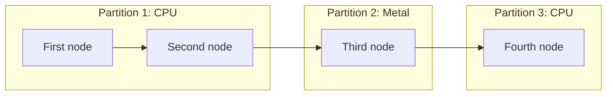

# [Partition](../glossary.md#partition) Scoring

This document explains [backend](../glossary.md#backend)-neutral partition scoring as defined by [`ARCHITECTURE.md`](../../ARCHITECTURE.md). The contract remains authoritative.

An **[owner](../glossary.md#term-owner)** here is the backend assigned to compute a [node](../glossary.md#node). **Hard eligibility** excludes a
backend that cannot meet the request; a **soft preference** only chooses among eligible owners.
“Scoring” names that [ownership](../glossary.md#term-ownership-meanings) comparison, not necessarily a numeric score or a performance
measurement. A capability answer applies to one exact **[occurrence](../glossary.md#term-occurrence)**: the [operation](../glossary.md#operation) together
with its attributes and ordered input/output descriptions.

The operation-capability question and provider collaboration used before scoring are implemented.
[Planning](../glossary.md#term-planning) keeps hard eligibility and baseline comparison package-private, then composes them
through the public one-method `BackendOwnerPlanning` collaboration. Hard eligibility validates
the complete provider/[snapshot](../glossary.md#term-snapshot) association, applies current availability and one exact hard
requirement, and retains supported backend [identities](../glossary.md#term-identity-meanings) in provider order. Baseline owner selection
treats that list as the complete candidate set and applies the current optional soft
[`DeviceClass`](../glossary.md#device-class--deviceclass) preference.

Planning also exposes `MaximalSameOwnerPartitioning.partition(...)` and
`LogicalMemoryPlanning.plan(...)` as public stateless operations in their owning packages. The
current package-private [Compiler](../glossary.md#term-compiler) [artifact](../glossary.md#term-artifact) entry constructs one query per final [graph](../glossary.md#graph) node,
assembles the complete owner map, invokes those operations, and returns [immutable](../glossary.md#term-immutable)
`CompileArtifacts`. Reusable or public capability [matrices](../glossary.md#term-review-matrix), public graph-wide planning or [compile](../glossary.md#compile)
orchestration, numeric or cost scoring, and a public compiler [facade](../glossary.md#term-facade) remain planned. This page
explains the accepted boundary and current cost-free baseline; it does not define [weights](../glossary.md#term-weight) or a
general cost formula.

## Purpose and pipeline position

[Partition](../glossary.md#partition) scoring answers this [compile](../glossary.md#compile)-time question:

```text
When a node or segment can run on more than one backend,
which backend should own it in the overall plan?
```

It runs after intent propagation and capability analysis and before maximal same-[owner](../glossary.md#term-owner) partitioning:

```text
backend intent
  -> current OperationCapabilityQuery
  -> current BackendCapabilityProvider boolean answer
  -> current BackendOwnerPlanning collaboration
     -> internal per-query hard eligibility
  -> current PartitionScoringConfig preference input
     -> internal preferred-class/provider-order baseline
  -> current BackendId owner for that occurrence
  -> current Compiler orchestration assembles a complete Map<NodeId, BackendId>
  -> current MaximalSameOwnerPartitioning.partition(...)
  -> current immutable PlannedPartition(owner, nodeIds) recipes
  -> current LogicalMemoryPlanning.plan(...)
  -> current immutable LogicalMemoryPlan
  -> current immutable CompileArtifacts
```

The current public capability contract asks whether one named [backend](../glossary.md#backend) can semantically own one
[immutable](../glossary.md#term-immutable) [operation](../glossary.md#operation) [occurrence](../glossary.md#term-occurrence). The query contains an `Operation` plus ordered input and output
`TensorDescriptor` snapshots; the explicitly supplied provider returns only a deterministic
[boolean](../glossary.md#data-type--datatype) answer for its stable [`BackendId`](../glossary.md#backend-identity--backendid). It does not discover a backend, inspect availability,
evaluate a hard requirement, select a [device](../glossary.md#term-device) or route, or explain a rejection.

The package-private eligibility step combines those answers with caller-supplied
[`BackendAvailabilitySnapshot`](../glossary.md#backend-availability-snapshot--backendavailabilitysnapshot) values and [`BackendIntent`](../glossary.md#backend-intent--backendintent). It first validates a complete
one-provider/one-[snapshot](../glossary.md#term-snapshot) association by equal `BackendId`. It then skips empty snapshots and
exact hard-requirement mismatches before querying each remaining provider once. The result is an
immutable provider-ordered `BackendId` list, which may be empty. Exact-device and device-class
requirements prove only matching availability in the associated snapshot: capability remains
backend-level, and the step neither selects nor retains a device.

The package-private selector uses the eligible [identity](../glossary.md#term-identity-meanings) list directly as its complete
candidate set. It validates every supplied snapshot for null and duplicate equal identities,
requires one equal-identity snapshot for every eligible backend, and permits extra unique
snapshots. An empty eligible list fails internally before any snapshot [element](../glossary.md#term-element) is read. With no
preference, the first eligible identity wins. With a preference, the first eligible identity whose
snapshot reports that class wins; if none matches, the first eligible identity still wins. An
empty matching snapshot is only a preference nonmatch, and provider order resolves ties and
fallback. The selector returns the exact identity reference from hard eligibility and never
selects or retains a device.

`BackendOwnerPlanning.selectOwner(...)` validates its five top-level inputs in declaration order,
then invokes each internal step once. The eligibility result does not escape. This is one
cost-free per-occurrence collaboration, not a public [graph](../glossary.md#graph)-wide [planning](../glossary.md#term-planning) workflow or a general
numeric scoring [model](../glossary.md#term-model). Later cost-bearing scoring may use additional compile-time facts. Once
[Compiler](../glossary.md#term-compiler) has assembled a complete owner map, the public stateless partitioner scans
`CompiledGraphModel.nodes()` in its stored validated [topological order](../glossary.md#term-topological-order) and starts a partition only
at the first [node](../glossary.md#node) or an owner transition. Equality is `BackendId` value equality; graph edges,
phase changes, [fan-out](../glossary.md#term-fan-out), merges, repeated inputs, graph boundaries, and multi-output values do not
redefine adjacency or split an equal-owner [run](../glossary.md#term-run).

The resulting public recipe retains only the first node's exact owner reference and the exact
graph [`NodeId`](../glossary.md#nodeid) references in order. Its outer and inner lists are immutable. A valid zero-node
pass-through graph yields no partitions because inputs and outputs are values, not synthetic
nodes. The operation is public because Compiler is its concrete cross-package consumer; Compiler,
not Planning, still owns the graph-wide loop and owner-map assembly.

This conceptual diagram makes “consecutive” explicit. Read the stored node order left to right;
the last [CPU](../glossary.md#term-cpu) node starts a new partition even though CPU already owned an earlier partition.
The groups are [ownership](../glossary.md#term-ownership-meanings) recipes, not a claim about [fusion](../glossary.md#term-fusion) or selected [kernels](../glossary.md#kernel).



The public stateless logical-memory operation accepts that closed [`CompiledGraphModel`](../glossary.md#compiled-graph--compiledgraphmodel) and the
ordered partition recipes. Because `PlannedPartition` is publicly constructible, it first checks
that the recipes contain no null, unknown, duplicate, missing, or out-of-order node and that
adjacent owners differ. It then emits one requirement for every [graph value](../glossary.md#graph-value) in graph-value order.
Each requirement retains the exact [`ValueId`](../glossary.md#logical-valueid-versus-physical-memory-slot) and `TensorDescriptor`, its optional producing
partition, each distinct consuming partition in partition order, and a graph-output flag.

These facts describe graph inputs, partition inputs and outputs, same-owner and cross-owner
boundaries, partition-internal values, and graph-output preservation without storing a closed role
enum. Retaining the [descriptor](../glossary.md#term-descriptor) keeps dynamic and expression [dimensions](../glossary.md#dimension) representable. The plan
does not calculate element or byte counts, accept `ForwardPublicationBinding` or
`GradientPublicationBinding`, choose a transfer or copy, allocate physical storage, resolve a
device or route, or create prepared/[runtime](../glossary.md#term-runtime) state. Public visibility of this package-owned
operation does not make it an end-to-end Planning workflow.

## Information scoring may use

Scoring may use [immutable](../glossary.md#term-immutable) or estimated [compile](../glossary.md#compile)-time facts, including:

- [graph](../glossary.md#graph) [metadata](../glossary.md#term-metadata) and [graph phase](../glossary.md#graph-phase);
- [operation](../glossary.md#operation) kind;
- [data type](../glossary.md#data-type--datatype), [shape](../glossary.md#shape), estimated [element](../glossary.md#term-element) count, and estimated byte size;
- [backend capability](../glossary.md#backend-capability) and availability information represented for [planning](../glossary.md#term-planning);
- configured [backend intent](../glossary.md#backend-intent--backendintent);
- candidate [ownership](../glossary.md#term-ownership-meanings) of [producers](../glossary.md#term-producer) and consumers;
- logical [materialization](../glossary.md#materialization) requirements and estimates;
- transfer and [partition](../glossary.md#partition)-boundary estimates; and
- immutable backend-neutral planning cost profiles supplied as configuration after their
  consumer and cost classification are stable.<span data-glossary-navigation="true"> ([backend glossary](../glossary.md#backend))</span>

These inputs describe the graph and likely ownership costs. They do not require live [runtime](../glossary.md#term-runtime) resources.

## Information scoring must not use

[Planning](../glossary.md#term-planning) scoring must not inspect or select [runtime](../glossary.md#term-runtime) and implementation details, including:

- current runtime [residency](../glossary.md#residency) or current [device](../glossary.md#term-device) [buffers](../glossary.md#term-buffer);
- physical buffer addresses or [mutable](../glossary.md#term-mutable) [`RunState`](../glossary.md#run-state--runstate);
- prepared units or prepared executables;
- concrete [kernel](../glossary.md#kernel) classes or calls;
- concrete [OpenBLAS](../glossary.md#term-openblas) routes;
- concrete [MPSGraph](../glossary.md#term-mpsgraph) executables or routes;
- concrete [CUDA](../glossary.md#term-cuda) [kernels](../glossary.md#kernel); or
- [backend](../glossary.md#backend)-specific executable DAGs;
- backend route names, vector species or lanes, unroll factors, thread counts, chunks, or tiles;
  or<span data-glossary-navigation="true"> ([backend route glossary](../glossary.md#backend-route); [vector species glossary](../glossary.md#term-vector-species); [lanes glossary](../glossary.md#term-lane))</span>
- backend-local workload-[cache](../glossary.md#term-cache) entries, route configurations, or other [model](../glossary.md#term-model)-[autotuning](../glossary.md#autotuning--model-autotuning) values.

Concrete kernel or runtime scoring belongs to backend [prepare](../glossary.md#prepare), not planning.

## Scoring factors

The scoring [model](../glossary.md#term-model) may account for these [backend](../glossary.md#backend)-neutral factors:

- **[Backend intent](../glossary.md#backend-intent--backendintent)** supplies an optional hard eligibility [target](../glossary.md#term-target).
- **[Device](../glossary.md#term-device)-class preference** is a current optional soft input that the internal baseline applies
  only after hard eligibility; an absent preference supplies no class match and the baseline uses
  provider order.
- **Capability** removes unsupported ownership candidates through the current query/provider and
  internal hard-eligibility contracts.
- **Transfer penalty** estimates the cost of moving values across [backend ownership](../glossary.md#backend-ownership) boundaries.
- **[Materialization](../glossary.md#materialization) penalty** estimates logical [layout](../glossary.md#layout) or [contiguity](../glossary.md#storage-mapping-contiguity-and-injectivity) work needed by an [ownership](../glossary.md#term-ownership-meanings) choice.
- **Boundary penalty** discourages plans fragmented into costly backend transitions.
- **[Accelerator](../glossary.md#term-accelerator) bonus** favors accelerator ownership when the region is large and suitable enough to benefit.
- **Small-region penalty** avoids offloading regions too small to justify accelerator and transfer overhead.
- **[Planning cost profile](../glossary.md#term-planning-cost-profile)** may supply compact backend-neutral estimates for the ownership
  comparison. It is separate from measurement evidence and from backend-local model-autotuning
  values.<span data-glossary-navigation="true"> ([autotuning glossary](../glossary.md#autotuning--model-autotuning))</span>

The factors can support [node](../glossary.md#node)-level or, after an explicit architecture evolution, more advanced segment-level and profile-guided policies. They do not change the meaning of the output.

No stable production [operation](../glossary.md#operation)-family or workload-bucket contract exists yet. [Planning](../glossary.md#term-planning) must not
invent one merely to accept profile data. A future cost-profile [schema](../glossary.md#term-schema) follows the stable cost
consumer and backend-neutral cost classification rather than preceding them.

## [Ownership](../glossary.md#term-ownership-meanings) is not implementation selection

[Planning](../glossary.md#term-planning) produces ownership such as:

```text
owner = CPU
owner = Metal
owner = CUDA
```

It does not produce implementation choices such as:

```text
CPU scalar vs Vector API vs OpenBLAS
MPSGraph vs custom Metal kernel
specific CUDA kernel
fused backend executable
```

Those choices depend on [backend](../glossary.md#backend)-specific [lowering](../glossary.md#lowering), [specialization](../glossary.md#term-specialization), [fusion](../glossary.md#term-fusion), [prepare](../glossary.md#prepare) configuration, and workspace constraints. They are made by the owning [concrete backend](../glossary.md#concrete-backend) during prepare.

The current [owner](../glossary.md#term-owner)-selection collaboration returns one [`BackendId`](../glossary.md#backend-identity--backendid) owner for one eligible
[occurrence](../glossary.md#term-occurrence). [Compiler](../glossary.md#term-compiler) builds the complete per-[node](../glossary.md#node) owner map, invokes the public package-owned
[partition](../glossary.md#partition) and logical-memory operations, and retains their results in public [immutable](../glossary.md#term-immutable)
`CompileArtifacts`. The callable compiler entry remains package-private; there is no public
[graph](../glossary.md#graph)-wide Planning workflow or public [lifecycle](../glossary.md#lifecycle) [facade](../glossary.md#term-facade). Neither an owner [identity](../glossary.md#term-identity-meanings), a partition
recipe, a logical requirement, nor [compile artifacts](../glossary.md#compile-artifacts) are an executable implementation or physical
schedule.

See [Lifecycle](lifecycle.md) for the full [compile](../glossary.md#compile) pipeline and [Runtime, Prepare, and Backend Boundary](runtime-prepare-backend-boundary.md) for where implementation selection occurs.
See [Performance Evidence and Model Autotuning](performance-evidence-and-tuning.md)<span data-glossary-navigation="true"> ([Model Autotuning glossary](../glossary.md#autotuning--model-autotuning))</span> for the
separate [benchmarking](../glossary.md#term-benchmarking), [model](../glossary.md#term-model)-[autotuning](../glossary.md#autotuning--model-autotuning), [runtime](../glossary.md#term-runtime)-profiling, and planning-cost boundaries.

## [Occurrence](../glossary.md#term-occurrence)-qualified eligibility

[`OperationCapabilityQuery`](../glossary.md#operation-capability-query--operationcapabilityquery) carries the complete occurrence without a numerical selector. Scoring
may compare only providers that answered that exact occurrence. A soft [accelerator](../glossary.md#term-accelerator) [device](../glossary.md#term-device)-class
preference does not change [Model](../glossary.md#term-model) numerical semantics or turn an unsupported occurrence into a
capable one.
