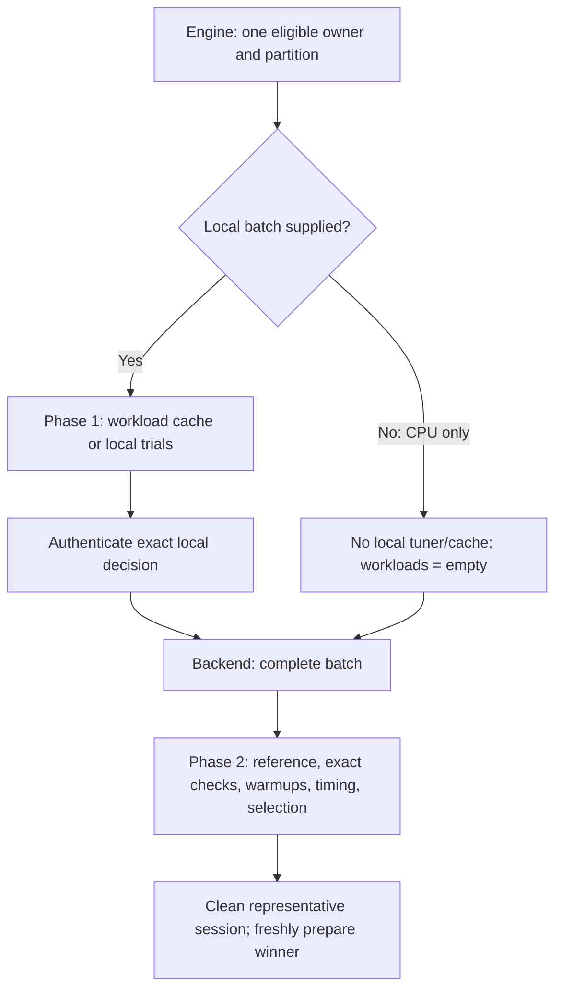

# Performance evidence and [model autotuning](../glossary.md#autotuning--model-autotuning)

[`ARCHITECTURE.md`](../../ARCHITECTURE.md) is authoritative. This document explains how fixed
benchmark evidence, model autotuning, [backend](../glossary.md#backend)-local candidate generation, [planning](../glossary.md#term-planning) cost, [runtime
profiling](../glossary.md#runtime-profiling), and persistent tuning [artifacts](../glossary.md#term-artifact) remain separate.

## Purpose and [mental model](../glossary.md#term-mental-model)

A **benchmark** records how supplied work performed; **[autotuning](../glossary.md#autotuning--model-autotuning)** uses allowed measurements to
choose a configuration. A **candidate** is one complete allowed alternative, not an arbitrary
setting to try during a [run](../glossary.md#term-run). A tuning **[objective](../glossary.md#term-objective)** is a selection goal such as elapsed time,
not the training [loss](../glossary.md#loss). A **workload [signature](../glossary.md#term-signature)** identifies the computation and compatibility
facts needed to reuse a local decision; it is not a saved output or a promise that two complete
models will have identical costs.

The user supplies one explicit set of inputs to one optional [model](../glossary.md#term-model)-autotuning workflow:

```text
model + target + representative input/shape profiles
      + objective + budget + constraints + explicit caches
  -> model autotuning
     1. reuse or measure canonical local workloads, when a local batch exists
     2. measure bounded complete plan candidates end to end
  -> updated workload cache + model plan result or prepared artifact
  -> runtime executes the selected result
```

[Benchmarking](../glossary.md#term-benchmarking) remains a separate report-only activity. [Planning](../glossary.md#term-planning) cost remains a separate
[backend](../glossary.md#backend)-neutral estimate used to prune or [rank](../glossary.md#term-ranking) [ownership](../glossary.md#term-ownership-meanings) choices. [Runtime profiling](../glossary.md#runtime-profiling) remains
passive observation.

The current public [Engine](../glossary.md#term-engine) composition supports one representative input set and one eligible
single-[owner](../glossary.md#term-owner) [partition](../glossary.md#partition). [CPU](../glossary.md#term-cpu) either supplies a local batch or goes directly to complete-plan
tuning. [Metal](../glossary.md#term-metal) admits only nonempty canonical FLOAT32 [singleton](../glossary.md#term-singleton) NEG, with ordered local
candidates custom [kernel](../glossary.md#kernel) then [MPSGraph](../glossary.md#term-mpsgraph), and one [complete-plan candidate](../glossary.md#complete-plan-candidate) fixed to the local winner.
Engine joins Config, the generic tools transactions, [Prepare](../glossary.md#prepare)'s [opaque](../glossary.md#term-opaque) [handoff](../glossary.md#term-handoff), the selected
backend's typed [producer](../glossary.md#term-producer), and exact correctness behind `Engine.prepareTuned(...)`.

When present, Phase 1 runs once; Engine authenticates its decision and passes that exact value
unchanged to the same backend's complete-plan producer. Without a CPU local batch, Engine
constructs no workload-tuning request, invokes no local tuner or workload cache, and reports
`evidence.workloads=[]`. That empty evidence is truthful, not a fabricated cache hit.
Both branches then run Phase 2, checking every candidate by exact ordered [canonical](../glossary.md#term-canonical-form)
[publication](../glossary.md#term-publication) bytes before any [warmup](../glossary.md#term-warmup) or timed execution. Every action uses fresh preparation and
[Runtime](../glossary.md#term-runtime) state. After winner [authentication](../glossary.md#term-authentication), Engine cleans the representative session and makes
exactly one fresh selected production preparation. Mixed-owner/multiple-partition tuning,
broader Metal tuning and cross-topology local-decision mapping remain analysis-only. This
composition adds no Compiler or Planning alternatives and no persistent complete-plan reuse.
Metal compatibility is session-only; it accesses neither workload-cache nor model-plan files.



## [Benchmarking](../glossary.md#term-benchmarking) is fixed and observational

`tools/benchmarks` runs fixed reproducible [operation](../glossary.md#operation), operation-family, [model](../glossary.md#term-model), and end-to-end
workloads. A [benchmark report](../glossary.md#term-benchmark-report) records the workload, environment, supplied settings, [samples](../glossary.md#term-sample-machine-learning-and-hyperparameters), and
statistics needed to compare [commits](../glossary.md#commit-release-distribution-log-and-seed-meanings), models, or environments.

Benchmarking never selects or mutates a production setting, tuning [cache](../glossary.md#term-cache), or prepared plan. It
may record which route and configuration were supplied, but it does not install the fastest
result. Correctness and [conformance](../glossary.md#term-conformance) tests remain separate gates.

The current standard [CPU](../glossary.md#term-cpu) composition retains [scalar](../glossary.md#term-scalar), single-thread portable execution. CPU 0010M
rejected a global [vector](../glossary.md#term-vector)-if-eligible escalation because machine-local measurements covered only a
subset of the forms the policy would enable and did not establish representative [target](../glossary.md#term-target)/[JIT](../glossary.md#term-just-in-time-compilation-jit)
behavior. Its hardened [schema](../glossary.md#term-schema)-3 reports explicitly become ineligible for production decisions
when the public [lifecycle](../glossary.md#lifecycle) cannot record actual selected-plan facts. This conservative no-change
adds no [runtime](../glossary.md#term-runtime) search, persistent profile, automatic mutation, or user-facing tuning knob.

The fixed [Metal](../glossary.md#term-metal) [singleton](../glossary.md#term-singleton)-`NEG` benchmark is the bounded exception that can record actual route
facts: it separately attests the current two [opaque](../glossary.md#term-opaque) local candidates through typed [Trace](../glossary.md#trace) outcomes,
then closes that integration and times freshly enumerated matching candidate [identities](../glossary.md#term-identity-meanings) through the
ordinary no-trace integration. Enumerating and measuring both fixed candidates is observation, not
selection. The harness never calls the model-[autotuning](../glossary.md#autotuning--model-autotuning) workflow, creates a winner or cache entry,
or changes later preparation; every report remains ineligible for a production decision. Its one
[Shape](../glossary.md#shape), one process, and correlated within-process samples are not a substitute for a separately
reviewed multi-target/[fork](../glossary.md#term-fork-meanings) statistical protocol.

For Metal [qualification](../glossary.md#term-qualification) outside production Runtime, candidate comparison begins only after
identical complete-domain semantics and numerical acceptance. One survivor needs no comparative
cost gate. Multiple survivors may close without timing only by strict [structural dominance](../glossary.md#term-structural-dominance-index-mappings-and-cost-dominance): one
candidate has no more compute dispatches and no more route-owned temporary bytes than every
alternative and is strictly better in at least one [dimension](../glossary.md#dimension). An explicit custom route may declare
those exact facts when retained source owns every encoder [dispatch](../glossary.md#term-dispatch) and resource in the [synchronous](../glossary.md#term-synchronous)
hot invocation. [MPSGraph](../glossary.md#term-mpsgraph) and every other opaque route require supported observation of actual
framework-internal dispatches and peak transient resources; [graph](../glossary.md#graph) [nodes](../glossary.md#node), command [buffers](../glossary.md#term-buffer), inferred
[fusion](../glossary.md#term-fusion), estimates, and process memory are never substitutes.

Here **structural dominance** compares known dispatch counts and temporary-storage bytes:
one candidate is no worse on either count and better on at least one. **[Nondominated](../glossary.md#compiler-transformations-and-dominance)** means
neither candidate has established that advantage. These counts are not timings, and an opaque
framework is one whose internal work is not directly visible through this boundary.

### Comparing counts without inventing a time estimate

For qualified candidates $a$ and $b$, let $D_a,D_b\ge0$ count compute dispatches and
$M_a,M_b\ge0$ be peak route-owned temporary bytes, measured or established over the same
invocation boundary. Candidate $a$ dominates $b$ exactly when

$$
D_a\le D_b,\qquad M_a\le M_b,\qquad
(D_a<D_b\ \text{or}\ M_a<M_b).
$$

For example, $(D_a,M_a)=(1,0)$ dominates $(D_b,M_b)=(2,4096)$.
But $(1,4096)$ versus $(2,0)$ is a tradeoff: neither dominates, and the rule supplies no
winner. These are integer counts and bytes, not rounded numerical results or nanoseconds.
Without observation of an opaque route's actual internal work, its missing counts cannot be
substituted with graph-node counts. The example does not supply such missing evidence.

The caller of the optional workflow is Engine; it supplies candidates/actions from the selected
backend to `tools/tuning`, which compares evidence without interpreting backend-private plans.
Trials own fresh execution resources and detach correctness values before closing each result.
The [complete-plan correctness boundary](#correctness-fallback-and-runtime-boundary)
explains why a retained correctness reference is bytes, not a borrowed device buffer.


When multiple nondominated survivors remain, selection waits for an explicitly authorized,
controlled comparative environment and protocol. Timing collected on an uncontrolled local
developer [device](../glossary.md#term-device) may be retained as diagnostic history only. It never qualifies a candidate,
selects a route, changes tuning [identity](../glossary.md#term-identity-meanings), populates a production decision, or breaks a structural
tie. Route selection remains cold and fixed; Runtime performs no timing, fallback, retry, or
[matrix](../glossary.md#term-matrix-meanings).

## One [model](../glossary.md#term-model)-[autotuning](../glossary.md#autotuning--model-autotuning) workflow

`tools/tuning` coordinates one explicit workflow with two related phases. The phases share the
same model, [target](../glossary.md#term-target), [objective](../glossary.md#term-objective), budget, constraints, and explicit [cache](../glossary.md#term-cache) inputs, but they answer
different questions.

### Phase 1: [model](../glossary.md#term-model)-guided workload and route tuning

The workflow extracts actual tunable workloads and routes from the model. For each one it forms a
[canonical workload signature](../glossary.md#canonical-workload-signature) from semantics and attributes, input and output data types, [shapes](../glossary.md#shape),
[layouts](../glossary.md#layout), relevant policies, and [target](../glossary.md#term-target) compatibility. Identical [signatures](../glossary.md#term-signature) are deduplicated for
measurement while retaining their [occurrence](../glossary.md#term-occurrence) [weight](../glossary.md#term-weight) and surrounding context for later plan
[evaluation](../glossary.md#term-evaluation).

The workflow loads the explicit persistent workload [cache](../glossary.md#term-cache) and reuses only compatible hits. It
measures [backend](../glossary.md#backend)-generated configurations only for cache misses, then records the selected local
result. The [operation](../glossary.md#operation) family chooses which [candidate generator](../glossary.md#candidate-generator) to ask; it is not itself a [cache
key](../glossary.md#term-cache-key) and never receives one universal configuration. Identical signatures can reuse a result
across occurrences and models.

Running this same workflow over a representative model corpus may pre-[seed](../glossary.md#term-seed) the same workload
cache for a target. That is a use of [model autotuning](../glossary.md#autotuning--model-autotuning), not a separate platform-calibration
subsystem, baseline workflow, or profile.

Current CPU local admission is narrower than this general extraction responsibility: one bare
[MATMUL](../glossary.md#matrix-multiplication--matmul), with at most two absorbed PERMUTE prerequisites, must already have an intrinsically
singleton complete topology/representation. Phase 1 does **not** sweep fusion topologies.
It enumerates the existing legal scalar direct/fixed-2×2 forms for the 40 promoted numeric
tuples, and homogeneous FLOAT32/FLOAT64/INT32/INT64 vector direct/fixed-2×2 forms only where
physical-layout, epilogue and species proofs hold. All legal configured range counts are included.
This is no arbitrary species/tile/unroll search; an unresolved optional Vector module prunes
vector forms rather than failing otherwise legal scalar tuning. Ordinary production defaults
remain scalar and single-threaded.

Qualified OpenBLAS alternatives enumerate every legal copy mask/configured-thread combination
that fits resources, only for its existing positive rank-two homogeneous FLOAT32/FLOAT64 bare
route with $K>1$, where $K$ is the integer contraction length. Qualified oneDNN alternatives
enumerate every permitted API: `AUTO` permits up to two APIs per unit, a forced policy up to one.
The [primitive/Graph APIs](../glossary.md#onednn-primitive-and-graph-apis) remain CPU-owned native routes, not backend owners.
Existing Model qualification and staged dtype rules still decide eligibility; portable support
for 40 tuples does not promise native support for all 40.

### Phase 2: bounded [graph](../glossary.md#graph) and plan tuning

The general owner boundary permits bounded complete valid candidates to vary only decisions
their producers own: graph transformations and [fusion](../glossary.md#term-fusion), [backend ownership](../glossary.md#backend-ownership) and partitioning,
[layouts](../glossary.md#layout)/materializations, or routes and already selected local configurations. Those are not all
current public features. Current CPU Phase 2 retains the existing backend topology/representation
domain (including legal direct, single-copy and disjoint-two-copy forms), not new Compiler or
Planning alternatives. A present local decision freezes its exact intrinsic topology and
realization without rerunning local enumeration. Without a local decision, each retained variant
enumerates existing typed per-unit portable MATMUL form/range choices and qualified oneDNN APIs;
other ordinary units retain their existing configurations. Qualified whole-unit OpenBLAS
alternatives are additional choices, not arbitrary mixed per-unit OpenBLAS placement.

Authenticated Phase-2 transport changes only four copy/direct/contiguous scoring cost terms.
Current execution configuration, capacity and minimum worker work stay authoritative.
Materialization `enabled`, `expectedRunCount`, `maximumAdditionalBytes`,
`minimumNetBenefitCostUnits`, and `minimumBenefitBasisPoints` must match; scoring transport cannot
enable a disabled copy or evade its byte limit. Caller inputs remain storage-unknown, so native
alternatives need already-declared legal ingress/copy workspaces. Segment-form generated
OpenBLAS copies may use exact matching primitive heap segments after intrinsic dtype/carrier
classification; uncopied provider buffers remain native-only. No guard is suppressed and no
caller storage is relabeled. Empty read domains have no meaningful materialization; zero direct
scoring cost keeps the established basis-zero convention, not division by zero. $K=0$ remains
portable, not newly native-qualified.

A singleton complete batch is legal and still captures a reference, warms/times, selects, and
freshly prepares production. Candidate zero has `REFERENCE_CAPTURED`; only later candidates have
separate comparison actions. A singleton reference is not an independent Model oracle.
The result is one explicit plan, not executable persistence.
A generic future plan decision may remain [occurrence](../glossary.md#term-occurrence)- or subgraph-specific because surrounding
fusion, layout, [materialization](../glossary.md#materialization), and partition context can differ for identical local signatures.

#### Finite, all-or-nothing candidate domains

For one legal portable MATMUL form, let $I\ge0$ be its integer work-iteration count, $O\ge0$ its
output-coordinate count, $E>0$ the configured minimum output-coordinate work per worker, and
$P,A\ge1$ the configured and available worker counts. Counts are dimensionless. For $I>0$:

$$
C=\max(1,\lfloor O/I\rfloor),\qquad
q=\max(1,\lceil E/C\rceil),\qquad
R=\min(P,A,\lceil I/q\rceil).
$$

$C$ counts output coordinates per work iteration; $q$ is the minimum iterations per worker.
Enumerate range counts $1,\ldots,R$; for $I=0$, use $R=1$. For example, a direct-scalar
form with $I=O=64$, $E=16$, $P=8$ and $A=4$ permits four range counts, not eight.
Let $p_i=\sum_{f\in F_i}R_{if}$ count legal portable forms/ranges for unit $i$; a unit without
these alternatives has $p_i=1$. With $B$ qualified whole-unit OpenBLAS mask/thread choices and
$a$ qualified oneDNN alternatives for the singleton local unit:

$$
N_{\mathrm{local}}=p+B+a,\qquad
N_{\mathrm{complete}}=\sum_{v\in V}
\left[\prod_{i\in U_v}(p_{vi}+a_{vi})+B_v\right].
$$

Here $V$ is the retained complete topology/representation set, $U_v$ its ordered units, and
$a_{vi}\in\{0,1,2\}$ the permitted qualified oneDNN API count. The complete formula describes the
**no-local** branch; a present local selection is frozen. Native-replaced units do not multiply
unused portable forms. Both aggregate domains are capped at 8192 before combination expansion,
all-or-nothing: a prefix never masquerades as a complete domain. At most eight units with two
qualified APIs each yield at most $3^8-1=6560$ nonempty native assignments. Existing limits of
eight compiled nodes, 64 topologies, 256 pair attempts and 1 MiB canonical identity streams remain.
Symbolic/Scan, over-eight and resource-bound exclusions are protocol exclusions, not merely
architecture proposals.

## Candidate [ownership](../glossary.md#term-ownership-meanings) and [opaque](../glossary.md#term-opaque) orchestration

Each architecture [owner](../glossary.md#term-owner) generates complete candidates only for its own decisions:

| Owner | Candidate responsibility |
|---|---|
| [Compiler](../glossary.md#term-compiler) | Complete valid [backend](../glossary.md#backend)-neutral [graph](../glossary.md#graph)-transformation alternatives |
| [Planning](../glossary.md#term-planning) | Complete valid [backend ownership](../glossary.md#backend-ownership) and [partition](../glossary.md#partition) alternatives, guided or pruned by backend-neutral cost estimates |
| Shared [prepare](../glossary.md#prepare) | Opaque typed candidate-[batch](../glossary.md#term-batch-machine-learning-and-hyperparameters) and selected-decision transport without interpreting private fields |
| [Concrete backend](../glossary.md#concrete-backend) prepare | Complete valid backend-specific [fusion](../glossary.md#term-fusion), [lowering](../glossary.md#lowering), route, [layout](../glossary.md#layout)/[materialization](../glossary.md#materialization), and route-configuration alternatives |
| `tools/tuning` | Bounded measurement, [cache](../glossary.md#term-cache) coordination, comparison against the [objective](../glossary.md#term-objective) and constraints, and explicit result selection |

The table preserves decision ownership, including responsibilities for future alternatives;
it does not claim all owners currently expose public candidate search. Current public tuning
uses the bounded CPU subset above or Metal's two-local/one-fixed-complete singleton NEG subset.
Tuning takes over neither graph semantics, compiler transformations, planning policy, backend
lowering, route logic, nor private configuration vocabulary.

Backend candidate generators are typed, version-controlled, tested, and colocated with the
concrete routes they configure. They derive and prune complete valid configurations from [target](../glossary.md#term-target)
capabilities, workload facts, and the tuning budget. Current [CPU](../glossary.md#term-cpu) [matrix multiplication](../glossary.md#matrix-multiplication--matmul) enumerates
only the fixed forms, supported species, legal ranges and qualified native choices described
above. [Scalar](../glossary.md#term-scalar), [vector](../glossary.md#term-vector), OpenBLAS and oneDNN configurations are distinct typed route values,
not booleans in a [parameter](../glossary.md#term-parameter) bag.

Candidate discovery does not use `Map<String,Object>`, string [dispatch](../glossary.md#term-dispatch), reflective annotations, a
central knob [registry](../glossary.md#term-registry), a generic configuration language, or arbitrary vector-[lane](../glossary.md#term-lane) promises. The
backend author defines candidates. An ordinary [model](../glossary.md#term-model) author supplies only the model,
representative [shapes](../glossary.md#shape) or inputs, objective, budget, constraints, and explicit caches.

## Persistent caches and compatibility

The architecture uses two explicit file-backed [artifact](../glossary.md#term-artifact) roles:

- a reusable workload tuning cache keyed by canonical workload signature and target
  compatibility; and<span data-glossary-navigation="true"> ([canonical workload signature glossary](../glossary.md#canonical-workload-signature))</span>
- a model-specific plan cache or prepared-plan record keyed by the model, target, representative
  profiles, objective, and constraints.

Loading occurs before measurement. Compatible hits are reused; misses may be tuned and then
atomically persisted. Each artifact carries an explicit artifact-[schema](../glossary.md#term-schema) version, [backend](../glossary.md#backend)
candidate-schema versions, [target](../glossary.md#term-target) and workload or [model](../glossary.md#term-model) fingerprints, [objective](../glossary.md#term-objective) and constraints,
and a compact measurement summary. Incompatible entries are invalidated, and corrupt data is
rejected safely.

Model-plan [publication](../glossary.md#term-publication) checks the complete encoded size, including length prefixes and [checksum](../glossary.md#term-checksum),
against the existing 16 MiB file limit before allocating the output [buffer](../glossary.md#term-buffer) or creating a temporary
file. Individually valid entries can still exceed this aggregate limit; that rejection leaves any
existing destination unchanged. The size check does not change schema-1 bytes or the [atomic](../glossary.md#resource-transaction-and-rollback)
replacement policy.

The workload [cache](../glossary.md#term-cache) is implemented for Phase 1. The generic Phase-2 model-plan cache format is also
implemented, but current [CPU](../glossary.md#term-cpu) compatibility is `SESSION`, so the public CPU composition performs
no model-plan-cache filesystem I/O. The same [Engine](../glossary.md#term-engine) translation can serve a future [producer](../glossary.md#term-producer) that
honestly declares `PERSISTENT`. Neither artifact is hidden process-global state, Java object
[serialization](../glossary.md#term-serialization), or an executable [payload](../glossary.md#artifact-envelope-and-atomic-publication). Rich per-call evidence keeps correctness actions and raw
[samples](../glossary.md#term-sample-machine-learning-and-hyperparameters) separately from compact reusable records, which retain only compatibility, selected
decision and winner [identities](../glossary.md#term-identity-meanings), and the winner summary. Serialization of a [prepared executable](../glossary.md#prepared-executable--preparedexecutable)
remains dependent on backend and [lifecycle](../glossary.md#lifecycle) contracts and is deferred.

CPU local schema 4, route-policy 3 and complete-plan schema 5 invalidate incompatible tuning
decisions. Internal `route.CpuLocalTuningBatch`/`CpuLocalTuningDecision` and
`CpuCompletePlanIdentity` describe CPU realizations, not an OpenBLAS-only owner protocol.
These tuning identities are distinct from unchanged generic cache formats, generated-kernel
schema/envelopes, numeric packed ABI and native ABI; no new executable format is implied.

## [Planning](../glossary.md#term-planning) cost stays [backend](../glossary.md#backend)-neutral

The [planning cost model](../glossary.md#term-planning-cost-model) estimates [backend ownership](../glossary.md#backend-ownership) from [graph](../glossary.md#graph), transfer, [materialization](../glossary.md#materialization), and
boundary facts. It may prune or [rank](../glossary.md#term-ranking) complete [ownership](../glossary.md#term-ownership-meanings) candidates, but it never interprets a
route, Java [Vector API](../glossary.md#term-vector-api) species, thread count, tile, chunk, [kernel](../glossary.md#kernel), or workload-[cache](../glossary.md#term-cache) value.

[Model autotuning](../glossary.md#autotuning--model-autotuning) may measure bounded complete plans that planning generated. That does not move
backend vocabulary into planning or turn the planning cost model into a tuning [parameter](../glossary.md#term-parameter) set.

## Correctness fallback and [runtime](../glossary.md#term-runtime) boundary

[Model autotuning](../glossary.md#autotuning--model-autotuning) is optional for correctness. When tuning is disabled, a workload-[cache](../glossary.md#term-cache) entry is
absent, or an [artifact](../glossary.md#term-artifact) is incompatible or corrupt, [backend](../glossary.md#backend) preparation uses safe heuristics and
valid complete candidates. Cache-only preparation may reuse compatible entries without running a
search.

When a local batch exists, the current [Engine](../glossary.md#term-engine) [operation](../glossary.md#operation) is cache-first in Phase 1: a compatible
workload hit executes no local trial, and Phase 2 receives the authenticated local decision unchanged.
The CPU complete-only branch instead has no local cache access or workload evidence rows.
Current CPU `SESSION` compatibility measures every complete candidate; a future authenticated
persistent hit would skip Phase-2 trials and expose no fabricated candidate rows. On a measured
[transaction](../glossary.md#term-transaction), all correctness actions complete before any configured [warmup](../glossary.md#term-warmup) or timed [sample](../glossary.md#term-sample-machine-learning-and-hyperparameters).
Selection uses the lowest integer-middle [median](../glossary.md#term-median) and encounter-order ties.

Engine's package-private complete-plan correctness primitive preflights every
ordered compiled [publication](../glossary.md#term-publication) [descriptor](../glossary.md#term-descriptor) and one aggregate [canonical](../glossary.md#term-canonical-form)-byte limit before its first
correctness execution. The first fresh execution copies every [publication occurrence](../glossary.md#publication-occurrence) while the
Runtime result [lease](../glossary.md#term-lease) is open, closes the result, and only then publishes an [opaque](../glossary.md#term-opaque) same-session
reference. A later fresh execution follows the same copy-and-close order before exact represented-
byte comparison. Publication order, repeated [aliases](../glossary.md#aliasing-and-arena), empty values, [signed zero](../glossary.md#term-signed-zero), and [NaN payload](../glossary.md#nan-infinity-and-signed-zero)
bits are significant. A mismatch carries no bytes and does not itself poison the representative
session; execution, copy, count, length, or cleanup failure follows the existing session poisoning
and once-only cleanup protocol.
This is deliberately stricter than the floating variation Model permits: it is not a tolerance
test or a change to Model arithmetic, and there is no value filter or numerical repair.

Engine adapts that primitive to the generic Phase-2 transaction without moving candidate meaning
out of the selected backend. Correctness, warmup, and timed actions each freshly [prepare](../glossary.md#prepare) the
requested candidate; after result [authentication](../glossary.md#term-authentication) and representative cleanup, exactly one
additional fresh preparation creates the returned winner. The correctness primitive itself still
does not enumerate or interpret candidates, time work, select a winner, access a cache, or apply
fallback.

`TUNED` carries authenticated [immutable](../glossary.md#term-immutable) evidence for the phases actually run; CPU complete-only
success has `workloads=[]`. Measured complete-plan rows record the exact correctness action,
encounter-ordered raw samples, summary and candidate [identity](../glossary.md#term-identity-meanings); compact cache records do not.
`SAFE_HEURISTIC_FALLBACK` records one fresh allowed
safe-[heuristic](../glossary.md#term-heuristic) preparation through the selected adapter and carries no evidence. Caller-defined
[model](../glossary.md#term-model) and profile identities label evidence; they neither key the workload cache nor authorize
compatibility. A present local [occurrence](../glossary.md#term-occurrence) is index 0 in [partition](../glossary.md#partition) 0 with [weight](../glossary.md#term-weight) 1; complete-only
execution has no local occurrence. Current CPU and [Metal](../glossary.md#term-metal) complete-plan compatibility is session-only;
Metal local compatibility is also session-only. This remains bounded single-partition tuning, not model extraction,
multi-occurrence weighting, broader [graph](../glossary.md#graph)/partition search, mixed-backend tuning, or executable
[persistence](../glossary.md#term-persistence).

Runtime executes the selected [prepared schedule](../glossary.md#prepared-schedule--preparedschedule). It performs no search, tuning-cache [lookup](../glossary.md#term-lookup) or
mutation, or hot-path graph inspection. [Runtime profiling](../glossary.md#runtime-profiling) may passively describe actual execution
through typed [trace](../glossary.md#trace) data-transfer objects, but the observation does not change the current or a
later [run](../glossary.md#term-run)'s settings.

## Related decisions and documentation

- [ADR 0008: Separate performance evidence, model autotuning, planning cost, and runtime observation](../design/decisions/0008-performance-evidence-and-tuning-boundaries.md)<span data-glossary-navigation="true"> ([ADR glossary](../glossary.md#term-architecture-decision-record-adr); [model autotuning glossary](../glossary.md#autotuning--model-autotuning); [planning glossary](../glossary.md#term-planning); [runtime glossary](../glossary.md#term-runtime))</span>
- [Partition scoring](partition-scoring.md)<span data-glossary-navigation="true"> ([Partition glossary](../glossary.md#partition))</span>
- [Runtime, prepare, and backend boundary](runtime-prepare-backend-boundary.md)<span data-glossary-navigation="true"> ([prepare glossary](../glossary.md#prepare); [backend glossary](../glossary.md#backend))</span>
- [Backend execution contract: current CPU routes](contracts/backend-execution.md#cpu-backend-routes)
- [Benchmarking guide](../developer-guide/benchmarking.md)<span data-glossary-navigation="true"> ([Benchmarking glossary](../glossary.md#term-benchmarking))</span>
