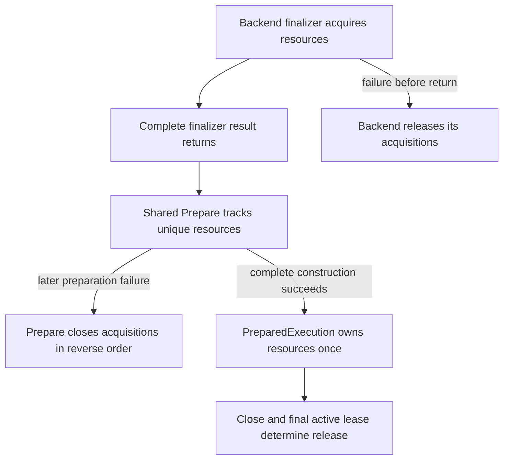

# Runtime, Prepare, and Backend Boundary

This document explains the boundary defined by [`ARCHITECTURE.md`](../../ARCHITECTURE.md). The root contract remains authoritative.

Start with [the execution atlas's distinctions](../explanation/packages/execution.md#the-distinctions-to-keep-while-reading)
if slots, representations or leases are unfamiliar. A **slot** is a planned position, a
**representation** is the physical storage bound there for a run, and a **workspace** is temporary
backend scratch rather than a transferable graph value. A **projection** passes only the facts
needed by the receiving boundary. **Opaque** means shared code can retain and transport a
backend's plan without interpreting its private fields.

Runtime currently implements the immutable `BufferSlot` and `WorkspaceSlot` identities,
`PreparedMemoryPlan` final slot geometry, nominal buffer/workspace representation roles,
borrowed/run-owned buffer bindings, immutable prepared representation origins and backend-owned
creator callbacks, package-private cold creation with rollback, structural per-run residency and
explicit buffer-copy validity, the array-backed one-run `RunState` lifecycle, immutable
`PreparedExecutable` and `PreparedBufferTransfer` recipes, per-run `BoundInvocation` and
`BoundBufferTransfer` objects, and the immutable creation-plus-execution-plus-transfer
`PreparedSchedule` contract described below, the dense final publication suffix, direct per-run
publication binding, the whole-`RunState` `RunResult` lease, the immutable-recipe lifecycle owner
`PreparedExecution`, explicit executable buffer-access declarations, and the stateless
prepared-execution runner. Prepare
currently implements the analysis-side projection, opaque analysis and tuning marker roles, the
exact-partition opaque tuning handoff, exact resource
declarations, analysis result, preparer collaboration, deterministic complete-set slot assignment,
typed backend finalization input/collaboration, the minimal prepared-partition association, exact
compile projection, one immutable partition-local directed acyclic graph (DAG) per backend
analysis context, explicit schedule assembly, complete schedule validation, and construction of
the reusable prepared-execution root.
The CPU backend supplies broad physical allocation, preparation, and access for
`Engine.standard()` and explicit composition. Metal supplies bounded MPSGraph and custom-kernel
occurrence-qualified routes plus explicit native configuration, host ingress, materialization, and
close. `Engine.builder()` currently registers opened CPU and/or Metal integrations and composes
their non-empty partition sets through one shared preparation. It preflights every owner and
required directed transfer before backend analysis, then captures direct per-input, executable,
transfer, and publication references. Current CPU/Metal transfer covers all seven model data types
over exact rank-0..16 static canonical or positive-stride non-overlapping storage layouts with a
checked physical span; CUDA and conversion-based transfer composition remain later work. The
lifecycle flow therefore combines current foundations with selected later stages, and each focused
section states its implementation status.
[ADR 0011](../design/decisions/0011-per-run-runtime-resource-ownership.md) defines the
resource-ownership and cold-binding architecture.
[ADR 0013](../design/decisions/0013-prepared-execution-persistent-resource-lifecycle.md) defines
the persistent prepared-resource ownership and close lifecycle.
[ADR 0015](../design/decisions/0015-explicit-engine-backend-composition.md) selects explicit
Engine registration and construction ownership.
[ADR 0016](../design/decisions/0016-cpu-metal-mixed-owner-schedule.md) selects owner-indexed
representations, physical contribution composition, and explicit bidirectional transfer.

## Boundary in one flow

```text
CompileArtifacts
  -> Engine validates every partition owner and required directed transfer
  -> shared Prepare validation and per-partition analysis
  -> concrete backend lowering, route choice, and exact resource declaration
  -> deterministic logical buffer/workspace assignment
     + one buffer representation position per participating owner
  -> concrete backend finalization against exact slots and representation positions
  -> backend physical-creation contributions
  -> Engine composition of partition execution, explicit transfer, and publication occurrences
  -> validated PreparedSchedule + PreparedMemoryPlan
  -> PreparedExecution
  -> Runtime execution with one heterogeneous RunState
```

Read the arrows from compile-time facts toward reusable runtime state. Prepare turns an immutable
compile recipe into runtime-ready state, but executable construction is deliberately split around
shared slot assignment. Runtime executes the result without rediscovering, lowering, or selecting
backend work.

## Accepted symbolic-batch handoff

The [resource contract](contracts/runtime-prepare-engine.md#accepted-symbolic-batch-resource-contract),
[Compiler binding](contracts/compiler-autograd.md#accepted-symbolic-batch-metadata-binding) and
[CPU recipes](contracts/backend-execution.md#accepted-ordinary-symbolic-batch-cpu-contract) now
are implemented for the bounded ordinary homogeneous FLOAT32, rank-at-most-two one-B CPU closure.
Prepare0014 additionally implements the [bounded symbolic Scan execution](#symbolic-scan-execution-and-future-geometry-reuse)
slice through these same owners; its task tracks final qualification.
Prepare0015 implements combined one-B/fixed-T/features F32/F64 length-Scan through this same
handoff. Owning validation and independent code/structural review passed; root validation and the sole bounded
probe completed (evidence and limits:
[Prepare0015 Result](../planning/modules/prepare/tasks/0015-symbolic-length-scan-cpu-vertical.md#result) );
final MAIN acceptance remains pending. No new API/type, Runtime numeric protocol, storage owner or lease
follows.
The current-foundation sections below also describe the preserved fixed paths.
[ADR 0050](../design/decisions/0050-dynamic-batch-geometry.md) records why exact per-run sizing
replaces mandatory maximum banks or per-batch full preparation without introducing another owner.

```text
compile/prepare once: Compiler metadata plan -> Prepare fixed identities -> CPU numeric recipes
each invocation:     Engine binds static descriptors -> checked numeric sizes -> borrow
                       -> Runtime lease/create/cold bind -> execute -> actual publications
```

Read the upper line as immutable semantic/physical recipes, the lower as one invocation's state.
Compiler alone interprets symbolic dimensions and private typed constraints; Prepare validates
complete declarations/coverage without executing CPU geometry. Runtime receives same-plan numeric
geometry, not Model/compiler objects. CPU packs actual access/contraction domains once and emits
no per-element recipe evaluation. Engine resolves only publication descriptors, not intermediate
Shapes or a new graph. The eight CompileArtifacts components and dependency edges do not change.

Execution mode is not a size test: `X[B,0].sum()` still requires B even when its declarations all
have constant bytes. PreparedMemoryPlan's explicit mode rejects absent B before creators. Entries
carry exact fixed bytes or immutable run-size recipes; creators receive actual bytes/alignment,
not a zero-argument closure over a guessed B. Slots, representation positions, routes and generated
code remain fixed; all mutable arrays and writable resources belong to the run. This preserves
different-B concurrent results without shared currentB or a new lease protocol.

Implemented low-level acceptance scenario: compile grad-eligible FLOAT32 X `[B,4]`,
W `[4,3]`, Y=X@W and L=mean(Y), requesting actual dX/dW with scalar-one seed. Prepare once;
all-one data and no updates give the following actual outputs under existing rounding:

| B | Y shape / bytes | dX shape / bytes | dW shape / bytes | Y / L / each dW |
|---:|---|---|---|---|
| 64 | `[64,3]` / 768 | `[64,4]` / 1024 | `[4,3]` / 48 | 4 / 4 / 1/3 |
| 40 | `[40,3]` / 480 | `[40,4]` / 640 | `[4,3]` / 48 | 4 / 4 / 1/3 |
| 1 | `[1,3]` / 12 | `[1,4]` / 16 | `[4,3]` / 48 | 4 / 4 / 1/3 |
| 64 | `[64,3]` / 768 | `[64,4]` / 1024 | `[4,3]` / 48 | 4 / 4 / 1/3 |

The table distinguishes batch-sized outputs from fixed parameter gradients: each dX entry is
1/B, and dW contracts K=B rather than allocating B×parameter storage. L is four bytes; each
materialized AD helper has its own declared resource, so this is not a total-memory budget.
MEAN/count preserves existing algebra, while admitted FLOAT32 exact SUM retains five limbs and
conditional 0/48-byte scratch. B=0, if predicates allow, produces empty Y/dX, NaN empty MEAN and
nonempty typed-zero dW; it cannot skip the whole run. Changed feature width or inconsistent B
rejects before borrowing, as do unsupported layout, overflow and invalid storage.

A counter-scenario is resolving Model Shape expressions inside Runtime or resizing buffers while
running a kernel: that crosses semantic ownership and invalidates fixed requirement coverage.
Instead, validate numeric sizes and referenced prefixes before borrow/allocation; preserve lease
precedence, caller ownership, actual publication descriptors and reverse failure cleanup.

Ordinary forward plus actual first-order backward qualifies independently of Scan. Symbolic Scan
keeps T/features fixed; future length-value checks remain after producers/before first writes, not
in shape admission. NN/Training one-state reuse, cold graph acquisition, symbolic wire and builder
qualification are separate; static saved Models/readers remain. Focused tests cover sizes/empty/
failure/concurrency/static retention and generated-versus-optimal-Java structure plus bounded
matched-work A/B. The public three-list Engine compile workflow separately executes scalar L plus
actual dX/dW; publishing Y and L while selecting L alone uses the existing low-level functional
gradient request, not a new public overload.

<a id="future-symbolic-scan-and-geometry-reuse"></a>

## Symbolic Scan execution and future geometry reuse

Prepare0014 implements bounded homogeneous FLOAT32 scalar, single-range CPU forward and actual
Compiler-generated first-order reverse; its [task](../planning/modules/prepare/tasks/0014-symbolic-scan-cpu-vertical.md)
tracks final qualification. This execution path is separate from the still-unimplemented geometry
memo. The following recurrence illustrates current geometry; the miss/hit scenario below is
explicitly future metadata reuse, not a current API or execution claim. The
[Scan contract](contracts/recurrent-scan.md#accepted-symbolic-batch-scan) alone defines semantics;
the [Engine memo contract](contracts/runtime-prepare-engine.md#accepted-engine-geometry-memo)
owns the narrow metadata exception. [ADR0051](../design/decisions/0051-symbolic-scan-and-geometry-reuse.md)
compares the selected direction with static execution and per-B respecialization.

Goal: reuse one fixed recurrence and preparation across fresh same-B and changed-B inputs.
Use fixed T=3, F=4, H=3 and one named B. Inputs are
X `[3,B,4]`, h0 `[B,3]`, Wx `[4,3]`, Wh `[3,3]`, bias `[3]`. Conceptual body:

```text
hNext = tanh(xStep @ Wx + h @ Wh + bias)
nextCarry = hNext; emission = hNext
finalCarry[B,3]; Y[3,B,3]
```

At each original time index, MATMUL and bias produce the next state, whose exact activation
output is saved when the actual reverse needs it. With zero X/h0/Wx/Wh and bias=atanh(0.25),
each step is approximately 0.25 after FLOAT32 rounding. This illustrative value is not a
qualification oracle: numerical tests must use signed nonuniform data and seeds versus ordinary
Tensor unrolling and specialized clean Java, including both traversals and joint output seeds.
dX/dh0 follow actual row shapes, but dWx `[4,3]`, dWh `[3,3]` and dbias `[3]` stay fixed;
the weight adjoints contract K=B, while mean(finalCarry) counts actual B*3.

Current calls resolve fresh numeric geometry, with no memo lookup/publication:

```text
prepare once -> fixed scoped checks + CPU numeric recipes + slots/code
each call    -> Engine/owner/inward admission -> full fresh Compiler bind
             -> checked scoped/numeric/aggregate geometry -> ALL current storage admission
             -> borrow exact prefixes -> Runtime's sole lease -> fresh resources/cold binding
             -> execute -> actual publications and fresh result
```

Read downward: prepared identities are reused, not mutable arrays, caller descriptors or resources.
For B64→40→1→64, X bytes are 3072→1920→48→3072 and final-carry bytes 768→480→12→768;
dWx remains `[4,3]` with 48 bytes. These are data sizes, not the complete run budget. Scoped
unused declarations still participate in pre-borrow admission, including overflowing geometry
behind zero extents. [The public example](../user-guide/running-models.md#symbolic-scan-with-changing-batch-size)
uses the implemented compile/prepare/runValues lifecycle.

### Future memo only

For a conceptual serial memo witness, start with one preparation and an empty metadata entry, then supply
fresh values in compiled input order. Each row below still performs complete fresh Compiler
bind/private obligations, input/storage/physical checks and new resource creation. Payload bytes
are exact FLOAT32 data sizes, not the total declared memory budget.

| Call | B | Memo result | X bytes | finalCarry bytes | Y bytes |
|---:|---:|---|---:|---:|---:|
| 1 | 64 | miss; retain 64 facts | 3072 | 768 | 2304 |
| 2 | 64 | hit on pure Engine facts only | 3072 | 768 | 2304 |
| 3 | 40 | miss; replace with 40 facts | 1920 | 480 | 1440 |
| 4 | 40 | hit on pure Engine facts only | 1920 | 480 | 1440 |
| 5 | 64 | miss; 64 was replaced | 3072 | 768 | 2304 |

Read the memo column as metadata reuse, not reuse of a Binding, supplied descriptor or invocation.
Input-backed publications always retain the current admitted descriptor, including `isView`;
only template-derived non-input metadata can hit. Code/routes/slots remain identical across all
five calls. Each gets fresh RunState, writable storage/workspaces (even at zero bytes), mutable
working arrays and result. Immutable exact-plan numeric facts/private backing may be shared;
the existing geometry test's sharing across states proves no Engine memo implementation.

The flow distinguishes semantic admission from numeric facts and physical resources:

```text
prepare once -> fixed scoped checks/layout recipes + CPU size/access recipes + slots/code
each call    -> Engine/owner/inward admission -> full fresh Compiler bind
             -> local memo snapshot or checked numeric candidate -> current storage admission
             -> atomic metadata publication if still open -> borrow exact prefixes
             -> Runtime's sole lease -> fresh resources/cold binding -> execute -> fresh result
```

An admission failure publishes nothing and leaves a good entry intact. Allocation or execution
failure may leave valid metadata, never resources/failures; retry revalidates and allocates fresh.
Concurrent calls keep local immutable snapshots, with candidate retention bounded by active
admissions. Close clears/prevents late publication. After inward admission it suppresses memo
publication rather than imposing a new outward-close error; Runtime's existing lease still
arbitrates the later close/run race. No execution lock or second lease is introduced, and the
exact coordination mechanism remains a later approved implementation choice.

Useful variations: B=0 empties row work but not shared outputs or parameter gradients; empty MEAN
is NaN, and empty contractions/SUM produce typed zeros. T=0 is a separate fixed-T preparation with
raw initial carry and no body/hoisted work. A changed F/H, inconsistent later input B, invalid
same-B layout/storage or overflowing latent local domain rejects before borrow. Neither emptiness
nor a hit can hide it. A false shortcut would retain a previous caller's dense-view descriptor or
shared mutable packed array because B matched; it would break publication truth or run isolation.

No new type/public signature or Runtime handoff is selected. Existing static F32/F64 Scan/read
exceptions, constituent arithmetic and compatibility identities remain unchanged. Length-value
preflight stays after producers/before Scan writes. CPU0042 implements fixed-batch length
execution separately; symbolic-B plus lengths remains gated.
Prepare0014's execution tests cover both actual reverse seeds, exact demanded/dead/shared resources,
aliases and failure/close/concurrency. Future memo tests must additionally distinguish reused
Engine geometry work from still-executed binder work. Generated Class-File inspection and bounded
matched-work CPU evidence compare specialized clean-Java algorithm/hot-loop/dataflow; the initial
Engine timing setup failed and its approved environment-only follow-up is pending. Neither the
CPU samples nor this future memo example promises parity, speed or automatic
NN/Training/cold/wire/wider-backend capability.

## Current Runtime memory geometry

The current `modules/runtime` production surface contains two nominally distinct non-negative
plan-local identities:

- `io.github.pho001.synaptik.runtime.memory.BufferSlot(long value)` for a reusable buffer
  position; and
- `io.github.pho001.synaptik.runtime.memory.WorkspaceSlot(long value)` for a reusable workspace
  position.

Neither record stores a plan reference. Equal numeric values are valid across the two domains,
and another plan may reuse either number without establishing cross-plan identity.

The current `PreparedMemoryPlan` carries final ordered geometry through immutable buffer-entry and
workspace-entry snapshots. Each entry retains one exact slot reference plus exact non-negative
byte-size declaration and positive power-of-two byte alignment. `requiresBatchSize` is explicit;
`RunMemoryGeometry` resolves same-plan per-run numeric sizes without Model/Compiler dependencies.
Slots are unique within their respective
lists, the two domains remain separate, and empty plans are valid.

These Runtime contracts deliberately retain no compile-time `ValueId`, analysis-local workspace
requirement ID, Prepare requirement, or source-to-slot association. They do not derive assignment,
allocate or own a physical buffer or workspace, define aliasing or lifetime, bind a run, provide
access, transfer data, or execute work. This distinction lets later prepared units refer to final
positions without moving graph objects or physical storage into the Runtime hot-path contract.

## Current analysis foundation

The current `modules/prepare` production surface is the
`io.github.pho001.synaptik.prepare.analysis` package. Its exact ten top-level declarations are:

- `BackendAnalysisInputs`, the marker role for one concrete backend's immutable target,
  capability, configuration, and compatible cached-decision inputs;
- `BackendPreparationPlan`, the marker role for that backend's immutable selected lowering,
  route, and private configuration;
- `PartitionDag`, the immutable topology-only projection for exactly one planned partition;
- `PrepareContext`, the validated partition projection;
- `PreparationResourceRequirement`, the sealed buffer/workspace declaration family;
- `BackendPartitionAnalysis`, the immutable selected-plan and requirement result;
- `BackendPartitionPreparer`, the typed backend analysis collaboration;
- `BackendTuningCandidateBatch`, the method-free role for one backend-owned immutable complete
  candidate batch;
- `BackendTuningDecision`, the method-free role for one backend-owned immutable selected-decision
  reference; and
- `BackendPartitionTuningHandoff`, the three-component generic association between one exact
  partition, one typed candidate batch, and an optional typed decision.

`PartitionDag` retains the exact planned-partition reference and exact `CompiledNode` references
in validated stable topological order. It derives producer/output-port, consumer/input-port, and
edge occurrences from ordered node ports. Repeated inputs therefore remain distinct, each output
of a multi-output node has its own producer occurrence, and query order follows partition node
order then port order. An input occurrence is external when its `ValueId` has no producer inside
this partition. A local sink is a node with no output consumed inside this partition; publication
and cross-partition consumers do not change that topology-only classification.

The DAG contains neither the complete `CompiledGraphModel` nor nodes from another partition. It
does not infer regions, cross-partition ownership, transfer, publication, materialization, memory,
fusion, route, scheduling, or performance policy. Duplicate node IDs or produced values,
partition membership/order disagreement, self-dependencies, and later-producer dependencies fail
construction before backend analysis.

`PrepareContext` stores this exact DAG as its sole node/topology component. Its derived
`partition()` and `nodes()` delegate to the DAG. Its six components are the DAG, projected values,
logical-memory requirements, constants, backend inputs and the Scan activity map. Structural
ScanActivityPlan metadata and full source shapes accompany the scoped body; these are not an
executable Runtime graph. Runtime receives prepared recipes, not another executor. The
[runtime contract](contracts/runtime-prepare-engine.md) owns the exact context/constructor surface.

Projected values are unique by `ValueId`, every node input and output resolves to one projected
value, and every projected value has one descriptor-matching logical-memory requirement. This is
intentionally asymmetric: the current contract does not separately require every projected value
to occur in a node input or output.

Projected Shapes follow qualified ordinary and Scan static/named-batch projection, not arbitrary
symbolic geometry. An immutable logical-splat constant may be projected
only for a projected graph input, and its exact `ScalarValue` type must match that input's
descriptor. Neither the context nor any marker role exposes `CompileArtifacts` or another
Compiler-owned aggregate.

The sealed resource family has two immutable records. `Buffer` associates one projected
`ValueId` with an exact non-negative byte size and positive power-of-two byte alignment.
`Workspace` uses a non-negative analysis-local requirement ID with the same size and alignment
rules. Buffer IDs and workspace IDs are unique within their respective domains in one
`BackendPartitionAnalysis`; neither identity is a Runtime slot, address, allocation, handle, or
per-run binding.

`BackendPartitionPreparer.analyze` must be deterministic from the complete context and return the
exact context partition reference. Analysis performs no measurement, tuning search, cache
mutation, allocation, executable construction, or slot assignment. The CPU backend currently
implements this collaboration internally for its supported partitions; that does not make CPU
types part of the shared Prepare surface.

### Current opaque tuning transport

`BackendPartitionTuningHandoff<C, D>` is cold, immutable transport state separate from
`PrepareContext` and `BackendPartitionAnalysis`. `C` must implement
`BackendTuningCandidateBatch`, and `D` must implement `BackendTuningDecision`. The record retains
the exact non-null `PlannedPartition` and candidate-batch references plus a non-null `Optional`
that is either empty or contains the exact decision reference. It copies no backend state and
acquires no ownership.

The two roles are deliberately method-free. Shared Prepare can preserve the caller's concrete
generic types, associate the values with one partition, and transport them, but it cannot
enumerate candidates, interpret compatibility, choose a winner, or apply a decision. CPU OpenBLAS
and Metal route batches and decisions adopt these nominal roles without moving their components,
schema, candidate generation, matching, heuristic fallback, or execution behavior out of the
backend. Each backend validates a supplied decision against a freshly generated local batch.

The record itself contains no measurement, cache schema, serialized form, executable, or Runtime
state. Current public `Engine.prepareTuned(...)` first obtains the sole eligible single-owner local
handoff, maps it to occurrence 0 in partition 0 with weight 1, and passes it opaquely to Phase 1.
The exact authenticated local decision then goes unchanged to the same backend's separate
complete-plan producer. Engine transports that second decision-empty handoff to Phase 2 and later
authenticates the decision-present result. Metal exposes this transport only for an exact
singleton NEG two-route local batch and a one-candidate complete batch fixed to the local winner.
Model-wide extraction, multiple occurrences, broader graph/partition search, multiple partitions,
mixed backends, and executable persistence remain downstream work.

### Current representative-execution lifecycle

Engine can now retain one lifecycle admission around a package-private synchronous representative
session. Admission precedes owner and input inspection, then exact compiled-input binding
snapshots every caller-owned host storage before borrowing non-owning wrappers. Each supplied
complete recipe runs through the stateless Runtime runner in a fresh `RunState` and completes all
publications. Existing Phase-1 trial actions remain completion-only: they validate the result
count and close the result without inspecting publication payloads.

The same session also owns the package-private correctness action used by current complete-plan
composition. Before the first correctness run, Engine validates every ordered compiled
publication descriptor and the aggregate canonical-byte limit. The first fresh run copies every
publication occurrence independently to detached canonical bytes while the result lease is open,
including repeated aliases and empty values, then closes the result before returning an opaque
same-session reference. Each later candidate uses another fresh `RunState`, completes all copies
and result cleanup, and only then compares exact represented bytes. Order, byte length, signed
zero, and NaN payload bits are significant. The comparison exposes only `MATCH` or `MISMATCH` and
no bytes, Tensor metadata, Runtime representation, or backend value.

The session closes wrappers once in reverse order before fresh selected or ordinary fallback
preparation. Execution, correctness-copy, result-count, copied-length, or cleanup failure
invalidates the session and preserves the existing primary, suppression, poisoning, admission,
and once-only cleanup rules. A successfully completed correctness mismatch does not poison the
session, although a later Phase-2 owner must stop rather than time or select that candidate set.
Required tuning propagates its recoverable failure without ordinary preparation; allowed fallback
performs ordinary safe-heuristic preparation once only after successful cleanup. Engine closure
waits for the admission, and a close race rejects the final selected or fallback recipe. The public
composition invokes tuning outside Runtime. Cache hits execute no trials; misses use configured
warmups and timed samples, each through a freshly prepared trial and fresh `RunState`. Selected
and fallback production recipes are prepared afresh. No tuning state, cache access, ranking, or
route selection enters Runtime.

Current Engine adapts the correctness primitive and the selected backend's opaque complete-plan
batch to the generic tools-only consumer. All candidate correctness actions and cleanup finish
before any warmup or timed action. Every action freshly prepares the requested recipe, and one
additional fresh preparation creates the authenticated production winner after representative
cleanup. Current CPU and Metal complete-plan compatibility is `SESSION`, so the exact model-plan
path is transported but receives no filesystem input/output. Metal local compatibility is also
`SESSION`; it cannot hit or publish a persistent workload entry. This composition changes no
candidate interpretation, backend contract, Prepare ownership, or Runtime behavior; a future
`PERSISTENT` producer may use the same translation without making current decisions persistent.

## The staged prepare handoff

The first handoff is now represented by `PrepareContext`. While shared Prepare holds the complete
compile graph, it constructs each `PartitionDag` exactly once, constructs all contexts before the
first backend call, and passes only the partition-local projection plus stable semantic and
Planning facts and fully resolved prepare-time inputs. The context is not `CompileArtifacts` and
exposes no Compiler-owned aggregate. Concrete backends may consume the projected Model and
Planning contracts during analysis; Runtime never receives those graph objects.

Through the current `BackendPartitionPreparer` collaboration, the owning backend deterministically
analyzes and lowers the partition from those explicit inputs. It selects one supported route and
configuration and returns a `BackendPartitionAnalysis`. The result has two parts:

- an opaque backend plan retaining the selected lowering, fusion, route, and private
  configuration; and
- exact backend-neutral declarations for every buffer and workspace resource that shared
  preparation must assign.

The next lifecycle step is current inside a package-private complete-set handoff. Shared Prepare
assigns stable Runtime-owned `BufferSlot` and `WorkspaceSlot` identities, retains exact
requirement-to-slot associations, and constructs one `PreparedMemoryPlan`. The current rule is
conservative: one buffer slot per distinct declared `ValueId`, with maximum declared size and
alignment only for repeated fixed-byte declarations. Run-bound declarations require structural
recipe equality and identical alignment; Prepare never evaluates them to invent a numeric maximum.
There is one distinct workspace slot per declaration, with exact recipe/alignment agreement.
No aliasing, lifetime, interference, or reuse model is inferred.

“Assignment” gives requirements stable names and positions; it does not allocate bytes.
For example, one logical value crossing CPU and Metal ownership can have one buffer slot with
distinct owner-specific representations. A transfer copies between those representations; it
does not create another semantic graph value or silently make every copy current.

Backend finalization is also current as a shared contract. After assignment, the owning backend's
`BackendPartitionFinalizer` receives one typed `BackendPartitionFinalization` containing its exact
analysis, the exact shared plan, and assignments in declaration order. It returns one
`BackendPartitionFinalizationResult` containing a `PreparedExecutable` plus an immutable snapshot
of persistent resources in physical acquisition order; shared Prepare extracts only the
executable for the minimal current `PreparedPartition` association. A finalizer owns and rolls
back everything it acquires until its complete result returns successfully. Finalization must not
change route choice, add an undeclared shared need, or allocate per-run physical representations.

The batch handoff, entry, and result remain package-private implementation details. Public
`GraphPreparation.project(...)` and `GraphPreparation.prepare(...)` share one projection
implementation. The former exposes an exact partition-local `PrepareContext` so Engine can ask a
backend for tuning candidates; the latter coordinates the complete positionally supplied backend
collaborations, producerless constant contributions, assignment, finalization, schedule assembly,
validation, rollback, and final `PreparedExecution`. Concrete backends never receive the
`CompileArtifacts` aggregate. Graph preparation does not select or discover a backend set;
current Engine composition supplies the collaborators explicitly.

After finalization, `PreparedScheduleContext` carries only stable Model, Planning, Prepare, and
Runtime facts: planned partitions, graph values, Compiler-ordered bindable-source IDs, constants,
ordered publication IDs, the exact memory plan, prepared partitions, and buffer assignments.
Prepare places bindable buffers first in that exact occurrence order, independently of partition
analysis/declaration order, and validates these associations before calling a concrete schedule
assembler. For a producerless
published constant, Prepare identifies and orders the exact logical role and asks the assembler
to contribute physical geometry from the stable graph value, logical-memory requirement, and
scalar. Prepare still validates complete coverage and owns assignment and transactionality.

Unknown/expression Shapes or symbolic geometry outside the bounded single named-B projection,
including its rank-three Scan closure, fail `PrepareContext` construction before backend analysis. The implemented
[ordinary symbolic-batch handoff](#accepted-symbolic-batch-handoff) preserves selected routes,
declared identities and slots; Scan still requires its independent whole-body qualification,
not a per-run graph.

## Current explicit Engine composition and cold routing

The current public composition is an Engine-owned `AutoCloseable` builder. Concrete
`takeOwnership(...)` overloads accept already-opened CPU and Metal integrations, transfer
ownership at method entry, and adapt them into a private registration-ordered registry keyed by
`BackendId`. Each registration captures one stable capability provider and one immutable
point-in-time availability snapshot. An equal duplicate ID is rejected and the newly transferred
integration is rolled back; no existing entry is replaced.

That map has only cold responsibilities. Compile receives the frozen provider/snapshot lists in
registration order so Planning selects owner identities. Prepare validates the complete non-empty
owner set and every required directed transfer before the first backend analysis call, resolves
each planned partition to its registered preparation, and performs one shared `GraphPreparation`
transaction. Shared Prepare assigns one logical slot plus deterministic owner-indexed physical
representations, finalizes partitions, and collects backend buffer/workspace contributions.
Engine then assembles partition execution in compile order, one transfer per logical value and
distinct destination owner immediately before that owner's first consumer, and the dense
publication suffix.

A missing owner, no planned partition, or an unsupported transfer fails before backend analysis.
The current CPU/Metal path supports exact native-host-staged transfer in both directions for all
seven carriers over rank-0..16 fully static canonical or positive-stride non-overlapping layouts with
checked physical byte spans. It performs no conversion, retry, fallback, heap staging, or owner
substitution.

Once `GraphPreparation` returns, the registry map has no execution role. The outward prepared
handle captures direct non-owning adapter references in caller-input and publication occurrence
order. Engine run uses the input references for backend-owned caller-storage ingress, and each
outward publication uses its own captured adapter for authenticated host materialization; both
occur outside Runtime and before integration closure.
The prepared schedule carries direct executable, representation-creation, transfer, and
publication recipes. Runtime cold binding turns them into typed direct-reference actions; neither
binding nor traversal consults Engine, the adapter, a backend ID, capability provider,
availability snapshot, integration, `ServiceLoader`, reflection, or a global registry.
`prepareTuned(...)` may use a selected CPU adapter or an exact eligible singleton-NEG Metal
adapter. Metal MPSGraph-only, multiple-partition, and mixed-owner plans fail local eligibility
before trials. A safe-heuristic fallback never changes the selected adapter.

<a id="planned-fixed-recurrent-scan-handoff"></a>

## Fixed recurrent scan handoff

Model now represents the fixed recurrent scan and its valid-length Tensor as ordinary expression
metadata. The CPU scalar executable path uses an ordinary caller input whose
values alter bounded backend control flow while its Shape and the complete resource geometry stay
static. The valid-length Tensor is fully static rank-one `INT64[batch]`; only its per-run values
vary. Model does not read those values. They do not make `time`, `batch`, feature dimensions,
parameter Shapes, output Shapes, route selection, or slot requirements dynamic.

```text
Planning: one ordinary operation capability query and owner
  -> Prepare: one static partition projection
  -> backend analysis: one recurrent-loop plan plus exact resources
  -> shared assignment
  -> backend finalization: one reusable PreparedExecutable
  -> Engine: typed logical input/publication binding
  -> Runtime: invoke one cold-bound action
```

Planning does not interpret variant, direction, valid lengths, active rows, loop parameters, or a
backend route. For this fixed family, shared Prepare adds no body, region, loop, or callback
contract. Backend analysis may retain the fixed transition and loop geometry in its opaque plan,
but it must declare every shared resource before assignment and must not create one executable
body per time step.
Finalization constructs one reusable executable for the compatible static descriptors.

Engine, not Runtime, owns typed mapping of logical caller inputs to the ordered Runtime
representations and typed output publication. Runtime sees only its existing prepared recipes,
slots, representations, cold-bound invocations, schedules, and isolated `RunState`. Runtime does
not inspect the length Tensor, select loop bounds, compact active rows, dispatch an operation, or
interpret recurrence.

The concrete backend validates the entire length vector and representation-specific access
preconditions before mutating any output representation. Each value must be in `[0, time]`.
Execution then writes original-time-aligned hidden outputs, exact positive zero for every padded
coordinate, and explicit final hidden and LSTM cell states. It traverses only valid prefixes in
`FORWARD` or `REVERSE` order and performs no recurrent arithmetic for invalid coordinates.
Branch-based skipping satisfies the first contract; physical active-row compaction, packed
batches, and stronger memory-work claims remain deferred.

CPU now admits homogeneous FLOAT32, FLOAT64, BFLOAT16 and FLOAT16 RNN, reset-after GRU and LSTM
occurrences in either direction, with or without bias. Resolved nonnegative-stride/offset inputs
include repeated and overlapping reads; outputs remain canonical dense. Logical counts and
referenced spans are checked separately, and an empty layout's unused origin is never accessed.
Analysis retains direct private facts rather than generated IR. Finalization
creates one Java scan child per occurrence without consulting the generated-artifact store.
Two packed projection rows require `2 * gates * hiddenSize * workingBytes` run-owned scratch bytes,
with width/alignment 8 for FLOAT64 and 4 otherwise, independent
of time and lengths; empty time or batch omits scratch. Dense outputs still require `O(T*B*H)` storage.
Cold binding reads no lengths. Bound execution checks every length after any length producer,
before padding, initial-state copies or gate writes; an invalid last row leaves every scan output
unchanged. Strided lengths use their logical addresses, not poisoned gaps. FLOAT64 works in double;
low types use FLOAT32 work and exact low stored-state barriers, including LSTM cell-to-hidden
consumption. Read/read aliases remain legal; writes/scratch reject overlap with whole selected
representations. Existing Engine cleanup propagates the unchecked failure and returns no result.

No shared executable code or contract changes were needed. If a later route proves
that a selected backend cannot preserve static route and resource decisions across compatible
valid-length values, it must expose the exact gap for a new architecture decision instead of
adding speculative control-flow state to Prepare or Runtime. See
[ADR 0012](../design/decisions/0012-fixed-recurrent-scan-without-regions.md).

<a id="cpu0074-staged-synchronous-row-region-exception"></a>

## CPU0074 implemented synchronous row-region exception

Implemented and MAIN accepted: the [CPU mechanism](contracts/backend-execution.md#cpu0074-selected-row-region-execution-exception)
and [run-owned reservation contract](contracts/runtime-prepare-engine.md#cpu0074-run-owned-synchronous-reservation)
permit only selected fused regions to dispatch synchronous worker ranges from the emitted Scan
loop. CPU0074 is Complete after final bounded validation. Its
[Result](../planning/backends/cpu/tasks/0074-row-fusion-simd-parallel.md#result) distinguishes
functional acceptance from unqualified steady-state profitability; defaults and rollout are unchanged.
Shared Prepare and Runtime APIs, one RunState and synchronous publication do not change.

Lifecycle example with two actual participants and a capacity-two budget: analysis declares
the bounded feature-transpose scratch and two terminal partial/validity slots before assignment.
Cold run binding creates the context/arrays/calls once. The caller acquires two permits, performs
after-producer preflight, and enters generated code. At the selected active-time region it lends
the same reservation to the two workers and waits without concurrent math. Workers acquire no
nested permits. Join completes before caller merge/carry or scratch reuse; the caller releases
only after all started work quiesces, also on failure/interruption/close. With one participant,
the inline path uses one permit and submits nothing. A wrong, released or insufficient reservation
rejects before enqueue. Holding one inline permit while separately acquiring worker permits is
not this protocol and can deadlock.

Only existing scheduler Job/queue/failure/latch metadata may allocate per dispatch. Frames, typed
bindings and calls remain run-owned and prebound; no per-step graph lookup, geometry repacking,
tensor allocation or second executor is introduced. True invariant transposes stage once under
activity gating; SHARED history/changing cuts stage at the right active time or fall back.
The [Scan owner](contracts/recurrent-scan.md#cpu0074-selected-terminal-grouping-exception) retains
activity and separate per-time carry ADD semantics. Existing scalar handoff statements below
remain unchanged outside this explicit selected exec-v1 exception.

The implemented, independently reviewed
[CPU0075 scalar emission/cache cutover](contracts/backend-execution.md#cpu0075-selective-scalar-load-and-address-reuse)
does not change this handoff. CPU analysis must account for within-row cached values/addresses
and last-use slot reuse before resources/slots; finalization only emits the proved form. For
example, two reads of one saved cell may share a typed local within an active row, but never
across a possibly aliasing write or a time/bank transition. This avoids redundant generated
accesses without a runtime cache, new run object, entry parameter or changed worker reservation.
Only affected scalar compatibility identities advance; SIMD/nonregional controls stay literal.
The [decision record](../design/decisions/0054-row-fusion-scalar-load-address-reuse.md) explains why
the former literal scalar-retention promise is qualified instead of preserving two emitters.
MAIN's CPU/Javadoc gate passed; the [CPU0075 Result](../planning/backends/cpu/tasks/0075-row-fusion-scalar-load-address-reuse.md#result)
separates structural savings from JIT-qualified timing. Neither a C1 repair nor a material Scan
speedup was established, and the remaining Java gap grants no wider staging or carry lifetime.

<a id="cpu0076-prospective-scalar-invariant-staging"></a>

### CPU0076 implemented scalar invariant staging

The user-approved [CPU0076 contract](contracts/backend-execution.md#cpu0076-prospective-invariant-external-cell-load-staging)
permits the implemented bounded load-placement step. CPU
cold analysis proves a cell's storage/address/activity lifetime before cuts/resources/slots;
generation may then keep the represented value in method locals without adding a Runtime cache.
Shared Prepare still assigns the same resources and Runtime executes the same prepared unit.

For example, an authenticated read-only matrix cell with no row/time dependence may load once
under the invocation's nonempty/any-active guard. A SHARED history of that matrix instead loads
its current original-time slice after its producer at active(t). Loading the first slice once
and reusing it through reverse traversal would read stale data. A worker range with no active
consumer cannot preload body cells just because another range is active. If the existing helper
bindings cannot express the required placement, its checked path remains supported. A constant-row
view of a ROW history still needs that source row's activity; it is not a SHARED source. The
implemented scopes omit ROW/carry/bank/scratch origins and already-hoisted scalar actuals.

Only complete consumed fixed-feature views and complete regional bodies qualify; rank greater
than two or unrelated body producers keep checked reads. The shared cold query is reused with
identical authenticated scope/base facts before cuts, in preparation, both cache streams and
emission. Caller lifetime includes every demanded history base, even forwarded sources and
prepublication; both phases include duplicate wrapper carrier/base allowances. This prevents a
regional-only estimate from hiding locals that coexist with invocation staging.

Caller/helper live-slot proof remains separate and pre-slot; no new frame, bank, helper ABI,
reservation or resource owner follows. Carry accumulators remain memory-backed with separate
per-time ADDs. [ADR0055](../design/decisions/0055-row-invariant-load-staging.md) explains the
tradeoff. The [task result](../planning/backends/cpu/tasks/0076-row-invariant-load-staging.md#result)
records generic tests, actual ClassFile proof, literal retention and the sole comparison:
B256 observed 17.7547% lower time than accepted CPU0075, with logged primary/Entry/window C2
stable through its sample envelope; B32 is outer-loop-JIT-confounded. This is not universal
stationarity, assembly, parity or C1-repair evidence. Final CPU/Javadoc and named Engine gates
passed; the independent documentation pass reuses that source-matched evidence without reruns.

## General differentiable scan handoff

This handoff is implemented for the bounded static homogeneous FLOAT32/FLOAT64 CPU scan, including
rank-two MATMUL and independently qualified actual Compiler first-order reverse bodies. CPU0033
derives F64 spans, strides, histories, banks and cuts from eight-byte elements, with exact checked
resources before slots and typed capacity/alignment checks at binding. The historical Prepare0014
layer extended this handoff to bounded all-valid one-B FLOAT32 with unresolved template layouts
and exact run-size declarations. Current ordinary CPU general Scan qualifies named-batch F32/F64
forward and actual selected VJPs under single-B, fixed-T/features guards; this does not grant
ordinary symbolic F64 MATMUL, arbitrary symbolic geometry, symbolic NN/training or persistence. The
[scan owner](contracts/recurrent-scan.md#general-differentiable-scan) specifies the complete semantic
protocol; the [Prepare](contracts/runtime-prepare-engine.md#modulesprepare) and
[CPU](contracts/backend-execution.md#cpu-backend-routes) contracts own only their boundaries.

```text
Compiler: validated scoped body + role/result bindings + ordinary residual edges/demand
  -> Planning: Tensor-free whole-body/binder query, one complete-body owner
  -> PrepareContext/PartitionDag: preserve attachment, separate local/outer descriptors
  -> CPU analysis: prepare once, exact checked resource declarations
  -> shared slot/representation assignment
  -> CPU finalization: emit outer time loop + admitted typed step emitters
  -> Runtime: cold-bind direct references, execute with one isolated RunState
```

Read downward: no generated executable is finalized before its resources have slots. Supported
children do not prove that a loop binder can execute their topology. A body with a supported
pointwise child but an unsupported role/carrier binding must reject as a whole, not dispatch that
child at runtime or split the body across owners. Local numeric ValueIds can coincide with outer
IDs without identifying the same values; projection validates them in separate scopes.

Prepare0011 also projects length-aware forward and actual Compiler-generated reverse scans.
It separates the final INT64 lengths actual from floating body formals, preserves explicit
ROW(0)/ROW(1)/SHARED bindings and outer layouts, and validates static boundaries and complete-graph
demand before any analyzer. It neither repeats Model/Compiler row-algebra proof nor reads length
values. The existing handoff transports backend-declared mixed-boundary resources before slots;
test-only analyzers verify those associations and rollback without invoking physical creators
or executables. CPU0042 separately implements real fixed-geometry FLOAT32/FLOAT64 length lowering,
mixed-width declarations and generated forward/actual-reverse execution through this same handoff.

Prepare0015 extends length projection to static or one named B, without changing that sequence
or re-proving Model/Compiler algebra in Prepare. Before analyzers, validate
all scoped declarations/bindings/latent ports and complete demand. Every run, including repeated B,
retains fresh Compiler bind/private obligations, current input-backed metadata/storage and checked
numeric sizing before borrow; after producers, run-aware typed checks and all B lengths precede
the first Scan-local write. `[B,0]` still carries explicit B and batch-required mode. Actual
F32/F64 widths and separate eight-byte INT64 control feed existing declarations/creators and one
RunState; the Engine memo remains excluded.

Canonical residual wrappers are not memory reservations. A reverse consumer makes selected
histories live through ordinary edges; inference with no residual publication/consumer has zero
history bytes/stores. Internal body uses require only step temporaries. Analysis declares checked
output, staging, carry-bank, temporary and live-history bytes before slots, including demand for
reverse residuals. No opaque saved-workspace exchange or nested execution owner replaces this work.

CPU generation composes typed body emitters inside an emitted time loop. Existing carrier/MATMUL
entry assumptions need explicit step-local carrier/local/base/range bindings; CPU0032's generation-only
matrix composer supplies them without an ordinary MATMUL entry call. A generation-time Consumer
is not a runtime callback. Hoist invariant setup, prefer direct time offsets, and justify
every materialization/carry bank/temporary. Live saved histories and needed MATMUL storage remain;
the decision does not promise universally copy-free or faster execution. Mutable carry, changing
addresses/geometry arrays and storage belong to the run, never shared prepared state. Body shape
is compiled once, not T times, with no runtime interpreter/per-op lookup/per-step allocation.

Generated identity must key every baked body/role/demand fact while CpuKernelIr excludes extents,
slots and run bindings; stale meaning/format artifacts reject. The current CPU route retains
schema/family 71 and old pointwise/shaped keys and bytes; a separate MATMUL-only versioned
specialization payload includes every baked affine/resource fact in both identity streams.
The additive F64 variants use existing dtype and baked eight-byte resource facts in those same
streams, preserving accepted F32 keys and generated bytes.
The fixed Java route above remains intact. CPU0042 adds the separately qualified fixed-geometry
length branch: INT64 control outside floating formals, after-producer preflight, and activity-dominated
generated work. All-valid static/symbolic keys and generated bytes remain unchanged. Cold/v5,
owned NN workflows remain separate gates. Prepare0015 adds a separate combined symbolic-length
branch, including typed outer/control closure and explicit B even behind zero features. Owning tests
and independent source/Class-File review passed; root validation and the sole bounded probe completed;
[Prepare0015 Result](../planning/modules/prepare/tasks/0015-symbolic-length-scan-cpu-vertical.md#result) records
evidence and limits; final MAIN acceptance remains pending. See
[the focused scan explanation](general-differentiable-scan.md) and
[ADR 0045](../design/decisions/0045-general-differentiable-scan.md).

## What prepare creates

The complete architecture prepare lifecycle creates:

- `PreparedPartition`, which associates a planned partition and backend identity with its
  prepared work;
- a possible `PreparedUnit`, if the actual finalization or schedule consumer later establishes a
  distinct invariant beyond the executable and its selections;
- `PreparedExecutable`, the current reusable cold-binding recipe for one prepared region;
- `PreparedMemoryPlan`, whose current Runtime contract defines final buffer/workspace slot
  geometry without allocating physical storage;
- `PreparedSchedule`, which orders executable, transfer/materialization, and publication work; and
- `PreparedExecution`, the immutable reusable runtime-ready result, including any immutable
  persistent prepared resources that are not ordinary per-run workspace.

Today, `PreparedMemoryPlan`, `PreparedRepresentationPlan`, `PreparedExecutable`,
`PreparedSchedule`, `PreparedExecution`, and `PreparedPartition` exist among the prepared/runtime
contracts in this list; `BoundInvocation` is
the current per-run result of binding an executable. The current `PreparedExecution` retains one
exact plan, one schedule that reports that same plan reference, and a private identity-unique
snapshot of persistent prepared resources. It has explicit non-waiting close and opaque
synchronous run leases, uses owner identity rather than structural equality, and exposes no
resource lookup. The current schedule retains one exact plan and an immutable ordered
snapshot. It permits one optional first-only representation-creation prefix plus executable and
buffer-transfer occurrences, followed by an optional dense publication-only suffix. Empty,
executable-only, transfer-only, and zero-publication schedules and repeated pre-publication
occurrences remain valid. Distinct publication positions may name the same exact representation.
It has no `PreparedUnit` and invokes no callback, binding, publication, or execution. Current
public Prepare orchestration constructs and validates this recipe through one explicitly supplied
assembler. The analysis-side and finalization-side Prepare contracts described above are also
current. `modules/prepare` owns `PrepareContext`,
`BackendPartitionPreparer`, `BackendPartitionAnalysis`, shared resource declarations, current
assignment and source associations, `PreparedPartition`, `GraphPreparation`, and complete
schedule validation. Engine-level composition supplies explicitly registered backend implementations and
their input facts. Prepare
does not interpret the backend's opaque route plan.

Shared prepare code does not implement concrete CPU, Metal, or CUDA lowering and does not own backend-specific executable or storage implementations.

## What runtime does

`modules/runtime` owns the contracts and state needed after preparation. It:

- executes `PreparedSchedule`;
- creates exactly one `RunState` for each active complete logical run and binds caller inputs as
  borrowed resources;
- manages runtime slots, resources, and workspaces through prepared contracts;
- performs scheduled residency, transfer, and materialization work;
- invokes current cold-bound `BoundInvocation.execute()` objects from later scheduled work;
- updates residency after execution; and
- publishes outputs and gradients according to the prepared plan and run policy.

Runtime does not optimize the graph, construct autograd, choose backend ownership, discover backends, lower partitions, or select kernels. Its hot path does not operate on `Operation` or `CompiledNode`.

Runtime profiling is passive observation of this execution. Runtime may translate observed facts
into typed trace payloads, but neither profiling nor tracing selects or mutates execution
settings. Runtime performs no model-autotuning search, cache lookup or mutation, or hot-path graph
inspection.

## Per-run resources and cold binding

```text
immutable PreparedExecution
  -> one isolated RunState for the complete heterogeneous run
     -> BufferSlot -> one or more explicitly prepared representations
     -> WorkspaceSlot -> one backend-local scratch representation
  -> cold checked binding -> backend-owned typed direct-reference invocation
  -> hot-path execution -> publication -> cleanup of resources still owned by the run
```

Concurrent invocations reuse the prepared recipe but never a `RunState` or run-owned mutable
resource. Runtime owns logical slot state, ownership transitions, validity/residency, cleanup
orchestration, and failure isolation. Concrete backends own physical representation classes and
perform allocation, release, transfer, and access.

The current Runtime foundation implements the prepared origin description, package-private cold
creation and rollback, structural residency, explicit per-copy buffer validity, carrier, cleanup,
and cold-binding portions of this flow.
`BufferRepresentation` and `WorkspaceRepresentation` are distinct nominal closeable roles with
no physical access API. `BufferRepresentationBinding` marks one exact buffer representation as
borrowed or run-owned. `RunState` retains one exact `PreparedMemoryPlan`, copies supplied list
structure into private arrays in plan encounter order, rejects repeated representation identity,
and exposes direct indexed access. Every supplied workspace is run-owned. Successful construction
transfers cleanup responsibility; failed construction transfers nothing and closes nothing.

Each bound representation is structurally resident until closure. One independent boolean per
buffer copy records logical validity: borrowed caller inputs start valid, ordinary created
run-owned buffers start invalid, backend-created initialized buffers start valid, zero or multiple
copies may be valid, and workspaces remain scratch outside logical validity. The initialized
origin carries only a backend creator and no graph or scalar fact. Query and mutation are
explicit constant-time array operations without
copying, backend work, ownership changes, or implicit coherence.

The package-private cold creation operation validates the complete dense caller-input list before
callbacks, creates buffers in buffer/representation order and then workspaces, and constructs one
state. A partial failure closes successfully created results once in reverse creation order,
preserves the original unchecked failure, suppresses cleanup failures, and never closes borrowed
inputs.

Current cleanup marks the state closed first, skips borrowed buffers, and attempts every owned
representation once in deterministic reverse order. It preserves the first unchecked exception
or error and suppresses later failures. The state is not thread-safe, but separate states may
share the immutable plan while keeping run-owned representations and validity arrays isolated.
The current transfer foundation adds an immutable recipe for two distinct already-created
representation positions of one buffer. Cold binding validates exact plan/state association,
position bounds, and concrete source/destination compatibility once, then produces a backend-
owned bound action retaining direct concrete references. Its final action makes a valid
destination a no-op; otherwise it requires a valid source, invokes backend work once, and marks
only the destination valid after success. Backend failure leaves Runtime validity unchanged.
Materialization is this same explicit transfer when it produces an equivalent already-created
destination representation. It adds no second operation kind, allocation, route search,
invalidation, or hidden coherence.

This implemented foundation still has no concrete allocation or storage-access implementation or
public output-value access.

The current `PreparedExecutable` retains one exact plan reference plus private immutable snapshots
of ordered dense buffer/representation and workspace selections, with aligned read-only,
write-only, or read-write declarations. Empty and repeated selections are valid. `bind` requires
an open `RunState` associated by exact plan reference identity, resolves
buffers before workspaces in selection order, and invokes concrete-backend compatibility hooks
once per selected representation. A normal incompatibility returns `false` so Runtime can issue a
stable indexed failure.

After all compatibility checks pass, the backend constructs a current `BoundInvocation` retaining
the exact run state and direct concrete typed buffer/workspace fields. Binding may allocate fresh
nominal arrays and the invocation object, but it acquires no auxiliary closeable binding resource
and changes no ownership. `BoundInvocation.execute()` performs one state-open guard, then calls
the backend implementation. It rejects execution after the state closes and owns or closes
nothing. One immutable executable may bind concurrently to distinct states; a bound invocation is
not thread-safe and must not race execution with closure.

Caller inputs are borrowed, internal buffers and workspaces are run-owned, and current published
results lease the complete `RunState` to `RunResult`; immutable persistent prepared resources
remain `PreparedExecution`-owned. A workspace is backend-local scratch rather than a transferable
logical value; host staging and device scratch use separate workspace requirements.

The current immutable `PreparedPublication` identifies one already-created buffer representation
with dense Runtime buffer, representation, and result positions against one exact plan. These are
prepared/run coordinates, not compiler graph or Tensor identities. Its cold binding resolves the
selected physical representation once into a per-run `BoundPublication`. Publication requires
the exact selected copy to be valid at that moment, changes only a local one-shot flag, and
performs no lookup, transfer, fallback, conversion, allocation, backend callback, validity change,
or ownership mutation. Publication occurrences form the schedule's dense final suffix. Different
result positions may intentionally alias one exact representation.

After all bound occurrences publish successfully, `RunResult` privately snapshots their direct
representation references and leases cleanup of the complete open state. Empty results are valid.
Partial publication or failed result construction transfers no cleanup responsibility. Closing
the result delegates to the existing state cleanup, so borrowed inputs remain caller-owned and
run-owned resources retain deterministic reverse cleanup. The result exposes count and lifecycle
only; output value, representation, Tensor, and state access remain deliberately absent.

Java representation compatibility is now checked explicitly once at the current cold binding
boundary. The backend creates typed bound objects with direct references, so the hot path needs no map lookup,
reflection, string dispatch, graph inspection, backend discovery, kernel selection, or repeated
unsafe cast. The shared contracts use no raw `Object`, unchecked generic API, public backend type
switch, registry, or service locator.

`PreparedExecutionRunner` creates one isolated state, binds all remaining schedule occurrences
before the first action, and traverses direct bound references in encounter order. It validates
executable reads before invalidating every copy of each output buffer and validates only exact
writes after success. Failure leaves those output copies invalid and closes the state while
preserving the original unchecked failure. The stateless runner supports concurrent isolated
calls, but each call is synchronous and uses one orchestrating thread.

The initial model adds no automatic pooling, reuse, aliasing, hidden coherence/write-back,
distributed sharding, or multi-device scheduling. Transfer/materialization recipes and their
success-only validity transition, prepared publication, result lease, executable-output
invalidation, and schedule traversal are current. Ordinary public Engine output access is current
through explicit bounded materialization into detached host values and exposes neither Runtime
representations nor backend storage.

The selected persistent-resource extension keeps the recipe data immutable while making
`PreparedExecution` an explicit lifecycle owner. Runtime exposes only a nominal close contract;
backend implementations retain native types and perform physical release. The execution snapshots
unique resource identities once, and schedule repetition never duplicates ownership. A runner
must acquire a lease before creating run state. Close rejects later leases immediately and either
releases resources in the closing thread or defers reverse attempt-all cleanup to the final active
lease. It never waits for an active run.

That Runtime owner and lease protocol is current. The Prepare finalizer-return transaction is also
current: `BackendPartitionFinalizationResult` snapshots one executable and its acquisition-ordered
resources, shared Prepare rejects repeated exact identities, and graph preparation transfers the
ordered unique resources only through successful `PreparedExecution` construction. Current CPU
finalization returns an empty resource list. One ordinary outward prepared handle owns its exact inward preparation; advanced prepared
handles retain their existing opaque ownership. Closing a prepared handle rejects later runs and closes its exact
inward Runtime execution once without closing an already returned result. A run that already
acquired the prepared lease may finish; close does not wait, and its final lease release performs
deferred prepared-resource cleanup. Engine closes temporary, trial, and rollback preparations
instead of publishing another owner, while Runtime remains the sole prepared-resource and run-lease
authority. Engine shutdown waits for admitted operations, closes retained results in reverse
run-publication order, then ordinary and advanced prepared handles in reverse
preparation-publication order, and finally the backend integrations.
Completed Metal 0002 and 0003 consume this ownership chain for persistent MPSGraph executable and
custom-kernel pipeline resources. Metal 0004 adds typed route-candidate generation and cache
compatibility without changing this lifecycle.

Preparation is transactional across this handoff. A finalizer cleans resources acquired before a
failed return. After a successful return, shared Prepare tracks the unique resources in acquisition
order and closes them in reverse if another finalizer, schedule assembly, schedule validation, or
final aggregate construction fails. Ownership transfers only when the complete
`PreparedExecution` is constructed successfully.

A **resource transaction** is an all-or-clean-up ownership handoff, not a database transaction
and not rollback of arithmetic already executed. Read the successful path downward in this
diagram; side arrows show who cleans acquired resources if preparation stops at that stage.
“Rollback” releases those resources rather than publishing a partly prepared result.



Duplicate rejection does not undo the resource transfer from a returned result. For example,
if one result lists resource identities `[A, A, B]`, Prepare records both unique owners before
rejecting the second `A`, then attempts to close `B` followed by `A` exactly once each. The same
cleanup order applies when an earlier result listed `A` and a later result lists `[A, B]`.
Prepare does not validate or use the rejected executable and calls no later finalizer. A close
failure does not stop cleanup: the first duplicate diagnostic stays primary, with distinct close
failures suppressed in cleanup order and self-suppression skipped. This prevents a trailing owner
such as `B` from leaking just because its result is invalid.

## What a concrete backend does

Each concrete backend owns preparation and execution details for the partitions assigned to it. This includes:

- backend-owned analysis and lowering of planned graph regions;
- backend-specific fusion and specialization;
- concrete kernel or executable route selection;
- exact declaration of shared buffer and workspace requirements;
- construction of immutable `PreparedExecutable` implementations during the current finalization
  contract;
- physical buffer and workspace representation implementations plus their
  allocation/release/transfer/access mechanics;
- current backend-owned typed `BoundInvocation` subclasses with direct representation references;
- backend-specific materialization and native bridge integration; and
- backend trace contributions.

Planning chooses an owner such as CPU, Metal, or CUDA. The owning backend then chooses a scalar
route, Vector API route, generated JVM-bytecode CPU computation kernel, OpenBLAS route, MPSGraph
executable, custom Metal kernel, CUDA kernel, or another backend-internal route during prepare.

For a generated CPU computation kernel, CPU analysis owns lowering, specialization, route choice,
and exact resource declarations. CPU finalization may generate and define the selected kernel or
reuse a compatible CPU-owned generated artifact after shared slot assignment. Runtime receives
only the prepared executable and does not generate, cache, or select the kernel.

Route selection occurs during analysis, before shared slot assignment. Executable construction
occurs during finalization, after slot assignment. Neither step consumes `CompileArtifacts` or
Compiler internals, and neither is repeated by Runtime.

Each backend also owns typed, version-controlled, tested candidate generators beside the routes
they configure. A generator uses target capabilities, canonical workload facts, and the tuning
budget to return complete valid configurations. The operation family selects the generator; it is
not a cache key for one universal family-wide setting. Hardware and supported JDK Vector API
species constrain CPU vector candidates, so no candidate can promise an arbitrary physical lane
count.

The current narrow Prepare transport can associate a complete backend candidate batch and an
optional selected decision with one exact partition. Shared code does not interpret route,
vector, thread, tile, kernel, or other private fields. Future tuning orchestration may use this
transport while the backend remains responsible for compatibility validation. During ordinary
preparation, the backend may reuse a compatible entry from an explicit workload cache or apply
safe heuristics. Model autotuning remains optional for correctness.

The model-specific tuning result is an explicit prepared plan or artifact, not hidden global
state. Its persistent plan record and the reusable workload cache are loaded and updated outside
runtime; incompatible or corrupt entries fall back safely. Physical cache formats and prepared-
executable serialization remain deferred.

## Why there is no shared `backend.lowering` module

Lowering is inseparable from a backend's implementation model, fusion opportunities, specialization, storage, and executable construction. A shared lowering module would either encode concrete backend knowledge in a supposedly common layer or reduce lowering to abstractions that do not own the real decision.

Backend-neutral graph canonicalization and decomposition belong in compiler passes. Backend-specific lowering belongs in each concrete backend's prepare implementation.

## Why there is no runtime service locator

Runtime must execute an already-prepared schedule. Looking up a backend or kernel service during execution would move selection and executable construction into the hot path and hide dependencies.

The engine instead registers backends explicitly and supplies their capability and preparation services before runtime execution. `PreparedExecutable` provides the backend-independent runtime call boundary.

## Why reflective backend discovery is not the core mechanism

Classpath scanning, annotation scanning, reflection, or `ServiceLoader` as the default mechanism would make backend availability implicit and mix composition with execution concerns. Engine is the composition root, so backends are registered explicitly when the engine is built.

An optional convenience layer for plugin discovery would require the architecture update specified by the contract. It must not become a runtime hot-path mechanism.

See [Lifecycle](lifecycle.md) for the complete stage flow, [Module Boundaries](module-boundaries.md) for ownership, and [Dependency Rules](dependency-rules.md) for prohibited dependency edges.
See [Performance Evidence and Tuning](performance-evidence-and-tuning.md) for the optimization
workflow boundaries that feed prepare without entering runtime.

## Numerical semantics at the boundary

`PrepareContext` carries complete occurrence and ownership facts, not a numerical selector.
Model owns one family/dtype contract. Planning's provider query rejects unsupported occurrences;
backend analysis qualifies a concrete route against exact stored/discrete/special boundaries and
test-only finite arithmetic criteria before committing its resource declarations. Prepare does
not infer capability from a passing sample. The frozen v1 `ACCELERATOR` capability ledger records
cutover answers; the profile-free v2 ledger snapshots actual current provider answers. A reviewed
post-cutover addition can change v2 without changing v1. At the Task-0074 checkpoint
(2026-10-09), the bounded no-gradient FLOAT32 `EXP` occurrence is true while its independently
queried BFLOAT16 and FLOAT16 occurrences and their v2 answers were false. Planning could
assign only the true occurrence; Prepare then fixes its direct MPSGraph route before declaring
shared resources. For example, an explicit low-to-FLOAT32 cast followed by FLOAT32 `EXP` may use an
internal MPSGraph boundary step, but the enclosing low-containing partition still uses
`CUSTOM_PROGRAM`; direct low-valued `EXP` was unsupported at that checkpoint. Task 0075 now
admits each homogeneous BFLOAT16 and FLOAT16 `EXP` occurrence in the bounded canonical, no-gradient
domain through its own qualified custom step and independently true current v2 provider answer.
Each step retains FLOAT32 working evaluation and one final narrowing to its original low type
under Model semantics, and the whole low-containing partition remains on `CUSTOM_PROGRAM`.
The explicit-cast FLOAT32 route and the low-valued custom routes are distinct. This is an occurrence
and dtype distinction fixed during Prepare, not a runtime decision.
Task 0076 separately admits bounded canonical no-gradient FLOAT32 `SIGMOID` through a fixed
sign-guarded MPSGraph composition. Task 0077 separately admits BFLOAT16 and FLOAT16 `SIGMOID`
through typed custom steps. An explicit low-to-FLOAT32 cast permits the FLOAT32 step alongside
a low custom step inside one low-containing `CUSTOM_PROGRAM` partition without changing its
whole-partition route. See the
[backend capability contract](contracts/backend-execution.md#profile-free-backend-capability-and-identity)
and [ADR 0027](../design/decisions/0027-post-cutover-capability-evolution.md).

Metal retains eligible FLOAT32 MPSGraph routes and the fixed custom program for low-containing
partitions; CPU retains generated and OpenBLAS routes.
The current Metal image is schema 20 with a 124-byte header and tuning identity 36; CPU generator
schema is 70; native ABI 7 retains thirteen exports. CPU/Metal transfer accepts canonical or
resolved positive-stride non-overlapping all-carrier storage layouts without widening operation
capability. Runtime requires no profile, tolerance, certificate, or policy lookup.
