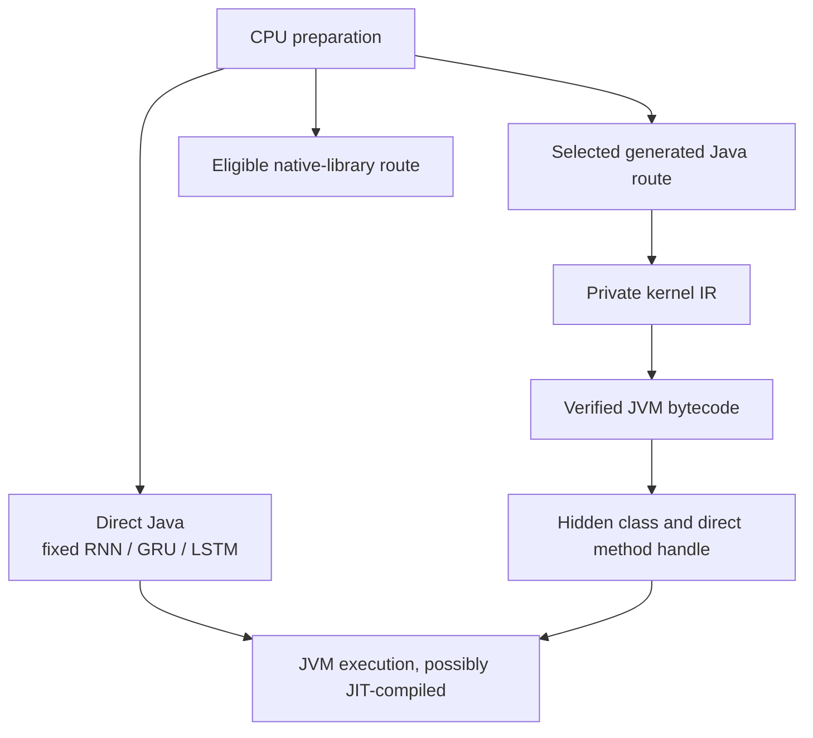

# [CPU](../glossary.md#term-cpu) [backend](../glossary.md#backend)

## Outcome and status

This guide defines the [CPU](../glossary.md#term-cpu) integration boundary and helps contributors avoid treating CPU routes
as separate [backends](../glossary.md#backend). The current CPU [module](../glossary.md#term-module) accepts the bounded, fully static portable families
described below, plus separately bounded ordinary and all-valid [Scan](../glossary.md#term-cumulative-scan) named-[batch](../glossary.md#term-batch-machine-learning-and-hyperparameters) slices.
It publishes `CpuBackendIntegration` as the supported [lifecycle](../glossary.md#lifecycle) service-provider interface ([SPI](../glossary.md#term-service-provider-interface-spi))
used by `Engine.standard()` and explicit `Engine.builder()` composition.
`Engine.standard()` opens and owns a fresh integration, while
`AdvancedEngine.takeOwnership(...)` accepts one explicitly supplied integration for advanced
CPU-only composition. The SPI is not the ordinary end-user execution [facade](../glossary.md#term-facade).

The **[central processing unit](../glossary.md#cpu-gpu-host-and-device) (CPU)** is the [host](../glossary.md#term-host) processor running Java and, when selected,
native machine-code libraries. A backend is the [owner](../glossary.md#term-owner) of a piece of computation; a **route** is
one way that owner implements it. Thus “CPU supports an [operation](../glossary.md#operation),” “a [native library](../glossary.md#term-native-library) loaded,”
and “this [run](../glossary.md#term-run) used that library” are three separate statements.

The [CPU low-precision parity cutover](production-support.md#temporary-java-low-computation-lock)<span data-glossary-navigation="true"> ([precision glossary](../glossary.md#term-precision))</span>
supersedes CPU0078. [BFLOAT16](../glossary.md#term-bfloat16), [FLOAT16](../glossary.md#term-float16), FLOAT8_E4M3 and FLOAT8_E5M2 reuse ordinary CPU
execution, [Compiler](../glossary.md#term-compiler) [AD](../glossary.md#autograd), Scan and Training owners under each family's existing geometry guards.
Historical counts and receipts below qualify their original [checkpoint](../glossary.md#term-checkpoint), not the complete cutover.

The earlier seven-[carrier](../glossary.md#term-storage-carrier), four-floating-type and 49-cast inventories below are historical
implementation checkpoints. Current ordinary CPU has nine types (six floating), including both
[FP8](../glossary.md#term-fp8) byte carriers across the existing low numerical/raw families and all [Model](../glossary.md#term-model)-legal casts.
These additions do not widen [Metal](../glossary.md#term-metal) transfer, [SIMD](../glossary.md#simd), [OpenBLAS](../glossary.md#term-openblas) or native geometry domains.

FP8 source [persistence](../glossary.md#term-persistence) selects [graph](../glossary.md#graph) v7 ([dtype](../glossary.md#data-type--datatype) wire IDs 8/9); old IDs 1–7 and non-FP8
smallest-sufficient v1–v6 bytes remain unchanged. FP8 [NN](../glossary.md#neural-network-module-parameter-buffer-and-forward-context) values select conditional
model.v2/SYNMOD02, definition SYNDEF02 and whole-model.v2 formats. These source formats
do not persist a compiled plan, [optimizer](../glossary.md#term-optimizer) continuation or new [runtime](../glossary.md#term-runtime) execution policy.

## Ordinary named-[batch](../glossary.md#term-batch-machine-learning-and-hyperparameters) [CPU](../glossary.md#term-cpu) execution

Here **[homogeneous](../glossary.md#term-homogeneous)** means that the numerical [graph](../glossary.md#graph) uses one common floating type. A named
[batch dimension](../glossary.md#batch-dimension) B lets different runs supply different batch sizes while the prepared structure
stays fixed; it does not make every [dimension](../glossary.md#dimension) changeable.

An ordinary homogeneous [FLOAT32](../glossary.md#term-float32) graph may [carry](../glossary.md#term-carry) one named B with fixed [features](../glossary.md#term-feature)/[parameters](../glossary.md#term-parameter) and
[rank](../glossary.md#term-rank) at most two. CPU prepares [scalar](../glossary.md#term-scalar), single-range portable units once; invocation B only
resolves numeric [extent](../glossary.md#term-extent)/[stride](../glossary.md#term-stride)/[contraction](../glossary.md#contraction-dimension) and byte recipes. The qualified closure includes
[MATMUL](../glossary.md#matrix-multiplication--matmul), [tensor](../glossary.md#tensor)/scalar ADD/SUB/MUL/DIV, NEG/[TANH](../glossary.md#term-tanh)/[SIGMOID](../glossary.md#term-sigmoid), SUM/[MEAN](../glossary.md#term-mean) (full/selected and
[SUM-to-Shape](../glossary.md#sum-to-shape)), logical splats, [singleton](../glossary.md#term-singleton)-preserving rank edits/RESHAPE, EXPAND, PERMUTE,
same-type casts and [CONTIGUOUS](../glossary.md#term-contiguous). Bounded rank-three outer [Scan](../glossary.md#term-cumulative-scan) [seeds](../glossary.md#commit-release-distribution-log-and-seed-meanings)/histories and their
[pointwise](../glossary.md#term-pointwise)/[layout](../glossary.md#layout)/reduction closure are additionally qualified, not arbitrary-rank operations.
The actual [Compiler](../glossary.md#term-compiler)-generated first-order reverse of `mean(X @ W)`
executes dX and dW; dW contracts K=B rather than creating a batch of parameters.

`BatchBinding`, MATMUL/aggregate `BatchGeometry` and `BatchByteSize` retain coefficients, not a
representative B or [Model](../glossary.md#term-model) lowerer. [Views](../glossary.md#term-view-meanings) preserve backing spans; CONTIGUOUS materializes actual
logical counts. Generated MATMUL uses direct typed row/column/full-K loops with fixed F/H facts;
the binder supplies `[0, outputCount)`, and an entry [guard](../glossary.md#term-guard) selects [canonical](../glossary.md#term-canonical-form) loops without
per-row first/last-column selection or range division. A separate subrange body preserves the
entry [ABI](../glossary.md#term-application-binary-interface-abi) for partial rows; the normal full-range hot loop does not pay for that flexibility.
Exact FLOAT32 SUM/MEAN uses signed five-[limb](../glossary.md#exact-superaccumulator-and-limbs) state and one final [rounding](../glossary.md#term-rounding), with 0/48 workspace
bytes according to actual output count. SUM-to-Shape at B=1 copies raw point bits. At B=0,
nonempty K=0 parameter adjoints still write typed zero.

Both [identity](../glossary.md#term-identity-meanings) streams conditionally mark `ordinary-batch-v1` and key baked MATMUL coefficients;
actual B, resolved bytes, slots and addresses are excluded. Static identities and generated
bytes retain their previous stream. Direct-entry tests inspect Class-Files and compare fixed-fact
clean Java, including exact five-limb reductions. Opt-in bounded timing uses
`-Dsynaptik.cpu.dynamicBatch.performance=true`; it is off by default and promises no zero overhead
or identical [JIT](../glossary.md#term-just-in-time-compilation-jit) assembly. Static tiled versus dynamic direct medium [Engine](../glossary.md#term-engine) timing is explicitly
an unmatched route-policy diagnostic, not isolated B-[binding](../glossary.md#term-binding) overhead.

[Symbolic Scan](../glossary.md#symbolic-scan) has its own [whole-body qualification](#symbolic-scan-cpu-execution), not an
automatic consequence of ordinary [operation](../glossary.md#operation) support. Neither [slice](../glossary.md#slice) enables [NN](../glossary.md#neural-network-module-parameter-buffer-and-forward-context)/Training
one-state reuse, symbolic cold/wire support, wider [dtype](../glossary.md#data-type--datatype),
native/mixed-[owner](../glossary.md#term-owner)/[vector](../glossary.md#term-vector)/parallel execution or tuning. Existing static routes remain separate.
See the [public changing-B example](../user-guide/running-models.md#ordinary-cpu-execution-with-changing-batch-size).

Before [ownership](../glossary.md#term-ownership-meanings) selection, Compiler completes canonical logical layouts for fully static,
layout-unresolved results only from explicitly proven materializing operation families and
`CONTIGUOUS`, plus explicit [compile](../glossary.md#compile)-time splat inputs. Proved affine views retain exact source
offsets/strides. A separate [topological](../glossary.md#term-topological-order) case now selects canonical non-view output for validated
static noncontiguous-input RESHAPE whose supported view remains unproved. Other unknown mappings
stay unresolved and caller-[bindable input](../glossary.md#bindable-input) [descriptors](../glossary.md#term-descriptor) remain exact. This completion grants no CPU
capability: the provider and complete-[partition](../glossary.md#partition) [lowering](../glossary.md#lowering) still reject unsupported semantics, data
types, [Shapes](../glossary.md#shape), resolved geometry, [topology](../glossary.md#term-topology), carriers, and resource requirements.

All four low storage types use FLOAT32 [working arithmetic](../glossary.md#accumulator-type) and accumulators, then one final
[round-to-nearest, ties-to-even](../glossary.md#floating-point-precision-and-rounding) (RNE) [narrowing](../glossary.md#term-narrowing) at each ordinary operation result, public output
or saved boundary. Unlike low operands promote to FLOAT32; [FLOAT64](../glossary.md#term-float64) dominates. Exact movement,
same-type casts, comparison, selection, indices, [masks](../glossary.md#term-boolean-mask) and state retain their original contracts.
Raw [NaN](../glossary.md#term-nan) payloads survive movement/selection; arithmetic NaNs need not retain sign/[payload](../glossary.md#artifact-envelope-and-atomic-publication).
Direct FLOAT64/integer casts round directly to the destination, without a lossy FLOAT32 step.
Training uses FLOAT32 master/[optimizer](../glossary.md#term-optimizer) values for low parameters, narrows logical candidates
at [commit](../glossary.md#term-commit), and rejects nonfinite represented candidates transactionally. [F32](../glossary.md#floating-point-precision-and-rounding)/[F64](../glossary.md#floating-point-precision-and-rounding) remain supported;
this is neither a second executor nor a [runtime](../glossary.md#term-runtime) unlock.

Ordinary static noncontiguous-input RESHAPE now materializes canonical non-view output through
the existing affine ordinal copy. Genuine contiguous views retain exact offsets and [metadata](../glossary.md#term-metadata).
All seven carriers passed public PERMUTE -> RESHAPE logical-order/raw-bit proof; generated-copy
tests cover changed inputs, offset/gapped source, source preservation and destination canaries.
This raw-movement receipt is historical. [CPU0079](../planning/backends/cpu/tasks/0079-materializing-reshape-admission.md#result)
records its separate provider, full [module](../glossary.md#term-module)/[conformance](../glossary.md#term-conformance) and public consumer evidence.

The separate [current general Scan composition](#current-general-scan-composition)<span data-glossary-navigation="true"> ([general Scan glossary](../glossary.md#general-differentiable-scan))</span> composes every
ordinary CPU-supported [PURE](../glossary.md#term-pure) unit and selected actual first-order [derivatives](../glossary.md#term-derivative), including low
types under ordinary [qualification](../glossary.md#term-qualification). Forward and reverse bodies independently satisfy the same
dtype, geometry, resource and exact-boundary guards.

A CPU-owned partition [directed acyclic graph](../glossary.md#term-directed-acyclic-graph-dag) ([DAG](../glossary.md#intermediate-representation-dag-and-ssa)) has no fixed eight-[node](../glossary.md#node) partition cap. Its
compiled nodes must be supported and remain in stable [producer](../glossary.md#term-producer)-before-consumer order; checked
geometry and resource requirements must still be valid. CPU analysis decomposes the complete
partition into established computation-unit seeds, then considers deterministic vertical and
horizontal [fusion](../glossary.md#term-fusion) only among ordinary pointwise units. A single [fused](../glossary.md#specialization-and-fusion) pointwise or affine unit
still contains at most eight compiled nodes; a long partition can contain more than eight
topologically ordered units behind one partition-level [prepared executable](../glossary.md#prepared-executable--preparedexecutable). For example, nine
separately published pointwise results can remain nine units in one CPU partition and [run](../glossary.md#term-run) in
[publication](../glossary.md#term-publication) order; the eight-node limit is not a Compiler partition boundary. Eligible
unpublished single-use pointwise
results remain virtual inside a fused unit; every value crossing units, every published result,
and every external read is an ordinary declared [buffer](../glossary.md#term-buffer). One pointwise unit may therefore have
multiple ordered output stores. A static affine unit remains one connected one-input/one-output
chain of at most eight resolved-layout [view](../glossary.md#view) occurrences. A static movement unit is exactly one
resolved-layout [PAD](../glossary.md#padding), TILE, CONCAT, STACK,
UNFOLD_AXIS, UNFOLD2D or UNFOLD3D [occurrence](../glossary.md#term-occurrence). It declares each distinct input once in first-occurrence
order plus one distinct [injective](../glossary.md#term-injective) output while preserving every semantic composition occurrence.
UNFOLD_AXIS copies all seven represented types; UNFOLD2D/UNFOLD3D copy FLOAT64, FLOAT32,
[BFLOAT16](../glossary.md#term-bfloat16) and [FLOAT16](../glossary.md#term-float16) under the Model's canonical [NCHW](../glossary.md#term-nchw)/[NCDHW](../glossary.md#conv3d--ncdhw) columns contract.
The fourth family is exactly one resolved-layout [`GATHER`](../glossary.md#gather), `GATHER_ELEMENTS`, `GATHER_ND`, or
`ONE_HOT` occurrence. It validates every logical [INT32](../glossary.md#data-type--datatype)/[INT64](../glossary.md#data-type--datatype) index deterministically before any
output write and then uses scalar or parallel-scalar generated output ranges. The movement family
also accepts exactly one resolved-layout `SLICE_UPDATE` with ordered `[base, update]` inputs and
either signed [finite](../glossary.md#term-finite)-[coordinate](../glossary.md#axis-rank-scalar-vector-and-matrix) or [target](../glossary.md#term-target)-relative placement. It writes a distinct injective
result with the base Shape and leaves both inputs unchanged.
The fifth family is exactly one resolved-layout functional scatter occurrence:
`SCATTER_ELEMENTS`, Gather-compatible fixed-add `SCATTER_ADD`, or `SCATTER_ND`. All three consume
ordered `[data, indices, updates]`, validate before writing, and create a fresh data-shaped result
without mutating inputs. Scalar and parallel-scalar execution own disjoint output coordinates.
The sixth family is exactly one resolved-layout overlap fold occurrence: general-[axis](../glossary.md#term-axis)
`FOLD_AXIS`, canonical columns-to-NCHW `FOLD2D`, or columns-to-NCDHW `FOLD3D`. Every result
coordinate begins at represented [positive zero](../glossary.md#nan-infinity-and-signed-zero) and accumulates its logical input contributions
in canonical input [row-major](../glossary.md#term-row-major) order. Image-fold arithmetic accepts FLOAT64/FLOAT32 and all four
low floating types, with FLOAT32 low accumulation and one final narrowing. `FOLD_AXIS` additionally accepts INT32
and INT64. Image folds exclude padded and ceil-tail positions outside the unpadded result.
[Schema](../glossary.md#term-schema)-26 generated fold entries embed the selected family mapping, represented addition, and
typed array or native-order segment access. Dense [heap](../glossary.md#term-heap) arrays use integer loop/address state;
general layouts and segment or mixed carriers normally use long addressing. Schema 35 adds one
guarded bounded exception for the frozen mixed-[carrier](../glossary.md#term-storage-carrier) FLOAT32 FOLD2D shape; every unproved case
retains the typed general-long body.
The seventh family is exactly one resolved-layout stable ordering occurrence: `SORT`, `ARGSORT`,
or two-output `TOP_K`. It accepts all seven represented types, orders complete logical-axis slices,
keeps every floating NaN after non-NaNs in both directions, reverses [signed-zero](../glossary.md#nan-infinity-and-signed-zero) order with the
requested direction, and preserves increasing original [logical index](../glossary.md#axis-rank-scalar-vector-and-matrix) for equal values and NaNs.
SORT and TOP_K copy selected [represented bits](../glossary.md#term-represented-bits); ARGSORT and TOP_K write zero-based INT64 axis
coordinates. Unsorted TOP_K deterministically orders the selected pairs by increasing original
index. Scalar or complete-slice parallel-scalar execution uses one exact run-owned workspace with
two primitive INT64 merge-index regions per selected range.
Schema-27 generated ordering entries embed the typed stable merge, comparison, optional
selected-pair index ordering, and represented value/index stores. Proved dense heap-array forms
use integer loop and address state; general layouts and segment or mixed carriers retain typed
long addressing. Scratch access remains direct through the assigned segment in both forms.
The eighth family is exactly one resolved-layout `INITIAL_STATE` or FLOAT64/FLOAT32/FLOAT16
[`DROPOUT`](../glossary.md#dropout--inverted-dropout) occurrence. It uses explicit key/counter state and the versioned CPU-private
`SYNAPTIK_CPU_SPLITMIX64_COUNTER_V1` mapping. INITIAL_STATE writes key then counter without a draw.
DROPOUT consumes one draw per row-major logical value ordinal, writes the dropped value, a
canonical one-byte [BOOL](../glossary.md#data-type--datatype) keep mask, and the next key/counter state, with identical scalar and
parallel-scalar results and zero workspace. Schema-28 generated entries embed the typed state
prologue, counter mapping, threshold, value, mask, and [element](../glossary.md#term-element) loop. Dense heap arrays use direct
integer addressing; arbitrary layouts and segment or mixed carriers normally use typed long
addressing. Schema 35 adds one guarded bounded exception for the frozen [rank-one](../glossary.md#axis-rank-scalar-vector-and-matrix) FLOAT32 mixed-
carrier dropout shape; every unproved case retains the typed general-long body.
The ninth family is exactly one resolved-layout `CUM_SUM` or `CUM_PROD` occurrence. It accepts
FLOAT64, FLOAT32, BFLOAT16, FLOAT16, INT32, and INT64 in inclusive/exclusive and forward/reverse modes.
Each logical scan slice keeps one sequential typed [accumulator](../glossary.md#accumulator-type); scalar or parallel-scalar
execution may distribute only whole independent slices. The family declares one input and one
distinct output, with zero workspace or [materialization](../glossary.md#materialization). Schema 38 adds one completely
guarded fixed `[1024,1024]` axis-one exclusive reverse INT64 product body over segment carriers;
all other admitted scan geometries retain their existing typed bodies.
The tenth family is exactly one resolved-layout ordinary or binding-aware aggregate occurrence. `SUM`, `PROD`,
`MIN`, and `MAX` accept FLOAT64, FLOAT32, BFLOAT16, FLOAT16, INT32, or INT64; `MEAN` accepts the four
floating types; and [Boolean](../glossary.md#data-type--datatype) `ALL` and `ANY` accept canonical BOOL. Exact full, single-axis, and
multi-axis forms share one output-cell geometry, including an empty multi-axis selection as a
one-value point domain. Scalar or parallel-scalar execution distributes only whole output cells.
Unfolded floating SUM, MEAN, and PROD use declared run-owned exact-state workspace; every other
row uses zero workspace. Proved static typed-one SUMs instead use the
[output-only count path](#static-typed-one-count-folding), retaining original source initialization.
No row uses input materialization, partial reductions, or a combine step.
Binding-aware SUM-to-Shape adds fully bound right-aligned SUM over the same six numeric types;
it uses exact floating or modular integral arithmetic when axes reduce and raw represented copying
when none does.
The eleventh family is exactly one resolved-layout, one-axis `ARG_MIN` or `ARG_MAX` occurrence.
It accepts FLOAT64, FLOAT32, BFLOAT16, FLOAT16, INT32, or INT64 and writes a zero-based logical axis
coordinate as INT64. The [normalized axis](../glossary.md#normalized-axis), keep/remove-Dimension form, FIRST/LAST tie policy, NaN
preference, signed-zero order, and signed integral order come from the Model contract. Scalar or
parallel-scalar execution owns complete output cells and uses no workspace or materialization.
The twelfth family is exactly one resolved-layout, axis-removing masked `SUM` or `MEAN`
occurrence. Data and output are the same FLOAT64, FLOAT32, BFLOAT16, or FLOAT16 type; the second
input is a canonical BOOL mask whose ordinary right-aligned broadcast must equal the data Shape exactly.
False positions are excluded before their data is loaded or classified. Scalar or parallel-scalar
execution owns complete output cells, keeps an exact true-position count, and uses one run-owned
exact-state slice per simultaneously used range. It declares three buffers and no mask
materialization, selected-count workspace, partial result, or combine state.
The thirteenth family is exactly one resolved-layout `LOG_SUM_EXP`, [`VARIANCE`](../glossary.md#term-variance),
`STANDARD_DEVIATION`, `L1_NORM`, or `L2_NORM` occurrence across the six floating representations.
It preserves the Model-owned ordered axes and correction and walks each selected domain in
canonical input-axis row-major order. [Log-sum-exp](../glossary.md#log-sum-exp) uses a maximum-shifted two-pass sum; variance
and [standard deviation](../glossary.md#term-standard-deviation) use the rounded mean and centered-square/count formula without a [residual](../glossary.md#scan-residual-port-and-history-demand)
correction; [L1](../glossary.md#term-l1) uses exact represented-sum state; [L2](../glossary.md#term-l2) sums working-[precision](../glossary.md#term-precision) squares, retaining
[overflow](../glossary.md#term-overflow) except for the Model's exact point-domain absolute-value identity. Scalar or
parallel-scalar execution owns complete output cells. Only L1 and statistics use run-owned exact
state; the family adds no materialization, partial result, combine state, vector body or native route.
The fourteenth family is exactly one resolved-layout `MAX_POOL2D` or `AVERAGE_POOL2D` occurrence
over matching rank-four NCHW BFLOAT16, FLOAT16, FLOAT32, or FLOAT64 input and output. It uses the
Model's literal floor/ceiling grid, symmetric [padding](../glossary.md#padding), stride, and [dilation](../glossary.md#term-dilation). Scalar or parallel-scalar
execution owns complete output cells, accepts exact typed heap-array, segment, or mixed carriers,
and declares zero workspace. Max excludes padding; average includes conceptual positive-zero
padding in its fixed [kernel](../glossary.md#kernel)-position divisor. The direct schema-71 generated body is the only
[pooling](../glossary.md#term-pooling) route and adds no fusion, materialization, vector body, native route, saved indices, or
backward execution.

The same Pool2d body also implements one exact visible [NCW](../glossary.md#term-ncw) [Pool1d composition](../glossary.md#pool1d-composition) when CPU analysis
recognizes `EXPAND_DIMS(axis 2) -> POOL2D -> SQUEEZE(axis 2)`. Both rank edits remain virtual,
and the external rank-three input and output are the only buffer boundaries. Recognition requires
private single-use intermediates, exact affine singleton-height layouts, and Pool2d height
geometry `(kernel, stride, padding, dilation) = (1, 1, 0, 1)`. A near match follows ordinary
partition-DAG [decomposition](../glossary.md#term-decomposition). This optimization retains the Pool2d family projection under the
current schema-71 envelope and does
not create a Pool1d operation, capability query, [IR](../glossary.md#term-intermediate-representation-ir) family, route, or generated [artifact](../glossary.md#term-artifact); CPU
continues to report the three visible component occurrences independently.

The fifteenth family is exactly one resolved-layout `MAX_POOL3D` or `AVERAGE_POOL3D` occurrence
over matching rank-five NCDHW BFLOAT16, FLOAT16, FLOAT32, or FLOAT64 input and output. The direct
schema-71 generated body visits each complete output cell in depth-height-width order and supports
typed heap-array, native-order segment, and mixed carriers. Maximum excludes padding, preserves the
first eligible NaN or equal winner, ranks positive zero above [negative zero](../glossary.md#nan-infinity-and-signed-zero), and returns [negative
infinity](../glossary.md#nan-infinity-and-signed-zero) for an all-padding window. Average uses the fixed
`kernelDepth * kernelHeight * kernelWidth` count-padding divisor, FLOAT32 arithmetic for BFLOAT16,
FLOAT16, and FLOAT32, FLOAT64 arithmetic for FLOAT64, and one final low-precision narrowing.
Scalar execution or caller-owned parallel-scalar ranges divide only complete output cells; the
family declares one read, one write, and zero workspace or materialization. Current support is limited to fully static
Shapes, resolved non-negative layouts, an injective output, exact floor/literal-ceil geometry, and
non-[gradient](../glossary.md#term-gradient) occurrences. It adds no pooling fusion, saved winners, general PoolNd bridge,
unfold/fold execution, vector/native route, or dynamic geometry.

The sixteenth family is exactly one first-class `SCALED_DOT_PRODUCT_ATTENTION` occurrence with
three ordered query/key/value inputs and an optional right-broadcast canonical BOOL mask, and one
output or same-occurrence normalized [weights](../glossary.md#term-weight) at output slot one. It accepts only fully static,
resolved non-negative layouts and BFLOAT16, FLOAT16, FLOAT32, or FLOAT64 query/key/value types. The
direct schema-71 generated scalar body owns complete broadcast-batch/query rows, applies top-left
causal eligibility (`j <= i`) together with the BOOL mask before reading excluded score/value data,
uses one exact score/weight scratch slice per selected range. The body has no MATMUL/[SOFTMAX](../glossary.md#softmax--log-softmax)
decomposition, external fusion, materialization, vector/native/packed/flash route, or interpreted
fallback. CPU analysis declares the workspace before shared slot assignment; CPU finalization
binds the selected generated artifact after assignment; Runtime invokes only the resulting
prepared primitive state. This is current forward execution, not dropout or training execution,
and it does not support dynamic shapes, negative strides, in-place/overlap layouts,
integral/quantized data, or a universal performance claim.

Generated scalar and Java 26 [Vector API](../glossary.md#term-vector-api) entries accept primitive `start` and `end` bounds.
Compatible concrete extents bind on the [cold path](../glossary.md#term-cold-path) and share identical class bytes and one
process-local loaded [compatibility identity](../glossary.md#identity-meanings-and-algebraic-identities). The pointwise semantic [matrix](../glossary.md#term-matrix-meanings) uses one forty-eight-
[opcode](../glossary.md#term-opcode) CPU-private vocabulary across FLOAT64, FLOAT32, BFLOAT16, FLOAT16, INT32, INT64, and BOOL.
Exactly 44 same-typed forms admit each low-precision floating type, and CAST additionally admits
all 49 ordered source/target pairs through scalar or caller-parallel scalar execution; this does
not make every opcode or mixed-type occurrence executable. Affine copies accept all seven current
Model data types and transfer represented bits without conversion. BFLOAT16 and FLOAT16 pointwise
boundaries use raw `short[]` representation or native-order two-byte segment access. The access
family covers scalar/rank/singleton/multi-axis
[broadcasting](../glossary.md#broadcasting), zero extents, offsets, positive and broadcast-zero strides, and ordered
heap/segment/mixed carrier patterns for the derived boundaries. CPU 0005H closes all nineteen
same-typed FLOAT16/FLOAT32/FLOAT64 [unary](../glossary.md#term-unary) kinds, while preserving the three separate floating-classification
kinds and CPU 0005G's [extrema](../glossary.md#saturation-pole-and-extremum), clamp, Tensor power, and canonical-BOOL logic. CPU 0005J preserves
that semantic inventory while adding exact preferred-species vector parity for selected floating
extrema/clamp/[ReLU](../glossary.md#term-relu)/sign/cast, signed-integral arithmetic/extrema/cast, canonical-BOOL logic/cast,
and narrowly virtual floating comparison/classification masks through logical masks into WHERE.
Cold analysis selects scalar, vector, parallel-scalar, or parallel-vector execution;
vector-ineligible admitted geometry or opcodes fall back to scalar compute. For partitions of at
most eight compiled nodes, analysis can also retain bounded direct, eligible single-copy, and
eligible disjoint-consumer pair representation
candidates for external reads across FLOAT64, FLOAT32, INT32, INT64, and canonical BOOL pointwise
work. Each copy candidate owns a declared run workspace and explicit generated affine-copy unit;
compatible repeated and cross-unit uses share one copy. Ordinary preparation selects direct and
declares none of those candidate-only resources. Capability and lowering [fail closed](../glossary.md#admission-preflight-and-fail-closed-validation) for every other
operation, type, shape, layout, parameter, [alias](../glossary.md#aliasing-and-arena), [fan-out](../glossary.md#term-fan-out), publication, carrier, or route. In
particular, cross-type CAST follows the completed Model conversion contract and does not infer a
promotion or conversion mode. Current tuning is limited to the bounded two-phase CPU-only workflow
for eligible FLOAT32/FLOAT64 bare MATMUL described below. Ordinary preparation already composes
CPU-owned work into the bounded mixed CPU/[Metal](../glossary.md#term-metal) schedule defined by [ADR](../glossary.md#term-architecture-decision-record-adr) 0016. Generic
[plugin](../glossary.md#term-plugin)/[backend](../glossary.md#backend) alternatives, broader transfer domains, and broader Metal operation coverage remain
planned. Current native CPU routes are the exact [OpenBLAS](../glossary.md#term-openblas) MATMUL route and the explicitly
configured [oneDNN route](#explicit-onednn-composition)<span data-glossary-navigation="true"> ([oneDNN glossary](../glossary.md#term-onednn))</span>.
CPU-private specialized-subgraph recognition is current only
as the cold, recognition-only boundary described below. Functional scatter,
overlap fold, stable ordering, explicit-state random, cumulative-scan, and ordinary-aggregate
execution are current
only within the exact
static portable boundaries described below; they do not imply native, vector, dynamic-layout, or
universal backend coverage.

The lower-level OpenBLAS provider separately implements explicit library loading, required-[symbol](../glossary.md#term-symbol)
binding, a caller-owned [lookup](../glossary.md#term-lookup) [lifetime](../glossary.md#term-lifetime), low-level FLOAT32/FLOAT64 dense row-major [general matrix
multiplication](../glossary.md#general-matrix-multiplication--gemm) ([GEMM](../glossary.md#general-matrix-multiplication--gemm)), and direct positive thread-count query/control. CPU preparation now
consumes that [leaf](../glossary.md#term-leaf) through one narrow qualified MATMUL route; the provider still does not own
graph interpretation, route selection, materialization, fallback, or Runtime lifetime.

CPU also has an internal cold discovery foundation for composition code. It accepts disabled,
automatic, exact-name, or exact-absolute-path intent and returns [immutable](../glossary.md#term-immutable) attempt metadata plus a
separate closeable session when loading succeeds. This is unsupported package-private machinery,
not a public configuration or Engine integration point. Loading proves only that the provider's
required symbols bound; it does not qualify, select, [cache](../glossary.md#term-cache), or publish the OpenBLAS route. Each
loaded resource also owns one [opaque](../glossary.md#term-opaque) per-load session key. A loaded session may transfer its
invocation, close action, and unchanged key exactly once to the internal coordinator. After
transfer, the session retains only immutable metadata and the coordinator becomes the sole
restoration and close owner. A separate cold qualifier can then issue one immutable credential
only after target, [binary](../glossary.md#term-binary-descriptor-and-metadata) when available, thread-control, and bounded numerical checks pass.

## Fixed recurrent forward execution

A fixed recurrent [scan](../glossary.md#term-cumulative-scan) is one flat RNN_TANH, GRU_RESET_AFTER or [LSTM](../glossary.md#term-long-short-term-memory-lstm) [occurrence](../glossary.md#term-occurrence) with [runtime](../glossary.md#term-runtime)
valid lengths, not a per-time-step [graph](../glossary.md#graph). [CPU](../glossary.md#term-cpu) executes all six biased/unbiased [signatures](../glossary.md#term-signature) and
both directions using direct Java, one sequential [scalar](../glossary.md#term-scalar) range on the invoking thread. [Vector](../glossary.md#term-vector)
preferences and parallel budgets do not promote the scan; other computation units keep their
own strategies. Scan-containing partitions use direct [decomposition](../glossary.md#term-decomposition) and report incomplete
complete-plan discovery, so they remain available for ordinary untuned preparation.

The scalar support set requires fully static geometry, one common [FLOAT32](../glossary.md#term-float32), [FLOAT64](../glossary.md#term-float64), [BFLOAT16](../glossary.md#term-bfloat16) or
[FLOAT16](../glossary.md#term-float16) type for floating roles, and non-[gradient](../glossary.md#term-gradient) [INT64](../glossary.md#data-type--datatype) lengths `[B]`. Every input role, including
lengths, admits resolved nonnegative [strides](../glossary.md#term-stride) and offsets: dense, transposed, sliced/gapped,
positive-stride overlapping reads and zero-stride repeated reads. Repetition of a non-[singleton](../glossary.md#term-singleton)
[axis](../glossary.md#term-axis) requires [Model](../glossary.md#term-model)'s [view](../glossary.md#term-view-meanings) flag. Negative or unresolved [layouts](../glossary.md#layout) remain unsupported; reverse is a
traversal direction, not a negative storage stride. Outputs stay [canonical](../glossary.md#term-canonical-form) zero-offset dense.
Floating gradient flags are accepted and outputs retain their exact OR; this enables forward
execution, not backward execution. Each [dimension](../glossary.md#dimension), packed [extent](../glossary.md#term-extent), logical boundary count and
referenced storage-[element](../glossary.md#term-element) span fits `int`, with checked byte and scratch arithmetic.
Input is `[T,B,I]`, hidden/cell state `[B,H]`, and packed [weights](../glossary.md#term-weight)/[bias](../glossary.md#term-bias) follow Model gate order.
`I/H` are positive; `T/B` may be zero. [Heap](../glossary.md#term-heap) `double[]`/`float[]`/raw `short[]`/`long[]`, native
and mixed exact aligned segments are accepted, including sliced physical bases and read-only inputs.
The physical [slice](../glossary.md#slice) base and logical layout offset are independent. For example, `[2]` lengths
with offset 3 and stride 2 read elements 3 and 5: their storage span is 6, not their logical count 2.
Poisoned gaps are never lengths. An empty layout has span zero and never accesses its unused offset.

Analysis declares every sibling output and `2 * gates * H * workingBytes` bytes of row projection scratch
before slot assignment, independent of `T` or length values. Empty time/[batch](../glossary.md#term-batch-machine-learning-and-hyperparameters) needs no scratch.
Working width and [alignment](../glossary.md#term-alignment) are 8 bytes for FLOAT64 and 4 otherwise. FLOAT64 uses double arithmetic
without [denormal](../glossary.md#subnormal-daz-ftz-overflow-and-underflow) flushing; FLOAT32 retains its rounded primitive sites. Each low type decodes
exactly and works/accumulates in FLOAT32, without [narrowing](../glossary.md#term-narrowing) projections, contributors or gates.
Hidden and cell [publication](../glossary.md#term-publication) each narrows once, [ties-to-even](../glossary.md#term-ties-to-even). Later steps read the exact stored
hidden/cell state; LSTM hidden also consumes the narrowed stored cell of that same step.
Finalization creates one [immutable](../glossary.md#term-immutable) direct [kernel](../glossary.md#kernel) per occurrence without generated [IR](../glossary.md#term-intermediate-representation-ir), [cache](../glossary.md#term-cache)
[artifacts](../glossary.md#term-artifact), per-step executable growth or retained [prototype](../glossary.md#term-prototype) storage. Every [run](../glossary.md#term-run) owns its writable
outputs and workspace. [Binding](../glossary.md#term-binding) rejects inaccessible, undersized, misaligned, read-only writable,
or overlapping writable representations. Real read/read [aliases](../glossary.md#aliasing-and-arena) are legal. A write or scratch
may not overlap any other whole selected representation, even only in its gaps or capacity tail.
Logical slices prevent output initialization from touching an oversized representation's
unrelated capacity tail.

For example, FLOAT32 input `[3,2,1]` and INT64 lengths `[0,2]` produce dense hidden output
`[3,2,H]`. Row 0 has positive-zero output at every time and returns its raw initial state bits. Row 1
visits times `0,1` forward or `1,0` reverse, storing each result at its original time; time 2 is
[positive zero](../glossary.md#nan-infinity-and-signed-zero). Padded [NaN](../glossary.md#term-nan)/Inf never reaches a gate. Dense output allocation remains `O(T*B*H)`.
Before these writes, execution validates the entire current length vector in `[0,T]`, after any
ordinary [producer](../glossary.md#term-producer) such as FLOAT32-to-INT64 CAST. An invalid last row throws
`IllegalArgumentException` with row/value/T context without changing any scan output. Earlier
producers need not roll back. A fresh run after repairing lengths reuses the same preparation.
[Engine](../glossary.md#term-engine) applies its existing failure cleanup and returns no public result on failure.

[Qualification](../glossary.md#term-qualification) lives in `CpuRecurrentScanExecutionTest`, `CpuRecurrentScanConformanceTest` and
`EngineCpuRecurrentScanIntegrationTest`. The independent [finite](../glossary.md#term-finite) [oracle](../glossary.md#term-test-oracle) uses explicit test-only
absolute-plus-relative thresholds; [padding](../glossary.md#padding), raw initial states, result classes and hidden-state
publication are checked separately. Source/[dataflow](../glossary.md#term-dataflow) review and [bytecode](../glossary.md#term-bytecode) inspection compare the
direct loops with specialized clean Java. The opt-in eight-case timing diagnostic has a
120-second deadline and no speed threshold. Its recorded route/oracle [mean](../glossary.md#term-mean) ratios span 0.88–5.84:
the route includes bound-invocation [lease](../glossary.md#term-lease), access and length checks, while the oracle starts at
the preflighted kernel boundary. Large within-case [sample](../glossary.md#term-sample-machine-learning-and-hyperparameters) shifts leave [warm-up](../glossary.md#benchmark-measurement-vocabulary) and [just-in-time
compilation](../glossary.md#just-in-time-compilation) effects unresolved.
The comparison neither isolates the cause of those ratios nor establishes performance parity.
No tuning, speed/parity, [SIMD](../glossary.md#simd), parallel scan, [NN](../glossary.md#neural-network-module-parameter-buffer-and-forward-context) migration or [backpropagation](../glossary.md#term-backpropagation)-through-time claim
follows. See the
[fixed-family contract](../architecture/contracts/recurrent-scan.md) and
[handoff explanation](../architecture/runtime-prepare-backend-boundary.md#fixed-recurrent-scan-handoff)<span data-glossary-navigation="true"> ([handoff glossary](../glossary.md#term-handoff))</span>.

## Prerequisites and terms

Contributors need [JDK](../glossary.md#term-java-development-kit-jdk) 26 and the [ownership](../glossary.md#term-ownership-meanings) rules in the [architecture
contract](../architecture/contracts/backend-execution.md#cpu-backend-routes)<span data-glossary-navigation="true"> ([architecture contract glossary](../glossary.md#architecture-contract))</span>. Native loading uses
an externally installed compatible [OpenBLAS](../glossary.md#term-openblas) or explicitly configured [oneDNN](../glossary.md#term-onednn) [binary](../glossary.md#term-binary-descriptor-and-metadata) and deployment
[JVM](../glossary.md#term-java-virtual-machine-jvm) permission for restricted native access: `--enable-native-access=ALL-UNNAMED` for the
[classpath](../glossary.md#term-classpath) deployment shown here.

The following vocabulary helps separate the code descriptions from the numerical and storage
contracts. These are explanations, not additional capability claims.

| Term | How to read it in this guide |
|---|---|
| [Java Virtual Machine](../glossary.md#java-platform-and-build-tools) (JVM) | The program that loads and executes Java class files. The [Java Development Kit](../glossary.md#java-platform-and-build-tools) (JDK) includes the tools used to build and [run](../glossary.md#term-run) them. |
| [Intermediate representation](../glossary.md#term-intermediate-representation-ir) ([IR](../glossary.md#intermediate-representation-dag-and-ssa)) | A structured description of computations before executable code is produced. [CPU](../glossary.md#term-cpu)'s private [kernel](../glossary.md#kernel) IR is not the public [Tensor](../glossary.md#tensor) [graph](../glossary.md#graph) or a [Runtime](../glossary.md#term-runtime) interpreter. |
| [Bytecode](../glossary.md#term-bytecode) and just-in-time ([JIT](../glossary.md#term-just-in-time-compilation-jit)) [compilation](../glossary.md#compiler-engine-and-execution-stage-names) | Bytecode is the instruction format in a Java class file. The JVM may translate it into processor instructions while the program runs; saving class bytes does not save those JIT results. |
| [Hidden class](../glossary.md#term-hidden-class) and [lookup](../glossary.md#term-method-handle-lookup) | A hidden class is a generated JVM class unavailable through ordinary name-based class loading. A Java `MethodHandles.Lookup` carries permission to define or access classes and methods; it is not a filesystem or tuning-[cache](../glossary.md#term-cache) search. |
| [Single instruction, multiple data](../glossary.md#simd) ([SIMD](../glossary.md#simd)) and [vector](../glossary.md#term-vector) [lanes](../glossary.md#term-lane) | SIMD applies one [operation](../glossary.md#operation) to several values together. A lane is one value position in that group; a [Vector API](../glossary.md#term-vector-api) species fixes the [element](../glossary.md#term-element) type and group width. Vector computation and multiple worker threads are independent choices. |
| [Affine storage mapping](../glossary.md#term-affine-storage-mapping) | An address calculated from a base offset plus [coordinate](../glossary.md#axis-rank-scalar-vector-and-matrix)-times-[stride](../glossary.md#term-stride) terms. For [shape](../glossary.md#shape) `[2,3]` and strides `[3,1]`, coordinate `[1,2]` selects element 5. This is different from an affine layer's scale-and-[bias](../glossary.md#term-bias) calculation. |
| [Contiguous storage](../glossary.md#contiguous-request) | Values occupy consecutive positions in the specified traversal order. [Canonical](../glossary.md#term-canonical-form) CPU [row-major](../glossary.md#term-row-major) [layout](../glossary.md#layout) additionally has the documented offset and strides; merely having enough bytes does not prove that layout. |
| [Carrier](../glossary.md#term-storage-carrier) and [referenced span](../glossary.md#referenced-element-span) | A carrier is the actual array or memory segment holding encoded values. The referenced span is the storage range needed by the layout, including gaps, not just the number of logical values. |
| [Application binary interface](../glossary.md#term-application-binary-interface-abi) ([ABI](../glossary.md#application-binary-interface-and-native-bridge)) | The machine-level agreement on function [arguments](../glossary.md#term-argument), integer widths, memory layout and return values. Java/native agreement is needed even when the mathematical operation names match. |
| [LP64](../glossary.md#term-lp64) and `blasint` | LP64 specifies 64-bit C `long` values and pointers, with 32-bit C `int`. The [BLAS](../glossary.md#term-blas) [dimension](../glossary.md#dimension) integer `blasint` is a separate library ABI choice; the OpenBLAS provider here requires its ordinary 32-bit form. A 64-bit process alone does not prove either interface matches. |
| OpenBLAS and oneDNN | External native numerical libraries used by qualified CPU routes. OpenBLAS supplies [Basic Linear Algebra Subprograms](../glossary.md#mps-mpsgraph-and-openblas), including [general matrix multiplication](../glossary.md#general-matrix-multiplication--gemm) ([GEMM](../glossary.md#general-matrix-multiplication--gemm)); oneDNN supplies deep-learning primitives and compiled numeric blocks. Neither is another [backend](../glossary.md#backend). |

Read the main flow from top to bottom: only the generated Java route creates a reusable Java
[artifact](../glossary.md#term-artifact) through private kernel IR. Retained direct Java execution
for fixed [RNN](../glossary.md#neural-network-families)/[GRU](../glossary.md#neural-network-families)/[LSTM](../glossary.md#neural-network-families) bypasses that generation and artifact cache; a native-library route is a
separate peer choice. The JVM independently decides whether to JIT-[compile](../glossary.md#compile) Java bytecode.



- A **route** is one backend-local implementation choice. The glossary entry for
  [backend route](../glossary.md#backend-route) explains why OpenBLAS is not a separate backend.
- The **[Foreign Function and Memory](../glossary.md#application-binary-interface-and-native-bridge) ([FFM](../glossary.md#term-ffm)) [API](../glossary.md#term-application-programming-interface-api)** is the JDK native-interoperability API used to
  load the library and bind C symbols.
- An [OpenBLAS library handle](../glossary.md#openblas-library-handle--openblaslibrary) is the
  caller-owned Java lifetime for one complete lookup and binding set. It exposes mutable native
  thread state without owning a thread-selection policy.<span data-glossary-navigation="true"> ([lookup glossary](../glossary.md#term-lookup))</span><span data-glossary-navigation="true"> ([lifetime glossary](../glossary.md#term-lifetime); [binding glossary](../glossary.md#term-binding); [mutable glossary](../glossary.md#term-mutable))</span>
- A [CPU concurrency budget](../glossary.md#cpu-concurrency-budget--cpuconcurrencybudget) is an
  explicit fair permit capacity shared by the portable and native work that composition chooses
  to coordinate.
- An [OpenBLAS coordinator](../glossary.md#openblas-coordinator--cpuopenblascoordinator) is the
  CPU-private owner that combines one transferred provider lifetime with that exact budget.<span data-glossary-navigation="true"> ([owner glossary](../glossary.md#term-owner))</span>
- An [OpenBLAS qualification](../glossary.md#openblas-qualification) is immutable bounded
  compatibility evidence tied to the exact coordinator session that produced it.<span data-glossary-navigation="true"> ([immutable glossary](../glossary.md#term-immutable))</span>
- An [OpenBLAS binary identity](../glossary.md#openblas-binary-identity) is the versioned target,
  executable-header, length, and SHA-256 input available only for a qualified absolute-path load.<span data-glossary-navigation="true"> ([target glossary](../glossary.md#term-target); [SHA-256 glossary](../glossary.md#term-sha-256))</span>

## [Ownership](../glossary.md#term-ownership-meanings) [mental model](../glossary.md#term-mental-model) and [scope](../glossary.md#term-scope)

The [CPU](../glossary.md#term-cpu) [backend](../glossary.md#backend) owns capability reporting, physical CPU representations, whole-[partition](../glossary.md#partition) [lowering](../glossary.md#lowering),
[specialization](../glossary.md#term-specialization), [fusion](../glossary.md#term-fusion), route selection, executable units, and typed tracing.
The Class-File/[Vector](../glossary.md#term-vector) portable baseline, narrow [OpenBLAS](../glossary.md#term-openblas) route, and qualified [oneDNN](../glossary.md#term-onednn) primitive
and [Graph](../glossary.md#graph) routes remain routes within one CPU [owner](../glossary.md#term-owner). Fusion and specialization describe common lowering or a route
configuration; they are not additional backend [identities](../glossary.md#term-identity-meanings) or provider-owned graph pipelines. The
architecture does not require a particular [bytecode](../glossary.md#term-bytecode)-generation [API](../glossary.md#term-application-programming-interface-api).

```text
planning: owner = CPU
CPU prepare: common lowering -> eligible portable / OpenBLAS / oneDNN plans -> whole-plan choice
runtime: invoke prepared CPU executable
```

## Explicit [oneDNN](../glossary.md#term-onednn) composition

**oneDNN** is an external native deep-learning [kernel](../glossary.md#kernel) library. [CPU](../glossary.md#term-cpu) uses its primitive [API](../glossary.md#term-application-programming-interface-api) and
[Graph](../glossary.md#graph) API through the [JDK](../glossary.md#term-java-development-kit-jdk) [Foreign Function and Memory](../glossary.md#application-binary-interface-and-native-bridge) ([FFM](../glossary.md#term-ffm)) API; neither API is a new [backend](../glossary.md#backend).
Graph here means oneDNN's compiled numeric block, not Synaptik's [automatic differentiation](../glossary.md#autograd) ([AD](../glossary.md#autograd)).
Both APIs consume the same common CPU [intermediate representation](../glossary.md#term-intermediate-representation-ir) ([IR](../glossary.md#intermediate-representation-dag-and-ssa)) and bind [canonical](../glossary.md#term-canonical-form)
external CPU [buffers](../glossary.md#term-buffer); native-internal [layouts](../glossary.md#layout) do not replace public or saved stores.

### Typed low [MATMUL](../glossary.md#matrix-multiplication--matmul) [qualification](../glossary.md#term-qualification)

Here **qualification** means evidence for a particular implementation, numerical type and
geometry on a [target](../glossary.md#term-target). The target **[instruction set architecture](../glossary.md#term-instruction-set-architecture-isa) ([ISA](../glossary.md#native-numerical-library-and-instruction-architecture))** is the processor's
machine-instruction vocabulary. A library accepting a [descriptor](../glossary.md#term-descriptor) is not by itself qualification
of its arithmetic or permission to [run](../glossary.md#term-run) every low-[precision](../glossary.md#term-precision) format.

Native low execution is independently qualified per [API](../glossary.md#term-application-programming-interface-api), [dtype](../glossary.md#data-type--datatype), target ISA and exact geometry.
The current low route is bare MATMUL with K > 1, not arbitrary native low [graphs](../glossary.md#graph). Native inputs
retain their [BF16](../glossary.md#floating-point-precision-and-rounding)/[F16](../glossary.md#floating-point-precision-and-rounding)/[FP8](../glossary.md#term-fp8) dtype: converting inputs to [F32](../glossary.md#floating-point-precision-and-rounding) is not native low execution.
Strict F32 native working/accumulation writes a declared F32 workspace, followed by the existing
generated CAST's final RNE [narrowing](../glossary.md#term-narrowing) into the logical low output. All staging, copies and scratch
are declared before shared slot assignment and bound cold; execution does not allocate, retry
or reselect. Typed recipes authenticate dtypes, spans, origins, [alignment](../glossary.md#term-alignment) and resource [identity](../glossary.md#term-identity-meanings).

Primitive and Graph availability are independent. Pinned [oneDNN](../glossary.md#term-onednn) 3.14 Graph rejects FP8.
FP8 primitives require a supported x86 ISA (upstream [CPU](../glossary.md#term-cpu) implementation requires at least
AVX512_CORE_FP16); there is no native FP8 execution claim on Arm. Unavailable native recipes
leave ordinary CPU candidates eligible during cold selection, not as execution-time fallback.
[F64](../glossary.md#floating-point-precision-and-rounding) oneDNN expansion is excluded; existing ordinary CPU/[OpenBLAS](../glossary.md#term-openblas) F64 remains.

Local M3 Max descriptor diagnostics admitted F32/BF16/F16 2×2 MATMUL and returned unsupported
status 3 for both FP8 types and F64. Actual public cutover [smoke](../glossary.md#term-smoke-test) passed 205 scenarios across
all four low types: arithmetic/shared [AD](../glossary.md#autograd), [pooling](../glossary.md#term-pooling), changing-B, length-aware [Scan](../glossary.md#term-cumulative-scan), [gradients](../glossary.md#term-gradient),
repeated [SGD](../glossary.md#term-stochastic-gradient-descent-sgd) and bit-exact save/load/fresh SGD. Three policies with changed [weights](../glossary.md#term-weight) confirmed
native F16 AUTO/PRIMITIVES/GRAPH and BF16 AUTO/PRIMITIVES; BF16 GRAPH kept ordinary CPU
for that [shape](../glossary.md#shape). Both FP8 types used ordinary CPU under every policy; no native FP8 execution
was observed. The affected test/catalog gate remains pending. These receipts do not establish
rebuilt-[release](../glossary.md#term-release), performance or universal-shape qualification.


### External [binary](../glossary.md#term-binary-descriptor-and-metadata) and loading requirements

`CpuBackendIntegration.openOneDnn(Path)` requires the exact absolute library path and defaults
to `OneDnnApi.AUTO`. Its overload accepts `AUTO`, `PRIMITIVES`, or [`GRAPH`](../glossary.md#graph). These are [API](../glossary.md#term-application-programming-interface-api)
preferences for eligible native units, not commands to select a provider. Whole-plan comparison
can retain portable or [OpenBLAS](../glossary.md#term-openblas) execution. There is no native-provider priority or fallback chain.
The default `open()` and `Engine.standard()` compositions are unchanged.

The required binary is **[oneDNN](../glossary.md#term-onednn) 3.14.0**, [little-endian](../glossary.md#text-encoding-and-file-boundaries) [LP64](../glossary.md#term-lp64) (64-bit pointers and C `long`), with
[CPU](../glossary.md#term-cpu) [runtime](../glossary.md#term-runtime) **SEQ** (sequential, runtime code `1`), Graph enabled and no [GPU](../glossary.md#term-gpu) runtime. Synaptik
bundles no oneDNN binary. Loading, [ABI](../glossary.md#term-application-binary-interface-abi)/version/runtime or required-[symbol](../glossary.md#term-symbol) failure throws from
explicit opening; optional OpenBLAS discovery never catches or substitutes for that failure.
Use the deployment [JVM](../glossary.md#term-java-virtual-machine-jvm) flag `--enable-native-access=ALL-UNNAMED` on the [classpath](../glossary.md#term-classpath).

The [Linux x86-64 qualification workflow](../../.github/workflows/onednn-cpu.yml)<span data-glossary-navigation="true"> ([x86-64 glossary](../glossary.md#term-x86-64))</span> pins upstream
[`v3.14`](https://github.com/uxlfoundation/oneDNN/releases/tag/v3.14), whose library version is
3.14.0, and authenticates the source tarball with [SHA-256](../glossary.md#term-sha-256)
`063eca4137678ba79b2da7030cbe2b41b1cc7b15a76ac13728a531a710e7392d`.
Its build uses `CMAKE_BUILD_TYPE=Release`, `ONEDNN_CPU_RUNTIME=SEQ`,
`ONEDNN_GPU_RUNTIME=NONE`, `ONEDNN_BUILD_GRAPH=ON`, `ONEDNN_LIBRARY_TYPE=SHARED`,
`ONEDNN_VERBOSE=ON`, and disables upstream tests/examples. This is a [reproducible build](../glossary.md#term-reproducible-build) and
[qualification](../glossary.md#term-qualification) procedure, not a claim that the Linux job has already passed.

### Complete public configuration example

**Goal and inputs:** explicitly load the caller's exact library and compute a [FLOAT32](../glossary.md#term-float32)
`[16,64] × [64,32]` [matrix](../glossary.md#term-matrix-meanings) product of ones. With the public [Engine](../glossary.md#term-engine), [Model](../glossary.md#term-model) and [CPU](../glossary.md#term-cpu) [artifacts](../glossary.md#term-artifact) on
the [classpath](../glossary.md#term-classpath), supply one absolute shared-library filename as the program [argument](../glossary.md#term-argument). This
complete class follows the same public [lifecycle](../glossary.md#lifecycle) exercised by `EngineOneDnnIntegrationTest`.

```java
import io.github.pho001.synaptik.backend.cpu.CpuBackendIntegration;
import io.github.pho001.synaptik.backend.cpu.CpuBackendIntegration.OneDnnApi;
import io.github.pho001.synaptik.engine.Engine;
import io.github.pho001.synaptik.engine.RunResult;
import io.github.pho001.synaptik.model.datatype.DataType;
import io.github.pho001.synaptik.model.layout.LayoutDescriptor;
import io.github.pho001.synaptik.model.shape.Shape;
import io.github.pho001.synaptik.model.storage.MemorySegmentStorage;
import io.github.pho001.synaptik.model.tensor.Tensor;
import io.github.pho001.synaptik.model.tensor.TensorDescriptor;
import io.github.pho001.synaptik.model.tensor.TensorFactory;
import java.lang.foreign.MemorySegment;
import java.nio.file.Path;
import java.util.Arrays;
import java.util.List;
import java.util.Optional;

public final class OneDnnExample {
    public static void main(String[] args) {
        Tensor left = ones(16, 64);
        Tensor right = ones(64, 32);
        try (Engine engine = configured(Path.of(args[0]));
                var prepared = engine.prepare(engine.compile(List.of(left.matmul(right))));
                RunResult result = engine.run(prepared, List.of(left, right))) {
            var value = result.materialize(result.publications().get(0), 16L * 32 * Float.BYTES);
            System.out.println(value.bytes().getFloat()); // 64.0
        }
    }

    private static Engine configured(Path library) {
        try (Engine.Builder builder = Engine.builder()) {
            return builder.takeOwnership(
                    CpuBackendIntegration.openOneDnn(library, OneDnnApi.AUTO)).build();
        }
    }

    private static Tensor ones(int rows, int columns) {
        float[] data = new float[rows * columns];
        Arrays.fill(data, 1.0f);
        Shape shape = Shape.of(rows, columns);
        return TensorFactory.create(
                new TensorDescriptor(DataType.FLOAT32, shape,
                        Optional.of(LayoutDescriptor.contiguous(shape)), false),
                Optional.empty(),
                Optional.of(new MemorySegmentStorage(
                        DataType.FLOAT32, data.length, MemorySegment.ofArray(data))));
    }
}
```

Opening authenticates the [binary](../glossary.md#term-binary-descriptor-and-metadata); `takeOwnership` gives Engine the integration's close duty.
[Compilation](../glossary.md#compiler-engine-and-execution-stage-names) describes the matrix product, preparation fixes resources and route, and the [run](../glossary.md#term-run)
publishes `[16,32]` values, each `64.0`. [Materialization](../glossary.md#materialization) detaches bytes while the result [lease](../glossary.md#term-lease) is
open. That value proves public arithmetic and lifecycle, **not** native selection: the selected
plan remains private and public timings alone cannot prove which provider executed.
Changing `AUTO` to `PRIMITIVES` or [`GRAPH`](../glossary.md#graph) restricts the native [API](../glossary.md#term-application-programming-interface-api) comparison without forcing
native selection. A relative or incompatible library path fails at explicit opening.

### Numerical [qualification](../glossary.md#term-qualification) and training

Native qualification is **[occurrence](../glossary.md#term-occurrence)-specific**, not a consequence of a [oneDNN](../glossary.md#term-onednn) [operation](../glossary.md#operation) name
or successful [descriptor](../glossary.md#term-descriptor) creation. The [F32](../glossary.md#floating-point-precision-and-rounding) expansion retains static, nonempty geometry of native
[rank](../glossary.md#term-rank) at most 12 and independently checks descriptor span, [layout](../glossary.md#layout) and implementation semantics.

| Common F32 unit | Native realization and limits |
|---|---|
| Bare [MATMUL](../glossary.md#matrix-multiplication--matmul) | Existing K > 1 dense/permuted-dense and normalized broadcast-[batch](../glossary.md#term-batch-machine-learning-and-hyperparameters) qualification. |
| [Pointwise](../glossary.md#term-pointwise) arithmetic | Literal ADD/SUB/MUL/DIV stores; MIN/MAX only on the qualified [AArch64](../glossary.md#term-aarch64) primitive implementation. |
| Elementary operations | SQRT/[TANH](../glossary.md#term-tanh); ABS/[EXP](../glossary.md#term-expx) only on the qualified AArch64 primitive implementation. Other [activations](../glossary.md#term-activation) remain ordinary [CPU](../glossary.md#term-cpu). |
| Predicates | Primitive LT/LE/EQ/NE produce [canonical](../glossary.md#term-canonical-form) one-byte [BOOL](../glossary.md#data-type--datatype); GT/GE reverse operands. [Graph](../glossary.md#graph) predicates remain ordinary CPU. |
| Aggregates | All-contributor SUM/PROD; [MEAN](../glossary.md#term-mean) is SUM followed by actual DIV, never reciprocal multiplication. A native count divisor must represent the exact integer count in F32. |
| [MSE](../glossary.md#mean-squared-error--mse) | Separate subtraction, square, optional SUM and actual DIV stores; nonrepresentable count divisors retain ordinary CPU. |
| BatchNorm [inference](../glossary.md#term-inference) | Separate subtraction, [epsilon](../glossary.md#epsilon) addition, SQRT, DIV, scale multiply and [bias](../glossary.md#term-bias) addition; no [opaque](../glossary.md#term-opaque) native [normalization](../glossary.md#term-normalization) substitution. |
| Average Pool2d/[Pool3d](../glossary.md#pool3d--ncdhw-pooling) | Qualified primitive only: power-of-two divisor and conceptual positive-zero [padding](../glossary.md#padding) in every output window. |
| Raw movement | Composed [coordinate](../glossary.md#axis-rank-scalar-vector-and-matrix) mapping must be proved; only the qualified AArch64 primitive reorder preserves raw F32 words. Graph and unqualified reference reorders retain ordinary CPU. |

An unsupported substep rejects the complete native candidate before selection. A fixed native
pipeline realizes one existing common unit and preserves its typed [rounding](../glossary.md#term-rounding)/[materialization](../glossary.md#materialization)
boundaries; it is not a replacement semantic graph, executor or [AD](../glossary.md#autograd) implementation.
[Shape](../glossary.md#shape)-[identity](../glossary.md#term-identity-meanings) reductions, including [singleton](../glossary.md#term-singleton)-only reductions inside a pipeline, reject before
any native query: oneDNN 3.14 cannot create their reduction primitive, and its Graph [backend](../glossary.md#backend)
can abort the process instead of returning an unsupported status.
K=0/K=1 contractions, symbolic B, [Scan](../glossary.md#term-cumulative-scan) orchestration, row regions, opaque convolutions,
[contraction](../glossary.md#contraction-dimension) bias/post-operations and unqualified geometry remain preplanned CPU work.
[F64](../glossary.md#floating-point-precision-and-rounding) CPU/[OpenBLAS](../glossary.md#term-openblas) behavior is unchanged; no F64 oneDNN support is claimed.

Actual 3.14.0 counterexamples expose [convolution](../glossary.md#term-channels-first-convolution-layers) [signed-zero](../glossary.md#nan-infinity-and-signed-zero) differences, activation [NaN](../glossary.md#term-nan)/zero
behavior, reference-reorder arithmetic and external-bias rounding/ordering differences.
Descriptor availability does not override those results. [Compiler](../glossary.md#term-compiler)-generated [gradients](../glossary.md#term-gradient) use the
same qualified ordinary units; saved/public stores remain present, and every [run](../glossary.md#term-run) observes
current inputs and [weights](../glossary.md#term-weight). [DAZ](../glossary.md#term-daz)/[FTZ](../glossary.md#term-ftz) permissions apply only at the [Model](../glossary.md#term-model)'s named arithmetic sites,
never raw movement, stored comparisons, [masks](../glossary.md#term-boolean-mask) or selection.

### Preparation, [leases](../glossary.md#term-lease) and [concurrency](../glossary.md#term-concurrency)

Common preparation compares the portable/[OpenBLAS](../glossary.md#term-openblas) peer with an explicit ordinary-[contraction](../glossary.md#contraction-dimension)
plan, including partitions above eight [nodes](../glossary.md#node) and [constant](../glossary.md#term-constant) writes. `AUTO` compares primitive
and [Graph](../glossary.md#graph) costs per eligible unit; node count does not force Graph. These are conservative,
dimensionless **whole-plan heuristics**, not measured nanoseconds or a speedup guarantee. They
charge arithmetic and the portable remainder, [dispatch](../glossary.md#term-dispatch)/control [binding](../glossary.md#term-binding), preparation, declared
memory, ingress copies and exact user scratch. Exact OpenBLAS Phase-1 decisions remain frozen;
a selected Phase-2 [topology](../glossary.md#term-topology) is never replaced.

Analysis retains no native handles. Primitive description queries a primitive [descriptor](../glossary.md#term-descriptor) without
creating a primitive. Graph exposes scratch size only after [compilation](../glossary.md#compiler-engine-and-execution-stage-names), so analysis compiles,
queries and closes a temporary block. After shared assignment, finalization freshly recompiles
the exact recipe and verifies its descriptor facts. [Singleton](../glossary.md#term-singleton)-[axis](../glossary.md#term-axis) [strides](../glossary.md#term-stride) are canonicalized
without changing addresses or spans, so primitive and Graph queries cannot disagree through
[oneDNN](../glossary.md#term-onednn)'s equivalent-descriptor [cache](../glossary.md#term-cache). oneDNN owns its native cache; Synaptik adds no custom
native cache. Selected [kernels](../glossary.md#kernel) are acquired in order as persistent [`PreparedResource`](../glossary.md#prepared-resource--preparedresource) objects,
with transactional [rollback](../glossary.md#term-rollback) if later acquisition fails. Literal intermediates, constants and
per-step scratch share one declared invocation allocation and are charged once.

Persistent [kernel](../glossary.md#kernel)/library leases are distinct from [run](../glossary.md#term-run) resources. Each run workspace factory
creates its stream, memory/[tensor](../glossary.md#tensor) handles, [ABI](../glossary.md#term-application-binary-interface-abi) [argument](../glossary.md#term-argument) tables and user scratch before binding.
Data span, [padding](../glossary.md#padding)/[alignment](../glossary.md#term-alignment), ingress and scratch requirements are declared before shared slot
assignment. Cold binding rejects output/input and scratch [aliases](../glossary.md#aliasing-and-arena) and applies original origins
once; copied origins are zero. Issued workspaces retain the kernels and library until workspace
close, including after prepared/[owner](../glossary.md#term-owner) close prevents new [admission](../glossary.md#term-admission). [Runtime](../glossary.md#term-runtime) owns prepared-resource
leases; one [RunState](../glossary.md#run-state--runstate) owns each shared workspace.

Raw ingress copies are deduplicated across units and operand roles by logical value [identity](../glossary.md#term-identity-meanings),
origin and [referenced span](../glossary.md#referenced-element-span). Only the referenced span is copied, never an offset prefix. Its first
native consumer refreshes it on **every run**, later consumers reuse it within that run, and
[weights](../glossary.md#term-weight) are never snapshotted across runs. Graph inputs are all VARIABLE, including weights.
Hot work is fixed copy, execute and [synchronous](../glossary.md#term-synchronous) wait under the shared [CPU](../glossary.md#term-cpu) budget with demand
one. SEQ avoids a second native worker pool; no allocation, route selection or late fallback is
performed in that [hot path](../glossary.md#term-hot-path).

Phase-2 tuning decisions use [schema](../glossary.md#term-schema) 4 with the oneDNN policy and exact load-session identity;
stale versions are rejected. This adds neither compatibility shims nor persistent cache support.
This [F32](../glossary.md#floating-point-precision-and-rounding) expansion adds no [Metal](../glossary.md#term-metal) execution path or low-[precision](../glossary.md#term-precision) numerical capability.

### Evidence and report-only [benchmarking](../glossary.md#term-benchmarking)

The expanded [F32](../glossary.md#floating-point-precision-and-rounding) source additionally passed 32 public scenarios under each of PRIMITIVES,
[GRAPH](../glossary.md#graph) and AUTO on the local M3 Max (96 total): current-input refresh, literal [pointwise](../glossary.md#term-pointwise) stores,
special values, [BOOL](../glossary.md#data-type--datatype) predicates, SUM/PROD/[MEAN](../glossary.md#term-mean), [MSE](../glossary.md#mean-squared-error--mse), BatchNorm [inference](../glossary.md#term-inference), padded [pooling](../glossary.md#term-pooling) and
three actual [Compiler](../glossary.md#term-compiler)-[gradient](../glossary.md#term-gradient) invocations sharing one preparation. A separate [cache](../glossary.md#term-cache)-[warmup](../glossary.md#term-warmup)
diagnostic reproduced the [singleton](../glossary.md#term-singleton)-[stride](../glossary.md#term-stride) [metadata](../glossary.md#term-metadata) mismatch before [canonicalization](../glossary.md#occurrence-identity-and-canonical-form) and
stable [descriptor](../glossary.md#term-descriptor) facts afterward. Public [MLP](../glossary.md#term-multilayer-perceptron-mlp)/[CNN](../glossary.md#term-convolutional-neural-network-cnn) consumers also passed actual [SGD](../glossary.md#term-stochastic-gradient-descent-sgd), save/load
and freshly configured SGD under all three policies, with [scalar](../glossary.md#term-scalar)/[finite-difference](../glossary.md#term-finite-difference-gradient-check) oracles and
native execution records. A singleton-[axis](../glossary.md#term-axis) reduction reproduced the Graph process abort before
cold rejection and preserved all 65,535 public values afterward. This is bounded source evidence,
not a republished [artifact](../glossary.md#term-artifact), cross-platform [qualification](../glossary.md#term-qualification) or performance claim.

Recorded macOS [arm64](../glossary.md#native-packaging-and-platform-vocabulary)/M3 Max qualification used [JDK](../glossary.md#term-java-development-kit-jdk) 26.0.1 and [oneDNN](../glossary.md#term-onednn) 3.14.0 SEQ: ten native
contract cases and twelve public [Engine](../glossary.md#term-engine) cases passed, including distinct concurrent [bindings](../glossary.md#term-binding) and
retained publications, exact F32/[F64](../glossary.md#floating-point-precision-and-rounding) singleton signs, empty contractions and separate epilogues.
Public PRIMITIVES, GRAPH and AUTO [CLI](../glossary.md#term-cli) training also exercised actual `ONEDNN_VERBOSE` execution
records, changed inputs/[weights](../glossary.md#term-weight), saved MLP preactivations, [rank](../glossary.md#term-rank)-four broadcast [AD](../glossary.md#autograd), grouped
anisotropic [Conv2d](../glossary.md#convolution--conv2d)/[Conv3d](../glossary.md#conv3d--ncdhw) [finite differences](../glossary.md#arithmetic-rearrangement-and-finite-difference-checks), [signed-zero](../glossary.md#nan-infinity-and-signed-zero) preservation and owned MLP/CNN
SGD/save/load/fresh-training workflows.

The independent [Linux x86-64 run](https://github.com/pho001/Synaptik/actions/runs/41663584505)<span data-glossary-navigation="true"> ([x86-64 glossary](../glossary.md#term-x86-64))</span>
passed all 1,601 [CPU](../glossary.md#term-cpu) cases plus twelve public Engine cases: 51 optional skips, no failures or
errors. All ten native-contract and twelve public oneDNN cases executed without skips, with
actual primitive and Graph execution records. Its [target](../glossary.md#term-target) was [AMD](../glossary.md#term-amd) EPYC 7763 with four exposed
vCPUs and AVX2, Ubuntu 24.04.5 LTS, Temurin `26.0.2.1+1`; the authenticated upstream build
produced oneDNN 3.14.0 SEQ+Graph [SHA-256](../glossary.md#term-sha-256)
`5dd9bef428deed4902bf071bf26470716ca9a108121c903b399f84f71c4925bc`.
The earlier EPYC 9V45/AVX512 [run](../glossary.md#term-run) passed the 22 oneDNN cases but failed legacy full-suite
portability assertions; a passing complete AVX512 gate is not claimed.

Run the public whole-plan benchmark separately, with native verbose output disabled:

```shell
ONEDNN_VERBOSE=0 DNNL_VERBOSE=0 ./gradlew :tools:benchmarks:oneDnnBenchmark \
  -PoneDnnLibrary=/absolute/path/to/libdnnl \
  -Pprofile=smoke
```

`baseline` is the longer profile. The report compares requested `CPU_DEFAULT`,
`ONEDNN_PRIMITIVES`, `ONEDNN_GRAPH` and `ONEDNN_AUTO` configurations over [linear](../glossary.md#term-linear-meanings)-MSE and
grouped Conv3d actual-AD workloads. It is report-only: configuration names do not prove selected
providers, and no [OpenBLAS](../glossary.md#term-openblas) training row or winner guarantee is implied.

The observed report-only baseline below used Apple M3 Max, macOS 26.7.1, JDK `26.0.1+8-34`
and the exact oneDNN library SHA-256
`44054170bb17aa931d5b1db29a0cfdac2a7f16c8ca20ec4ab4d71ab972abd2aa`.
Each row retained seven warmed [batches](../glossary.md#term-batch-machine-learning-and-hyperparameters) of at least 25 ms, in a fixed configuration order in one
[JVM](../glossary.md#term-java-virtual-machine-jvm) with native tracing disabled. Values are [median](../glossary.md#term-median) whole-plan milliseconds per run, including
forward and actual dX/dW, not a native-[kernel](../glossary.md#kernel) [microbenchmark](../glossary.md#term-microbenchmark).

| Requested configuration | Linear-MSE training | Grouped Conv3d training |
|---|---:|---:|
| CPU_DEFAULT | 4.403 | 7.387 |
| ONEDNN_PRIMITIVES | 3.971 | 12.529 |
| ONEDNN_GRAPH | 3.541 | 7.444 |
| ONEDNN_AUTO | 3.117 | 7.534 |

The Linux target above passed the same report-only baseline and independent forward/gradient
checks, with the same units, seven measurement batches and fixed single-JVM configuration order:

| Requested configuration | Linear-MSE training | Grouped Conv3d training |
|---|---:|---:|
| CPU_DEFAULT | 8.471 | 13.119 |
| ONEDNN_PRIMITIVES | 7.635 | 7.655 |
| ONEDNN_GRAPH | 7.468 | 9.605 |
| ONEDNN_AUTO | 4.395 | 6.428 |

Each target's single-[fork](../glossary.md#term-fork-meanings) observation is not a statistical winner claim or a calibration of
the selector's dimensionless [heuristic](../glossary.md#term-heuristic). Native configuration can be slower for a complete graph;
the default CPU composition therefore remains unchanged. `CPU_DEFAULT` is not a forced-portable
or forced-OpenBLAS row. Full training partitions are ineligible for the existing whole-[partition](../glossary.md#partition)
OpenBLAS route, so an isolated [BLAS](../glossary.md#term-blas) timing is not substituted for that missing comparison.

## Supported [lifecycle](../glossary.md#lifecycle) integration

`CpuBackendIntegration.open()` owns one fixed exact/default [CPU](../glossary.md#term-cpu) composition. It exposes the
retained `CpuCapabilityProvider`, the [immutable](../glossary.md#term-immutable) `cpu/host` availability [snapshot](../glossary.md#term-snapshot), one [artifact](../glossary.md#term-artifact)-free
positional preparation, one prepared-schedule assembler, two artifact-free tuning collaborations,
and intrinsic-only [borrowing](../glossary.md#term-borrowing) of compatible [host storage](../glossary.md#host-storage). CPU has no production [dependency](../glossary.md#term-dependency) on
[Compiler](../glossary.md#term-compiler) or [Engine](../glossary.md#term-engine). Engine remains the outer [composition root](../glossary.md#term-composition-root): it retains `CompileArtifacts`,
uses shared [`GraphPreparation`](../glossary.md#graph-preparation--graphpreparation) for the sole projection and complete orchestration, and passes only
stable [partition](../glossary.md#partition) context into CPU tuning. [Prepare](../glossary.md#prepare) derives source-only roles and asks CPU's
assembler to contribute physical geometry without exposing the Compiler aggregate.

The supported execution domain is exactly one non-empty maximal CPU-owned partition:

```text
CompileArtifacts retained by Engine
  -> GraphPreparation projects one non-empty CPU partition
  -> CpuBackendIntegration supplies one PartitionPreparation
  -> shared GraphPreparation asks the retained assembler for source-only constant geometry
  -> representation creation
  -> one prepared CPU executable
  -> forward publications, then gradient publications
```

The diagram reads from Engine-owned immutable Compiler output through shared Prepare recipe
construction to [Runtime](../glossary.md#term-runtime) schedule order. Prepare identifies a fully static [canonical](../glossary.md#term-canonical-form) source-only
published splat in final [graph](../glossary.md#graph)-value order; CPU contributes its physical geometry; Prepare assigns
it after ordinary [buffers](../glossary.md#term-buffer); and CPU represents it with one initialized-buffer recipe. It gains no
executable schedule step. Schedule assembly allocates, initializes, borrows, executes, and
publishes nothing. [`PreparedExecution`](../glossary.md#prepared-execution--preparedexecution) owns only immutable recipes. Each fresh
[`RunState`](../glossary.md#run-state--runstate) invokes every initialized-buffer recipe exactly once, so sequential and concurrent runs
own distinct initialized CPU representations; [borrowed](../glossary.md#ownership-borrowing-and-lease) caller inputs remain caller-owned.

A pure zero-[node](../glossary.md#node) [constant](../glossary.md#term-constant) or pass-through artifact remains rejected because ordinary preparation
requires a non-empty partition plan. Ordinary Engine now composes single-[owner](../glossary.md#term-owner) CPU and mixed
CPU/[Metal](../glossary.md#term-metal) artifacts through one shared Prepare [transaction](../glossary.md#term-transaction): CPU contributes only its assigned
representations, workspaces, and executable recipes, while Engine inserts explicit transfers in
the bounded positive [rank](../glossary.md#term-rank)-1..16 static canonical [contiguous](../glossary.md#term-contiguous) [`FLOAT32`](../glossary.md#term-float32) domain. Unsupported owner
pairs, directions, [layouts](../glossary.md#layout), types, and geometries reject before CPU or Metal analysis. [Planning](../glossary.md#term-planning)'s
maximal same-owner partitioning continues to accept every current non-empty all-CPU graph.

Opening the integration attempts only the existing bounded automatic [OpenBLAS](../glossary.md#term-openblas) discovery and
[qualification](../glossary.md#term-qualification) sequence. Success may make one single-thread FLOAT32/[FLOAT64](../glossary.md#term-float64) native candidate
eligible under the current safe [heuristic](../glossary.md#term-heuristic). It does not prove that OpenBLAS will be selected or
that it is faster. Failure retains the portable route and does not change the fixed `cpu/host`
availability [identity](../glossary.md#term-identity-meanings).

For the portable route, ordinary production uses [scalar](../glossary.md#term-scalar) single-thread execution: maximum and
available parallelism are one, no worker group is installed, and no Runtime fallback or route
search occurs. Existing typed analysis/tuning inputs may request preferred-species [Vector API](../glossary.md#term-vector-api)
candidates, but the standard production composition does not.

### [Binding](../glossary.md#term-binding) [metadata](../glossary.md#term-metadata) and validating produced values

Cold binding checks each [carrier](../glossary.md#term-storage-carrier)'s type, [lifetime](../glossary.md#term-lifetime), accessibility, [alignment](../glossary.md#term-alignment), writable output
region, represented span, and physical overlap. It also [captures](../glossary.md#term-capture-meanings) direct typed readers and
primitive traversal geometry for value-dependent checks, but does not [scan](../glossary.md#term-cumulative-scan) values: all [partition](../glossary.md#partition)
children are bound before an earlier child has produced its intermediate results.

At each consumer invocation, the orchestrating thread runs those prebound checks after [producers](../glossary.md#term-producer)
and before the consumer's first write, prologue, or worker submission. They check the [finite](../glossary.md#term-finite)
[softmax](../glossary.md#softmax--log-softmax) input/shift domain, index categorical [loss](../glossary.md#loss) [targets](../glossary.md#term-target), and [canonical](../glossary.md#term-canonical-form) [BOOL](../glossary.md#data-type--datatype) inputs, including
reduction and attention [masks](../glossary.md#term-boolean-mask). Attention scans its distinct mask [coordinates](../glossary.md#axis-rank-scalar-vector-and-matrix), not every
broadcast use. Successful scans allocate no traversal state and perform no per-[element](../glossary.md#term-element) carrier
selection. Repeated invocations check current values again; a prior [run](../glossary.md#term-run)'s workspace contents
cannot certify the next run. Index and scatter checks use the same pre-consumer timing.

For example, with a [FLOAT32](../glossary.md#term-float32) input `[0, 1000]`, `input.exp().softmax(0)` first produces
`[1, +Infinity]`. The softmax scan then rejects it, exactly as it rejects that direct input.
The softmax output remains untouched, although the [producer](../glossary.md#term-producer) has already written its intermediate.
This is consumer-level pre-write [validation](../glossary.md#term-validation), not [rollback](../glossary.md#term-rollback) of earlier partition work. [Runtime](../glossary.md#term-runtime)
still executes the fixed schedule and owns the existing failed-run cleanup; it adds no value
policy or retry.

### Cold local-workload tuning collaboration

Tuning compares already valid alternatives using representative work; it is not permission to
change an [operation](../glossary.md#operation)'s meaning. A **candidate** includes the route, configuration and required
resources needed to realize that alternative. A selected decision names a compatible candidate,
whereas a [heuristic](../glossary.md#term-heuristic) is a rule-based estimate rather than a measurement.

`CpuBackendIntegration.localWorkloadTuning()` returns the same retained
`CpuLocalWorkloadTuning` collaboration while the integration is open. This is a supported
composition [SPI](../glossary.md#term-service-provider-interface-spi) for the current exact/default [FLOAT32](../glossary.md#term-float32)/[FLOAT64](../glossary.md#term-float64) bare-[MATMUL](../glossary.md#matrix-multiplication--matmul) tuning [slice](../glossary.md#slice), not an
application tuning runner. Given the exact stable [`PrepareContext`](../glossary.md#prepare-context-preparecontext) for the supported sole
non-empty [CPU](../glossary.md#term-cpu) [partition](../glossary.md#partition), `candidateHandoff(...)` performs fresh CPU analysis and returns a [handoff](../glossary.md#term-handoff) only
when that analysis finds the complete eligible [OpenBLAS](../glossary.md#term-openblas)-versus-portable [batch](../glossary.md#term-batch-machine-learning-and-hyperparameters). A valid but
non-tunable [artifact](../glossary.md#term-artifact) returns an empty optional; unsupported partition [shapes](../glossary.md#shape) fail under the same
domain rules as ordinary preparation.

The handoff contains the exact partition and [opaque](../glossary.md#term-opaque) typed batch, while candidates and selected
decisions remain CPU-owned opaque values. Enumeration is [immutable](../glossary.md#term-immutable), complete, and stable in the
authoritative portable-first order. Compatibility and candidate [identity](../glossary.md#term-identity-meanings) are exposed only as
typed values with defensive [canonical](../glossary.md#term-canonical-form) byte copies. Batch, candidate, and decision association is
exact: a value from another batch or integration is rejected rather than structurally
reinterpreted.

Decision encoding is deterministic, bounded, and versioned. A persistent encoding is available
only when the qualified [binary](../glossary.md#term-binary-descriptor-and-metadata) and workload facts have the existing stable persistent projection;
otherwise the encoding is bound to the current integration session. Decoding snapshots the
caller's bytes and returns an empty optional for malformed, trailing, unsupported, stale,
wrong-session, or unknown-candidate data. The collaboration neither reads nor writes a [cache](../glossary.md#term-cache) or
file; an outer [owner](../glossary.md#term-owner) decides whether and where encoded decisions are retained.

`trialPreparation(...)` and `selectedPreparation(...)` return only a CPU-owned
`PartitionPreparation` after fresh authoritative CPU analysis accepts the exact requested
candidate or decision. They do not treat the earlier enumeration as authority and do not silently
fall back to a heuristic choice. [Engine](../glossary.md#term-engine) passes these values through [`GraphPreparation`](../glossary.md#graph-preparation--graphpreparation); ordinary
or fallback composition uses `CpuBackendIntegration.partitionPreparation()` through the same
shared path.

The collaboration does not bind representative inputs, [run](../glossary.md#term-run) a recipe, measure or benchmark it,
choose a winner, manage warmups or [samples](../glossary.md#term-sample-machine-learning-and-hyperparameters), [coordinate](../glossary.md#axis-rank-scalar-vector-and-matrix) a cache, or decide strict-versus-heuristic
fallback. Those orchestration responsibilities remain outside the CPU [backend](../glossary.md#backend). Current
`Engine.prepareTuned(...)` supplies representative execution, input [binding](../glossary.md#term-binding), cleanup, and fallback
policy for the bounded CPU-only workflow while `tools/tuning` owns measurement, cache
coordination, and selection. [Runtime](../glossary.md#term-runtime) receives only the final prepared recipe; it never sees
candidates or selects among them.

The collaboration has no independent close operation. It borrows the integration's provider,
coordination, and [lifecycle](../glossary.md#lifecycle) state, and its prepared recipes must not outlive that integration.
Independent calls are supported while the owner remains open; closing the integration prevents
new collaboration work and uses the existing provider [quiescence](../glossary.md#term-quiescence), restoration, and cleanup rules.

### Cold [complete-plan candidate](../glossary.md#complete-plan-candidate) collaboration

`CpuBackendIntegration.completePlanTuning()` returns the same retained
`CpuCompletePlanTuning` collaboration while the integration is open. Its current meaning of a
**complete-plan candidate** is deliberately narrower than the future multi-[backend](../glossary.md#backend) [model](../glossary.md#term-model)-plan
space and applies only to a [CPU](../glossary.md#term-cpu) [partition](../glossary.md#partition) of at most eight compiled [nodes](../glossary.md#node):

```text
same exact stable partition projection
  -> same sole non-empty CPU partition
  -> one retained legal 0008D fused/split topology
  -> one retained 0008E direct, single-copy, or eligible disjoint-two-copy representation
  -> exact reused Phase-1 route/configuration decision, or freshly proved Phase-1 ineligibility
  -> fresh CPU PartitionPreparation for shared composition
```

The candidate does not change the [Compiler](../glossary.md#term-compiler) [graph](../glossary.md#graph), [Planning](../glossary.md#term-planning) [owner](../glossary.md#term-owner) or partition boundary, logical
memory, or [publication](../glossary.md#term-publication) semantics. It contains every CPU-owned choice needed by the currently
supported one-partition [lifecycle](../glossary.md#lifecycle), but it is not a complete mixed-backend or multi-partition
model plan. Current `Engine.prepareTuned(...)` composes this bounded Phase-2 [batch](../glossary.md#term-batch-machine-learning-and-hyperparameters) after Phase 1.
Compiler graph alternatives, Planning [ownership](../glossary.md#term-ownership-meanings) alternatives, mixed-backend [autotuning](../glossary.md#autotuning--model-autotuning), and
persistent CPU model-plan [cache](../glossary.md#term-cache) reuse remain unimplemented.

`candidateHandoff(context, phaseOneDecision)` first authenticates the exact projected context and
integration association. When the projection has an eligible Phase-1 local workload, the caller
must supply the exact selected `CpuLocalWorkloadTuning.SelectedDecision`; when it does not, the
optional must be empty. Phase 2 keeps that state fixed. Fresh [validation](../glossary.md#term-validation) may regenerate the
Phase-1 batch to prove compatibility, but it does not enumerate, [rank](../glossary.md#term-rank), time, or substitute local
route candidates. Thus Phase 2 never repeats Phase-1 search.

The returned batch contains every retained legal [topology](../glossary.md#term-topology)/representation combination in stable
order, or no batch when completeness cannot be proved or fewer than two alternatives exist. For
a partition above eight compiled nodes, ordinary CPU preparation still executes a retained common
plan (including eligible [oneDNN](../glossary.md#term-onednn) comparison), but complete-plan candidates are unavailable: the
internal candidate result has no [identities](../glossary.md#term-identity-meanings)
and reports incomplete, and an explicit selected-plan [identity](../glossary.md#term-identity-meanings) is rejected. Phase 2 therefore
does not tune or select such a partition.

Candidate-only copied representations remain explicit alternatives for this collaboration; their
presence does not promote them into ordinary [heuristic](../glossary.md#term-heuristic) preparation, which continues to select
the established direct representation. `trialPreparation(...)` and
`selectedPreparation(...)` each repeat authoritative compatibility checks and return a fresh
CPU partition preparation. [Engine](../glossary.md#term-engine) then invokes shared assignment, finalization, schedule assembly,
validation, and [`PreparedExecution`](../glossary.md#prepared-execution--preparedexecution) construction. A trial preparation neither binds representative
inputs nor runs or timestamps a trial.

These copied-representation candidates are distinct from the oneDNN route's required raw ingress
workspaces. A selected Phase-2 topology is retained exactly; oneDNN does not replace it with the
ordinary-[contraction](../glossary.md#contraction-dimension) alternative used by untuned analysis.

Batch, candidate, and live decision values are [immutable](../glossary.md#term-immutable) exact-association values. They own no
closeable resource and borrow the exact integration, projected context, and partition association.
Compatibility and candidate identities expose fresh defensive byte copies. Current compatibility
is always `SESSION` scoped and includes an integration nonce; encoded decisions can therefore be
reused only against a freshly generated compatible batch from that same live integration. The
bounded versioned [codec](../glossary.md#term-codec) snapshots input bytes and uses a [checksum](../glossary.md#term-checksum) to detect accidental damage,
not to authenticate hostile input. Malformed, corrupt, stale, wrong-session, incompatible, or
unknown encoded decisions decode to empty.

Fresh selected preparation has no heuristic fallback. A changed candidate set, Phase-1 state,
resource fact, [schema](../glossary.md#term-schema), or association fails before a recipe is returned. Whether a later caller
falls back is an Engine policy decision. This CPU collaboration owns no representative execution,
correctness comparison, timing, [ranking](../glossary.md#term-ranking), [objective](../glossary.md#term-objective), budget, cache input/output, [persistence](../glossary.md#term-persistence), or
Engine/[Runtime](../glossary.md#term-runtime) selection; Runtime receives only a completed prepared recipe. The collaboration
has no independent close method, and both it and recipes produced through it must remain within
the owning integration's [lifetime](../glossary.md#term-lifetime).

`borrow(HostTensorStorage)` checks only the storage's own type/[carrier](../glossary.md#term-storage-carrier) consistency, capacity and
byte geometry, [liveness](../glossary.md#term-liveness), and current-thread segment access. It accepts intrinsically valid
read-only or writable storage and transfers no ownership. Because the call has no expected logical
[binding](../glossary.md#term-binding), it cannot validate the [target](../glossary.md#term-target) [tensor](../glossary.md#tensor) type, required span, or write role. Typed logical
binding and the simpler end-user execute/result surface remain at the Engine frontier.

### [Canonical](../glossary.md#term-canonical-form) caller-owned [host](../glossary.md#term-host) snapshots

`copyToCanonicalHostBytes(representation, descriptor, maximumBytes)` is the supported cold
[Engine](../glossary.md#term-engine)-facing [CPU](../glossary.md#term-cpu) service-provider interface ([SPI](../glossary.md#term-service-provider-interface-spi)) for copying one published CPU representation.
It is not an ordinary application [API](../glossary.md#term-application-programming-interface-api). A composition caller must obtain the [borrowed](../glossary.md#ownership-borrowing-and-lease)
`BufferRepresentation` from an open [Runtime](../glossary.md#term-runtime) [`RunResult`](../glossary.md#run-result--runresult) and pair it with the exact final
`TensorDescriptor` for that same [publication occurrence](../glossary.md#publication-occurrence).

```text
open Runtime result lease
  -> borrow one publication representation by occurrence
  -> pair it with that occurrence's final resolved descriptor
  -> CPU validates and copies logical elements synchronously
  -> fresh caller-owned canonical byte[]
```

The diagram separates [ownership](../glossary.md#term-ownership-meanings) from copying: Runtime continues to own the representation [lease](../glossary.md#term-lease),
CPU owns physical compatibility and access, and the caller owns only the returned array. The copy
does not retain, close, mutate, transfer, or change validity of the representation. Completed
Engine task 0004 now owns ordinary [publication](../glossary.md#term-publication) selection, [synchronization](../glossary.md#term-synchronization) against result closure,
and the [immutable](../glossary.md#term-immutable) [`HostTensorValue`](../glossary.md#host-tensor-value--hosttensorvalue) wrapper; it delegates this exact CPU copy while the Runtime
lease remains open.

The [descriptor](../glossary.md#term-descriptor) must have a fully static [Shape](../glossary.md#shape) and a present resolved `LayoutDescriptor`. CPU uses
the descriptor's non-negative [element](../glossary.md#term-element) offset and its positive or zero element [strides](../glossary.md#term-stride) exactly. It
visits logical [coordinates](../glossary.md#axis-rank-scalar-vector-and-matrix) in [row-major](../glossary.md#term-row-major) order, so the final [axis](../glossary.md#term-axis) changes fastest. [Rank](../glossary.md#term-rank) zero reads
the element at the [layout](../glossary.md#layout) offset. Any zero [extent](../glossary.md#term-extent) makes the logical result empty and causes no
source-element access. A zero stride is a supported broadcast read: repeated logical occurrences
may read the same physical address and appear repeatedly in the dense result. Negative strides
cannot be constructed by the current [Model](../glossary.md#term-model) layout contract.

Source [`MemorySegment`](../glossary.md#term-memorysegment) values use the matching unaligned Java primitive layout in native [byte
order](../glossary.md#text-encoding-and-file-boundaries), as CPU [kernels](../glossary.md#kernel) do. Canonical destination bytes are always [big-endian](../glossary.md#text-encoding-and-file-boundaries) and have this exact
meaning:

| [Data type](../glossary.md#data-type--datatype) | Bytes | Canonical representation |
|---|---:|---|
| [`FLOAT64`](../glossary.md#term-float64) | 8 | Raw `double` bits, including [NaN payload](../glossary.md#nan-infinity-and-signed-zero)/sign, [infinities](../glossary.md#nan-infinity-and-signed-zero), and [signed zero](../glossary.md#term-signed-zero) |
| [`FLOAT32`](../glossary.md#term-float32) | 4 | Raw `float` bits, including NaN payload/sign, infinities, and signed zero |
| [`BFLOAT16`](../glossary.md#term-bfloat16) | 2 | Exact stored 16-bit [payload](../glossary.md#artifact-envelope-and-atomic-publication); no [widening](../glossary.md#term-widening), [rounding](../glossary.md#term-rounding), or [NaN](../glossary.md#term-nan) conversion |
| [`FLOAT16`](../glossary.md#term-float16) | 2 | Exact stored [IEEE](../glossary.md#term-ieee) [binary16](../glossary.md#floating-point-precision-and-rounding) payload; no widening, rounding, or NaN conversion |
| [`INT64`](../glossary.md#data-type--datatype) | 8 | [Two's-complement](../glossary.md#arithmetic-rearrangement-and-finite-difference-checks) 64-bit pattern |
| [`INT32`](../glossary.md#data-type--datatype) | 4 | Two's-complement 32-bit pattern |
| [`BOOL`](../glossary.md#data-type--datatype) | 1 | Exact byte `0` or `1`; every other byte fails rather than being normalized |

#### [Layout](../glossary.md#layout) and encoding example

Goal: show that source layout and source [byte order](../glossary.md#text-encoding-and-file-boundaries) do not determine result order or encoding.
Assume an open [CPU](../glossary.md#term-cpu) representation contains [`INT32`](../glossary.md#data-type--datatype) [elements](../glossary.md#term-element) `[10, 11, 12, 13, 14, 15, 16, 17]`
in CPU-native storage. Pair it with [Shape](../glossary.md#shape) `[2, 2]`, element offset `1`, and [strides](../glossary.md#term-stride) `[3, 2]`.

The logical [coordinates](../glossary.md#axis-rank-scalar-vector-and-matrix) select physical indices in this order:

```text
[0, 0] -> 1 -> 11
[0, 1] -> 3 -> 13
[1, 0] -> 4 -> 14
[1, 1] -> 6 -> 16
```

With `maximumBytes` at least `16`, the result is a fresh 16-byte array containing the four values
in that logical order, each encoded [big-endian](../glossary.md#text-encoding-and-file-boundaries). On every platform its hexadecimal bytes are:

```text
00 00 00 0b  00 00 00 0d  00 00 00 0e  00 00 00 10
```

This proves [row-major](../glossary.md#term-row-major) logical traversal, offset/stride interpretation, and fixed external byte
order. Ordinary [Engine](../glossary.md#term-engine) [materialization](../glossary.md#materialization) now composes this exact CPU behavior, but this example does
not prove cross-[backend](../glossary.md#backend) export, automatic transfer, streaming, conversion, or a general
backend-neutral byte contract.

The [operation](../glossary.md#operation) first rejects a closed integration, then null [arguments](../glossary.md#term-argument), a negative byte limit,
non-static Shape, unresolved layout, checked count [overflow](../glossary.md#term-overflow), a result above the caller limit or
the `Integer.MAX_VALUE` [JVM](../glossary.md#term-java-virtual-machine-jvm) array ceiling, an unsupported concrete representation, closed or
current-thread-inaccessible storage, data-type or element-geometry disagreement, an incompatible
[carrier](../glossary.md#term-storage-carrier), insufficient [referenced span](../glossary.md#referenced-element-span), and a non-[canonical](../glossary.md#term-canonical-form) [BOOL](../glossary.md#data-type--datatype) byte as encountered. A genuine
allocation failure may still surface as [`OutOfMemoryError`](../glossary.md#memory-management-atomic-counters-and-complexity). Checked element-count, byte-count,
source-address, and destination-address overflow remains `ArithmeticException`.

The call is [synchronous](../glossary.md#term-synchronous) and returns no partially observable array on failure. The integration
[owner](../glossary.md#term-owner) and [Runtime](../glossary.md#term-runtime) result [lease](../glossary.md#term-lease) must remain open for the complete call; storage must remain
accessible to the calling thread and free from mutation or closure. Independent calls over valid
representations may [run](../glossary.md#term-run) concurrently because the exporter has no shared [mutable](../glossary.md#term-mutable) state. One call
adds no lock around the source, so concurrent mutation has no [atomic](../glossary.md#resource-transaction-and-rollback)-[snapshot](../glossary.md#term-snapshot) guarantee and racing
closure or access may expose the original CPU or [JDK](../glossary.md#term-java-development-kit-jdk) failure.

The adapter and [immutable](../glossary.md#term-immutable) recipes may be reused concurrently, but each active run requires its
own Runtime state. Keep the adapter open for every preparation and run that uses its recipes.
Closing it rejects new access, quiesces admitted native calls, restores provider thread state, and
closes optional provider [ownership](../glossary.md#term-ownership-meanings); repeated and concurrent close calls are [idempotent](../glossary.md#term-idempotent).

The low-level [OpenBLAS](../glossary.md#term-openblas) provider owns library loading, [symbol](../glossary.md#term-symbol) [binding](../glossary.md#term-binding), [GEMM](../glossary.md#general-matrix-multiplication--gemm) calls, and thread
control only. It does not interpret [graphs](../glossary.md#graph) or choose [fusion](../glossary.md#term-fusion), [broadcasting](../glossary.md#broadcasting), representations,
materialization, or Runtime [lifetime](../glossary.md#term-lifetime). [Dependency direction](../glossary.md#java-platform-and-build-tools) is
`modules/backend/cpu -> modules/backend/openblas-provider`.

## Historical provisional foundation

The following foundation description records the implementation delivered by superseded [CPU](../glossary.md#term-cpu)
tasks 0001 through 0005. CPU 0005A removed its flat `backend.cpu.execution` package, per-[node](../glossary.md#node)
candidate pipeline, worker/[vector](../glossary.md#term-vector) placeholders, and mandatory durable-store behavior. It remains
useful as historical evidence only; the current implementation is described under
[Atomic partition-kernel reset](#atomic-partition-kernel-reset)<span data-glossary-navigation="true"> ([Atomic glossary](../glossary.md#resource-transaction-and-rollback); [partition glossary](../glossary.md#partition))</span>.

At that historical point, `CpuCapabilityProvider` was the only public CPU type. It returns the
exact stable
`BackendId("cpu")` [constant](../glossary.md#term-constant). Its `supports` method returns `true` only for a parameterless [binary](../glossary.md#term-binary-descriptor-and-metadata)
`ADD` [occurrence](../glossary.md#term-occurrence) with exactly two inputs and one output, exact equal fully static [shapes](../glossary.md#shape), and one
exact common [`FLOAT64`](../glossary.md#term-float64), [`FLOAT32`](../glossary.md#term-float32), [`INT32`](../glossary.md#data-type--datatype), or [`INT64`](../glossary.md#data-type--datatype) type. Every [layout](../glossary.md#layout) must be unresolved or
resolved as [canonical](../glossary.md#term-canonical-form) dense [contiguous](../glossary.md#term-contiguous), zero-offset, non-[view](../glossary.md#term-view-meanings) geometry. An unresolved layout is
accepted because CPU preparation selects a canonical materialized representation; a resolved
view, offset, or non-canonical [stride](../glossary.md#term-stride) is rejected. The [identity](../glossary.md#term-identity-meanings) itself still does not assert
availability or registration, and infrastructure or a related type never broadens capability.

The [backend](../glossary.md#backend)-private execution package supplies two physical [ownership](../glossary.md#term-ownership-meanings) forms:

- `CpuBorrowedBuffer` retains one exact caller-owned `HostTensorStorage` and segment. Its close is
  a no-op and it never copies, slices, reinterprets, or closes caller memory.
- `CpuNativeBuffer` and `CpuNativeWorkspace` each own one exact aligned native segment in a
  distinct shared arena. They are run-owned, accessible across permitted CPU worker/Foreign
  Function and Memory (FFM) threads while open, and close their arena at most once.<span data-glossary-navigation="true"> ([arena glossary](../glossary.md#term-arena); [run glossary](../glossary.md#term-run); [Foreign Function and Memory glossary](../glossary.md#application-binary-interface-and-native-bridge); [FFM glossary](../glossary.md#term-ffm))</span>

Cold [binding](../glossary.md#term-binding) classifies each selected [buffer](../glossary.md#term-buffer) independently and does not materialize bytes. An
explicit array-form route requires an observable primitive [heap](../glossary.md#term-heap) [carrier](../glossary.md#term-storage-carrier) matching the logical [data
type](../glossary.md#data-type--datatype); its [argument](../glossary.md#term-argument) retains that array plus the carrier-relative byte offset and exact byte size.
A prepared segment-form route instead retains the exact selected [`MemorySegment`](../glossary.md#term-memorysegment) or [slice](../glossary.md#slice), even
when a matching array is observable. Its argument reports `byteOffset() == 0` relative to that
segment and preserves its byte size and read-only state. `Segment` is an access form, not a
native-[provenance](../glossary.md#provenance) claim: genuine native and heap-backed segments both use it. In [JDK](../glossary.md#term-java-development-kit-jdk) 26, a
read-only heap segment has an empty `heapBase()`, but keeps its exact backing without copying.

Every binding checks representation kind, [liveness](../glossary.md#term-liveness), current-thread access, exact byte size,
writability, logical data type, carrier compatibility when observable, and required [alignment](../glossary.md#term-alignment).
Mixed array and exact-segment selections are ordinary ordered inputs and outputs. The later
route-specific binder receives fresh cold arrays once and must retain the needed direct typed
fields in its [bound invocation](../glossary.md#bound-invocation--boundinvocation). The hot call performs no representation [lookup](../glossary.md#term-lookup), heap-base
discovery, type switch, route selection, [materialization](../glossary.md#materialization), or allocation.

The fixed worker group owns daemon platform workers and splits a non-empty [half-open](../glossary.md#term-half-open-interval) range into
bounded deterministic contiguous ranges. It provides [synchronous](../glossary.md#term-synchronous) completion, isolated concurrent
submissions, cooperative [cancellation](../glossary.md#term-cancellation) between ranges, first/suppressed failure propagation,
interrupt restoration, and [idempotent](../glossary.md#term-idempotent) shutdown. It does not select an [operation](../glossary.md#operation), [kernel](../glossary.md#kernel), route,
thread count from configuration, or reduction combine policy. In explicitly coordinated mode, it
borrows one [CPU concurrency budget](../glossary.md#cpu-concurrency-budget--cpuconcurrencybudget) and acquires the actual participant count
`min(worker count, submitted range count)` before publishing a submission. The waiting submitter
does not execute a range and is not charged as another participant. The group [releases](../glossary.md#commit-release-distribution-log-and-seed-meanings) the [lease](../glossary.md#term-lease)
only after all started ranges quiesce, including cancellation, interruption, and failure; workers
never perform nested acquisition. Compatibility construction remains unbudgeted.

## Historical generated-[kernel](../glossary.md#kernel) foundation

The generated-kernel foundation turns one already-selected typed [specialization](../glossary.md#term-specialization) and one
family-owned emitter into verified Java class bytes and a directly invocable hidden-class
[artifact](../glossary.md#term-artifact). It is deliberately narrower than a [CPU](../glossary.md#term-cpu) route:

```text
typed specialization + matching family emitter
  -> deterministic Java 26 class bytes
  -> Class-File API verification
  -> fresh hidden nestmate class
  -> exact static MethodHandle entry point
```

The Java [Class-File API](../glossary.md#term-class-file-api) is the current CPU-internal [bytecode](../glossary.md#term-bytecode) builder, and the Java [Vector API](../glossary.md#term-vector-api) is
the current CPU-internal [vector](../glossary.md#term-vector) mechanism. Both are implementation choices, not architecture
invariants. The Vector API remains an [incubator module](../glossary.md#term-incubator-module) in Java 26 and is enabled only for CPU
[compile](../glossary.md#compile), test, and [Javadoc](../glossary.md#term-javadoc) tasks.

`CpuKernelSpecialization` is an [immutable](../glossary.md#term-immutable), structurally comparable description of every fact that
may change emitted bytes. It contains the generator [schema](../glossary.md#term-schema) and Java class-file [target](../glossary.md#term-target), a
family-owned [lowering](../glossary.md#lowering) [fingerprint](../glossary.md#term-fingerprint), ordered [argument](../glossary.md#term-argument) [carrier](../glossary.md#term-storage-carrier) and access facts, baked byte offsets,
[element](../glossary.md#term-element) [strides](../glossary.md#term-stride) and extents, dynamic-[extent](../glossary.md#term-extent) count, execution mode, exact [Vector species](../glossary.md#term-vector-species) when
applicable, [byte order](../glossary.md#text-encoding-and-file-boundaries), unroll/tile/tail structure, the current exact/default numerical mode, and
partial-combine ordering. A second [SHA-256](../glossary.md#term-sha-256) content fingerprint covers that complete ordered
specialization. These fingerprints are deterministic compatibility [identities](../glossary.md#term-identity-meanings), not security
[authentication](../glossary.md#term-authentication), [Model](../glossary.md#term-model)-[operation](../glossary.md#operation) capability, or a persistent [cache](../glossary.md#term-cache) format.

The portable mode vocabulary has exactly four values:

| Mode | Emission form | Invocation range |
|---|---|---|
| [Scalar](../glossary.md#term-scalar) single-thread | Scalar instructions | One complete element count |
| Scalar parallel | Scalar instructions | Caller-assigned [half-open](../glossary.md#term-half-open-interval) start/end plus range index |
| Vector API single-thread | Exact-species Vector API instructions | One complete element count |
| Vector API parallel | Exact-species Vector API instructions | Caller-assigned half-open start/end plus range index |

The mode owns only the structural choice between the scalar and Vector family [callback](../glossary.md#term-callback). A family
emitter owns semantic instruction construction, while distinct carrier, scalar, Vector, range/
tile/tail, and partial/combine emitters provide low-level bytecode seams. The first production
family emitter implements only scalar [pointwise](../glossary.md#term-pointwise) `ADD`; all other semantic families and its Vector
callback remain unsupported. The range controls do not create parallel work: [`CpuWorkerGroup`](../glossary.md#cpu-worker-group--cpuworkergroup) owns
worker [dispatch](../glossary.md#term-dispatch), [synchronization](../glossary.md#term-synchronization), [cancellation](../glossary.md#term-cancellation), and failure propagation outside generated code.

Generated entry [signatures](../glossary.md#term-signature) use the selected primitive array carrier (`double[]`, `float[]`,
`short[]`, `int[]`, `long[]`, or `byte[]`), an exact [`MemorySegment`](../glossary.md#term-memorysegment), or an ordered mixture. A
primitive-array byte offset is either baked into the specialization or passed as a primitive
`long`; exact segments use a segment-relative zero base. Dynamic extents and the single-thread
count or parallel range controls are also primitive entry arguments. Generation performs no copy
and owns none of the supplied arrays or segments. Read-only, write-only, and read-write access
facts constrain emitted loads and stores; exact-segment [liveness](../glossary.md#term-liveness), thread access, size, and
writability remain cold-[binding](../glossary.md#term-binding) obligations.

`CpuGeneratedKernel` retains the specialization, verified bytes, full-privilege hidden [lookup](../glossary.md#term-method-handle-lookup),
[hidden class](../glossary.md#term-hidden-class), exact static [method handle](../glossary.md#term-method-handle), and method type. Retaining the artifact retains that
hidden-class [lifetime](../glossary.md#term-lifetime), but the foundation promises no unloading time. Calling the generator's
convenience generation path directly still defines a fresh hidden class. The durable store
described below instead reuses compatible class bytes and weakly interns a loaded artifact while
it remains live.

Foundation tests still invoke bounded synthetic copy and structural probes across [heap](../glossary.md#term-heap),
exact-segment, and mixed signatures in all four modes. Those tests prove the generic generator
and direct-carrier seams only. Separate CPU `ADD` tests prove the narrow production route described
below; they do not broaden the generic foundation to other operations or modes.

## Historical durable generated-[artifact](../glossary.md#term-artifact) store

`CpuGeneratedKernelArtifactStore` is the package-private cold-loading boundary for deterministic
generated class bytes. A caller constructs it with one explicit trusted local root; construction
normalizes that path but does not touch the filesystem. A later [CPU](../glossary.md#term-cpu) finalizer can ask the store
for one already-selected `CpuKernelSpecialization` and matching family emitter after shared
[Prepare](../glossary.md#prepare) assigns slots. The current CPU-private finalizer performs that integration and makes the
[prepared executable](../glossary.md#prepared-executable--preparedexecutable) a strong [owner](../glossary.md#term-owner). Public composition still has no owner for the explicit root
or worker-group [lifetime](../glossary.md#term-lifetime).

```text
explicit root + complete specialization + matching emitter
  -> deterministic .cpuclass path
  -> validate a complete compatible envelope, or emit verified bytes
  -> force a temporary file and atomically replace the final entry
  -> re-read, revalidate, define a hidden class, and resolve the exact handle
  -> return a loaded CpuGeneratedKernel
```

The final relative path has the fixed form
`generated-kernels/v1/sha256/<two hex digits>/<62 hex digits>.cpuclass`. Its [SHA-256](../glossary.md#term-sha-256) address covers
a domain separator and complete [canonical](../glossary.md#term-canonical-form) compatibility [metadata](../glossary.md#term-metadata). The self-contained [binary](../glossary.md#term-binary-descriptor-and-metadata)
envelope records a format version, bounded metadata and class lengths, a class-byte [checksum](../glossary.md#term-checksum), the
full metadata, and the class bytes. A path [digest](../glossary.md#term-digest), [specialization](../glossary.md#term-specialization) [fingerprint](../glossary.md#term-fingerprint), Java [hash code](../glossary.md#term-hash-code), or
checksum alone is never accepted as compatibility proof. The store compares the complete
metadata, rejects trailing or truncated data, verifies the checksum, and delegates Java class-file
verification and exact class-[shape](../glossary.md#shape) [validation](../glossary.md#term-validation) to `CpuClassFileKernelGenerator` before definition.

A missing, incompatible, or corrupt final entry is a [cache miss](../glossary.md#cache-and-memoization). The store emits deterministic
verified bytes, writes one uniquely named temporary regular file in the final directory, forces
its contents, and performs an [atomic](../glossary.md#resource-transaction-and-rollback) replacement. It never falls back to a non-[atomic move](../glossary.md#term-atomic-move). A
mandatory final re-read means only the bytes visible at the deterministic final path are defined.
Separate [Java Virtual Machine](../glossary.md#term-java-virtual-machine-jvm) ([JVM](../glossary.md#java-platform-and-build-tools)) processes may emit redundantly, but atomic replacement and
complete validation ensure that readers do not accept a partial [publication](../glossary.md#term-publication). Ordinary directory,
permission, read, write, force, or atomic-move failures fail cold loading instead of silently
bypassing the explicit store. Compatible age and access history never invalidate an entry; the
store performs no expiry, eviction, quota enforcement, directory sweep, or background cleanup.

Equal requests in one process share one in-flight attempt even when they use different store
instances normalized to the same root. Waiters observe the same loaded artifact or the same
unchecked failure, and an interrupted waiter restores its interrupt status without cancelling the
attempt. A failed attempt is removed and may be retried. Loaded artifacts are interned only through
weak references with reference-queue cleanup during later calls. The store has no strong completed
map or hidden-[class unloading](../glossary.md#weak-reference-and-weak-interning) promise. A caller-held artifact remains invocable; task 0004 makes
the prepared executable its strong lifetime owner while that prepared recipe is usable.

The root is an executable-code trust boundary. SHA-256 checksums and structural verification
detect accidental corruption and incompatible data; they do not authenticate [bytecode](../glossary.md#term-bytecode). The
caller must choose a local root whose permissions and ancestor paths prevent untrusted writers
from replacing its contents. An attacker who can modify both stored class bytes and their checksum
is outside this mechanism's security claim. The store is also distinct from a workload tuning
[cache](../glossary.md#term-cache): it reuses exact executable bytes after route and specialization selection, while tuning
evidence would help select a route or configuration before finalization.

## Historical typed portable preparation

The current [CPU](../glossary.md#term-cpu)-private preparation path connects one already CPU-owned [partition](../glossary.md#partition) to one reusable
[Runtime](../glossary.md#term-runtime) recipe. Candidate sources return complete partition candidates, each with a non-empty
ordered [kernel](../glossary.md#kernel) sequence:

```text
PrepareContext<CpuPortableAnalysisInputs>
  -> injected family-owned candidate source
  -> exact validation and first eligible candidate in source order
  -> CpuPortablePreparationPlan + exact shared resource declarations
  -> shared Prepare assigns slots and validates declaration geometry
  -> CpuPortablePartitionFinalizer
  -> compatible artifact load or verified generation
  -> CpuPortablePreparedExecutable
  -> Runtime cold binding through CpuBorrowedBuffer or CpuNativeBuffer
  -> family-owned typed BoundInvocation
```

`CpuPortableAnalysisInputs` snapshots the exact supported [Vector species](../glossary.md#term-vector-species) and retains one [immutable](../glossary.md#term-immutable)
prepared parallel configuration. The configuration records positive worker count, positive
minimum range size, and deterministic-range intent; it does not own a worker group or discover a
[target](../glossary.md#term-target). A directly injected `CpuPortableCandidateSource` supplies complete candidates in
deterministic preference order. There is no [registry](../glossary.md#term-registry), reflective discovery, generic [parameter](../glossary.md#term-parameter)
map, tuning [lookup](../glossary.md#term-lookup), or universal route priority.

Each [node](../glossary.md#node)-level `CpuPortableKernelCandidate` binds one [specialization](../glossary.md#term-specialization) and matching family emitter
to ordered [buffer](../glossary.md#term-buffer)/workspace declarations, [identity](../glossary.md#term-identity-meanings)-bound uses, and a [signature](../glossary.md#term-signature)-specific cold
binder. `CpuPortablePartitionCandidate` groups those node recipes and their exact shared
declarations for the complete partition. CPU
analysis rejects non-CPU [ownership](../glossary.md#term-ownership-meanings), an unprojected buffer value, a specialization [data type](../glossary.md#data-type--datatype) that
disagrees with that projected value, unsupported Vector species, and malformed declarations or
uses. It selects the first valid eligible candidate. The declared byte size and [alignment](../glossary.md#term-alignment) remain
[backend](../glossary.md#backend)-owned [opaque](../glossary.md#term-opaque) facts at this point: task 0004 does not derive dense byte size from a [tensor
descriptor](../glossary.md#tensor-descriptor) or introduce a [layout](../glossary.md#layout)/[materialization](../glossary.md#materialization) policy. The existing shared finalization [handoff](../glossary.md#term-handoff)
checks that each assigned Runtime slot satisfies the exact declaration geometry.

The finalizer receives an explicit trusted [artifact](../glossary.md#term-artifact) root and an already-owned open
[`CpuWorkerGroup`](../glossary.md#cpu-worker-group--cpuworkergroup). It resolves every shared declaration and every node use to assigned dense plan
positions before the first artifact-store request, then loads or generates artifacts in node
order. It neither changes a selected specialization nor adds a resource. The resulting immutable
executable strongly retains every `CpuGeneratedKernel` and exact direct [`MethodHandle`](../glossary.md#native-numerical-library-and-instruction-architecture); it borrows
rather than closes the worker group and owns no per-[run](../glossary.md#term-run) representation.

Runtime remains the [lifetime](../glossary.md#term-lifetime) boundary. Caller storage enters the run only through the non-owning
`CpuBorrowedBuffer` implementation of `BufferRepresentation`; no executable or binder accepts
`HostTensorStorage` directly. Cold [binding](../glossary.md#term-binding) first applies Runtime and the task-0001 representation
checks, then validates the exact specialization [carrier](../glossary.md#term-storage-carrier), baked or dynamic array offset form, and
parallel worker accessibility. A family binder copies the direct handle and required carrier,
segment, workspace, worker, and primitive range fields into a [guard](../glossary.md#term-guard)-free node call. One
partition-level [`BoundInvocation`](../glossary.md#bound-invocation--boundinvocation) performs the sole run-state-open guard, then invokes those
direct child calls in node order. The [hot path](../glossary.md#term-hot-path) has no slot lookup, storage discovery, [argument](../glossary.md#term-argument)
classification, artifact access, reflection, handle adaptation, route selection, [operation](../glossary.md#operation)
[dispatch](../glossary.md#term-dispatch), or allocation.

The foundation tests use fixed synthetic emitters and signature-specific invocations to exercise all
four portable modes, [heap](../glossary.md#term-heap) and exact-segment carriers, mixed signatures, repeated resources,
artifact miss and reuse, shared assignment, parallel worker access, and concurrent binding. Normal
return proves only that the staged [lifecycle](../glossary.md#lifecycle) and direct-call boundary work for those synthetic
inputs. Production [pointwise](../glossary.md#term-pointwise) tests separately exercise the exact route below; neither test family
claims backend [conformance](../glossary.md#term-conformance), public [Engine](../glossary.md#term-engine) integration, or performance.

## Historical dense ADD route

The only production [operation](../glossary.md#operation) route is parameterless `BinaryArithmeticKind.ADD`. [CPU](../glossary.md#term-cpu) analysis
visits a non-empty CPU-owned [partition](../glossary.md#partition) in stored [node](../glossary.md#node) order and rejects the complete partition if
any node falls outside the exact capability [matrix](../glossary.md#term-review-matrix). It does not split the partition, skip a node,
or fall back after [Planning](../glossary.md#term-planning) has selected CPU [ownership](../glossary.md#term-ownership-meanings).

For each accepted node, `CpuPointwiseAddCandidateSource` derives one [identity](../glossary.md#term-identity-meanings)-free [lowering](../glossary.md#lowering) and
one [scalar](../glossary.md#term-scalar) single-thread [specialization](../glossary.md#term-specialization) whose [signature](../glossary.md#term-signature) is:

```text
(readable left MemorySegment,
 readable right MemorySegment,
 writable output MemorySegment,
 element count) -> void
```

Shared [buffer](../glossary.md#term-buffer) requirements are interned once per [graph](../glossary.md#graph) [`ValueId`](../glossary.md#logical-valueid-versus-physical-memory-slot) in first encounter order while
visiting each node's inputs and output. Exact byte size is the checked static [element](../glossary.md#term-element) count times
the data-type width, [alignment](../glossary.md#term-alignment) is that width, and a zero-element value requests zero bytes. A
value read by one node and written by another receives partition-level read-write access. Every
node recipe still keeps `[left, right, output]` [argument](../glossary.md#term-argument) order and uses the exact shared
declaration objects.

The generated loop follows logical flat order. [`FLOAT64`](../glossary.md#term-float64) and [`FLOAT32`](../glossary.md#term-float32) use ordinary [Java Virtual
Machine](../glossary.md#term-java-virtual-machine-jvm) [IEEE](../glossary.md#term-ieee) [binary](../glossary.md#term-binary-descriptor-and-metadata) addition; [`INT32`](../glossary.md#data-type--datatype) and [`INT64`](../glossary.md#data-type--datatype) use Java fixed-width [two's-complement](../glossary.md#arithmetic-rearrangement-and-finite-difference-checks) modular
addition. For example, a two-node INT32 partition with inputs `[1, 2]` and `[10, 20]` can compute:

```text
node 0: intermediate = [1, 2] + [10, 20] = [11, 22]
node 1: output       = intermediate + [1, 2] = [12, 24]
```

The intermediate uses one shared assigned buffer. Finalization resolves the complete assignment
mapping before [artifact](../glossary.md#term-artifact) access, loads the two generated artifacts in node order, and cold [binding](../glossary.md#term-binding)
creates two direct [guard](../glossary.md#term-guard)-free child calls. Normal execution produces `[12, 24]` and proves the
ordered native-segment ADD route for this example; it does not prove [heap](../glossary.md#term-heap), [Vector](../glossary.md#term-vector), parallel,
[fused](../glossary.md#specialization-and-fusion), dynamic-[shape](../glossary.md#shape), or non-[canonical](../glossary.md#term-canonical-form)-[layout](../glossary.md#layout) support.

The historical route supported scalars and zero extents because their shapes were fully static. It deliberately
excludes [broadcasting](../glossary.md#broadcasting), mixed types, [BFLOAT16](../glossary.md#term-bfloat16), [BOOL](../glossary.md#data-type--datatype), [FLOAT16](../glossary.md#term-float16), resolved [views](../glossary.md#term-view-meanings) or non-canonical
[strides](../glossary.md#term-stride), input/output [aliasing](../glossary.md#term-aliasing), heap or mixed carriers, [Vector API](../glossary.md#term-vector-api) and parallel execution,
[fusion](../glossary.md#term-fusion), workspace, tuning, and vendor libraries. CPU 0005A replaced this route atomically; later
family expansion remains Draft.

## [Atomic](../glossary.md#resource-transaction-and-rollback) [partition](../glossary.md#partition)-[kernel](../glossary.md#kernel) reset

Completed [CPU task 0005A](../planning/backends/cpu/tasks/0005a-atomic-partition-kernel-architecture-reset.md)
atomically replaced the historical per-[node](../glossary.md#node) ADD sequence before [operation](../glossary.md#operation)-family expansion.

The current [CPU](../glossary.md#term-cpu)-private flow is:

```text
complete CPU-owned partition
  -> computation-oriented execution units
  -> for at most eight nodes: bounded complete legal-topology enumeration
     and deterministic profitability selection or canonical split fallback
  -> for longer partitions: deterministic direct local fusion, no complete candidates
  -> route-independent canonical kernel IR and normalized access-plan form
  -> exact post-fusion buffer declarations
  -> portable Class-File/Vector baseline or eligible peer native route
  -> one partition-level PreparedExecutable
  -> direct cold-bound execution
```

### General [partition](../glossary.md#partition) [DAG](../glossary.md#term-directed-acyclic-graph-dag) and bounded [pointwise](../glossary.md#term-pointwise) [fusion](../glossary.md#term-fusion)

[CPU](../glossary.md#term-cpu) preparation treats the complete CPU-owned partition as a [directed acyclic graph](../glossary.md#intermediate-representation-dag-and-ssa)
(DAG), not as a promise that every [node](../glossary.md#node) belongs in one generated loop. Proved static typed-one
count chains are selected first by following [producers](../glossary.md#term-producer), including across unrelated interleaved
nodes. Their original node ordinals and downstream dependencies remain intact. Other [seeds](../glossary.md#commit-release-distribution-log-and-seed-meanings) use
the longest already-established form at each stable node position. Affine chains and specialized
movement, indexing, scatter, fold, ordering, random, [scan](../glossary.md#term-cumulative-scan), reduction, [normalization](../glossary.md#term-normalization), and
[convolution](../glossary.md#term-channels-first-convolution-layers) families remain indivisible seeds. Only units represented by the ordinary pointwise
[kernel](../glossary.md#kernel) [IR](../glossary.md#term-intermediate-representation-ir) may be contracted.

Shared [Prepare](../glossary.md#prepare) validates and carries this partition-local [topology](../glossary.md#term-topology) once in the [immutable](../glossary.md#term-immutable)
`PrepareContext.partitionDag()` projection. CPU cold analysis reads its stable node order and
exact [producer](../glossary.md#term-producer)/output-port, consumer/input-port, edge, and external-input occurrences rather than
reconstructing a second complete adjacency index. CPU still owns computation-unit membership,
[contraction](../glossary.md#contraction-dimension) candidates, unit dependencies, semantic [lowering](../glossary.md#lowering), candidate-local IR instruction-use
counts, representation choices, and boundary-role accounting. [Publication](../glossary.md#term-publication) and cross-partition
obligations continue to come from logical-memory facts; the shared DAG does not decide fusion,
[materialization](../glossary.md#materialization), resources, scheduling, or execution.

CPU derives invocation-local adjacency between the current contracted computation units from
those shared edges to order units and assign final [dependency](../glossary.md#term-dependency) indices. This unit-level [view](../glossary.md#term-view-meanings) does
not duplicate the shared node/port [graph](../glossary.md#graph) and is rebuilt after membership changes.

Vertical fusion crosses an unpublished pointwise value only when it has exactly one in-partition
consumer. Horizontal fusion combines dependency-independent pointwise units that are [ready](../glossary.md#term-ready) from
the same predecessor set and have the same checked iteration domain. The combined IR preserves
stable [operation](../glossary.md#operation) order and emits one store for each materialized branch result. Publication,
[fan-out](../glossary.md#term-fan-out), state/random transitions, affine or specialized families, numerical-order-sensitive
families, incompatible access geometry, and any unproved [alias](../glossary.md#aliasing-and-arena) relation remain unit barriers.

For partitions of at most eight nodes, the compatibility [decomposition](../glossary.md#term-decomposition) remains deterministic:
vertical pairs precede horizontal pairs, and the first legal pair within the 28-attempt search
ceiling is accepted. Bounded complete-topology enumeration and profitability selection remain in
this domain. A longer partition instead takes a direct path that examines adjacent local pairs
in stable order, including at the tail, without spending one partition-wide attempt budget. It
does not enumerate all legal complete topologies or promise fusion across non-adjacent units.
Both paths keep the hard ceiling of eight compiled nodes per [fused](../glossary.md#specialization-and-fusion) pointwise unit, 16 materialized
boundaries, 16 simultaneously live IR values, 32 indexing-complexity units, and 64 estimated
generated-code units. CPU 0008D reuses the same typed contraction result and structural
calculation for bounded complete alternatives; it does not weaken these correctness and resource
gates. An illegal, unsupported, or over-budget contraction leaves a complete materialized split
topology available; failure occurs when an individual [seed](../glossary.md#term-seed) is unsupported or the complete context
is malformed.

```text
input -> pointwise producer -> split buffer -> pointwise left  --\
                                      \-----> pointwise right ---+-> publications
```

In this compact [fork](../glossary.md#term-fork-meanings) example the producer has two consumers, so its result must be materialized.
If the two consumers have the same domain and predecessor set, CPU analysis may horizontally fuse
them into one multi-store unit. The producer unit completes, including any worker join, before the
consumer unit starts.

Split [buffers](../glossary.md#term-buffer) and external-read representation candidates are distinct. A CPU 0008B split buffer
is an ordinary `Buffer(ValueId)` for an existing [graph value](../glossary.md#graph-value) that crosses units. A CPU 0008E
[contiguous](../glossary.md#term-contiguous)-copy candidate instead uses an anonymous workspace to change an external read's
representation without creating a graph value. Candidates may describe one eligible copy or two
eligible copies whose consumers are disjoint at instruction level, and one copy may feed
compatible repeated or cross-unit uses. Each intrinsic family workspace in a multi-unit plan has
the final unit index as its partition-unique requirement ID and stays [run](../glossary.md#term-run)-owned. Ordinary
preparation selects direct, so Shared Prepare receives none of the candidate-only copy resources;
an explicitly selected bounded [complete-plan candidate](../glossary.md#complete-plan-candidate) declares them before assignment without
asking Shared Prepare to interpret CPU topology.

Finalization resolves the complete buffer and workspace assignment sets before looking up or
generating the first unit [artifact](../glossary.md#term-artifact), then realizes exactly one already-selected artifact per unit
in stable order. Cold composite [binding](../glossary.md#term-binding) validates every outer CPU representation, writability,
workspace, child contract, and cross-buffer overlap before returning an invocation. Hot execution
uses the already-bound immutable child list in stable unit order and stops at the first failure;
it performs no graph inspection or dynamic scheduling. [Runtime](../glossary.md#term-runtime) surrounds the composite with one
[atomic](../glossary.md#resource-transaction-and-rollback) invalid-before/valid-after transition, so a failed partition does not validate any declared
partition write.

### [CPU](../glossary.md#term-cpu)-private specialized-subgraph recognition

CPU analysis now records bounded typed recognition facts after the complete 0008B execution plan
has succeeded. A recognition fact identifies an exact [MATMUL](../glossary.md#matrix-multiplication--matmul), channels-first [convolution](../glossary.md#term-channels-first-convolution-layers),
selected floating reduction with a literal suffix, or an already first-class [softmax](../glossary.md#softmax--log-softmax) or
[normalization](../glossary.md#term-normalization) [kernel](../glossary.md#kernel). The only suffix vocabulary is an optional external `ADD` followed by at
most one exact [activation](../glossary.md#term-activation) or `CLAMP`. These facts are private cold [metadata](../glossary.md#term-metadata), not another kernel
[intermediate representation](../glossary.md#term-intermediate-representation-ir) ([IR](../glossary.md#intermediate-representation-dag-and-ssa)), [artifact](../glossary.md#term-artifact) key, capability surface, or [Runtime](../glossary.md#term-runtime) [application
programming interface](../glossary.md#term-application-programming-interface-api) ([API](../glossary.md#api-spi-and-dto)).

```text
complete projected partition
  -> build the ordinary 0008B execution plan
  -> recognize a bounded semantic topology
  -> snapshot its exact baseline units and resources
  -> reject any disagreement
  -> retain the already selected execution unchanged
```

The [snapshot](../glossary.md#term-snapshot) is [fail-closed](../glossary.md#term-fail-closed) and exact. It retains each associated unit's portable-IR structural
key, generated [specialization](../glossary.md#term-specialization), [scalar](../glossary.md#term-scalar)/[vector](../glossary.md#term-vector) and single/parallel strategy, ranges, materialized
boundary [bindings](../glossary.md#term-binding), [carrier](../glossary.md#term-storage-carrier) forms, dependencies, workspace, [materialization](../glossary.md#materialization) decision, and packed
runtime geometry. Plan [validation](../glossary.md#term-validation) independently rebuilds those facts. A mismatch rejects the
recognition fact before resource declaration or artifact access; it never repairs, relaxes, or
replaces the baseline.

The execution dispositions make this boundary explicit. `UNSUPPORTED_ANCHOR` is diagnostic-only
MATMUL recognition and cannot enter a successful CPU plan. `ORDINARY_SPLIT` retains the exact
materialized units already selected for Conv1d, [Conv3d](../glossary.md#conv3d--ncdhw), and reduction epilogues.
`EXISTING_SPECIALIZED` refers only to an already implemented identical form: the exact [Conv2d](../glossary.md#convolution--conv2d)
`ADD` and `ADD -> RELU` forms from CPU 0008, plus the existing one-unit first-class softmax and
normalization [kernels](../glossary.md#kernel) and selected [ordinary exact aggregate fusion](#ordinary-exact-aggregate-fusion)<span data-glossary-navigation="true"> ([fusion glossary](../glossary.md#term-fusion))</span>.
An admitted aggregate fact describes its actual executable baseline; bare or unsupported tails
retain `ORDINARY_SPLIT`. Recognition does not infer first-class semantics from algebraically similar
decomposed [graphs](../glossary.md#graph).

Retained evidence compares recognition-free and recognized Conv2d `ADD` and `ADD -> RELU`
preparation. Each pair has equal portable IR and exact generated class bytes. Generator [schema](../glossary.md#term-schema) 52
is unchanged, and complete [binary](../glossary.md#term-binary-descriptor-and-metadata), `javap`, member-reference, and source scans find no recognition
fact or helper in generated code, artifact [identity](../glossary.md#term-identity-meanings), executable code, or hot [dispatch](../glossary.md#term-dispatch). No new
benchmark [fork](../glossary.md#term-fork-meanings) was [run](../glossary.md#term-run) because this task changes neither a generated form nor a runtime [hot path](../glossary.md#term-hot-path);
the owning execution tasks' performance evidence remains controlling.

### Bounded complete-[topology](../glossary.md#term-topology) profitability

[CPU](../glossary.md#term-cpu) analysis now separates three questions that are easy to conflate:

```text
legality       -> may this contraction preserve the established semantic/resource contract?
profitability  -> does one complete legal topology beat canonical split by the fixed heuristic?
selection      -> which complete plan survives every fallback rule?
```

Starting from the [canonical](../glossary.md#term-canonical-form) maximally split [seeds](../glossary.md#commit-release-distribution-log-and-seed-meanings), analysis explores the unchanged [pointwise](../glossary.md#term-pointwise)
[contraction](../glossary.md#contraction-dimension) grammar in deterministic breadth-first order. It admits at most 64 distinct complete
topologies and 256 distinct source-topology/pair attempts. The exact CPU 0008B maximal-legal
[decomposition](../glossary.md#term-decomposition) is retained separately as the compatibility baseline. Recognition-associated
0008C baseline units are [immutable](../glossary.md#term-immutable) barriers, so enumeration cannot silently broaden recognition
or fuse through an established specialized [occurrence](../glossary.md#term-occurrence). If a 65th topology or pending 257th pair
shows that enumeration is incomplete, selection ignores the partial [ranking](../glossary.md#term-ranking) and returns canonical
split.

Every legal complete topology receives checked integer facts. For one candidate, the score is:

```text
64 * final unit count
+ sum over cross-unit buffers (16 + min(4096, ceil(referenced bytes / 4096)))
+ sum over pointwise units (
     generated-code units
   + indexing-complexity units
   + 8 * max(0, simultaneously-live values - 8))
+ 32 * indivisible non-pointwise unit count
```

The score is a structural [heuristic](../glossary.md#term-heuristic), not measured time. A [fused](../glossary.md#specialization-and-fusion) alternative is comparable only
when its largest pointwise unit has at most 48 generated-code units and 12 simultaneously live
values and it does not increase cross-unit materialized bytes relative to canonical split. The
best comparable alternative must improve split's score by at least 32 points. An absent/overflowed
score, incomplete enumeration, insufficient margin, or a best-alternative tie selects canonical
split. Tie fallback is best-only: a non-winning candidate tied with split cannot suppress a
different strictly profitable winner. Stable typed [identity](../glossary.md#term-identity-meanings), rather than map iteration, [graph](../glossary.md#graph) ID,
or text, breaks ordering after the score and resource comparisons.

The retained facts distinguish legal candidates, hard-legality rejections, profitability-only
rejections, and final selection. Candidate identity contains relative member/[dependency](../glossary.md#term-dependency) positions,
typed structural-key octets, [specialization](../glossary.md#term-specialization), execution strategy, boundary access and byte
geometry, optional workspace geometry, and indivisible/split/fused topology. It deliberately
contains no graph/value/slot identity, physical resource, class loader, generated class, [cache](../glossary.md#term-cache)
entry, measurement, or [Runtime](../glossary.md#term-runtime) input. The facts are immutable CPU-private cold [Prepare](../glossary.md#prepare) [metadata](../glossary.md#term-metadata);
they do not enter [schema](../glossary.md#term-schema) 52, generated-[artifact](../glossary.md#term-artifact) identity, finalization choice, Runtime [dispatch](../glossary.md#term-dispatch),
[Trace](../glossary.md#trace), tuning, or a cache.

Boundary roles are also checked against [producer](../glossary.md#term-producer) and [publication](../glossary.md#term-publication) facts. Preparation derives an
immutable ordered list of publication boundary positions from
`LogicalMemoryRequirement.graphOutput()`. Plan [validation](../glossary.md#term-validation) uses that projection to recompute
`PUBLICATION` versus unpublished `PARTITION_WRITE`, while unit
occurrence counts and producer topology distinguish `CROSS_UNIT` from `EXTERNAL_READ`: a value
read by two units is cross-unit only when a unit in the [partition](../glossary.md#partition) produces it. For example, two
chained [`FLOAT32`](../glossary.md#term-float32) [matrix](../glossary.md#term-matrix-meanings) products may both read the same caller-owned [weight](../glossary.md#term-weight). That weight remains
an external read in both units, while the first product's materialized result is a cross-unit
value consumed by the second product. An optional `RELU` after the chain does not change the
weight's role. The retained recognition [snapshot](../glossary.md#term-snapshot) is checked against the selected compatibility
baseline before shared resource assignment. Validation also compares retained
0008C baseline facts—member order, structural key, specialization, dependencies, access geometry,
workspace, and topology—against the [compatibility identity](../glossary.md#identity-meanings-and-algebraic-identities). These checks reject mismatched roles
and geometry rather than trusting the claimed decision or recognition fact.
For retained recognition, CPU also carries a cold-only [binding](../glossary.md#term-binding) from each unfused baseline
boundary to the partition [directed acyclic graph](../glossary.md#term-directed-acyclic-graph-dag) ([DAG](../glossary.md#intermediate-representation-dag-and-ssa)) value and its producer. CPU preparation
constructs this immutable binding from checked DAG ports and the previously analyzed unfused
units. It is tied to the exact selected execution-unit objects so another graph's genuine binding
cannot be transplanted into a reconstructed plan. The unfused baseline was analyzed before
selection virtualized any output. Plan validation checks every
compatibility-baseline relative position against that independent value order, including the
intermediate [MATMUL](../glossary.md#matrix-multiplication--matmul) result when a following `RELU` is fused. A forged position cannot therefore
make a produced virtual output appear to be the repeatedly read external weight. The binding
does not enter the graph-identity-free candidate, tuning or generated-artifact identity, nor
Runtime execution. An unauthenticated retained candidate fails preparation rather than silently
selecting a split fallback.

The retained fixed-topology evidence is intentionally narrow. Across two retained runs, all 45
[samples](../glossary.md#term-sample-machine-learning-and-hyperparameters) per comparison were kept; generated/direct medians were `0.886422494` and `0.885426214`,
while fused/canonical-split medians were `0.503477345` and `0.494450262`. All three generated class
[hashes](../glossary.md#term-hash) were identical across runs, and inspection retained Java 26 major version 70, [descriptor](../glossary.md#term-descriptor)
`([I[I[JJJ)V`, one method, and zero fields, member references, allocations, dispatch instructions,
or string [constants](../glossary.md#term-constant). This validates that selected topology on the evidence [host](../glossary.md#term-host). It is not a
universal speedup claim.

The proving [slice](../glossary.md#slice) is one fully static [FLOAT64](../glossary.md#term-float64) ADD -> exact [GELU](../glossary.md#gaussian-error-linear-unit--gelu) -> MUL chain. ADD and MUL use the
current [Model](../glossary.md#term-model) right-aligned broadcast result, GELU preserves the ADD result [Shape](../glossary.md#shape) exactly, and all
boundary [layouts](../glossary.md#layout) are resolved. Its ADD and
GELU results remain graph values and [kernel](../glossary.md#kernel)-[IR](../glossary.md#term-intermediate-representation-ir) values, but they are virtual within the one fused
unit and receive no [buffer](../glossary.md#term-buffer) declaration or Runtime slot. This does not remove them from
`LogicalMemoryPlan`: logical graph-value [planning](../glossary.md#term-planning) and [backend](../glossary.md#backend) physical [materialization](../glossary.md#materialization) are
different decisions. A [scalar](../glossary.md#term-scalar) reference realization checks [conformance](../glossary.md#term-conformance) and provides a [fail-closed](../glossary.md#term-fail-closed)
fallback; it is not an [`Operation`](../glossary.md#operation) or IR interpreter inside Runtime.

The portable route is [bytecode](../glossary.md#term-bytecode)-first Java 26 Class-File generation plus the [Vector API](../glossary.md#term-vector-api) and remains
the always-available semantic fallback for every occurrence it supports. CPU 0005C completes all
four execution strategies for the proving slice. [OpenBLAS](../glossary.md#term-openblas) is a narrow cross-platform native route
for eligible [BLAS](../glossary.md#term-blas)-compatible [linear](../glossary.md#term-linear-meanings) algebra, not the universal or preferred CPU route.
The explicitly configured [oneDNN](../glossary.md#term-onednn) primitive/Graph peer is current only within the
[F32 occurrence qualification](#numerical-qualification-and-training). Accelerate BLAS/vDSP/vForce,
distinct [oneMKL](../glossary.md#term-onemkl) BLAS/[VML](../glossary.md#term-vml), [AOCL](../glossary.md#term-aocl)-BLAS/AOCL-LibM and optional [ZenDNN](../glossary.md#term-zendnn) peers remain planned.

There is no fixed vendor priority and no route-specific [`BackendId`](../glossary.md#backend-identity--backendid). Planning selects the single
CPU [owner](../glossary.md#term-owner); CPU Prepare filters exact capability, platform, semantics, numerical/determinism,
layout, representation, and resources, then compares whole-plan cost. The baseline oneDNN route
has recorded macOS and Linux x86 evidence; the expanded [F32](../glossary.md#floating-point-precision-and-rounding) occurrences currently have local
macOS evidence only. A processor vendor or ARM [target](../glossary.md#term-target) does not imply a [native library](../glossary.md#term-native-library) or [qualification](../glossary.md#term-qualification).

Portable generated loops use universal primitive `start`/`end` loops. Compatible
concrete extents and [element](../glossary.md#term-element) count bind on the [cold path](../glossary.md#term-cold-path) and do not normally change class/cache
identity. Focused tests prove that one exact byte sequence and loaded compatibility identity serve
two compatible extents of the same fused topology. Additional planner-visible fixed-shape or
[unrolled](../glossary.md#backpropagation-through-time-and-recurrent-state) variants remain later, budgeted, evidence-selected specializations. The current hard
ceiling admits four complete analysis candidates and realizes one artifact; additional
fixed-shape and unrolled variant budgets are both zero. This budget counts distinct preparation
candidates and artifact identities. A generator may still emit a fixed-trip straight-line body
inside that one artifact after a complete cold geometry [guard](../glossary.md#term-guard) proves it, without creating another
route or Runtime choice.

The canonical IR records typed boundary/virtual values, ordered semantics, structural access-plan
form, loop model, and stores. It excludes selected route, thread count, [vector species](../glossary.md#term-vector-species), artifact
root, graph/Runtime identity, generator version, and invocation bindings. The current single
right-aligned access system consumes Model `ShapeBroadcast` and `LayoutDescriptor` semantics. It
supports fully static scalar, expanded-[rank](../glossary.md#term-rank), [singleton](../glossary.md#term-singleton)/multi-[axis](../glossary.md#term-axis)/zero broadcast, offsets,
positive and zero [strides](../glossary.md#term-stride), and [heap](../glossary.md#term-heap), segment, or mixed carriers. Named-[batch](../glossary.md#term-batch-machine-learning-and-hyperparameters) access uses the
separate bounded ordinary/[Scan](../glossary.md#term-cumulative-scan) numeric recipes described above; other dynamic/symbolic
[dimensions](../glossary.md#dimension) remain fail-closed. The access family does not duplicate `WHERE`, [elementwise](../glossary.md#term-elementwise), or fused
planners. Broadcast [gradients](../glossary.md#term-gradient) remain `SUM_TO_SHAPE` and later reduction work.

[Carrier](../glossary.md#term-storage-carrier) access form is structural when it changes generated code. Each generated class contains
exactly one direct static entry whose ordered typed primitive-array/[`MemorySegment`](../glossary.md#term-memorysegment) [signature](../glossary.md#term-signature)
matches the prepared unit. FLOAT64, FLOAT32, [INT32](../glossary.md#data-type--datatype), [INT64](../glossary.md#data-type--datatype), and [BOOL](../glossary.md#data-type--datatype) use `double[]`, `float[]`,
`int[]`, `long[]`, and canonical `byte[]` respectively, or an exact native-order segment. The
ordered type/carrier pattern participates in specialization and class/cache compatibility;
exact carrier objects, byte offsets, extents, strides, slots, addresses, and [run](../glossary.md#term-run) identity remain
cold bindings. Equal topology/access structure/carrier patterns may reuse class bytes and loaded
identity across compatible extents, while a different carrier pattern intentionally selects a
different specialization. The generator does not emit every possible carrier combination into
each class. CPU analysis receives the backend-owned prepared pattern, finalization realizes the
one matching artifact, and Runtime binding only validates matching concrete carriers; it neither
generates nor specializes code.

`CpuPartitionAnalysisInputs.DEFAULT` is the standard production and compatibility configuration.
It disables the [lowering](../glossary.md#lowering) [manifest](../glossary.md#term-manifest), [persistence](../glossary.md#term-persistence), materialization, [vector](../glossary.md#term-vector) preference, and parallel
execution. Its empty explicit carrier list means "select one exact `MemorySegment` form per
boundary derived by lowering"; it is not a four-boundary topology contract. The standard
`CpuBackendComposition` passes this value unchanged. An explicit composition-created input may
instead supply another typed compute preference or a non-null ordered heap/segment pattern. CPU
analysis snapshots that pattern and validates its count, type, and order against the derived
declarations. No physical carrier object or general Config value enters the analysis input.

### Current bounded [pointwise](../glossary.md#term-pointwise) family

The portable route maps admitted [Model](../glossary.md#term-model) occurrences once into a single [CPU](../glossary.md#term-cpu)-private
`CpuPointwiseOpcode` vocabulary. The forty-eight opcodes are grouped by family rather than by
[operation](../glossary.md#operation)-specific lowerer, emitter, executable, or [registry](../glossary.md#term-registry) class:

| Family | Current admitted semantics and exact types |
|---|---|
| [Binary](../glossary.md#term-binary-descriptor-and-metadata) arithmetic | Same-type `ADD`, `SUB`, `MUL`, `MIN`, and `MAX` for [FLOAT64](../glossary.md#term-float64), [FLOAT32](../glossary.md#term-float32), [BFLOAT16](../glossary.md#term-bfloat16), [FLOAT16](../glossary.md#term-float16), [INT32](../glossary.md#data-type--datatype), and [INT64](../glossary.md#data-type--datatype); same-type `DIV` and direct [Tensor](../glossary.md#tensor)/Tensor `POW` for FLOAT64, FLOAT32, BFLOAT16, and FLOAT16 |
| [Scalar](../glossary.md#term-scalar) arithmetic and range | Exact typed scalar `ADD`, `SUB`, `MUL`, `MIN`, and `MAX` for the same six numeric types; exact typed scalar `DIV` and `POW` plus first-class range `CLAMP` for FLOAT64, FLOAT32, BFLOAT16, and FLOAT16 |
| [Unary](../glossary.md#term-unary) | All nineteen `UnaryElementwiseKind` values for same-typed FLOAT64/FLOAT32/BFLOAT16/FLOAT16: `ABS`, `NEG`, `RECIPROCAL`, [`LOG`](../glossary.md#term-log), `LOG1P`, [`EXP`](../glossary.md#term-expx), `EXPM1`, [`ERF`](../glossary.md#term-erf), `SQRT`, `RSQRT`, `FLOOR`, `CEIL`, `SIGN`, `RELU`, [`SIGMOID`](../glossary.md#term-sigmoid), [`TANH`](../glossary.md#term-tanh), [`GELU`](../glossary.md#gaussian-error-linear-unit--gelu), `GELU_TANH_APPROXIMATION`, and `SILU` |
| Classification | `IS_FINITE`, `IS_NAN`, and `IS_INF` for FLOAT64/FLOAT32/BFLOAT16/FLOAT16 to [BOOL](../glossary.md#data-type--datatype) |
| Comparison | All six ordered/equality comparisons for FLOAT64, FLOAT32, BFLOAT16, FLOAT16, INT32, and INT64 to BOOL |
| Logical | [Canonical](../glossary.md#term-canonical-form)-BOOL `AND`, `OR`, and `NOT` |
| Selection | BOOL-conditioned `WHERE` with same-type FLOAT64, FLOAT32, BFLOAT16, or FLOAT16 branches |
| Cast | All 49 ordered `CAST` pairs among FLOAT64, FLOAT32, BFLOAT16, FLOAT16, INT64, INT32, and BOOL; cross-type forms are scalar-only |

Scalar and parallel-scalar generated execution cover every row. BFLOAT16 and FLOAT16 each
contribute exactly 44 forms: seven binary, eight scalar/range, nineteen unary, six comparison,
three classification, and one `WHERE`. These forms support `short[]`, native-order
[`MemorySegment`](../glossary.md#term-memorysegment), and mixed carriers under `DENSE_LINEAR`, read-only `SCALAR_ALL_ZERO`,
`LAST_AXIS_BIAS`, `BLOCK_OUTER`, and `GENERAL_ODOMETER`. They are scalar only; caller-parallel
execution reuses the same scalar generated entry, and neither low-[precision](../glossary.md#term-precision) type has a current
[Vector API](../glossary.md#term-vector-api) route. [Vector](../glossary.md#term-vector) and parallel-vector require
one exact [lane](../glossary.md#term-lane) type, an eligible value/[mask](../glossary.md#term-boolean-mask) [topology](../glossary.md#term-topology), and the completed [contiguous](../glossary.md#term-contiguous)-[run](../glossary.md#term-run) access
checks:

| Lane/topology | Exact vector-eligible opcodes |
|---|---|
| FLOAT32 or FLOAT64 values | `ADD`, `SUB`, `MUL`, `DIV`, `MIN`, `MAX`, `SCALAR_ADD`, `SCALAR_SUB`, `SCALAR_MUL`, `SCALAR_DIV`, eligible `SCALAR_POW`, `SCALAR_MIN`, `SCALAR_MAX`, `SCALAR_CLAMP`, `NEG`, `ABS`, `RECIPROCAL`, `LOG`, `LOG1P`, `EXP`, `EXPM1`, `ERF`, `SQRT`, `RSQRT`, `SIGN`, `RELU`, `TANH`, `GELU_EXACT`, and same-type `CAST` |
| INT32 or INT64 values | `ADD`, `SUB`, `MUL`, `MIN`, `MAX`, `SCALAR_ADD`, `SCALAR_SUB`, `SCALAR_MUL`, `SCALAR_MIN`, `SCALAR_MAX`, and same-type `CAST` |
| Canonical BOOL values | `LOGICAL_AND`, `LOGICAL_OR`, `LOGICAL_NOT`, and same-type `CAST` |
| FLOAT32 or FLOAT64 with BOOL masks | Six comparisons and three classifications may produce a virtual mask or publish dense canonical BOOL; `LOGICAL_AND`, `LOGICAL_OR`, and `LOGICAL_NOT` combine matching floating-lane masks and may publish their final mask; floating `WHERE` consumes a matching virtual mask, dense canonical BOOL input, or scalar/all-zero BOOL broadcast |

For FLOAT32 and FLOAT64, a virtual mask is a `VectorMask` local that stays inside one generated
unit. A materialized dense boundary is one canonical BOOL byte per logical lane: `0` for false and
`1` for true. [Publication](../glossary.md#term-publication) packs the floating mask's lane bits, maps lane zero to the least-
significant bit, blends byte one into a zero `ByteVector`, and writes only the numeric lane count.
Reload reverses that mapping by loading the bounded bytes, comparing them with byte one, and
constructing the matching floating `VectorMask`. The bridge uses the smallest fixed
`ByteVector.SPECIES_64`, `SPECIES_128`, `SPECIES_256`, or `SPECIES_512` that covers the preferred
numeric species. CPU analysis requires between two and 64 numeric lanes; otherwise it selects the
existing scalar fallback before generated execution. BOOL segment offsets remain byte offsets,
while numeric segment offsets retain [element](../glossary.md#term-element)-width scaling and native [byte order](../glossary.md#text-encoding-and-file-boundaries).

`VECTOR` and `PARALLEL_VECTOR` use the same generated vector [artifact](../glossary.md#term-artifact). Complete numeric chunks use
the bounded byte bridge, and the existing scalar body handles short ranges and remainders in lane
order. A dense boundary may use its exact primitive array or `MemorySegment`, including ordered
mixed [carrier](../glossary.md#term-storage-carrier) patterns. `LAST_AXIS_BIAS`, `BLOCK_OUTER`, and `GENERAL_ODOMETER` mask boundaries,
external BOOL inputs to mixed floating logical operations, BFLOAT16, FLOAT16, integral predicates,
and other mixed floating-mask topologies remain scalar or [fail closed](../glossary.md#admission-preflight-and-fail-closed-validation) according to the pre-existing
route rules.

Publication is still driven by [graph](../glossary.md#graph) and execution-unit boundaries. A private same-unit mask
remains virtual and incurs no BOOL store or reload. If a mask is already required as an output or
unit boundary and also feeds same-unit `WHERE`, one live `VectorMask` is stored once and reused by
`WHERE`. A later unit reloads a materialized dense mask from its declared boundary; this support
does not add a [materialization](../glossary.md#materialization) policy, workspace, route, tuning input, or public capability.

FLOAT32/FLOAT64 vector [extrema](../glossary.md#saturation-pole-and-extremum) retain [NaN](../glossary.md#term-nan) propagation and directional [signed-zero](../glossary.md#nan-infinity-and-signed-zero) selection;
`SCALAR_CLAMP` remains lower `MAX` followed by upper `MIN`; [ReLU](../glossary.md#term-relu) is `MAX(input, +0)`; and sign
preserves both zero signs and NaN while mapping every other negative or positive value, including
[infinity](../glossary.md#term-infinity), to exact `-1` or `+1`. INT32/INT64 vector addition, subtraction, and multiplication are
fixed-width modular operations, while their extrema use signed order. Same-type cast is an
[identity](../glossary.md#term-identity-meanings) for all five executable types and does not imply cross-type conversion.

`SCALAR_POW` is vector-realizable only for `POSITIVE_ONE`, `IDENTITY`, `SQUARE`, and
`RECIPROCAL`; `DIRECT` remains scalar. Non-dense materialized comparison/classification results,
non-dense external BOOL conditions for floating `WHERE`, and mixed or otherwise unsafe mask
topologies remain scalar. A chain containing one vector-ineligible instruction remains
one unit and selects scalar or parallel-scalar; it is not split and does not extract individual
lanes. Parallel-scalar remains available when cold orchestration selects more than one range. This
fallback is a cold strategy decision, not an execution failure or a universal vectorization
claim.

These operation and access rules also apply inside the bounded pointwise [DAG](../glossary.md#term-directed-acyclic-graph-dag) model. A selected
unit may be a vertical chain or a horizontally [fused](../glossary.md#specialization-and-fusion) same-domain branch set with multiple stores;
barrier edges remain materialized between units.

BFLOAT16 and FLOAT16 [fusion](../glossary.md#term-fusion) preserve each logical operation boundary even when no intermediate
[buffer](../glossary.md#term-buffer) is materialized. A producing [node](../glossary.md#node) stores raw 16-bit bits in its virtual local; each
numerical consumer decodes those bits to FLOAT32, and each producing node performs one inline
[round-to-nearest](../glossary.md#floating-point-precision-and-rounding)-[ties-to-even](../glossary.md#term-ties-to-even) encode with canonical produced NaN. For example:

```text
raw a, raw b -> decode -> ADD -> encode raw sum
raw sum      -> decode -> SIGMOID -> encode raw activation
BOOL condition, raw activation, raw alternative -> WHERE -> selected raw output
```

Within a low [activation](../glossary.md#term-activation), each named arithmetic site works in FLOAT32, not in a single double
expression narrowed at the end. This applies to reciprocal [square root](../glossary.md#norms-elementary-functions-and-probability-distributions) (RSQRT), sigmoid, exact
GELU, tanh GELU, and [SiLU](../glossary.md#sigmoid-linear-unit--silu). Elementary-function implementations may use double internally, but
their results round to FLOAT32 before the next site; real [constants](../glossary.md#term-constant) round before first use.
For example, the generated BFLOAT16 GELU path decodes input `-6`, divides by the FLOAT32
square root of two, and rounds ERF to FLOAT32 `-1`. Adding typed one gives `+0`, and multiplying
by `0.5 * -6` gives `-0`, stored as `0x8000`. Keeping ERF and the addition in double would
instead publish a small negative nonzero value. FLOAT16 follows the same working-site sequence.
This does not merge two logical low operations or change their final [narrowing](../glossary.md#term-narrowing) boundaries.

Scalar and vector ERF saturate to signed one at input magnitude six. For positive `x >= 6`,
`erfc(x) < exp(-x*x)/(x*sqrt(pi)) <= exp(-36)/(6*sqrt(pi)) < 2^-54`, below half the
FLOAT64 spacing immediately below one (and below the FLOAT32 half-spacing). Scalar code guards
before squaring or evaluating a polynomial; vector code bounds the magnitude before its [eager](../glossary.md#term-eager-evaluation)
polynomial work and blends the unit result. This prevents large [finite](../glossary.md#term-finite) inputs such as FLOAT64
`1e100` or FLOAT32 `1e10` from producing polynomial infinity divided by infinity. The retained
coefficient data is unchanged on the unsaturated domain; the unreachable magnitude-eight tail
is removed. NaN, [infinities](../glossary.md#nan-infinity-and-signed-zero), odd sign, and [signed zero](../glossary.md#term-signed-zero) retain their existing rules.

CPU0022 changes no strategy, carrier, or [layout](../glossary.md#layout) eligibility. In particular, ordinary FLOAT32
scalar composites retain their existing double [evaluation](../glossary.md#term-evaluation) and vector GELU retains its typed
FLOAT32 sites; the [scalar tail](../glossary.md#term-scalar-tail) need not be bit-identical near [cancellation](../glossary.md#term-cancellation). Focused tests inspect
the low generated Class-Files for FLOAT32 arithmetic and elementary-result [rounding](../glossary.md#term-rounding), exercise
all 65,536 encodings of each low format, and verify [heap](../glossary.md#term-heap)/native mixed carriers, offsets, [strides](../glossary.md#term-stride),
and scalar/vector remainder paths. `CpuActivationDiagnosticTest` is an optional bounded
single-process generated/direct diagnostic, enabled by `SYNAPTIK_CPU_0022_DIAGNOSTIC=true`;
its timings are not a route-selection or numerical-policy gate.

Rounding only at the final store would change this chain and is not permitted. `WHERE` performs
no encode: it preserves the selected branch's [raw bits](../glossary.md#storage-mapping-contiguity-and-injectivity). Comparisons and classifications instead
emit canonical BOOL `0` or `1`. If a [contraction](../glossary.md#contraction-dimension) cannot prove this raw-local [round trip](../glossary.md#term-round-trip), CPU keeps
the legal materialized split or fails closed when no supported split exists.

[Schema](../glossary.md#term-schema) 40 adds one bounded body inside the existing scalar pointwise artifact for the frozen
FLOAT32 `[512,512]` `DIV -> SIGMOID -> MUL` chain. Its ordered carriers are `MemorySegment`,
`float[]`, `MemorySegment`, and `float[]`: the first and third inputs are dense, the second input
broadcasts across the last [axis](../glossary.md#term-axis), and the output starts at offset 3 with strides `[1024,2]`.
Complete topology, carrier, geometry-length, ordered-range, start-[coordinate](../glossary.md#axis-rank-scalar-vector-and-matrix)/address, [extent](../glossary.md#term-extent),
stride, and sentinel guards admit any legal [half-open](../glossary.md#term-half-open-interval) range. The proved loop derives row and
column from the integer ordinal, performs direct unaligned segment loads and the strided heap
store, and preserves FLOAT32 division and multiplication around the stable sigmoid. That sigmoid
uses its sign branch and [binary64](../glossary.md#floating-point-precision-and-rounding) `StrictMath.exp` work before one final narrowing to FLOAT32.
Every failed proof enters the unchanged typed general-long state machine in the same artifact.
This form changes no pointwise semantics, capability, [lowering](../glossary.md#lowering), declaration, materialization,
workspace, route, finalization, [Runtime](../glossary.md#term-runtime) [binding](../glossary.md#term-binding), or public [API](../glossary.md#term-application-programming-interface-api), and its retained timing evidence
supports only this frozen case and environment.

For example, a three-[occurrence](../glossary.md#term-occurrence) chain can add two FLOAT32 inputs, negate the virtual result, and
compare it with a third FLOAT32 input. Lowering derives the three external reads in first-use
order and appends the BOOL comparison result as the only materialized output:

```text
left -----\
           FLOAT32 ADD -> virtual sum -> FLOAT32 NEG -> virtual negated --\
right ----/                                                               > GREATER_THAN -> BOOL output
threshold ---------------------------------------------------------------/
```

The two intermediate values receive no CPU buffer declaration or Runtime slot. The generated
entry has four boundary [arguments](../glossary.md#term-argument) only because this example has three external reads and one
output; another legal chain derives a different count. The BOOL store is canonical byte `0` or
`1`, and each invocation validates every BOOL input boundary before generated work. This example
demonstrates family lowering, virtuality, and derived boundary [cardinality](../glossary.md#term-cardinality); it does not by itself
demonstrate cross-type conversion, general DAG fusion, or another operation family.

Complete-[partition](../glossary.md#partition) analysis has no fixed eight-node cap on supported stored occurrences in acyclic
[producer](../glossary.md#term-producer)-before-consumer order. Checked geometry and resource requirements still apply. Side
inputs become external boundaries. Eligible unpublished single-use pointwise results may remain
virtual within a fused unit, while publications, [fan-out](../glossary.md#term-fan-out),
and all cross-unit values materialize. Disconnected same-domain pointwise branches may form one
multi-store unit; other disconnected or mixed-family work remains separate supported units.
The eight-node limit applies to each fused pointwise or affine unit, not to the complete CPU
partition. Malformed topology or an independently unsupported [seed](../glossary.md#term-seed) fails before declaration or
artifact access.

CAST follows the Model-owned 49-pair value contract. Same-type pairs preserve [represented bits](../glossary.md#term-represented-bits),
including signed zero and every NaN pattern. Cross-type conversion uses these categories:

| Source/[target](../glossary.md#term-target) category | CPU result |
|---|---|
| Floating or integral to floating | Direct target-format [round-to-nearest, ties-to-even](../glossary.md#floating-point-precision-and-rounding); FLOAT64/integral to BFLOAT16 or FLOAT16 never passes through FLOAT32 |
| Lossy floating NaN conversion | Positive canonical [quiet NaN](../glossary.md#nan-infinity-and-signed-zero) in the target format |
| BFLOAT16/FLOAT16/FLOAT32 [widening](../glossary.md#term-widening) | Exact finite widening and the Model-defined left-aligned NaN fraction mapping |
| Floating to INT64/INT32 | Truncate toward zero, saturate infinities/out-of-range values, and map NaN to zero |
| INT32 to INT64 / INT64 to INT32 | [Sign extension](../glossary.md#term-sign-extension) / retention of the low 32 [two's-complement](../glossary.md#arithmetic-rearrangement-and-finite-difference-checks) bits |
| BOOL conversion | False/true becomes [positive zero](../glossary.md#nan-infinity-and-signed-zero)/one; numeric zero of either floating sign becomes false and every other numeric value becomes true |

For example, FLOAT64 bits `0x3FF0100000400000` convert directly to BFLOAT16 bits `0x3F81`.
Rounding through FLOAT32 would incorrectly produce `0x3F80`; the generated conversion therefore
reads the original binary64 value. This demonstrates the explicit conversion boundary, not
BFLOAT16 [SIMD](../glossary.md#simd) or implicit promotion.

Cross-type CAST supports primitive arrays, native-order `MemorySegment` carriers, and mixed
array/segment boundaries. Canonical contiguous and offset-dense layouts use `DENSE_LINEAR`;
positive non-unit layouts use `BLOCK_OUTER` or `GENERAL_ODOMETER`; and [rank-zero](../glossary.md#axis-rank-scalar-vector-and-matrix) reads use
`SCALAR_ALL_ZERO` with a dense [injective](../glossary.md#term-injective) output. Negative storage strides remain unrepresentable
and unsupported. A negative [slice](../glossary.md#slice) step is an operation coordinate rule and does not create a
negative storage stride.

A bounded pointwise [directed acyclic graph](../glossary.md#intermediate-representation-dag-and-ssa) containing cross-type CAST stays one scalar or
caller-parallel scalar unit. Each CAST stores the target primitive or raw low-precision bits in its
virtual local before a consumer executes, so `FLOAT64 -> FLOAT16 -> FLOAT64` preserves the
FLOAT16 rounding boundary even without a materialized intermediate. The generated class is
final, field-free, and has one typed static entry; generated element work calls no Synaptik
conversion helper. Same-type CAST keeps its established vector eligibility. No current CAST path
adds SIMD conversion, native execution, materialization, workspace, route selection, or
[autotuning](../glossary.md#autotuning--model-autotuning) policy, and CPU does not remove CAST from the graph or define a [Compiler](../glossary.md#term-compiler)
[canonicalization](../glossary.md#occurrence-identity-and-canonical-form) rule.

Partition lowering, fusion legality/profitability, canonical [IR](../glossary.md#term-intermediate-representation-ir), access plans, materialization
accounting, numerical/determinism checks, and representation [planning](../glossary.md#term-planning) are common across routes.
Native provider adapters consume selected route facts and own only provider [ABI](../glossary.md#term-application-binary-interface-abi)/compatibility
mechanics. They do not reinterpret graphs, duplicate [broadcasting](../glossary.md#broadcasting) or fusion, or own shared Runtime
resource lifetimes.

Numerical permission follows the same common path. An internal portable or vendor implementation
may use a fast exponential, [hyperbolic tangent](../glossary.md#bias-and-activation), or similar algorithm under the hood, but it is an
exact/default candidate only when it satisfies the ordinary operation's [conformance](../glossary.md#term-conformance) contract. A
genuinely relaxed approximation requires explicit caller permission from the future [backend](../glossary.md#backend)-neutral
[prepare](../glossary.md#prepare) configuration; hardware, an installed provider, workload size, a tuning [objective](../glossary.md#term-objective), or a
benchmark result cannot grant it. Tuning and [benchmarking](../glossary.md#term-benchmarking) compare only candidates already eligible
under that permission and contract.

### Current static affine [view](../glossary.md#term-view-meanings) family

“Affine” here concerns [coordinate](../glossary.md#axis-rank-scalar-vector-and-matrix)-to-storage addresses, not changing numerical values with a
scale and [bias](../glossary.md#term-bias). A view changes how coordinates refer to existing storage; this family can
materialize the final mapping into a distinct output while preserving the stored bits.

The portable affine family composes a closed set of existing [Model](../glossary.md#term-model) view meanings during [CPU](../glossary.md#term-cpu)
analysis:

- [`CONTIGUOUS`](../glossary.md#term-contiguous), `RESHAPE`, and `EXPAND`;
- `PERMUTE`, `EXPAND_DIMS`, and `SQUEEZE`;
- [scalar](../glossary.md#term-scalar)-coordinate `SELECT`; and
- positive-step [`SLICE`](../glossary.md#slice), including the current [target-relative crop](../glossary.md#target-relative-crop) attribute form.

Every [occurrence](../glossary.md#term-occurrence) has exactly one input and one output of the same [data type](../glossary.md#data-type--datatype). Input, output, [target](../glossary.md#term-target),
and prefix [Shapes](../glossary.md#shape) used by the mapping must be fully static, and both [tensor](../glossary.md#tensor) [layouts](../glossary.md#layout) must already be
resolved and exactly match the Model relationship. CPU does not bind symbolic [dimensions](../glossary.md#dimension), invent a
layout, normalize caller syntax, or admit the currently unresolved negative-step slice result.

One through eight occurrences may form one unit only when the chain has one external source and
one final result. Each intermediate must feed the next occurrence exactly once and must have no
[publication](../glossary.md#term-publication), [fan-out](../glossary.md#term-fan-out), or cross-[partition](../glossary.md#partition) obligation. Such an intermediate remains present in the
[compiled graph](../glossary.md#compiled-graph--compiledgraphmodel) and `LogicalMemoryPlan`, but CPU analysis declares no [buffer](../glossary.md#term-buffer) or workspace for it;
there is no [Runtime](../glossary.md#term-runtime) slot, generated instruction, or store for that value. This is CPU-private
virtuality, not shared storage [aliasing](../glossary.md#term-aliasing). Because shared preparation does not assign two [graph](../glossary.md#graph)
values to one representation, a standalone affine unit's final result receives its own buffer
and one explicit boundary copy. The narrow private [transpose](../glossary.md#term-transpose)/[MATMUL](../glossary.md#matrix-multiplication--matmul) composition
[described below](#private-transpose-inputs-of-matmul) instead consumes the original backing
directly and does not form a standalone affine unit.

Analysis walks the final result's logical coordinates, reverses the complete view chain, and
composes exact source and result [element](../glossary.md#term-element) addresses. The result buffer keeps its resolved offset,
positive [strides](../glossary.md#term-stride), zero strides, [referenced element span](../glossary.md#referenced-element-span), and view classification. An [injective](../glossary.md#term-injective)
result layout uses one write per logical element. A zero-stride or otherwise non-injective result
uses one deterministic write per distinct address, but only when all omitted repeated logical
coordinates select the same source value. Otherwise [lowering](../glossary.md#lowering) fails closed. Scalar results contain
one address pair, and zero-element results contain none.

For example, start with a contiguous [INT32](../glossary.md#data-type--datatype) source of Shape `[2, 1]`, expand it to Shape `[2, 3]`
with result strides `[1, 0]`, and publish that expanded result. The six logical result coordinates
refer to only two result addresses:

```text
source logical values:                  [a, b]
expanded logical coordinates:           [a, a, a, b, b, b]
distinct source -> result address pairs: 0 -> 0, 1 -> 1
```

The generated copy writes `a` and `b` once each. This proves deterministic distinct-address
[materialization](../glossary.md#materialization); it does not attach shared aliasing to the expanded [graph value](../glossary.md#graph-value) or promise a dense
six-element result representation.

The copy transfers raw [represented bits](../glossary.md#term-represented-bits) for [FLOAT64](../glossary.md#term-float64), [FLOAT32](../glossary.md#term-float32), [BFLOAT16](../glossary.md#term-bfloat16), [FLOAT16](../glossary.md#term-float16), INT32, [INT64](../glossary.md#data-type--datatype),
and [BOOL](../glossary.md#data-type--datatype). The seven generated [carrier](../glossary.md#term-storage-carrier) forms are `DOUBLE_ARRAY`, `FLOAT_ARRAY`, `SHORT_ARRAY`,
`INT_ARRAY`, `LONG_ARRAY`, `BYTE_ARRAY`, and `MEMORY_SEGMENT`. `SHORT_ARRAY` maps both BFLOAT16
and FLOAT16 to the existing `CpuBufferArgument.Shorts` form. Array-to-array, array-to-segment,
segment-to-array, and segment-to-segment copies preserve floating [NaN](../glossary.md#term-nan) payloads and signed zeros,
raw BFLOAT16/FLOAT16 payloads, signed integral patterns, and [canonical](../glossary.md#term-canonical-form) BOOL bytes without
[canonicalization](../glossary.md#occurrence-identity-and-canonical-form).

Affine bodies use scalar compute. The scalar and parallel-scalar strategies execute arbitrary
[half-open](../glossary.md#term-half-open-interval) ranges; parallel ranges are allowed only over disjoint distinct-address writes.
`VECTOR_IF_ELIGIBLE` therefore selects scalar compute for this family. There is no [Vector API](../glossary.md#term-vector-api)
affine load/store, [gather](../glossary.md#gather), scatter, masked tail, or speed claim.

[Lifecycle](../glossary.md#lifecycle) [ownership](../glossary.md#term-ownership-meanings) remains unchanged. CPU analysis validates and composes the chain, chooses the
scalar orchestration, and declares exactly the source and final result. Shared [Prepare](../glossary.md#prepare) assigns
those two slots without interpreting the affine plan. CPU finalization validates both assignments
before current [schema](../glossary.md#term-schema)-71 [artifact](../glossary.md#term-artifact) access and constructs one [immutable](../glossary.md#term-immutable) executable. Cold [binding](../glossary.md#term-binding)
validates the exact data type, carrier, byte size, [alignment](../glossary.md#term-alignment), accessibility, output writability,
and source/result non-overlap. Invocation checks canonical BOOL input bytes before copying.
Runtime invokes only the prepared direct carriers, address table, and `start`/`end` bounds;
it receives no [operation](../glossary.md#operation), graph [node](../glossary.md#node), Shape,
layout, affine [IR](../glossary.md#term-intermediate-representation-ir), or route choice.

Static non-affine movement is the separate bounded family below. Index tensors, functional
scatter, overlap fold, ordering and top-K,
dynamic layouts, general partition-[DAG](../glossary.md#term-directed-acyclic-graph-dag) [decomposition](../glossary.md#term-decomposition)/[fusion](../glossary.md#term-fusion), and
benchmarks remain outside this implemented family.

Schema 39 adds one guarded body inside that same affine artifact for the frozen raw-BFLOAT16
`[256,32,32]` PERMUTE followed by [identity](../glossary.md#term-identity-meanings)-range SLICE mapping. The input is a
[`MemorySegment`](../glossary.md#term-memorysegment), the output is `short[]`, and both layouts retain element offset 5 and their
proved positive non-unit strides. Complete geometry-length, ordered-range, and sentinel
address-pair guards establish the mapping for every legal half-open logical range before the body
narrows ordinals. Its loop derives coordinates with shifts and [masks](../glossary.md#term-boolean-mask), performs a direct unaligned
short load, and stores the exact represented bits into the short array. A failed [guard](../glossary.md#term-guard) enters the
unchanged typed general-long address-pair body. This bounded form changes no view composition,
declaration, materialization, route, resource, finalization, or Runtime contract and makes no
general performance claim.

### Current static pad, tile, and composition movement family

The portable movement family accepts exactly one fully static, resolved-[layout](../glossary.md#layout) [`PAD`](../glossary.md#padding), `TILE`,
`CONCAT`, or `STACK` [occurrence](../glossary.md#term-occurrence). All inputs and the output have one exact common [Model](../glossary.md#term-model) [data type](../glossary.md#data-type--datatype);
[represented-bit](../glossary.md#storage-mapping-contiguity-and-injectivity) movement therefore covers [FLOAT64](../glossary.md#term-float64), [FLOAT32](../glossary.md#term-float32), [BFLOAT16](../glossary.md#term-bfloat16), [FLOAT16](../glossary.md#term-float16), [INT32](../glossary.md#data-type--datatype), [INT64](../glossary.md#data-type--datatype), and [BOOL](../glossary.md#data-type--datatype)
without conversion or numerical interpretation. PAD retains the exact typed fill bits, TILE
repeats complete logical input patterns, CONCAT selects ordered segments along an existing [axis](../glossary.md#term-axis),
and STACK selects ordered inputs along one inserted axis.

CONCAT/STACK preserve ordered semantic input occurrences, including repeated inputs, while analysis
declares each [graph value](../glossary.md#graph-value) once. Up to sixteen occurrences retain their existing typed entry [ABI](../glossary.md#term-application-binary-interface-abi).
Larger compositions bind one prepared `MemorySegment[]` operand table and checked geometry rather
than adding one [JVM](../glossary.md#term-java-virtual-machine-jvm) [argument](../glossary.md#term-argument) or one generated branch per occurrence. The output must have an
[injective](../glossary.md#term-injective) resolved layout distinct from every input; even an [identity](../glossary.md#term-identity-meanings)-like request materializes.
Offset, strided and broadcast reads use the original represented [carrier](../glossary.md#term-storage-carrier).

The [canonical](../glossary.md#term-canonical-form) movement [IR](../glossary.md#term-intermediate-representation-ir) records only the family, [rank](../glossary.md#term-rank), represented type, unique structural
access forms, ordered occurrence-to-boundary mapping, one output store, and code-shaping [padding](../glossary.md#padding)
bits. Compatible extents, layout offsets and [strides](../glossary.md#term-stride), normalized axes, padding widths, repeats,
composition segment prefixes, and [slice](../glossary.md#slice) placement remain compact [immutable](../glossary.md#term-immutable) preparation geometry
outside [artifact](../glossary.md#term-artifact) identity. [CPU](../glossary.md#term-cpu) retains no address or selector entry per output [element](../glossary.md#term-element).

For example, concatenating semantic inputs `[left, middle, left]` along axis zero declares two
unique input [buffers](../glossary.md#term-buffer) plus the output, while retaining occurrence map `[0, 1, 0]`:

```text
unique boundaries:  0 = left, 1 = middle
semantic segments:  left, middle, left
occurrence map:      0, 1, 0
```

Generated [scalar](../glossary.md#term-scalar) bodies accept arbitrary [half-open](../glossary.md#term-half-open-interval) output ranges. Cold [binding](../glossary.md#term-binding) computes the
range-start [coordinate](../glossary.md#axis-rank-scalar-vector-and-matrix) and base addresses once. The hot loop advances coordinates with [carry](../glossary.md#term-carry) and
reset state; TILE wraps through the same mechanism, without per-element division or modulo.
PAD may branch between exact fill bits and its source. Small CONCAT/STACK entries retain bounded
ordered branches; wide entries traverse their prepared operand table and write disjoint final
output cells. There is no reflection, Model interpretation, map [lookup](../glossary.md#term-lookup), [callback](../glossary.md#term-callback), or per-element
allocation in generated code. Controlled [Scan](../glossary.md#term-cumulative-scan) helpers reuse their existing shared [arena](../glossary.md#term-arena), with no
per-step operand-table allocation. [Cardinality](../glossary.md#term-cardinality) still obeys checked list/geometry/resource limits;
the former N-wide JVM entry budget is not a capability limit.

Movement uses scalar compute and either single-thread or deterministic parallel orchestration.
Parallel chunks are safe because output [injectivity](../glossary.md#storage-mapping-contiguity-and-injectivity) proves disjoint writes. [Vector](../glossary.md#term-vector) preference
falls back to scalar for this family. Wide ordinary entries use selective [schema](../glossary.md#term-schema) 75; unchanged
small entries retain their previous identities. Cold binding validates complete input/output spans
and rejects every output/input overlap. The scalar reference consumes the same movement IR and
compact geometry for differential tests, not as a [Runtime](../glossary.md#term-runtime) fallback.

Dense [heap](../glossary.md#term-heap)-array affine and movement entries use a cold-proved integer loop/address form. The
entry [descriptor](../glossary.md#term-descriptor) remains [shape](../glossary.md#shape)-polymorphic and accepts `long start, long end`; it narrows those
bounds, carrier bases, and compact movement geometry once before entering the loop. Dense affine
copies then advance direct source/result array indexes. PAD, TILE, CONCAT, STACK, UNFOLD_AXIS,
UNFOLD2D, and SLICE_UPDATE retain family-specific integer coordinate/address state. Schema 34
lets PAD, CONCAT, UNFOLD_AXIS, UNFOLD2D, and canonical-BOOL axis-zero STACK use bounded primitive geometry and address/coordinate
cursors when cold invocation checks prove every geometry value, range, and transition, regardless
of heap, segment, or mixed carrier choice. The original typed general-long form remains the
fallback whenever those checks cannot prove the bounded form. [Target](../glossary.md#term-target) schema-37 classes embed this
work directly and contain no hidden Synaptik runtime call.

TILE wraps each source coordinate by its own input-axis [extent](../glossary.md#term-extent). An outer source coordinate advances
only when the matching output axis carries; repeating the final axis therefore does not
incorrectly advance an outer source row. This rule applies to dense and general-long forms and to
arbitrary legal subranges. The generated TILE loop performs no per-element division, modulo,
allocation, or helper bridge.

CPU 0007A0A measured this bounded code-shape correction outside [JUnit](../glossary.md#term-junit). Its pre-change
generated/direct ratios were 4.582 for dense FLOAT64 affine [CONTIGUOUS](../glossary.md#term-contiguous), 1.928 for FLOAT32 TILE,
and 2.181 for INT32 SLICE_UPDATE. The corrected five-[fork](../glossary.md#term-fork-meanings) [median](../glossary.md#term-median)-of-fork-medians ratios were
0.869, 1.107, and 1.132 respectively, all within the fixed `<= 1.15x` gate. The final TILE case
uses input Shape `[1024, 256]`, repeats the final axis four times, and writes 1,048,576 outputs.
The probe used Java 26.0.1 on macOS 26.5.2 [aarch64](../glossary.md#term-aarch64), fixed one-gibibyte initial and maximum heaps,
five [warmup](../glossary.md#term-warmup) [batches](../glossary.md#term-batch-machine-learning-and-hyperparameters), nine randomized measurement rounds, adaptive batches of at least 25 ms, and
exact verification. These local measurements validate the selected cases; they do not select a
production route or promise parity for every mapping or machine.

CPU 0007A1E applied the schema-33 bounded form to four fixed general-address cases. The worst of
five generated/direct fork ratios was `0.823098645x` for PAD, `1.143960287x` for CONCAT,
`0.896544010x` for UNFOLD_AXIS, and `0.825152484x` for UNFOLD2D; every fork passed the unchanged
`<= 1.15x` gate. These results cover only the retained cases and environment. The unchanged
20-row diagnostic probe still exits nonzero because twelve or thirteen deferred non-target rows
exceed the gate in each fork, so this evidence is not a full-probe performance pass.

CPU 0007A1F added a narrow canonical-BOOL STACK form for axis zero. After cold geometry proof, it
copies occurrences in semantic order through direct primitive loops, including the repeated
mapping `[0, 1, 0, 2]`, across mixed `byte[]` and [`MemorySegment`](../glossary.md#term-memorysegment) inputs into `byte[]` output. The
typed general-long form remains the fallback. Its five generated/direct ratios were
`0.933040078x`, `0.878074544x`, `0.869558736x`, `0.932181070x`, and `0.986374612x`.
These measurements cover only that retained shape and environment.

### Current static window extraction

The movement family also accepts exactly one fully static, resolved-[layout](../glossary.md#layout) window [occurrence](../glossary.md#term-occurrence).
`UNFOLD_AXIS` replaces one input [axis](../glossary.md#term-axis) by the floor-counted window-position [extent](../glossary.md#term-extent) and appends the
window size as the final result axis. For input [Shape](../glossary.md#shape) `[2, 3]`, axis `1`, size `2`, and step `1`,
the exact result Shape is `[2, 2, 2]`; output [coordinate](../glossary.md#axis-rank-scalar-vector-and-matrix) `[n, position, offset]` reads input
coordinate `[n, position + offset]`. This row copies [represented bits](../glossary.md#term-represented-bits) for [FLOAT64](../glossary.md#term-float64), [FLOAT32](../glossary.md#term-float32),
[BFLOAT16](../glossary.md#term-bfloat16), [FLOAT16](../glossary.md#term-float16), [INT32](../glossary.md#data-type--datatype), [INT64](../glossary.md#data-type--datatype), and [canonical](../glossary.md#term-canonical-form) [BOOL](../glossary.md#data-type--datatype) without [padding](../glossary.md#padding) or numerical interpretation.

`UNFOLD2D` accepts [rank](../glossary.md#term-rank)-four [NCHW](../glossary.md#term-nchw) input and produces canonical rank-three [im2col](../glossary.md#term-im2col) columns in
`[N, C * kernelHeight * kernelWidth, outputHeight * outputWidth]` order. [Kernel](../glossary.md#kernel) width and output
width are the fastest-changing coordinates. Kernel, [stride](../glossary.md#term-stride), symmetric padding, [dilation](../glossary.md#term-dilation), and
floor/ceil output-grid calculations are checked during [CPU](../glossary.md#term-cpu) analysis. Direct `Window2dAttrs` uses
represented [positive zero](../glossary.md#nan-infinity-and-signed-zero) outside the source. `Unfold2dAttrs` instead uses its exact matching
FLOAT64, FLOAT32, BFLOAT16, or FLOAT16 padding bits, including [signed zero](../glossary.md#term-signed-zero) and [NaN](../glossary.md#term-nan) payloads. Integral and
BOOL two-dimensional unfold remain unsupported because the [Model](../glossary.md#term-model) contract is floating-only.

`UNFOLD3D` extends the same movement [owner](../glossary.md#term-owner) to fully static resolved-layout [NCDHW](../glossary.md#conv3d--ncdhw) input and
canonical columns `[N, C * KD * KH * KW, OD * OH * OW]`. [Channel](../glossary.md#term-channel)/kernel-depth/kernel-height/
kernel-width and output-depth/output-height/output-width flatten in that order, width fastest.
Direct `Window3dAttrs` supplies represented positive zero; `Unfold3dAttrs` supplies exact matching
typed padding, including raw [signed-zero](../glossary.md#nan-infinity-and-signed-zero) and NaN bits. All four floating carriers remain raw
movement, not low arithmetic. Kernel/stride/symmetric-padding/dilation and floor/literal-ceil
geometry are checked before execution, with the existing layout/span/output-[injectivity](../glossary.md#storage-mapping-contiguity-and-injectivity) guards.

The generated [artifact](../glossary.md#term-artifact) records the window family, rank/access structure, [carrier](../glossary.md#term-storage-carrier)/type facts, and
exact 2D/3D padding bits. Extents, layout magnitudes, axis and window [parameters](../glossary.md#term-parameter),
[spatial](../glossary.md#term-spatial-axes) grid, and arbitrary-range start coordinates remain compact cold geometry. Compatible
cold geometry can therefore reuse the same class bytes. Generated loops advance output and
window coordinates with [carry](../glossary.md#term-carry)/reset odometers; division and remainder are confined to cold range
initialization. One input and one distinct [injective](../glossary.md#term-injective) output are declared, with no workspace.

Window extraction does not implement value-dependent indices, scatter, fold, or overlap
accumulation, dynamic Shape [binding](../glossary.md#term-binding), general mixed-family [fusion](../glossary.md#term-fusion), a native route, or a performance
claim. Functional [slice update](../glossary.md#slice-update) is a separate one-[node](../glossary.md#node) movement form described below.

### Current [gather](../glossary.md#gather) and one-hot indexing family

The portable indexing family accepts exactly one fully static, resolved-[layout](../glossary.md#layout) [occurrence](../glossary.md#term-occurrence) of
`GATHER`, `GATHER_ELEMENTS`, `GATHER_ND`, or `ONE_HOT`. Gather data and output may use any of the
seven current [Model](../glossary.md#term-model) data types and copy [represented bits](../glossary.md#term-represented-bits) without conversion. Indices are [INT32](../glossary.md#data-type--datatype) or
[INT64](../glossary.md#data-type--datatype). `ONE_HOT` writes [canonical](../glossary.md#term-canonical-form) [BOOL](../glossary.md#data-type--datatype) byte `0` or `1` and has no configurable on/off values,
alternate output type, ignored index, or default row.

The [coordinate](../glossary.md#axis-rank-scalar-vector-and-matrix) meanings remain Model-owned. `GATHER` replaces one data [axis](../glossary.md#term-axis) with the complete
indices [Shape](../glossary.md#shape), `GATHER_ELEMENTS` aligns every indices coordinate with data except at the selected
axis, `GATHER_ND` uses the final indices axis as tuple components after any shared [batch](../glossary.md#term-batch-machine-learning-and-hyperparameters) axes, and
`ONE_HOT` appends its positive depth. [CPU](../glossary.md#term-cpu) capability and [lowering](../glossary.md#lowering) recheck those exact [signatures](../glossary.md#term-signature),
types, Shapes, static extents, resolved layouts, and output [injectivity](../glossary.md#storage-mapping-contiguity-and-injectivity); they do not broaden or
reinterpret the public contracts.

For example, gather data Shape `[2, 3]` at axis `1` with indices Shape `[2]` and logical values
`[2, 0]`. The result Shape is `[2, 2]`. Each data row selects its third value and then its first:

```text
data:    [[10, 11, 12], [20, 21, 22]]
indices: [2, 0]
result:  [[12, 10],     [22, 20]]
```

The same indices [vector](../glossary.md#term-vector) is logically visited once during [validation](../glossary.md#term-validation), even though both data rows
reuse it during output generation. This example demonstrates axis-gather coordinate mapping and
strict bounds. It does not imply [embedding](../glossary.md#embedding)-specific behavior, negative-index [normalization](../glossary.md#term-normalization), or a
general multi-[node](../glossary.md#node) indexing route.

Execution deliberately separates the value-dependent failure domain from output writes:

```text
direct bound INT32/INT64 index carrier
  -> scalar row-major validation of the complete logical index domain
  -> only after success, generated scalar or parallel-scalar output ranges
```

The invoking thread selects the first invalid [scalar](../glossary.md#term-scalar) deterministically. Negative and upper-bound
indices throw `IndexOutOfBoundsException`; they never wrap, clamp, select a default, leave an
all-false one-hot row, or expose partially written CPU output bytes. Validation uses the exact
logical indices order rather than physical address order, so an offset, positive [stride](../glossary.md#term-stride), or
read-zero stride does not change which failure is first. Generated writers may reload already
validated indices but contain no bounds branch. Worker submission begins only after the complete
validation pass succeeds.

Validation and output have independent zero domains. An empty index domain succeeds without a
load. A zero output caused by an unrelated data suffix still validates every supplied index. A
zero selected data [extent](../glossary.md#term-extent) rejects every encountered value because its valid interval is empty.
After successful validation, zero output invokes no generated entry and submits no worker work.
All cold [carrier](../glossary.md#term-storage-carrier), span, [alignment](../glossary.md#term-alignment), accessibility, output-writability, injectivity, and
output/input non-overlap checks still [run](../glossary.md#term-run). Canonical gathered-BOOL values are checked at invocation
before any consumer write.

CPU analysis declares each distinct gather input [`ValueId`](../glossary.md#logical-valueid-versus-physical-memory-slot) once in semantic first-use order and
then one separate output; one-hot declares indices and output. Every indexing plan has one unit,
no [materialization](../glossary.md#materialization), no workspace, one current [schema](../glossary.md#term-schema)-71 generated class [artifact](../glossary.md#term-artifact), one [prepared
executable](../glossary.md#prepared-executable--preparedexecutable), and one [bound invocation](../glossary.md#bound-invocation--boundinvocation). The generated class embeds carrier-, type-, family-, and
access-specialized output loops rather than delegating through a generic carrier bridge. Proved
dense [heap](../glossary.md#term-heap) arrays use integer loop/address state; segment, mixed-carrier, and general-layout forms
retain typed long-address traversal. The artifact owns only output writing. Compact CPU-private
geometry retains layout and coordinate facts without a per-index or per-output table, while the
bound executable owns run-value validation. Shared [Prepare](../glossary.md#prepare) assigns declared [buffers](../glossary.md#term-buffer) opaquely,
and [Runtime](../glossary.md#term-runtime) sees only the prepared executable and direct carriers. Schema 24 introduced these
embedded indexing bodies. Schema 37 additionally admits guarded primitive cursor bodies for the
frozen mixed-carrier [FLOAT64](../glossary.md#term-float64) GATHER row-copy and [FLOAT32](../glossary.md#term-float32) GATHER_ND tuple/suffix geometries. The
full-range GATHER_ND body reads each tuple pair once and emits its proved 16-[element](../glossary.md#term-element) suffix as a
generation-time straight-line primitive load/store sequence; partial subranges keep a bounded
suffix loop, and unproved geometry enters the existing typed general-long writer. This fixed body
is part of the one artifact and does not consume an additional fixed-shape or [unrolled](../glossary.md#backpropagation-through-time-and-recurrent-state)
[specialization](../glossary.md#term-specialization) variant. Schema-36 and earlier artifacts are incompatible misses, with no migration
reader.

The frozen five-[fork](../glossary.md#term-fork-meanings) generated/direct ratios were `0.847429053x` through `0.874533105x` for
GATHER, with [median](../glossary.md#term-median) `0.853338331x`, and `0.733345077x` through `0.772532795x` for GATHER_ND, with
median `0.745954874x`. The vector-segment, integral-mixed, and ARGSORT controls passed every fork
and median at `<= 1.15x`. This evidence closes only the two fixed indexing rows on the recorded
environment; five deferred diagnostic rows remain.

Current indexing support ends at these four one-node, fully static operations. Functional
scatter, fold accumulation, ordering/top-K, and explicit-state random work have separate current
families; dynamic
Shape/layout [binding](../glossary.md#term-binding), vector gather, native routes, tuning, and general [partition](../glossary.md#partition)-[DAG](../glossary.md#term-directed-acyclic-graph-dag) [fusion](../glossary.md#term-fusion)
remain planned. The independent scalar reference is differential-test evidence, not a Runtime
fallback or a second artifact.

### Current functional [slice update](../glossary.md#slice-update)

The portable movement family accepts exactly one fully static, resolved-[layout](../glossary.md#layout)
`SliceKind.SLICE_UPDATE` [occurrence](../glossary.md#term-occurrence). Ordered inputs are `[base, update]`; the output has the exact
base [Shape](../glossary.md#shape) and [data type](../glossary.md#data-type--datatype). All three [descriptors](../glossary.md#term-descriptor) have resolved layouts, the output layout is
[injective](../glossary.md#term-injective), and cold [binding](../glossary.md#term-binding) rejects every output/input physical overlap. Input/input overlap is
allowed, including the deduplicated case where both occurrences are the same [graph value](../glossary.md#graph-value) and the
occurrence map is `[0, 0]`.

The semantic effect is copy-base-then-replace selected positions, although the generated body
realizes that effect in one output-domain pass: each result [coordinate](../glossary.md#axis-rank-scalar-vector-and-matrix) selects either the
corresponding base value or the unique mapped update value and writes once. Both inputs remain
unchanged. `SliceAttrs` supplies distinct normalized [axes](../glossary.md#term-axis) and [finite](../glossary.md#term-finite) coordinate sequences:

```text
baseCoordinate = start + updateCoordinate * step
0 <= updateCoordinate < length
```

Positive, negative, and non-unit steps are supported. A length-one sequence may legally retain
`Long.MIN_VALUE` because no second coordinate or absolute step is needed. Unselected axes use
start zero, the full base [extent](../glossary.md#term-extent), and step one. `CropToShapeAttrs` instead uses every prefix extent
as a start, every update extent as a length, and step one. For example:

```text
base:    [10, 11, 12, 13, 14]
update:  [90, 80]
start:   4
length:  2
step:   -2
result:  [10, 11, 80, 13, 90]
```

The implementation copies [represented bits](../glossary.md#term-represented-bits) for [FLOAT64](../glossary.md#term-float64), [FLOAT32](../glossary.md#term-float32), [BFLOAT16](../glossary.md#term-bfloat16), [FLOAT16](../glossary.md#term-float16), [INT32](../glossary.md#data-type--datatype), [INT64](../glossary.md#data-type--datatype),
and [canonical](../glossary.md#term-canonical-form) [BOOL](../glossary.md#data-type--datatype) through [heap](../glossary.md#term-heap) arrays, native-order [`MemorySegment`](../glossary.md#term-memorysegment) carriers, or compatible mixed
patterns. It covers [scalar](../glossary.md#term-scalar) and empty results or update regions. Arbitrary [half-open](../glossary.md#term-half-open-interval) result ranges,
including parallel chunks, cold-[seed](../glossary.md#term-seed) their own coordinate and signed-sequence cursors, so chunks
remain independent and deterministic. The hot loop performs no per-[element](../glossary.md#term-element) allocation, division,
modulo, [Model](../glossary.md#term-model) interpretation, or semantic [dispatch](../glossary.md#term-dispatch).

[CPU](../glossary.md#term-cpu) analysis declares each unique input once followed by one output, one execution unit, no
workspace or [materialization](../glossary.md#materialization), and one generated [artifact](../glossary.md#term-artifact). [Schema](../glossary.md#term-schema) 15 records the movement family,
output [rank](../glossary.md#term-rank), occurrence map, access/type/[carrier](../glossary.md#term-storage-carrier) structure, and generated body compatibility;
exact starts, lengths, steps, extents, offsets, and [stride](../glossary.md#term-stride) magnitudes remain cold facts. Older
schemas are incompatible misses and have no migration reader.

This row remains functional [slice](../glossary.md#slice) replacement only. Index-valued functional scatter and
zero-initialized overlap fold have separate current CPU routes below.

### Current functional scatter family

The portable scatter family accepts exactly one fully static, resolved-[layout](../glossary.md#layout) current [Model](../glossary.md#term-model)
[occurrence](../glossary.md#term-occurrence) of `SCATTER_ELEMENTS`, [Gather](../glossary.md#gather)-compatible `SCATTER_ADD`, or `SCATTER_ND`. Each consumes
ordered logical inputs `[data, indices, updates]` and produces a fresh, distinct result with the
exact data [Shape](../glossary.md#shape) and type. [CPU](../glossary.md#term-cpu) never mutates an input. `SCATTER_ELEMENTS` uses same-[rank](../glossary.md#term-rank) aligned
indices and updates, `SCATTER_ADD` uses ordinary Gather's result Shape for updates and has
intrinsic `ADD`, and `SCATTER_ND` uses the final indices [extent](../glossary.md#term-extent) as [tuple depth](../glossary.md#term-tuple-depth) after its shared
[batch](../glossary.md#term-batch-machine-learning-and-hyperparameters) [Dimensions](../glossary.md#dimension). Historical `SCATTER_AXIS_ADD` and the superseded reduced-rank [Scatter Add](../glossary.md#scatter-add) Shape
are not current operations.

Indices are exactly [INT32](../glossary.md#data-type--datatype) or [INT64](../glossary.md#data-type--datatype). Replacement reduction `NONE` accepts [FLOAT64](../glossary.md#term-float64), [FLOAT32](../glossary.md#term-float32),
[BFLOAT16](../glossary.md#term-bfloat16), [FLOAT16](../glossary.md#term-float16), INT32, INT64, and [canonical](../glossary.md#term-canonical-form) [BOOL](../glossary.md#data-type--datatype); `ADD`, `MUL`, `MIN`, and `MAX` accept the six
numeric types, while Gather-compatible `SCATTER_ADD` is fixed to numeric addition. Every untouched result
[coordinate](../glossary.md#axis-rank-scalar-vector-and-matrix) copies the exact base representation. `NONE` replaces an addressed coordinate with
its unique update. Other reductions include the base exactly once and every addressed update
exactly once, including duplicate contributions. Integral addition and multiplication are
fixed-width modular. Floating addition follows deterministic CPU [row-major](../glossary.md#term-row-major) contribution order,
which is not a stronger Model guarantee. Floating [extrema](../glossary.md#saturation-pole-and-extremum) propagate [NaN](../glossary.md#term-nan) and apply the current
[signed-zero](../glossary.md#nan-infinity-and-signed-zero) rule. Floating multiplication computes the exact abstract unchanged-format product
and rounds once; it does not promise a [NaN payload](../glossary.md#nan-infinity-and-signed-zero), source, signaling state, or sign.

Each invocation validates the complete [logical index](../glossary.md#axis-rank-scalar-vector-and-matrix) domain in deterministic row-major [scalar](../glossary.md#term-scalar) order
before any output write or worker submission. Negative and out-of-range indices fail; CPU does not
normalize, wrap, clamp, ignore, or substitute a default. For `SCATTER_ELEMENTS + NONE` and
`SCATTER_ND + NONE`, a second complete pass rejects the first later update or tuple that repeats
an earlier complete [target](../glossary.md#term-target). Bounds always precede duplicate checking, including zero-output
cases, and any [validation](../glossary.md#term-validation) failure leaves the output bytes unchanged. `SCATTER_ADD` accumulates
duplicates and has no uniqueness pass.

The generated class embeds the selected scatter family, represented type, reduction, [carrier](../glossary.md#term-storage-carrier)
accesses, target mapping, and output store. For `NONE`, `ADD`, `MIN`, `MAX`, and integral `MUL`,
each invocation first copies the base values in its owned [half-open](../glossary.md#term-half-open-interval) output range, then traverses
the complete logical update-scalar domain once in row-major order. It derives each target's logical
output ordinal and applies the update only when that ordinal belongs to the range. A range of
length `R` with `U` update scalars therefore performs `O(R + U)` generated work; `W` disjoint
worker ranges perform `O(outputCount + W * U)` total work. Each worker still writes only its own
output coordinates, so duplicate reductions retain canonical update order without atomics, locks,
cross-range partials, or a merge step.

Cold-proved dense [rank-one](../glossary.md#axis-rank-scalar-vector-and-matrix) [heap](../glossary.md#term-heap)-array forms narrow universal bounds and bases once and retain
integer loop and address state. Segment, mixed-carrier, arbitrary-layout, large-range, and
otherwise unproved forms retain typed general long-address traversal. Both forms use the same
copy-then-update [ownership](../glossary.md#term-ownership-meanings) rule. Neither contains a generic `Object` execution bridge or repeats
bounds and uniqueness validation inside generated work. A raw generated replacement entry is
deterministically last-assignment-wins if a caller bypasses the required uniqueness validator;
that is a Class-File test [invariant](../glossary.md#term-invariant), not supported public behavior. Resolved inputs may use
non-negative offsets and [strides](../glossary.md#term-stride), including broadcast-zero strides; output layout must be writable
and [injective](../glossary.md#term-injective). Heap carriers are
`double[]`, `float[]`, raw BFLOAT16/FLOAT16 `short[]`, `int[]`, `long[]`, and canonical BOOL
`byte[]`; native-order [`MemorySegment`](../glossary.md#term-memorysegment) and compatible mixed patterns are also supported. Exact repeated
input values deduplicate to one boundary, and input/input overlap is allowed. Output overlap with
any input is rejected.

Floating `MUL` is the deliberate algorithmic exception. Copy-then-update would either round an
intermediate product or require exact state for every interleaved target, but the established
resource contract provides only one exact [accumulator](../glossary.md#accumulator-type) [slice](../glossary.md#slice) per range. A floating-product range
therefore remains output-owned: for each owned output coordinate it scans the complete update
domain, groups that target's factors, finishes one once-rounded product, and reuses the same slice.
This is approximately `O(R * U)` work and is retained as a correctness/resource boundary, not
presented as whole-family [linear](../glossary.md#term-linear-meanings) complexity.

Only a floating `MUL` plan with non-empty output and contribution domains declares workspace. One
[run](../glossary.md#term-run)-owned `CpuContiguousWorkspace` contains a checked, eight-byte-aligned fixed-capacity primitive-
[limb](../glossary.md#exact-superaccumulator-and-limbs) scratch slice per selected range; slices are disjoint, reset and reused. The FLOAT64,
FLOAT32, BFLOAT16, or FLOAT16 generated entry embeds its type-specialized factor classification,
sign/[exponent](../glossary.md#term-exponent)/[significand](../glossary.md#term-significand) state, primitive-limb multiplication, and final [ties-to-even](../glossary.md#term-ties-to-even) [rounding](../glossary.md#term-rounding).
It uses no `BigInteger`, generic scatter helper, or per-factor/per-output allocation. Every other
scatter row declares no workspace, and scatter never selects input [materialization](../glossary.md#materialization). [Schema](../glossary.md#term-schema) 16
introduced scatter family, reduction, structural access/type/carrier facts, semantic occurrence
mapping, and the optional scratch entry. Schema 25 added the embedded
family/type/reduction/carrier/access body. Schema 31 adds the range-owned copy-then-update
loop shape for scratch-free rows while retaining grouped floating-product [bytecode](../glossary.md#term-bytecode) and the same
scratch [signature](../glossary.md#term-signature). Schema 41 adds one completely guarded direct body for the frozen INT64
`SCATTER_ND + MIN` geometry with `[16384,16]` data/result, `[4096,1]` indices, and `[4096,16]`
updates. After complete cold guards, it copies the owned output interval linearly, loads each
tuple index once, visits its 16-[element](../glossary.md#term-element) suffix, filters targets to the owned interval, and applies
signed `long` minimum in encounter order. It preserves duplicate tuples, arbitrary legal
half-open ranges, zero workspace, and the typed general-long fallback. Schema-40 and every earlier
envelope are incompatible misses with no migration reader. Concrete [axes](../glossary.md#term-axis), batch/tuple values,
extents, layout magnitudes, ranges, workspace sizes and offsets, resource [identities](../glossary.md#term-identity-meanings), and
validation results remain cold compatible facts.

The CPU 0007A1B local parity probe used five isolated [JVM](../glossary.md#term-java-virtual-machine-jvm) [forks](../glossary.md#term-jvm-fork) and six fixed adverse-ratio cases.
The final generated/direct [median](../glossary.md#term-median)-of-[fork](../glossary.md#term-fork-meanings)-medians ratios were `1.034` for dense Elements `NONE`,
`1.022` for dense Elements `ADD`, `1.017` for dense Gather-compatible Scatter Add, `1.012` for
dense [Scatter-ND](../glossary.md#scatter-nd) `NONE`, `0.563` for a general mixed-carrier Elements `ADD`, and `0.850` for the
grouped exact floating product. All 30 individual ratios and all six aggregates were at most
`1.15`. Compared with preserved schema-30 class bytes, the five scratch-free generated medians
improved by `1795.9x`, `1966.0x`, `1925.0x`, `1388.1x`, and `6652.7x`; the unchanged-resource
exact-product split improved by `2.09x` and was exempt from the scratch-free `4x` gate. These are
writer-only results for the recorded Java 26/macOS [arm64](../glossary.md#native-packaging-and-platform-vocabulary) cases and protocol. They exclude cold
validation, generation, class loading, preparation, [binding](../glossary.md#term-binding), and allocation, and they are neither
a universal speed claim nor a production selection input.

This coverage changes only the CPU-private portable route. It does not change Model semantics,
[Compiler](../glossary.md#term-compiler) [capture](../glossary.md#term-capture-meanings) or [gradients](../glossary.md#term-gradient), shared [Prepare](../glossary.md#prepare) or [Runtime](../glossary.md#term-runtime) contracts, public [Tensor](../glossary.md#tensor)/[API](../glossary.md#term-application-programming-interface-api) behavior,
native or vendor routes, [Vector API](../glossary.md#term-vector-api) scatter execution, dynamic or symbolic layout handling,
multi-[node](../glossary.md#node) [fusion](../glossary.md#term-fusion), [backend](../glossary.md#backend) [conformance](../glossary.md#term-conformance), [Engine](../glossary.md#term-engine) composition, universal backend
support, or performance guarantees.

The fixed CPU 0007A1M evidence covers only that guarded INT64 case on the recorded OpenJDK 26.0.1
macOS arm64 environment. Its five generated/direct ratios are `0.984900063x`, `0.988888234x`,
`0.983823803x`, `0.978065816x`, and `0.992400680x`, with median `0.984900063x`. These values are
acceptance evidence for the generated shape, not a universal scatter-performance claim or a
production tuning input. The broader frozen comparison still has one unresolved row,
`X-MIN-MULTI`.

### Current overlap fold family

The ordinary portable fold family accepts one fully static, resolved-[layout](../glossary.md#layout) `FOLD_AXIS`,
`FOLD2D` or `FOLD3D` [occurrence](../glossary.md#term-occurrence) with one read-only input and one distinct writable output. A selected [F32](../glossary.md#floating-point-precision-and-rounding)/[F64](../glossary.md#floating-point-precision-and-rounding)
raw-repetition chain can instead feed compact stored input to that same fold emitter, as described
below. Both forms create a fresh
result rather than mutating or [aliasing](../glossary.md#term-aliasing) the input. Every output [coordinate](../glossary.md#axis-rank-scalar-vector-and-matrix) begins at represented
[positive zero](../glossary.md#nan-infinity-and-signed-zero), including coordinates that receive no contribution.

`FOLD_AXIS` removes the input's final window-size [dimension](../glossary.md#dimension) and restores one explicit [target](../glossary.md#term-target)
[axis](../glossary.md#term-axis). If window position is `w`, final-dimension offset is `k`, and step is `s`, that input
position contributes at target coordinate `w * s + k`. Gaps and the trailing remainder left by
floor-counted windows remain positive zero. [FLOAT64](../glossary.md#term-float64), [FLOAT32](../glossary.md#term-float32), [BFLOAT16](../glossary.md#term-bfloat16), [FLOAT16](../glossary.md#term-float16), [INT32](../glossary.md#data-type--datatype), and [INT64](../glossary.md#data-type--datatype)
are supported.

`FOLD2D` accepts [canonical](../glossary.md#term-canonical-form) columns `[N, C * KH * KW, OH * OW]` and writes explicit [NCHW](../glossary.md#term-nchw) output
`[N, C, H, W]`. For each logical column position, [CPU](../glossary.md#term-cpu) derives its [batch](../glossary.md#term-batch-machine-learning-and-hyperparameters), [channel](../glossary.md#term-channel), [kernel](../glossary.md#kernel), and
window coordinates. It adds the value only when the corresponding unpadded height and width are
inside `[0, H)` and `[0, W)`. Leading or trailing symmetric-[padding](../glossary.md#padding) positions and terminal
ceil-grid positions outside the unpadded output are excluded geometrically; there is no padding
[scalar](../glossary.md#term-scalar) to compare or add. FLOAT64/FLOAT32 and all four low floating types are admitted under
ordinary guards; low arithmetic uses FLOAT32 accumulation and one final [narrowing](../glossary.md#term-narrowing).

`FOLD3D` uses the same fold [owner](../glossary.md#term-owner) with canonical columns
`[N, C * KD * KH * KW, OD * OH * OW]` and explicit [NCDHW](../glossary.md#conv3d--ncdhw) target `[N,C,D,H,W]`.
It excludes out-of-target padded and literal-ceil-tail coordinates and sums overlapping
in-range contributions. Arithmetic includes all four low floating types under ordinary guards;
raw UNFOLD3D itself remains exact movement, not arithmetic [qualification](../glossary.md#term-qualification).

For each output coordinate, scalar generated execution visits contributing logical input
positions in canonical flattened [row-major](../glossary.md#term-row-major) order. FLOAT64 and FLOAT32 perform sequential
same-format addition. INT32 and INT64 `FOLD_AXIS` use fixed-width [two's-complement](../glossary.md#arithmetic-rearrangement-and-finite-difference-checks) modular addition.
This order is the current CPU realization, not a cross-[backend](../glossary.md#backend) [Model](../glossary.md#term-model) promise. BFLOAT16/FLOAT16
decode each stored contribution exactly, including stored [subnormals](../glossary.md#term-subnormal), accumulate in FLOAT32
([FP32](../glossary.md#term-fp32)), and narrow once at the output store with [round-to-nearest, ties-to-even](../glossary.md#floating-point-precision-and-rounding). This repairs
the former per-add narrowing defect under the existing
[low-precision accumulation contract](../architecture/contracts/foundational-modules.md#model-low-precision-contract)<span data-glossary-navigation="true"> ([precision glossary](../glossary.md#term-precision))</span>;
it adds neither capability nor a new [denormal](../glossary.md#subnormal-daz-ftz-overflow-and-underflow) policy. Compact-source selection still excludes
both low formats, so their expanded input [buffers](../glossary.md#term-buffer) remain real storage boundaries.

For example, one BFLOAT16 output receiving stored contributions `1`, `2^-8`, `2^-8` has FP32
partial sums `1`, `1 + 2^-8`, `1 + 2^-7`. The single final result is BFLOAT16 bits `0x3f81`.
Narrowing after each add would instead lose both increments and produce `0x3f80`. For FLOAT16,
the analogous contributors `1`, `2^-11`, `2^-11` produce `0x3c01`, not `0x3c00`. These witnesses
distinguish the repaired arithmetic; they do not change contributor membership or geometry.

The repair retains the shared ordinary geometry-generic traversal. In general `FOLD2D`, that
fallback scans logical input occurrences and repeats channel/kernel-coordinate decoding inside
the contributor loop. The primitive Java [oracle](../glossary.md#term-test-oracle) hoists that decoding outside its position loop;
the difference is acknowledged, hoistable pre-existing overhead, not a limitation imposed by
[runtime](../glossary.md#term-runtime) geometry. The changed arithmetic core matches the oracle's exact decode, sequential
FP32 accumulation and final conversion. The traversal is retained to isolate the numerical repair,
preserve existing mapping/order and nonlow ClassFiles, and avoid a separate low-only geometry
implementation. Source comparison and the captured before/after ClassFiles confirm unchanged
geometry decoding. This is qualification of the arithmetic repair within the existing generic
fallback, not whole-loop optimality, inverse-[gather](../glossary.md#gather) [specialization](../glossary.md#term-specialization) or steady-state performance
parity. A bounded optimized gather would require its own geometry/address/order proof and review;
no such new specialization is established here.

Input and output layouts may use non-negative offsets and [strides](../glossary.md#term-stride), including repeated logical
input reads through zero strides. [Heap](../glossary.md#term-heap) arrays, native-order [`MemorySegment`](../glossary.md#term-memorysegment), and compatible mixed
[carrier](../glossary.md#term-storage-carrier) patterns are supported. The output layout must be [injective](../glossary.md#term-injective), and cold [binding](../glossary.md#term-binding) rejects any
physical input/output overlap before a generated call or worker submission. A range owns a
disjoint [half-open interval](../glossary.md#term-half-open-interval) of flattened output coordinates, writes each coordinate once, and
shares no [mutable](../glossary.md#term-mutable) state with another range.

Analysis declares exactly the input and output buffers, zero workspaces, zero materializations,
one computation unit, and one [artifact](../glossary.md#term-artifact). Scalar preference uses one direct scalar call; eligible
parallel orchestration calls the same scalar body over disjoint output ranges. Fold has no [Vector
API](../glossary.md#term-vector-api) body, atomics, partial sums, cross-range merge, hidden scratch, or input-domain parallelism.
CPU analysis and finalization keep concrete axes, windows, extents, layouts, carriers, and ranges
cold. [Schema](../glossary.md#term-schema) 17 introduced the fold family, represented type, boundary access/[rank](../glossary.md#term-rank) structure,
carrier pattern, execution mode, and canonical sequential-addition policy. Schema 31
embeds typed mapping, carrier access, and sequential addition; every older schema is an
incompatible miss with no migration reader.

Within current envelope 71 and fold class projection 52, ordinary low folds append only
`:low-fp32-accumulation-v1` to their canonical family [identity](../glossary.md#term-identity-meanings). The resulting [fingerprint](../glossary.md#term-fingerprint) changes
both compatibility streams, generated names, artifact keys and weak-intern keys. Authentic old
low classes and checksummed stale envelopes are incompatible misses; current artifacts retain
weak and persisted reuse. Nonlow ordinary and CPU0050 compact F32/F64 keys, ClassFiles, packed
geometry, entry [signatures](../glossary.md#term-signature) and resource declarations remain unchanged.

`CpuLowFoldFp32AccumulationTest` checks both low types/families, every carrier pair, [rounding](../glossary.md#term-rounding),
special values, layouts, empty/partial ranges and ClassFile arithmetic structure against independent
primitive Java. The literal-control tests distinguish stale low artifacts from retained nonlow
artifacts. `CpuBroadcastFoldConformanceTest`, `EngineCpuLowFoldIntegrationTest` and
`EngineCpuAveragePoolBackwardIntegrationTest` execute physical binding and actual generated
adjoints with fresh inputs. AveragePool backward still stores its typed `DIV` result before the
fold; the oracle includes that low conversion rather than summing unrounded quotients. Focused
CPU evidence passed 78 tests with one opt-in diagnostic skipped; the named consumer join passed
20 tests without skips, with performance diagnostics disabled throughout. The
[CPU0050A validation packet](../planning/backends/cpu/tasks/0050a-low-fold-fp32-accumulation.md#validation)<span data-glossary-navigation="true"> ([validation glossary](../glossary.md#term-validation))</span>
defines those commands and their bounded [scope](../glossary.md#term-scope). This evidence does not qualify a new folding
algorithm or add a timing claim.

Schema 35 adds one guarded form for the frozen A1G mixed-carrier FLOAT32 FOLD2D geometry: input
columns `[1, 9, 512]`, NCHW output `[1, 1, 16, 32]`, a `3 x 3` kernel, unit stride, symmetric
padding `2`, and [dilation](../glossary.md#term-dilation) `2`. After complete cold proof, each output cell starts at `+0.0f`, then
visits kernel position `q` and column in canonical occurrence order, performs one sequential
FLOAT32 addition for each match, and stores once. The [singleton](../glossary.md#term-singleton) batch and channel machinery is
removed only by that proof. The same entry accepts arbitrary legal [half-open](../glossary.md#elementwise-unary-binary-and-interval-vocabulary) output subranges;
unproved geometry retains the typed general-long body.

The retained five-[fork](../glossary.md#term-fork-meanings) `F-FOLD2D` generated/direct ratios have [median](../glossary.md#term-median) `0.232217638x` and maximum
`0.234704046x`. The low ratio reflects cold-proved [constants](../glossary.md#term-constant) and removed singleton/general
coordinate machinery around the same frozen direct comparator algorithm; it is not a different
semantic algorithm or evidence of universal fold parity.

This is exact current CPU route coverage, not broader Model, [Compiler](../glossary.md#term-compiler), Runtime, [Engine](../glossary.md#term-engine), [gradient](../glossary.md#term-gradient),
native, [fusion](../glossary.md#term-fusion), dynamic-layout, reduction-framework, backend-[conformance](../glossary.md#term-conformance), cross-backend bitwise,
or performance support.

#### Compact-source AveragePool2d backward

For [homogeneous](../glossary.md#term-homogeneous) [FLOAT32](../glossary.md#term-float32) or [FLOAT64](../glossary.md#term-float64), [CPU](../glossary.md#term-cpu) can remove a private raw [kernel](../glossary.md#kernel)-repetition chain before
`FOLD2D`. [Compiler](../glossary.md#term-compiler) still builds the original [automatic differentiation](../glossary.md#autograd) ([AD](../glossary.md#autograd)) recipe: a typed-one
reduction supplies the divisor, and a separate typed `DIV` stores each rounded per-position
[cotangent](../glossary.md#cotangent). CPU removes only subsequent [rank](../glossary.md#term-rank) edits, expansion and raw copies, not that division
or its stored result. Recognition follows [producer](../glossary.md#term-producer) edges through at most eight [nodes](../glossary.md#node), including
the fold, rather than requiring adjacent nodes.

The physical input is dense `[N,C,P]`, where `P=OH*OW`; logical columns remain `[N,C*K,P]`, where
`K=KH*KW>1`. For each output `(n,c,y,x)`, the existing fold emitter visits `ky`, then `kx`, in
ascending order. It derives `a=y+padH-ky*dilH` and `b=x+padW-kx*dilW`, excludes negative,
[stride](../glossary.md#term-stride)-indivisible or out-of-grid positions, and reads `[n,c,(a/strideH)*OW+b/strideW]` only after
those checks. This inverse gathering avoids an all-columns [scan](../glossary.md#term-cumulative-scan) and preserves sequential typed
addition from [positive zero](../glossary.md#nan-infinity-and-signed-zero). [Padding](../glossary.md#padding), ceil tails and uncovered output cells add no terms.

For example, a FLOAT32 source `[2,3,4]` and a `2 x 2` kernel with unit stride, no padding and
unit [dilation](../glossary.md#term-dilation) produce `[2,3,3,3]`. Each [channel](../glossary.md#term-channel)'s source `[1,2,3,4]` represents a `2 x 2` pooled
grid. Logical repetition would store sixteen columns cells per channel; compact folding reads
the four stored cells directly and produces `[1,3,2,4,10,6,3,7,4]`. The source declaration is
`2*3*4*4 = 96` bytes instead of `384` bytes for expanded columns. The child has exactly source
and output [arguments](../glossary.md#term-argument), no workspace, no [materialization](../glossary.md#materialization) and no hidden expanded allocation.
This example starts after the typed division; it does not replace the divisor recipe with a
[host](../glossary.md#term-host)-computed kernel count.

Public, saved, [autograd](../glossary.md#autograd), [fan-out](../glossary.md#term-fan-out), outside-unit and cross-[partition](../glossary.md#partition) uses of removed mappings
prevent absorption. The compact source itself remains a real boundary and may have other
consumers. Unsupported strategies, types, [layouts](../glossary.md#layout), geometry or failed checked proofs retain
the existing route. Only [scalar](../glossary.md#term-scalar), single-range selection is enabled. Existing empty domains,
nonnegative source offsets, [injective](../glossary.md#term-injective) nonnegative output strides and legal subranges retain
their semantics. [Binding](../glossary.md#term-binding) validates physical spans, types, [alignment](../glossary.md#term-alignment), output access and complete
source/output overlap before writes, including [aliases](../glossary.md#aliasing-and-arena) between arrays and [heap](../glossary.md#term-heap) segments.

Both generated-[artifact](../glossary.md#term-artifact) [identity](../glossary.md#term-identity-meanings) streams inherit the selected-only
`:kernel-broadcast-input-v1` discriminator. Geometry remains cold; envelope 71, fold projection 52,
ordinary nonlow keys, packed geometry and ordinary nonlow ClassFiles remain unchanged. The
separate low arithmetic repair above changes only ordinary low identities and arithmetic; it
does not enable compact low input. A complete entry [guard](../glossary.md#term-guard)
selects int [coordinates](../glossary.md#axis-rank-scalar-vector-and-matrix) only when every relevant bound, inverse numerator and physical address
fits; other admitted geometry uses long arithmetic in the same emitter. Source/output cursors
and per-kernel-row source bases avoid redundant per-cell address products.

`CpuBroadcastFoldGeneratedKernelTest` compares both [dtypes](../glossary.md#data-type--datatype) with independent Java inverse gathering
and physically repeated ordinary-fold input, and checks generated ClassFiles. The named
`CpuBroadcastFoldConformanceTest` and `EngineCpuAveragePoolBackwardIntegrationTest` cover physical
binding and actual AD consumers. A separate, default-disabled bounded diagnostic is observational
only; it establishes no speed/parity threshold, rollout or broader [pooling](../glossary.md#term-pooling) capability.

### Current stable ordering and selection family

The portable ordering family accepts exactly one fully static, resolved-[layout](../glossary.md#layout) `SORT`, `ARGSORT`,
or `TOP_K` [occurrence](../glossary.md#term-occurrence). The input may be [FLOAT64](../glossary.md#term-float64), [FLOAT32](../glossary.md#term-float32), [BFLOAT16](../glossary.md#term-bfloat16), [FLOAT16](../glossary.md#term-float16), [INT32](../glossary.md#data-type--datatype), [INT64](../glossary.md#data-type--datatype), or
[canonical](../glossary.md#term-canonical-form) [BOOL](../glossary.md#data-type--datatype). SORT has ordered boundaries `[input, values]`; ARGSORT has `[input, indices]`; TOP_K has
`[input, values, indices]`, with values at output slot zero and INT64 indices at slot one. Every
output is distinct, writable, [injective](../glossary.md#term-injective), and has the exact [Model](../glossary.md#term-model) [Shape](../glossary.md#shape). [CPU](../glossary.md#term-cpu) creates no hidden
second SORT output and does not decompose TOP_K into separate executable occurrences.

Each logical [slice](../glossary.md#slice) varies along the normalized selected [axis](../glossary.md#term-axis) while all other [coordinates](../glossary.md#axis-rank-scalar-vector-and-matrix) remain
fixed. Floating non-NaNs use ordinary numerical order; ascending places [negative zero](../glossary.md#nan-infinity-and-signed-zero) before
[positive zero](../glossary.md#nan-infinity-and-signed-zero) and descending reverses that order. Every [NaN](../glossary.md#term-nan) remains after every non-NaN in either
direction. Equal numeric, integral, BOOL, and NaN keys retain increasing original [axis index](../glossary.md#axis-rank-scalar-vector-and-matrix).
INT32 and INT64 use signed order, while BOOL uses `false < true` before direction reversal.
ARGSORT and TOP_K indices are zero-based logical-axis coordinates, not flattened offsets or
physical addresses.

TOP_K first selects the first `k` value/index pairs from that complete stable order. With
`sorted == true`, outputs retain selection order. With `sorted == false`, CPU keeps the same
selected set and orders it by increasing original axis index. SORT and ARGSORT preserve the axis
[extent](../glossary.md#term-extent); TOP_K replaces it with `k`, where `0 <= k <= extent`. An empty selected SORT/ARGSORT axis,
an empty unselected [dimension](../glossary.md#dimension), or `k == 0` produces no generated call or worker submission after
cold [validation](../glossary.md#term-validation). [Scalar](../glossary.md#term-scalar) inputs remain unsupported because they have no axis.

[Lowering](../glossary.md#lowering) records family, represented type, direction/output-order flags, structural boundary
accesses, output count, and the fixed two-index-region scratch policy in route-independent
ordering [IR](../glossary.md#term-intermediate-representation-ir). Axis, `k`, concrete extents, offsets, [stride](../glossary.md#term-stride) magnitudes, and ranges remain cold.
Analysis declares one exact eight-byte-aligned [run](../glossary.md#term-run)-owned workspace. Its checked size is twice the
input axis extent in INT64 [elements](../glossary.md#term-element) for every selected range; each range receives a disjoint
region and never splits a slice. Scalar and parallel-scalar use the same ordering body and produce
bitwise-identical represented value outputs. [Vector](../glossary.md#term-vector) sorting, parallel merge, radix/network
sorting, approximate selection, and [runtime](../glossary.md#term-runtime) algorithm choice are not implemented.

Cold [binding](../glossary.md#term-binding) validates [carrier](../glossary.md#term-storage-carrier) kind, byte size, [alignment](../glossary.md#term-alignment), accessibility, output writability,
complete [buffer](../glossary.md#term-buffer) spans, and workspace geometry. Invocation checks canonical input BOOL bytes
before sorting. Binding rejects every input/output overlap and TOP_K output/output overlap
before any scratch mutation, output write,
generated call construction, or worker submission. [Heap](../glossary.md#term-heap) arrays, native-order [`MemorySegment`](../glossary.md#term-memorysegment),
and compatible mixed carriers are supported; input reads may use dense, offset, positive-strided,
or zero-strided layouts, and outputs may use injective non-dense layouts. Values outputs copy the
selected raw FLOAT64/FLOAT32 NaN and [signed-zero](../glossary.md#nan-infinity-and-signed-zero) bits, raw BFLOAT16/FLOAT16 payloads, integral
patterns, or canonical BOOL bytes without conversion.

[Schema](../glossary.md#term-schema) 18 records the ordering family, represented type, direction/output-order flags, ordered
boundary roles and carrier forms, output count, and scratch-bearing entry shape. It excludes
concrete axis, `k`, layout magnitudes, assigned slot/workspace [identity](../glossary.md#term-identity-meanings), and slice ranges. One
TOP_K [artifact](../glossary.md#term-artifact) and one [bound invocation](../glossary.md#bound-invocation--boundinvocation) perform both stores. The scalar reference uses an
independent primitive-index insertion implementation for differential evidence; it is not a
Runtime fallback.

Schema 27 introduced the complete carrier-, represented-type-, family-, direction-, output-,
and access-specialized ordering body, which current schema 71 retains. It uses a stable bottom-up
merge over the two assigned
INT64 scratch regions, selecting the left [logical index](../glossary.md#axis-rank-scalar-vector-and-matrix) on equality. Dense heap-array forms use
cold-proved integer loop and address state. Arbitrary supported layouts and heap, segment, or
mixed carrier forms use typed long-address access; values and indices are stored without a
generic `Object` execution bridge or runtime family [dispatch](../glossary.md#term-dispatch). Schema 27 and every earlier envelope
are incompatible misses and are regenerated under current schema 71; no migration reader is
provided.

The retained fixed five-[fork](../glossary.md#term-fork-meanings) evidence compares dense FLOAT32 schema-27 generated entries with
equivalent direct primitive stable-merge bodies. Stable ascending SORT ratios were
`1.092722590x`, `1.077727976x`, `1.090165540x`, `1.049603676x`, and `1.089690637x`, with aggregate
`1.090165540x`. Sorted-largest two-output TOP_K ratios were `0.962180009x`, `0.969660236x`,
`0.936075945x`, `1.018861174x`, and `1.020688132x`, with aggregate `0.965951020x`. Every fork and
aggregate passed the task-local `<= 1.15x` gate. These observations cover only those fixed local
cases and do not claim machine-code shape, [JIT](../glossary.md#term-just-in-time-compilation-jit) behavior, other layouts or types, native routing,
or general performance parity.

This is CPU realization of the existing Model ordering meaning, not a change to [Tensor](../glossary.md#tensor) semantics.
It adds no dynamic Shape or layout binding, custom/unstable ordering, native route, [Vector API](../glossary.md#term-vector-api)
sort, [fusion](../glossary.md#term-fusion), [autotuning](../glossary.md#autotuning--model-autotuning), public configuration, [Engine](../glossary.md#term-engine) integration, cross-[backend](../glossary.md#backend) bitwise promise,
or performance guarantee.

### Current explicit-state [RNG](../glossary.md#graph-rng-state--graphrngstate) and [dropout](../glossary.md#dropout--inverted-dropout) family

RNG means **random number generator**. Explicit state makes the sequence of generated choices
part of the [operation](../glossary.md#operation)'s inputs and outputs, rather than hidden [mutable](../glossary.md#term-mutable) state. It does not imply
cryptographic security or a common [random stream](../glossary.md#graph-rng-state--graphrngstate) across [backends](../glossary.md#backend).

The portable random family accepts exactly one fully static, resolved-[layout](../glossary.md#layout) [occurrence](../glossary.md#term-occurrence). An
`INITIAL_STATE` occurrence has no input and one writable [INT64](../glossary.md#data-type--datatype) `Shape[2]` output. It writes the
exact raw key word to logical [lane](../glossary.md#term-lane) zero and counter word to lane one; it does not [hash](../glossary.md#term-hash) either
word, draw randomness, or advance the counter. A `DROPOUT` occurrence has ordered boundaries
`[value, state, output, keepMask, nextState]`. Value and output must have the same floating
[dtype](../glossary.md#data-type--datatype) and [Shape](../glossary.md#shape), including both 16-bit and both [OFP8](../glossary.md#term-ofp8) formats. The [mask](../glossary.md#term-boolean-mask) is [canonical](../glossary.md#term-canonical-form) [BOOL](../glossary.md#data-type--datatype)
with that Shape, and both state values are INT64 `Shape[2]`. Every writable layout and the
state input must be [injective](../glossary.md#term-injective). Numerical [admission](../glossary.md#term-admission) retains the declared working-site and
final-[narrowing](../glossary.md#term-narrowing) rules below, independently of the raw [storage carrier](../glossary.md#term-storage-carrier).

[CPU](../glossary.md#term-cpu) realizes those [Model](../glossary.md#term-model) semantics with the non-cryptographic, CPU-private configuration
`SYNAPTIK_CPU_SPLITMIX64_COUNTER_V1`. All additions and multiplications below are modulo `2^64`;
`>>>` is an unsigned shift:

```text
KEY_BIAS = 0x9e3779b97f4a7c15
MIX_MULTIPLIER_1 = 0xbf58476d1ce4e5b9
MIX_MULTIPLIER_2 = 0x94d049bb133111eb

mix64(z):
  z = (z ^ (z >>> 30)) * MIX_MULTIPLIER_1
  z = (z ^ (z >>> 27)) * MIX_MULTIPLIER_2
  return z ^ (z >>> 31)

keyOffset(key) = mix64(key + KEY_BIAS)
word(key, counter, i) = mix64(counter + i + keyOffset(key))
uniform53(word) = (word >>> 11) * 0x1.0p-53
```

Here `i` is the zero-based [row-major](../glossary.md#term-row-major) logical ordinal, independent of physical layout, [carrier](../glossary.md#storage-mapping-contiguity-and-injectivity),
worker range, or scheduling. Each logical [element](../glossary.md#term-element) consumes exactly one word. The element is kept
when `uniform53(word) >= probability`; equality therefore keeps. The comparison uses [binary64](../glossary.md#floating-point-precision-and-rounding)
without first narrowing the draw or probability. Mask storage is byte `1` for kept and byte `0`
for dropped. A dropped value is represented [positive zero](../glossary.md#nan-infinity-and-signed-zero). Kept values use the Model's ordered
complement, reciprocal, and multiplication: [FLOAT64](../glossary.md#term-float64) computes `input * (1.0d / (1.0d - probability))`;
[FLOAT32](../glossary.md#term-float32) computes `input * (1.0f / (float) (1.0d - probability))`. [Homogeneous](../glossary.md#term-homogeneous) low bodies expand
the represented input to FLOAT32, use the FLOAT32 complement/reciprocal/multiply sites, and narrow
only the final product. This is not direct division of the input by the complement. RNG words,
keep masks, and modulo state advancement are unchanged; all four low types use the ordinary
CPU numerical admission and exact RNG/state guards.

The independent compatibility [vectors](../glossary.md#term-vector) are:

| Key | Counter | Word | Top 53 bits | `Double.toHexString(uniform53)` |
|---|---|---|---|---|
| `0000000000000000` | `0000000000000000` | `48218226ff3cd4bf` | `09043044dfe79a` | `0x1.2086089bfcf34p-2` |
| `0000000000000000` | `0000000000000001` | `ea8568d2e45fd6cb` | `1d50ad1a5c8bfa` | `0x1.d50ad1a5c8bfap-1` |
| `0000000000000001` | `0000000000000000` | `dce423fc82c0d5b8` | `1b9c847f90581a` | `0x1.b9c847f90581ap-1` |
| `ffffffffffffffff` | `ffffffffffffffff` | `e8ba9f99ca933538` | `1d1753f3395266` | `0x1.d1753f3395266p-1` |
| `0000000000001234` | `0000000000000007` | `3e4cf5a0c9489779` | `07c99eb4192912` | `0x1.f267ad064a448p-3` |

One generated `[0,0)` prologue writes state before element work. For dropout it retains the key
and writes `counter + N` modulo `2^64`, where `N` is the checked logical element count. A [scalar](../glossary.md#term-scalar)
Shape consumes one draw. A zero [extent](../glossary.md#term-extent) consumes none, still writes unchanged next state, and
submits no worker work. Non-empty scalar and parallel-scalar ranges derive every word directly
from the global ordinal, so scheduling and chunk boundaries cannot alter output, mask, or state.
The [prepared executable](../glossary.md#prepared-executable--preparedexecutable) owns no mutable generator; separate runs obtain their ordinary isolated
state through their explicit input and distinct [`RunState`](../glossary.md#run-state--runstate) resources.

Generation specializes family, represented type, probability or initializer words, each ordered
carrier role, and dense-versus-general access before invocation. [Schema](../glossary.md#term-schema)-28 dense [heap](../glossary.md#term-heap)-array
entries contain no member references. Segment entries refer only to the predefined native-order
unaligned primitive layouts and the matching typed `MemorySegment.get` or `set` methods required
by their roles. Generated work contains no generic `Object` bridge, carrier/type [dispatch](../glossary.md#term-dispatch),
allocation, random service, route [lookup](../glossary.md#term-lookup), [cache](../glossary.md#term-cache) lookup, or [Runtime](../glossary.md#term-runtime) interpretation. The universal
primitive `long start, long end` [signature](../glossary.md#term-signature) and `[0,0)` prologue sentinel remain unchanged.

Concrete state words, extents, element count, offsets, [stride](../glossary.md#term-stride) magnitudes, carrier instances,
assigned slots, addresses, worker ranges, and [run](../glossary.md#term-run) [identity](../glossary.md#term-identity-meanings) remain invocation or [lifecycle](../glossary.md#lifecycle) facts.
They do not enter class identity. Compatible geometries and state values therefore reuse the same
structural class, while probability bits, initializer bits, carrier pattern, represented type,
and emitted access form remain compatibility facts because they can change the [descriptor](../glossary.md#term-descriptor) or
class bytes.

Analysis declares one initializer boundary or five dropout boundaries, one computation unit, one
generated [artifact](../glossary.md#term-artifact), and zero workspaces, materializations, random-word [buffers](../glossary.md#term-buffer), replay buffers,
or per-thread generators. Cold [binding](../glossary.md#term-binding) validates carrier type, byte size, [alignment](../glossary.md#term-alignment), access,
complete spans, and writable layouts. Before the prologue or any worker submission, it rejects
each of the three output spans against both input spans and rejects all three output/output pairs.
Input/input overlap is allowed because both inputs remain read-only. A later generated or worker
failure may leave ordinary outputs partially written under the existing execution contract, but
there is no hidden random state to corrupt.

Schema 19 introduced the generator name, [constants](../glossary.md#term-constant) and mapping, uniform and threshold rules,
[finite](../glossary.md#term-finite)-[precision](../glossary.md#term-precision) scaling order, canonical mask and prologue policies, raw initializer or
probability bits, ordered boundary roles and carriers, and zero-scratch shape. Concrete layouts,
slots, carriers, workers, and ranges remain cold when they do not change emitted bytes. There is
no migration reader for old artifacts. Schema 28 is the first version whose random entries embed
the direct typed initializer and FLOAT64/FLOAT32 dropout bodies. A schema-27 envelope is an
incompatible safe miss: cold finalization regenerates and may publish current schema-71 bytes
after shared slot assignment rather than loading, converting, or [aliasing](../glossary.md#term-aliasing) the old bridge class.

Retained observational evidence for the fixed dense heap-array shape `[64,16384]`, probability
`0.25`, key `0x0123456789abcdef`, and counter `0xfedcba9876543210` used five fresh fixed-heap [JVM](../glossary.md#term-java-virtual-machine-jvm)
[forks](../glossary.md#term-jvm-fork) on OpenJDK 26.0.1+8-34, macOS 26.5.2 [arm64](../glossary.md#native-packaging-and-platform-vocabulary). The FLOAT64 generated/direct [fork](../glossary.md#term-fork-meanings) ratios were
`0.242432568x`, `0.240238314x`, `0.245355311x`, `0.242999122x`, and `0.241854555x`, with aggregate
`0.241451022x`. The FLOAT32 ratios were `1.046430134x`, `1.063729192x`, `1.052403558x`,
`1.060950642x`, and `1.053413773x`, with aggregate `1.058174348x`. Every fixed-case fork and both
aggregates passed the task-local `<= 1.15x` gate. These results apply only to those exact cases,
[host](../glossary.md#term-host), JVM, direct bodies, and protocol; they are not a general speedup, other-layout, other-state,
parallel, native-route, or hardware performance claim and do not select production behavior.

Schema 35 also adds one guarded form for the frozen A1G [rank-one](../glossary.md#axis-rank-scalar-vector-and-matrix) `1 << 20` FLOAT32 mixed-carrier
dropout geometry. Complete cold checks permit primitive integer logical and physical cursors while
preserving the V1 key/counter/mix/uniform calculation, the binary64 `>= 0.25` threshold, canonical
BOOL mask, FLOAT32 widen/divide-by-`0.75`/narrow order, and the dedicated `[0,0)` next-state
prologue. It accepts arbitrary legal [half-open](../glossary.md#term-half-open-interval) subranges; unproved geometry retains the typed
general-long body. Its five-fork generated/direct ratios have [median](../glossary.md#term-median) `1.052637855x` and maximum
`1.056324388x`. This evidence covers only the retained shape and protocol.

The same five A1G processes retained passing vector-segment, integral-mixed, and ARGSORT controls.
Each process still exited nonzero because nine or ten task-deferred diagnostic rows exceeded the
gate. A1G therefore closes only its two [targets](../glossary.md#term-target); it is not a 20-row performance pass and does not
establish that every generated [kernel](../glossary.md#kernel) is optimal.

This configuration defines [bounded replay](../glossary.md#bounded-replay) only for the same CPU V1 implementation and numerical
order. It is not a public Model configuration, serialized RNG format, cross-backend or
cross-version bitstream, distinct-key disjointness guarantee, statistical certification, or
cryptographic generator. Model owns the explicit key/counter meaning, one abstract draw per
logical element, keep rule, and modulo advancement; CPU owns this private mapping and realization.

### Current [cumulative scan](../glossary.md#cumulative-scan) family

A cumulative scan keeps a running result along one [axis](../glossary.md#term-axis): for example, a running sum of
`[1,2,3]` is `[1,3,6]`. That is distinct from [general Scan](../glossary.md#general-differentiable-scan)'s repeated body computation and from
a reduction that returns only one result for the entire selected domain.

The portable [scan](../glossary.md#term-cumulative-scan) family accepts exactly one fully static, resolved-[layout](../glossary.md#layout) `CUM_SUM` or
`CUM_PROD` [occurrence](../glossary.md#term-occurrence) with one read-only input and one distinct writable output. Both [descriptors](../glossary.md#term-descriptor)
have the same non-[scalar](../glossary.md#term-scalar) [Shape](../glossary.md#shape) and [data type](../glossary.md#data-type--datatype), the [normalized axis](../glossary.md#normalized-axis) is valid for that [rank](../glossary.md#term-rank), and the
output layout is [injective](../glossary.md#term-injective). Input reads may use dense, offset, positive-strided, interleaved,
transposed, or zero-strided layouts. Output writes may use any supported injective resolved
layout. [Heap](../glossary.md#term-heap) primitive arrays, native-order [`MemorySegment`](../glossary.md#term-memorysegment) carriers, and compatible mixed input/
output patterns are supported.

The exact current type and execution [matrix](../glossary.md#term-matrix-meanings) is:

| Type | `CUM_SUM` | `CUM_PROD` | [Accumulator](../glossary.md#accumulator-type) rule | Compute modes |
|---|---|---|---|---|
| [FLOAT64](../glossary.md#term-float64) | yes | yes | One [binary64](../glossary.md#floating-point-precision-and-rounding) [operation](../glossary.md#operation) per visited value; retain the binary64 result | Scalar, parallel-scalar |
| [FLOAT32](../glossary.md#term-float32) | yes | yes | One [binary32](../glossary.md#floating-point-precision-and-rounding) operation per visited value; retain the binary32 result | Scalar, parallel-scalar |
| [BFLOAT16](../glossary.md#term-bfloat16) | yes | yes | Widen represented operands to FLOAT32, operate once, then round back to BFLOAT16 after every value | Scalar, parallel-scalar |
| [FLOAT16](../glossary.md#term-float16) | yes | yes | Widen represented operands to FLOAT32, operate once, then round back to FLOAT16 after every value | Scalar, parallel-scalar |
| [INT32](../glossary.md#data-type--datatype) | yes | yes | [Two's-complement](../glossary.md#arithmetic-rearrangement-and-finite-difference-checks) 32-bit modular operation after every value | Scalar, parallel-scalar |
| [INT64](../glossary.md#data-type--datatype) | yes | yes | Two's-complement 64-bit modular operation after every value | Scalar, parallel-scalar |
| [BOOL](../glossary.md#data-type--datatype) | no | no | Unsupported | None |

A logical scan [slice](../glossary.md#slice) fixes every [coordinate](../glossary.md#axis-rank-scalar-vector-and-matrix) except the selected axis. Slice ordinals follow
[row-major](../glossary.md#term-row-major) order over those non-axis coordinates and do not depend on physical layout. [Forward
mode](../glossary.md#term-forward-mode) visits axis coordinates from zero upward; [reverse mode](../glossary.md#term-reverse-mode) visits them from the last coordinate
downward while storing at their original coordinates. Inclusive mode incorporates the current
input before writing. Exclusive mode writes the current accumulator first. The represented
[identities](../glossary.md#term-identity-meanings) are [positive zero](../glossary.md#nan-infinity-and-signed-zero) for sum and positive one for product.

This concrete example uses one INT32 slice with input `[1, 2, 3]` and axis `0`:

| Mode | `CUM_SUM` result |
|---|---|
| Inclusive, forward | `[1, 3, 6]` |
| Exclusive, forward | `[0, 1, 3]` |
| Inclusive, reverse | `[6, 5, 3]` |
| Exclusive, reverse | `[5, 3, 0]` |

The example demonstrates placement and traversal order. It does not imply in-place execution,
cross-[backend](../glossary.md#backend) bitwise [identity](../glossary.md#term-identity-meanings), a particular [NaN payload](../glossary.md#nan-infinity-and-signed-zero), or a [vector](../glossary.md#term-vector) prefix algorithm.

Scalar execution covers every independent slice directly. Parallel-scalar execution partitions
only the slice-ordinal domain into deterministic disjoint ranges; it never divides one slice
between workers. Both modes therefore use the same sequential order for every output and are
bitwise identical for this [CPU](../glossary.md#term-cpu) realization. When there is only one non-empty slice, execution is
scalar even if its selected axis is long. If the selected axis or any non-axis [extent](../glossary.md#term-extent) is zero,
the logical output is empty and no generated call or worker work occurs after cold [validation](../glossary.md#term-validation).

Analysis declares exactly `[input, output]`, one computation unit, one generated [artifact](../glossary.md#term-artifact), zero
workspace, zero [materialization](../glossary.md#materialization), and no partial/[carry](../glossary.md#term-carry)/scratch [buffer](../glossary.md#term-buffer). Cold [binding](../glossary.md#term-binding) validates
type/[carrier](../glossary.md#term-storage-carrier) compatibility, complete byte sizes, [alignment](../glossary.md#term-alignment), access, output writability, and the
complete physical spans. Any input/output overlap fails before output mutation, generated-call
creation, or worker submission. The [immutable](../glossary.md#term-immutable) prepared recipe owns no [mutable](../glossary.md#term-mutable) accumulator or
shared state; each invocation range receives private packed coordinate state.

The generated two-boundary entry embeds a typed [scan body](../glossary.md#backpropagation-through-time-and-recurrent-state) selected from structural scan facts.
Dense [rank-one](../glossary.md#axis-rank-scalar-vector-and-matrix) heap-array scans use one-time integer base [narrowing](../glossary.md#term-narrowing) and a direct typed loop.
[Schema](../glossary.md#term-schema) 38 adds one completely guarded body for the fixed `[1024,1024]`, axis-one, exclusive
reverse INT64 `CUM_PROD` geometry when input and output are both `MemorySegment` carriers with
row [stride](../glossary.md#term-stride) 2,048 and axis stride 2. Invocation-specific carrier bases retain arbitrary legal
offsets, and the body accepts every legal [half-open](../glossary.md#term-half-open-interval) complete-slice range. It initializes one
input cursor and one output cursor at the last axis coordinate of each slice, stores the current
accumulator before loading the input, applies one same-width modular long multiplication, and
decrements both cursors by two [elements](../glossary.md#term-element). The proved loop calls direct
`JAVA_LONG_UNALIGNED` segment `get`/`set`; it performs no coordinate division or remainder,
packed-layout [lookup](../glossary.md#term-lookup), layout construction, generic [dispatch](../glossary.md#term-dispatch), or helper call. The same generated
method retains the typed general-long body as its fallback whenever any kind, type, rank, axis,
mode, extent, stride, carrier, or range [guard](../glossary.md#term-guard) fails. That fallback reconstructs non-axis
coordinates once per slice and contains the method's remaining division/remainder pair. The
entry contains no generic `Object` carrier bridge or [runtime](../glossary.md#term-runtime) data-type/kind dispatcher.

Schema 20 records scan kind, represented type, normalized axis role, inclusive/exclusive and
forward/reverse modes, ordered boundary roles and carrier forms, structural accesses, sequential
typed-[rounding](../glossary.md#term-rounding) policy, scalar compute shape, and absence of scratch. Schema 22 added the embedded
typed body and dense heap-array loop-shape compatibility. Schema 30 additionally emits
BFLOAT16 conversion, arithmetic, and [round-to-nearest](../glossary.md#floating-point-precision-and-rounding)-[ties-to-even](../glossary.md#term-ties-to-even) steps directly in the generated
body. It widens each represented operand to FLOAT32, performs one typed add or multiply, and rounds
back after every visited value without calling a Synaptik-owned runtime member.
Concrete extents, offsets, stride magnitudes, assigned slots, carrier objects,
addresses, worker identity, [run](../glossary.md#term-run) identity, and selected range count remain cold when they do not
change emitted bytes. Schema 38 records the guarded scan body described above. Schema-37 and
earlier artifacts are incompatible safe misses under the current-only [cache](../glossary.md#term-cache) policy, and there is
no migration reader.

On the frozen OpenJDK 26.0.1, macOS 26.5.2 [arm64](../glossary.md#native-packaging-and-platform-vocabulary) [host](../glossary.md#term-host) and unchanged A1C probe, the accepted five
generated/direct ratios for this one scan case were `0.983678415x`, `0.947724365x`,
`0.992224731x`, `0.966227297x`, and `0.978732901x`, with [median](../glossary.md#term-median) `0.978732901x`. This evidence
accepts only the recorded case and code shape; it is not a universal scan-performance claim or a
production tuning input. Two earlier five-[fork](../glossary.md#term-fork-meanings) [samples](../glossary.md#term-sample-machine-learning-and-hyperparameters) were rejected in full because an unrelated
row exceeded the fixed gate in one fork, so neither rejected sample contributes accepted ratios.

Current coverage ends at this one-[node](../glossary.md#node) static portable family. Ordinary aggregates, arg [extrema](../glossary.md#saturation-pole-and-extremum),
masked reductions, advanced reductions, stable [softmax](../glossary.md#softmax--log-softmax), and trailing Layer/[RMS normalization](../glossary.md#rms-normalization) are
the separate current families below. [Batch-normalization inference and training](../glossary.md#batch-normalization--batch-normalization-inference-and-training) are also separate
current families below. Multi-node scan
[fusion](../glossary.md#term-fusion), partial scans, cross-worker prefix combination, vector or native scan bodies, dynamic
Shape/layout binding, in-place/overlapping execution, public scan configuration, and a shared
Runtime scan primitive are not implemented.

### Current [aggregate reduction](../glossary.md#aggregate-reduction) family

An aggregate combines a selected group of input values into one output cell. Each selected
value is a **contributor**; an **[accumulator](../glossary.md#accumulator-type)** is the working state used while combining them.
The accumulator's representation and [rounding](../glossary.md#term-rounding) need not match the stored output representation.

The portable ordinary-aggregate family accepts exactly one fully static, resolved-[layout](../glossary.md#layout)
`SUM`, [`MEAN`](../glossary.md#term-mean), `PROD`, `MIN`, `MAX`, `ALL`, or `ANY` [occurrence](../glossary.md#term-occurrence). `SUM`, `PROD`, `MIN`, and `MAX`
accept [FLOAT64](../glossary.md#term-float64), [FLOAT32](../glossary.md#term-float32), [BFLOAT16](../glossary.md#term-bfloat16), [FLOAT16](../glossary.md#term-float16), [INT32](../glossary.md#data-type--datatype), and [INT64](../glossary.md#data-type--datatype) and preserve that represented type.
`MEAN` accepts only FLOAT64, FLOAT32, BFLOAT16, and FLOAT16. `ALL` and `ANY` accept and produce only [canonical](../glossary.md#term-canonical-form)
one-byte [BOOL](../glossary.md#data-type--datatype). Integral MEAN, the distinct masked and arg-[extrema](../glossary.md#saturation-pole-and-extremum) forms, and later reduction
families [fail closed](../glossary.md#admission-preflight-and-fail-closed-validation) through this ordinary-family path before their focused lowerers are
considered.

The separate [static typed-one count fold](#static-typed-one-count-folding) can replace a proved
SUM and its private affine prefixes before ordinary aggregate emission. The ordinary arithmetic,
state and two-boundary behavior below describe the unchanged fallback, not that output-only path.
Selected FLOAT32/FLOAT64 compositions can instead use the separate
[ordinary exact aggregate fusion](#ordinary-exact-aggregate-fusion)<span data-glossary-navigation="true"> ([fusion glossary](../glossary.md#term-fusion))</span> below without changing that
fallback's arithmetic or exact-state sizing.
The two fixed [softmax](../glossary.md#softmax--log-softmax) [derivative](../glossary.md#term-derivative) patterns use a separate
[two-pass backward composition](#ordinary-softmax-and-log-softmax-backward-fusion), whose final
write spans the full input [Shape](../glossary.md#shape) rather than the reduced SUM Shape.

#### Ordinary exact aggregate [fusion](../glossary.md#term-fusion)

For a fully static, [homogeneous](../glossary.md#term-homogeneous) [FLOAT32](../glossary.md#term-float32) or [FLOAT64](../glossary.md#term-float64) [scalar](../glossary.md#term-scalar) unit, [CPU](../glossary.md#term-cpu) preparation can remove a
private [pointwise](../glossary.md#term-pointwise) [producer](../glossary.md#term-producer) chain before exact `SUM`/[`MEAN`](../glossary.md#term-mean), an `ADD`, `RELU`, or `ADD -> RELU`
tail after it, or both. A tail must keep the aggregate's exact output [Shape](../glossary.md#shape): its external ADD
operand may broadcast **to** that Shape, but may not expand it. Every removed producing site
still rounds to its represented [dtype](../glossary.md#data-type--datatype) in a local variable. The existing exact [accumulator](../glossary.md#accumulator-type)
consumes that rounded value, finishes and rounds the SUM/MEAN, then the existing pointwise
emitter evaluates the tail. This is not an unrounded [dot product](../glossary.md#term-dot-product) or an exact-[precision](../glossary.md#term-precision) [epilogue](../glossary.md#term-epilogue).

For example, given FLOAT32 `gradient = [[1,2,3],[4,5,6]]` and `normalized = [[2,2,2],[2,2,2]]`,
`gradient.mul(normalized).sum(1)` has represented products `[[2,4,6],[8,10,12]]` and result
`[12,30]`. If those products have one private use, their values live only in typed locals rather
than a six-cell [buffer](../glossary.md#term-buffer). For an adversarial distinction, let `a = 1 + 2^-23` and `p = 1 + 2^-22`:
the FLOAT32 products of `[a,-p] * [a,1]` sum to zero; an unrounded product would leave `2^-46`.
Likewise `SUM([1,2^-24]) + (-1)` is zero because SUM rounds before ADD.

The [immutable](../glossary.md#term-immutable) `CpuAggregateFusionIr` binds the producer's contribution domain, the tail's output
domain and every physical input/final-output access explicitly. Selection uses complete [graph](../glossary.md#graph)
uses before shared slots: public, saved, [fan-out](../glossary.md#term-fan-out) and outside-[partition](../glossary.md#partition) values keep their stores.
Independently legal portions can still fuse. Analysis removes only proved private declarations;
the ordinary domain-sized exact state, [alignment](../glossary.md#term-alignment), [workspace slot](../glossary.md#workspace-slot--workspaceslot)/creator and per-[run](../glossary.md#term-run) [ownership](../glossary.md#term-ownership-meanings)
remain. One executing range covers complete output cells, including empty/subranges. Cold [binding](../glossary.md#term-binding)
checks full spans of **all** inputs against the final output and checks scratch disjointness
before writes, with the existing typed-array and checked [heap](../glossary.md#term-heap)/native segment rules.

The eight-[node](../glossary.md#node) bound includes producer, reduction and tail. CAST, predicate/[mask](../glossary.md#term-boolean-mask)/selection/state
crossings, movement absorption, symbolic [dimensions](../glossary.md#dimension), [SUM-to-Shape](../glossary.md#sum-to-shape), other aggregates, low/integer/
mixed dtypes, noncanonical writes and wider terminals keep their established split routes.
CPU0048 typed-one [constant](../glossary.md#term-constant) writes are selected first and do not regain contribution loops or
exact-state scratch. This composition neither extends the row-map region nor changes [Scan](../glossary.md#term-cumulative-scan).
Both [artifact](../glossary.md#term-artifact) [identity](../glossary.md#term-identity-meanings) streams append `ordinary-aggregate-fusion-v1`; global envelope 71,
existing class projections and unrelated generated keys/bytes remain unchanged.
The [canonical](../glossary.md#term-canonical-form) envelope retains structural roles and ordered typed [topology](../glossary.md#term-topology) (including existing
aggregate domain/state facts); a separate baked [payload](../glossary.md#artifact-envelope-and-atomic-publication) binds the new static extents, offsets,
[strides](../glossary.md#term-stride) and address-width proof. Invocation bases, slots and ranges belong to neither identity.
The independent recognition-fact budget remains six members; a selected seven- or eight-node
executable can therefore omit that diagnostic fact without splitting or changing execution.
An empty selected domain emits no contributor traversal at all, even when a zero [extent](../glossary.md#term-extent) follows
a very large selected prefix; output-cell initialization and empty SUM/MEAN finalization remain.

Untimed tests compare represented results with materialized split execution, an independent
integer/rational numerical reference and a specialized clean-Java [limb](../glossary.md#exact-superaccumulator-and-limbs) implementation. Class-File
inspection checks one contribution traversal and no [runtime](../glossary.md#term-runtime) [callback](../glossary.md#term-callback), allocation, boxing,
reflection, [operation](../glossary.md#operation) [dispatch](../glossary.md#term-dispatch) or Synaptik helper. These are structural and semantic claims, not
a general speed or profitability guarantee.

#### Ordinary [softmax](../glossary.md#softmax--log-softmax) and [log-softmax](../glossary.md#softmax--log-softmax) backward [fusion](../glossary.md#term-fusion)

This [CPU](../glossary.md#term-cpu)-only physical [lowering](../glossary.md#lowering) removes private [buffers](../glossary.md#term-buffer) from two exact ordinary-[operation](../glossary.md#operation)
[graphs](../glossary.md#graph) constructed by [Compiler](../glossary.md#term-compiler) [automatic differentiation](../glossary.md#autograd). It does not add a public operation,
construct [gradients](../glossary.md#term-gradient) in CPU, or change the [forward softmax family](#current-stable-softmax-family).
Here `g` is the incoming [cotangent](../glossary.md#cotangent) (the gradient supplied by the downstream calculation), and
`y` or `logY` is the exact stored forward output:

```text
softmax:      y * (g - SUM(g * y, axis, keepDimensions=true))
log-softmax:  g - EXP(logY) * SUM(g, axis, keepDimensions=true)
```

Preparation recognizes exact operand/use edges, not [node](../glossary.md#node) adjacency, names or mathematical
equivalence. The following conditions must all hold; the table describes this [specialization](../glossary.md#term-specialization),
not the capability of the constituent ordinary operations.

| Concern | Admitted two-pass composition |
|---|---|
| Representation | [Homogeneous](../glossary.md#term-homogeneous) [FLOAT32](../glossary.md#term-float32) or [FLOAT64](../glossary.md#term-float64) at every captured site; no casts |
| Domain | Fully static [rank](../glossary.md#term-rank) one, [axis](../glossary.md#term-axis) zero; or rank two, axis one; one kept-axis SUM |
| Saved read | [Canonical](../glossary.md#term-canonical-form) dense mapping, with a nonnegative offset |
| Cotangent read | Canonical dense mapping, or normalized [scalar](../glossary.md#term-scalar)/per-row column broadcast with zero [feature](../glossary.md#term-feature) [stride](../glossary.md#term-stride); nonnegative offset |
| Final write | Canonical, [injective](../glossary.md#term-injective) full-gradient mapping; checked nonoverlap with every read and scratch |
| Carriers | Independent typed `float[]`/`double[]` or checked native-order [`MemorySegment`](../glossary.md#term-memorysegment) boundaries, including mixed tuples |
| Execution | Generated scalar, one complete-[slice](../glossary.md#slice) range; checked int-bounded counts, extents, byte spans and address arithmetic |

An intermediate can disappear only when its complete graph use inventory proves exactly the
expected private use. Public outputs, gradient publications, saved/higher-order uses, [fan-out](../glossary.md#term-fan-out)
and outside consumers keep their stores. Saved output and cotangent remain stored read boundaries,
even when they have other consumers. The contracted nodes must be convex: no [dependency](../glossary.md#term-dependency) path may
leave the selected group and return to it. Unrelated interleaved nodes are allowed, and reserved
units cannot overlap. Failed proofs retain the established [decomposition](../glossary.md#term-decomposition), including any already
legal partial fusion and existing rejection behavior. Other ranks/axes, symbolic [Shapes](../glossary.md#shape),
[SUM-to-Shape](../glossary.md#sum-to-shape), low/mixed [dtypes](../glossary.md#data-type--datatype), casts and unproved striding are not admitted by this composition.
[Vector](../glossary.md#term-vector)/worker preference hints do not widen its scalar, single-range execution.

Each slice uses two direct feature passes. For softmax, pass one rounds each `g * y` product in
the captured dtype and includes it exactly once in the existing exact-[limb](../glossary.md#exact-superaccumulator-and-limbs) SUM. SUM rounds once
before pass two performs a typed SUB followed by a typed MUL. For log-softmax, pass one sums each
stored cotangent once; pass two performs the existing scalar `StrictMath.exp`, converts its result
to FLOAT32 when needed, then performs typed MUL and SUB. No unrounded [dot product](../glossary.md#term-dot-product), forward Kahan
[accumulator](../glossary.md#accumulator-type), [FMA](../glossary.md#term-fused-multiply-add-fma), forward-output recomputation or primitive-eliding [singleton](../glossary.md#term-singleton) shortcut is used.
The ordinary SUM flags, domain-sized limbs, [rounding](../glossary.md#term-rounding) and special-value finish remain unchanged.
Backward operands follow ordinary primitive rules, including NaNs and [infinities](../glossary.md#nan-infinity-and-signed-zero); they do not
inherit forward softmax's [finite](../glossary.md#term-finite)-input validator. The forward [producer](../glossary.md#term-producer) still validates before
any of its consumers write.

For a concrete FLOAT32 [rank-one](../glossary.md#axis-rank-scalar-vector-and-matrix) example, stored `y = [0.25, 0.75]` and `g = [2, -1]` produce
rounded products `[0.5, -0.75]` and exact SUM `-0.25`. The second pass subtracts that rounded SUM
to obtain `[2.25, -0.75]`, then multiplies by `y` to publish `[0.5625, -0.5625]`. These dyadic
values are exactly representable. The result is the gradient with respect to the softmax input;
it is not a new [normalization](../glossary.md#term-normalization) of `g`. Publishing the product intermediate would prevent its
removal even though this numerical result stays the same.

`CpuSoftmaxBackwardIr` retains the fixed formula, normalized physical [bindings](../glossary.md#term-binding) and existing
aggregate state facts. `CpuSoftmaxBackwardEmitter` composes existing scalar, [carrier](../glossary.md#term-storage-carrier) and exact-SUM
emitters rather than introducing another arithmetic or execution [owner](../glossary.md#term-owner). Bases and carriers are
hoisted, and row/feature cursors replace per-[element](../glossary.md#term-element) [coordinate](../glossary.md#axis-rank-scalar-vector-and-matrix) decoding. A zero-feature-stride
cotangent is loaded once per nonempty row and reused across both passes. Identical saved/cotangent
positions share one typed load per pass. These are load-placement proofs, not permission to omit
contributors or arithmetic sites.

Analysis declares the full final-gradient span and one flags-plus-limbs workspace slice before
shared slot assignment. Finalization follows assignment and reuses the existing aggregate header
and `packFusion` [handoff](../glossary.md#term-handoff). [Mutable](../glossary.md#term-mutable) scratch and packed bases are [run](../glossary.md#term-run)-owned, never shared in the
prepared recipe. Binding validates carriers, usable spans, writability, overlap and actual bases
against the integer proof before execution. Zero rows need no state or output write; zero-width
slices perform no [tensor](../glossary.md#tensor) reads or writes, although state reset/finish may remain. Width one
retains all sites, and generated entries accept legal [half-open](../glossary.md#term-half-open-interval) complete-slice subranges. Empty
ranges and zero width cannot trigger a hoisted cotangent read. Empty forward selected axes are
also shape-preserving and publish no values.

The canonical family is `ordinary-softmax-backward-v1`, with a selective baked suffix in both
[artifact](../glossary.md#term-artifact) compatibility and generated-class [identity](../glossary.md#term-identity-meanings) streams. Variant, typed sites, roles and
structural access participate; the baked [payload](../glossary.md#artifact-envelope-and-atomic-publication) also binds extents, strides, offsets, spans,
domain count and exact-state facts. Graph IDs, assigned slots, carrier objects, addresses,
invocation bases and subranges are excluded. Envelope 71 and static class projection 52 remain;
forward, aggregate-fusion, low-fold, row/[Scan](../glossary.md#term-cumulative-scan) and unrelated identities and generated bodies are
unchanged. Route [validation](../glossary.md#term-validation) rejects mismatched baked facts, and the existing artifact store
handles compatible reuse and stale payload rejection.

Focused untimed tests compare [fused](../glossary.md#specialization-and-fusion) execution with materialized split execution and independent
typed clean-Java exact-limb loops, covering both kinds/dtypes, carrier tuples, broadcasts, offsets,
empty/singleton/subranges, rounding counterexamples and special values. Class-File checks inspect
typed sites and the two-pass [dataflow](../glossary.md#term-dataflow) without intermediate tensor stores or Synaptik [runtime](../glossary.md#term-runtime)
helpers. Compiler selection and prepared-resource tests are separate from public [Engine](../glossary.md#term-engine) consumer
[qualification](../glossary.md#term-qualification); the [CPU0051 validation packet](../planning/backends/cpu/tasks/0051-softmax-logsoftmax-backward-fusion.md#validation)
records the required gates and their result belongs to that task's completion record.

The test-only `CpuSoftmaxBackwardCleanJavaOracle.main` diagnostic requires the explicit
`--softmax-backward-diagnostic` [argument](../glossary.md#term-argument) and MAIN [release](../glossary.md#term-release) after source review. Its one [JVM](../glossary.md#term-java-virtual-machine-jvm) uses
only `[32,128]` [heap](../glossary.md#term-heap) cases for the two kinds and two dtypes, five [warmup](../glossary.md#term-warmup) groups and five alternating
paired [samples](../glossary.md#term-sample-machine-learning-and-hyperparameters) of five calls, separate setup/empty-entry observations, a 60-second cap and no
retry. Saved-input values cycle through `(i % 11 - 5) * 0.125`; [seeds](../glossary.md#commit-release-distribution-log-and-seed-meanings) use `(i % 7 - 3) * 0.5`.
These are synthetic primitive-pattern inputs: softmax saved values are not normalized
probabilities, and the log-softmax values are not a normalized [log](../glossary.md#term-log)-probability slice. The
diagnostic therefore measures matched generated/direct pattern work, not representative
end-to-end softmax training. It cannot establish universal speedup, steady-state parity or a
production tuning decision.

#### Ordinary aggregate geometry and arithmetic

The accepted attribute forms determine selected [axes](../glossary.md#term-axis) as follows:

| Attribute form | Selected domain | Output [Shape](../glossary.md#shape) |
|---|---|---|
| Exact parameterless form | Every input axis | [Canonical](../glossary.md#term-canonical-form) [scalar](../glossary.md#term-scalar) |
| One [normalized axis](../glossary.md#normalized-axis) | That axis | Axis removed, or retained with [extent](../glossary.md#term-extent) one |
| Distinct normalized axis list | Axis membership, independent of list order | Selected axes removed, or retained with extent one |
| Empty normalized axis list | One value at the corresponding input position | Input Shape, regardless of retention |

[Binding](../glossary.md#term-binding)-aware [SUM-to-Shape](../glossary.md#sum-to-shape) is a fourth SUM attribute form, not another semantic kind or [backend
route](../glossary.md#backend-route). [CPU](../glossary.md#term-cpu) accepts it only when source, [target](../glossary.md#term-target), and output Shapes are fully static, both [layouts](../glossary.md#layout)
are resolved, output Shape equals the exact target, and output type equals input type. The target
is right-aligned with the source. Every unmatched leading source axis reduces and disappears; an
aligned unequal pair is valid only when the target extent is one, in which case that source axis
reduces while the target position remains; equal extents preserve the [coordinate](../glossary.md#axis-rank-scalar-vector-and-matrix). Equality has
precedence, so source-one/target-one is preserved. CPU does not bind unresolved [Dimensions](../glossary.md#dimension).

For source Shape `[2, 3, 4]` and target Shape `[3, 1]`, source axis zero and aligned source axis
two reduce. Each output cell keeps its axis-one coordinate and sums `2 * 4` values. Source Shape
`[1, 3, 1]` to the identical target selects no reduction axis and copies each represented value
to the required distinct output. That copy preserves every floating bit, including [NaN payload](../glossary.md#nan-infinity-and-signed-zero),
sign, signaling state, and [signed zero](../glossary.md#term-signed-zero); it does not classify or round the value as a one-[element](../glossary.md#term-element)
SUM.

Each existing output cell owns its complete selected domain. A selected zero extent materializes
the kind's empty-domain result independently for every such cell: [positive zero](../glossary.md#nan-infinity-and-signed-zero) for SUM, positive
one for PROD, canonical positive [quiet NaN](../glossary.md#nan-infinity-and-signed-zero) for floating [MEAN](../glossary.md#term-mean), the [extrema](../glossary.md#saturation-pole-and-extremum) [identity](../glossary.md#term-identity-meanings), canonical true
for ALL, or canonical false for ANY. A zero extent on an unselected axis instead makes the output
empty, so there is no cell on which to write a result and no generated call or worker submission.

For a compact example, reduce this [INT32](../glossary.md#data-type--datatype) input of Shape `[2, 3]` along axis `1`:

```text
input rows: [[3, -2, 7], [4, 5, -1]]
MIN:        [-2, -1]
MAX:        [ 7,  5]
```

The two output cells are independent. For the first `MIN` cell, the selected-domain walk visits
`3`, then `-2`, then `7`; its result is `-2`. The second cell visits `4`, `5`, then `-1`; its
result is `-1`. Parallel-scalar execution may assign those two complete rows to different ranges,
but it never divides either three-value domain or combines partial results. This example shows
logical traversal and result placement; it does not promise [vector](../glossary.md#term-vector) reduction or a performance
result.

Floating domains use numerical order, with [negative zero](../glossary.md#nan-infinity-and-signed-zero) selected for `MIN` and positive zero for
`MAX`. Any [NaN](../glossary.md#term-nan) makes the result NaN. The CPU-local deterministic policy introduced with [schema](../glossary.md#term-schema) 21
copies the
[represented bits](../glossary.md#term-represented-bits) of the first NaN in canonical logical input [row-major](../glossary.md#term-row-major) traversal order; this is
not a [Model](../glossary.md#term-model), cross-[backend](../glossary.md#backend), or future-schema [payload](../glossary.md#artifact-envelope-and-atomic-publication) promise. [BFLOAT16](../glossary.md#term-bfloat16) and [FLOAT16](../glossary.md#term-float16) values widen
only for comparison, and the selected output copies the original 16 represented bits without arithmetic
or [rounding](../glossary.md#term-rounding).

Floating SUM uses the exact real sum of all [finite](../glossary.md#term-finite) selected values and rounds that value once to
BFLOAT16, FLOAT16, [FLOAT32](../glossary.md#term-float32), or [FLOAT64](../glossary.md#term-float64) with [round-to-nearest, ties-to-even](../glossary.md#floating-point-precision-and-rounding). MEAN divides the exact sum by
the exact positive domain count before that single rounding; it does not first produce a rounded
SUM. PROD retains an exact integer [significand](../glossary.md#term-significand) and power-of-two [exponent](../glossary.md#term-exponent) for all finite nonzero
factors, then rounds the exact product once with the same rule. "Exact" describes the internal
real-number target, not an arbitrary-[precision](../glossary.md#term-precision) output: the observable result remains the input
format.

Schema 29 makes special values deterministic for these numerical rows. Any NaN produces the
format's canonical positive quiet NaN. For SUM and nonempty MEAN, opposite-signed [infinities](../glossary.md#nan-infinity-and-signed-zero) also
produce that NaN; one [infinity](../glossary.md#term-infinity) sign produces that infinity. Exact finite [overflow](../glossary.md#term-overflow) rounds to signed
infinity. Empty SUM is positive zero, and a nonempty exact-zero SUM or MEAN is negative zero only
when every selected operand is negative zero. Empty MEAN is [canonical NaN](../glossary.md#term-canonical-nan). For PROD, NaN wins;
zero together with infinity produces canonical NaN; otherwise infinity or zero uses the XOR of
all factor sign bits, and empty PROD is positive one. [Subnormal](../glossary.md#term-subnormal) inputs participate exactly, and
normal, subnormal, overflow, [underflow](../glossary.md#term-underflow), and underflow-to-[signed-zero](../glossary.md#nan-infinity-and-signed-zero) results all use the one final
[ties-to-even](../glossary.md#term-ties-to-even) conversion.

INT32 and [INT64](../glossary.md#data-type--datatype) SUM and PROD use same-width [two's-complement modular arithmetic](../glossary.md#arithmetic-rearrangement-and-finite-difference-checks). Overflow wraps
modulo 2^32 or 2^64; no [widening](../glossary.md#term-widening), [saturation](../glossary.md#term-saturation), floating [accumulator](../glossary.md#accumulator-type), or boxed state is involved.

Unfolded aggregate analysis declares exactly `[input, output]`, one computation unit, and one generated [artifact](../glossary.md#term-artifact).
Floating SUM, MEAN, and PROD also declare one eight-byte-aligned CPU-private workspace before
shared slot assignment. It contains one disjoint exact-state [slice](../glossary.md#slice) for each simultaneously
executable output-cell range; zero output cells require no workspace. The workspace is allocated
and released with the [run](../glossary.md#term-run), not retained by the [immutable](../glossary.md#term-immutable) [prepared executable](../glossary.md#prepared-executable--preparedexecutable). Integral numerical,
extrema, and [Boolean](../glossary.md#data-type--datatype) rows declare no workspace, and no aggregate row selects [materialization](../glossary.md#materialization).
Cold binding accepts the matching [heap](../glossary.md#term-heap) primitive arrays,
native-order [`MemorySegment`](../glossary.md#term-memorysegment) carriers, and compatible mixed boundaries for arbitrary supported
non-negative resolved input layouts and [injective](../glossary.md#term-injective) output layouts. It rejects complete physical
input/output overlap and prebinds a canonical [BOOL](../glossary.md#data-type--datatype) [scan](../glossary.md#term-cumulative-scan) for invocation. Scratch-bearing rows
additionally validate workspace presence, exact size, [alignment](../glossary.md#term-alignment), accessibility, and complete
physical non-overlap with input and output. The value scan follows [producers](../glossary.md#term-producer) and precedes
generated output initialization or worker submission. Empty output performs no generated work.
The same checks apply to SUM-to-Shape, including complete input/output physical-overlap rejection
for its raw-copy form. A selected empty floating domain with existing output cells still owns its
exact-state slices; integral reductions and every raw copy use no workspace.

The generated entry embeds a typed aggregate body selected from structural aggregate facts.
Primitive `start` and `end` values bound a [contiguous](../glossary.md#term-contiguous) range of flattened output-cell ordinals.
Full and eligible trailing-axis dense heap-array reductions use direct integer-address loops.
Other supported forms retain a typed long-address body that decodes output and selected-domain
coordinates only where arbitrary [rank](../glossary.md#term-rank) or [strides](../glossary.md#term-stride) require it. Floating numerical entries receive
their range's already assigned workspace slice and emit direct primitive-[limb](../glossary.md#exact-superaccumulator-and-limbs) operations; they do
not call a numerical helper or [runtime](../glossary.md#term-runtime) [operation](../glossary.md#operation) dispatcher. Every range receives invocation-
private coordinate and accumulator state, while the prepared recipe retains no [mutable](../glossary.md#term-mutable)
accumulator, partial [buffer](../glossary.md#term-buffer), combine state, or run-shared reduction state.

Schema 21 records kind, represented type, ordinary form, canonical selected-axis membership,
retention, structural boundary access, first-logical-NaN/signed-zero policy, complete-output-cell
range meaning, [carrier](../glossary.md#term-storage-carrier) forms, and zero scratch. Schema 22 added embedded typed-body and dense
heap-array loop-shape compatibility. Schema 29 added numerical kind/type/form identity,
domain [cardinality](../glossary.md#term-cardinality), exact-state limb and slice shape, scratch-bearing entry shape, and direct
SUM/MEAN/PROD bodies. Schema 30 additionally emits FLOAT64, FLOAT32, BFLOAT16, FLOAT16, INT32, and
INT64 MIN/MAX selection and canonical BOOL ALL/ANY combination directly. Floating selection keeps
the first logical NaN bits and the established signed-zero choice, low-precision values compare
widened but copy the selected 16-bit representation, and integral comparison remains signed.
offsets, stride magnitudes, slots, carrier objects, addresses, workers, run identity, and selected
range count remain cold when they do not change emitted bytes or resource shape. Schema-29 and
earlier artifacts are incompatible safe misses; there is no migration reader or partial reuse.

Schema 34 adds one narrow [rank-two](../glossary.md#axis-rank-scalar-vector-and-matrix) canonical-BOOL ANY form with one zero-stride selected axis.
Cold checks prove its geometry before a direct primitive output-cell/domain loop visits every
logical selected position, combines bytes with `IOR`, and canonicalizes once at the store. It does
not short-circuit repeated reads; unproved geometry retains the typed general-long body. The fixed
five-[fork](../glossary.md#term-fork-meanings) generated/direct ratios were `0.307561645x`, `0.306641529x`, `0.304177560x`,
`0.306305081x`, and `0.307136502x`. This is evidence only for the retained shape and environment,
not every ANY reduction.

Schema 36 adds two runtime-guarded numerical forms without changing aggregate resources or
semantics. The frozen FLOAT32 MEAN form reduces axis one of Shape `[128, 2048]`; each output cell
visits exactly 2,048 factors, keeps the exact five-limb state in primitive locals, writes the
identical final state to its assigned 48-byte run-owned workspace slice, and performs the exact
division by `2^11` during extraction and ties-to-even rounding. The frozen BFLOAT16 PROD form
reduces axes `[0, 2]` of Shape `[4, 16384, 4]`; it preserves the exact product-state transitions
and four-by-four logical factor order while using primitive geometry cursors. Both forms accept
arbitrary legal output-cell subranges, and a failed complete geometry/carrier [guard](../glossary.md#term-guard) enters the
existing typed general-long body.

The five-fork generated/direct ratios for the MEAN form have [median](../glossary.md#term-median) `0.973095585x` and maximum
`0.995106956x`; the PROD form has median `1.022472818x` and maximum `1.084500356x`. The same five
processes retained passing vector-segment, integral-mixed, and ARGSORT controls. Every process
remained nonzero only because seven explicitly deferred diagnostic rows exceeded the gate, so
this evidence closes the two fixed numerical rows rather than the complete twenty-row corpus.

Schema 42 adds one completely guarded BFLOAT16 `MIN` form for dense input Shape `[64,64,64]`,
selected axes `[0,2]`, kept output Shape `[1,64,1]`, a `MemorySegment` input, and an offset,
two-strided `short[]` output. Complete carrier, geometry, ordered-range, start-address, and sentinel
guards precede every specialized write. Each owned output-cell ordinal uses the direct primitive
axis-0-then-axis-2 traversal for 4,096 canonical visits, retains the first raw BFLOAT16 NaN,
chooses negative zero when both zero signs occur, otherwise selects the smaller represented value,
and writes its raw 16 bits once. Arbitrary legal complete-output-cell subranges are supported with
no workspace, materialization, partial/combine state, or selected-domain buffer; failed proofs use
the unchanged typed general-long body.

In the retained fixed environment, its five generated/direct ratios are `0.818775794x`,
`0.811182115x`, `0.811942840x`, `0.810720356x`, and `0.810918826x`, with median
`0.811182115x`. All twenty frozen rows and their medians passed five accepted forks at
`<= 1.15x`; one unrelated `M-CONCAT` whole [sample](../glossary.md#term-sample-machine-learning-and-hyperparameters) at `2.537201532x` was retained and rejected.
This closes that bounded comparison and is neither a universal aggregate-performance claim nor a
production selection input.

Schema 43 adds fully bound SUM-to-Shape identity and generated execution. Its typed general body
uses long-address right-aligned target mapping for every supported heap-array, native-order
`MemorySegment`, or mixed carrier combination, including nonzero offsets, positive or zero input
strides, arbitrary injective output layouts, and arbitrary valid [half-open](../glossary.md#term-half-open-interval) output-cell ranges.
The generated raw-copy body handles the no-reduction form directly. The cold-guarded dense
`[64,128,256]` to `[128,1]` form uses direct primitive nested loops for all six numeric types;
its integral body has the same pre-tested one-accumulator algorithm, hot-loop work, and [dataflow](../glossary.md#term-dataflow)
shape as the optimal clean-Java implementation. Floating reductions reuse the exact SUM emitter
and one final round-to-nearest, ties-to-even result conversion; INT32 and INT64 addition remains
same-width [modular arithmetic](../glossary.md#term-modular-arithmetic). Failed dense-form guards retain the direct typed general body.

The schema-43 entry partitions only complete output cells, never a selected domain, so scalar and
parallel-scalar execution remain bit-identical and one immutable prepared executable may be reused
with distinct run-owned state. Schema-42 envelopes are current-incompatible safe misses; the A1O
schema-42 ledger remains explicitly historical evidence rather than a current-schema claim.

The local CPU 0007A0 parity probe is evidence for the current generated code shape, not a
hardware-universal speed guarantee or production selector. On Java 26.0.1, macOS 26.5.2,
[aarch64](../glossary.md#term-aarch64), with 128-bit preferred `DoubleVector` species and 1,048,576-element cases, the
median-of-fork-medians generated/direct ratios were 0.819 for scalar FLOAT64 ADD, 0.852 for
preferred-species FLOAT64 Vector ADD, 0.854 for scalar FLOAT64 ADD -> GELU_EXACT -> MUL, 1.001
for dense FLOAT64 full MIN, and 0.998 for inclusive forward FLOAT32 CUM_SUM. The probe used five
fresh [JVM](../glossary.md#term-java-virtual-machine-jvm) [forks](../glossary.md#term-jvm-fork) and kept timing outside ordinary unit tests.

The numerical implementation partitions only output cells. It never divides one reduction domain,
so scalar and every supported worker count visit each cell's inputs in the same logical row-major
order and produce bit-identical results. This is a deterministic CPU result guarantee, not a claim
that floating output arithmetic is mathematically associative or that another backend uses the
same NaN policy.

Apart from the bounded count fold below, this aggregate increment covers the one-[node](../glossary.md#node) static
family. Arg extrema, masked reductions, advanced
reductions, stable [softmax](../glossary.md#softmax--log-softmax), and trailing Layer/[RMS normalization](../glossary.md#rms-normalization) are the separate current families
below. [Batch normalization](../glossary.md#batch-normalization--batch-normalization-inference-and-training), multi-node reduction [fusion](../glossary.md#term-fusion),
within-domain parallelism, partial/combine trees, vector/native reduction bodies, dynamic
Shape/layout binding, in-place overlap, tuning, and broader performance guarantees remain outside
this increment. The task's fixed generated/direct measurements are acceptance evidence for its
selected dense cases, not a route selector or universal speed promise. No claim extends to
dynamic binding, a [Vector API](../glossary.md#term-vector-api) reduction body, native execution, or fusion.

#### Static typed-one count folding

[CPU](../glossary.md#term-cpu) cold analysis can evaluate a static SUM whose contributors are all the exact typed value
`+1`. Its only source is an explicit entry in `PrepareContext.constants()`: a
[logical splat](../glossary.md#logical-splat), meaning one [immutable](../glossary.md#term-immutable) typed [scalar](../glossary.md#term-scalar) repeated at
every logical [coordinate](../glossary.md#axis-rank-scalar-vector-and-matrix). A [Tensor](../glossary.md#tensor) label, factory, [shape](../glossary.md#shape) or [mutable](../glossary.md#term-mutable) [buffer](../glossary.md#term-buffer) currently containing
ones is not such a fact. No [payload](../glossary.md#artifact-envelope-and-atomic-publication) is read to establish constancy.

The admitted source feeds SUM directly, or through same-[dtype](../glossary.md#data-type--datatype) `EXPAND` optionally followed by
[`CONTIGUOUS`](../glossary.md#term-contiguous). Source, domain and result shapes must be static. Full, single/multiple-[axis](../glossary.md#term-axis),
keep/remove-[dimension](../glossary.md#dimension) and [SUM-to-Shape](../glossary.md#sum-to-shape) forms reuse the existing normalized axes and geometry.
Public, saved, [fan-out](../glossary.md#term-fan-out) or outside-consumer affine intermediates retain the ordinary path; the
final count may still be published or consumed downstream. Dynamic and otherwise unproved
counts keep their current algebra and [admission](../glossary.md#term-admission) behavior, including checked [overflow](../glossary.md#term-overflow) failures.

For an internal [lowering](../glossary.md#lowering) example, suppose the immutable [FLOAT32](../glossary.md#term-float32) source fact is scalar `+1`,
the private expansion/contiguous domain is `[2, 3]`, and SUM removes axis `1`. Each of two output
cells has three contributors, so the prepared result is `[3.0, 3.0]` with shape `[2]`. Analysis
removes the private domain buffers, copies and contributor traversal; `CpuConstantWriteIr`
instead describes the exact typed literal and one output-write boundary. Finalization emits
literal stores using the existing [carrier](../glossary.md#term-storage-carrier) and loop machinery after shared slot assignment.
Dense [heap](../glossary.md#term-heap) entries use integer induction; segment and other mappings retain existing output
addressing. There is no computational source [argument](../glossary.md#term-argument) or exact-state workspace in this unit.

The containing [partition](../glossary.md#partition) still declares every original
[compile-time constant source](../glossary.md#compile-time-constant-source) and shared [Prepare](../glossary.md#prepare)
still initializes its representation for each [run](../glossary.md#term-run). A scalar source remains scalar-sized, but
a nonscalar direct source retains its full mandated initialization. Those original bytes/fills
are not removed by this optimization. A one-unit count partition uses the existing composite's
[ValueId](../glossary.md#logical-valueid-versus-physical-memory-slot)-based child selection so retained sources never become extra [kernel](../glossary.md#kernel) arguments.

The count is rounded directly to the existing CPU SUM result representation: [ties-to-even](../glossary.md#term-ties-to-even) for
FLOAT32/[FLOAT64](../glossary.md#term-float64)/[BFLOAT16](../glossary.md#term-bfloat16)/[FLOAT16](../glossary.md#term-float16), including low final [rounding](../glossary.md#term-rounding) and overflow, and same-width
modular bits for [INT32](../glossary.md#data-type--datatype)/[INT64](../glossary.md#data-type--datatype). A selected-empty domain produces typed [positive zero](../glossary.md#nan-infinity-and-signed-zero); no selected
axes means one contributor per output cell; an empty output has no stores. A [host](../glossary.md#term-host) cast chain
does not establish equivalence: BFLOAT16 count `16,842,753` rounds directly to `16,908,288`,
whereas converting through FLOAT32 first incorrectly yields `16,777,216`.

The baked typed literal enters both existing [specialization](../glossary.md#term-specialization) [identity](../glossary.md#term-identity-meanings) streams through the [IR](../glossary.md#term-intermediate-representation-ir)
[fingerprint](../glossary.md#term-fingerprint); no global [schema](../glossary.md#term-schema) bump or [Runtime](../glossary.md#term-runtime) proof mechanism is added. The
[CPU0048 result](../planning/backends/cpu/tasks/0048-static-typed-one-count-folding.md#result)
records focused semantic/resource/ClassFile evidence and pending final gates. This is structural
work removal, not a benchmark, speed/parity claim, broader [constant](../glossary.md#term-constant) propagation or [Scan](../glossary.md#term-cumulative-scan) change.

### Current arg-[extrema](../glossary.md#saturation-pole-and-extremum) family

The portable arg-extrema family accepts exactly one fully static, resolved-[layout](../glossary.md#layout) `ARG_MIN` or
`ARG_MAX` [occurrence](../glossary.md#term-occurrence). It has one numeric input and one distinct writable [INT64](../glossary.md#data-type--datatype) output. The input
type is exactly [FLOAT64](../glossary.md#term-float64), [FLOAT32](../glossary.md#term-float32), [BFLOAT16](../glossary.md#term-bfloat16), [FLOAT16](../glossary.md#term-float16), [INT32](../glossary.md#data-type--datatype), or INT64. [CPU](../glossary.md#term-cpu) consumes the
[Model](../glossary.md#term-model)-normalized non-negative [axis](../glossary.md#term-axis) and validates it against the resolved input [rank](../glossary.md#term-rank); it does not renormalize the
axis or add a multi-axis form. The selected [extent](../glossary.md#term-extent) must be positive. A zero extent on an
unselected axis is legal and produces zero output cells, so execution makes no generated call,
submits no worker work, and reads or writes no value.

With `keepDimensions == false`, the selected [Dimension](../glossary.md#dimension) is removed. With
`keepDimensions == true`, it remains in the same position with extent one. For an input [Shape](../glossary.md#shape)
`[2, 4]` reduced on axis `1`, those forms produce `[2]` and `[2, 1]`, respectively. Every result
is the zero-based logical [coordinate](../glossary.md#axis-rank-scalar-vector-and-matrix) along axis `1`, not a [storage offset](../glossary.md#term-storage-offset), flattened index, or
selected value.

This example shows extrema ordering and tie selection for two INT32 rows:

```text
input:             [[3, -1, -1, 2], [5, 7, 7, 4]]
ARG_MIN / FIRST:   [1, 3]
ARG_MIN / LAST:    [2, 3]
ARG_MAX / FIRST:   [0, 1]
ARG_MAX / LAST:    [0, 2]
```

The first row's equal minima occupy logical coordinates 1 and 2; FIRST chooses 1 and LAST chooses
2. The second row's equal maxima occupy coordinates 1 and 2. Physical offsets and [strides](../glossary.md#term-stride) do not
change those answers. For floating input, every represented [NaN](../glossary.md#term-nan) is preferred to every non-NaN in
both extrema directions, and multiple NaNs tie. [Negative zero](../glossary.md#nan-infinity-and-signed-zero) orders below [positive zero](../glossary.md#nan-infinity-and-signed-zero), so
`ARG_MIN([-0.0, +0.0])` returns `0` and `ARG_MAX([-0.0, +0.0])` returns `1`. [Infinities](../glossary.md#nan-infinity-and-signed-zero) follow
ordinary numerical order. BFLOAT16 and FLOAT16 widen only their represented raw 16-bit value for comparison.

Input reads support arbitrary legal resolved non-negative layouts, including nonzero offsets,
positive strides, and zero-stride repeated reads. Output writes support arbitrary legal [injective](../glossary.md#term-injective)
layouts. Cold [binding](../glossary.md#term-binding) accepts matching primitive arrays, [`MemorySegment`](../glossary.md#term-memorysegment) carriers, and mixed
input/output patterns; it validates accessibility, [alignment](../glossary.md#term-alignment), complete referenced subranges,
[carrier](../glossary.md#term-storage-carrier) compatibility, output [injectivity](../glossary.md#storage-mapping-contiguity-and-injectivity), and complete physical input/output non-overlap before
any write or worker submission.

[Scalar](../glossary.md#term-scalar) execution owns the complete output-cell range. Parallel-scalar execution divides only that
range into deterministic disjoint [half-open](../glossary.md#term-half-open-interval) chunks; each worker traverses the whole selected axis
for every cell it owns. No selected domain is split, and there is no partial result, combine step,
hidden workspace, or representation [materialization](../glossary.md#materialization). Packed coordinate state is invocation-
private, while the [immutable](../glossary.md#term-immutable) prepared recipe borrows but never closes the configured worker group.

[Schema](../glossary.md#term-schema) 44 adds the separate arg-extrema [intermediate representation](../glossary.md#term-intermediate-representation-ir), structural kind/type/axis/
Shape-form/tie/carrier [identity](../glossary.md#term-identity-meanings), mixed numeric-input/INT64-output [descriptor](../glossary.md#term-descriptor), and direct typed
generated body. The body decodes each output coordinate once, walks the selected axis in
increasing logical order, and stores one INT64 result per output cell. A structurally proved
unit-stride form and a guarded stride-two form remove repeated cold stride loads; every other legal
stride uses the direct typed arbitrary-stride fallback. The generated loop has the same algorithm,
traversal, comparison branches, address work, and store count as its optimal straightforward Java
[oracle](../glossary.md#term-test-oracle). It calls no Synaptik helper and performs no allocation, boxing, reflection, generic
[dispatch](../glossary.md#term-dispatch), or [Runtime](../glossary.md#term-runtime) semantic [lookup](../glossary.md#term-lookup).

The retained six-case performance [matrix](../glossary.md#term-matrix-meanings) passed every ratio in five isolated fixed-[heap](../glossary.md#term-heap) [forks](../glossary.md#term-fork-meanings) at
`<= 1.15x`; the largest observed [fork](../glossary.md#term-fork-meanings) ratio was `1.038305072x`. This evidence covers only the
recorded classes, [host](../glossary.md#term-host), [JVM](../glossary.md#term-java-virtual-machine-jvm), and protocol. It is not a universal speed guarantee, production
tuning input, [vector](../glossary.md#term-vector)/native claim, or evidence of broader CPU readiness.

Current coverage does not include multi-axis or runtime-axis arg extrema, values-plus-indices,
masked arg extrema, selected-domain vectorization, partial/combine execution, [fusion](../glossary.md#term-fusion), [gradients](../glossary.md#term-gradient),
[compiler](../glossary.md#term-compiler) or Model changes, dynamic Shapes/layouts, native routes, or another [backend](../glossary.md#backend). Those forms
remain [fail-closed](../glossary.md#term-fail-closed).

### Current masked-reduction family

The portable masked-reduction family accepts exactly one fully static, resolved-[layout](../glossary.md#layout),
[axis](../glossary.md#term-axis)-removing `SUM` or [`MEAN`](../glossary.md#term-mean) [occurrence](../glossary.md#term-occurrence). Its ordered boundaries are `[data, mask, output]`.
Data and output have the same [FLOAT64](../glossary.md#term-float64), [FLOAT32](../glossary.md#term-float32), [BFLOAT16](../glossary.md#term-bfloat16), or [FLOAT16](../glossary.md#term-float16) type, and the [mask](../glossary.md#term-boolean-mask) is
[canonical](../glossary.md#term-canonical-form) one-byte [BOOL](../glossary.md#data-type--datatype). [CPU](../glossary.md#term-cpu) consumes one already normalized non-negative axis and validates that removing
it produces the exact output [Shape](../glossary.md#shape). [Scalar](../glossary.md#term-scalar) data, keep-[Dimension](../glossary.md#dimension), full- or multi-axis forms,
integral data, non-BOOL masks, unresolved Shapes or layouts, and any other masked [operation](../glossary.md#operation) remain
[fail-closed](../glossary.md#term-fail-closed).

Mask mapping uses one directional condition:

```text
rightAlignedBroadcast(dataShape, maskShape) == dataShape
```

A scalar mask, an equal Shape, omitted leading mask dimensions, and aligned [extent](../glossary.md#term-extent)-one mask
dimensions are accepted. An omitted or [singleton](../glossary.md#term-singleton) mask dimension always uses [coordinate](../glossary.md#axis-rank-scalar-vector-and-matrix) zero; an
equal aligned dimension uses the data coordinate. A lower-[rank](../glossary.md#term-rank) mask therefore addresses trailing
data dimensions. For data Shape `[batch, time, features]`, mask Shape `[batch, time]` does not in
general address [batch](../glossary.md#term-batch-machine-learning-and-hyperparameters) and time; the caller supplies `[batch, time, 1]` when that is the intended
[alignment](../glossary.md#term-alignment). CPU computes the mapping directly from resolved layouts and never materializes the
mask.

For each output cell, generated code tests the mask byte before loading, classifying, or adding
the corresponding data value. A false position therefore contributes neither [finite](../glossary.md#term-finite) data, [NaN](../glossary.md#term-nan),
[infinity](../glossary.md#term-infinity), nor a [signed zero](../glossary.md#term-signed-zero). Selected values retain ordinary floating SUM/MEAN semantics: the
finite values form an exact real sum, MEAN divides it by the exact number of true positions, and
the result is rounded once to the output type with [round-to-nearest, ties-to-even](../glossary.md#floating-point-precision-and-rounding). Selected NaN or
opposite [infinities](../glossary.md#nan-infinity-and-signed-zero) produce the CPU's canonical [quiet NaN](../glossary.md#nan-infinity-and-signed-zero); one selected infinity sign is
preserved. A nonempty exact zero is negative only when every selected value is [negative zero](../glossary.md#nan-infinity-and-signed-zero).

A zero selected count produces [positive zero](../glossary.md#nan-infinity-and-signed-zero) for `SUM` and the type-specific canonical quiet NaN
for `MEAN`. The same rule covers an all-false mask and a statically empty selected axis. A zero
extent on an unselected axis instead produces no output cells and therefore no generated call,
worker submission, read, write, or workspace use.

Analysis declares exactly three [buffer](../glossary.md#term-buffer) requirements—data read, mask read, and output write—and,
when output cells exist, one eight-byte-aligned `AGGREGATE_EXACT_STATE` workspace. Its size is one
existing exact-state [slice](../glossary.md#slice) per simultaneously used output-cell range. The selected count is a
primitive invocation local, not a declared resource. Data and mask are both read-only and may
physically overlap; cold [binding](../glossary.md#term-binding) rejects output overlap with either input and scratch overlap with
every buffer. It also validates [carrier](../glossary.md#term-storage-carrier) type, accessibility, alignment, complete referenced
spans, and output [injectivity](../glossary.md#storage-mapping-contiguity-and-injectivity). The prebound mask [scan](../glossary.md#term-cumulative-scan) checks every represented byte at invocation,
after its [producer](../glossary.md#term-producer) and before the first output write or worker submission.

Scalar and parallel-scalar execution divide only the flattened output-cell domain into disjoint
[half-open](../glossary.md#term-half-open-interval) ranges. Each range owns complete selected-axis domains and one private exact-state
slice; no selected domain is split and no partial result is combined. The [immutable](../glossary.md#term-immutable) executable
borrows caller buffers and the worker group, while each [run](../glossary.md#term-run) owns its workspace.

[Schema](../glossary.md#term-schema) 45 adds the focused masked-reduction [intermediate representation](../glossary.md#term-intermediate-representation-ir), directional broadcast
[topology](../glossary.md#term-topology), three-boundary [descriptor](../glossary.md#term-descriptor), early mask branch, selected-count work, and exact-state entry
shape. Generated classes are final, field-free, constructor-free, and expose one public static
typed entry. Complete `javap -c -p` and `javap -v -p` inspection of the six retained classes
confirmed the mask load and false branch precede the data load, and the reviewed forbidden-member
scan found no Synaptik helper call, allocation, boxing, reflection, generic descriptor, semantic
[dispatch](../glossary.md#term-dispatch), or collection/map/string [lookup](../glossary.md#term-lookup) in generated hot work.

The task froze FLOAT64, FLOAT32, and BFLOAT16 `SUM` and `MEAN` over data Shape `[128, 2048]`, axis
one, with full-Shape or trailing `[2048]` masks. Five isolated fixed-[heap](../glossary.md#term-heap) [forks](../glossary.md#term-fork-meanings) compared each
generated class with an optimal clean primitive Java implementation that used the same traversal,
early mask branch, exact-state algorithm, selected-count work, address work, and stores. Every
individual and [median](../glossary.md#term-median)-of-five ratio passed the task-local `<= 1.15x` gate; the largest observed
[fork](../glossary.md#term-fork-meanings) ratio was `0.980505473x`. This is retained evidence for those exact classes, [host](../glossary.md#term-host), [JVM](../glossary.md#term-java-virtual-machine-jvm), and
protocol. It is not a universal performance promise, production tuning input, [vector](../glossary.md#term-vector)/native
claim, or evidence for another Shape or [backend](../glossary.md#backend).

Current coverage does not include other masked operations, vector or native execution,
selected-domain splitting, [materialization](../glossary.md#materialization), [fusion](../glossary.md#term-fusion), dynamic Shapes/layouts, new [Model](../glossary.md#term-model) or [Compiler](../glossary.md#term-compiler)
semantics, [gradients](../glossary.md#term-gradient), or broader backend [conformance](../glossary.md#term-conformance). Those forms remain fail-closed or belong to
their existing [owners](../glossary.md#term-owner).

### Current advanced-reduction family

The portable advanced-reduction family accepts exactly one fully static, resolved-[layout](../glossary.md#layout)
`LOG_SUM_EXP`, [`VARIANCE`](../glossary.md#term-variance), `STANDARD_DEVIATION`, `L1_NORM`, or `L2_NORM` [occurrence](../glossary.md#term-occurrence). Input and
output use the same one of all six floating representations. [CPU](../glossary.md#term-cpu) consumes the
[Model](../glossary.md#term-model)'s normalized ordered [axes](../glossary.md#term-axis), keep-[Dimension](../glossary.md#dimension) choice, and non-negative [statistical correction](../glossary.md#statistical-correction). Axis
order remains [specialization](../glossary.md#term-specialization) and diagnostic [identity](../glossary.md#term-identity-meanings); selected values are visited in [canonical](../glossary.md#term-canonical-form)
input-axis [row-major](../glossary.md#term-row-major) order. The selected-domain count `N` must fit `long`, and statistics [fail
closed](../glossary.md#admission-preflight-and-fail-closed-validation) unless `N > correction`.

The numerical [owner](../glossary.md#term-owner) is selected while the class is generated:

| Family | Current arithmetic and traversal | Workspace |
|---|---|---|
| `LOG_SUM_EXP` | Find the maximum, then compensate the working-[precision](../glossary.md#term-precision) sum of `exp(value - maximum)` | None |
| `VARIANCE`, `STANDARD_DEVIATION` | Rounded exact [mean](../glossary.md#term-mean), then compensated working-precision centered squares divided by `N - correction` | Existing exact-state [slice](../glossary.md#slice) for the mean |
| `L1_NORM` | Exact sum of represented absolute values, rounded once | Existing exact-state slice |
| `L2_NORM` | Working-precision squares and [compensated sum](../glossary.md#rounding-sites-fma-and-aggregate-floor) followed by [square root](../glossary.md#norms-elementary-functions-and-probability-distributions); exact [absolute value](../glossary.md#norms-elementary-functions-and-probability-distributions) for a point domain | None |

[FLOAT64](../glossary.md#term-float64) uses [binary64](../glossary.md#floating-point-precision-and-rounding) working sites. [FLOAT32](../glossary.md#term-float32), [BFLOAT16](../glossary.md#term-bfloat16), [FLOAT16](../glossary.md#term-float16) and both [FP8](../glossary.md#term-fp8) formats use [binary32](../glossary.md#floating-point-precision-and-rounding)
arithmetic sites, including shifts, squares, compensation, division and transcendental results.
Only the declared low output is narrowed. These are Model working boundaries, not a CPU-private
permission to widen arithmetic. [Log-sum-exp](../glossary.md#log-sum-exp) preserves a [finite](../glossary.md#term-finite) [singleton](../glossary.md#term-singleton) directly. Statistics
do not subtract an extra deviation correction or clamp a negative variance. [L2](../glossary.md#term-l2) does not replace
the multi-contributor square sum with a scaled/hypot algorithm: square or sum [overflow](../glossary.md#term-overflow) remains
[positive infinity](../glossary.md#nan-infinity-and-signed-zero). The Model's point-domain absolute-value identity is checked before squaring.

Special values are classified before finite arithmetic. [NaN](../glossary.md#term-nan) has priority and produces the CPU
canonical [quiet NaN](../glossary.md#nan-infinity-and-signed-zero). Positive infinity dominates log-sum-exp; an empty or all-negative-[infinity](../glossary.md#term-infinity)
domain produces [negative infinity](../glossary.md#nan-infinity-and-signed-zero). Either infinity makes statistics NaN. Either [norm](../glossary.md#term-norm) produces
positive infinity when no NaN occurs, and every exact zero norm is [positive zero](../glossary.md#nan-infinity-and-signed-zero). A selected zero
[extent](../glossary.md#term-extent) is therefore negative infinity for log-sum-exp and positive zero for either norm;
statistics reject it. An empty axis list is a one-value point domain. Valid finite point
statistics are positive zero, while point norms are the represented absolute value.

Analysis declares one input and one distinct [injective](../glossary.md#term-injective) output. [L1](../glossary.md#term-l1) and statistics add one
eight-byte-aligned exact-state slice per simultaneously used output-cell range. No selected domain
is split: [scalar](../glossary.md#term-scalar) and parallel-scalar ranges own complete output cells and private scratch. Cold
execution validates [carrier](../glossary.md#term-storage-carrier)/access/[alignment](../glossary.md#term-alignment), complete spans, output/input and workspace overlap,
and output [injectivity](../glossary.md#storage-mapping-contiguity-and-injectivity) before any mutation or worker submission. [Heap](../glossary.md#term-heap) arrays, native-order
[`MemorySegment`](../glossary.md#term-memorysegment) carriers, and all matching mixed input/output pairs use one typed generated entry.

The historical [schema](../glossary.md#term-schema)-46 [checkpoint](../glossary.md#term-checkpoint) added the advanced-reduction identity, ordered-axis membership,
correction, algorithm/pass [shape](../glossary.md#shape), exact resources and the three emitters. Its retained fifteen
generated classes covered five kinds across three representations, with three unchanged-family controls.
Complete Class-File
inspection found no forbidden generated member. All [targets](../glossary.md#term-target) and controls passed five isolated
[forks](../glossary.md#term-fork-meanings) against optimal clean Java implementations with the same algorithm, traversal, address
work, and stores. The worst [fork](../glossary.md#term-fork-meanings) ratio was `1.099406784x` and the worst [median](../glossary.md#term-median) aggregate ratio was
`1.087934030x`, both FLOAT64 log-sum-exp, within the task-local `<= 1.15x` gate.
That timing receipt describes the old algorithms; it is not requalification of the current
working-site correction. The public-readiness audit uses selective compatibility projection79
and independent numerical regressions/public execution for the changed bodies.

This family does not add public or shared semantics, [gradients](../glossary.md#term-gradient), [compiler](../glossary.md#term-compiler) behavior, [vector](../glossary.md#term-vector) or
native execution, [fusion](../glossary.md#term-fusion), [materialization](../glossary.md#materialization), dynamic Shapes/layouts, partial/combine state, or a
cross-[backend](../glossary.md#backend) numerical promise. Stable [softmax](../glossary.md#softmax--log-softmax) and [log-softmax](../glossary.md#softmax--log-softmax) are the separate current family
below.

### Current stable-[softmax](../glossary.md#softmax--log-softmax) family

The portable stable-softmax family accepts exactly one first-class, fully static,
resolved-[layout](../glossary.md#layout) `SOFTMAX` or `LOG_SOFTMAX` [occurrence](../glossary.md#term-occurrence). [CPU](../glossary.md#term-cpu) never recognizes an equivalent-looking
maximum/subtraction/exponential/reduction/division/logarithm [graph](../glossary.md#graph) as this family. Input and output
use the same admitted floating representation and exact [Shape](../glossary.md#shape), retaining matching
[gradient](../glossary.md#term-gradient)-eligibility [metadata](../glossary.md#term-metadata). `CpuSoftmaxIr` accepts [FLOAT64](../glossary.md#term-float64), [FLOAT32](../glossary.md#term-float32), [BFLOAT16](../glossary.md#term-bfloat16), [FLOAT16](../glossary.md#term-float16) and both
[OFP8](../glossary.md#term-ofp8) formats. A zero [extent](../glossary.md#term-extent) on any [axis](../glossary.md#term-axis) makes the shape-preserving
output empty, so execution performs no source load, generated value pass, write, or worker
submission. Low bodies use the ordinary CPU parity [admission](../glossary.md#term-admission) and unchanged family guards.
The separate [ordinary backward fusion](#ordinary-softmax-and-log-softmax-backward-fusion) reads
this stored result and retains the [Compiler](../glossary.md#term-compiler)'s primitive [derivative](../glossary.md#term-derivative) graph.

The current body follows the [Model](../glossary.md#term-model) value domain rather than a [finite](../glossary.md#term-finite)-input-only subset.
All-finite slices use the stable maximum-shifted algorithm, including a negative-[infinity](../glossary.md#term-infinity) working
shift caused by finite subtraction [overflow](../glossary.md#term-overflow). A [NaN](../glossary.md#term-nan) input makes every result NaN. With [positive
infinity](../glossary.md#nan-infinity-and-signed-zero) but no NaN, positive-infinity positions are NaN; other positions are [positive zero](../glossary.md#nan-infinity-and-signed-zero) for
SOFTMAX and [negative infinity](../glossary.md#nan-infinity-and-signed-zero) for LOG_SOFTMAX. Only negative-infinity-containing slices with
neither NaN nor positive infinity use the Model's literal unshifted formula.
The earlier [CPU0077 finite-input checkpoint](../planning/backends/cpu/tasks/0077-f64-finite-softmax-admission-parity.md#result)
is historical evidence, not a current nonfinite-input restriction.

Cold [binding](../glossary.md#term-binding) validates the exact [heap](../glossary.md#term-heap)-array or native-order [`MemorySegment`](../glossary.md#term-memorysegment) [carrier](../glossary.md#term-storage-carrier), thread
access, [liveness](../glossary.md#term-liveness), [alignment](../glossary.md#term-alignment), complete [referenced span](../glossary.md#referenced-element-span), output writability and [injectivity](../glossary.md#storage-mapping-contiguity-and-injectivity), and
complete input/output non-overlap. There is no separate finite-value [scan](../glossary.md#term-cumulative-scan). FLOAT16 and BFLOAT16
storage are decoded distinctly and exactly. Heap, segment, and mixed input/output pairs are
supported for `double[]`, `float[]`, raw-BFLOAT16/FLOAT16 `short[]` and raw-OFP8 `byte[]` carriers.
Arbitrary resolved legal non-negative layouts are supported, including positive offsets,
non-[contiguous](../glossary.md#term-contiguous) [injective](../glossary.md#term-injective) output [strides](../glossary.md#term-stride) and zero input strides.

Each generated range counts complete [normalization](../glossary.md#term-normalization) slices rather than individual [elements](../glossary.md#term-element). [Slice](../glossary.md#slice)
[coordinates](../glossary.md#axis-rank-scalar-vector-and-matrix) follow [canonical](../glossary.md#term-canonical-form) logical [row-major](../glossary.md#term-row-major) order over non-selected axes, and selected-axis
coordinates increase within a slice. [Scalar](../glossary.md#term-scalar) and parallel-scalar execution therefore never split
one normalization slice and need no workspace, [materialization](../glossary.md#materialization), partial result, or combine state.

Both kinds use three direct passes:

1. retain the first maximum on an equal-value tie;
2. accumulate `exp(value - maximum)` with a compensated primitive sum; and
3. write the kind-specific result.

SOFTMAX writes `exp(value - maximum) / sum` and computes no logarithm. LOG_SOFTMAX computes
`log(sum)` once per complete slice after pass two and writes
`(value - maximum) - log(sum)` without reevaluating the exponential in pass three. FLOAT64 uses
[binary64](../glossary.md#floating-point-precision-and-rounding) working sites. FLOAT32, BFLOAT16, and FLOAT16 use [binary32](../glossary.md#floating-point-precision-and-rounding) shifts, exponential/logarithm
results, and compensated sums; the low types each narrow only the final output. The generated
float sites mirror the direct clean-Java algorithm. FLOAT32 `[-Float.MAX_VALUE,
Float.MAX_VALUE]` produces `[0, 1]` for SOFTMAX and `[-infinity, 0]` for LOG_SOFTMAX. These
working choices implement the Model [precision](../glossary.md#term-precision) rule without a cross-[backend](../glossary.md#backend) bitwise promise.

For example, one admitted slice `[1, 2, 3]` produces approximately
`[0.09003057, 0.24472847, 0.66524096]` for SOFTMAX and
`[-2.40760596, -1.40760596, -0.40760596]` for LOG_SOFTMAX. The first row sums approximately to
one, and exponentiating the second reconstructs it. This numerical walkthrough illustrates the
first-class meanings; it does not extend the CPU-private admitted subset into a portable
special-value or bitwise contract.

[Schema](../glossary.md#term-schema) 47 introduced the first-class kind, selected axis, representation, [stable algorithm](../glossary.md#conditioning-and-numerical-stability) and pass
shape, access plans, carrier forms, and direct emitted-body [identity](../glossary.md#term-identity-meanings). Generated classes are final,
field-free, constructor-free, and expose one typed static entry with packed primitive geometry and
complete-slice `start`/`end` bounds. Generated SOFTMAX contains no `Math.log` reference;
LOG_SOFTMAX retains its required logarithm. Complete inspection found no allocation, boxing,
reflection, [method handle](../glossary.md#term-method-handle), `invokedynamic`, collection, semantic [dispatch](../glossary.md#term-dispatch), or Synaptik numerical
helper in the retained generated [targets](../glossary.md#term-target).

Current CPU-private softmax algorithm version 3 encodes the complete Model value/empty domain
and cannot reuse former finite-only bodies. The selective family identity also applies to
retained composition helpers.

At the historical version-1→2 [checkpoint](../glossary.md#term-checkpoint), structural fingerprints, generated [binary](../glossary.md#term-binary-descriptor-and-metadata) names and
[artifact](../glossary.md#term-artifact) keys changed while the global envelope was schema 70; schema 71 later retained that
version-2 family. The performance receipts below belong to those recorded earlier bodies.
They have not been rerun or promoted to algorithm-3 performance evidence.

The retained evidence covers eight generated targets and three unchanged-family controls across
five sequential isolated [Java virtual machine](../glossary.md#term-java-virtual-machine-jvm) [forks](../glossary.md#term-fork-meanings). All 55 per-[fork](../glossary.md#term-fork-meanings) and all 11 aggregate ratios
were at most `1.15x` against optimal clean Java implementations with the same [validation](../glossary.md#term-validation),
algorithm, pass/[dataflow](../glossary.md#term-dataflow) shape, addressing, [narrowing](../glossary.md#term-narrowing), and stores. The worst fork ratio was
`1.119471916x` for BFLOAT16 LOG_SOFTMAX heap in fork 2; the worst aggregate ratio was
`1.113919290x` for the same case. This evidence is bounded to the recorded classes, [host](../glossary.md#term-host), Java
version, and protocol. It is not a universal [throughput](../glossary.md#term-throughput), tuning, [vector](../glossary.md#term-vector)/native, or cross-backend
claim.

The separate historical opt-in v2 diagnostic compared its then-current generated class against
directly written clean Java for SOFTMAX and LOG_SOFTMAX at FLOAT32 and FLOAT16. It used matching contiguous heap
carriers and 128 rows of 2048 values. Both timed sides make the same maximum, shifted-exponential
sum, and output passes; binary32 shift, [EXP](../glossary.md#term-expx)/[LOG](../glossary.md#term-log) result, and Kahan sum/[residual](../glossary.md#scan-residual-port-and-history-demand) sites match, and
FLOAT16 narrows only each final output. A representative output is consumed through a volatile
sink after every full invocation on both sides. Raw output equality is checked before and after
timing. Preparation, generation, geometry packing, allocation, and equality checks are outside
the timed region.

On Mac OS X/[aarch64](../glossary.md#term-aarch64) with Java 26.0.1, one Java virtual machine ran 50 [warmup](../glossary.md#term-warmup) pairs per case,
then seven paired [samples](../glossary.md#term-sample-machine-learning-and-hyperparameters) of four full invocations per side. A fixed-[seed](../glossary.md#term-seed) random order shuffled
cases and which side ran first. The times below are medians in nanoseconds per full invocation;
the ratio is the [median](../glossary.md#term-median) of the seven paired generated/direct ratios, so it need not equal the
ratio of the two displayed time medians.

| Recorded v2 case | Generated median (ns) | Direct median (ns) | Paired median ratio | Paired ratio range |
|---|---:|---:|---:|---:|
| LOG_SOFTMAX / FLOAT16 | 9,186,895 | 9,180,104 | 1.000580x | 0.982913–1.029248x |
| LOG_SOFTMAX / FLOAT32 | 1,637,906 | 1,612,520 | 1.021311x | 0.981995–1.054201x |
| SOFTMAX / FLOAT16 | 18,653,864 | 18,541,114 | 1.012033x | 0.994502–1.022780x |
| SOFTMAX / FLOAT32 | 3,132,718 | 3,114,146 | 0.999465x | 0.988187–1.019029x |

The recorded v2 diagnostic used this opt-in entry point:
`SYNAPTIK_CPU_0033_DIAGNOSTIC=true ./gradlew :backends:cpu:test --tests io.github.pho001.synaptik.backend.cpu.internal.codegen.emit.CpuSoftmaxV2PerformanceDiagnosticTest --max-workers=2 --console=plain --info`.
The recorded probe printed its per-case table. Those four cases showed no material [regression](../glossary.md#term-regression) in
that [run](../glossary.md#term-run), but one process, one host, one shape and seven samples establish neither multi-fork
parity nor a general speed/route threshold. Neither this v2 receipt nor the preceding five-fork
receipt measures the current algorithm-3 class.

This CPU route adds no public [API](../glossary.md#term-application-programming-interface-api), Compiler semantic change, backward execution, vector or
native route, [fusion](../glossary.md#term-fusion), dynamic Shape/layout support, overlap allowance, workspace algorithm,
[backend capability](../glossary.md#backend-capability) expansion, or integration guarantee. Layer/[RMS normalization](../glossary.md#rms-normalization) and the two
first-class [batch](../glossary.md#term-batch-machine-learning-and-hyperparameters)-normalization forms are separate current families below.

### Current trailing Layer/RMS-[normalization](../glossary.md#term-normalization) family

The portable trailing-normalization family accepts exactly one explicit first-class
`LAYER_NORM` or `RMS_NORM` [occurrence](../glossary.md#term-occurrence) with fully static [Shapes](../glossary.md#shape) and resolved non-negative [layouts](../glossary.md#layout).
It never reconstructs normalization from a decomposed arithmetic/reduction [graph](../glossary.md#graph). A positive-[rank](../glossary.md#term-rank)
[normalized Shape](../glossary.md#normalized-shape) must equal the input's trailing Shape, and every optional [parameter](../glossary.md#term-parameter) has that
exact Shape. The four admitted forms are:

| Family form | Ordered inputs | Calculation after the shared [statistic](../glossary.md#term-statistic) |
|---|---|---|
| Layer | `[input]` | Standardize |
| Affine Layer | `[input, scale, bias]` | Standardize, multiply by scale, then add [bias](../glossary.md#term-bias) |
| RMS | `[input]` | Divide by the [root mean square](../glossary.md#root-mean-square) |
| Scaled RMS | `[input, scale]` | Divide, then multiply by scale |

Every operand may independently use any of the six [Model](../glossary.md#term-model) floating types. Promotion follows
occurrence order—input/scale/bias for affine Layer and input/scale for scaled RMS—and determines
the output type. [Epsilon](../glossary.md#epsilon) follows the Model's typed [metadata](../glossary.md#term-metadata) rule, including [FLOAT32](../glossary.md#term-float32) metadata for
[FLOAT16](../glossary.md#term-float16) and [FP8](../glossary.md#term-fp8) results. Each original stored operand is decoded before the promoted computation.
Low and FLOAT32 results use FLOAT32 formula sites, including the rounded Layer [mean](../glossary.md#term-mean) and final
divide/multiply/add; [FLOAT64](../glossary.md#term-float64) uses FLOAT64. A low result is encoded once at its final store.
These Model working sites are not a public cast, quantization mode or cross-[backend](../glossary.md#backend) bitwise promise.

A Layer [slice](../glossary.md#slice) with values `x_i` and population count `N` requests:

```text
mean           = sum_i(x_i) / N
variance       = sum_i((x_i - mean)^2) / N
standardized_i = (x_i - mean) / sqrt(variance + epsilon)
```

The generated body uses three complete passes. The first classifies the slice and calculates its
exact represented-value mean in the existing exact-state workspace before [rounding](../glossary.md#term-rounding) the mean once.
The second rounds each subtraction and square in the working type, compensates their sum and
divides by `N`, preserving square/sum [overflow](../glossary.md#term-overflow). No extra deviation correction or negative-[variance](../glossary.md#term-variance)
clamp is applied. The third standardizes and, for the affine form, performs separate working-type
multiply and add operations. A [finite](../glossary.md#term-finite) [constant](../glossary.md#term-constant) slice, including mixed signed zeros, standardizes
to exact [positive zero](../glossary.md#nan-infinity-and-signed-zero); [NaN](../glossary.md#term-nan) or either input [infinity](../glossary.md#term-infinity) makes every standardized value NaN.

[RMS normalization](../glossary.md#rms-normalization) instead uses the uncentered population mean square:

```text
root         = sqrt(sum_i(x_i * x_i) / N + epsilon)
normalized_i = x_i / root
```

Its first pass sums working-[precision](../glossary.md#term-precision) squares with compensation, retaining overflow, then applies
count division, epsilon addition and [square root](../glossary.md#norms-elementary-functions-and-probability-distributions); the second divides and optionally scales.
No scaled-square or hypot rewrite hides an overflowing square. NaN has priority. Without NaN, an
infinite input makes the root [positive infinity](../glossary.md#nan-infinity-and-signed-zero), so finite numerators produce [signed zero](../glossary.md#term-signed-zero) and
infinite numerators produce NaN. RMS requires zero workspace. Layer declares exactly one existing
eight-byte-aligned exact-state slice per simultaneous range; neither family declares [materialization](../glossary.md#materialization),
partial values, combine state, saved statistics or another resource kind.

Each range owns complete leading slices and never divides a normalized slice. [Scalar](../glossary.md#term-scalar) and
parallel-scalar execution therefore visit every slice in the same logical [row-major](../glossary.md#term-row-major) order and are
raw-bit deterministic for the same prepared inputs; simultaneous Layer ranges receive disjoint
scratch. Empty leading or normalized extents perform no read, write, scratch access, generated
call, or worker submission. Cold [binding](../glossary.md#term-binding) first validates each typed [heap](../glossary.md#term-heap) array or native-order
[`MemorySegment`](../glossary.md#term-memorysegment), thread access, [liveness](../glossary.md#term-liveness), [alignment](../glossary.md#term-alignment), complete span, output [injectivity](../glossary.md#storage-mapping-contiguity-and-injectivity), and every
output/input and workspace overlap. Repeated logical inputs share one boundary in first-use order.

[Schema](../glossary.md#term-schema) 48 freezes family and form, ordered types and boundary map, exact epsilon bits, normalized
rank and code-shaping geometry, pass/resource [identity](../glossary.md#term-identity-meanings), access plans, and concrete [carrier](../glossary.md#term-storage-carrier) forms.
Generated segment access uses static typed native-order layouts; it does not construct a
`ValueLayout` on each invocation. The 17 retained Java 26 generated classes are final,
field-free, constructor-free, and expose one typed static entry. Full Class-File/member scans found
no forbidden member or [opcode](../glossary.md#term-opcode) and confirmed the direct three-pass Layer and two-pass RMS bodies.
Schema 47 and earlier envelopes are incompatible safe misses.

The bounded performance evidence compares fourteen Layer/RMS [targets](../glossary.md#term-target) and three unchanged-family
controls with frozen optimal clean Java implementations that perform the same [validation](../glossary.md#term-validation),
arithmetic, pass/[dataflow](../glossary.md#term-dataflow) shape, address work, conversions, and stores. All 85 per-[fork](../glossary.md#term-fork-meanings) and 17
aggregate ratios passed `<= 1.15x` across five isolated forks. The worst fork ratio was
`1.136183168x`; the worst aggregate ratio was `1.113266704x`, both for [BFLOAT16](../glossary.md#term-bfloat16) RMS. This proves
only the recorded cases, source, Java/[runtime](../glossary.md#term-runtime), [host](../glossary.md#term-host), and protocol. It is not a universal speedup,
tuning result, native/[vector](../glossary.md#term-vector) guarantee, or performance claim for another Shape or backend.

This increment adds no public [API](../glossary.md#term-application-programming-interface-api) or shared-contract change, backward execution, [fusion](../glossary.md#term-fusion),
materialization, [Vector API](../glossary.md#term-vector-api) or native route, dynamic or symbolic Shape, unresolved layout,
decomposed-graph recognition, or cross-backend numerical promise. [Batch-normalization inference
and training](../glossary.md#batch-normalization--batch-normalization-inference-and-training) are separate current families below.

### Current [batch](../glossary.md#term-batch-machine-learning-and-hyperparameters)-[normalization](../glossary.md#term-normalization) [inference](../glossary.md#term-inference) family

The portable [CPU](../glossary.md#term-cpu) route accepts exactly one explicit first-class `BATCH_NORM_INFERENCE` [occurrence](../glossary.md#term-occurrence)
with the ordered inputs `[input, scale, bias, runningMean, runningVariance]` and one output. It does
not infer this family from decomposed arithmetic. The input and output have the same fully static
[Shape](../glossary.md#shape) of [rank](../glossary.md#term-rank) at least two; scale, [bias](../glossary.md#term-bias), running [mean](../glossary.md#term-mean), and running [variance](../glossary.md#term-variance) are [rank-one](../glossary.md#axis-rank-scalar-vector-and-matrix) `[C]`
[vectors](../glossary.md#term-vector), where `C` is the [extent](../glossary.md#term-extent) of the normalized arbitrary static [channel](../glossary.md#term-channel) [axis](../glossary.md#term-axis).

Every input may independently be [BFLOAT16](../glossary.md#term-bfloat16), [FLOAT16](../glossary.md#term-float16), [FLOAT32](../glossary.md#term-float32), or [FLOAT64](../glossary.md#term-float64). Promotion proceeds in the
exact five-input occurrence order, and the output and positive [finite](../glossary.md#term-finite) [epsilon](../glossary.md#epsilon) use that result type.
Epsilon is retained by its exact result-type bits. Each represented input is converted to the
result type before the direct running-variance formula is evaluated in this order:

```text
centered     = input - runningMean[channel]
denominator  = sqrt(runningVariance[channel] + epsilon)
standardized = centered / denominator
result       = standardized * scale[channel] + bias[channel]
```

The add, [square root](../glossary.md#norms-elementary-functions-and-probability-distributions) boundary, subtraction, division, multiplication, and final addition use
FLOAT32 locals and [rounding](../glossary.md#term-rounding) boundaries for BFLOAT16/FLOAT16/FLOAT32 results and FLOAT64 locals for
FLOAT64 results. BFLOAT16 and FLOAT16 are encoded once at the final store. Scale, bias, mean,
variance, and denominator are hoisted outside the [coordinates](../glossary.md#axis-rank-scalar-vector-and-matrix) belonging to a channel. This is a CPU-private conforming
finite-[precision](../glossary.md#term-precision) realization, not a public cast or cross-[backend](../glossary.md#backend) bitwise promise.

Cold preparation derives prefix, channel, suffix, flattened non-channel, and output counts. The
default range owns channels. Parallel-[scalar](../glossary.md#term-scalar) preparation selects the flattened non-channel range
when that domain is larger than the channel domain and falls back to channel [ownership](../glossary.md#term-ownership-meanings) if fewer
than two ranges would result. Both forms are deterministic because ranges own disjoint output
coordinates. Generated entries decode their initial range coordinate once, then use odometer and
incremental address updates; they do not repeat per-[element](../glossary.md#term-element) coordinate division/remainder or
avoidable base-address reconstruction. Empty output performs no read, write, generated call, or
worker submission.

The family declares no workspace, [materialization](../glossary.md#materialization), scratch, denominator table, [saved statistic](../glossary.md#saved-statistic),
or training state. Each boundary accepts the exact typed [heap](../glossary.md#term-heap) array or a native-order, live,
thread-accessible, aligned [`MemorySegment`](../glossary.md#term-memorysegment); carriers may be mixed. Fully static resolved [layouts](../glossary.md#layout)
may be dense, broadcast, or strided and must use non-negative offsets and [strides](../glossary.md#term-stride). Output layout
must be [injective](../glossary.md#term-injective). Repeated logical inputs share one boundary in first-occurrence order while the
five semantic positions remain in the generated [identity](../glossary.md#term-identity-meanings). Input/input [aliasing](../glossary.md#term-aliasing) is allowed, but
the complete accessed output span must not overlap any input; [binding](../glossary.md#term-binding) rejects overlap and all
other [carrier](../glossary.md#term-storage-carrier)/layout failures before writes or worker submission.

[Schema](../glossary.md#term-schema) 49 records the five ordered types, promotion result, exact epsilon bits, rank and channel
axis, first-occurrence boundary map, access plans, selected channel/non-channel range form,
algorithm version, and concrete carriers. Generated classes are deterministic, final,
field-free, constructor-free, and expose exactly one typed static entry without a scratch
[parameter](../glossary.md#term-parameter). Retained member and Class-File audits admit only the required primitive array or typed
segment access, `Math.sqrt`, and BFLOAT16 conversion members.

The frozen performance [matrix](../glossary.md#term-matrix-meanings) covers eight batch/control [targets](../glossary.md#term-target) across five sequential isolated
[forks](../glossary.md#term-fork-meanings). Every accepted [fork](../glossary.md#term-fork-meanings) and [median](../glossary.md#term-median) was at most `1.15x` its optimal clean Java equivalent; the
tightest batch result was the BN-MIX-[F32](../glossary.md#floating-point-precision-and-rounding) fork at `1.149753751x`. Rejected probe designs and [sample](../glossary.md#term-sample-machine-learning-and-hyperparameters)
windows that failed the frozen protocol remain recorded as rejected evidence. The accepted
generated bodies are equivalent in semantic algorithm, hot-loop/[dataflow](../glossary.md#term-dataflow) shape, and avoidable-
overhead profile to the specialized optimal clean Java cases; they are not claimed to be byte-for-
byte `javac` output or to produce identical [JIT](../glossary.md#term-just-in-time-compilation-jit) assembly. The evidence supports only the frozen
Shapes, carriers, [host](../glossary.md#term-host), Java version, and protocol, not universal performance.

This inference family adds no training/[statistic](../glossary.md#term-statistic) transition, [fusion](../glossary.md#term-fusion), [Vector API](../glossary.md#term-vector-api) or native route, dynamic or
symbolic Shape, unresolved layout, [autotuning](../glossary.md#autotuning--model-autotuning), public [API](../glossary.md#term-application-programming-interface-api), shared [Prepare](../glossary.md#prepare)/backend-contract,
backend-[conformance](../glossary.md#term-conformance), or integration guarantee.

### Current [batch](../glossary.md#term-batch-machine-learning-and-hyperparameters)-[normalization](../glossary.md#term-normalization) training family

The portable [CPU](../glossary.md#term-cpu) route accepts exactly one explicit first-class `BATCH_NORM_TRAINING` [occurrence](../glossary.md#term-occurrence).
It preserves the [Model](../glossary.md#term-model) [operation](../glossary.md#operation)'s five ordered inputs and five ordered outputs:

```text
inputs  = [input, scale, bias, runningMean, runningVariance]
outputs = [output, nextRunningMean, nextRunningVariance,
           savedBatchMean, savedInverseStandardDeviation]
```

All [descriptors](../glossary.md#term-descriptor) and [layouts](../glossary.md#layout) are fully static and resolved. The input [rank](../glossary.md#term-rank) is at least two, the
arbitrary normalized [channel](../glossary.md#term-channel) [axis](../glossary.md#term-axis) has [extent](../glossary.md#term-extent) `C`, and the other four inputs plus outputs one
through four are [rank-one](../glossary.md#axis-rank-scalar-vector-and-matrix) `[C]` [vectors](../glossary.md#term-vector). Every output has an [injective](../glossary.md#term-injective) writable layout. The CPU
route accepts independent operands across all six floating types, promotes them in the displayed
order and requires every output to have that result type. [Momentum](../glossary.md#term-momentum) and [epsilon](../glossary.md#epsilon) retain the Model's
typed [metadata](../glossary.md#term-metadata) rule, including [FLOAT32](../glossary.md#term-float32) metadata for [FLOAT16](../glossary.md#term-float16) and [FP8](../glossary.md#term-fp8) results.
Equivalent decomposed reductions and arithmetic remain ordinary [nodes](../glossary.md#node); training never shares an
[identity](../glossary.md#term-identity-meanings) or [runtime](../glossary.md#term-runtime) mode with batch [inference](../glossary.md#term-inference).

One [scalar](../glossary.md#term-scalar) or parallel-scalar range owns a [half-open interval](../glossary.md#term-half-open-interval) of complete channels. If `N` is the
product of every non-channel extent, each owned channel visits all `N` [coordinates](../glossary.md#axis-rank-scalar-vector-and-matrix) in [canonical](../glossary.md#term-canonical-form)
prefix-major then suffix-major order. Non-empty channel work requires `N >= 2`. A zero channel
extent is empty work: it performs no [carrier](../glossary.md#term-storage-carrier) read, exact-state access, generated call, [square
root](../glossary.md#norms-elementary-functions-and-probability-distributions), output write, or worker submission.

For a non-empty channel, the generated body makes three complete traversals. The first obtains the
exact represented-value sum from one existing `AGGREGATE_EXACT_STATE` [slice](../glossary.md#slice) and rounds
`batchMean = sum / N` once to the result computation format. The second rounds each centered
subtraction and square in the working type, compensates their sum and performs separate divisions:

```text
numerator        = sumSquaredDeviation
biasedVariance   = numerator / N
unbiasedVariance = numerator / (N - 1)
savedInv         = 1 / sqrt(biasedVariance + epsilon)
```

There is no extra deviation correction or negative-[variance](../glossary.md#term-variance) clamp; working-square and sum
[overflow](../glossary.md#term-overflow) remain observable. Forward normalization and saved inverse [standard deviation](../glossary.md#term-standard-deviation) use biased
[population variance](../glossary.md#population-variance); the next running variance uses the separately divided unbiased estimate.
Epsilon affects only the inverse-standard-deviation radicand. The four channel statistics are
stored once in output slots one through four before the third traversal computes each normalized
output as separate `input - mean`, multiply by `savedInv`, multiply by scale, then add [bias](../glossary.md#term-bias) sites.

Momentum is the [weight](../glossary.md#term-weight) of the new batch, not of the old [statistic](../glossary.md#term-statistic):

```text
nextRunningMean     = (1 - momentum) * runningMean + momentum * batchMean
nextRunningVariance = (1 - momentum) * runningVariance + momentum * unbiasedVariance
```

All five results are ordinary [graph](../glossary.md#graph) outputs, not [backend](../glossary.md#backend)-created tape or persistent workspace.
All four low formats and FLOAT32 results use FLOAT32 formula sites; [FLOAT64](../glossary.md#term-float64) uses FLOAT64.
Low results narrow only at final stores. [NaN](../glossary.md#term-nan) or [infinity](../glossary.md#term-infinity) in a non-empty input channel produces
[canonical NaN](../glossary.md#term-canonical-nan) batch statistics and normalized results. Old running variance affects only its
transition; it is not used, checked or repaired for forward normalization. The written transition
arithmetic remains authoritative at momentum endpoints: a zero coefficient does not suppress NaN
or infinity.

Preparation declares unique inputs once in first-occurrence order, then all five outputs, and
exactly one eight-byte-aligned exact-state workspace slice per simultaneous range. A slice is
reused sequentially across channels and no partial statistic, combine state, saved-statistic
scratch, [materialization](../glossary.md#materialization), or persistent resource exists. Cold [binding](../glossary.md#term-binding) accepts exact typed [heap](../glossary.md#term-heap)
arrays, native-order [`MemorySegment`](../glossary.md#term-memorysegment) values, and mixed patterns. Before any write or worker
submission it validates [liveness](../glossary.md#term-liveness), access, [alignment](../glossary.md#term-alignment), spans, layouts, the exact workspace, every
output/input pair, every output/output pair, and every [buffer](../glossary.md#term-buffer)/workspace pair. Input/input [aliasing](../glossary.md#term-aliasing)
is legal read sharing; any output overlap fails without writes.

[Schema](../glossary.md#term-schema) 50 introduced the family, five semantic types and promoted result, raw momentum and epsilon
bits, rank and channel axis, three-pass arithmetic identity, exact-state [limb](../glossary.md#exact-superaccumulator-and-limbs)/slice [shape](../glossary.md#shape),
first-occurrence input map, ordered access plans, carrier [signature](../glossary.md#term-signature), and scratch-bearing entry.
Schema 50 and earlier envelopes are incompatible safe misses under the current schema. The eight
retained generated Java
26 classes are deterministic, final, field-free, constructor-free, and expose one typed static
entry. Complete `javap` and member scans found direct odometer traversals, one square-root site and
four semantic division sites per class, with no forbidden allocation, boxing, reflection,
[dispatch](../glossary.md#term-dispatch), layout construction, or Synaptik numerical helper reference.

The frozen evidence compares eight training [targets](../glossary.md#term-target) and four unchanged-family controls with
optimal clean Java implementations having identical [validation](../glossary.md#term-validation), channel [ownership](../glossary.md#term-ownership-meanings), arithmetic,
passes, addressing, workspace reuse, and stores. Five accepted isolated `-Xms1g -Xmx1g` Java
26.0.1 [forks](../glossary.md#term-fork-meanings) passed all 60 per-[fork](../glossary.md#term-fork-meanings) and all 12 aggregate `<= 1.15x` gates. The worst fork ratio
was `1.123421082x` and the worst aggregate ratio was `1.110678870x`, both `BNT-REPEAT`. One whole
environment/[classpath](../glossary.md#term-classpath) [sample](../glossary.md#term-sample-machine-learning-and-hyperparameters) was rejected before measurement; no measured ratio was discarded.
This evidence is bounded to the recorded source, classes, [host](../glossary.md#term-host), Java version, and protocol. It is
not a universal performance, tuning, vector/native, or cross-backend bitwise claim.

### Current grouped [NCHW](../glossary.md#term-nchw) [Conv2d](../glossary.md#convolution--conv2d) family

The portable [CPU](../glossary.md#term-cpu) route accepts one explicit fully static, resolved-[layout](../glossary.md#layout) grouped `CONV2D`
[occurrence](../glossary.md#term-occurrence). Input uses NCHW order `[N, C_in, H, W]`; [weight](../glossary.md#term-weight) uses
`[C_out, C_in/groups, K_h, K_w]`; optional intrinsic [bias](../glossary.md#term-bias) uses `[C_out]`; and output uses
`[N, C_out, H_out, W_out]`. [FLOAT64](../glossary.md#term-float64), [FLOAT32](../glossary.md#term-float32), [BFLOAT16](../glossary.md#term-bfloat16), and [FLOAT16](../glossary.md#term-float16) boundaries may be selected
independently and promote in semantic input order. The route supports positive groups, including
depthwise geometry, positive [stride](../glossary.md#term-stride) and [dilation](../glossary.md#term-dilation), and non-negative explicit symmetric [padding](../glossary.md#padding).

Generated work owns a [half-open](../glossary.md#term-half-open-interval) range of complete output cells. For each cell it visits the
[contiguous](../glossary.md#term-contiguous) group-local input channels, [kernel](../glossary.md#kernel) height, and kernel width in increasing logical
order. Out-of-range padded input is conceptual [positive zero](../glossary.md#nan-infinity-and-signed-zero) and still participates in ordinary
multiplication. FLOAT64 output accumulates in FLOAT64; FLOAT32, BFLOAT16, and FLOAT16 output
accumulate in FLOAT32; BFLOAT16 and FLOAT16 narrow only at the final store. An intrinsic bias initializes the [accumulator](../glossary.md#accumulator-type).
The direct generated body may additionally retain one legal same-type right-broadcast ADD, or
that ADD followed by exact RELU. Other independently supported [pointwise](../glossary.md#term-pointwise) suffixes are not silently
[fused](../glossary.md#specialization-and-fusion) into this body.

The route accepts exact typed primitive arrays, native-order [`MemorySegment`](../glossary.md#term-memorysegment) values, and mixed
[carrier](../glossary.md#term-storage-carrier) patterns. Fully static layouts may use non-negative offsets and strides; the output must
be [injective](../glossary.md#term-injective). Cold [binding](../glossary.md#term-binding) validates carrier type, accessibility, [alignment](../glossary.md#term-alignment), exact spans,
writability, and every output/input overlap before generated work or worker submission. [Scalar](../glossary.md#term-scalar)
Eligible direct same-typed dense FLOAT32/FLOAT64 forms may instead select output-width [vector](../glossary.md#term-vector) or
parallel-vector execution when width stride and dilation are one and at least one preferred-species
block is fully in bounds. Non-width stride and dilation remain eligible. Scalar work handles
padding borders, worker-range fragments, and tails. Arrays, native-order segments, and ordered
mixed carriers are supported. BFLOAT16, FLOAT16, external epilogues, mixed types, non-dense access,
short/no-interior-block [shapes](../glossary.md#shape), and other width geometry remain scalar. Ranges require no atomics,
partial sums, combine step, packing, [im2col](../glossary.md#term-im2col) [buffer](../glossary.md#term-buffer), or hidden workspace.

A non-fusible suffix is represented by the general materialized multi-unit plan. It contains the
direct Conv2d unit, one independently generated pointwise suffix unit, and one ordinary
intermediate buffer. The CPU-private `CpuPreparedPartitionExecutable` exposes all external reads
plus the intermediate and final writes through one [`PreparedExecutable`](../glossary.md#prepared-executable--preparedexecutable) access declaration. Cold
binding validates [aliases](../glossary.md#aliasing-and-arena) and binds both children before either can write. Hot invocation
completes and joins the Conv2d child before invoking the suffix child. The composite does not
mutate [`RunState`](../glossary.md#run-state--runstate) validity: [Runtime](../glossary.md#term-runtime) performs one [atomic](../glossary.md#resource-transaction-and-rollback) pre-execution invalidation and one
successful post-execution [validation](../glossary.md#term-validation) for the outer executable boundary.

#### Geometry example

An input `[1, 4, 5, 5]`, [weight](../glossary.md#term-weight) `[6, 2, 3, 3]`, [bias](../glossary.md#term-bias) `[6]`, two groups, [stride](../glossary.md#term-stride) 2, [padding](../glossary.md#padding) 1,
and [dilation](../glossary.md#term-dilation) 1 is valid. The effective [kernel](../glossary.md#kernel) is `1 * (3 - 1) + 1 = 3`, so each output [spatial](../glossary.md#term-spatial-axes)
[extent](../glossary.md#term-extent) is `floor((5 + 2 * 1 - 3) / 2) + 1 = 3`. The result [Shape](../glossary.md#shape) is `[1, 6, 3, 3]`; each output
[channel](../glossary.md#term-channel) reads exactly the two input channels belonging to its group. Changing groups to four
would be invalid for this weight/output-channel geometry because six output channels are not
divisible by four.

[Schema](../glossary.md#term-schema) 51 adds the direct [Conv2d](../glossary.md#convolution--conv2d) [identity](../glossary.md#term-identity-meanings): ordered promoted types, intrinsic-bias presence,
stride, padding, dilation, groups, direct algorithm version, legal [epilogue](../glossary.md#term-epilogue), access plans, [carrier](../glossary.md#term-storage-carrier)
[signature](../glossary.md#term-signature), and direct complete-output-cell body. Each unit of the exact split form has its own
structural key and generated [artifact](../glossary.md#term-artifact). Schema 50 and earlier envelopes are safe incompatible
misses; no migration reader is present.

### Current [NCW](../glossary.md#term-ncw) [Conv1d composition](../glossary.md#conv1d-composition) and grouped [NCDHW](../glossary.md#conv3d--ncdhw) [Conv3d](../glossary.md#conv3d--ncdhw) family

The portable [CPU](../glossary.md#term-cpu) route now closes the current channels-first dimensional-[convolution](../glossary.md#term-channels-first-convolution-layers) [slice](../glossary.md#slice) in two
[rank](../glossary.md#term-rank)-specific ways. NCW Conv1d remains the visible four-[node](../glossary.md#node) [Model](../glossary.md#term-model) and [Compiler](../glossary.md#term-compiler) composition: two
independent `EXPAND_DIMS(2)` values feed one ordinary [`CONV2D`](../glossary.md#convolution--conv2d), whose result feeds
`SQUEEZE(2)`. CPU analysis recognizes only that exact [topology](../glossary.md#term-topology), mapped attributes, private
single-use intermediates, and address-preserving [singleton](../glossary.md#term-singleton) [views](../glossary.md#term-view-meanings). It then reuses the established
singleton-height Conv2d generated unit while declaring only the original rank-three input,
[weight](../glossary.md#term-weight), optional [bias](../glossary.md#term-bias), and final output. All three intermediate [graph](../glossary.md#graph) values remain virtual;
there is no Conv1d [operation](../glossary.md#operation), generated body, workspace, [materialization](../glossary.md#materialization), or graph rewrite.

Conv3d is instead one first-class `CONV3D` [occurrence](../glossary.md#term-occurrence). The direct CPU route accepts fully static,
resolved-[layout](../glossary.md#layout) NCDHW input `[N, C_in, D, H, W]`, weight
`[C_out, C_in/groups, K_d, K_h, K_w]`, optional intrinsic bias `[C_out]`, and output
`[N, C_out, D_out, H_out, W_out]`. [FLOAT64](../glossary.md#term-float64)/[FLOAT32](../glossary.md#term-float32) and all four low floating types use
ordinary CPU [admission](../glossary.md#term-admission), with FLOAT32 low [working arithmetic](../glossary.md#accumulator-type) and final RNE [narrowing](../glossary.md#term-narrowing).
Groups may be one, intermediate or depthwise; [stride](../glossary.md#term-stride) and [dilation](../glossary.md#term-dilation) are positive; symmetric [padding](../glossary.md#padding)
is non-negative. Legal layouts may have arbitrary non-negative offsets and strides, but the
output must be [injective](../glossary.md#term-injective); complete generated-[gradient](../glossary.md#term-gradient) admission may be narrower.

Generated Conv3d work owns a [half-open](../glossary.md#term-half-open-interval) range of complete output cells in logical
`N, C_out, D_out, H_out, W_out` order. Each cell traverses its group-local input channels, then
[kernel](../glossary.md#kernel) depth, height, and width in increasing order. Padded input [coordinates](../glossary.md#axis-rank-scalar-vector-and-matrix) contribute
[positive zero](../glossary.md#nan-infinity-and-signed-zero) through ordinary multiplication, so an infinite stored weight can still produce
[NaN](../glossary.md#term-nan). Optional intrinsic bias initializes the [accumulator](../glossary.md#accumulator-type) once. FLOAT64 output accumulates in
FLOAT64; FLOAT32, [BFLOAT16](../glossary.md#term-bfloat16), and [FLOAT16](../glossary.md#term-float16) output accumulate in FLOAT32; BFLOAT16 and FLOAT16 narrow once at the store.

Eligible direct same-typed dense FLOAT32/FLOAT64 forms may select output-width [vector](../glossary.md#term-vector) or
parallel-vector execution under the same width-only geometry and full-block conditions as
Conv2d; non-width stride and dilation remain eligible. [Scalar](../glossary.md#term-scalar) work handles borders, fragments,
and tails, while BFLOAT16, FLOAT16, mixed types, non-dense access, short/no-interior-block [shapes](../glossary.md#shape),
and other width geometry remain scalar. Parallel ranges retain one writer per cell, so Conv3d declares no workspace,
packing, [im2col](../glossary.md#term-im2col) [buffer](../glossary.md#term-buffer), partial sum, [atomic](../glossary.md#resource-transaction-and-rollback), or combine phase. Empty output invokes no generated
entry and submits no worker work. Cold [binding](../glossary.md#term-binding) accepts exact typed primitive arrays,
native-order accessible [`MemorySegment`](../glossary.md#term-memorysegment) values, and mixed carriers. Before any write or worker
submission it validates [carrier](../glossary.md#term-storage-carrier) type, accessibility, order, [alignment](../glossary.md#term-alignment), exact spans, output
writability, worker capacity, and every output/input overlap. Input/input read sharing is legal;
any output/input overlap fails closed.

#### [Conv3d](../glossary.md#conv3d--ncdhw) geometry example

For input `[1, 4, 5, 5, 5]`, [weight](../glossary.md#term-weight) `[6, 2, 3, 3, 3]`, [bias](../glossary.md#term-bias) `[6]`, two groups, [stride](../glossary.md#term-stride)
`[2, 2, 2]`, [padding](../glossary.md#padding) `[1, 1, 1]`, and [dilation](../glossary.md#term-dilation) `[1, 1, 1]`, each effective [kernel](../glossary.md#kernel) [extent](../glossary.md#term-extent) is
`1 * (3 - 1) + 1 = 3`. Each output [spatial](../glossary.md#term-spatial-axes) extent is
`floor((5 + 2 * 1 - 3) / 2) + 1 = 3`, so the result [Shape](../glossary.md#shape) is `[1, 6, 3, 3, 3]`. Each output
[channel](../glossary.md#term-channel) reads the two input channels in its group. This example demonstrates geometry and group
isolation; it does not claim [vector](../glossary.md#term-vector)/native execution or cross-[backend](../glossary.md#backend) bitwise [identity](../glossary.md#term-identity-meanings).

[Schema](../glossary.md#term-schema) 52 adds direct grouped [NCDHW](../glossary.md#conv3d--ncdhw) Conv3d identity: ordered boundary/result types, intrinsic-bias
presence, [rank](../glossary.md#term-rank)-five stride/padding/dilation/groups, algorithm version, access plans, [carrier](../glossary.md#term-storage-carrier)
[signature](../glossary.md#term-signature), and typed complete-output-cell body. Schema 51 and earlier envelopes are incompatible
safe misses. The task-owned frozen ledger maps the recognized Conv1d forms to their unchanged
[Conv2d](../glossary.md#convolution--conv2d) bodies and retains seven distinct Conv3d generated forms plus unchanged Conv2d controls.
Complete Class-File and `javap -c -v` inspection found deterministic final, field-free,
constructor-free classes with one typed static entry and no allocation, boxing, reflection,
collection [dispatch](../glossary.md#term-dispatch), [graph](../glossary.md#graph)/[layout](../glossary.md#layout)/[operation](../glossary.md#operation) [lookup](../glossary.md#term-lookup), or Synaptik-owned hot helper call.

Five accepted isolated Java 26 fixed-[heap](../glossary.md#term-heap) [forks](../glossary.md#term-fork-meanings) passed every per-[fork](../glossary.md#term-fork-meanings) and aggregate
generated/direct `<= 1.15x` gate. The seven Conv3d aggregate ratios ranged from `0.667123855x` to
`1.066896079x`; unchanged Conv2d controls ranged from `0.939897066x` to `1.035211861x`. This is
bounded evidence for the retained forms and environment, not a universal speedup claim.

The Conv3d [epilogue](../glossary.md#term-epilogue) boundary is exact: only the [occurrence](../glossary.md#term-occurrence)'s intrinsic [rank-one](../glossary.md#axis-rank-scalar-vector-and-matrix) bias is admitted.
An external ADD, [activation](../glossary.md#term-activation), clamp, [fan-out](../glossary.md#term-fan-out), or other Conv3d-led suffix fails this specialized
path and cannot select the Conv2d-only [fused](../glossary.md#specialization-and-fusion) or materialized-suffix forms. This limits direct
[convolution](../glossary.md#term-channels-first-convolution-layers) [fusion](../glossary.md#term-fusion), not ordinary [Compiler](../glossary.md#term-compiler)-generated Conv3d training. Shared grouped Conv2d/Conv3d
[AD](../glossary.md#autograd) now closes selected or joint input, weight and bias [gradients](../glossary.md#term-gradient) through public window,
[MATMUL](../glossary.md#matrix-multiplication--matmul) and reduction operations, including overlapping FOLD3D, for the qualified static
[FLOAT32](../glossary.md#term-float32)/[FLOAT64](../glossary.md#term-float64) domain. The
[production matrix](production-support.md#conv3d-training-and-independent-pool3d-boundary)<span data-glossary-navigation="true"> ([matrix glossary](../glossary.md#term-matrix-meanings))</span>
records independent all-role [finite differences](../glossary.md#arithmetic-rearrangement-and-finite-difference-checks) and real [NN](../glossary.md#neural-network-module-parameter-buffer-and-forward-context) train/save/load/new-train proof.

The compiler retains symbolic [Dimensions](../glossary.md#dimension), but public ordinary named-B Conv3d [admission](../glossary.md#term-admission) is
unchanged. Proved general-[Scan body](../glossary.md#backpropagation-through-time-and-recurrent-state) [lowering](../glossary.md#lowering) composes Conv3d forward and reverse in
all-valid/length-aware modes and both traversal directions for [F32](../glossary.md#floating-point-precision-and-rounding)/[F64](../glossary.md#floating-point-precision-and-rounding); the complete body/binder
and higher-order gates still apply. Current [pooling](../glossary.md#term-pooling) AD reuses the shared pooling/fold rules.
Neither low parity nor this extension grants arbitrary-layout closure, broader cold constructor
inventory, new epilogue fusion, native convolution, packing, [autotuning](../glossary.md#autotuning--model-autotuning) or a cross-backend
bitwise promise.

### Current portable [MATMUL](../glossary.md#matrix-multiplication--matmul) family

A [contraction](../glossary.md#contraction-dimension) multiplies paired values along a shared [dimension](../glossary.md#dimension) and combines those products.
For [matrix multiplication](../glossary.md#matrix-multiplication--matmul), K is that shared dimension: each output cell combines K products.
“Increasing K” describes contributor order, not the order in which output cells are scheduled.

The portable [CPU](../glossary.md#term-cpu) route accepts the complete current fully static, resolved-[layout](../glossary.md#layout) `MATMUL`
semantic family. It covers [vector](../glossary.md#term-vector)-vector, vector-[matrix](../glossary.md#term-matrix-meanings), matrix-vector, matrix-matrix, and batched
forms. [Rank-one](../glossary.md#axis-rank-scalar-vector-and-matrix) operands are normalized internally with a unit M or N [axis](../glossary.md#term-axis), then the inserted
result axis is removed. Leading [batch](../glossary.md#term-batch-machine-learning-and-hyperparameters) prefixes align from the right; an absent or [singleton](../glossary.md#term-singleton)
operand batch [coordinate](../glossary.md#axis-rank-scalar-vector-and-matrix) has effective [stride](../glossary.md#term-stride) zero, so unequal-[rank](../glossary.md#term-rank) and two-sided singleton
[broadcasting](../glossary.md#broadcasting) reuse the same checked geometry without copying.

All twenty ordered non-[BOOL](../glossary.md#data-type--datatype) numeric promotions are supported: the sixteen pairs over [BFLOAT16](../glossary.md#term-bfloat16),
[FLOAT16](../glossary.md#term-float16), [FLOAT32](../glossary.md#term-float32), and [FLOAT64](../glossary.md#term-float64), plus the four pairs over [INT32](../glossary.md#data-type--datatype) and [INT64](../glossary.md#data-type--datatype). BFLOAT16 and FLOAT16
operands decode to FLOAT32; BFLOAT16, FLOAT16, and FLOAT32 results accumulate in FLOAT32, FLOAT64
accumulates in FLOAT64, and BFLOAT16/FLOAT16 round once at the final store. Integral accumulation uses Java's [modular arithmetic](../glossary.md#term-modular-arithmetic) at
the promoted INT32 or INT64 width. Every [accumulator](../glossary.md#accumulator-type) starts at its typed zero and traverses K in
increasing logical order exactly once. Empty K therefore writes positive floating zero or
integral zero for each existing output cell.

Cold analysis selects from exactly four bounded generated realizations:

| Realization | Work-unit [ownership](../glossary.md#term-ownership-meanings) | Eligibility boundary |
|---|---|---|
| `DIRECT_SCALAR` | One output cell | Complete fallback for every admitted type, layout, and [carrier](../glossary.md#term-storage-carrier) pattern. |
| `DIRECT_N_VECTOR` | One complete `(batch, m)` row, including its [scalar](../glossary.md#term-scalar) N tail | Same-type FLOAT32, FLOAT64, INT32, or INT64 with positive K, unit right/result N strides, and at least one preferred species. The terminal is absent, or [TANH](../glossary.md#term-tanh) for [homogeneous](../glossary.md#term-homogeneous) FLOAT32/FLOAT64 with unit-stride [bias](../glossary.md#term-bias) when present. |
| `TILED_SCALAR_2X2` | One bounded two-by-two M/N microtile plus edge tails | Any admitted type/layout after the direct-small gates when M and N are at least two and the checked work reaches the fixed [tiling](../glossary.md#tiling) threshold. |
| `TILED_N_VECTOR_2X2` | Two M rows by two preferred-species N vectors plus edge tails | The vector-access subset with at least two rows, two species, and the fixed large-work threshold. |

The direct-small gates select scalar work for empty output, K zero, unit M or N, or fewer than
4,096 checked multiply-adds. Scalar tiling becomes eligible at 16,384; vector tiling becomes
eligible at 65,536. These [constants](../glossary.md#term-constant) are conservative cold selection policy, not hardware [cache](../glossary.md#term-cache)
sizes or universal optimality claims. Concrete extents, batch count, range count, and worker count
remain invocation geometry, so compatible [Shapes](../glossary.md#shape) reuse the same generated class form.

The standard CPU preparation input requests `SCALAR`. For a bare same-type matrix product such as
`INT32 [2,63] × [63,128]`, cold selection therefore uses `DIRECT_SCALAR` and one work unit per
output cell, even though its layout also qualifies `DIRECT_N_VECTOR` as a candidate. At the
16,384-work threshold, `SCALAR` selects `TILED_SCALAR_2X2` when its geometry is eligible. An
explicit `VECTOR_IF_ELIGIBLE` preference selects the corresponding direct-N or 2×2 vector form
when eligible; otherwise it retains the scalar form. The selected realization fixes the generated
compute strategy, exact preferred species bits (zero for scalar), and flattened range domain
before finalization. Parallel orchestration partitions that same domain without changing its
generated compute form.

Each generated `start`/`end` range indexes only the selected flattened output work-unit domain.
Ranges own disjoint cells, rows, or tiles and may [run](../glossary.md#term-run) through the existing caller-owned
[`CpuWorkerGroup`](../glossary.md#cpu-worker-group--cpuworkergroup); K is never a parallel axis. There is no K blocking, K splitting, partial result,
combine phase, [atomic](../glossary.md#resource-transaction-and-rollback) update, lock, panel pack, nested worker, or invocation-local packing. The
scalar fallback preserves arbitrary admitted non-negative-stride layouts and exact [heap](../glossary.md#term-heap)-array,
native-order segment, or mixed carrier patterns. Output/input and output/bias overlap is rejected
before any write or worker submission; read-only input/input sharing remains legal.

The recognized [linear](../glossary.md#term-linear-meanings) suffix remains the visible [Model](../glossary.md#term-model) and [Compiler](../glossary.md#term-compiler)
`PERMUTE([1,0]) -> MATMUL -> optional ADD` composition. CPU recognition may retain an exact
FLOAT32/FLOAT64 rank-one bias ADD and at most one recognized terminal [activation](../glossary.md#term-activation) or CLAMP in one
generated body when legality and complete-[topology](../glossary.md#term-topology) profitability prove it. The [operation](../glossary.md#operation) order
is full-K accumulation, bias ADD, optional terminal, then one store. Scalar realizations retain
the recognized terminal vocabulary. Both vector realizations admit TANH only for homogeneous
FLOAT32/FLOAT64, with no bias or a unit-stride rank-one bias in either original ADD order.
Complete vectors use the existing typed vector TANH mathematics; scalar N tails use scalar TANH.
A non-unit bias stride keeps TANH on the scalar realization. Other terminals remain scalar;
unsupported or uncertain suffixes keep the [canonical](../glossary.md#term-canonical-form) executable split. CPU does not create a
`LINEAR` operation or rediscover a broader [transpose](../glossary.md#term-transpose) or bias pattern.

Vector TANH retains the existing cold selection thresholds, explicit compute preference and
disjoint row/tile range ownership. The default remains `SCALAR`. This capability applies only to
ordinary fully static MATMUL; it adds no symbolic or [Scan](../glossary.md#term-cumulative-scan) vector/parallel route. Focused tests
check both floating types and vector forms, heap and native-segment carriers, ordered bias,
vector interiors and scalar tails. [Finite](../glossary.md#term-finite) checks use test-only bounds of five FLOAT32 or three
FLOAT64 ulps against independently accumulated scalar arithmetic and `StrictMath.tanh`; [NaN](../glossary.md#term-nan),
[infinity](../glossary.md#term-infinity) and zero-sign checks are separate. A single short FLOAT32 heap diagnostic measured
generated/direct [median](../glossary.md#term-median) ratios of 1.276 for direct-N and 1.080 for vector-2x2. These are bounded
diagnostic observations, not a performance gate, speedup claim or extension of the historical
[kernel](../glossary.md#kernel) ledger below.

#### Private [transpose](../glossary.md#term-transpose) inputs of [MATMUL](../glossary.md#matrix-multiplication--matmul)

CPU0047 removes the separate copy for one or two adjacent [rank-two](../glossary.md#axis-rank-scalar-vector-and-matrix) `PERMUTE [1,0]` inputs when
their results are private and each has exactly one consumer [occurrence](../glossary.md#term-occurrence) in the MATMUL. Cold
analysis retains the original backing value as the read boundary and swaps that source's actual
[strides](../glossary.md#term-stride). Nonzero offsets and gaps are retained; the logical [graph](../glossary.md#graph) and its [descriptors](../glossary.md#term-descriptor) are not
rewritten. No [buffer](../glossary.md#term-buffer), store, workspace or generated transpose step is declared for an absorbed
[view](../glossary.md#term-view-meanings). The existing MATMUL geometry and emitter perform the arithmetic.

For a concrete [FLOAT32](../glossary.md#term-float32) example, let input `A[2,3]` contain rows `[1,2,3]`, `[4,5,6]`, and [weight](../glossary.md#term-weight)
`W[4,3]` contain rows `[7,8,9]`, `[10,11,12]`, `[13,14,15]`, `[16,17,18]`. The existing expression
`A.matmul(W.permute(1,0))` has result [Shape](../glossary.md#shape) `[2,4]`. W's [canonical](../glossary.md#term-canonical-form) storage strides are `[3,1]`;
the consumed read mapping has Shape `[3,4]` and strides `[1,3]` over the same original buffer.
For example, the first [dot product](../glossary.md#term-dot-product) reads `1*7 + 2*8 + 3*9 = 50`, without creating a transposed W.
The final rows are `[50,68,86,104]` and `[122,167,212,257]`.

The corresponding plan changes from two units (`copy W -> temporary`, then `MATMUL`) and four
buffers to one MATMUL unit and three buffers (`A`, original `W`, result). This is [CPU](../glossary.md#term-cpu)-private
virtuality, not a public [alias](../glossary.md#aliasing-and-arena) or an in-place update. Tests execute both [heap](../glossary.md#term-heap)-array and native
segment [bindings](../glossary.md#term-binding); typed padded/offset reads and valid empty contractions retain existing behavior.
An equivalent bare strided MATMUL produces identical generated class bytes, so the change adds
no hot-loop work, new generator [schema](../glossary.md#term-schema) or geometry-specific class [specialization](../glossary.md#term-specialization).

Public results, consumers outside the selected unit or [partition](../glossary.md#partition), and multiple consumer
occurrences keep the copy. Projection preserves original external obligations before testing
privacy. If backing substitution would merge the two logical read [identities](../glossary.md#term-identity-meanings), a required copy
remains rather than changing the existing boundary [ABI](../glossary.md#term-application-binary-interface-abi). General affine chains, nonadjacent
prefixes, higher-[rank](../glossary.md#term-rank) permutations and symbolic geometry are not newly absorbed by this rule.
Existing [bias](../glossary.md#term-bias)/[activation](../glossary.md#term-activation) alternatives include the proved prefix in their membership, so input
absorption does not discard [epilogue](../glossary.md#term-epilogue) [fusion](../glossary.md#term-fusion). [Vector](../glossary.md#term-vector) and parallel choices still follow the same
MATMUL selector; a transposed right operand need not qualify for [contiguous](../glossary.md#term-contiguous) N-vector loads.

[OpenBLAS](../glossary.md#term-openblas) selection remains available for an otherwise eligible no-epilogue prefix/MATMUL unit.
The current provider accepts only canonical non-transposed [GEMM](../glossary.md#general-matrix-multiplication--gemm) inputs. It can therefore still
require one declared copy per noncanonical input, but there is no additional preceding PERMUTE
buffer. This repair does not add native transpose flags, remove that provider limitation, or
establish a timing speedup.

Direct representation is always executable and remains the ordinary preparation choice. The
existing representation planner can retain a complete one-copy-left or one-copy-right candidate
using a declared whole-value affine-copy workspace. A two-copy candidate consumed by the same
MATMUL remains rejected as `CO_CONSUMED_PAIR`. The retained [materialization](../glossary.md#materialization) measurements prove the
two named task cases only; they do not establish an automatic default policy, panel packing, or a
[Runtime](../glossary.md#term-runtime) choice.

Schema 54 adds the MATMUL class-[identity](../glossary.md#term-identity-meanings) projection while unchanged generated families retain
their schema-52 class projection and byte-identical class forms. The retained task evidence uses
an optimal clean Java implementation at the same shape-polymorphic typed-[carrier](../glossary.md#term-storage-carrier),
[mutable](../glossary.md#term-mutable)-`long[]`-geometry, and `long start`/`long end` invocation boundary. Generated code must
preserve that [oracle](../glossary.md#term-test-oracle)'s specialized algorithm and avoidable-overhead profile; it need not be
byte-identical or receive the same just-in-time ([JIT](../glossary.md#term-just-in-time-compilation-jit)) [compiler](../glossary.md#term-compiler) [inlining](../glossary.md#term-inlining) decision.

For the frozen ten-row [kernel](../glossary.md#kernel) ledger, all five Java 26 [forks](../glossary.md#term-fork-meanings) and all aggregate medians passed the
generated/direct `<= 1.15x` gate. Aggregate ratios were `0.970930`, `0.989785`, `0.991573`,
`0.990020`, `0.885035`, `0.990787`, `0.988615`, `0.946980`, `0.996487`, and `0.991202`; the worst
individual ratio was `1.002573`. The two complete materialization companion medians were
`0.351500` and `0.582291`. This is bounded evidence for the retained source, generated classes,
Java version, [host](../glossary.md#term-host), and protocol—not a permanent performance guarantee, universal speedup, native
route claim, or cross-[backend](../glossary.md#backend) bitwise promise.

### Current narrow [OpenBLAS](../glossary.md#term-openblas) [MATMUL](../glossary.md#matrix-multiplication--matmul) route

[CPU](../glossary.md#term-cpu) preparation may replace the already-complete portable plan with one qualified OpenBLAS route
only for a one-unit, positive [rank-two](../glossary.md#axis-rank-scalar-vector-and-matrix) [matrix](../glossary.md#term-matrix-meanings) product with no arithmetic [epilogue](../glossary.md#term-epilogue). Besides a bare
MATMUL, CPU0047 permits its one or two proved private [transpose](../glossary.md#term-transpose) inputs as cold read mappings,
subject to the same direct/copy checks. `A[m,k]`, `B[k,n]`, and
`C[m,n]` must all be [FLOAT32](../glossary.md#term-float32) or all be [FLOAT64](../glossary.md#term-float64); `m`, `n`, and `k` must fit the provider's signed
32-bit `blasint` [dimensions](../glossary.md#dimension). The [operation](../glossary.md#operation) must use the exact default numerical mode, have no
broadcast [batch](../glossary.md#term-batch-machine-learning-and-hyperparameters), inserted or removed [vector](../glossary.md#term-vector) [axis](../glossary.md#term-axis), [bias](../glossary.md#term-bias), terminal, or other epilogue, and produce a
complete proved rank-two output [binding](../glossary.md#term-binding). Every failure or uncertain fact leaves the portable plan
selected and declares no OpenBLAS-only workspace.

[BFLOAT16](../glossary.md#term-bfloat16) and [FLOAT16](../glossary.md#term-float16) remain supported [Model](../glossary.md#term-model) and portable CPU data types, but neither has a current
OpenBLAS MATMUL route. The deferred direct-BFLOAT16 side branch requires a concrete capability
proving BFLOAT16 inputs and output, FLOAT32 accumulation across the complete [contraction](../glossary.md#contraction-dimension), and
exactly one final BFLOAT16 [narrowing](../glossary.md#term-narrowing). `cblas_sbgemm`, conversion staging, a temporary FLOAT32
output matrix, platform [inference](../glossary.md#term-inference), and relaxed semantics do not satisfy that requirement. The
absence of low-[precision](../glossary.md#term-precision) OpenBLAS routes does not block the FLOAT32/FLOAT64 route or its tuning work.

The direct form requires expected native, type-width-aligned [`MemorySegment`](../glossary.md#term-memorysegment) storage and [canonical](../glossary.md#term-canonical-form)
zero-offset dense [row-major](../glossary.md#term-row-major) access for all three matrices. For each boundary that is not direct,
CPU selects exactly one generated affine copy and one distinct exact-size, type-width-aligned,
[run](../glossary.md#term-run)-owned native workspace. `A` and `B` reuse the existing external-read [materialization](../glossary.md#materialization) contract;
`C` uses a separate route-local copy-out contract from a canonical provider destination to the
original proved [injective](../glossary.md#term-injective) logical output. This yields exactly eight [masks](../glossary.md#term-boolean-mask): direct; left; right;
output; left+right; left+output; right+output; and left+right+output. It is not general input
materialization, provider transpose support, panel packing, batching, [broadcasting](../glossary.md#broadcasting), or
provider-side allocation. Common CPU [lowering](../glossary.md#lowering) remains authoritative, and the selected plan
retains the complete portable realization as analysis evidence; finalization and [Runtime](../glossary.md#term-runtime) cannot
reselect it as a fallback.

Selection uses caller-supplied [immutable](../glossary.md#term-immutable) [qualification](../glossary.md#term-qualification), expected storage, bounded positive thread
candidates, and dimensionless cost facts. Each thread candidate carries its own OpenBLAS
fixed/per-output/per-multiply-accumulate cost triple. At most 32 candidates are accepted, their
counts must be unique, and only candidates no greater than the explicit analysis-time CPU capacity
are evaluated. Deliberately incomplete terms can be represented for [fail-closed](../glossary.md#term-fail-closed) input handling,
but any incomplete candidate makes the route configuration ineligible rather than contributing a
partial [ranking](../glossary.md#term-ranking). The list is [heuristic](../glossary.md#term-heuristic) input, not benchmark evidence or an [autotuning](../glossary.md#autotuning--model-autotuning) [cache](../glossary.md#term-cache). Let
`t` be one admitted candidate count, `O = m * n`, `W = m * n * k`, `R` be expected runs, `S` be
selected workspace count, `B` their total bytes, `IA + IB` be copied input [elements](../glossary.md#term-element), and `OC` be
copied output elements. Checked costs are:

```text
portable = R * (portableFixed + portablePerOutput * O + portablePerMac * W)

openblas(t) = R * (openblasFixed(t) + openblasPerOutput(t) * O + openblasPerMac(t) * W
                + workspaceAllocationAndBindingFixed * S
                + workspaceCostPerByte * B
                + copyInFixed * inputCopyCount
                + copyInPerElement * (IA + IB)
                + copyOutFixed * outputCopyCount
                + copyOutPerElement * OC)
```

OpenBLAS wins only when its complete cost is strictly lower and the difference meets both the
configured absolute and relative basis-point thresholds. Every workspace and copy is charged on
every expected run; prepared declarations and generated [artifacts](../glossary.md#term-artifact) do not make copied bytes
persistent. [Overflow](../glossary.md#term-overflow), missing terms, equality, a combined workspace-byte ceiling failure, an
invalid relative denominator, or insufficient benefit fails closed. Among passing thread
candidates, lower total cost wins, followed by lower thread count and then original candidate-list
order. This tie-break conserves permits without claiming that fewer threads are faster.

For every eligible workload, cold analysis now retains one immutable, versioned tuning batch. Its
first member is the complete portable realization. The remaining members cross every realizable
one of the eight copy masks with every configured positive OpenBLAS thread count that fits the
shared CPU capacity, in copy-mask order and then caller-supplied thread order. A mask is realizable
only when every uncopied boundary is already direct, every requested copy plan can be constructed,
and the complete workspace set fits the configured byte ceiling. Each member carries the exact
route plan and [graph](../glossary.md#graph)-[identity](../glossary.md#term-identity-meanings)-free resource facts needed to prove that selecting it declares the
same workspaces.

The batch's [canonical workload signature](../glossary.md#canonical-workload-signature) includes operation semantics, exact types, [Shapes](../glossary.md#shape),
resolved [layouts](../glossary.md#layout), [carrier](../glossary.md#term-storage-carrier) and access facts, numerical and determinism modes, [target](../glossary.md#term-target) qualification,
caller-supplied CPU identity and expected-use cohort, [concurrency](../glossary.md#term-concurrency), portable strategy, thread and
cost inputs, and route/artifact policy versions. A selected decision is an immutable reference to
one exact [schema](../glossary.md#term-schema), workload [signature](../glossary.md#term-signature), and candidate identity. CPU accepts it only when all three
match a freshly generated batch; an absent or incompatible decision is an explicit miss and uses
the safe heuristic above. Session-only qualification binds compatibility to the exact session,
while a persistently reusable projection exists only for qualified [binary](../glossary.md#term-binary-descriptor-and-metadata) content. Neither form
contains measurements, cache bytes, provider handles, native addresses, or Runtime state.

Candidate production and decision consumption perform no native query, benchmark, [objective](../glossary.md#term-objective)
comparison, cache access, [serialization](../glossary.md#term-serialization), [host](../glossary.md#term-host) discovery, allocation, assumed thread scaling, or
fixed vendor-priority choice. Shared [Prepare](../glossary.md#prepare) does not interpret CPU-owned candidate or decision
values. For the bounded CPU-only workflow, [Engine](../glossary.md#term-engine) translates the Config-owned request into
`tools/tuning` transactions and passes the selected [opaque](../glossary.md#term-opaque) CPU [partition](../glossary.md#partition) preparation through
[`GraphPreparation`](../glossary.md#graph-preparation--graphpreparation). Runtime receives only the selected prepared result and never sees or reselects
a [tuning candidate](../glossary.md#candidate-batch).

The implemented qualified path has an explicit internal composition boundary:

```text
loaded discovery session
  -> one-time ownership transfer to CpuOpenBlasCoordinator
  -> shared CpuConcurrencyBudget identity and capacity
  -> cold target/binary/thread and exact-output GEMM ABI smoke qualification on that exact coordinator
  -> immutable session-bound CpuOpenBlasQualification
  -> CPU analysis selects a fixed thread count and identical permit demand
  -> CPU finalization verifies session, target, and capacity, then installs the count
  -> execution admits copy-in + GEMM + copy-out once, then releases in finally
  -> coordinator close restores and verifies the original count before provider close
```

These names are technically visible CPU internals used by focused and [conformance](../glossary.md#term-conformance) tests; they are
not supported Engine, Config, or CPU construction APIs. Applications may request the bounded
CPU-only autotuning workflow through `Engine.prepareTuned(...)`, but they neither construct nor
control this internal OpenBLAS composition. The coordinator is not a [singleton](../glossary.md#term-singleton) and cannot control
another Java handle, class loader, coordinator, or arbitrary native consumer. Every work item that
relies on the capacity guarantee must explicitly share the same budget, and every OpenBLAS call or
writer that relies on exclusion must use the same coordinator.

The budget has one positive immutable capacity and owns no threads or [lifecycle](../glossary.md#lifecycle). Inline portable
work consumes one permit. A portable worker submission consumes its actual worker participant
count once. A native plan consumes its selected provider count once around the complete
copy-in/[GEMM](../glossary.md#general-matrix-multiplication--gemm)/copy-out transition. Fair acquisition prevents barging among queued acquisitions but
does not promise operating-system scheduling order or [throughput](../glossary.md#term-throughput) proportional to permits.

On the first successful cold configuration, the coordinator [captures](../glossary.md#term-capture-meanings) one positive original
provider count, installs the selected positive count, queries it back, and publishes configured
state only after exact verification. Reconfiguration uses the same restore target and excludes
admitted calls and other writers. Provider queries and setters occur outside the Java lock while a
writer flag excludes new admissions. An installation failure immediately attempts restoration;
unproved restoration makes the coordinator terminally failed. Closing is [idempotent](../glossary.md#term-idempotent), prevents new
[admission](../glossary.md#term-admission), waits uninterruptibly for active calls and a writer, restores and verifies the original
count through the still-open [owner](../glossary.md#term-owner), closes that owner, and restores the closer's interrupt status.
Restoration remains primary if provider close also fails.

Qualification runs before deterministic CPU analysis and uses the same coordinator writer
boundary. It excludes admitted calls and other writers, captures the original positive count,
installs and verifies count one, and runs the bounded checks without holding the Java lock across
provider work. Qualification exercises the exact four bound symbols: the count setter/getter plus
one exact-output and four result-class cases for each of [SGEMM](../glossary.md#general-matrix-multiplication--gemm) and [DGEMM](../glossary.md#general-matrix-multiplication--gemm). The [finite](../glossary.md#term-finite) case is a mixed-sign
`A[2,3] x B[3,2] -> C[2,2]` product with small integer operands, exactly representable expected
outputs, and a sentinel-filled output. It uses no [tolerance](../glossary.md#term-tolerance); the other cases require [NaN](../glossary.md#term-nan),
the sole positive or [negative infinity](../glossary.md#nan-infinity-and-signed-zero), and exact [positive zero](../glossary.md#nan-infinity-and-signed-zero). A failed check restores the
captured count immediately when possible and issues no credential.

The target [snapshot](../glossary.md#term-snapshot) accepts only macOS, Linux, or Windows on [AArch64](../glossary.md#term-aarch64) or [x86-64](../glossary.md#term-x86-64) with a 64-bit
address width and [little-endian](../glossary.md#text-encoding-and-file-boundaries) native order. For an absolute-path selection, inspection resolves
the real regular file, streams at most 1 GiB of complete bytes through [SHA-256](../glossary.md#term-sha-256), parses the matching
thin Mach-O64, ELF64, or PE32+ machine header, and rejects ordinary size, modification-time, or
available-file-key change across the read. The persistent identity excludes the path and file
attributes, so identical trusted bytes can move without changing identity. For a name selection,
the [JDK](../glossary.md#term-java-development-kit-jdk) exposes no resolved file, so qualification performs no path guess and remains
`SESSION_ONLY` with no persistent identity.

These checks are compatibility evidence, not [authentication](../glossary.md#term-authentication). The caller must supply a trusted,
[quiescent](../glossary.md#term-quiescent) installed-library path and exclude adversarial replacement. SHA-256 and ordinary file-
stability checks do not cryptographically associate the pathname read with already mapped pages.
The result also does not certify arbitrary application binary interfaces (ABIs), matrix shapes,
numerical orders, builds, processors, thread counts, determinism, or performance.

CPU finalization first verifies that the retained credential belongs to the exact live coordinator
and matches the target qualified by that coordinator. Foreign-session rejection therefore occurs
before provider mutation or recipe construction. It then verifies that the live budget is the
exact object [borrowed](../glossary.md#ownership-borrowing-and-lease) by the worker group and coordinator and that its capacity equals the
analysis snapshot. It installs only the already selected count before constructing the native
recipe. Cold binding acquires no permit and performs
no provider thread query or setter; it validates coordinator availability, types, native segments,
accessibility, [alignment](../glossary.md#term-alignment), complete spans, output writability, generated-copy identity, and every
[buffer](../glossary.md#term-buffer)-workspace and workspace-workspace overlap before any copy or provider mutation. Execution
then requires the installed count to match the immutable plan and admits the complete sequence.
`A` and `B` may overlap; logical `C` may not overlap either input even when that input is copied.
The invocation copies `A` then `B` when selected, makes exactly one `sgemm` or `dgemm` call with
`alpha = 1` and `beta = 0`, then copies the result to logical `C` when selected. A provider failure
cannot reach logical `C` when copy-out is selected, but copy-out is not transactional. Every
permit is released on normal return, interruption, unchecked failure, or `Error`.

Qualified route finalization now requires the exact coordinator; a borrowed invocation alone
cannot authorize it. Prepared recipes are reusable while each [`RunState`](../glossary.md#run-state--runstate) receives distinct
physical workspaces. Closure, session or target mismatch, installed-count mismatch, interruption,
binding failure, copy
failure, or provider failure propagates; no selected native plan retries or falls back to portable
execution.

The current package-private discovery session supplies that owned [lifetime](../glossary.md#term-lifetime) before preparation,
but a `LOADED` discovery result alone does not supply qualification, expected-storage, candidates,
capacity, or cost facts. Disabled or exhausted discovery supplies no invocation and leaves
portable composition available. A failed exact-name or exact-path request is exclusive: it does
not continue with automatic candidates. Qualification is explicitly invoked and remains internal;
CPU does not measure candidates, autotune a model, or mutate a tuning cache. Current Config values
declare the bounded request, Engine owns representative execution and lifecycle composition, and
`tools/tuning` owns measurement, cache coordination, and selection. Broader [occurrence](../glossary.md#term-occurrence) extraction,
graph or [ownership](../glossary.md#term-ownership-meanings) alternatives, mixed [backends](../glossary.md#backend), and persistent CPU complete-plan reuse remain
future work.

The historical CPU route [checkpoint](../glossary.md#term-checkpoint) compared FLOAT32 and FLOAT64 prepared layout routes with a
higher-precision sum-of-products [oracle](../glossary.md#term-test-oracle) using a bounded test tolerance. That checkpoint is test
evidence only, not a production eligibility rule. Current `CpuOpenBlasQualifier` issues a
versioned compatibility credential after bounded [ABI](../glossary.md#term-application-binary-interface-abi) [smoke](../glossary.md#term-smoke-test) calls: the finite GEMM outputs must
equal their exactly representable known results, and separate cases check NaN, sole-sign [infinity](../glossary.md#term-infinity),
and positive zero. It does not certify arbitrary OpenBLAS accuracy, determinism, or performance.

### Current portable [NCHW](../glossary.md#term-nchw) Pool2d family

The portable [CPU](../glossary.md#term-cpu) route accepts one fully static, resolved-[layout](../glossary.md#layout) `MAX_POOL2D` or
`AVERAGE_POOL2D` [occurrence](../glossary.md#term-occurrence) with one [rank](../glossary.md#term-rank)-four channels-first input `[N,C,H,W]` and one matching
output. Input and output must have the same [BFLOAT16](../glossary.md#term-bfloat16), [FLOAT16](../glossary.md#term-float16), [FLOAT32](../glossary.md#term-float32), or [FLOAT64](../glossary.md#term-float64) type. The input may use
arbitrary checked non-negative [strides](../glossary.md#term-stride), including broadcast-zero strides; the output layout must
be [injective](../glossary.md#term-injective). Each boundary independently accepts its exact primitive [heap](../glossary.md#term-heap)-array [carrier](../glossary.md#term-storage-carrier) or a
native-order [`MemorySegment`](../glossary.md#term-memorysegment), including mixed input/output carrier forms.

For either [spatial axis](../glossary.md#spatial-axes-channels-and-window-sampling), the route computes the effective [kernel](../glossary.md#kernel) and output [extent](../glossary.md#term-extent) literally:

```text
effectiveKernel = dilation * (kernel - 1) + 1
numerator       = input + 2 * padding - effectiveKernel
output          = floor(numerator / stride) + 1
output          = ceil(numerator / stride) + 1  // when ceil mode is true
```

All arithmetic and address spans are checked. Ceil mode retains the literal symmetric padded
grid; CPU does not discard a terminal window merely because its start lies in trailing [padding](../glossary.md#padding).
For example, input `[1,1,2,2]`, kernel `2x2`, stride one, [dilation](../glossary.md#term-dilation) one, and padding one produces
output `[1,1,3,3]`. With input values `[[1,2],[3,4]]`, the top-left max is `1` and the center max
is `4`; the top-left average is `0.25` because its three conceptual padding positions contribute
[positive zero](../glossary.md#nan-infinity-and-signed-zero) but still count in the divisor of four, while the center average is `2.5`.

Maximum [pooling](../glossary.md#term-pooling) visits kernel height and then kernel width in increasing order, excludes padding
from selection, and writes [negative infinity](../glossary.md#nan-infinity-and-signed-zero) for an all-padding window. The first [NaN](../glossary.md#term-nan) wins; among
non-NaNs ordinary numerical order applies, positive zero wins over [negative zero](../glossary.md#nan-infinity-and-signed-zero), and equal
candidates retain the first represented [sample](../glossary.md#term-sample-machine-learning-and-hyperparameters). In particular, BFLOAT16 and FLOAT16 compare
decoded values but store the selected represented non-NaN bits rather than [narrowing](../glossary.md#term-narrowing) a promoted [accumulator](../glossary.md#accumulator-type).

Average pooling always divides by `kernelHeight * kernelWidth`; dilation changes [coordinates](../glossary.md#axis-rank-scalar-vector-and-matrix), not
the divisor. BFLOAT16, FLOAT16, and FLOAT32 accumulate and divide in FLOAT32, FLOAT64 does both in
FLOAT64, and BFLOAT16/FLOAT16 narrow once after division. Conceptual padding contributes positive zero. An exact
zero result is negative only when every divisor contribution is an in-bounds negative zero;
[cancellation](../glossary.md#term-cancellation), any positive zero, or any padding produces positive zero. Increasing kernel-order
traversal makes this CPU implementation deterministic, but it is not a cross-[backend](../glossary.md#backend) [finite](../glossary.md#term-finite)-bit
[identity](../glossary.md#term-identity-meanings) promise.

Cold [binding](../glossary.md#term-binding) rejects physical output/input overlap before any output write or worker submission.
A zero [batch](../glossary.md#term-batch-machine-learning-and-hyperparameters) or [channel](../glossary.md#term-channel) extent yields an empty output and invokes no generated work. Otherwise,
the [scalar](../glossary.md#term-scalar) and parallel-scalar strategies call the same `DIRECT_SCALAR` body over [half-open](../glossary.md#term-half-open-interval) ranges
of complete flattened NCHW output cells. A range never splits a pooling window, and execution uses
no partial result, combine phase, [atomic](../glossary.md#resource-transaction-and-rollback) update, lock, nested worker, window [materialization](../glossary.md#materialization), or
workspace.

Pooling remains one direct atomic CPU unit. CPU does not recognize a pooling [epilogue](../glossary.md#term-epilogue), rank a
pooling [fusion](../glossary.md#term-fusion) alternative, broaden [pointwise](../glossary.md#term-pointwise) materialization, decompose pooling through
`UNFOLD2D`, or select a [vector](../glossary.md#term-vector) or native implementation. [Schema](../glossary.md#term-schema) 55 identifies the new Pool2d code
[shape](../glossary.md#shape); unchanged generated families retain their schema-52 projections and [MATMUL](../glossary.md#matrix-multiplication--matmul) retains schema
54. The retained optimal-clean-Java comparison used five fixed-heap [forks](../glossary.md#term-fork-meanings) and six max/average
cases spanning dense [F64](../glossary.md#floating-point-precision-and-rounding), padded/dilated/ceil [F32](../glossary.md#floating-point-precision-and-rounding), and mixed-carrier [BF16](../glossary.md#floating-point-precision-and-rounding). Aggregate generated to
direct medians ranged from `0.931805101x` through `1.106718493x`, so every retained row passed the
task's `<= 1.15x` gate. This is bounded evidence for those [artifacts](../glossary.md#term-artifact) and environment, not a
universal performance claim.

### Current portable [loss](../glossary.md#loss) family

The portable [CPU](../glossary.md#term-cpu) route keeps each first-class loss [occurrence](../glossary.md#term-occurrence) [atomic](../glossary.md#resource-transaction-and-rollback). [Mean-squared error](../glossary.md#mean-squared-error--mse) ([MSE](../glossary.md#mean-squared-error--mse)),
dense-[target](../glossary.md#term-target) [categorical cross entropy](../glossary.md#categorical-cross-entropy), and index-target categorical cross entropy use the
existing typed array, native-order [`MemorySegment`](../glossary.md#term-memorysegment), or ordered mixed-[carrier](../glossary.md#term-storage-carrier) boundaries. Cold
[binding](../glossary.md#term-binding) validates carrier accessibility, [alignment](../glossary.md#term-alignment), represented spans, output writability, and
output/input non-overlap before a generated call or worker submission. Repeated [prediction](../glossary.md#term-prediction) and
target [graph](../glossary.md#graph) roles may share one read boundary, and distinct read boundaries may overlap; the
output span must remain disjoint from every input span.

Index categorical targets are scanned at invocation after their [producers](../glossary.md#term-producer), once on the
orchestrating thread before any loss output write or worker submission. The exact ignore [guard](../glossary.md#term-guard)
precedes bounds checking; an invalid non-ignored target leaves every loss output cell untouched.
MSE and dense categorical loss add no target-value restriction.

Composed loss units validate their actual occurrence access plans, including non-[scalar](../glossary.md#term-scalar) ranks and
strided boundaries. The generated-[artifact](../glossary.md#term-artifact) [cache](../glossary.md#term-cache) still projects loss access plans to [rank-zero](../glossary.md#axis-rank-scalar-vector-and-matrix)
read/write [identities](../glossary.md#term-identity-meanings) because [rank](../glossary.md#term-rank), [axis](../glossary.md#term-axis), [layout](../glossary.md#layout), offsets, and [strides](../glossary.md#term-stride) are cold invocation
geometry. That cache projection is not an occurrence binding and cannot replace one. This repair
does not change generated bytes, cache format, [schema](../glossary.md#term-schema), or [operation](../glossary.md#operation) capability.

Same-typed [FLOAT32](../glossary.md#term-float32) or [FLOAT64](../glossary.md#term-float64) MSE with reduction `NONE` can select preferred-species [`VECTOR`](../glossary.md#term-vector) or
`PARALLEL_VECTOR` compute when prediction, target, and output are dense [row-major](../glossary.md#term-row-major) [contiguous](../glossary.md#term-contiguous),
their complete logical domain contains at least one full species, and vector compute is
preferred. Each full chunk performs exactly:

```text
difference = prediction - target
loss       = difference * difference
```

The generated body loads the matching `FloatVector` or `DoubleVector`, subtracts in
prediction-minus-target order, multiplies the difference by itself, and stores directly. It does
not use [fused multiply-add](../glossary.md#term-fused-multiply-add-fma) ([FMA](../glossary.md#rounding-sites-fma-and-aggregate-floor)), [widening](../glossary.md#term-widening), [reassociation](../glossary.md#term-reassociation), or a horizontal reduction. A [scalar
tail](../glossary.md#term-scalar-tail) then applies the same typed subtraction and multiplication to every remaining [element](../glossary.md#term-element) in
increasing order. Any valid [half-open](../glossary.md#term-half-open-interval) `[start,end)` range is supported, including non-zero starts,
empty ranges, and worker-local tails. Cold element offsets are added to the range start; segment
offsets are converted to byte addresses with the exact [lane](../glossary.md#term-lane) width. Storage outside the validated
range is untouched.

`VECTOR` and `PARALLEL_VECTOR` share one generated vector artifact. Parallel orchestration keeps
the existing ascending, disjoint quotient/remainder ranges, with one writer per output range and
one scalar tail per worker range. Range count, offsets, extents, carriers, addresses, worker
[identity](../glossary.md#term-identity-meanings), and [run](../glossary.md#term-run) identity remain cold facts outside class identity. Prepared executables remain
[immutable](../glossary.md#term-immutable) and reusable, while each invocation and [Runtime](../glossary.md#term-runtime) run retains its own geometry, ranges,
bindings, and [mutable](../glossary.md#term-mutable) state.

MSE `SUM` and [`MEAN`](../glossary.md#term-mean) remain scalar. Their current CPU meaning accumulates squared errors in
increasing logical-element order with left-associated scalar addition; a horizontal vector
reduction or partial reduction would change that order. [BFLOAT16](../glossary.md#term-bfloat16), [FLOAT16](../glossary.md#term-float16), mixed FLOAT32/FLOAT64,
non-contiguous MSE, categorical losses, zero-element work, rank-zero work, and domains shorter
than one preferred species also retain scalar or parallel-scalar execution. Vector preference is
a fallback preference: an ineligible loss does not lose CPU support, gain a [materialization](../glossary.md#materialization), or
fail solely because [SIMD](../glossary.md#simd) was unavailable.

Schema 62 identifies only the changed same-typed contiguous FLOAT32/FLOAT64 MSE `NONE` vector
classes. Their identity includes vector compute, preferred-species bit size, ordered unique-
boundary types and carriers, role mapping, and the existing loss [fingerprint](../glossary.md#term-fingerprint). Parallel-vector
orchestration does not create a second class. Every scalar loss remains on schema 58 with its
historical `workspace=NONE:realization=DIRECT_SCALAR` fingerprint and generated bytes preserved.
The compatibility envelope advances to 62, so older persisted envelopes are safe misses; prior
class projections remain selected for unchanged families.

Completed task 0008M compares all 24 vector class identities and 12 representative performance rows with an
independently compiled optimal clean Java 26 [oracle](../glossary.md#term-test-oracle). The oracle has the same typed carrier
[signature](../glossary.md#term-signature), preferred species, full-vector/scalar-tail algorithm, address progression, parallel
ranges, and output consumption. This evidence checks generated-code algorithm and avoidable-
overhead parity; it is not a universal speedup, cross-[backend](../glossary.md#backend) bitwise promise, production tuning
input, or permission to alter materialization, [persistence](../glossary.md#term-persistence), or route-selection policy.

The retained evidence passed all 24 structural dossiers and all 540 performance [sample](../glossary.md#term-sample-machine-learning-and-hyperparameters) pairs.
Generated/direct aggregate ratios ranged from `0.924263487813383x` to
`1.009408829343164x`, below the `1.15x` limit. The final CPU run passed 139 suites and 730 tests
with 21 expected opt-in skips and zero failures or errors. These measurements remain bounded to
the retained Java 26 environment and protocol.

### [Unary](../glossary.md#term-unary) numerical closure

Accuracy bounds below use **[ULP](../glossary.md#term-unit-in-the-last-place-ulp)**, a [unit in the last place](../glossary.md#ulp-and-numerical-tolerance): the spacing associated with a
[floating-point format](../glossary.md#floating-point-precision-and-rounding) at a value's magnitude. It is not a fixed decimal error or a single
relative [tolerance](../glossary.md#term-tolerance) for the whole [graph](../glossary.md#graph); the stated format, reference and [operation](../glossary.md#operation) still matter.

Every unary [occurrence](../glossary.md#term-occurrence) remains one [Model](../glossary.md#term-model) [node](../glossary.md#node) and one [CPU](../glossary.md#term-cpu) instruction. [FLOAT64](../glossary.md#term-float64) [scalar](../glossary.md#term-scalar) emission
uses primitive arithmetic and permitted [JDK](../glossary.md#term-java-development-kit-jdk) primitive `Math` or `StrictMath` calls. [Schema](../glossary.md#term-schema) 30
embeds the selected [ERF](../glossary.md#term-erf), [sigmoid](../glossary.md#term-sigmoid), exact and [tanh](../glossary.md#term-tanh)-approximation [GELU](../glossary.md#gaussian-error-linear-unit--gelu), and [SiLU](../glossary.md#sigmoid-linear-unit--silu) formulas directly in
the generated class. Where the JDK lacks a [FLOAT32](../glossary.md#term-float32) overload, scalar emission widens the represented
[binary32](../glossary.md#floating-point-precision-and-rounding) input exactly, performs the selected [binary64](../glossary.md#floating-point-precision-and-rounding) calculation, and narrows once. This is a
private realization of a same-typed request, not a cross-type Model cast.

FLOAT32 `RSQRT` rounds the [square root](../glossary.md#norms-elementary-functions-and-probability-distributions) at its prescribed FLOAT32 working site, then computes the
FLOAT32 reciprocal: `1.0f / (float) StrictMath.sqrt(input)`. Scalar, [vector](../glossary.md#term-vector), remainder, [Scan](../glossary.md#term-cumulative-scan) and
regional helpers share that order; [widening](../glossary.md#term-widening) the complete reciprocal-square-root expression
would skip a required intermediate [rounding](../glossary.md#term-rounding) boundary.

The compute [matrix](../glossary.md#term-matrix-meanings) separates semantic support from vector eligibility:

| Unary group | FLOAT32 scalar / parallel-scalar | FLOAT64 scalar / parallel-scalar | FLOAT32 and FLOAT64 vector / parallel-vector |
|---|---|---|---|
| `ABS`, `NEG`, `RECIPROCAL` | yes | yes | yes |
| [`LOG`](../glossary.md#term-log), `LOG1P`, [`EXP`](../glossary.md#term-expx), `EXPM1`, `SQRT`, `RSQRT`, `TANH` | yes | yes | yes, direct Java 26 [lane](../glossary.md#term-lane) operators or typed division/square-root composition |
| `ERF`, `GELU` | yes | yes | yes, typed pure vector formulas |
| `SIGN`, `RELU` | yes | yes | yes |
| `FLOOR`, `CEIL` | yes | yes | no; scalar compute |
| `SIGMOID`, `GELU_TANH_APPROXIMATION`, `SILU` | yes | yes | no; scalar compute |

The [Vector API](../glossary.md#term-vector-api) math-library operators follow the corresponding Java accuracy and monotonicity
contracts, but this makes no hardware-intrinsic or speedup promise. Generated code does not
extract, call, and reinsert individual lanes. If any instruction in an otherwise admitted chain is
vector-ineligible, preparation selects scalar or parallel-scalar compute instead.

Exceptional values are part of the selected semantics. `ABS(-0)` is [positive zero](../glossary.md#nan-infinity-and-signed-zero); `NEG(+0)` is
[negative zero](../glossary.md#nan-infinity-and-signed-zero); reciprocal and reciprocal square root preserve the division-defined zero and
[infinity](../glossary.md#term-infinity) signs. `LOG` rejects negative [finite](../glossary.md#term-finite) values, `LOG1P(-1)` is [negative infinity](../glossary.md#nan-infinity-and-signed-zero), and values
below `-1` are [NaN](../glossary.md#term-nan). `SQRT` and `RSQRT` reject negative finite values, while FLOOR, CEIL, SIGN, and
TANH preserve [signed zero](../glossary.md#term-signed-zero). [ReLU](../glossary.md#term-relu) is `Math.max(input, +0)`, so either zero sign produces positive
zero and NaN propagates. ERF maps [infinities](../glossary.md#nan-infinity-and-signed-zero) to signed one and preserves zero sign. Sigmoid uses a
sign-stable two-branch formula. GELU, its fixed tanh approximation, and SiLU explicitly map
negative infinity to negative zero rather than evaluating an indeterminate infinity-times-zero
product. NaN results have a classification promise only; [payload](../glossary.md#artifact-envelope-and-atomic-publication) and sign are unspecified.

Scalar `LOG`, `LOG1P`, `EXP`, and `EXPM1` retain the Java method's at-most-one-ulp contract;
`SQRT` is [correctly rounded](../glossary.md#nan-infinity-and-signed-zero) and scalar `TANH` permits at most 2.5 ulps. FLOAT32 vector
`LOG`/`LOG1P`/`EXP`/`EXPM1` and `RSQRT` permit at most 2 binary32 ulps against the completed scalar
reference; vector `SQRT` permits at most 1 binary32 ulp and vector `TANH` at most 5. FLOAT64 vector
`EXP`/`LOG`/`LOG1P`/`EXPM1` permit at most 2 ulps against the scalar [oracle](../glossary.md#term-test-oracle), and vector `TANH`
permits at most 5 ulps. ERF, sigmoid, both GELU kinds, and SiLU use
`max(2e-7, 2e-7 * abs(expected))` for FLOAT64 and
`max(2e-5, 2e-5 * abs(expected))` for FLOAT32. These are [conformance](../glossary.md#term-conformance) limits for the fixed
algorithms, not relaxed-math permission or a hardware-acceleration claim.

The vector ERF formula retains the selected Cephes double-[precision](../glossary.md#term-precision) piecewise [rational
approximation](../glossary.md#range-reduction-and-approximation) and coefficient order documented by the official [Cephes double-precision
reference](https://netlib.org/cephes/doubldoc.html). The FLOAT32 tables are source-stable
hexadecimal float literals: each is the one-time [IEEE](../glossary.md#term-ieee)-754 binary32 rounding of its corresponding
retained binary64 coefficient. They are not per-call casts and do not substitute the different
Cephes `erff` polynomial family; the official [Cephes single-precision
reference](https://netlib.org/cephes/singldoc.html) is [provenance](../glossary.md#provenance) review evidence. Directed,
deterministic-random, scalar-differential, and independent numerical-integration tests establish
the stated FLOAT32 bound. GELU calls the matching typed ERF formula and then evaluates
`0.5 * x * (1 + erf(x / sqrt(2)))`, including the explicit negative-infinity-to-negative-zero
correction.

Emission [ownership](../glossary.md#term-ownership-meanings) follows the computation boundary. `CpuVectorInstructionEmitter` owns the
single closed [opcode](../glossary.md#term-opcode) switch and emits one already-validated typed value-vector or virtual-[mask](../glossary.md#term-boolean-mask)
instruction into preallocated locals. `CpuVectorMath` has overloads for both floating precisions
and owns only pure multi-instruction formulas such as reciprocal, ERF, and GELU. It owns no `CodeBuilder`,
loop, [carrier](../glossary.md#term-storage-carrier), route, or opcode selection. `CpuClassFileKernelGenerator` still owns class and loop
construction, local allocation, boundary loads/stores, scalar tails, byte verification, and [hidden
class](../glossary.md#term-hidden-class) definition. Generated hot code contains no opcode, type, carrier, route, or [shape](../glossary.md#shape) [dispatch](../glossary.md#term-dispatch).

The schema-30 self-containment audit is deliberately bounded to 28 representative generated
classes: ten scalar [activation](../glossary.md#term-activation) classes, four vector ERF/GELU classes, two [BFLOAT16](../glossary.md#term-bfloat16) scan classes,
ten numeric MIN/MAX classes, and two [BOOL](../glossary.md#data-type--datatype) ALL/ANY classes. Scalar activation, scan, and aggregate
[artifacts](../glossary.md#term-artifact) contain no Synaptik-owned call. Their remaining formula calls are the required primitive
JDK operations: `Math.abs`, `Math.sqrt`, `Math.copySign`, integral `Math.min`/`Math.max`,
`StrictMath.exp`, `StrictMath.tanh`, and primitive-wrapper raw-bit conversion or NaN
classification. The four vector artifacts reference only typed `CpuVectorMath.erf` or
`CpuVectorMath.gelu`, once per emitted vector instruction per chunk; their scalar tails contain no
Synaptik-owned call. None of the 28 classes contains a [method handle](../glossary.md#term-method-handle), `invokedynamic`, dynamic
[constant](../glossary.md#term-constant), or bootstrap-method entry. This is evidence for that audited matrix, not a claim about
every possible current or future generated [kernel](../glossary.md#kernel).

The matching 24-case direct-primitive-Java probe covered both precisions of all five changed
activations, both BFLOAT16 scan operations, numeric MIN/MAX for every supported represented type,
and BOOL ALL/ANY. All 120 isolated-[fork](../glossary.md#term-fork-meanings) results and all 24 aggregate ratios passed the `<= 1.15x`
gate on the recorded Java 26/macOS [arm64](../glossary.md#native-packaging-and-platform-vocabulary) environment. The maximum fork ratio was `1.117147x` and
the maximum aggregate ratio was `1.111438x`, both for BOOL ANY. These measurements compare only
the fixed audited cases and do not select production behavior or establish a general speedup.

### Floating division, [extrema](../glossary.md#saturation-pole-and-extremum), clamp, and power realization

[CPU](../glossary.md#term-cpu) 0005F adds three distinct semantic opcodes. [Binary](../glossary.md#term-binary-descriptor-and-metadata) `DIV` reads two [tensor](../glossary.md#tensor) boundaries and uses
ordinary right-aligned [broadcasting](../glossary.md#broadcasting). [Scalar](../glossary.md#term-scalar) `DIV` reads one tensor boundary and divides each
[element](../glossary.md#term-element) by the exact same-typed `ScalarValueAttrs` denominator. Scalar `POW` also reads one tensor
boundary, but retains its [exponent](../glossary.md#term-exponent) bits and semantic power [opcode](../glossary.md#term-opcode) even when its selected
realization uses division. CPU 0005G adds direct Tensor/Tensor `POW`; it never applies scalar-
exponent analysis because the exponent is a [runtime](../glossary.md#term-runtime) Tensor value.

| Semantic [operation](../glossary.md#operation) | [FLOAT32](../glossary.md#term-float32) | [FLOAT64](../glossary.md#term-float64) | [Vector](../glossary.md#term-vector) eligibility |
|---|---|---|---|
| Tensor/Tensor `DIV` | Primitive `left / right` | Primitive `left / right` | Both precisions, under the existing [homogeneous](../glossary.md#term-homogeneous)-type, [topology](../glossary.md#term-topology), access, and [carrier](../glossary.md#term-storage-carrier) gates |
| Tensor/scalar `DIV` | Primitive `input / denominator` | Primitive `input / denominator` | Both precisions, under the same gates |
| Tensor/scalar `POW` | Direct or one selected exact plan | Direct or one selected exact plan | Both precisions for the four special plans; direct power is scalar-compute only |
| Tensor/Tensor `POW` | Widen both represented [binary32](../glossary.md#floating-point-precision-and-rounding) values, call `StrictMath.pow`, narrow once | Direct `StrictMath.pow` | Scalar-compute only |

Division uses Java/[IEEE](../glossary.md#term-ieee)-754 behavior in operand order. It preserves [NaN](../glossary.md#term-nan) classification,
[infinities](../glossary.md#nan-infinity-and-signed-zero), [signed zero](../glossary.md#term-signed-zero), division by zero, [overflow](../glossary.md#term-overflow), [underflow](../glossary.md#term-underflow), and [subnormal](../glossary.md#term-subnormal) transitions without
throwing an integer-style divide-by-zero exception. CPU does not replace either DIV form with
multiplication by a reciprocal. FLOAT32 direct power widens the represented binary32 base and
exponent exactly, calls `StrictMath.pow`, and narrows once; FLOAT64 calls `StrictMath.pow`
directly.

Common [lowering](../glossary.md#lowering) classifies each exact scalar-power exponent once:

| Exact exponent | Plan | Realization |
|---|---|---|
| positive or [negative zero](../glossary.md#nan-infinity-and-signed-zero) | `POSITIVE_ONE` | Store exact positive typed one without reading the base |
| positive one | [`IDENTITY`](../glossary.md#term-identity-meanings) | Forward the represented base |
| positive two | `SQUARE` | One typed multiply, `base * base` |
| negative one | `RECIPROCAL` | One typed division, `+1.0 / base` |
| every other [finite](../glossary.md#term-finite) value, [infinity](../glossary.md#term-infinity), or NaN | `DIRECT` | Direct power realization |

When the existing vector eligibility gates select FLOAT32 or FLOAT64, the four special
realizations are self-contained generated bodies: positive one is a prepared typed broadcast,
identity forwards the loaded vector, square multiplies it by itself, and reciprocal divides the
prepared positive-one vector by it. These bodies call only the typed [Vector API](../glossary.md#term-vector-api), not a Synaptik
helper. Positive one does not read or advance its semantically unused base. Dense-loop choice and
the single precomputed vector bound consider only accessed boundaries; an accessed non-dense [fused](../glossary.md#specialization-and-fusion)
boundary retains the boundary-aware vector loop, including `LAST_AXIS_BIAS`. Segment [byte order](../glossary.md#text-encoding-and-file-boundaries) is
prepared only when the vector portion actually accesses a non-scalar segment. Arbitrary ranges and
scalar tails remain unchanged. This is the proved special-realization exception, not generic
vector support for `DIRECT`, [BFLOAT16](../glossary.md#term-bfloat16), Tensor/Tensor power, or another access form.

The reciprocal row is still `SCALAR_POW(-1)`, not binary or scalar DIV. Its opcode, exact
immediate bits, realization, [canonical](../glossary.md#term-canonical-form) [IR](../glossary.md#term-intermediate-representation-ir) identity, [specialization](../glossary.md#term-specialization) [metadata](../glossary.md#term-metadata), and cold [manifest](../glossary.md#term-manifest)
remain power facts. Exponents such as `0.5`, `3`, and `-2` stay direct: square-root substitution,
multiply chains, reciprocal chains, and exponentiation by squaring do not have the required
universal [rounding](../glossary.md#term-rounding) and exceptional-value proof.

All three opcodes are ordinary members of the existing one-to-eight connected [pointwise](../glossary.md#term-pointwise) [fusion](../glossary.md#term-fusion).
For example, a binary broadcast DIV may feed a scalar DIV and then scalar POW inside one
three-instruction unit. The two intermediate [graph](../glossary.md#graph) values remain virtual, instruction order is
preserved, and only the last result is stored. This example explains lowering structure; it does
not add a public execution [facade](../glossary.md#term-facade) or broaden Tensor/Tensor power support.

CPU 0005G also realizes represented-value extrema and first-class range clamp. FLOAT32/FLOAT64
use `Math.min`/`Math.max` semantics so either NaN propagates and opposite signed zeros select
negative zero for minimum or [positive zero](../glossary.md#nan-infinity-and-signed-zero) for maximum. [INT32](../glossary.md#data-type--datatype)/[INT64](../glossary.md#data-type--datatype) use exact signed order.
`CLAMP(input, lower, upper)` remains one [Model](../glossary.md#term-model) [occurrence](../glossary.md#term-occurrence) and one `SCALAR_CLAMP` instruction whose
calculation is ordered exactly as `MIN(MAX(input, lower), upper)`.

For a concrete [signed-zero](../glossary.md#nan-infinity-and-signed-zero) example, the input values `[-1.0, -0.0, +0.0, +1.0]` with bounds
`[-0.0, +0.0]` produce `[-0.0, -0.0, +0.0, +0.0]`. The lower `MAX` stage runs first, then the
upper `MIN` stage. This result demonstrates directional zero selection and ordered clamp
[evaluation](../glossary.md#term-evaluation); it does not promise which [NaN payload](../glossary.md#nan-infinity-and-signed-zero) is retained. Reversing the accepted zero bounds
to `[+0.0, -0.0]` produces `-0.0` for every non-NaN input.

Logical `AND` and `OR` use ordinary right-aligned broadcasting; `NOT` preserves [Shape](../glossary.md#shape). Each
invocation validates external [BOOL](../glossary.md#data-type--datatype) bytes as canonical `0` or `1`, and materialized logical results
stay canonical. The BOOL vector `NOT` [masks](../glossary.md#term-boolean-mask) the bitwise complement back to byte `0` or `1`; it
never exposes `0xFF`. Generated loops perform no numeric-truthiness conversion or repeated BOOL
[validation](../glossary.md#term-validation). Virtual floating predicate masks instead remain matching `VectorMask` locals until
logical combination or floating `WHERE` consumption.

The selected realization is a preparation-time code-shaping fact. It participates, with the
semantic opcode and exact scalar bits, in canonical IR, specialization and [artifact](../glossary.md#term-artifact) compatibility,
and the optional lowering manifest. Generator [schema](../glossary.md#term-schema) 10 includes exact FLOAT32, FLOAT64, INT32,
INT64, or BOOL preferred-species specialization plus virtual floating-mask topology in addition
to the forty-eight-opcode vocabulary and earlier instruction shapes. It rejects schema 9 and every
older stored artifact as incompatible, with no migration reader. Generated
code performs no exponent comparison or policy [lookup](../glossary.md#term-lookup), and Runtime only
invokes the already-[prepared executable](../glossary.md#prepared-executable--preparedexecutable).

The implemented access regimes are dense [linear](../glossary.md#term-linear-meanings), scalar/all-zero broadcast,
last-[axis](../glossary.md#term-axis) [bias](../glossary.md#term-bias), block/outer broadcast with a [contiguous](../glossary.md#term-contiguous) inner loop, and the complete general
positive-strided odometer fallback. [Bytecode](../glossary.md#term-bytecode) emits offset/[carry](../glossary.md#term-carry) arithmetic directly with no hot
cursor, virtual call, or per-element division/modulo. A cold [binding](../glossary.md#term-binding) computes the starting
[coordinates](../glossary.md#axis-rank-scalar-vector-and-matrix)/address and exact accessed [half-open](../glossary.md#term-half-open-interval) span for its requested range. CPU 0005C
vectorizes dense linear, scalar-broadcast, last-axis, and block/outer access only when every
non-scalar boundary has a complete preferred-species contiguous [run](../glossary.md#term-run). General odometer access and
too-short runs select scalar compute rather than rejecting the [partition](../glossary.md#partition). There is no vector
[gather](../glossary.md#gather). Bounded contiguous-copy candidates may represent eligible non-dense input accesses, but
ordinary preparation selects direct and complete access semantics do not promise universal
vectorization.

Vector classes use the Java 26 preferred species for their validated [lane](../glossary.md#term-lane) type:
`FloatVector.SPECIES_PREFERRED`, `DoubleVector.SPECIES_PREFERRED`,
`IntVector.SPECIES_PREFERRED`, `LongVector.SPECIES_PREFERRED`, or
`ByteVector.SPECIES_PREFERRED`. The exact species bit size and ordered boundary types participate
in generated specialization and [cache](../glossary.md#term-cache) identity; schema 10 also reflects opcode/mask topology
through the lowering [fingerprint](../glossary.md#term-fingerprint), and no duplicate lane-type field is needed. Each generated class
contains only its selected scalar or vector body and one direct entry [signature](../glossary.md#term-signature) for the prepared derived-boundary
carrier pattern. Vector loads and stores call the exact primitive array or [`MemorySegment`](../glossary.md#term-memorysegment) form
selected during generation; segment access uses native byte order. Proved dense [heap](../glossary.md#term-heap)-array loops
narrow universal `long` bounds and bases once to integer locals. Each contiguous vector run uses
one precomputed bound, unmasked complete vectors, and then the existing scalar body for every
remainder. This scalar-tail rule covers arbitrary starts and worker chunk ends. General
odometers, masked tails, gather access, and vector-ineligible chains select scalar compute. The
[JVM](../glossary.md#term-java-virtual-machine-jvm) may internally
scalarize a Vector API operation, so this route and its tests do not promise hardware intrinsics
or speedup.

When the ordinary prepared pattern selects `MEMORY_SEGMENT`, CPU cold binding uses the exact
selected segment even if that segment is backed by a matching primitive heap array. For example,
an offset [slice](../glossary.md#slice) of a `double[]` remains that same slice for a generated segment entry; CPU does
not copy it to [native memory](../glossary.md#aliasing-and-arena) or switch to an array-specialized entry during the run. An explicitly
prepared `DOUBLE_ARRAY` entry still requires the observable matching array carrier. Binding
checks type, byte [extent](../glossary.md#term-extent), [alignment](../glossary.md#term-alignment), accessibility, output writability, and overlap before
invocation; the caller retains [ownership](../glossary.md#term-ownership-meanings) and [lifetime](../glossary.md#term-lifetime) of [borrowed](../glossary.md#ownership-borrowing-and-lease) input storage. This choice
changes neither generated bytecode nor its prepared specialization identity.

Mixed prepared segment/array boundaries still reject a write that [aliases](../glossary.md#aliasing-and-arena) a read on the same
heap array, including offset slices and read-only heap inputs. Disjoint selected spans remain
valid; an affine copy checks the actual read/write addresses within its selected spans.

### Current [contiguous](../glossary.md#term-contiguous) representation candidates

Before shared assignment, [CPU](../glossary.md#term-cpu) analysis of a [partition](../glossary.md#partition) with at most eight compiled [nodes](../glossary.md#node) completes
a bounded cross-product of each already legal CPU 0008D [topology](../glossary.md#term-topology) with representation forms. For a
longer partition, this candidate enumeration and its fixed-ID copy workspaces are unavailable;
ordinary preparation selects the direct portable multi-unit path and declares only intrinsic
unit workspaces under their final unit indices. Stable candidate order within the bounded domain
is direct first, then every eligible single copy in source order, then every eligible pair of
distinct sources in lexicographic source
order. Eligible external reads cover [FLOAT64](../glossary.md#term-float64), [FLOAT32](../glossary.md#term-float32), [INT32](../glossary.md#data-type--datatype), [INT64](../glossary.md#data-type--datatype), and [canonical](../glossary.md#term-canonical-form) [BOOL](../glossary.md#data-type--datatype), whose
stored byte representation is the CPU UINT8 [carrier](../glossary.md#term-storage-carrier) form. [BFLOAT16](../glossary.md#term-bfloat16) and [FLOAT16](../glossary.md#term-float16) remain excluded
from these copy candidates; raw movement support alone does not establish an eligible copied
[pointwise](../glossary.md#term-pointwise) representation. [Scalar](../glossary.md#term-scalar)/all-zero and already
dense sources, unused values, incompatible mappings or carriers, unresolved or overflowed facts,
and candidates beyond the exact source, variant, or resource ceilings [fail closed](../glossary.md#admission-preflight-and-fail-closed-validation).

One candidate copy retains the source access and carrier, canonical dense consumer access, typed
consumer positions and use counts, checked cost and resource geometry, generated affine-copy [IR](../glossary.md#term-intermediate-representation-ir)
and [specialization](../glossary.md#term-specialization), and a dedicated workspace with analysis-local ID 8 or 9. Repeated occurrences
of the exact same source are deduplicated. When their [binding](../glossary.md#term-binding), type, carrier, and [element](../glossary.md#term-element) geometry
are compatible, repeated consumers, including consumers in different computation units, reuse one
copy. For each admitted source, analysis derives use count from all represented consumers and
retains these dimensionless cold estimates:

```text
direct = expected runs * uses * direct kernel cost
copied = expected runs * (copy cost + uses * contiguous kernel cost)
net benefit = direct - copied
```

These costs and the configured byte and benefit thresholds are diagnostic candidate facts, not
proof of end-to-end promotion. Checked `long` arithmetic fails analysis on [overflow](../glossary.md#term-overflow). CPU analysis
never measures a [model](../glossary.md#term-model) or searches a tuning [cache](../glossary.md#term-cache). When one represented instruction consumes both
sources of a proposed pair, analysis retains a typed `CO_CONSUMED_PAIR` rejection before [ranking](../glossary.md#term-ranking);
the corresponding singles and any pair whose consumers remain disjoint stay complete candidates.

Ordinary enabled preparation always selects the exact direct topology already selected by CPU
0008D, produces zero representation materializations, and records
`DIRECT_MATERIALIZATION_UNPROVED`. Disabled policy also stays direct and records
`DIRECT_POLICY_DISABLED`. Incomplete enumeration, arithmetic uncertainty, or unresolved facts
select canonical direct with `DIRECT_UNCERTAINTY`. Materialized variants are nevertheless
complete candidate data: they preserve [identity](../glossary.md#term-identity-meanings), cost, resources, representation-adjusted
consumer units, generated copy units, and executable finalization facts. Candidate-only does not
mean illegal or partly specified, and it does not mean current estimates prove that a copy is
faster.

For an explicitly chosen compatible candidate, all [graph](../glossary.md#graph)-value [buffer](../glossary.md#term-buffer) declarations remain first
and unchanged. The plan adds one or two anonymous workspaces with no [`ValueId`](../glossary.md#logical-valueid-versus-physical-memory-slot), and finalization
resolves every boundary and workspace before generating the affine-copy [artifacts](../glossary.md#term-artifact) followed by the
represented consumer artifacts. Cold binding validates every original source, destination
workspace, consumer, and overlap before mutation. Execution invokes each copy exactly once before
any represented consumer; inline and worker consumers then read the completed workspace, and a
copy failure prevents all consumer execution. The complete partition remains one [atomic](../glossary.md#resource-transaction-and-rollback) [prepared
executable](../glossary.md#prepared-executable--preparedexecutable). These workspaces are not CPU 0008B graph-split `Buffer(ValueId)` resources.

[Schema](../glossary.md#term-schema) 53 changes the existing general affine-copy body so a proved dense destination loads its
initial address once and advances a unit-[stride](../glossary.md#term-stride) cursor. The emitted typed [heap](../glossary.md#term-heap)-array or unaligned
segment load/store loop matches the optimal clean-Java semantic algorithm and hot-loop [shape](../glossary.md#shape). The
retained Class-File inspection shows no hidden Synaptik helper [dispatch](../glossary.md#term-dispatch), allocation, boxing,
reflection, planner fact, or [Runtime](../glossary.md#term-runtime) representation choice in generated work. Generated/[oracle](../glossary.md#term-test-oracle)
[median](../glossary.md#term-median) `1.000326680` establishes affine-copy parity for the retained case, but the complete
materialized/direct median `2.605250934` shows why that candidate is not promoted by ordinary
preparation.

Current Config request data, [Engine](../glossary.md#term-engine) composition, shared [Prepare](../glossary.md#prepare), the CPU complete-plan [producer](../glossary.md#term-producer),
and `tools/tuning` may supply a compatible explicit complete candidate only after end-to-end
measurement includes the copy and every consumer. The bounded public workflow keeps Phase-1 state
fixed during Phase 2 and its current CPU complete-plan reuse is session-scoped. Selection completes
before Runtime. Runtime executes the [immutable](../glossary.md#term-immutable) prepared choice and never enumerates candidates,
autotunes, reads a tuning cache, or chooses a representation.

Shared Prepare remains blind to CPU units and [fusion](../glossary.md#term-fusion). Its narrow declaration hardening checks only
cross-planned-partition values: the producer partition, when present, and every distinct external
consumer partition must each declare the value. A value whose producer and consumers are confined
to one partition may remain undeclared. Existing bindable-input, [constant](../glossary.md#term-constant), and [publication](../glossary.md#term-publication) checks
remain unchanged.

The final portable strategy vocabulary is exactly scalar, [vector](../glossary.md#term-vector), parallel-scalar, and
parallel-vector: scalar/vector is the compute [axis](../glossary.md#term-axis) and single-thread/parallel is orchestration.
Generated [kernels](../glossary.md#kernel) always take `start` and `end`; workers dispatch chunks outside the inner loop.
CPU analysis bounds usable parallelism by the configured maximum and an available-parallelism
[snapshot](../glossary.md#term-snapshot), then limits the selected range count by the positive minimum elements per worker. These
are explicit CPU-private cold inputs, not process properties, Runtime decisions, or tuning values.
Zero elements always select scalar/single-thread. Cold binding divides a requested non-empty range
into deterministic ascending contiguous chunks that cover it exactly once; a one-chunk invocation
runs inline, while two or more chunks [run](../glossary.md#term-run) synchronously through one [borrowed](../glossary.md#ownership-borrowing-and-lease) worker group.

Composition or test code creates and closes [`CpuWorkerGroup`](../glossary.md#cpu-worker-group--cpuworkergroup). It owns a fixed positive number of
named daemon platform workers. Finalization requires an open group large enough for a selected
parallel plan, and the finalizer, prepared executable, and [bound invocation](../glossary.md#bound-invocation--boundinvocation) borrow it without ever
closing it. Every selected segment must be accessible to every worker before binding succeeds.
Nested multi-chunk submission and close from an owned worker fail before nested work starts.
Concurrent external submissions remain isolated and share only the fixed worker capacity.

On worker failure, unclaimed chunks are cancelled, started chunks quiesce, and the lowest failing
range index supplies the primary unchecked failure; later distinct failures are suppressed in
ascending range order. Interruption cancels unclaimed work, joins started work, restores interrupt
status, and reports a CPU-private coordination exception. A racing close rejects new work,
cancels unclaimed chunks, joins started chunks, and terminates every owned worker. No write
[rollback](../glossary.md#term-rollback) is promised; Runtime retains its existing failed-executable output-validity behavior.
CPU 0005D established the earlier one-unit [materialization](../glossary.md#materialization) and [persistence](../glossary.md#term-persistence)/specialization evidence
gate; CPU 0008E now retains the bounded multi-input candidates above while keeping ordinary
selection direct.

For example, iteration Shape `[2, 4, 3]` can combine a dense `[2, 4, 3]` input, a right-aligned
`[3]` [bias](../glossary.md#term-bias), and a contiguous `[2, 1, 3]` input. Their access regimes are respectively
`DENSE_LINEAR`, `LAST_AXIS_BIAS`, and `BLOCK_OUTER`; the output may use another [injective](../glossary.md#term-injective) resolved
[layout](../glossary.md#layout). With a final contiguous run of only three elements, this exact example selects scalar
compute whenever the preferred FLOAT64 species has more than three [lanes](../glossary.md#term-lane). It explains access and
fallback only: it does not add another [operation](../glossary.md#operation) topology or a materialization policy.

The reset replaces the flat execution package with unsupported `.internal` packages for memory,
prepare, [lowering](../glossary.md#lowering), IR, portable [code generation](../glossary.md#term-code-generation)/emission, `route.portable`, cache, executable, and
reference responsibilities. Java subpackages are not friends, so only the minimum collaboration
contracts are technically public below `.internal`. The supported root-package surface now
contains `CpuCapabilityProvider` plus the Engine-facing `CpuBackendIntegration` [SPI](../glossary.md#term-service-provider-interface-spi); every
preparer, finalizer, representation, route, and composition implementation remains unsupported
under `.internal`. CPU 0005A created no native placeholder package. CPU 0010 now owns the
exact `route.nativeblas.openblas` [leaf](../glossary.md#term-leaf) described above; the explicit [oneDNN](../glossary.md#term-onednn) route now lives in
`route.nativeops.onednn`. Distinct Accelerate/[oneMKL](../glossary.md#term-onemkl)/[AOCL](../glossary.md#term-aocl) `route.nativeblas` leaves and
vDSP/vForce/[VML](../glossary.md#term-vml)/AOCL-LibM/[ZenDNN](../glossary.md#term-zendnn) `route.nativeops` leaves remain later work.

### Generated class-byte [persistence](../glossary.md#term-persistence) and evidence

Class bytes describe [JVM](../glossary.md#term-java-virtual-machine-jvm) instructions, not the processor instructions later chosen by the [JIT](../glossary.md#term-just-in-time-compilation-jit).
A [checksum](../glossary.md#term-checksum) can detect changed bytes; it cannot establish who supplied them or make an
untrusted executable-code directory safe.

Generated-class persistence is optional cold-path policy. Without a trusted root, [CPU](../glossary.md#term-cpu) emits,
verifies, and defines deterministically in memory. With an explicit normalized trusted root, one
realization performs one weak-intern [lookup](../glossary.md#term-lookup) and at most one bounded current-[schema](../glossary.md#term-schema) envelope lookup.
The envelope is limited to 2 MiB, with at most 64 KiB of compatibility [metadata](../glossary.md#term-metadata) and 1 MiB of class
bytes. Schema, structural key, metadata, lengths, checksum, trailing data, class [shape](../glossary.md#shape), and entry
[descriptor](../glossary.md#term-descriptor) must all verify. Any absence, incompatibility, corruption, malformed class, or file or
security failure is a safe miss; verified generation remains correct, and optional [publication](../glossary.md#term-publication)
uses a forced temporary file plus [atomic move](../glossary.md#term-atomic-move). There is one current schema, no migration reader,
disk expiry/eviction, background service, or hostile-byte [authentication](../glossary.md#term-authentication) claim. The size limits
apply to each envelope, not to the total number of persisted files or live [artifacts](../glossary.md#term-artifact).

A process-local weak-intern hit reuses the same live artifact, including its [hidden class](../glossary.md#term-hidden-class).
Prepared executables retain artifacts strongly; the store itself does not keep them alive.
After [garbage collection](../glossary.md#term-garbage-collection-gc) clears an artifact, a [reference queue](../glossary.md#weak-reference-and-weak-interning) records its weak [token](../glossary.md#term-token) and key.
The next cold realization drains that queue under the existing lookup/publication lock and removes
only the matching token. For example, a delayed notification for old artifact A cannot remove
replacement B under the same structural key. No cleanup occurs in [kernel](../glossary.md#kernel) execution, and no
live-artifact quota or geometry-specific class generation is introduced. Without a later cold
realization, pending dead-key cleanup waits; this does not retain the artifact itself.

A persisted-envelope hit instead reuses verified [Java Virtual Machine](../glossary.md#java-platform-and-build-tools) (JVM) class bytes only.
It defines a fresh hidden class that the JVM may independently interpret or just-in-time (JIT)
[compile](../glossary.md#compile) and profile. Neither class bytes nor JIT [machine code](../glossary.md#term-machine-code)/profile are the Phase-1 workload tuning [cache](../glossary.md#term-cache): that separate
`tools/tuning` cache records compatible route/configuration decisions before finalization.

The opt-in CPU 0005D development evidence suite compared complete no-root generation against
verified trusted-root hits on [Oracle](../glossary.md#term-test-oracle) [JDK](../glossary.md#term-java-development-kit-jdk) 26.0.1, macOS 26.5.2, [aarch64](../glossary.md#term-aarch64), with 16 available
processors. Six [scalar](../glossary.md#term-scalar)/[vector](../glossary.md#term-vector) and segment/[heap](../glossary.md#term-heap)/mixed fixtures each used seven fresh [JVM forks](../glossary.md#java-preview-incubator-modules-and-compiler-tiers) per
mode, 20 warmups and 50 [samples](../glossary.md#term-sample-machine-learning-and-hyperparameters) per [fork](../glossary.md#term-fork-meanings), for 350 samples per mode. All 2,100 hit samples were
verified persistence hits with no fallback. [Median](../glossary.md#term-median) hit ratios ranged from `0.747375` to `0.863274`;
median absolute savings ranged from 83,625 ns to 150,500 ns. Every [fixture](../glossary.md#term-fixture) missed the required
200,000 ns absolute median saving, and several also missed the 0.80 median-ratio threshold. The
recorded verdict is therefore `KEEP_DISABLED` (report [hash](../glossary.md#term-hash)
`0977061bba616421a23f69a7819ba0a85de9af072956d98c21a934af13ba6453`). The default finalizer and
`CpuPartitionAnalysisInputs.DEFAULT` remain persistence-free.

Ordinary [prepare](../glossary.md#prepare) and [Runtime](../glossary.md#term-runtime) never [run](../glossary.md#term-run) this evidence suite, benchmark, or compare timing. Ordinary
explicit-root use only performs bounded lookup/verification and generate/optional-store on a miss.
Rerun the evidence only after a material generator, generator schema, JDK, persistence-policy
change, or deliberate performance [evaluation](../glossary.md#term-evaluation)—not per [model](../glossary.md#term-model) and not as part of the ordinary CPU
suite.

The replacement removed the old portable candidate, preparer, finalizer, executable, [pointwise](../glossary.md#term-pointwise)-ADD,
unused worker/vector, and flat-package types without [aliases](../glossary.md#aliasing-and-arena) or adapters. Historical CPU 0001–0005
specifications remain preserved as Superseded evidence.

## Current low-level [OpenBLAS](../glossary.md#term-openblas) foundation

[CPU](../glossary.md#term-cpu) separates its internal discovery policy and [lifetime](../glossary.md#term-lifetime) session from the provider's public exact
loader. The first boundary chooses what to try; the second owns one loaded provider.

### Internal automatic discovery and [lifetime](../glossary.md#term-lifetime)

The [CPU](../glossary.md#term-cpu) [backend](../glossary.md#backend) has a package-private discovery [operation](../glossary.md#operation) used by its current fixed composition.
Calling it explicitly is the first point at which it reads platform properties or attempts a
native load; constructing request values has no such [side effect](../glossary.md#term-side-effect). Disabled mode performs neither
operation. Exact-name and exact-absolute-path modes try only their unchanged selection. Automatic
mode snapshots the operating-system and architecture [tokens](../glossary.md#term-token) once, then tries a fixed ordered
table: conventional [OpenBLAS](../glossary.md#term-openblas) loader names on every recognized platform and, on macOS, the stable
Homebrew `/opt/homebrew/opt` and `/usr/local/opt` library paths in architecture-dependent order.
It performs no directory search, environment mutation, package-manager invocation, download, or
background refresh.

Each failed attempt retains only its position, exact typed selection, failure type name, and
optional message. The [immutable](../glossary.md#term-immutable) result retains no exception or native resource. On the first
successful complete provider load, a separate session owns the provider lifetime, exposes a
[borrowed](../glossary.md#ownership-borrowing-and-lease) CPU invocation, and creates one [opaque](../glossary.md#term-opaque) per-load association key. Composition may either
close that session after quiescing every borrower, or atomically transfer its invocation, close
action, and key once to the CPU-private [OpenBLAS coordinator](../glossary.md#openblas-coordinator--cpuopenblascoordinator). After transfer, session close cannot
affect the resource; the coordinator is the sole
restoration and close [owner](../glossary.md#term-owner). A session that retains [ownership](../glossary.md#term-ownership-meanings) closes idempotently without querying,
changing, or restoring the OpenBLAS thread count.

The distinction is deliberate:

```text
LOADED discovery result
  = exact selection loaded and four required symbols bound

qualified selected OpenBLAS route
  = session-bound target/ABI/numerical credential plus storage, thread, and whole-plan-cost facts
    all permit selection
```

Automatic exhaustion and failed exact override produce an unavailable result instead of enabling
another native choice. That lets later composition retain the independently established portable
plan. This internal seam is not automatic route selection, a public availability [API](../glossary.md#term-application-programming-interface-api), packaged
native binaries, or fallback during [prepare](../glossary.md#prepare) or execution.

[`OpenBlasLibrary`](../glossary.md#openblas-library-handle--openblaslibrary) is the current public
provider-lifetime boundary. A caller opens exactly one supplied operating-system library name or
one absolute path:

The first example proves only that the supplied library loaded, exported the complete required
[symbol](../glossary.md#term-symbol) set, and remained open inside one caller-owned [scope](../glossary.md#term-scope). It assumes that the loader resolves
the exact name `openblas` to a compatible 32-bit-`blasint` build.

```java
import io.github.pho001.synaptik.backend.provider.openblas.OpenBlasLibrary;

try (OpenBlasLibrary library = OpenBlasLibrary.open("openblas")) {
    if (!library.isOpen()) {
        throw new IllegalStateException("unexpected closed OpenBLAS handle");
    }
}
```

`open("openblas")` passes that name unchanged to the [JDK](../glossary.md#term-java-development-kit-jdk) [lookup](../glossary.md#term-lookup) and returns only after all four
required symbols bind. `isOpen()` then reports this owner's local [lifecycle](../glossary.md#lifecycle) state. Exiting the
try-with-resources block closes the lookup lifetime, including when the body fails. The final
observable state is a closed Java owner; this proves loading, [binding](../glossary.md#term-binding), and cleanup only, not a
[GEMM](../glossary.md#general-matrix-multiplication--gemm) result or viable CPU route.

The provider input is explicit: the provider does not choose a platform filename, inspect
configuration, read an environment variable or system property, search directories, or decide
fallback. CPU's separate internal discovery policy chooses each candidate before delegating it
unchanged. The provider path overload requires an absolute path and passes it unchanged to the JDK
lookup.

Opening succeeds only after the provider binds this complete ordered set:

1. `cblas_sgemm`;
2. `cblas_dgemm`;
3. `openblas_set_num_threads`; and
4. `openblas_get_num_threads`.

The bindings use the ordinary OpenBLAS C interface with 32-bit `blasint`. A library using the
64-bit integer interface is outside the current contract. Missing symbols fail the whole open in
the order above, the partial lookup lifetime is closed, and the caller receives
`OpenBlasLoadException` with the original failure as its cause.

Each successful open returns a fresh Java owner backed by a shared [Foreign Function and Memory](../glossary.md#application-binary-interface-and-native-bridge)
([FFM](../glossary.md#term-ffm)) [arena](../glossary.md#term-arena). `close()` is safe for repeated or concurrent close attempts and ends that owner's
lookup lifetime. It does not promise physical unloading, because the JDK, operating system, or
another owner may retain the same process library. A later native call must not [race](../glossary.md#term-race) closure.

The handle exposes no native address or Foreign Function and Memory (FFM) handle. It now exposes
`sgemm` and `dgemm` for one already-normalized product:

```text
C[m,n] = alpha * (A[m,k] x B[k,n]) + beta * C[m,n]
```

`A`, `B`, and `C` begin at byte offset zero in caller-owned native segments. They use dense
[row-major](../glossary.md#term-row-major), non-transposed geometry; `A` and `B` may be read-only, while `C` must be writable and
must not overlap either required input range. The provider validates [dimensions](../glossary.md#dimension), segment
lifetime/access, [alignment](../glossary.md#term-alignment), required spans, and overlap before it either calls OpenBLAS or returns
for an output-empty product. It forwards [scalar](../glossary.md#term-scalar) bits unchanged and does not define OpenBLAS
numerical accuracy, exceptional-value, determinism, or performance behavior.

A positive-output call with `k == 0` still invokes OpenBLAS so `beta` can apply to `C`. Calls with
`m == 0 || n == 0` make no native call only after complete [validation](../glossary.md#term-validation). Caller memory remains
borrowed for the call: the provider does not allocate, copy, retain, reinterpret, or close it.
Concurrent calls require caller-managed nonconflicting segment access, and callers must not race
`close()` with invocation.

This provider surface is an invocation boundary, not route selection. The current CPU route
described above separately decides its exact bare-[MATMUL](../glossary.md#matrix-multiplication--matmul) eligibility, optional one-input affine
copy, whole-plan cost, resource declarations, and [prepared execution](../glossary.md#prepared-execution--preparedexecution). The bounded CPU-only tuning
workflow may compare its eligible OpenBLAS thread/configuration candidates and apply the explicit
[Engine](../glossary.md#term-engine) fallback policy. Broader work on [transpose](../glossary.md#term-transpose), packing, batching, higher-level operations,
generic native routes, and mixed-backend fallback remains future CPU or composition work. Direct
provider thread control does not perform any of those CPU decisions.

### Direct thread control

`threadCount()` returns the exact positive count reported by [OpenBLAS](../glossary.md#term-openblas). `setThreadCount(int)`
accepts a positive 32-bit count and returns after the native setter invocation completes; it does
not confirm an effective later value. Synaptik conservatively treats the setting as [mutable](../glossary.md#term-mutable)
library/process state. Two [owners](../glossary.md#term-owner) of one loaded [binary](../glossary.md#term-binary-descriptor-and-metadata) may observe one another's mutations, but
the provider makes no shared-state claim across independently loaded copies, loader namespaces,
or arbitrary native consumers.

The following pattern shows caller-owned temporary restoration. It assumes the caller has already
excluded concurrent OpenBLAS work and writers for the complete [scope](../glossary.md#term-scope):

```java
try (OpenBlasLibrary library = OpenBlasLibrary.open("openblas")) {
    int original = library.threadCount();
    try {
        library.setThreadCount(1);
        // Perform coordinated OpenBLAS work while the requested count is installed.
    } finally {
        library.setThreadCount(original);
    }
}
```

The intermediate requested value is `1`; the final requested value is the captured positive
`original` count. This pattern proves only explicit caller coordination and restoration attempts.
A competing native writer can still change the value, query/set sequences are not [atomic](../glossary.md#resource-transaction-and-rollback),
concurrent setters have no provider-defined winner, and thread mutation is not serialized with
[GEMM](../glossary.md#general-matrix-multiplication--gemm). The [owner](../glossary.md#term-owner) must remain open through restoration, and `close()` neither restores the count nor
safely races a query, setter, or GEMM call.

### Low-level invocation example

This example supplies one `A[2,4] x B[4,3] -> C[2,3]` geometry. It requires the same compatible
installed library and native-access permission as the loading example; it demonstrates the Java
contract and call boundary, not numerical correctness.

```java
import io.github.pho001.synaptik.backend.provider.openblas.OpenBlasLibrary;
import java.lang.foreign.Arena;
import java.lang.foreign.MemorySegment;

try (Arena matrices = Arena.ofConfined();
        OpenBlasLibrary library = OpenBlasLibrary.open("openblas")) {
    MemorySegment a = matrices.allocate(2L * 4L * Float.BYTES, Float.BYTES);
    MemorySegment b = matrices.allocate(4L * 3L * Float.BYTES, Float.BYTES);
    MemorySegment c = matrices.allocate(2L * 3L * Float.BYTES, Float.BYTES);

    library.sgemm(2, 3, 4, 1.0f, a, b, 0.0f, c);
}
```

The three allocations provide 32, 48, and 24 bytes respectively: exactly the dense [row-major](../glossary.md#term-row-major)
ranges for 8, 12, and 6 [FLOAT32](../glossary.md#term-float32) [elements](../glossary.md#term-element). The call requests `alpha = 1` and `beta = 0`; the
provider checks the open [owner](../glossary.md#term-owner) and all [matrix](../glossary.md#term-matrix-meanings) preconditions, derives leading [dimensions](../glossary.md#dimension) 4, 3,
and 3, then invokes the bound [SGEMM](../glossary.md#general-matrix-multiplication--gemm) [symbol](../glossary.md#term-symbol). Normal return means that [validation](../glossary.md#term-validation) and native
invocation completed without a reported failure. It does not establish particular values in
`c`, because installed-library numerical validation belongs to the provider [checkpoint](../glossary.md#term-checkpoint).

## Typical mistakes

| Symptom | Cause | Correction |
|---|---|---|
| Loading fails immediately for a short name | The operating-system loader cannot resolve the exact supplied name. | Supply an installed name the loader recognizes or use the absolute-path overload. |
| Opening reports missing required symbols | The selected [binary](../glossary.md#term-binary-descriptor-and-metadata) is incompatible or incomplete for the four-[symbol](../glossary.md#term-symbol) contract. | Supply a compatible [OpenBLAS](../glossary.md#term-openblas) C library; do not treat a partial [binding](../glossary.md#term-binding) as available. |
| A caller expects [scalar](../glossary.md#term-scalar) fallback after `OpenBlasLoadException` | Fallback policy was placed mentally in the [leaf](../glossary.md#term-leaf) provider. | Qualify availability before [CPU](../glossary.md#term-cpu) analysis or handle loading in composition; the provider only reports loading failure. |
| A caller passes batched, transposed, strided, offset, or [tensor](../glossary.md#tensor)-shaped data directly to `sgemm`/`dgemm` | The low-level call was mistaken for CPU [normalization](../glossary.md#term-normalization). | Use the bounded current CPU route only for its exact eligible form; broader normalization remains future work. |
| A selected CPU route silently falls back after provider closure or thread drift | Analysis-time ineligibility was confused with post-selection failure. | Keep the exact qualified coordinator open and its selected count installed. A selected native plan fails without reselection. |
| A loaded library is treated as qualified | Required-symbol binding was confused with bounded compatibility evidence. | Transfer the loaded resource to its coordinator and [run](../glossary.md#term-run) the cold qualifier; loading alone never creates a route credential. |
| A [SHA-256](../glossary.md#term-sha-256) [digest](../glossary.md#term-digest) is treated as proof of trusted code | Content compatibility was confused with [authentication](../glossary.md#term-authentication). | Supply a trusted, [quiescent](../glossary.md#term-quiescent) installation and treat the digest plus header/[target](../glossary.md#term-target) facts only as invalidatable compatibility input. |
| A caller expects the provider to allocate or return `C` | The [borrowed](../glossary.md#ownership-borrowing-and-lease) in-place [ABI](../glossary.md#term-application-binary-interface-abi) boundary was mistaken for a storage [API](../glossary.md#term-application-programming-interface-api). | Supply a writable, sufficiently large native `C` segment and retain its [ownership](../glossary.md#term-ownership-meanings). |
| Two Java handles appear to have independent thread counts | Both may refer to the same loaded binary and [mutable](../glossary.md#term-mutable) library/process state. | Conservatively coordinate their thread mutations together; do not infer sharing across independent copies or namespaces. |
| A temporary thread setting remains after the Java [owner](../glossary.md#term-owner) closes | The provider owns only local [lookup](../glossary.md#term-lookup) [lifetime](../glossary.md#term-lifetime) and does not retain or restore a prior value. | [Capture](../glossary.md#term-capture-meanings) a positive count, exclude competing native work, and restore explicitly through a still-open owner. |
| Application code treats `CpuBackendIntegration` as the end-user execution API | A cross-[module](../glossary.md#term-module) [SPI](../glossary.md#term-service-provider-interface-spi) was confused with the current [Engine](../glossary.md#term-engine) [facade](../glossary.md#term-facade). | Let Engine own composition, typed logical binding, execution convenience, and result access; keep the adapter behind that boundary. |
| A caller copies raw CPU storage bytes or assumes native [byte order](../glossary.md#text-encoding-and-file-boundaries) is portable | Physical [layout](../glossary.md#layout)/encoding was confused with the [canonical](../glossary.md#term-canonical-form) logical [snapshot](../glossary.md#term-snapshot) contract. | Use the supported CPU integration copy with the exact [publication](../glossary.md#term-publication) [descriptor](../glossary.md#term-descriptor) and an explicit byte limit; interpret its result as [row-major](../glossary.md#term-row-major) [big-endian](../glossary.md#text-encoding-and-file-boundaries) bytes. |
| A caller closes or mutates a result representation while copying it | The fresh destination was mistaken for a lock or an extension of the source [lease](../glossary.md#term-lease). | Keep the [Runtime](../glossary.md#term-runtime) result and integration open and prevent source mutation or closure until the [synchronous](../glossary.md#term-synchronous) copy returns. |
| A pass-through or unsupported mixed [graph](../glossary.md#graph) is expected to [prepare](../glossary.md#prepare) through the CPU complete-schedule assembler | The non-empty-plan requirement or ordinary Engine's exact mixed-transfer domain was overlooked. | Keep a non-empty plan. Ordinary Engine composes supported CPU/[Metal](../glossary.md#term-metal) partitions through [backend](../glossary.md#backend) contributions; owner pairs, directions, types, layouts, and geometries outside the documented transfer domain still fail before backend analysis. |

## [Toolchain](../glossary.md#term-toolchain) and resources

The project baseline is [JDK](../glossary.md#term-java-development-kit-jdk) 26. The [Vector API](../glossary.md#term-vector-api) remains an [incubator module](../glossary.md#term-incubator-module) and is not enabled
globally; a focused [CPU](../glossary.md#term-cpu) task must configure and validate it. Real [OpenBLAS](../glossary.md#term-openblas) loading requires a
compatible installed library and deployment [JVM](../glossary.md#term-java-virtual-machine-jvm) permission for restricted native access. The
ordinary provider unit tests do not require an installed OpenBLAS library.

## Native [checkpoint](../glossary.md#term-checkpoint) and [validation](../glossary.md#term-validation)

The test-source `OpenBlasNativeCheckpoint` accepts exactly one caller-supplied absolute compatible-
library path. In an isolated process with native access explicitly enabled, it opens that path
twice, requests count `1`, checks observation through both [owners](../glossary.md#term-owner), runs one fixed [SGEMM](../glossary.md#general-matrix-multiplication--gemm) and [DGEMM](../glossary.md#general-matrix-multiplication--gemm)
case, and restores and verifies the captured count in `finally`. It performs no discovery,
download, packaging, fallback, or environment/property [lookup](../glossary.md#term-lookup).

The ordinary provider suite passed 5 suites and 50 tests with no skips, failures, or errors using
deterministic fake handles. The isolated real-native checkpoint subsequently passed against the
supplied compatible [arm64](../glossary.md#native-packaging-and-platform-vocabulary) [OpenBLAS](../glossary.md#term-openblas) 0.3.33 library, including shared thread-count observation,
fixed SGEMM/DGEMM cases, and restoration of the original thread count. The ordered repository and
architecture capability checkpoint then passed, and the provider milestone is complete.

The [CPU](../glossary.md#term-cpu)-route checkpoint also retains its CPU-0010A `--auto` mode. Automatic discovery selected
`/opt/homebrew/opt/openblas/lib/libopenblas.dylib`, the checkpoint closed the discovery session,
reopened that exact selection, and confirmed OpenBLAS 0.3.34. It exercised [FLOAT32](../glossary.md#term-float32) and [FLOAT64](../glossary.md#term-float64)
direct and one-copy prepared routes through CPU analysis, finalization, cold [binding](../glossary.md#term-binding), and
execution; the process reported `CPU OpenBLAS native checkpoint passed; restored thread count 16`.
This bounded result uses the formula and exceptional-class checks in the current route section.
It does not qualify another [binary](../glossary.md#term-binary-descriptor-and-metadata), make discovery a route decision, or supersede the provider's
historical 0.3.33 evidence.

CPU 0010C additionally ran the exact-path checkpoint against
`/opt/homebrew/Cellar/openblas/0.3.34/lib/libopenblasp-r0.3.34.dylib`. With one explicit shared
budget and coordinator, it installed and verified counts one and two, overlapped compatible
count-one calls under capacity two, excluded a configuration writer during an admitted call, and
exercised FLOAT32 and FLOAT64 across all eight representation [masks](../glossary.md#term-boolean-mask). Cleanup restored and verified
the captured original count 16 before provider close. This is bounded coordination and numerical
evidence for that binary and process, not automatic [qualification](../glossary.md#term-qualification), a benchmark, [autotuning](../glossary.md#autotuning--model-autotuning) input,
or a public composition workflow.

CPU 0010D then ran the exact-path checkpoint against the same 0.3.34 Cellar binary. The cold [target](../glossary.md#term-target)
was macOS/[AArch64](../glossary.md#term-aarch64)/64-bit/[little-endian](../glossary.md#text-encoding-and-file-boundaries); inspection reported thin Mach-O64, 16,085,376 bytes, and
[SHA-256](../glossary.md#term-sha-256) `aeb5f40d3b5cc0fca84e05e90b8e7da6921cea2c33ca701062b0ccd7b4caf117` with
`PERSISTENT_BINARY` [scope](../glossary.md#term-scope). Qualification exercised both precisions and every bounded [finite](../glossary.md#term-finite) and
exceptional case, route construction consumed the issued credential, and coordinator cleanup
restored count 16. This verifies the exact supplied file, target, process, provider contract, and
bounded cases. It is not code-signing evidence, a broad [ABI](../glossary.md#term-application-binary-interface-abi)/numerical [certificate](../glossary.md#formal-proof-certificate-and-trusted-assumptions), or a
performance result.

The current CPU foundation provides the bounded fully static [pointwise](../glossary.md#term-pointwise) [matrix](../glossary.md#term-matrix-meanings), static
resolved-[layout](../glossary.md#layout) affine family, and one-[node](../glossary.md#node) static movement, indexing, functional-scatter,
overlap-fold, stable ordering, explicit-state random, cumulative-[scan](../glossary.md#term-cumulative-scan), aggregate, arg-[extrema](../glossary.md#saturation-pole-and-extremum),
masked-reduction, advanced-reduction, stable-[softmax](../glossary.md#softmax--log-softmax), trailing Layer/RMS-[normalization](../glossary.md#term-normalization), and
[batch-normalization inference and training](../glossary.md#batch-normalization--batch-normalization-inference-and-training), grouped [NCHW](../glossary.md#term-nchw) [Conv2d](../glossary.md#convolution--conv2d), exact [NCW](../glossary.md#term-ncw) [Conv1d composition](../glossary.md#conv1d-composition),
and direct grouped [NCDHW](../glossary.md#conv3d--ncdhw) [Conv3d](../glossary.md#conv3d--ncdhw) families
described above. [Scalar](../glossary.md#term-scalar)
execution covers every admitted row; parallel-scalar orchestration is available for disjoint
affine, movement, scatter, fold, ordering, random-[element](../glossary.md#term-element), whole-scan-[slice](../glossary.md#slice), whole-aggregate-
output-cell, whole-arg-extrema-output-cell, whole-masked-reduction-output-cell, whole-advanced-
reduction-output-cell, whole-softmax-slice, whole-trailing-normalization-slice, and selected
[channel](../glossary.md#term-channel) or flattened non-channel [batch](../glossary.md#term-batch-machine-learning-and-hyperparameters)-[inference](../glossary.md#term-inference) ranges and complete-channel batch-training
ranges, plus complete Conv2d and Conv3d output-cell ranges; and the
pointwise family retains its exact typed value-[vector](../glossary.md#term-vector) and bounded floating-mask matrix. Generator
compatibility is family-specific. [Schema](../glossary.md#term-schema) 61 applies only to vector pointwise projections with at
least one dense non-scalar FLOAT32/FLOAT64 [BOOL](../glossary.md#data-type--datatype) input or materialized BOOL output. It records the
changed fixed-byte-species [publication](../glossary.md#term-publication)/reload body through the existing complete [IR](../glossary.md#term-intermediate-representation-ir), [carrier](../glossary.md#term-storage-carrier),
compute, and preferred numeric-species [identity](../glossary.md#term-identity-meanings). Virtual-mask-only pointwise classes remain on
schema 52 with byte-identical generated classes. Schema 60 applies only to pointwise projections containing
cross-type CAST; it records ordered source/target types, carrier/access structure, scalar compute,
and explicit conversion [topology](../glossary.md#term-topology). Existing schema-52 and schema-59 projections and their
generated bytes are unchanged. Schema 59 remains the identity only for [BFLOAT16](../glossary.md#term-bfloat16) pointwise
projections without cross-type CAST; it records their raw-local per-node encode boundary, exact
carriers, access form, and scalar strategy. The earlier schemas described below remain the identity
of their unchanged family projections. Generator schema 52
distinguishes pointwise,
affine, movement, indexing, scatter, fold, ordering, random, scan, aggregate, arg-extrema, and
masked-reduction, advanced-reduction, softmax, trailing-normalization, batch-inference,
batch-training, grouped NCHW Conv2d, and grouped NCDHW Conv3d structures,
including movement [occurrence](../glossary.md#term-occurrence) order,
unequal-[rank](../glossary.md#term-rank) access, exact
[padding](../glossary.md#padding) bits, functional slice-update rank/map identity, scatter reduction/scratch [signature](../glossary.md#term-signature) and
embedded typed output/contribution body,
plus fold family/addition-policy identity and embedded typed mapping/addition body, ordering direction/output-order/output-count/scratch-
entry identity and embedded typed stable-merge/output body, explicit-state mapping/scaling
identity and direct typed state/mapping/threshold/value/mask bodies, cumulative kind/[axis](../glossary.md#term-axis)/mode/typed-[rounding](../glossary.md#term-rounding)
identity, ordinary aggregate form/axis/selection/range identity, embedded typed scan/aggregate
bodies, schema-29 exact floating aggregate state and direct numerical bodies, schema-30 direct
covered scalar [activation](../glossary.md#term-activation)/BFLOAT16 scan/extrema/[Boolean](../glossary.md#data-type--datatype) formulas, proved dense [heap](../glossary.md#term-heap)-array integer
pointwise/affine/movement/indexing/scatter/fold loop forms, and the [affine
mapping](../glossary.md#storage-mapping-contiguity-and-injectivity)/write domain and all seven carrier forms. Schema 35 adds the guarded frozen-[shape](../glossary.md#shape) FOLD2D
and [dropout](../glossary.md#dropout--inverted-dropout) forms described above. Schema 36 adds the guarded FLOAT32 [MEAN](../glossary.md#term-mean) and BFLOAT16 PROD forms,
with exact [run](../glossary.md#term-run)-owned state and typed general-long fallbacks preserved. Schema 37 adds the guarded
FLOAT64 [GATHER](../glossary.md#gather) and FLOAT32 GATHER_ND cursor forms, including the fixed 16-element full-range suffix
body described above, while preserving validation-before-write, arbitrary legal subranges, and
typed general-long fallbacks. Schema 38 adds the completely guarded fixed `[1024,1024]` axis-one
exclusive reverse [INT64](../glossary.md#data-type--datatype) product segment-cursor form described above, with direct unaligned long
access, arbitrary legal complete-slice subranges, unchanged zero resources, and a typed general-
long fallback. Schema 39 adds the guarded raw-BFLOAT16 affine PERMUTE/SLICE form described above,
with arbitrary legal [half-open](../glossary.md#term-half-open-interval) ranges and the unchanged typed general-long fallback. Schema 40
adds the completely guarded frozen FLOAT32 mixed-carrier pointwise ordinal loop described above,
including arbitrary legal half-open ranges, stable [binary64](../glossary.md#floating-point-precision-and-rounding) exponential/sign/final-[narrowing](../glossary.md#term-narrowing)
semantics, and the unchanged typed general-long fallback. No excluded pointwise form is enabled
by that bounded body. Schema 41 adds the guarded frozen INT64 `SCATTER_ND + MIN` direct copy and
tuple/suffix loops with arbitrary legal subranges, duplicate encounter order, zero workspace, and
the unchanged typed general-long fallback. Schema 42 adds the completely guarded frozen BFLOAT16
axes-zero-and-two MIN traversal described above, with arbitrary legal complete-output-cell ranges,
raw first-[NaN](../glossary.md#term-nan) and negative-zero selection, zero workspace/[materialization](../glossary.md#materialization), and the unchanged typed
general-long fallback. Schema 43 adds the bound [SUM-to-Shape](../glossary.md#sum-to-shape) mapping, exact-state reduction,
modular integral, represented-copy, and guarded dense forms described above. Schema 44 adds the
separate mixed-input/output arg-extrema identity and direct typed unit-[stride](../glossary.md#term-stride), guarded stride-two,
and arbitrary-stride bodies described above. Schema 45 adds the directional right-aligned mask
topology, three typed boundaries, early false exclusion, invocation-local selected count, and
direct exact-state SUM/MEAN bodies described above. Retained schema-42 ledger and performance
material is explicitly historical. Schema 46 adds ordered advanced-reduction axes, correction,
algorithm/pass and resource identity, plus the three focused direct numerical bodies described
above. Schema 47 adds first-class softmax/[log-softmax](../glossary.md#softmax--log-softmax) kind, selected-axis, type-specific [stable
algorithm](../glossary.md#conditioning-and-numerical-stability)/pass, access, carrier, and direct emitted-body identity. Schema 48 adds the four
first-class trailing Layer/RMS forms, ordered promotion and unique-boundary mapping, exact [epsilon](../glossary.md#epsilon),
normalized geometry, pass/resource identity, direct numerical bodies, and static typed segment
layouts. Schema 49 adds the five-input batch-inference identity, arbitrary channel axis, ordered
promotion and exact epsilon, unique-boundary mapping, selected channel/non-channel range form,
zero-resource identity, and direct running-[variance](../glossary.md#term-variance) body. Schema 49 was the compatible [artifact
envelope](../glossary.md#term-artifact-envelope) for that increment. Schema 50 adds five-output batch-normalization training, schema 51
adds direct grouped NCHW Conv2d, schema 52 adds direct grouped NCDHW Conv3d, schema 54 adds [MATMUL](../glossary.md#matrix-multiplication--matmul),
schema 55 adds Pool2d, schema 56 adds [Pool3d](../glossary.md#pool3d--ncdhw-pooling), schema 57 adds attention, schema 58 adds [loss](../glossary.md#loss), and
schema 59 adds BFLOAT16 pointwise, schema 60 adds cross-type CAST, schema 61 adds only the dense
FLOAT32/FLOAT64 vector-mask boundary classes described above, schema 62 adds only the same-typed
[contiguous](../glossary.md#term-contiguous) FLOAT32/FLOAT64 [MSE](../glossary.md#mean-squared-error--mse) `NONE` vector classes, schema 63 adds eligible direct dense
FLOAT32/FLOAT64 Conv2d/Conv3d output-width vector classes, and schema 64 makes the four proved
FLOAT32/FLOAT64 vector scalar-power realizations self-contained without changing their semantic
or [specialization](../glossary.md#term-specialization) identity fields. Schema 65 finalizes CONCAT/STACK terminal emission and freezes
affected typed layouts; schema 66 freezes aggregate scalar segment layouts; schema 67 adds the
historical numerical-profile wire identity; schema 68 activated direct [FLOAT16](../glossary.md#term-float16) execution throughout the
portable generated families; schema 69 removed that profile wire while preserving non-profile
specialization facts. Schema 70 repairs [ERF](../glossary.md#term-erf) extremes and named FLOAT32 low activation sites.
The current envelope version is 71; older envelopes, including 70, are incompatible
safe misses, while scalar Conv retains schema 52, scalar loss remains on schema 58, and unchanged
prior-family projections retain their established structural bytes.

CPU 0008L retained evidence verifies this boundary against the same-algorithm optimal clean Java
[oracle](../glossary.md#term-test-oracle) required for generated code. All 72 generated Class-Files and 72 `javap` reports passed
structural inspection, including the [fan-out](../glossary.md#term-fan-out) class's single publication/blend/`toLong` sequence
and live-mask reuse. All 540 randomized [sample](../glossary.md#term-sample-machine-learning-and-hyperparameters)-pair ratios, 60 [fork](../glossary.md#term-fork-meanings) medians, and 12 aggregates
passed `<= 1.15x`; the largest observed values were `0.8171099525620247x`,
`0.7176738221779834x`, and `0.7030305670814165x`, respectively. The final CPU rerun passed 715
tests with zero failures or errors and 18 expected opt-in skips. These results establish only the
recorded dense FLOAT32/FLOAT64 mask-boundary forms; they do not broaden the fallback, capability,
tuning, materialization, or route boundaries above.
No excluded
aggregate/scatter form or later semantic family,
BFLOAT16 pointwise [SIMD](../glossary.md#simd) or dropout numerical [operation](../glossary.md#operation),
cross-type CAST SIMD, dynamic layout, vector affine/scatter/fold/ordering execution, broader
native fallback, hardware-intrinsic guarantee, or performance result is implemented or promised.
Public `Engine.Builder` can register CPU alone or beside [Metal](../glossary.md#term-metal), while `Engine.standard()` remains
fixed CPU-only. Ordinary composition can execute mixed CPU/Metal plans by assigning one physical
representation per participating [owner](../glossary.md#term-owner) and scheduling direct native-[host](../glossary.md#term-host)-staged transfer for all
seven carriers over exact rank-0..16 static [canonical](../glossary.md#term-canonical-form) or positive-stride non-overlapping layouts
with checked physical spans. Generic [plugin](../glossary.md#term-plugin) composition and conversion-based transfer remain
unsupported. Ordinary provider tests prove Java validation and exact ABI forwarding, not
installed-library numerical correctness. The native checkpoint proves only its selected binary
and fixed cases.
Future CPU work must compare optimized routes with a scalar reference through [backend](../glossary.md#backend)-[conformance](../glossary.md#term-conformance)
tests and keep benchmarks reproducible.

See the [CPU master plan](../planning/backends/cpu/master-plan.md), [kernel routes](kernel-routes.md)<span data-glossary-navigation="true"> ([kernel glossary](../glossary.md#kernel))</span>, and [CPU kernel strategy](../design/notes/cpu-kernel-strategy.md).

## Current [general Scan](../glossary.md#general-differentiable-scan) composition

General Scan repeats a captured computation body over time while passing state, called a [carry](../glossary.md#term-carry),
between steps. A demanded history saves particular per-step values for a consumer; it is not
automatically a copy of every temporary value. The detailed row-activity rules below determine
which [batch](../glossary.md#term-batch-machine-learning-and-hyperparameters) members actually participate.

Current [admission](../glossary.md#term-admission) composes every ordinary [CPU](../glossary.md#term-cpu)-supported [PURE](../glossary.md#term-pure) unit under the same ordinary [dtype](../glossary.md#data-type--datatype),
[layout](../glossary.md#layout), [finite](../glossary.md#term-finite)/value-[validation](../glossary.md#term-validation) and selected [derivative](../glossary.md#term-derivative) guards, not the finite historical algebra
below. The sole [Scan semantic contract](../architecture/contracts/recurrent-scan.md#general-differentiable-scan)
and [backend execution contract](../architecture/contracts/backend-execution.md)<span data-glossary-navigation="true"> ([backend glossary](../glossary.md#backend))</span> remain authoritative.
Selected actual first-order [AD](../glossary.md#autograd), including low types, uses ordinary [Compiler](../glossary.md#term-compiler) rules; families without
backward retain that limit, while nondifferentiable units may occur on non-[gradient](../glossary.md#term-gradient) [primal](../glossary.md#term-primal) paths.

All-valid bodies use WholeTensor. Length-aware body values may be proved ROW([axis](../glossary.md#term-axis)) values or
arbitrary-[shape](../glossary.md#shape) SHARED [tensors](../glossary.md#tensor); lengths is a separate final non-gradient [INT64](../glossary.md#data-type--datatype) `[B]` control
actual with no body formal, not a [scalar](../glossary.md#term-scalar) alternative. Original AD source carries/sequences and
emission boundaries remain ROW(0); intermediate/history ROW axes and ranks follow their proofs.
Supported row-mixing [materialization](../glossary.md#materialization) requires exactly the same length values, not Tensor [identity](../glossary.md#term-identity-meanings).
Structural absence differs from a present all-zero [seed](../glossary.md#term-seed); cross-[Scan](../glossary.md#term-cumulative-scan) materialization is explicit.
[Model](../glossary.md#term-model) remains the logical-layout [owner](../glossary.md#term-owner). CPU reuses ordinary [lowering](../glossary.md#lowering)/emitters under the existing
loop, direct same-class helpers and [run](../glossary.md#term-run)-owned staging, not a second executor or universal
no-copy, zero-allocation or speedup behavior.

The following legacy sections retain qualified domains, exact identities/ABIs, read [views](../glossary.md#term-view-meanings), native
and parallel exclusions, and bounded performance evidence, not a current operator whitelist.
Current ordinary CPU general Scan qualifies all-valid named-batch [FLOAT32](../glossary.md#term-float32)/[FLOAT64](../glossary.md#term-float64) forward and
actual selected VJPs under ordinary single-B, fixed-T/[features](../glossary.md#term-feature) guards. This does not grant ordinary
symbolic FLOAT64 [MATMUL](../glossary.md#matrix-multiplication--matmul) or arbitrary symbolic geometry. All four low types now reuse ordinary
Scan owners under their dtype/geometry guards; end-to-end cutover [qualification](../glossary.md#term-qualification) remains partial.
No [Metal](../glossary.md#term-metal) general Scan, nested control flow, fixed [BPTT](../glossary.md#term-backpropagation-through-time-bptt), parallel-composite, cold/wire or [NN](../glossary.md#neural-network-module-parameter-buffer-and-forward-context) recipe
[widening](../glossary.md#term-widening) follows. Legacy qualified bytes/identities remain unchanged; composite-only v2 streams
invalidate the old bad interface-copy form. Partial smokes/numeric receipts are not final unified
[release](../glossary.md#term-release) qualification. Reviewed [borrowed](../glossary.md#ownership-borrowing-and-lease)-source APIs do not prove production cutover or passing
end-to-end T0 caller [publication](../glossary.md#term-publication); that qualification remains pending.

<a id="bounded-float32-general-scan"></a>

## Bounded [FLOAT32](../glossary.md#term-float32)/[FLOAT64](../glossary.md#term-float64) [general scan](../glossary.md#general-differentiable-scan)
**Legacy qualified route:** this heading and its anchors retain the historical bounded domain
and evidence below, not current whole-[feature](../glossary.md#term-software-feature) [admission](../glossary.md#term-admission).


This route executes a fixed-count [scan](../glossary.md#term-cumulative-scan) over a captured ordinary [Tensor](../glossary.md#tensor) body. A **[carry](../glossary.md#term-carry)** is the
previous step's state; an **emission** is a requested per-step output. A
[residual port](../glossary.md#scan-residual-port-and-history-demand) names an exact body value
available for saving to a downstream consumer, including [Compiler](../glossary.md#term-compiler)'s automatic reverse scan.
A port alone allocates no history. The [general-scan contract](../architecture/contracts/recurrent-scan.md#general-differentiable-scan)
owns semantics; this section explains the [CPU](../glossary.md#term-cpu) realization, not a region protocol.

```text
whole-query proof -> one typed body -> exact resources -> shared assigned slots
                  -> generated time/coordinate loops -> one call under the run's RunState
```

The provider and [lowering](../glossary.md#lowering) share `CpuGeneralScanLowering`'s whole-body/binder proof. CPU0031 extends
the unchanged CPU0030 same-[shape](../glossary.md#shape) [pointwise](../glossary.md#term-pointwise) path to static [homogeneous](../glossary.md#term-homogeneous) FLOAT32 shapes of local [rank](../glossary.md#term-rank)
0..16, non-negative T, and independently shaped carries, sequence steps, invariants and emissions.
The closed algebra is right-aligned ADD/SUB/MUL/DIV [broadcasting](../glossary.md#broadcasting), existing [scalar](../glossary.md#term-scalar) forms,
NEG/[TANH](../glossary.md#term-tanh)/[SIGMOID](../glossary.md#term-sigmoid), full/single-/multi-[axis](../glossary.md#term-axis) SUM and sumToShape, EXPAND/RESHAPE, EXPAND_DIMS/SQUEEZE,
[rank-two](../glossary.md#axis-rank-scalar-vector-and-matrix) `[1,0]` PERMUTE and [CONTIGUOUS](../glossary.md#term-contiguous). CPU0032 adds rank-two [MATMUL](../glossary.md#matrix-multiplication--matmul)
`[M,K] @ [K,N] -> [M,N]` inside the same emitted scan, including independently qualified actual
Compiler-generated reverse bodies. RESHAPE requires proved storage compatibility or an
explicit contiguous input; it never silently reorders a [transpose](../glossary.md#term-transpose). CPU0033 implements homogeneous
FLOAT64 across that complete bounded declared algebra and actual first-order reverse closure,
including closed [derivative](../glossary.md#term-derivative) [constants](../glossary.md#term-constant) and same-type [identity](../glossary.md#term-identity-meanings) casts. Type-changing casts reject.
Zero-offset all-zero-[stride](../glossary.md#term-stride) outer reads bind their actual one-cell span without dense expansion.
Local derived [views](../glossary.md#term-view-meanings) may have broadcast or permuted strides. Internal formals and outer writes
remain [canonical](../glossary.md#term-canonical-form); actual reads additionally admit the CPU0037 dense-view case below alongside
proved scalar reads. A rank-16 step has rank-17 stacked CPU boundaries, not rank-17 cross-[owner](../glossary.md#term-owner)
transfer. MATMUL requires static homogeneous [F32](../glossary.md#floating-point-precision-and-rounding) or [F64](../glossary.md#floating-point-precision-and-rounding) operands and the existing
proved [affine access](../glossary.md#storage-mapping-contiguity-and-injectivity) rules; [rank-one](../glossary.md#axis-rank-scalar-vector-and-matrix) and batched products do not enter this scan route. Low types,
mixed arithmetic [dtypes](../glossary.md#data-type--datatype), arbitrary views and [NN](../glossary.md#neural-network-module-parameter-buffer-and-forward-context)/training/[persistence](../glossary.md#term-persistence) migration remain gated.
The separate fixed-[batch](../glossary.md#term-batch-machine-learning-and-hyperparameters) length mode below adds discrete [INT64](../glossary.md#data-type--datatype) control, not mixed body arithmetic.
No [vector](../glossary.md#term-vector), parallel or [OpenBLAS](../glossary.md#term-openblas) scan route is granted.
A forward provider answer never promises its generated reverse.

CPU0071 implements the [approved static MATMUL compatibility exception](../architecture/contracts/backend-execution.md#cpu0071-approved-static-matmul-compatibility-cutover)
inside the existing CPU owners. The exception versions [artifacts](../glossary.md#term-artifact) for static constant-stride setup
outside time; the static/length retention results below remain historical evidence. Other
identities/bytes remain preservation [targets](../glossary.md#term-target). No route, arithmetic, resource or worker change follows.

### Common [rank-two](../glossary.md#axis-rank-scalar-vector-and-matrix) [MATMUL](../glossary.md#matrix-multiplication--matmul) [binding](../glossary.md#term-binding)

Ordinary MATMUL and [Scan](../glossary.md#term-cumulative-scan) now share exact rank-two [shape](../glossary.md#shape) [validation](../glossary.md#term-validation) in `CpuMatmulLowering` and
[scalar](../glossary.md#term-scalar) [contraction](../glossary.md#contraction-dimension) emission in `CpuMatmulEmitter`. A bound contraction is the full increasing-K
multiply/add loop after its caller has selected typed carriers, addresses and geometry. It is not
an entry adapter, a second body [graph](../glossary.md#graph) or a [Runtime](../glossary.md#term-runtime) object. Shape checks compare [Dimensions](../glossary.md#dimension) by
their exact static value or dynamic name, never by [sampling](../glossary.md#term-sampling-machine-learning-and-hyperparameters) a [batch](../glossary.md#term-batch-machine-learning-and-hyperparameters) size. Ordinary batch MATMUL
retains its [FLOAT32](../glossary.md#term-float32)-only access/coefficient guards.

Invocation setup precedes [operation](../glossary.md#operation) regions. `CpuCarrierEmitter` reserves its six [layout](../glossary.md#layout) locals
once, with the existing combined-mode omission of unused initialization. Ordinary geometry and
compatible [vector](../glossary.md#term-vector)-species/byte-order setup remain invocation-local. Scan binds [constant](../glossary.md#term-constant) static
MATMUL byte [strides](../glossary.md#term-stride) before time, including empty exits, while its evolving scalar-to-dense factor
stays temporal. [Symbolic Scan](../glossary.md#symbolic-scan) reuses its already-selected stride/proof handles. [JVM](../glossary.md#term-java-virtual-machine-jvm)-local indexes
are allocated only by CodeBuilder; they are not indexes in the invocation's packed `long[]` and
are not shared Runtime slots.

`CpuGeneralScanEmitter.Shaped` adapts temporal bases, M/N output activity, active K, stores and
same-cell tails to common cursor or proved indexed contractions. The common [owner](../glossary.md#term-owner) receives no
Scan stage/state type. Its callbacks execute during generation only: emitted code has no [callback](../glossary.md#term-callback),
graph [lookup](../glossary.md#term-lookup), per-step allocation or geometry repacking. ROW output activity guards the complete
cell, ROW(1) activity guards both K-operand loads and math, and SHARED work retains any-active-time
gating. Inactive cursor paths still advance over the original increasing contributors. K=0 keeps
the caller's typed positive-zero [accumulator](../glossary.md#accumulator-type); known-empty static contractions emit no K loop.
Common MATMUL does not admit Scan [SIMD](../glossary.md#simd), parallel workers or new [dtypes](../glossary.md#data-type--datatype)/layouts.

For example, with existing declared storage, a non-[fused](../glossary.md#specialization-and-fusion) `x@W` followed by `product+h` completes
the product domain in its declared intermediate or demanded port before the consumer domain.
For `x=[[1,2]]`, `W=[[3],[4]]`, and `h=[[5]]`, the intermediate is `[[11]]` and the result is
`[[16]]`. The consumer uses that existing storage without a mandatory extra copy. If the product
has a demanded saved port, that exact represented `11` remains live; a scratch cut can be reused
only after its inclusive last use. This illustrates binding/completion order, not a new [fusion](../glossary.md#term-fusion)
permission or a universal no-copy claim. Old/next carries, original-time histories, physical
final-port hazards and the v9 bank-free scheduling/fallback proofs are unchanged.

Permanent tests retain pre-edit old ClassFiles for the eight static T4/B7/F3/H2 forward/actual
[Compiler](../glossary.md#term-compiler)-reverse rows and pre-edit digests for affected/control [matrices](../glossary.md#term-matrix-meanings). They check both [identity](../glossary.md#term-identity-meanings)
streams, stale input rejection, common-loop activity/typed zeros, setup dominance, exact old/new
results and saved bits against specialized clean Java without timing. The 226-case matrix records
68 approved changes and 158 exact retained controls; 21 ordinary-batch/typed controls additionally
use [immutable](../glossary.md#term-immutable)-before-source recovery. Ordinary vector golden bytes are qualified only for the
captured 128-bit preferred species; other hosts report unqualified vector rows while retaining
scalar checks and portable vector tests. These [finite](../glossary.md#term-finite) controls are not proof for every [artifact](../glossary.md#term-artifact).

The [CPU0071 Result](../planning/backends/cpu/tasks/0071-common-matmul-binding-foundation.md#result)
records the separately authorized single-JVM diagnostic: all eight semantic checks passed,
but no speedup is established. Some measured arms changed timing regime after the fixed [warmup](../glossary.md#term-warmup);
no [compilation](../glossary.md#compiler-engine-and-execution-stage-names) [log](../glossary.md#term-log) proves the cause. The [FLOAT64](../glossary.md#term-float64) length-forward direct arm is unsteady, so its
aggregate new/direct ratio is not a performance claim. Length-reverse new/direct medians of about
1.50 (FLOAT32) and 1.42 (FLOAT64) remain a performance question, not a correctness failure or
proof of a CPU0071 [regression](../glossary.md#term-regression). Generated-entry/[MethodHandle](../glossary.md#native-numerical-library-and-instruction-architecture) and direct-call costs are included;
[Engine](../glossary.md#term-engine) [admission](../glossary.md#term-admission) was not measured. Historical v9 timing does not qualify these static shapes.
No steady-state parity, identical-[JIT](../glossary.md#term-just-in-time-compilation-jit) or inner-loop-only conclusion follows. The sole measurement
budget is spent and closed; no retry, additional [fork](../glossary.md#term-fork-meanings) or CPU0072 measurement is authorized.

### Common [pointwise](../glossary.md#term-pointwise) and SUM composition

Ordinary and [Scan](../glossary.md#term-cumulative-scan) pointwise sites share generation-time ordering in
`CpuClassFileKernelGenerator.emitBoundPointwise`: entry loads, then each instruction's operand
loads, arithmetic and producing stores, followed by exit stores. Ordinary [scalar](../glossary.md#term-scalar)/[vector](../glossary.md#term-vector) entries
load boundaries at entry and publish after the instruction list. Flat Scan retains formal loads
and previous-[carry](../glossary.md#term-carry) histories at entry, exact produced histories per instruction, and bank stores
at exit. Shaped Scan supplies demand-driven loads and producing sinks at each active [coordinate](../glossary.md#axis-rank-scalar-vector-and-matrix).
These callbacks emit [bytecode](../glossary.md#term-bytecode) during preparation; they are not [runtime](../glossary.md#term-runtime) objects or per-step calls.

`CpuPartitionLowering.validatePointwise` shares current common arithmetic attribute, [dtype](../glossary.md#data-type--datatype) and
exact broadcast checks. `CpuAggregateLowering` owns normalized [axes](../glossary.md#term-axis), keep-[dimensions](../glossary.md#dimension) and [target](../glossary.md#term-target)
[validation](../glossary.md#term-validation) for ordinary SUM/[MEAN](../glossary.md#term-mean) and Scan SUM. Exact named Dimensions remain distinct even when
their current extents coincide. Provider, [layout](../glossary.md#layout), role, [fusion](../glossary.md#term-fusion) and resource [admission](../glossary.md#term-admission) remain with
their existing [owners](../glossary.md#term-owner); shared validation does not admit another [operation](../glossary.md#operation) or [backend route](../glossary.md#backend-route).

`CpuAggregateEmitter.emitRepresentedSum` owns Scan's sequential reset/fold/result/tail sequence.
Scan adapters bind selected/retained coordinates, activity and physical sinks; common math accepts
no Scan state type. Contributor activity guards both [producer](../glossary.md#term-producer) arithmetic and loads. Legacy
[invariant](../glossary.md#term-invariant) preloads remain confined to all-valid paths. Each contributor has fresh scalar
availability; the tail initially has only the completed result. Raw no-axis movement and exact
[SUM-to-Shape](../glossary.md#sum-to-shape) [singleton](../glossary.md#term-singleton) paths still bypass addition. A [batch](../glossary.md#term-batch-machine-learning-and-hyperparameters) with one active row among several is
not a singleton domain. Ordinary SUM/MEAN still use exact primitive-[limb](../glossary.md#exact-superaccumulator-and-limbs) state and rational MEAN,
not this sequential entry. For [FLOAT32](../glossary.md#term-float32) or [FLOAT64](../glossary.md#term-float64) inputs `[1e20,1,-1e20]`, exact ordinary SUM is
`1`, while Scan's represented increasing-contributor SUM is `0`; the extraction preserves this
algorithm distinction, saved sites, empty [positive zero](../glossary.md#nan-infinity-and-signed-zero) and raw singleton bits.

The Scan-only reduction emitter is retired; its source is recoverable from MAIN's [immutable](../glossary.md#term-immutable)
before-source [snapshot](../glossary.md#term-snapshot). CPU0072 captured 278 whole ClassFiles, both [identity](../glossary.md#term-identity-meanings) streams and
resource/geometry/pack witnesses before extraction; vector golden rows require their captured
species and report mismatches as unqualified without suppressing scalar checks.
The original eight conditional [binding](../glossary.md#term-binding) diagnostics
contained process identities; their deterministic value witnesses were separately recovered from
immutable before-source classes with literal original-ClassFile [provenance](../glossary.md#provenance), without changing the
[sealed](../glossary.md#term-sealed) [capture](../glossary.md#term-capture-meanings). [Finite](../glossary.md#term-finite) controls complement review of changed generation/allocation paths; they
do not certify every [specialization](../glossary.md#term-specialization). [Schema](../glossary.md#term-schema)/family 71, namespaces, entry [ABI](../glossary.md#term-application-binary-interface-abi), resources, workers
and Job [lifecycle](../glossary.md#lifecycle) are unchanged. Literal equality transfers existing evidence only with its
original limitations; no new optimal-Java parity or speed claim, Scan [SIMD](../glossary.md#simd)/parallel capability,
or timing budget follows.

CPU0072 is Complete after independent Class C source/[Javadoc](../glossary.md#term-javadoc)/documentation/provenance approval
and MAIN's combined [module](../glossary.md#term-module) and named [conformance](../glossary.md#term-conformance)/[Engine](../glossary.md#term-engine) gates. Its
[Result](../planning/backends/cpu/tasks/0072-common-pointwise-sum-composition.md#result) distinguishes
the original failed module command (one stale inventory expectation) from its one-test correction
PASS; Javadoc completed with existing warnings. No CPU0072 measurement ran. The next priority is
[complete backward-versus-optimized-Java code comparison](../planning/backends/cpu/existing-emitter-composition-plan.md#post-integration-actual-scan-evaluation),
including entry, activity, saved-value, address and staging work, not repeated timing or a presumed
[compiler](../glossary.md#term-compiler) cause. This does not open another source or measurement frontier.

<a id="accepted-row-map-and-multiple-terminal-fusion-design"></a>

### Implemented row-map and multiple-terminal [fusion](../glossary.md#term-fusion)

CPU0073 is implemented, independently reviewed and MAIN accepted on 2026-10-30. The
[backend mechanism contract](../architecture/contracts/backend-execution.md#cpu0073-accepted-row-map-and-multiple-terminal-reduction-fusion)<span data-glossary-navigation="true"> ([backend glossary](../glossary.md#backend))</span>
owns the exact five internal type names, [signatures](../glossary.md#term-signature), cold proofs/limits, generation [lifetime](../glossary.md#term-lifetime)
and selective [cache](../glossary.md#term-cache) [identities](../glossary.md#term-identity-meanings). [ADR 0052](../design/decisions/0052-row-map-multi-reduction-fusion.md)<span data-glossary-navigation="true"> ([ADR glossary](../glossary.md#term-architecture-decision-record-adr))</span>
records the rationale; the [task](../planning/backends/cpu/tasks/0073-row-map-multi-reduction-fusion.md)
records exact [validation](../glossary.md#term-validation) and evidence-transfer limits, not additional authority.

A row map evaluates pure ordered row-local sites once and shares their values with row outputs
and multiple terminal contractions/represented [Scan](../glossary.md#term-cumulative-scan) sums. A genuinely computed [producer](../glossary.md#term-producer) must
reach a terminal and another retained or terminal sink; input/movement sharing alone is ineligible.
Ordinary analysis selects one full-body unit (work=1, [0,1), including empty rows;
[0,0) does no work, other ranges reject before writes). Scan emits the same region within its
existing time traversal and activity wrapper, not by submitting a per-step unit/Job. Analysis fixes
resources before slots; generation reuses current [pointwise](../glossary.md#term-pointwise), [MATMUL](../glossary.md#matrix-multiplication--matmul) and represented-SUM math.
The derived physical region is not a new [Model](../glossary.md#term-model) [operation](../glossary.md#operation) or semantic [graph](../glossary.md#graph). Existing [carrier](../glossary.md#term-storage-carrier),
[dtype](../glossary.md#data-type--datatype)/[layout](../glossary.md#layout), [RunState](../glossary.md#run-state--runstate) and [Runtime](../glossary.md#term-runtime)/[Prepare](../glossary.md#prepare)/[Engine](../glossary.md#term-engine) boundaries remain unchanged.

Conceptual ordinary example, assuming admitted disjoint static [F32](../glossary.md#floating-point-precision-and-rounding) storage: X=`[[1],[2]]`,
computed D=`X+2`=`[[3],[4]]`, W=`[[2]]`. A selected row loop produces dX=`[[6],[8]]` and
accumulates dW from 3 after row 0 to 11 after row 1. It must also retain D for separate ordinary
exact `db=SUM_R(D)`, whose result is 7. Sharing D is the optimization; removing that exact-SUM
boundary is not permitted. In Scan the represented sum can be a terminal, followed by a distinct
per-time shared [carry](../glossary.md#term-carry) ADD. A terminal feeding row work forces a split. These values illustrate
completion/storage, not runnable [API](../glossary.md#term-application-programming-interface-api) code, broader [admission](../glossary.md#term-admission) or a performance claim.

This historical CPU0073 region admission is bounded ordinary static F32/[F64](../glossary.md#floating-point-precision-and-rounding), already-admitted
ordinary symbolic [scalar](../glossary.md#term-scalar) F32 and separately admitted [homogeneous](../glossary.md#term-homogeneous) scalar Scan cases. Its original
all-valid symbolic F64 exclusion is not a current [general Scan](../glossary.md#general-differentiable-scan) exclusion. Ordinary symbolic F64
MATMUL remains unsupported; no new carrier/layout, [SIMD](../glossary.md#simd), threads or [OpenBLAS](../glossary.md#term-openblas) route follows.
Structural budgets reject rather than truncate candidates.

Only selected ordinary regions use class projection 72, the geometry-free family marker
and ordinary row-fusion-v1 suffix. Scan keeps projection 71 and appends its selective suffix to
the existing baked mode. The generator envelope remains 71; noneligible keys/ClassFiles/resources,
including [vector](../glossary.md#term-vector)/tiled/[TANH](../glossary.md#term-tanh)/fixed controls, stay literal unchanged. [Artifact](../glossary.md#term-artifact) routing, both [identity](../glossary.md#term-identity-meanings)
streams, actual [Compiler](../glossary.md#term-compiler) reverse and optimal same-algorithm Java/ClassFile comparisons are
qualified by CPU0073's durable tests and independent review. MAIN's named join passed 42 tests,
including one public prepared dense-[AD](../glossary.md#autograd) [owner](../glossary.md#term-owner) with sequential/concurrent mixed B. See the task's
[Result](../planning/backends/cpu/tasks/0073-row-map-multi-reduction-fusion.md#result) for the failed
full-[module](../glossary.md#term-module) [run](../glossary.md#term-run), passing targeted closures and approved transfer; no fresh full-suite pass is claimed.
Performance is unmeasured. Across-time carry promotion remains separate; old timing budgets are
closed and no new measurement or automatic successor is authorized.

<a id="accepted-but-unimplemented-row-fusion-exec-v1"></a>

<a id="implemented-row-fusion-exec-v1-final-validation-pending"></a>

### Implemented and accepted row-[fusion](../glossary.md#term-fusion) exec-v1

CPU0074's [mechanism contract](../architecture/contracts/backend-execution.md#cpu0074-selected-row-region-execution-exception)
is implemented, independently reviewed and MAIN accepted; CPU0074 is Complete after bounded
[validation](../glossary.md#term-validation). It qualifies only
selected CPU0073-shaped regions for [feature](../glossary.md#term-software-feature) [SIMD](../glossary.md#simd), parallel-[scalar](../glossary.md#term-scalar) or parallel-[vector](../glossary.md#term-vector), preserving
the historical ordinary static [F32](../glossary.md#floating-point-precision-and-rounding)/[F64](../glossary.md#floating-point-precision-and-rounding), ordinary symbolic F32 and static/symbolic/length/combined
[Scan](../glossary.md#term-cumulative-scan) [dtype](../glossary.md#data-type--datatype) bounds of this selected-region layer. That layer's all-valid symbolic F64 exclusion is
not a global [general Scan](../glossary.md#general-differentiable-scan) limit. No new [layout](../glossary.md#layout)/[carrier](../glossary.md#term-storage-carrier) or general [pointwise](../glossary.md#term-pointwise) rewrite follows.
Production scalar/thread-count-one defaults and no-region Scan execution remain unchanged.

The historical selected-region arithmetic [matrix](../glossary.md#term-matrix-meanings) below is not current whole-feature [admission](../glossary.md#term-admission) or
a guarantee that every [graph](../glossary.md#graph) in a domain contains an eligible region.

| Domain | Arithmetic |
|---|---|
| Ordinary static | F32/F64 |
| Ordinary named-B symbolic | F32 only |
| Static all-valid Scan | F32/F64 |
| All-valid [symbolic Scan](../glossary.md#symbolic-scan) | F32 only |
| Static-length / combined symbolic-length Scan | F32/F64; separate exact [INT64](../glossary.md#data-type--datatype) control |

For an admitted F3/H2 actual reverse, masked H2/F3 feature vectors consume saved primals;
the [target](../glossary.md#term-target) dtype's preferred species must match [accumulator](../glossary.md#accumulator-type)/load/[mask](../glossary.md#term-boolean-mask) [specialization](../glossary.md#term-specialization) facts.
Feature K stays ordered. W/U transposes use ten cells (40/80 bytes before [alignment](../glossary.md#term-alignment)) once per [run](../glossary.md#term-run)
only for proved invariants; SHARED histories/changing cuts require proper active-time staging or
fallback. This is not arbitrary segment [gather](../glossary.md#gather) or a [transpose](../glossary.md#term-transpose) manager. Genuinely [fused](../glossary.md#specialization-and-fusion) forward
and actual reverse qualify separately; a standard [RNN](../glossary.md#term-recurrent-neural-network-rnn) forward may contain no eligible region.
The [nonlinear](../glossary.md#term-nonlinear) static all-valid F64 reverse fails the existing live-value proof; a separate
admitted `h+xW` F3/H2 closure tests that domain without [widening](../glossary.md#term-widening) the 128-slot limit.

Existing unit fields select worker policy cold. Analysis declares bounded partials and validity
flags before slots; cold [binding](../glossary.md#term-binding) fixes ranges and calls in one [RunState](../glossary.md#run-state--runstate). The emitted time loop
invokes one typed StepDispatch, lending a sufficient same-budget live reservation synchronously.
Join precedes fixed range-index merge, each distinct active-time [carry](../glossary.md#term-carry) ADD and scratch reuse.
No nested permit acquisition/submission or B×[parameter](../glossary.md#term-parameter) bank. Existing Job [metadata](../glossary.md#term-metadata) may allocate
per [dispatch](../glossary.md#term-dispatch); body/[element](../glossary.md#term-element) allocation and generic [runtime](../glossary.md#term-runtime) [lookup](../glossary.md#term-lookup) remain forbidden. Invalid empty
partials are skipped, not merged as invented zeros. Ordinary exact SUM/[MEAN](../glossary.md#term-mean) and raw [singleton](../glossary.md#term-singleton)
paths remain separate. See [ADR 0053](../design/decisions/0053-row-fusion-simd-parallel.md)<span data-glossary-navigation="true"> ([ADR glossary](../glossary.md#term-architecture-decision-record-adr))</span> for tradeoffs.

Cold candidate metadata labels ordinary selected scratch `ROW_REGION_STATE` only with matching
row [IR](../glossary.md#term-intermediate-representation-ir)/emission and no Scan/recurrent [owner](../glossary.md#term-owner), despite its shared `GENERAL_SCAN_BANKS` preparation
tag. The selector and retained-plan validator agree; internal row-to-terminal uses stay within
one indivisible unit. Actual Scan banks, ordinary pointwise accounting and scoring are unchanged.

At CPU0074 acceptance only new selected exec-v1 payloads/helper ABIs changed in both [identity](../glossary.md#term-identity-meanings)
streams; scalar CPU0073 and noneligible keys/ClassFiles/resources remained literal controls.
The implemented CPU0075 cutover below narrowly qualifies that scalar-retention promise.
Implementation must compare
each realization with optimal clean Java/ClassFiles, qualify [finite](../glossary.md#term-finite) arithmetic plus special/raw
semantics, and test budget-one, [aliases](../glossary.md#aliasing-and-arena), [producer](../glossary.md#term-producer) [preflight](../glossary.md#term-preflight), interruption/close and concurrent runs.
The [brief](../planning/backends/cpu/tasks/0074-row-fusion-simd-parallel.md) owns commands and MAIN's
new finite performance budget; this docs pass launches no Java/native tests or measurement.
Its optimal Java Scan arms retain twelve typed carry cells across T and a distinct ADD at each
active time. Generated across-T carry promotion remains deferred; disclose that [dataflow](../glossary.md#term-dataflow) gap
in performance interpretation, without weakening the [oracle](../glossary.md#term-test-oracle) or claiming identical traffic/parity.
The brief records 356 authentic scalar [payload](../glossary.md#artifact-envelope-and-atomic-publication) controls and available focused/named receipts;
the final post-fix [module](../glossary.md#term-module) and named gates passed. Worker fault injection covers
F32 parallel-vector Scan, not an exhaustive cross-product of every owner and realization.
The sole performance comparison completed, but steady-state profitability remains unqualified.
Concrete [JIT](../glossary.md#term-just-in-time-compilation-jit) [compilation](../glossary.md#compiler-engine-and-execution-stage-names)-pressure failures require separate investigation; do not dismiss the
whole gap as [warm-up](../glossary.md#benchmark-measurement-vocabulary) or infer a universal speedup/[ranking](../glossary.md#term-ranking). The brief centralizes observations
and limitations; scalar/thread-count-one defaults remain unchanged, with no automatic rollout.

<a id="accepted-scalar-loadaddress-reuse-cutover"></a>

#### Implemented [scalar](../glossary.md#term-scalar) load/address reuse cutover

[CPU0075's generation/compatibility contract](../architecture/contracts/backend-execution.md#cpu0075-selective-scalar-load-and-address-reuse)
is implemented and independently reviewed. It replaces affected ordinary/[Scan](../glossary.md#term-cumulative-scan) scalar and parallel-scalar
row emission in existing [owners](../glossary.md#term-owner), sharing repeated external cells only within the active row and
folding/sharing proved affine addresses. For example, two reads of the same saved Y cell can use
one typed local if the first load dominates the second and no intervening store can change it;
[release](../glossary.md#term-release) that slot after its last use. A possibly [aliasing](../glossary.md#term-aliasing) store requires a fresh read. This is not
W/U preloading outside the row or [carry](../glossary.md#term-carry) promotion across T; the Java reference's wider staging
advantage remains disclosed. Mathematics, retained stores and existing eligibility do not change.

Only affected scalar [artifacts](../glossary.md#term-artifact) gain scoped markers in both [identity](../glossary.md#term-identity-meanings) streams. Old affected
snapshots become stale; historical `.tsv`/`.gz.b64` evidence is not regenerated from the candidate.
[SIMD](../glossary.md#simd)/nonregional controls retain literal bytes/keys, and the old scalar emitter is not maintained
alongside the replacement. [ADR 0054](../design/decisions/0054-row-fusion-scalar-load-address-reuse.md)<span data-glossary-navigation="true"> ([ADR glossary](../glossary.md#term-architecture-decision-record-adr))</span>
records the tradeoff; the [Result](../planning/backends/cpu/tasks/0075-row-fusion-scalar-load-address-reuse.md#result)
records final [CPU](../glossary.md#term-cpu)/[Javadoc](../glossary.md#term-javadoc) [validation](../glossary.md#term-validation) and the exhausted one-[JVM](../glossary.md#term-java-virtual-machine-jvm) A/B/C observation.

In the actual [F32](../glossary.md#floating-point-precision-and-rounding) F3/H2 fixtures, ordinary load sites fall 32→20 and Scan row gets 27→22
(including the length read); floating MUL/ADD/SUB sites, retained stores and distinct per-time
carry ADDs are unchanged. Ordinary's four overlapping duplicate-cell intervals need four FLOAT
slots plus one recycled LONG offset, not twenty permanently live inputs. Scan caches only proved
[borrowed](../glossary.md#ownership-borrowing-and-lease) sequences/invariants; carries, scratch and SUM alternatives keep checked direct reads.
The remaining cold slot budget caps the typed pool. JVM max_locals is not simultaneous live
slots or hardware-register pressure.

For B32/B256, observed ordinary old/new [median](../glossary.md#term-median) ratios were 172.8×/216.3×, but old A had no own
[nmethod](../glossary.md#term-nmethod)/only [C2](../glossary.md#term-c2) [on-stack replacement](../glossary.md#term-on-stack-replacement-osr) ([OSR](../glossary.md#just-in-time-compilation)), whereas new B had normal C2 before [samples](../glossary.md#term-sample-machine-learning-and-hyperparameters). These
are not matched-optimized-loop speedups. Scan A/B/Java had normal C2 before samples; its
1.007×/1.005× old/new ratios do not establish material speedup. New/Java remained 1.36×/1.27×
ordinary and 1.68×/1.79× Scan. The unchanged Java reference stages W/U and retains Scan carry
locals across T; generated entry wrappers and [dataflow](../glossary.md#term-dataflow) differ. [C1](../glossary.md#term-c1) virtual-register failures
persist, including candidate methods; neither C1 repair nor machine-code root cause is proved.
No further timing, production-default change or rollout follows.

<a id="cpu0076-accepted-staging-plan-not-yet-implemented"></a>

#### CPU0076 implemented [scalar](../glossary.md#term-scalar) [invariant](../glossary.md#term-invariant) staging

The [CPU0076 exception](../architecture/contracts/backend-execution.md#cpu0076-prospective-invariant-external-cell-load-staging)
qualifies CPU0075's within-row-only placement. It implements generic scalar staging
of proved external cells, not a [weight](../glossary.md#term-weight)/[RNN](../glossary.md#term-recurrent-neural-network-rnn)/root-number shortcut. An external cell is a represented
value in an authenticated input/storage origin. [Scope](../glossary.md#term-scope) remains existing ordinary/[Scan](../glossary.md#term-cumulative-scan) [F32](../glossary.md#floating-point-precision-and-rounding)/[F64](../glossary.md#floating-point-precision-and-rounding)
eligibility; [SIMD](../glossary.md#simd) bodies, exact SUM, worker [ownership](../glossary.md#term-ownership-meanings) and entry/helper ABIs do not change.

Placement example: a fixed `[3,2]` invariant [matrix](../glossary.md#term-matrix-meanings) has six F32 cells. If its effective address
has zero row/time dependence, stays disjoint from all writes, and all six cells have active
consumers, load those six cells once into invocation locals before rows. A fresh invocation
must reread changed values. If the same [shape](../glossary.md#shape) instead denotes a SHARED `[T,3,2]` history, stage
only the six cells at the current active original time after their [producer](../glossary.md#term-producer). Equal shape or
copied-equal history values do not establish temporal invariance. Empty/all-inactive domains
must not touch inaccessible body sources. Worker preheaders also need range-local activity.
The current proof stages only complete actually consumed fixed-[feature](../glossary.md#term-software-feature) [views](../glossary.md#term-view-meanings), with [rank](../glossary.md#term-rank) at most
two and a complete regional body: each nonformal self-rooted producer is a row site, terminal or
finish-[epilogue](../glossary.md#term-epilogue) producer. Partial/unused/empty domains or unrelated producers keep checked reads.
ROW histories, carries and uncertain cut/bank/scratch origins are excluded; a zero-[stride](../glossary.md#term-stride) or
[constant](../glossary.md#term-constant)-row view does not erase source activity. Existing typed scalar hoists are not relabeled.

Analysis must bound both caller/helper phases before cuts/resources/slots, including overlap of
staged cells with producer/terminal/address/control locals and CPU0075's reuse pool. There is no
larger local limit or scratch/frame extension. Unproved/over-budget placement retains checked
emission without reducing capability. Helper-local staging is not once-per-whole-Scan staging
across repeated dispatches. Small ordinary F64 staging is qualified, but the larger combined
F64 primary geometry retains CPU0075. Existing symbolic F64 exclusions remain unchanged.

Both resource findings are closed by whole-[lifetime](../glossary.md#term-lifetime) accounting, not just witness exclusions.
The caller counts ALL demanded history LONG bases, including forwarded formals, through
prepublication; both phases count each extra producing wrapper's [carrier](../glossary.md#term-storage-carrier) plus LONG base.
Independent structural floors, distinct staged typed cells, a readiness allowance and the
remaining CPU0075 pool must fit 128 simultaneous [JVM](../glossary.md#term-java-virtual-machine-jvm) slots (DOUBLE/LONG count two). The
[owning resource proof](../architecture/contracts/backend-execution.md#cpu0076-prospective-invariant-external-cell-load-staging)
defines the common bases. An over-budget optimization declines staging, not the existing strategy.

The sole new shared cold method is existing [lowering](../glossary.md#lowering) [owner](../glossary.md#term-owner)'s
[`invariantLoadStaging`](../architecture/contracts/backend-execution.md#cpu0076-shared-cold-proof).
Lowering, preparer, both [identity](../glossary.md#term-identity-meanings) streams and emitters use its deterministic [immutable](../glossary.md#term-immutable) ordered
selection with the SAME authenticated temporal scopes and structural caller/helper base facts,
not allocation-derived/private competing eligibility. It selects only complete actual-consumer
cell domains, deduplicates equivalent origin/affine reads and jointly bounds staging/flags/pool
(helper base zero means none). Unknown/over-budget proof keeps checked emission; malformed
[metadata](../glossary.md#term-metadata) keeps existing exceptions. No [runtime](../glossary.md#term-runtime) reads, class generation, key parsing or route/
resource decisions occur here. [Binding](../glossary.md#term-binding) owners retain full-lifetime access/[alias](../glossary.md#aliasing-and-arena)/write and
activity/nonempty checks; worker-local staging does not cross the [ABI](../glossary.md#term-application-binary-interface-abi). No new type, supported [API](../glossary.md#term-application-programming-interface-api),
runtime map, resource, layer or late route decision is introduced.

Only changed scalar cases gain the new markers in both identity streams; unchanged cases,
SIMD/nonregional controls and historical resources remain literal. [ADR0055](../design/decisions/0055-row-invariant-load-staging.md)
records rationale. The [task](../planning/backends/cpu/tasks/0076-row-invariant-load-staging.md)
owns exact [validation](../glossary.md#term-validation) and the sole MAIN-released three-arm/two-case comparison: accepted CPU0075
current code versus real new generator versus unchanged independent Java. Actual reverse-Scan
row gets fall 22→12: ten W/U cells stage before time under the existing activity guards. Row
24 MUL/24 ADD/2 SUB, five ordered stores and twelve distinct memory-backed after-row [carry](../glossary.md#term-carry) ADDs
remain. Actual [CFG](../glossary.md#term-control-flow-graph-cfg) live slots are 59 versus 51 before; max_locals is 138 versus 128, a different
quantity and not a hardware-register/spill measurement. SIMD and historical resources stay literal.

The table reports medians in ns/call from three 5000-call [sample](../glossary.md#term-sample-machine-learning-and-hyperparameters) blocks per arm/case in one JVM;
common resets and staging are inside each timed call. A is literal accepted CPU0075, not CPU0074.

| Case | CPU0075 A | CPU0076 B | Original Java R | Interpretation |
|---|---:|---:|---:|---|
| B256, T4/F3/H2 | 5301.4 | 4360.15 | 3013.225 | Observed 17.7547% lower time; logged primary/Entry/window stable during [sampling](../glossary.md#term-sampling-machine-learning-and-hyperparameters). |
| B32, T4/F3/H2 | 699.3166 | 584 | 431.2332 | Observed 16.4899% lower, but outer-window [C1](../glossary.md#term-c1)/[C2](../glossary.md#term-c2) [OSR](../glossary.md#term-on-stack-replacement-osr) transitions confound a stationary causal estimate. |

B256 still takes 1.447× R's time. R retains its distinct carry-local algorithm; neither full Java
parity nor a machine-code cause is established. C1 virtual-register failures persist. Five fresh
symmetric raw-five-[gradient](../glossary.md#term-gradient) checks per case passed; these are not checks of every timed call.
This bounded result is independently accepted, not universal stationarity, support or speed.
Final [CPU](../glossary.md#term-cpu)/[Javadoc](../glossary.md#term-javadoc) and the two named [Engine](../glossary.md#term-engine) methods (four typed parameterized cases) passed;
no further timing/default/rollout decision follows. The earlier external Java experiment remains
historical, not this measurement.

### Length-aware fixed-[batch](../glossary.md#term-batch-machine-learning-and-hyperparameters) execution

Length mode uses the same [compile](../glossary.md#compile) → [Prepare](../glossary.md#prepare) → generated [CPU](../glossary.md#term-cpu) execution path. Its floating body
is [homogeneous](../glossary.md#term-homogeneous) [FLOAT32](../glossary.md#term-float32) or [FLOAT64](../glossary.md#term-float64); one additional [INT64](../glossary.md#data-type--datatype) `[B]` actual supplies prefix lengths.
That control actual is not a body formal, arithmetic ordinal, [invariant](../glossary.md#term-invariant) or [differentiation target](../glossary.md#functional-gradient-request).
T, B and [feature](../glossary.md#term-software-feature) extents remain fixed by preparation. Changing length **values** changes activity,
not code, slots, resource declarations or [specialization](../glossary.md#term-specialization). The
[length-mode semantic contract](../architecture/contracts/recurrent-scan.md#length-aware-whole-batch-scan)
owns the accepted row algebra and reverse construction.

A row role identifies a batch [coordinate](../glossary.md#axis-rank-scalar-vector-and-matrix), not an [extent](../glossary.md#term-extent) numerically equal to B. ROW(0) is
row-leading; a [rank-two](../glossary.md#axis-rank-scalar-vector-and-matrix) [transpose](../glossary.md#term-transpose) may [carry](../glossary.md#term-carry) ROW(1). SHARED values have no batch coordinate,
even when F=B. CPU independently proves these roles across the whole body, including dead
declarations. Contributor and [epilogue](../glossary.md#term-epilogue) [fusion](../glossary.md#term-fusion) must preserve the activity domain as well as [shape](../glossary.md#shape):
an independent SHARED `[F,F]` calculation cannot move under a numerically equal ROW `[B,F]` gate.

For a concrete [linear](../glossary.md#term-linear-meanings) example, take T=5, B=3, H=1, initial state `[-0,1,3]`, sequence values all
one, shared [weight](../glossary.md#term-weight) `2`, and `L=[5,3,0]`. The body is `next = h + xStep*w`, also emitted each step.
By original time, two rows are active at times 0, 1 and 2,
and one at times 3 and 4. This executes `2+2+2+1+1=8` row transitions, not 15.
The final state is `[10,7,3]`, with these original-time emission frames:

```text
t=0 [ 2,3,0]
t=1 [ 4,5,0]
t=2 [ 6,7,0]
t=3 [ 8,0,0]
t=4 [10,0,0]
```

The zero-length row keeps its raw initial state; its emissions are [positive zero](../glossary.md#nan-infinity-and-signed-zero). With final
[cotangent](../glossary.md#cotangent) [seeds](../glossary.md#commit-release-distribution-log-and-seed-meanings) all one and no emission [seed](../glossary.md#term-seed), actual [Compiler](../glossary.md#term-compiler) reverse returns dInitial all one,
active dSequence cells equal two, inactive dSequence cells positive zero, and dWeight equal eight.
Reverse traversal visits valid prefixes only. A cotangent is the [sensitivity](../glossary.md#term-sensitivity) propagated by
[reverse-mode](../glossary.md#primal-adjoint-and-differentiation-seed) differentiation; padded seeds and [primal](../glossary.md#term-primal) cells are never loaded or multiplied by zero.

Cold [binding](../glossary.md#term-binding) checks every selected typed span, eight-byte control [alignment](../glossary.md#term-alignment), accessibility and
writable overlap without reading lengths. After [producers](../glossary.md#term-producer) [run](../glossary.md#term-run), the [scan](../glossary.md#term-cumulative-scan) invocation rechecks
physical bindings and **all** B values in `[0,T]` before any scan output, [padding](../glossary.md#padding), history or
workspace write. An invalid last value therefore preserves scan-local sentinels; upstream writes
are not rolled back. T=0 still requires every length to be zero. B=0 has an empty length domain
and executes no body, while nonempty shared final state retains its initial bits.

Generated guards dominate row loads and arithmetic, including both [MATMUL](../glossary.md#matrix-multiplication--matmul) operands and [fused](../glossary.md#specialization-and-fusion) SUM
producers. Shared work runs only at active times. Each shared contribution starts at typed zero,
reduces active batch contributors in increasing order, then performs one distinct shared-state
ADD per time. No B-by-[parameter](../glossary.md#term-parameter) [gradient](../glossary.md#term-gradient) bank is allocated. Proved same-cell transitions may use
their distinct final output as state; cross-coordinate or otherwise unproved transitions retain
independent banks. Previous-carry histories save before work; produced sites save their represented
values without replay. Demanded ROW histories retain `[T]+localShape`, and SHARED histories also
retain `[T]+localShape` without inserting B. Inactive history cells are positive zero; undemanded
histories require no storage or stores.
The in-place proof follows actual [scalar](../glossary.md#term-scalar) availability: a SUM contributor's old-carry local is
not available automatically in its epilogue. A later old-state reload keeps separate banks.

Length mode alone adds [canonical](../glossary.md#term-canonical-form) `:length-aware-v1` and baked `|scan-length-aware-v1=` [identity](../glossary.md#term-identity-meanings).
CPU0071 selects `|scan-length-aware-matmul-v2=` instead only when the retained stage order still
contains a MATMUL. Eliminated/dead products do not select the new namespace.
Both specialization streams bind control [dtype](../glossary.md#data-type--datatype), formal/actual mappings, explicit roles,
terminal dependencies, demand, storage and baked geometry. Length values, slots and addresses
are excluded. [Schema](../glossary.md#term-schema)/family 71, old [pointwise](../glossary.md#term-pointwise)/fixed/ordinary identities, static staged v4 and
symbolic v3 projections/bytes are retained; diagnostic ScanAttrs text is not identity.

MAIN accepted [CPU0042](../planning/backends/cpu/tasks/0042-length-aware-general-scan-execution.md#result)
on 2026-10-26 after independent Class C code/docs review, CPU/[Javadoc](../glossary.md#term-javadoc) and the named joined
[conformance](../glossary.md#term-conformance)/[Engine](../glossary.md#term-engine) [checkpoint](../glossary.md#term-checkpoint). Focused fixtures cover actual Compiler siblings in both dtypes,
poisoned padding/seeds, saved roles, [producer](../glossary.md#term-producer) ordering, pre-write failure/retry, raw inactive bits
and generated activity instrumentation. Twenty representative baseline witnesses preserve canonical
identity, both specialization streams and generated bytes exactly, not every possible [graph](../glossary.md#graph).

The sole observational probe compared specialized clean Java and generated `h+x*w` forward and
actual reverse at T=5/B=3/F=H=8, L=[5,3,0], in both dtypes. Each side/case completed 2,000 [warmup](../glossary.md#term-warmup)
and 1,000 measured calls, with equal per-call deadline-clock overhead and cold/binding costs
reported separately. No censorship or overshoot occurred. Timings changed abruptly within the
measured pairs on both sides; they do not establish steady-state parity, a stable speed ratio or
a confirmed just-in-time compiler cause. The Result links raw pairs and limits; no extra campaign
or performance promise follows.
Symbolic-B plus lengths remains outside CPU0042; Prepare0015 implements that separate combined
path below. Cold/[persistence](../glossary.md#term-persistence)/[NN](../glossary.md#neural-network-module-parameter-buffer-and-forward-context) migration, low types, higher-order [derivatives](../glossary.md#term-derivative),
[vector](../glossary.md#term-vector), parallel and native Scan routes remain outside this task.

<a id="accepted-symbolic-length-qualification-not-implemented"></a>

### Symbolic-length [Scan](../glossary.md#term-cumulative-scan) [CPU](../glossary.md#term-cpu) execution

[Prepare0015](../planning/modules/prepare/tasks/0015-symbolic-length-scan-cpu-vertical.md) implements
one named B with fixed T/[features](../glossary.md#term-software-feature) and existing non-[gradient](../glossary.md#term-gradient) [INT64](../glossary.md#data-type--datatype) `[B]` lengths for [homogeneous](../glossary.md#term-homogeneous)
[F32](../glossary.md#floating-point-precision-and-rounding)/[F64](../glossary.md#floating-point-precision-and-rounding) generated [scalar](../glossary.md#term-scalar), single-range forward and actual [Compiler](../glossary.md#term-compiler)-generated reverse. Owning tests,
focused [conformance](../glossary.md#term-conformance)/integration and independent code/structural review passed. Root [validation](../glossary.md#term-validation) and the sole
bounded probe completed;
[Prepare0015 Result](../planning/modules/prepare/tasks/0015-symbolic-length-scan-cpu-vertical.md#result) records
evidence and limits; final MAIN acceptance remains pending; no speed or
steady-state parity claim is made here.

Use the same `Scan.apply` length overload and `Engine.compile` → [`prepare`](../glossary.md#prepare) → `runValues` [lifecycle](../glossary.md#lifecycle)
as the [complete public example](../user-guide/running-models.md#symbolic-length-scan-with-changing-batch-size).
Direct INT64 lengths need no [producer](../glossary.md#term-producer). A non-gradient floating `[B]` input may instead feed the
ordinary `.cast(DataType.INT64)` [operation](../glossary.md#operation), whose result supplies lengths. Each [run](../glossary.md#term-run) freshly binds
all [descriptors](../glossary.md#term-descriptor)/obligations and allocates actual-sized outputs, banks and demanded histories; repeated
B does not [cache](../glossary.md#term-cache) [admission](../glossary.md#term-admission) or [mutable](../glossary.md#term-mutable) arrays. ROW histories scale with B; shared [parameter](../glossary.md#term-parameter) state
remains O(parameter count), not B times that count. Even `[B,0]` carries explicit B.

After upstream producers, the Scan invocation rechecks typed spans/access/[alignment](../glossary.md#term-alignment)/overlap and
validates every length before any output, [padding](../glossary.md#padding), history or scratch write. Invalid-last and T=0
inputs reject without partial Scan writes; this does not undo producer writes. Activity guards
dominate padded [primal](../glossary.md#term-primal)/[seed](../glossary.md#term-seed)/history loads and arithmetic. Inactive [carry](../glossary.md#term-carry)/dInitial values are raw
[identities](../glossary.md#term-identity-meanings), while inactive emissions/dX are raw +0. The new combined ROW(0) carry transition tests
activity once per row before its [feature](../glossary.md#term-feature)-copy loops; retained fixed-length Class-Files are unchanged.

The [bounded ordinary prerequisite](../architecture/contracts/backend-execution.md#accepted-ordinary-symbolic-batch-cpu-contract)
qualifies only typed splats/[seeds](../glossary.md#commit-release-distribution-log-and-seed-meanings), ADD ties, required MUL/DIV, SUM/[MEAN](../glossary.md#term-mean)/sumToShape and necessary
[layout](../glossary.md#layout) plumbing for `[T,B,F]` and ROW(1) `[F,B]`/`[T,F,B]` [constants](../glossary.md#term-constant)/zeros. Predicates are exact
family/[dtype](../glossary.md#data-type--datatype)/[shape](../glossary.md#shape)/attribute/access checks with equal answers inside/outside Scan, never an [AD](../glossary.md#autograd)-origin
tag. Only non-gradient F32/F64 `[B]`→INT64 `[B]` CAST adds produced control. No ordinary F64 [MATMUL](../glossary.md#matrix-multiplication--matmul),
arbitrary [rank](../glossary.md#term-rank)-three or all-valid symbolic F64 Scan [qualification](../glossary.md#term-qualification) follows.

The existing exact F64 ordinary reduction algorithm needs at most 2130 signed bits for int-bounded
N: fixed 34 limbs, 280-byte single-range scratch when outputCount>0, zero otherwise with its
slot/creator retained. F32 stays five limbs/48 bytes; static F64 N=3 stays 33 limbs/272 bytes.
This is not Scan's typed sequential producing-site SUM. Exact rational-MEAN [rounding](../glossary.md#term-rounding), [subnormals](../glossary.md#term-subnormal),
special values, empty domains and absence of F64 [narrowing](../glossary.md#term-narrowing)/[DAZ](../glossary.md#term-daz)/[FTZ](../glossary.md#term-ftz) are covered by executable tests
against an independent high-[precision](../glossary.md#term-precision) [oracle](../glossary.md#term-test-oracle). F64 workspace recipes count eight-byte cells, not
four-byte units; numeric admission tests exercise large valid/invalid domains without allocating them.

Combined Scan uses [canonical](../glossary.md#term-canonical-form) `:symbolic-length-v1` / current baked `|scan-symbolic-length-v9=`;
combined baked v1 through v8 [artifacts](../glossary.md#term-artifact) are stale; v8 was withdrawn. The `typed-explicit-b-v1` numeric pack, cuts, scratch
and [schema](../glossary.md#term-schema)/family 71 are unchanged. Added outer F64/control/new
rank-three cases use `ordinary-batch-typed-v1` in [IR](../glossary.md#term-intermediate-representation-ir) and both [specialization](../glossary.md#term-specialization) streams. Actual B/L,
bytes, slots and addresses are not keys. Existing F32/static/all-valid-symbolic/static-length
identities and generated bytes remain unchanged. Existing [owners](../glossary.md#term-owner)/protocols suffice; header,
row/AD/activity/saved-site/resource rules remain with the Scan [owner](../glossary.md#term-owner), with no [memo](../glossary.md#cache-and-memoization) or new [API](../glossary.md#term-application-programming-interface-api)/type.

Structural review inspected eight combined forward/reverse Class-Files, typed optimal clean Java,
and ordinary F64 exact SUM/MEAN artifacts. Both dtypes retain direct typed arithmetic, with no
generated allocation, boxing, reflection, helper [dispatch](../glossary.md#term-dispatch) or [activation](../glossary.md#term-activation) replay in reverse.
Independent ordinary [Tensor](../glossary.md#tensor) AD active-prefix [unrolling](../glossary.md#term-unrolling) also covers mixed ROW(1) histories and shared
[transpose](../glossary.md#term-transpose); the larger changing-B [RNN](../glossary.md#term-recurrent-neural-network-rnn) witness separately covers direct/produced lengths, joint seeds,
poisoned padding and fixed [topology](../glossary.md#term-topology). These checks establish algorithm/[dataflow](../glossary.md#term-dataflow) properties, not
literal Class-File or just-in-time assembly equality.

The authorized timing probe has a hard global 60-second admission budget and reports cold setup,
first entry, [binding](../glossary.md#term-binding)/[preflight](../glossary.md#term-preflight) and [censored](../glossary.md#term-censored) cases separately. Its Scan comparison measures generated
entry plus [fixture](../glossary.md#term-fixture) list access/`asSpreader` [MethodHandle](../glossary.md#native-numerical-library-and-instruction-architecture) invocation against a direct typed Java call.
Any resulting ratio includes that entry/harness difference; it must not be attributed solely to
emitted inner loops, [just-in-time compilation](../glossary.md#just-in-time-compilation) or steady-state performance. The sole campaign completed all 24
cases in 10.117149416 seconds,
without [censoring](../glossary.md#benchmark-measurement-vocabulary) or overshoot. B=7 reverse paired-[median](../glossary.md#term-median) generated/direct ratios were 1.344–1.462;
B=32 reverse ratios were 41.129–78.837, with strongly [nonstationary](../glossary.md#term-nonstationary) round results. All 16 measured
Scan Class-Files match the structurally reviewed retained classes byte for byte. These results
establish neither parity nor a speed guarantee, steady-state behavior or a [JIT](../glossary.md#term-just-in-time-compilation-jit)-cause diagnosis.
[Prepare0015 Result](../planning/modules/prepare/tasks/0015-symbolic-length-scan-cpu-vertical.md#result) owns
the full evidence, limits and MAIN interpretation; any causal
diagnosis requires separately authorized future work, not another campaign here.

#### CPU0044 combined code-[shape](../glossary.md#shape) repair

CPU0044 removed four proved redundancies only in combined symbolic-[batch](../glossary.md#term-batch-machine-learning-and-hyperparameters)/[runtime](../glossary.md#term-runtime)-length [Scan](../glossary.md#term-cumulative-scan)
generation. The existing [FLOAT32](../glossary.md#term-float32)/[FLOAT64](../glossary.md#term-float64) forward and actual [Compiler](../glossary.md#term-compiler)-generated reverse [scope](../glossary.md#term-scope),
arithmetic, resources and checked foreign-memory accesses are unchanged:

- An already cached scalar keeps its existing typed local without a load/store self-move.
  An alias needing a different destination local still receives its copy.<span data-glossary-navigation="true"> ([scalar glossary](../glossary.md#term-scalar); [alias glossary](../glossary.md#aliasing-and-arena))</span>
- Scalar initializers are read once per nonempty initialization copy, not once per destination
  cell. For a reverse witness with T=4 time steps, F=3 input features and H=2 state features,
  weight gradients dW <span data-glossary-navigation="true"> ([features glossary](../glossary.md#term-feature))</span>`[3,2]`, recurrent-[weight](../glossary.md#term-weight) [gradients](../glossary.md#term-gradient) dU `[2,2]` and [bias](../glossary.md#term-bias) gradient db `[2]`
  read their actual scalar splats 1+1+1 times instead of 6+4+2. This is required initialization,
  not activity-guarded body work: nonempty shared state still initializes at T=0, B=0 or all-zero
  lengths. Values are not inferred as literal zero, and evolving carry is never cached as invariant.<span data-glossary-navigation="true"> ([carry glossary](../glossary.md#term-carry); [invariant glossary](../glossary.md#term-invariant))</span>
- Unused layout initialization and dense-stride products are omitted. The same six layout-local
  slots remain reserved, and dense setup remains for every consuming copy/write/stage domain,
  including an uncut first scalar value whose loop stores a later materialized value.<span data-glossary-navigation="true"> ([layout glossary](../glossary.md#layout); [stride glossary](../glossary.md#term-stride))</span>
- Equal full affine byte coefficients share original-time products within one dominating step
  lifetime. The witness's six products become two; equality at a sampled B is not a proof.
  Empty/final exits and different time lifetimes do not borrow those products.<span data-glossary-navigation="true"> ([lifetime glossary](../glossary.md#term-lifetime))</span>

CPU0044 advanced both [specialization](../glossary.md#term-specialization) streams only to combined baked v4; noncombined [identities](../glossary.md#term-identity-meanings) and
generated bytes remained unchanged. [CPU0044 Result](../planning/backends/cpu/tasks/0044-symbolic-length-scan-code-shape.md#result)
records structural/semantic [validation](../glossary.md#term-validation) and the accepted bounded same-[JVM](../glossary.md#term-java-virtual-machine-jvm) v3/v4/unchanged-Java
comparison. Entry and wrapper differences remain part of that observation; it establishes no
Java parity, exact assembly equality, steady-state speed guarantee or new [backend capability](../glossary.md#backend-capability).

#### CPU0045 equivalent Java and stable [carry](../glossary.md#term-carry) offsets

CPU0045 adds a separate executable clean-Java reference for the [F32](../glossary.md#floating-point-precision-and-rounding)/F3/H2 actual [Compiler](../glossary.md#term-compiler) reverse.
It retains invocation T/B and actual [scalar](../glossary.md#term-scalar) initializers and [derivative](../glossary.md#term-derivative) operand, rather than
substituting literal T=4, zero and one. Saved primals, activity gates, represented [rounding](../glossary.md#term-rounding) sites,
increasing-row contributions, [singleton](../glossary.md#term-singleton) raw SUM and distinct per-time shared carry ADDs remain
required. Separately compiled fixed T=0/1/4 cases qualify the reference; [runtime](../glossary.md#term-runtime) T in the entry
does not grant changing-T [prepared execution](../glossary.md#prepared-execution--preparedexecution). The fastest literal Java reference is unchanged.

The v5 generation change is combined-only. After a required raw initial copy, a carry with its
own final [output port](../glossary.md#capture-graph-ports-and-reconstruction) and no bank uses stable [nominal](../glossary.md#term-nominal) [strides](../glossary.md#term-stride) and a proved zero base. Each
derived [view](../glossary.md#term-view-meanings) keeps its own nominal recipe, not its formal's stride tuple. The existing
cell-scoped address [cache](../glossary.md#term-cache) can then share an identical relative offset between carry read and
producing write, without reusing it across cells or carry versions. [Binding](../glossary.md#term-binding) follows formal
origin, so another input sharing the same actual read slot or segment remains independent.
Bank-backed/changing and noncombined bindings keep their previous selection protocol. Checked
accesses, required initialization at T=0/B=0/all-zero lengths, arithmetic and resources are unchanged.
Only the combined baked [identity](../glossary.md#term-identity-meanings) advances from v4 to v5 in both [specialization](../glossary.md#term-specialization) streams.

Actual generated Class-Files show one unmodified offset local for each dW, dU and singleton/general
[bias](../glossary.md#term-bias) read/write pair. In the F3/H2 witness this removes duplicate relative-address work of 22 long
multiplications and 10 long additions per active time, plus 24 proved-zero-base additions at the
12 shared cells. These are pre-[JIT](../glossary.md#term-just-in-time-compilation-jit) [bytecode](../glossary.md#term-bytecode) facts, not surviving instruction counts or timing
causes. Tests cover both [dtypes](../glossary.md#data-type--datatype)/traversals, production cache [lifetime](../glossary.md#term-lifetime), each view's nominal strides,
bank/noncombined vetoes and a real aliased read while the copied carry evolves.

The sole four-[target](../glossary.md#term-target) measurement compared retained v4, v5, equivalent Java and unchanged literal
Java in one normal-tiered [JDK](../glossary.md#term-java-development-kit-jdk) 26.0.1 [JVM](../glossary.md#term-java-virtual-machine-jvm): F32, original-forward/actual reverse, T4/F3/H2, B7 then
B32, 100 [warmup](../glossary.md#term-warmup) and 300 measured rounds per B, 100 calls per target/round. It completed uncensored
in 1.129084042 seconds including result [persistence](../glossary.md#term-persistence); the 1/1 measured-body budget is consumed.
Raw [median](../glossary.md#term-median) paired v5/v4 [latency](../glossary.md#term-latency) ratios were 1.032334 at B7 and 1.011950 at B32; no v5 speedup
was demonstrated. All 300 measured rounds per B lie within the guarded common normal-[C2](../glossary.md#term-c2) [kernel](../glossary.md#kernel)
window, but B7's wrappers/[host](../glossary.md#term-host) transition during measurement. Its separate 204-round segment
has a normal [C1](../glossary.md#term-c1) host and median paired v5/v4 ratio 1.028667; B32 retains all 300 rounds after
normal-C2 host/observed-adapter installation. This is not an all-wrapper-C2 or steady-state claim.

Timings include required initialization, [padding](../glossary.md#padding)/body work, deadline-clock checks and unequal
generated [MethodHandle](../glossary.md#native-numerical-library-and-instruction-architecture)/spreader versus direct Java entry costs. They are not pure inner-loop
measurements and establish neither causality, parity, statistical significance nor a general
[regression](../glossary.md#term-regression) or speed guarantee. Surviving bounds checks, spills and [alias](../glossary.md#aliasing-and-arena) effects remain unknown.
The full [CPU](../glossary.md#term-cpu) [run](../glossary.md#term-run) reported 1290 passed, one task-caused test-selector collision and 52 skipped;
the repaired generated-test class passed all 31 tests, reusing successful unaffected evidence.
This is not a clean post-repair full-[module](../glossary.md#term-module) rerun. CPU [Javadoc](../glossary.md#term-javadoc) succeeds with 94 existing warnings.
[CPU0045 Result](../planning/backends/cpu/tasks/0045-symbolic-length-scan-equivalent-java.md#result)
records source/Class-File, [validation](../glossary.md#term-validation) and independently accepted measurement evidence and limits;
final task acceptance remains MAIN-owned. No [API](../glossary.md#term-application-programming-interface-api), [ABI](../glossary.md#term-application-binary-interface-abi), semantics, resource or capability is added.

#### CPU0058 zero scratch-base omission

CPU0058 advanced the combined baked [identity](../glossary.md#term-identity-meanings) to `|scan-symbolic-length-v6=` in both [specialization](../glossary.md#term-specialization)
streams. It extends the existing zero-base proof to a scratch cut (a materialized intermediate
with an inclusive stage [lifetime](../glossary.md#term-lifetime)) only when the cut has neither a backing [output port](../glossary.md#capture-graph-ports-and-reconstruction) nor a
[carry](../glossary.md#term-carry) bank and both coefficients of `offset + offsetPerBatch * B` are zero. Testing only the
[constant](../glossary.md#term-constant) term or resolving zero at B=0 is insufficient: `0 + 8 * B` still needs its base.

The exact scratch origin keeps its entry [carrier](../glossary.md#term-storage-carrier)/base across all stages and time transitions.
Derived [views](../glossary.md#term-view-meanings) retain their own relative [stride](../glossary.md#term-stride) recipes, and relative-offset sharing stays
inside one emitted cell. For the [F32](../glossary.md#floating-point-precision-and-rounding) T4/F3/H2 actual reverse, the [activation](../glossary.md#term-activation)-[adjoint](../glossary.md#term-adjoint) scratch
store and [bias](../glossary.md#term-bias)-SUM scratch load now pass their relative byte offset directly to the same
checked foreign-memory access. At active row 3, [feature](../glossary.md#term-software-feature) 1, the relative offset is
`3 * 8 + 1 * 4 = 28` bytes; removing the proved zero base still accesses byte 28.
Port/time-backed cuts, bank selection, [matrix](../glossary.md#term-matrix-meanings) cursor/base arithmetic, activity guards,
represented arithmetic, required initialization and resources are unchanged.

The two base-load/add sequences on the B7/B32 paths are absent; the same proof also removes
the mutually exclusive B1 raw-SUM branch's static sequence. With the retained witness's 11/61 active
time-row pairs at B7/B32 and two state features, structural accounting removes `4 * 11 = 44`
and `4 * 61 = 244` executed zero additions and matching local loads. These are [bytecode](../glossary.md#term-bytecode)/[dataflow](../glossary.md#term-dataflow)
facts, not timing, native instruction counts or a speed claim. The optimal specialized Java
[oracle](../glossary.md#term-test-oracle) and all historical campaigns remain unchanged; no measurement accompanies CPU0058.

At that [checkpoint](../glossary.md#term-checkpoint), both streams rejected combined baked v1 through v5 [artifacts](../glossary.md#term-artifact) and reused valid v6 artifacts.
[Canonical](../glossary.md#term-canonical-form) `:symbolic-length-v1`, numeric packing `typed-explicit-b-v1`, [schema](../glossary.md#term-schema)/family 71 and
all noncombined identities and generated bytes remain unchanged. No [API](../glossary.md#term-application-programming-interface-api), protocol, resource
or [backend capability](../glossary.md#backend-capability) is added.

#### CPU0060 combined Java loop [shape](../glossary.md#shape)

CPU0060 introduced combined baked `|scan-symbolic-length-v7=` in both [specialization](../glossary.md#term-specialization)
streams. V7 replaced [scalar](../glossary.md#term-scalar) initialization's [coordinate](../glossary.md#axis-rank-scalar-vector-and-matrix) nest with a dense byte cursor and
omits a nonempty [guard](../glossary.md#term-guard) when the frame is a positive [constant](../glossary.md#term-constant). After required initialization
and [padding](../glossary.md#padding), zero maximum length takes the existing EMPTY path: bank-backed and non-own-port
final carries publish their raw initial values, not an unreadied bank.

[Pointwise](../glossary.md#term-pointwise) address prefixes are computed at the enclosing coordinate that binds them, after
its row-activity guard. Keys include the selected base and each [alias](../glossary.md#aliasing-and-arena)'s own [stride](../glossary.md#term-stride) mapping;
prefixes expire at the stage boundary before any [carry](../glossary.md#term-carry)/time rebinding. A ROW(1) alias keeps
its actual nesting order rather than assuming rows are always the outermost coordinate.

For ROW(1) @ ROW(0) contractions with proved [contiguous](../glossary.md#term-contiguous) [feature](../glossary.md#term-feature) strides, each active [batch](../glossary.md#term-batch-machine-learning-and-hyperparameters)
coordinate computes both affine addresses from selected strides. Inactive rows do not update
operand cursors; at v7, other [matrix](../glossary.md#term-matrix-meanings) paths retained their cursor algorithm. Contributor order, typed
zero/product/ADD sites and the separate per-time shared-carry ADD remain unchanged.

The raw-[singleton](../glossary.md#term-singleton) [SUM-to-Shape](../glossary.md#sum-to-shape) branch binds selected coordinates to zero without a loop.
When B=1 and time is active, that sole row is active; B>1 with only one active row still uses
ordinary SUM. [Fused](../glossary.md#specialization-and-fusion) producing stores, demanded saved sites and epilogues remain present.
For example, raw singleton movement preserves [negative zero](../glossary.md#nan-infinity-and-signed-zero) instead of adding it to [positive zero](../glossary.md#nan-infinity-and-signed-zero).

At that [checkpoint](../glossary.md#term-checkpoint), both streams rejected baked v1 through v6 and reused valid v7. CPU0064
supersedes v7 as described below; [canonical](../glossary.md#term-canonical-form) v1, numeric pack, [schema](../glossary.md#term-schema)/family 71, resources and
all noncombined [identities](../glossary.md#term-identity-meanings)/bytes remain unchanged.

#### CPU0064 clean-Java generator port

The current combined baked [identity](../glossary.md#term-identity-meanings) is `|scan-symbolic-length-v9=` in both [specialization](../glossary.md#term-specialization)
streams; v8 was withdrawn. The generator borrows stable entry carriers and original-time bases
directly and derives affine byte facts from the invocation's admitted explicit B. T, B, lengths
and [scalar](../glossary.md#term-scalar) operands remain invocation values, not sampled [constants](../glossary.md#term-constant). Proved constant effective
K [strides](../glossary.md#term-stride) enable indexed [feature](../glossary.md#term-feature) contractions; active ROW(1) @ ROW(0) contractions retain their
[contiguous](../glossary.md#term-contiguous)-feature proof. Other contractions retain their cursor path.

Bank-free stages may reorder only after checking producing dependencies, physical output
read/write hazards (including a history-backed next [carry](../glossary.md#term-carry)'s additional final destination) and
inclusive scratch lifetimes against the assigned byte ranges for every admitted B. An unchanged
candidate returns immediately; failed or overflowing proofs retain the declared order. No [IR](../glossary.md#term-intermediate-representation-ir),
cut, bank or workspace assignment changes. Bank-free active-time skipping precedes temporal
setup; banked paths retain their raw inactive-state transitions. Typed products and additions,
the separate per-time carry ADD, raw [singleton](../glossary.md#term-singleton) SUM, [padding](../glossary.md#padding) and exact saved sites remain intact.

Two short matched [FLOAT32](../glossary.md#term-float32) reverse measurements at B=7/32 found about 10–12%/25% less
entry-inclusive time than v7 and about 1–3% longer time than E, the clean-Java reference. Generated
entries and the manual J4 Java [oracle](../glossary.md#term-test-oracle) used the same 19-[carrier](../glossary.md#term-storage-carrier)/pack/range [ABI](../glossary.md#term-application-binary-interface-abi); E used a different
entry ABI. These
bounded observations do not establish pure-body parity, other-[shape](../glossary.md#shape)/[dtype](../glossary.md#data-type--datatype) performance, or [Engine](../glossary.md#term-engine)
speed. They introduce no new capability, architecture rule or arithmetic permission.

### [Symbolic Scan](../glossary.md#symbolic-scan) [CPU](../glossary.md#term-cpu) execution

Current ordinary composition supports named-[batch](../glossary.md#term-batch-machine-learning-and-hyperparameters) [F32](../glossary.md#floating-point-precision-and-rounding)/[F64](../glossary.md#floating-point-precision-and-rounding) forward and actual selected VJPs under
single-B, fixed-T/[features](../glossary.md#term-software-feature) guards. The following Prepare0014 domain and evidence are historical;
its [FLOAT32](../glossary.md#term-float32)-only and [finite](../glossary.md#term-finite)-algebra limits are not global current [general Scan](../glossary.md#general-differentiable-scan) restrictions.

Prepare0014 implements all-valid [homogeneous](../glossary.md#term-homogeneous) FLOAT32 forward and actual [Compiler](../glossary.md#term-compiler)-generated
first-order reverse with one named batch B and fixed time T, [feature](../glossary.md#term-feature) F and state H widths.
Final [qualification](../glossary.md#term-qualification) is tracked in the [task](../planning/modules/prepare/tasks/0014-symbolic-scan-cpu-vertical.md).
The generated [scalar](../glossary.md#term-scalar), single-range route independently proves each complete body: [tensor](../glossary.md#tensor)/scalar
ADD/SUB/MUL/DIV, NEG/[TANH](../glossary.md#term-tanh)/[SIGMOID](../glossary.md#term-sigmoid), [rank-two](../glossary.md#axis-rank-scalar-vector-and-matrix) [MATMUL](../glossary.md#matrix-multiplication--matmul)/[transpose](../glossary.md#term-transpose), SUM/sumToShape, explicit [constants](../glossary.md#term-constant)
and the required named-[coordinate](../glossary.md#axis-rank-scalar-vector-and-matrix)-preserving [layout](../glossary.md#layout)/[rank](../glossary.md#term-rank) edits. [Model](../glossary.md#term-model) [PURE](../glossary.md#term-pure)/applicable [dtype](../glossary.md#data-type--datatype)
validity and Compiler FLOAT32/[FLOAT64](../glossary.md#term-float64) [AD](../glossary.md#autograd) are broader, separate admissions. Static F32/F64
execution below is retained; all-valid symbolic F64/low types and lengths are not admitted by
Prepare0014 (the combined [target](../glossary.md#term-target) above qualifies separately). Native/mixed execution,
[vector](../glossary.md#term-vector)/parallel/tuning, cold/copy/wire and [NN](../glossary.md#neural-network-module-parameter-buffer-and-forward-context)/Training reuse remain excluded.

One [compile](../glossary.md#compile)/[prepare](../glossary.md#prepare) serves B=64→40→1→64 through the ordinary public
[Engine workflow](../user-guide/running-models.md#symbolic-scan-with-changing-batch-size).
Analysis fixes body [topology](../glossary.md#term-topology), demand, code, routes, slots and representation positions. Numeric
recipes bind actual B, including sequence time [stride](../glossary.md#term-stride) B*F and row frame B*H for [canonical](../glossary.md#term-canonical-form)
inputs. Proved outer transpose/expand reads retain their actual strides: a repeated-time
sequence may have time stride zero, independently of its logical frame size. [Axis](../glossary.md#term-axis) [provenance](../glossary.md#provenance),
not coincident sizes, distinguishes `[B,F]` from shared `[F,H]`; a shared history is `[T,F,H]`
even at B=F=H. Reverse [weight](../glossary.md#term-weight) [gradients](../glossary.md#term-gradient) accumulate in [parameter](../glossary.md#term-parameter)-shaped carries, not B copies.

The [CPU0039 specialization](../planning/backends/cpu/tasks/0039-symbolic-scan-fixed-geometry-specialization.md)
emits a fixed [extent](../glossary.md#term-extent), byte stride or frame/offset fact directly when its recipe's coefficient of
B is zero. Identical complete constant/B-coefficient pairs may share invocation setup facts;
equal resolved sizes do not prove shared provenance. For example, with F=4 and H=3, a canonical
`[B,4]` step has fixed byte strides 16 and 4, but its sequence time stride is 16*B bytes.
A shared `[4,3]` parameter frame is always 48 bytes. Actual B and genuinely B-dependent geometry
remain invocation-bound. Initial physical scalar reads retain zero effective strides; evolving
[carry](../glossary.md#term-carry) reads select their [nominal](../glossary.md#term-nominal) dense mapping only after the initial version is consumed.
Actual transposed reverse operands keep their proved mappings, not strides inferred from B=F=H.

Identical relative affine offsets are shared while generating one cell, independently of storage
bases; the generation-only keys include coordinate and selected-stride [identities](../glossary.md#term-identity-meanings). This adds no
[runtime](../glossary.md#term-runtime) [cache](../glossary.md#term-cache) or shared [mutable](../glossary.md#term-mutable) geometry. Symbolic MATMUL uses int K control under the existing
`BatchBinding.bind(B)` proof, which checks B and every resolved extent against integer limits,
including empty domains. A fixed F/H bound is emitted directly, while K=B remains dynamic;
coordinates widen before long byte products and addresses. Static or unproved K retains long
control. Arithmetic, contributor/stage order, public writes and exact saved sites are unchanged.
These structural facts do not establish machine-cycle savings or timing parity; CPU0038's
measurements predate this [specialization](../glossary.md#term-specialization).

[Scan](../glossary.md#term-cumulative-scan)'s four-[byte alignment](../glossary.md#term-byte-alignment) and disjoint symbolic workspace regions admit exact checked
constant-plus-B frame, cut, carry-bank and workspace recipes. This is the selected mechanism,
not a claim that every possible size recipe is affine. Only demanded histories receive
storage/stores; exact saved TANH/SIGMOID outputs are loaded by reverse, never replayed.
Distinct demanded wrappers receive the same represented [producer](../glossary.md#term-producer) value, including [singleton](../glossary.md#term-singleton)
[SUM-to-Shape](../glossary.md#sum-to-shape)'s raw-copy branch. A proved [pointwise](../glossary.md#term-pointwise) carry may use its distinct final output;
unproved transitions retain independent old/new banks. Scan producing-site SUM is separate
from outer exact five-[limb](../glossary.md#exact-superaccumulator-and-limbs) SUM/[MEAN](../glossary.md#term-mean) with conditional 0/48-byte scratch. Structural zero-byte
workspaces keep their declaration, slot and creator.

B=0 suppresses empty row loops, not nonempty shared work or parameter gradients: empty
contractions/SUM write typed zero and empty MEAN is [NaN](../glossary.md#term-nan). `mean(finalCarry)` divides by actual
B*H. T=0 uses a separate fixed-T plan, bypasses body/hoisted work and copies initial carry bits
into distinct final outputs. Every [run](../glossary.md#term-run) performs fresh scoped [metadata](../glossary.md#term-metadata)/numeric/storage [admission](../glossary.md#term-admission),
then actual-byte/access/[alignment](../glossary.md#term-alignment) and full-capacity overlap checks. Mutable packed/access/carry
arrays and writable resources belong to one [RunState](../glossary.md#run-state--runstate); no [Engine](../glossary.md#term-engine) [memo](../glossary.md#cache-and-memoization) or per-B relowering exists.

Symbolic mode retains canonical `:symbolic-batch-v1`. CPU0039 advances only its baked [payload](../glossary.md#artifact-envelope-and-atomic-publication)
to `|scan-symbolic-batch-v2=` in both specialization [identity](../glossary.md#term-identity-meanings) streams, rejecting symbolic baked
v1 [artifacts](../glossary.md#term-artifact). It does not set the ordinary-batch Scan flag.
[Schema](../glossary.md#term-schema)/family 71, static pointwise/shaped-v4/MATMUL-v4 and accepted ordinary keys/bytes remain
unchanged; actual B, resolved bytes, assigned slots and addresses are excluded from identity.

Focused generated-code, public Engine, [conformance](../glossary.md#term-conformance) and ordinary-[unrolling](../glossary.md#term-unrolling) integration tests
cover both traversals, actual reverse, exact saved sites/resources, empty domains and [lifecycle](../glossary.md#lifecycle)
failures. Prepare0014 records their source [checkpoints](../glossary.md#term-checkpoint) and final root gate. Its one CPU probe
completed all four fixed cases in 2.941 seconds including cold setup, with equal mandatory
writable footprints, distinct emission/saved histories and zero temporary workspace. [Samples](../glossary.md#term-sample-machine-learning-and-hyperparameters)
were variable, not evidence of parity or negligible B overhead; packing-only timing is not full
Engine admission. The initial Engine probe failed during cold setup because its [JVM](../glossary.md#term-java-virtual-machine-jvm) lacked
`jdk.incubator.vector`, before any [timing sample](../glossary.md#benchmark-measurement-vocabulary). The explicitly approved Engine-only environment
follow-up then completed all four cases (XML testcase 6.046 seconds), with the [module](../glossary.md#term-module) enabled
only for that command, no source/build edit or CPU remeasurement. Its separate cold, full-admission
and fresh-run/five-[materialization](../glossary.md#materialization) samples remain diagnostic: they do not establish parity or
negligible batch overhead. The configured final root test/[Javadoc](../glossary.md#term-javadoc) gate passed; the task records
counts, skips and preserved original/supplemental evidence.

The test-only [CPU0038 methodology repair](../planning/backends/cpu/tasks/0038-symbolic-scan-timing-methodology.md)
retains the same actual forward/reverse hidden methods across runtime B and compares literal-specialized
Java with matched public/saved writes. It reports generator-only constant storage separately and
separates cold setup, fixed paired startup/[warmup](../glossary.md#term-warmup),
[kernel](../glossary.md#kernel) windows and numeric/access packing. True hidden names, handle identities and JVM-uptime
boundaries support [compilation](../glossary.md#compiler-engine-and-execution-stage-names)-[log](../glossary.md#term-log) correlation. Post-fixed-warmup samples remain observational,
not guaranteed [steady state](../glossary.md#term-steady-state) or full Engine admission; the single body cap includes setup/checks.

### Retained static [Scan](../glossary.md#term-cumulative-scan) [qualification](../glossary.md#term-qualification) and resources

CPU0037's [approved read-boundary extension](../architecture/contracts/recurrent-scan.md#traversal-empty-domains-and-declared-qualification)
is implemented with focused qualification. It admits actual dense zero-offset reads whose [strides](../glossary.md#term-stride)
exactly match [canonical](../glossary.md#term-canonical-form) [row-major](../glossary.md#term-row-major) geometry even if `isView=true`, without changing internal formal or
output/write requirements. For example, Conv1d can supply a `[3,2,4]` [view](../glossary.md#term-view-meanings) with strides `[8,4,1]`;
its addresses match the canonical twin, while an offset-one or transposed input still rejects.
The existing [scalar](../glossary.md#term-scalar)-all-zero read path remains supported, not normalized into dense storage.
The [CPU0037 packet](../planning/backends/cpu/tasks/0037-general-scan-dense-read-views.md) records
focused source forward and actual reverse numerical-[gradient](../glossary.md#term-gradient) tests for real Conv1d-prefix and
[singleton](../glossary.md#term-singleton)-CONCAT workflows against ordinary [unrolling](../glossary.md#term-unrolling), in both traversals and [dtypes](../glossary.md#data-type--datatype). Eighteen
canonical/view pairs have identical access/resource/[IR](../glossary.md#term-intermediate-representation-ir) facts, canonical and both [specialization](../glossary.md#term-specialization)
[identities](../glossary.md#term-identity-meanings), generated bytes and cached [artifact](../glossary.md#term-artifact) reuse. [Carrier](../glossary.md#term-storage-carrier), reuse, scalar/empty-domain and
[binding](../glossary.md#term-binding)-[guard](../glossary.md#term-guard) tests retain read/read [aliasing](../glossary.md#term-aliasing) while rejecting writable overlap, including capacity
tails. Main accepted final [module](../glossary.md#term-module)/[Javadoc](../glossary.md#term-javadoc), named [conformance](../glossary.md#term-conformance)/integration and configured root gates
and the capability on 2026-10-24. No copy, [CONTIGUOUS](../glossary.md#term-contiguous), generator,
[schema](../glossary.md#term-schema)/[cache](../glossary.md#term-cache)-[identity](../glossary.md#term-identity-meanings) or physical-binding change was made. CPU0036's clean-Java and bounded
performance evidence is reused with its existing limits; no new timing claim or campaign follows.
This does not authorize fluent `.rnn` migration, arbitrary [layouts](../glossary.md#layout) or low-type scan execution.

[Admission](../glossary.md#term-admission) checks dead interiors even at T=0 or empty S. Limits independently apply to the actual
forward and [Compiler](../glossary.md#term-compiler)-generated reverse body: 128 [nodes](../glossary.md#node), 256 local values and outer ports each,
64 formals, and 248 input positions plus demanded ports. Forward admission alone does not
promise an arbitrary backward body; the actual pair qualifies before physical allocation or
class generation. Conservative generated-method/local budgets additionally account for [matrix](../glossary.md#term-matrix-meanings)
stages, affine operands, [publication](../glossary.md#term-publication) work and [F64](../glossary.md#floating-point-precision-and-rounding) two-slot [JVM](../glossary.md#term-java-virtual-machine-jvm) locals; supported children can still
exceed the binder's budget. There is no [CPU](../glossary.md#term-cpu) [AD](../glossary.md#autograd), interpreter, per-step invocation or time unrolling.

Analysis derives `CpuGeneralScanIr` from the one captured body, preserving the [homogeneous](../glossary.md#term-homogeneous)
producing dtype and positional roles. With W=4 bytes for [F32](../glossary.md#floating-point-precision-and-rounding) or W=8 for F64 and N=[elements](../glossary.md#term-element)(S),
the [pointwise](../glossary.md#term-pointwise) path requires W bytes per referenced input cell, W*N per demanded final wrapper,
W*T*N per demanded dense history, and W*N per necessary
independent scratch bank. Local values are generated locals, not step arrays. Undemanded
histories, including reverse residuals, have zero bytes/stores. Tied demanded wrappers remain
distinct. A demanded emission or produced-value [residual](../glossary.md#scan-residual-port-and-history-demand) may back the exact next value without
new history or duplicate bank stores; each distinct final wrapper then receives one final frame
copy. Otherwise a live role uses a demanded final output or independent bank. Selection considers
the whole tied-next group before scratch. Prior-[carry](../glossary.md#term-carry) residuals are not assumed to save next.
[Liveness](../glossary.md#term-liveness) also closes direct next-role dependencies transitively: an emission-only carry chain
must retain the evolving source of a later carry read even when that edge has no arithmetic
instruction. Loading all old locals protects the current step, not a later time version.

The shaped path derives affine accesses and stage lifetimes before slots. Each value has its own
frame size. A **cut** is a producing value that must survive its scalar loop, not a history.
Only live cuts materialize; demanded exact frames are preferred as backing. Compatible [producer](../glossary.md#term-producer),
SUM and same-cell accumulation sites share one emitted traversal with represented F32 or F64 locals,
so a [parameter](../glossary.md#term-parameter) gradient needs no contribution array or exact-[limb](../glossary.md#exact-superaccumulator-and-limbs) aggregate state. Remaining
scratch cuts reuse complete dead regions after their last consumer. Carries without demanded
next frames use disjoint old/new banks; next producers write directly into those banks. This
protects [transpose](../glossary.md#term-transpose)/reduction reads across [coordinates](../glossary.md#axis-rank-scalar-vector-and-matrix). Self-forwarding and temporally unused
carries need no banks. Prior-carry histories store before the body, produced saved sites at their
typed producer, and distinct demanded wrappers remain distinct. No inputs are staged.
[Fusion](../glossary.md#term-fusion) requires a same-output-cell [dependency](../glossary.md#term-dependency) proof, not just equal [Shapes](../glossary.md#shape). Contributor [fan-out](../glossary.md#term-fan-out)
after SUM and a permuted SUM consumer retain a complete-domain boundary and the necessary live
cuts; a demanded SUM history cannot make reading a not-yet-produced cell safe. Within proved
cells, generated accesses share affine byte offsets. Equal-sized frames share their per-step
time offset, and proved dense final/publication copies use one flat byte cursor; other affine
copies retain their coordinate traversal.

CPU0034 selects int coordinate locals for static extents in `0..Integer.MAX_VALUE`; larger legal
extents use long locals. Zero domains emit no body access, singleton [axes](../glossary.md#term-axis) need no increment,
and the final int increment reaches the [extent](../glossary.md#term-extent) rather than overflowing past it. Every address
consumer widens int coordinates before long byte/stride arithmetic. Reduction coordinate bindings
and restored singleton axes preserve their selected kinds; [MATMUL](../glossary.md#matrix-multiplication--matmul) M/N use the same proof while
its independent K counter, time and all byte cursors/bases remain long. Endpoint tests inspect
0, 1, MAX and MAX+1 generated classes without allocating or executing giant domains.

CPU0035 removes proved redundant work inside those existing emitters. Forward traversal uses its
long iteration directly as the original-time index; reduction coordinates borrow their dominating
loop locals. [Immutable](../glossary.md#term-immutable) carriers and equal-sized frame bases also borrow existing bindings rather
than emit [alias](../glossary.md#aliasing-and-arena) copies. Zero-base additions disappear only where the selected base is proved zero;
changing carry bases retain their complete binding protocol. Empty/singleton, scalar-read and
matrix cases keep an initialized zero local before branches when binding or access can consume it.
Only nonempty scalar-initializer-to-dense carries need dynamic factors: zero for the initial
one-cell read, one after a completed step. Loads, dense copies and MATMUL strides use that same
transition. Fixed scalar MATMUL operands instead bind zero strides without a factor local.

CPU0036 uses top-tested time, coordinate, full-K and dense-copy loops: bound test, forward exit,
body, increment, then an unconditional backedge to the test. Singleton coordinates still bind
zero without a loop, and empty domains omit cell accesses. Moving the time test exposes a
verifier zero-trip edge even after the separate T=0 guard. Generation therefore initializes
only the bank bases and shared frame-base locals read by nonempty final copies before the top
test, then updates those same locals in each step. Existing formal carriers/bases, scalar
factors, static scratch bases and hoisted scalar values already dominate their reads. Empty
finals need no dummy base stores. This changes neither represented arithmetic/order nor saved
sites, resources, carry-memory strategy or fallback selection; the separate final/T=0 copy
tails remain. Mixed empty, dense and scalar carry tests cover step/transpose/emission/bank final
sources in both dtypes and directions at T=0/1/3, including a zero-sized first carry alongside
nonempty work. Class-File checks inspect actual exit and backedge [targets](../glossary.md#term-target), not only opcodes.

An exact produced dense next value backed by a demanded emission/residual frame can now bind
once before time and transition after each complete step. The generation-time proof removes
only its first-iteration selection branch. Previous-state saves, all stage reads, publications
and simultaneous next-bank copies finish before rebinding; scalar initializers become dense
only after the first step. Tied roles may share the exact produced frame, not their distinct
final wrappers. Bank-backed carries, forwarded views and other unproved cases keep the safe
selection fallback. A demanded final-next view rooted at an old formal also prevents rebinding
that formal: for `next=(h+xStep*w, h)`, the second final must be the last pre-step h, not the
new first final. The exclusion also covers a transpose or chained view of h. T=0 still copies
the raw initializer without a body step. These are generation changes within existing types,
not new capability, resources or [runtime](../glossary.md#term-runtime) [dispatch](../glossary.md#term-dispatch).

CPU0032 originally added the package-private generation-only `CpuGeneralScanMatmulEmitter`.
CPU0071 retires that subemitter after migrating its qualified indexed/cursor callers to the
common [contraction](../glossary.md#contraction-dimension) [owner](../glossary.md#term-owner); temporal adaptation stays in `CpuGeneralScanEmitter.Shaped`.
The shared math does not inherit the ordinary entry [ABI](../glossary.md#term-application-binary-interface-abi) or [batch](../glossary.md#term-batch-machine-learning-and-hyperparameters) decoding. Invocation/step bindings select
carriers, bases and affine byte strides before cell loops. Each output cell uses one F32 or F64
[accumulator](../glossary.md#accumulator-type); the K loop loads both operands, multiplies/adds, and advances two byte cursors.
There is no per-K geometry [lookup](../glossary.md#term-lookup), Synaptik helper call, [operation](../glossary.md#operation) dispatch or allocation. Proved internal
left/right transposes need no operand copy, but do not authorize noncanonical outer bindings.

Both operands participate in dependency closure and inclusive stage lifetimes. Same-cell scalar
tails consume the represented product directly when proved legal; later products, cross-coordinate
views, fan-out and demanded saved sites retain the necessary complete cuts. Disjoint-[lifetime](../glossary.md#term-lifetime)
cuts can reuse storage without aliasing a live operand or old carry. In the MATMUL-containing
domain, a proved no-axis SUM to the same Shape aliases its raw input at the generation binding
seam rather than introducing a redundant copy; saved/public wrappers retain exact values.
Dead products are pruned only after whole-body qualification, without dropping live independent
scalar tails. A direct product of [invariant](../glossary.md#term-invariant) formals with no [fused](../glossary.md#specialization-and-fusion) tail, demanded-history backing
or next-carry role may execute once after the T>0 guard; its scratch is pinned across time.

For a concrete F32 resource example, use `next=emit=h+xStep@w`, T=3, `h[2,3]` initially filled with
0.25, `xStep[2,2]` filled with 2 and `w[2,3]` filled with 0.5. Each dot is
`2*0.5 + 2*0.5 = 2`, so the three next frames contain 2.25, 4.25 and 6.25, respectively.
Final-only demand needs 48 workspace bytes for two six-cell F32 carry versions; demanding the
next frames instead supplies carry backing with zero workspace, plus 72 bytes of requested
emission output. The distinct final wrapper still needs its 24-byte publication and final copy.
The identical F64 case has the same represented results, 96 bank bytes for final-only demand,
or zero workspace plus 144 emission bytes when those frames back carry, and a distinct 48-byte
final publication. Both calculations follow six cells per frame and the dtype's four/eight-byte width.
This illustrates demand-dependent backing, not a universal zero-scratch or no-copy property.

M=0 or N=0 produces no matrix cells, while K=0 with positive M/N still writes nonempty typed
positive-zero products. An empty product can feed a nonempty SUM result. No global empty-domain
return replaces constituent rules. At T=0 no body arithmetic or invariant product executes:
final carry and its final-[seed](../glossary.md#term-seed) gradient retain their raw values, histories are empty and parameter
gradient sums are typed zero.

For example, `h[2,2] + xStep[2,2]*w[2]`, T=3, final-only demand uses 32 bytes for two carry
versions and exactly 16 F32 stores: twelve direct next-bank stores and four final stores. An
unused `h[2]` with next=`xStep.sum(0,false)` and only `xStep` emission demanded needs zero workspace
and twelve emission stores; whole-body qualification still validates that unused SUM. An empty
`[0,H] -> [H]` SUM instead performs H nonempty result stores with typed zero, without reading or
combining [NaN](../glossary.md#term-nan)/Inf parameters from the empty contributor domain. No selected reduction axes and
equal-shape sumToShape are raw copies, preserving stored zero signs and NaN bits.

### Complete forward example

With Java 26 and the ordinary [Engine](../glossary.md#term-engine)/[Model](../glossary.md#term-model) dependencies, S is `[1]`, T is 3, initial states are
`(1,100)`, and sequence steps are `(2,4,8)`. This demonstrates temporal old-[carry](../glossary.md#term-carry) preservation.
The shown results are expected from these transitions; this source-checked example is not a
claim that the separate Engine [runtime](../glossary.md#term-runtime) [checkpoint](../glossary.md#term-checkpoint) below has passed.

```java
import io.github.pho001.synaptik.engine.Engine;
import io.github.pho001.synaptik.model.datatype.DataType;
import io.github.pho001.synaptik.model.layout.LayoutDescriptor;
import io.github.pho001.synaptik.model.shape.Shape;
import io.github.pho001.synaptik.model.tensor.*;
import java.util.List;
import java.util.Optional;

class GeneralScanExample {
    static TensorDescriptor descriptor(long... dimensions) {
        Shape s = Shape.of(dimensions);
        return new TensorDescriptor(DataType.FLOAT32, s,
                Optional.of(LayoutDescriptor.contiguous(s)), false);
    }
    public static void main(String[] args) {
        Tensor h = TensorFactory.create(descriptor(1));
        Tensor previous = TensorFactory.create(descriptor(1));
        Tensor step = TensorFactory.create(descriptor(1));
        ScanBody body = new ScanBody(List.of(h, previous), List.of(step), List.of(),
                List.of(h.add(step), h), List.of());
        Tensor initial = TensorFactory.fromFlatArray(descriptor(1), Optional.empty(), new float[] {1});
        Tensor old = TensorFactory.fromFlatArray(descriptor(1), Optional.empty(), new float[] {100});
        Tensor sequence = TensorFactory.fromFlatArray(descriptor(3, 1), Optional.empty(), new float[] {2,4,8});
        ScanResult scan = Scan.apply(List.of(initial, old), List.of(sequence), List.of(), body, false);
        try (Engine engine = Engine.standard()) {
            var values = engine.compute(scan.finalCarry());
            System.out.println(values.get(0).bytes().getFloat()); // 15.0
            System.out.println(values.get(1).bytes().getFloat()); // 7.0
        }
    }
}
```

Storage-free formals describe one template; actual [tensors](../glossary.md#tensor) supply data. `Scan.apply` binds both
carried positions and the [axis](../glossary.md#term-axis)-zero sequence. Steps produce `(3,1)`, `(7,3)`, then `(15,7)`.
The second final value is old h, not 15. Returned [host](../glossary.md#term-host) values are [detached](../glossary.md#detached-model-results) snapshots. Reverse
traversal instead produces `(9,1)`, `(13,9)`, `(15,13)`. The ordinary Engine [compile](../glossary.md#compile)/[prepare](../glossary.md#prepare)/[run](../glossary.md#term-run)
path can also request explicit [seeds](../glossary.md#commit-release-distribution-log-and-seed-meanings) and [targets](../glossary.md#term-target); [Compiler](../glossary.md#term-compiler) builds the reverse sibling.

### Entry, [lifetime](../glossary.md#term-lifetime) and [validation](../glossary.md#term-validation)

After assignment, finalization realizes one [schema](../glossary.md#term-schema)-71 family with B segment [parameters](../glossary.md#term-parameter), optional
scratch, a [run](../glossary.md#term-run)-owned `long[] {T,N}`, and long start/end bounds. For staged entries N is the first
[carry](../glossary.md#term-carry)'s frame size, not a universal body domain: each generated stage has its own proved domain,
so N=0 does not skip nonempty SUM or [matrix](../glossary.md#term-matrix-meanings) results. Slots are B+5 plus one for scratch,
at most 254 for Java 26 `findStatic`; the conservative positional limit stays 248 without scratch.
[Layouts](../glossary.md#layout), [scalar](../glossary.md#term-scalar) invariants and geometry load outside time; [carrier](../glossary.md#term-storage-carrier)/base selection stays outside
[coordinates](../glossary.md#axis-rank-scalar-vector-and-matrix). Dense byte increments are [constants](../glossary.md#term-constant) and unused formal addresses do not advance.

[Canonical](../glossary.md#term-canonical-form) CpuKernelIr, including its family envelope, contains no extents, [stride](../glossary.md#term-stride) magnitudes,
byte offsets or byte sizes. Stage [topology](../glossary.md#term-topology), normalized [axes](../glossary.md#term-axis), ranks/access categories, role/demand
and storage decisions remain canonical. Every actually baked shaped geometry/resource fact is
conditionally included in both existing `CpuKernelSpecialization` [identity](../glossary.md#term-identity-meanings) byte streams under
the current `scan-shaped-v4`, or `scan-matmul-v5` when live matrix stages are present. The latter
also binds both ordered operands and their derived storage facts. That existing [specialization](../glossary.md#term-specialization) [hash](../glossary.md#term-hash)
identifies [binary](../glossary.md#term-binary-descriptor-and-metadata) names and weak/persisted [cache](../glossary.md#term-cache) entries. Compatible T with the same baked local
geometry reuses identical code. Absent stages append nothing: global/family 71 and the original
[pointwise](../glossary.md#term-pointwise) hashes remain unchanged, as do fixed and unrelated identities. Canonical shaped/[MATMUL](../glossary.md#matrix-multiplication--matmul)
projections remain geometry-free v1. CPU0033 introduced [F64](../glossary.md#floating-point-precision-and-rounding) without changing staged v1 payloads
or accepted [F32](../glossary.md#floating-point-precision-and-rounding) keys/bytes; existing arithmetic/boundary [dtype](../glossary.md#data-type--datatype) and eight-byte magnitudes
distinguished its typed variants. CPU0034 advanced only those baked payloads to v2 for both dtypes
for coordinate/carry [bytecode](../glossary.md#term-bytecode) changes; CPU0035 advanced the same sole payloads to v3 for the
factor/address/[binding](../glossary.md#term-binding) cleanup. CPU0036 advances them to v4 for top-tested loop control and
dominating final-copy bases. Both identity streams, binary names, keys and staged class hashes
advance. CPU0071 then advances only static MATMUL to v5 for invocation-bound strides; shaped v4,
symbolic v3 and combined symbolic-length v9 remain unchanged. Historical v1/v2/v3/v4 MATMUL
identities and class hashes remain [provenance](../glossary.md#provenance), not current-byte expectations.
Actual v1/v2/v3 classes are rejected at definition and persisted-cache validation, including valid,
checksummed stale classes under a current key; old-key entries remain unchanged. The v2 fixtures
are unchanged CPU0034 production classes: F64 B4/H8 broadcast and F32 non-square MATMUL, with
their different geometry and identity provenance retained. The v3 fixtures are unchanged actual
CPU0035 classes for those same two cases, transported only by gzip/base64 with original source,
class hashes and both identity-stream hashes recorded in `general-scan-v3-provenance.txt`.

`CpuGeneralScanPreparedExecutable` retains primitive geometry and one typed [MethodHandle](../glossary.md#native-numerical-library-and-instruction-architecture) spreader,
not a [graph](../glossary.md#graph). Cold binding checks typed capacity, [alignment](../glossary.md#term-alignment) and access plus full selected
write/scratch overlap, including tails; read/read [aliases](../glossary.md#aliasing-and-arena) remain legal. Each invocation owns its
arrays under the existing single [RunState](../glossary.md#run-state--runstate), rechecks [liveness](../glossary.md#term-liveness) and calls each [scan](../glossary.md#term-cumulative-scan) entry once.
Cleanup, retry, concurrent-run isolation and result lifetime use existing [Runtime](../glossary.md#term-runtime)/[Engine](../glossary.md#term-engine) [owners](../glossary.md#term-owner).

F64 binding independently enforces the exact dtype and eight-byte capacity/alignment for selected
[buffers](../glossary.md#term-buffer) and workspace; [heap](../glossary.md#term-heap), native and mixed representations do not imply another dtype's
capability. Individual and aggregate declared resource bytes and affine byte coefficients are
checked before allocation/generation. F64 arithmetic, scalar attributes, temporaries and
SUM/MATMUL accumulators stay double, with no F32 [narrowing](../glossary.md#term-narrowing) or arithmetic [denormals-are-zero](../glossary.md#subnormal-daz-ftz-overflow-and-underflow) ([DAZ](../glossary.md#term-daz))
or [flush-to-zero](../glossary.md#subnormal-daz-ftz-overflow-and-underflow) ([FTZ](../glossary.md#term-ftz)). Raw movement, saved histories and state remain exact; arithmetic [NaN
payload](../glossary.md#nan-infinity-and-signed-zero)/sign are unspecified, but a raw saved copy retains the actual stored bits. [Finite](../glossary.md#term-finite)
arithmetic test tolerances are not runtime certificates or permission to relax these boundaries.

`CpuGeneralScan*Test` covers whole queries, actual reverse closure, assigned-slot execution,
raw/special and empty domains, temporal carry and frame reuse, Class-File inspection and
instrumented counts of executed `MemorySegment.set`. `CpuGeneralScanCleanJavaOracle` uses the
same specialized algorithm and [MemorySegment](../glossary.md#term-memorysegment) carriers, including heap segments. Short opt-in
CPU0030 timing used `(T,N)=(8,32),(64,256)`, forward and joint reverse, native and mixed inputs. It
separates generation, class load, first entry, bound entry/[preflight](../glossary.md#term-preflight), [kernels](../glossary.md#kernel) and per-step costs.
The recorded diagnostic ran eight cases in one [JVM](../glossary.md#term-java-virtual-machine-jvm) with 6.121453917 seconds of measured workload.
The small joint native case changed from roughly 29–32 microseconds to 4.13 microseconds in its
last [sample](../glossary.md#term-sample-machine-learning-and-hyperparameters), versus roughly 3.7–4.2 microseconds for the direct [oracle](../glossary.md#term-test-oracle): a visible just-in-time ([JIT](../glossary.md#term-just-in-time-compilation-jit))
[compilation](../glossary.md#compiler-engine-and-execution-stage-names)/[warmup](../glossary.md#term-warmup) confound. The small joint mixed-carrier case remained roughly 32.5 versus
4.68 microseconds (about sevenfold). These are short-sample observations, not steady-state
parity, a universal zero-overhead claim or a reason to launch a broader benchmark campaign.

```bash
./gradlew :backends:cpu:test --tests '*CpuGeneralScan*' --console=plain
./gradlew :backends:cpu:test -Dsynaptik.cpu.generalScan.performance=true -Dsynaptik.cpu.generalScan.evidenceRoot=/private/tmp/synaptik-cpu0032-evidence --tests '*CpuGeneralScanTimingTest.matchedMatmulForwardAndActualReverse' --console=plain
```

Public Engine/[unrolled](../glossary.md#backpropagation-through-time-and-recurrent-state)-[AD](../glossary.md#autograd) witnesses are in `EngineCpuGeneralScanIntegrationTest`. [Model](../glossary.md#term-model)-only
[conformance](../glossary.md#term-conformance) and independent [CPU](../glossary.md#term-cpu)/[Metal](../glossary.md#term-metal) low-type witnesses are in the existing conformance project
and current v2 ledger, with no new [Compiler](../glossary.md#term-compiler) edge there. The recorded integration [owner](../glossary.md#term-owner) runs the
named [checkpoints](../glossary.md#term-checkpoint) after independent code/documentation review.

The CPU0031 short diagnostic compares actual generated broadcast-parameter reverse at
`(T,B,H)=(8,2,8)` and `(8,64,128)` with the optimal specialized Java `broadcastReverse` oracle.
Both use MemorySegment carriers, the same F32 sites, output-cell/selected-row traversal, direct
old/new carry banks and demanded dSequence stores. There is no contribution/reduction staging.
Generation, fresh class load, first entry, cold binding, complete bound forward/reverse pipeline
and reverse-[kernel](../glossary.md#kernel)/step samples are reported separately. Short samples may include interpretation
and JIT transitions; they establish neither [C2](../glossary.md#term-c2) status nor parity. The final Class-File inspection
confirms shared contributor-coordinate and per-step frame-offset locals, with eleven long
multiplications in the large entry, rather than the earlier thirty-four. No extra full-domain
pass, contribution array or reduction buffer remains in these matched cases. This structural
comparison does not explain the remaining timing gap. The recorded small generated samples were
26.2–27.8 microseconds versus Java's 22.8–24.7 microseconds; the large samples were
0.357–1.890 milliseconds versus Java's 119–132 microseconds, with a visible sample transition of
unproved origin. These ranges do not establish steady-state performance or a JIT compilation tier.
The old sevenfold small
mixed-backward limitation remains unproved; it was not retimed because exact historical class
bytes remained unchanged. The old diagnostic is available only with the separate explicit
`synaptik.cpu.generalScan.pointwisePerformance=true` property.

The historical CPU0031 source-matched worker run completed 216 suites with 1,148 tests, 33 skips and no failures
or errors. [Javadoc](../glossary.md#term-javadoc) validation retained 94 baseline warnings from untouched compatibility
constructors and incubator use; this is not a zero-warning claim. The task brief records the
worker validation and timing outcome. Main's named conformance/integration/architecture checkpoint
remains separate; worker tests and [fixture](../glossary.md#term-fixture) compilation do not claim that checkpoint has passed.

CPU0032's focused matrix evidence covers actual non-square multi-stage Compiler reverse against
ordinary unrolled [Tensor](../glossary.md#tensor) AD, both traversal directions, optimization on/off, final/emission/joint
[seeds](../glossary.md#commit-release-distribution-log-and-seed-meanings), non-[gradient](../glossary.md#term-gradient) initial carry, two carries, shared parameters, tied roles/reused templates and
cross-[occurrence](../glossary.md#term-occurrence) sums. Empty contractions, saved/raw-special sites, internal [views](../glossary.md#term-view-meanings) and method/
resource budgets have focused witnesses. Conformance/Engine fixture compilation alone does not
establish their named runtime checkpoint; final [module](../glossary.md#term-module)/checkpoint evidence belongs to the task's
recorded validation owners.

The CPU0032 bounded native-MemorySegment diagnostic uses `next=emit=h+x@w` at
`(T,M,K,N)=(4,2,3,4)` and `(4,16,24,32)`, forward and actual Compiler reverse. The specialized
`matmulForward`/`matmulReverse` Java oracles match F32 [contraction](../glossary.md#contraction-dimension) order, carriers, represented
sites, bank and [publication](../glossary.md#term-publication) work. Inspected generated classes contain one time loop, direct [FFM](../glossary.md#term-ffm)
loads/stores and cursor-based contractions, with no allocation, boxing, reflection, [operation](../glossary.md#operation)
[lookup](../glossary.md#term-lookup), Synaptik runtime helper or hidden fallback. T=3/257 reuses identical code. Forward feeds
the represented product into ADD and the demanded next frame; reverse materializes incoming
[cotangent](../glossary.md#cotangent) once for its two cross-coordinate consumers. Its necessary simultaneous old/new carry
and parameter banks are 160 bytes small and 10,240 bytes larger, with no product array in these
matched cases. Demanded saved products in other occurrences can still require storage.

The r4 follow-up retained the same four class hashes as r3, warmed each generated specialization
and oracle 1,200 times, then took three samples in one JVM (100 repetitions small, 20 larger).
Small direct-kernel samples were 8.1–9.0 microseconds generated versus 8.6–9.1 Java forward,
and 19.6–20.4 versus 19.9–20.2 reverse. Larger samples were 22.3–22.7 versus 21.8–22.7 forward,
and 67.2–69.2 versus 73.1–75.2 reverse. These limited native-carrier observations are not an
end-to-end, steady-state, universal or JIT-tier parity result. Earlier r3 larger-forward samples
were 591–603 microseconds versus 21–25 Java after only 60 fresh-class warmup calls, while the
shared oracle already had 1,200 small-case calls. Removing that observed gap is consistent with
warmup, not proof of an exact compilation-tier cause. Full bound forward/reverse pipeline classes
have different warmup history and retain millisecond samples; kernel observations do not explain
those costs. Generation, class load, first entry, binding, pipeline and kernel/step costs remain
separate, without subtraction estimates or a broader benchmark campaign.

CPU0033's focused F64 evidence includes 72 source-built family/direction/optimization/[seed](../glossary.md#term-seed)
comparisons of actual Compiler reverse with ordinary unrolled Tensor AD. Separate fixtures cover
non-gradient initial carry, different carry/parameter [shapes](../glossary.md#shape), tied roles and reused occurrences,
saved [activation](../glossary.md#term-activation)/previous-carry bits, [subnormal](../glossary.md#term-subnormal) arithmetic/gradients, T=0, zero contractions,
nonempty reductions after empty products, checked resource [overflow](../glossary.md#term-overflow) and typed binding failures.
Class-File verification and inspection check double loops, no F32 narrowing, and no hidden
Synaptik arithmetic helper, operation [dispatch](../glossary.md#term-dispatch) or emitted allocation. This evidence is bounded
to those occurrences, not all operations/layouts or all [backend](../glossary.md#backend) routes.

The initial short F64 diagnostic and its one follow-up retain the same six class [SHA-256](../glossary.md#term-sha-256) [hashes](../glossary.md#term-cryptographic-hash)
for pointwise, shaped and MATMUL forward/actual-reverse pairs. The follow-up uses native
MemorySegments, T=8, 32 pointwise cells, shaped `[4,8]` frames, and MATMUL `(M,K,N)=(4,6,8)`;
each generated specialization and its Java oracle receive 8,000 warmup calls with alternating
order, then three 100-repetition samples.
Its shaped-forward samples are 27.949–29.247 microseconds generated versus 0.324–0.348 Java.
That large gap remains unexplained. Pointwise reverse changes from about 25–26 microseconds to
0.559, and MATMUL reverse from about 96–98 to 4.728; these samples are [nonstationary](../glossary.md#term-nonstationary). No
compilation-tier telemetry was collected. Algorithm/[dataflow](../glossary.md#term-dataflow) inspection found no concrete extra
logical work, but neither this inspection nor the timings establish a JIT-tier diagnosis,
steady-state parity, universal speed or zero overhead.

Generation, class load, first entry, direct kernel, cold recipe binding, already-bound pipeline
and bind-plus-execute costs are recorded separately. The last two reuse an existing RunState;
they exclude public Engine/RunState creation and [materialization](../glossary.md#materialization) and are not public end-to-end
latencies. The probe is opt-in, not a route selector or performance acceptance threshold.
The following is the historical CPU0033 invocation, not a bounded-campaign launcher; its wildcard
also matches the newer bounded method and must not be reused for a CPU0034/CPU0035 campaign:

```bash
./gradlew :backends:cpu:test --tests '*CpuGeneralScanTimingTest.*Float64*' -Dsynaptik.cpu.generalScan.performance=true -Dsynaptik.cpu.generalScan.evidenceRoot=build/cpu0033-f64-evidence
```

This command records diagnostics; it promises no timing ratio. Main's conformance, Engine,
architecture and source-matched native-enabled root checkpoint remain separate acceptance gates.

CPU0034's staged v2 classes do not inherit those staged v1 timing results. At its independent-review
freeze, the prepared protocol used only F64 shaped forward `next=h+xStep*w`, T=8, B=4, H=8,
against the unchanged
`CpuGeneralScanCleanJavaOracle.broadcastForwardFloat64`. Both sides borrow the same shared
native inputs and write separate nonaliasing shared native final/emission outputs, with zero
workspace and the same represented multiply/add sites. [Scope](../glossary.md#term-scope) policy is recorded before samples.
The timing class's `main` then invoked only that bounded case. The reviewed protocol called
for exactly three valid fresh sequential measurement JVMs after the validation/review gates.
Each generates and defines production v2 anew, then runs 100 warmup and 300 measured pairs of
10,000 calls per side, alternating side order. No pilot, trial, forced C2 compilation or success
rerun is part of it.
The first approved launch completed warmup but stopped in optional `Compiler.codelist`
diagnostics with zero measured pairs; children 2/3 never launched. Its original `fork-1` [artifacts](../glossary.md#term-artifact)
remain preserved as failed setup, not discarded timing samples. Both [snapshot](../glossary.md#term-snapshot) calls and their
unused helper are removed, without adding a process-management layer or changing measured work.
The one explicitly authorized recovery reserves the absent `measurement-v2` campaign directory
and `measured-fork-1..3` children without overwriting any prior artifacts. Any further workload
failure stops the campaign; there is no automatic extension or result-driven retry. The targeted
harness [compile](../glossary.md#compile)/review refresh reuses the passed module/Javadoc and runtime checkpoints rather
than rerunning unchanged production validation.

Exact output checks bracket measurement. All paired samples, full-[distribution](../glossary.md#term-distribution) and early/middle/
late statistics, class bytes/hash/disassembly, identities, [JDK](../glossary.md#term-java-development-kit-jdk) flags and cold generation/
definition/first-entry costs are retained. [Java Flight Recorder](../glossary.md#term-java-flight-recorder-jfr) ([JFR](../glossary.md#memory-management-atomic-counters-and-complexity)) block/clock events and
LogCompilation [logs](../glossary.md#commit-release-distribution-log-and-seed-meanings) correlate measurement windows with the exact hidden entry and oracle, with
no `Compiler.codelist` snapshot [dependency](../glossary.md#term-dependency); stack export uses depth 128 to avoid the default
five-frame [truncation](../glossary.md#term-truncation-toward-zero). [Inlining](../glossary.md#term-inlining) requires [qualification](../glossary.md#term-qualification)
of the containing compiled method; missing correlation or unstable compilation remains an
explicit limitation. A guarded subset is supplementary, never a replacement for all 300 pairs.
Recovery had not launched at that historical review freeze. The task's
[Result](../planning/backends/cpu/tasks/0034-general-scan-coordinate-loops-and-carry-transition.md#result)
records the eventual outcome and retained evidence. Results cannot establish public Engine/binding
cost by subtraction,
universal speed or parity, and limitations do not authorize additional timing runs.

CPU0035's historical staged v3 probe introduced the test-only
`CpuGeneralScanCleanJavaOracle.broadcastForwardFloat64B4H8`. B=4/H=8 are static in both sides;
T is a runtime long read from the same [borrowed](../glossary.md#ownership-borrowing-and-lease) geometry through the same five-segment entry [ABI](../glossary.md#term-application-binary-interface-abi).
Each source occurrence still qualifies static T; the reusable entry does not bake that count.
The unchanged generic `broadcastForwardFloat64` remains available for other geometry and historical
evidence; its runtime B/H parameters make it a different specialization comparator. The matched oracle
preserves multiply-then-add order, direct unaligned native-order [FP64](../glossary.md#term-fp64) access, emission-backed carry
and the complete 32-cell final copy, including exact initial bits at T=0. Structural comparison
does not require byte-for-byte equality to javac or promise identical JIT [machine code](../glossary.md#term-machine-code).

The timing class's `main` now invokes only `boundedSharedFloat64ShapedForwardCpu0036`: production
v4 versus that byte-unchanged, equally specialized oracle at runtime T=8, with identical shared
native scope policies, distinct outputs and zero workspace. The bounded protocol remains three sequential
fresh JVMs, each with 100 warmup/300 measured alternating pairs of 10,000 calls per side, full
output checks and all samples retained. Cold generation, definition and first entry stay separate.
The historical v3 campaign observed roughly 385 ns generated versus 125 ns oracle, an unexplained
roughly threefold gap. Its cause was not diagnosed; loop-control changes are not a causal experiment.
Earlier v1/v2/v3 timings do not qualify v4. The
[CPU0035 result](../planning/backends/cpu/tasks/0035-general-scan-emission-cleanup-and-specialized-oracle.md#result)
records that historical campaign and its JIT-evidence limitations.

At CPU0036's code/documentation review freeze, the actual matched v4 entry has 312 code bytes,
59 JVM local slots and 1420 total class bytes, versus v3's 297/61/1437. The unchanged specialized
javac oracle remains 215 code bytes and 28 local slots. V4's class SHA-256 is
`c93ce92071dca81af6e407a04886996a7c09b11e6a374121947ab742c8470200`; its key is
`a341d9c9fbbb2eb4d6609f4b654c7afcf3e0b238aa7fcd45cf9a22c8c40286bd`.
T=0/1/3/8 reuse identical bytes/key. Generated control now follows top-tested javac loop shape,
but retains separate T=0/nonempty publication tails, a dominating final-frame initialization,
ordinal-reserved sparse locals, typed operand stores/reloads and a reused address local instead
of javac's operand-stack expression placement. These reflect retained inventory/dataflow and
verifier/tail-shape choices; they add no new per-cell algebra or helper call and do not explain
timing. Tail sharing, local compaction and expression-stack rewrites are outside this change.

The source-matched final CPU module/Javadoc gate passed: 216 suites, 1176 executed tests,
38 skips and zero failures/errors, with 94 baseline Javadoc warnings. Focused conformance and
Engine checkpoints passed 7 and 17 tests respectively, without skips. One authorized campaign
then completed in exactly three fresh sequential JVMs, without a pilot, retry or forced
compilation. All 900 measured pairs remain primary; all 2400 warmup/measurement blocks reconcile
with JFR, all generated class/identity bytes agree, and exact output checks pass before and after
each [fork](../glossary.md#term-fork-meanings). The matched oracle source and its 106-instruction, 215-byte method remain unchanged.

Across the three forks, primary all-300-pair generated medians are 121.86–121.95 ns per call
versus 119.76–120.20 ns for the oracle. Ratios of those medians are 1.014–1.018; [median](../glossary.md#term-median) paired
ratios are 1.014–1.018. These are narrow observed near-reference timings for this test-only
prepared-entry workload, not universal speed or parity, or a causal comparison with v3.
Cold generation, definition and first-entry values are retained separately; these warmed
measurements establish no public Engine or binding cost.

The unchanged analyzer reports `INSUFFICIENT STABLE EVIDENCE` for every fork. It finds 260/261/260
[guard](../glossary.md#term-guard)-qualified measured pairs spanning 0.638468541/0.639898791/0.634660167 seconds, below its
required one-second span. The remaining 40/39/40 pairs lack sufficient recorded tail, the sole
measured-pair rejection reason; not all 300 pairs are guard-qualified. Ordinary non-[OSR](../glossary.md#term-on-stack-replacement-osr) C2 entries
for both methods are corroborated before measurement, with no observed [target](../glossary.md#term-target) [deoptimization](../glossary.md#term-deoptimization) or
successful target inline. The span/tail limitation is not proof of unstable JIT execution.
Supplementary guarded subsets do not replace primary samples, and the gate is neither relaxed
nor reclassified. No replacement campaign is authorized.

Raw structure and campaign evidence are retained under
`/private/tmp/synaptik-cpu0036-evidence.EmcTYL/structure/` and `measurement/` respectively. The
[CPU0036 result](../planning/backends/cpu/tasks/0036-general-scan-javac-loop-control.md#result)
records per-fork statistics, compilation correlation, separate cold costs and evidence limits.

## Numerical semantics and capability

The numerical terms distinguish stored values from arithmetic on them. **[NaN](../glossary.md#term-nan)** means “[not a
number](../glossary.md#nan-infinity-and-signed-zero),” a [floating-point](../glossary.md#term-floating-point) encoding used for outcomes such as invalid arithmetic; its [payload](../glossary.md#artifact-envelope-and-atomic-publication) is
extra encoded information, not a numerical magnitude. A **[subnormal](../glossary.md#term-subnormal)** is a nonzero floating
value smaller in magnitude than the format's smallest normal value. [DAZ](../glossary.md#term-daz) treats such an input as
zero at a permitted arithmetic site; [FTZ](../glossary.md#term-ftz) replaces a subnormal result with zero under that site's
sign rules. Neither permission authorizes changing copied stored bits.

**[Fused multiply-add](../glossary.md#term-fused-multiply-add-fma) ([FMA](../glossary.md#rounding-sites-fma-and-aggregate-floor))** computes a product plus an addend with one final [rounding](../glossary.md#term-rounding), unlike a
separately rounded multiplication followed by addition. Whether it is permitted depends on the
[operation](../glossary.md#operation)'s observable boundaries. The [Model](../glossary.md#term-model)'s **[aggregate floor](../glossary.md#term-aggregate-floor)** is the minimum rule that
every declared contributor participates exactly once, with the required [identities](../glossary.md#term-identity-meanings), divisors,
working [precision](../glossary.md#term-precision) and permitted rounding sites. “Floor” here is a correctness baseline, not
the integer-rounding FLOOR operation or an error threshold. A particular route, such as the
ordinary exact SUM realization above, may provide stronger arithmetic than that minimum.

[CPU](../glossary.md#term-cpu) capability and preparation have no numerical-profile selector. They retain the true and false
provider answers from the historical [accelerator](../glossary.md#term-accelerator) baseline and the qualified portable/generated
and [OpenBLAS](../glossary.md#term-openblas) routes. Model's one family/[dtype](../glossary.md#data-type--datatype) contract permits [denormals-are-zero](../glossary.md#subnormal-daz-ftz-overflow-and-underflow) (DAZ) and
[flush-to-zero](../glossary.md#subnormal-daz-ftz-overflow-and-underflow) (FTZ) only at named [FLOAT32](../glossary.md#term-float32)/[BFLOAT16](../glossary.md#term-bfloat16)/[FLOAT16](../glossary.md#term-float16) arithmetic primitive sites, not at
stored-value or exact sites; [FLOAT64](../glossary.md#term-float64) forbids both. CPU does not infer new support from that
permission. [Finite](../glossary.md#term-finite) tolerances may appear in historical test [checkpoints](../glossary.md#term-checkpoint) but are not a [runtime](../glossary.md#term-runtime)
[qualification](../glossary.md#term-qualification) or numerical policy; current [OpenBLAS qualification](../glossary.md#openblas-qualification) uses exact bounded [ABI](../glossary.md#term-application-binary-interface-abi) [smoke](../glossary.md#term-smoke-test).

P0 freezes representative true and false [F32](../glossary.md#floating-point-precision-and-rounding) provider answers and independently queries the
corresponding [BF16](../glossary.md#floating-point-precision-and-rounding) [occurrence](../glossary.md#term-occurrence) before assigning a [target](../glossary.md#term-target). It never infers BF16 support from F32.
Current BF16 true rows are preserved; an explicit false row may become a future parity target only
when its operation-family contract says so. These are inactive target decisions and change no
[matrix](../glossary.md#term-matrix-meanings) or route. The provider ledger contains no route, runtime/[device](../glossary.md#term-device), generated-backward, or
[certificate](../glossary.md#formal-proof-certificate-and-trusted-assumptions) fact.

[Partition](../glossary.md#partition) plans, generated-[kernel](../glossary.md#kernel) [specialization](../glossary.md#term-specialization) and [artifacts](../glossary.md#term-artifact), OpenBLAS workload [identity](../glossary.md#term-identity-meanings), and
local and complete-plan tuning compatibility retain their non-profile identity facts. Current
generator [schema](../glossary.md#term-schema) 71 rejects schema-70 and earlier envelopes and class names as incompatible misses.
The current generated-coverage inventory was refreshed from actual [canonical](../glossary.md#term-canonical-form) [fixture](../glossary.md#term-fixture) executions:
41,601 [owners](../glossary.md#term-owner) remain in the same order, with 41,336 generated and 265 rejected. Only evidence key,
class [SHA-256](../glossary.md#term-sha-256) and normalized-body key change for the generated rows; all other fields and rejected
rows remain byte-identical. Current SHA joins and [scalar](../glossary.md#term-scalar) goldens follow those current artifacts;
schema-68 composition/post-terminal evidence and the [immutable](../glossary.md#term-immutable) v1 low ledger remain historical,
not rewritten or promoted. Runtime, [Trace](../glossary.md#trace), generated entry [signatures](../glossary.md#term-signature) and hot loops remain
numerical-policy-free.
