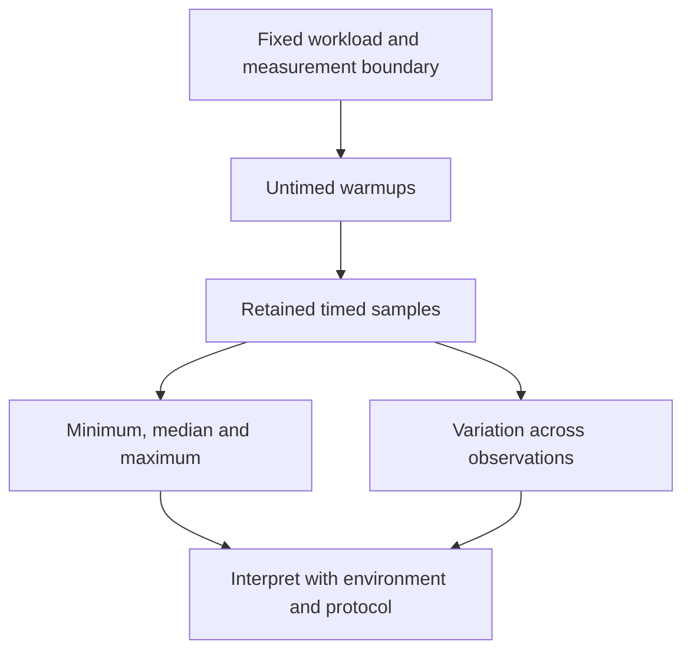

# [Benchmarking](../glossary.md#term-benchmarking)

## What you will learn

This guide defines evidence expected from Synaptik benchmarks and separates [benchmarking](../glossary.md#term-benchmarking) from
generic tuning transactions, bounded [Engine](../glossary.md#term-engine) composition, [planning](../glossary.md#term-planning) cost, and [runtime profiling](../glossary.md#runtime-profiling).
The `tools/benchmarks` project contains the report-only [CPU](../glossary.md#term-cpu) Engine [lifecycle](../glossary.md#lifecycle) harness and a fixed
[Metal](../glossary.md#term-metal) [singleton](../glossary.md#term-singleton)-`NEG` two-route harness. No benchmark result changes production settings.

## Prerequisites and terms

Read the [performance evidence and tuning boundary](../architecture/performance-evidence-and-tuning.md)
and the [performance glossary entries](../glossary.md#benchmark-report--benchmarking) before
designing a harness.

- **[Benchmarking](../glossary.md#term-benchmarking)** runs a fixed reproducible workload and reports measurements without changing
  production settings.
- A **[benchmark report](../glossary.md#term-benchmark-report)** is the rich [immutable](../glossary.md#term-immutable) evidence from one recorded benchmark [run](../glossary.md#term-run).
- **Phase-1 workload tuning** reuses or measures caller-supplied exact compatible local workloads
  and records selected backend-owned decisions in an explicit persistent workload cache.
- **Phase-2 complete-plan tuning** authenticates a reusable selected decision or checks and
  measures every member of one caller-supplied bounded complete-plan batch.
- **[Model autotuning](../glossary.md#autotuning--model-autotuning)** is the broader workflow that composes Phase 1 and Phase 2 around a model,
  representative inputs, target, policy, and fresh production preparation.
- **[Runtime profiling](../glossary.md#runtime-profiling)** passively observes actual [prepared execution](../glossary.md#prepared-execution--preparedexecution).

The **harness** is the program that sets up, repeats and measures the workload. A **[warmup](../glossary.md#term-warmup)** is
an untimed execution before retained measurements; it lets effects such as Java's [compilation](../glossary.md#compiler-engine-and-execution-stage-names) of
frequently used code occur, but does not prove that later measurements are stable. A **[timing sample](../glossary.md#benchmark-measurement-vocabulary)**
here is one retained timing observation, not a training example.

**[Latency](../glossary.md#term-latency)** is the elapsed time for a defined action, such as one complete run. **[Throughput](../glossary.md#term-throughput)** is
completed work per unit time, such as runs per second. They answer different questions: concurrent
work can increase throughput without reducing the time experienced by one request. Always name
the measured action and what its timing includes.

A **[regression](../glossary.md#term-regression)** is a loss of previously expected behavior, such as a wrong answer or slower
execution for a specified workload. A **regression test** checks a retained case to detect its
return. Timing variation alone is not enough to establish a performance regression; interpret
the comparison using its declared [measurement protocol](../glossary.md#term-measurement-protocol) and limits.

A **[performance distribution](../glossary.md#benchmark-measurement-vocabulary)** describes how measurements vary, rather than reducing them to one
number. The **minimum** is the smallest observation, the **maximum** the largest, and the
**[median](../glossary.md#term-median)** the middle after sorting. For an odd sample count, this guide's integer-middle rule
selects the single middle observation. A median alone cannot show occasional long delays or
explain their cause.

Read the following diagram from top to bottom: warmups are not retained timing samples, and summaries
describe the retained samples rather than replacing the evidence needed to interpret them.



## [Mental model](../glossary.md#term-mental-model)

```text
correctness tests -> is the result valid?
benchmark report  -> how did this fixed workload behave here?
Phase-1 tuning    -> which supplied complete local candidate has the lowest median elapsed time?
Phase-2 tuning    -> which supplied valid complete plan has the lowest median elapsed time?
model autotuning  -> how are those transactions composed for a model and production preparation?
runtime profiling -> what happened during actual prepared execution?
```

A benchmark answers only the second question. It never substitutes for unit, [conformance](../glossary.md#term-conformance), or
integration tests and never installs the fastest measured setting.

## Identify the caller before choosing a tool

- **A benchmark contributor** invokes Gradle's benchmark task. The harness supplies
  fixed values, invokes Engine or the prepared runner and writes measurements.
  A report is an observation, not an instruction to later preparation.
- **A tuning integration** calls `tools/tuning` with complete candidate descriptions,
  representative inputs and execution callbacks. In the public bounded path,
  Engine supplies those callbacks and coordinates preparation, run results and cleanup.
  The tuning tool orders and measures calls; it does not interpret CPU kernels.
- **A backend candidate producer** defines legal alternatives and decodes its own
  decisions. Returning the same opaque bytes is not enough to prove that a current
  producer still accepts them.

Here “caller-supplied” therefore does not always mean application code directly:
Engine can call the generic tool. Decision ownership means authority over candidate
meaning; resource ownership separately determines who must close an integration,
prepared execution or result. See the
[preparation boundary](../architecture/runtime-prepare-backend-boundary.md) for
those lifetimes and [passive diagnostics](debugging-trace.md) for observing actual
selection without changing it.

## Current tuning capabilities

### Phase 1: local workload [transaction](../glossary.md#term-transaction)

`tools/tuning` currently provides a generic caller-supplied cold workload tuner and a reusable,
bounded persistent workload [cache](../glossary.md#term-cache). The caller supplies stable [model](../glossary.md#term-model) and representative-profile
evidence [identities](../glossary.md#term-identity-meanings), original [occurrence](../glossary.md#term-occurrence) contexts and [weights](../glossary.md#term-weight), [backend](../glossary.md#backend)-owned compatibility and
candidate identities, complete candidate enumeration, a decision [codec](../glossary.md#term-codec), and one complete
candidate execution action on equivalent representative inputs.

The tuner loads and validates the complete explicit cache before candidate enumeration or
execution. It deduplicates exact compatible occurrences in encounter order. Compatible persistent
hits reuse the backend-decoded decision without enumerating or executing candidates. For each
miss, the tuner validates the complete [candidate batch](../glossary.md#candidate-batch) against the budget, performs the configured complete
[warmup](../glossary.md#term-warmup) and timed executions, calculates each candidate's integer-middle [median](../glossary.md#term-median), and retains the
first encountered candidate when medians tie. A successfully encoded decision must decode back to
an equal compatible decision before same-directory [atomic](../glossary.md#resource-transaction-and-rollback) cache [publication](../glossary.md#term-publication). Returned rich
evidence retains raw measured [timing samples](../glossary.md#benchmark-measurement-vocabulary) separately; cache-hit evidence has an empty candidate list
and retains only the compact stored winner summary.

[Engine](../glossary.md#term-engine) supplies a bounded public [CPU](../glossary.md#term-cpu) Phase-1 composition for one representative input set and at
most one local workload. A compatible hit executes no local trial. A miss uses the configured
warmup and timed-sample counts and chooses the lowest integer-middle median with encounter-order
ties. Engine authenticates that decision and passes it unchanged to CPU [complete-plan candidate](../glossary.md#complete-plan-candidate)
production; Phase 1 does not [prepare](../glossary.md#prepare) the returned production recipe. The backend retains
semantic, compatibility, candidate, decision, route, and resource [ownership](../glossary.md#term-ownership). Model extraction
and multiple-occurrence aggregation remain planned.

### Phase 2: complete-plan [transaction](../glossary.md#term-transaction)

`tools/tuning` also provides a generic bounded complete-plan transaction. The caller supplies
[model](../glossary.md#term-model), representative-profile, [target](../glossary.md#term-target), and policy fingerprints; an exact decision-empty [Prepare](../glossary.md#prepare)
[handoff](../glossary.md#term-handoff); a complete [backend](../glossary.md#backend)-owned [candidate batch](../glossary.md#candidate-batch); a correctness collaboration; a fresh complete
measurement action; and an explicit model-plan-[cache](../glossary.md#term-cache) path. The concrete [producer](../glossary.md#term-producer) owns candidate
meaning, legality, stable order and [identity](../glossary.md#term-identity-meanings), compatibility, reuse [scope](../glossary.md#term-scope), selected decisions, and
decision codecs. The caller owns representative inputs, preparation, execution, [canonical](../glossary.md#term-canonical-form)
[publication](../glossary.md#term-publication) copying, correctness-reference bytes, aggregate correctness-byte enforcement, and
cleanup.

On a measured transaction with `N` candidates, `W` warmups per candidate, and `S` timed [timing samples](../glossary.md#benchmark-measurement-vocabulary)
per candidate, the tool checks the exact whole-transaction execution count before running work:

Let $N$ be the positive integer number of candidates, $W\ge0$ the integer warmup
count per candidate, and $S$ the positive odd integer timed-sample count per
candidate. The total number of complete executions is

$$
E=N(1+W+S).
$$

The unit is executions, not nanoseconds: one correctness execution plus $W$
untimed and $S$ timed executions for each candidate. For $N=2$, $W=1$ and $S=3$,
$E=2(1+1+3)=10$: two correctness runs, two warmups and six timed runs. This exact
integer accounting is checked against the declared ceiling before work starts;
it is not a floating-point time estimate.

All `N` correctness actions finish before the first [warmup](../glossary.md#term-warmup) or sample. The first candidate [captures](../glossary.md#term-capture-meanings)
an [opaque](../glossary.md#term-opaque) reference; every later candidate must exactly match it. A clean mismatch stops the
transaction without timing, a result, or cache publication. Caller execution and cleanup failures
remain failures rather than being reclassified as mismatches. After correctness succeeds, each
candidate receives its complete warmups and samples. Selection uses the smallest integer-middle
[median](../glossary.md#term-median) elapsed nanoseconds and retains the first candidate on a tie.

Reuse behavior is producer-declared. `SESSION` is a strict no-filesystem transaction: the cache
path is retained in the request but is never inspected or published. `PERSISTENT` validates the
entire bounded, checksummed cache before candidate enumeration. An exact-key entry is a hit only if
the current producer decodes it as compatible. Such a hit performs no enumeration, correctness,
warmup, or timing. A persistent miss is published only after the selected decision encodes within
the bound and decodes back to an equal compatible decision.

The persistent cache is compact: it contains opaque compatibility-key material, the selected
decision and winner identities, and the winner's minimum/median/maximum/count summary. The
returned evidence is deliberately richer. A measured result contains ordered correctness actions
and every raw [timing sample](../glossary.md#benchmark-measurement-vocabulary); a cache-hit result identifies its source and selected summary but has
no fabricated candidate measurements. Neither [artifact](../glossary.md#term-artifact) serializes an executable, [Runtime](../glossary.md#term-runtime) state,
representative publication bytes, or the opaque correctness reference.

The generic transaction, declarative Config inputs, [CPU](../glossary.md#term-cpu) producer, and bounded public [Engine](../glossary.md#term-engine)
composition are current. Engine passes the authenticated Phase-1 decision unchanged to the CPU
producer, freshly prepares every correctness, warmup, and timed action, and completes every exact
canonical-byte correctness action before timing. It authenticates the Phase-2 winner, cleans the
representative session, and prepares exactly one fresh selected production recipe. The tools
layer still owns transaction ordering, bounds, timing, comparison, and compact records; it does
not own Engine execution or CPU candidate meaning.

Current CPU complete-plan [candidate batches](../glossary.md#candidate-batch) declare `SESSION`, so they neither read nor write the
persistent model-plan cache. The explicit path is still passed unchanged, keeping Engine's mapping
valid for a future `PERSISTENT` producer without claiming current persistent CPU reuse.

## Current declarative Config request

`modules/config` now provides [`ModelAutotuningConfig`](../glossary.md#model-autotuning-request-facade--modelautotuningconfig), an [immutable](../glossary.md#term-immutable) request [facade](../glossary.md#term-facade) separate from
the operational tool-local `WorkloadTuningRequest`. Possessing the Config value means tuning was
requested; there is no enabled flag, disabled sentinel, implicit default, or default [cache](../glossary.md#term-cache) path.
It stores exactly seven ordered user-owned inputs: the minimum-[median](../glossary.md#term-median)-elapsed-nanoseconds
[objective](../glossary.md#term-objective); a four-count Phase-1 [sampling](../glossary.md#term-sampling-machine-learning-and-hyperparameters) budget; one [opaque](../glossary.md#term-opaque) [schema](../glossary.md#term-schema)-versioned
[representative-profile identity](../glossary.md#representative-profile-identity); a fallback policy; an explicit workload-cache path; an
independent five-count Phase-2 `CompletePlanBudget`; and an explicit [model](../glossary.md#term-model)-plan-cache path.

The two budgets deliberately do not share timing policy. Phase 1 owns maximum distinct misses,
maximum local candidates per miss, warmups, and timed [timing samples](../glossary.md#benchmark-measurement-vocabulary). Phase 2 owns maximum complete-plan
candidates, its own warmups and positive odd timed samples, a positive total-execution ceiling,
and a non-negative aggregate [canonical](../glossary.md#term-canonical-form)-[publication](../glossary.md#term-publication) correctness ceiling in bytes. Later Phase-2
[preflight](../glossary.md#term-preflight) evaluates the actual candidate count using $E=N(1+W+S)$ as defined above. The byte ceiling is
neither a cache-file limit nor a per-result allocation promise.

The Config value stores [identity](../glossary.md#term-identity-meanings) and policy, not work or execution state. Its representative
profile is an immutable byte [snapshot](../glossary.md#term-snapshot) that identifies evidence; actual representative inputs,
[Shapes](../glossary.md#shape), model [fingerprint](../glossary.md#term-fingerprint), occurrences, [backend](../glossary.md#backend) candidate [candidate batches](../glossary.md#candidate-batch), cache contents, and execution
resources do not enter Config. Constructing the facade performs no cache I/O, measurement,
selection, preparation, [Engine](../glossary.md#term-engine) orchestration, or [Runtime](../glossary.md#term-runtime) work.

Current Engine maps the objective and both budgets explicitly, copies the profile identity, and
passes the exact workload-cache and model-plan paths. `ModelAutotuningRequest` separately supplies live representative
[Tensors](../glossary.md#tensor) and a caller-defined model identity. That identity labels evidence only; it is not a [cache
key](../glossary.md#term-cache-key) or proof of equivalent model behavior. `REQUIRE_TUNED_RESULT` is strict, while
`ALLOW_SAFE_HEURISTIC` permits abandoning a tuning
[transaction](../glossary.md#term-transaction) that cannot yield a complete result and continuing through ordinary safe [heuristic](../glossary.md#term-heuristic)
preparation. Safe fallback does not make corrupt or incompatible cache data a hit, admit a
candidate, relax numerical requirements, accept a partial result, or suppress an unrelated
preparation failure. `TUNED` carries evidence; `SAFE_HEURISTIC_FALLBACK` carries none.

## Inspecting current tuning [artifacts](../glossary.md#term-artifact) and evidence

`TuningInspection` provides a cold, read-only diagnostic report ([report view](../glossary.md#term-view-meanings)) of the two current compact [cache](../glossary.md#term-cache)
formats and of rich evidence that a tuning result already contains. Here a view
means a presentation of evidence, not a Tensor descriptor aliasing another Tensor's storage:


```text
Path or byte[] cache snapshot -> compact redacted artifact report
existing result evidence      -> detached rich evidence summary
```

For a Path, inspection opens one read-only [I/O channel](../glossary.md#term-io-channel)
(a file-reading connection, not a neural-network feature axis), bounds the [snapshot](../glossary.md#term-snapshot) to 16 MiB before
allocation, reads the observed length, and probes once for growth. A missing [target](../glossary.md#term-target) returns a
`MISSING` report. Permission, directory, and ordinary read failures remain `IOException`; malformed
content returns `INVALID` with a typed reason. Inspection creates no file, temporary file, lock,
repair, or replacement. A same-length concurrent rewrite can only be judged from the bytes read
and their [checksum](../glossary.md#term-checksum), and bytes appended after the final probe are outside that snapshot.

The `byte[]` overloads enforce the same 16 MiB bound before making a defensive snapshot. They do
not mutate or retain the caller array. Both input forms validate the [schema](../glossary.md#term-schema)-1 checksum, structure,
65,536-entry limit, 1 MiB [opaque](../glossary.md#term-opaque)-field limit, summaries, and [canonical](../glossary.md#term-canonical-form) order. Reports replace every
opaque [identity](../glossary.md#term-identity-meanings), decision, and winner with its schema when present, byte length, and lowercase
[SHA-256](../glossary.md#term-sha-256) [digest](../glossary.md#term-digest). A digest distinguishes content but does not authenticate its writer.

Supplying a workload or [model](../glossary.md#term-model)-plan expectation adds deterministic stored-key comparison. A
mismatch report lists every directly provable difference in key-field order. Exact equality
reports `KEY_MATCH_REQUIRES_BACKEND_DECODER`, because only the current [producer](../glossary.md#term-producer)-owned decoder can
decide whether opaque decision bytes remain compatible. A `SESSION` expectation instead reports
that persistent reuse is forbidden. Inspection never proves freshness, legality, performance, or
executability and never invokes a decoder, prepares a plan, or runs work.

Evidence summarization is separate and performs no cache [lookup](../glossary.md#term-lookup). It redacts identities while
retaining rich facts already held in memory: workload occurrences and [weights](../glossary.md#term-weight), measured raw
nanosecond [timing samples](../glossary.md#benchmark-measurement-vocabulary), complete-plan correctness actions, compact summaries, sources, and winners.
Cache-hit evidence has no fabricated measurement or correctness rows. Compact files cannot recover
these facts: workload files omit model/profile and [occurrence](../glossary.md#term-occurrence) [provenance](../glossary.md#provenance), both formats omit raw
samples and reuse [scope](../glossary.md#term-scope), and model-plan files omit correctness actions.

There is no command-line renderer or automatic [Engine](../glossary.md#term-engine)/[Runtime](../glossary.md#term-runtime) composition for these reports.
Callers may inspect a known Path or already-loaded byte array, or summarize an existing result,
but the [API](../glossary.md#term-application-programming-interface-api) performs no [backend](../glossary.md#backend) decoding, trust verification, migration, or repair.

## Benchmark workloads and reports

Future benchmark suites may contain four fixed workload levels:

- one [operation](../glossary.md#operation) [occurrence](../glossary.md#term-occurrence);
- a representative operation-family workload;
- a complete [model](../glossary.md#term-model) workload; and
- end-to-end [compile](../glossary.md#compile), [prepare](../glossary.md#prepare), and [run](../glossary.md#term-run) workloads.

For every report, record the exact [commit](../glossary.md#term-commit), model or workload [identity](../glossary.md#term-identity-meanings), [JDK](../glossary.md#term-java-development-kit-jdk), operating system,
hardware, native-library versions, [warmup](../glossary.md#term-warmup) policy, measurement iterations, input data types and
[shapes](../glossary.md#shape), [backend](../glossary.md#backend) and supplied route/configuration, thread settings, [lifecycle](../glossary.md#lifecycle) boundary, and summary
statistics. Keep raw [timing samples](../glossary.md#benchmark-measurement-vocabulary) or equivalent [distribution](../glossary.md#term-distribution) evidence when the selected reporting
policy requires it.

Measurement evidence remains richer than any later compact [planning](../glossary.md#term-planning)-cost profile, workload tuning
[cache](../glossary.md#term-cache), or model-plan record. A production [artifact](../glossary.md#term-artifact) may retain selected values and [compatibility
identity](../glossary.md#identity-meanings-and-algebraic-identities); the report retains the environment, workload, candidates, samples, and statistics that
justify them.

## Complete conceptual example

### Inputs and initial state

Assume a future [operation](../glossary.md#operation) benchmark measures [matrix multiplication](../glossary.md#matrix-multiplication--matmul) `[64, 128] × [128, 32]` on one
recorded [CPU](../glossary.md#term-cpu) configuration. The fixed logical work is:

Let $A$ have $m=64$ rows and $k=128$ columns, and $B$ have $k=128$ rows and
$n=32$ columns. For zero-based output indices $0\le i<m$ and $0\le j<n$, the
real-number definition is

$$
C_{ij}=\sum_{q=0}^{k-1}A_{iq}B_{qj}.
$$

Each output receives $k$ multiplication contributions. Thus there are
$m n=64\cdot32=2048$ output elements and $mkn=64\cdot128\cdot32=262144$
multiplication contributions. These are exact logical counts, not elapsed time,
bytes or an instruction count: a route may fuse multiply/add instructions.
The backend's permitted rounded contraction, not this real-number identity,
determines actual floating values. This example has positive dimensions and does
not change empty-contraction, NaN, infinity or signed-zero rules.

### Procedure and intermediate evidence

The harness warms up according to the report policy, measures only the chosen [lifecycle](../glossary.md#lifecycle) stage,
and writes a report containing the fixed inputs, environment, supplied [CPU](../glossary.md#term-cpu) route [parameters](../glossary.md#term-parameter), raw
or aggregated [timing samples](../glossary.md#benchmark-measurement-vocabulary), and summary [statistic](../glossary.md#term-statistic).

### Result and interpretation

Running the same report definition on two [commits](../glossary.md#commit-release-distribution-log-and-seed-meanings) permits a performance comparison. The faster
result does not update a [CPU](../glossary.md#term-cpu) route threshold, [vector](../glossary.md#term-vector) strategy, thread count, workload tuning
[cache](../glossary.md#term-cache), or [model](../glossary.md#term-model)-plan cache. The current explicit tuning tools may instead [run](../glossary.md#term-run) a caller-supplied
bounded Phase-1 or Phase-2 [transaction](../glossary.md#term-transaction) and, when the [producer](../glossary.md#term-producer) permits persistent reuse, publish
their own compact cache entries. They do not mutate settings as a consequence of this [benchmark
report](../glossary.md#term-benchmark-report).

## Workload-[tuning candidate](../glossary.md#candidate-batch) spaces

Workload tuning belongs to `tools/tuning`, not the benchmark suite. A [concrete backend](../glossary.md#concrete-backend) owns typed,
version-controlled candidate generators beside its routes. An [operation](../glossary.md#operation) family selects the
appropriate generator, but [cache](../glossary.md#term-cache) reuse uses a [canonical workload signature](../glossary.md#canonical-workload-signature) that also includes
semantics and attributes, data types, [shapes](../glossary.md#shape), [layouts](../glossary.md#layout), relevant policies, and [target](../glossary.md#term-target)
compatibility. A single family-wide thread or [vector](../glossary.md#term-vector) value is not a valid general cache contract.

Hardware and supported [JDK](../glossary.md#term-java-development-kit-jdk) [Vector API](../glossary.md#term-vector-api) species constrain physical vector [lanes](../glossary.md#term-lane). A [CPU](../glossary.md#term-cpu) [candidate
generator](../glossary.md#candidate-generator) may return complete valid species/strategy, unroll, tile, parallelism, and [OpenBLAS](../glossary.md#term-openblas)
thread configurations. It cannot promise an arbitrary lane count or expose private knobs through
a generic [parameter](../glossary.md#term-parameter) map.

## Current benchmark commands

### [CPU](../glossary.md#term-cpu) [lifecycle](../glossary.md#lifecycle)

```bash
# Build the harness before measuring; a successful build is not a timing result.
./gradlew :tools:benchmarks:build
# Check that the bounded workloads and report path work with short sampling.
./gradlew :tools:benchmarks:benchmark -Pprofile=smoke
# Use the longer sampling policy without changing production route settings.
./gradlew :tools:benchmarks:benchmark -Pprofile=baseline
```

`CpuLifecycleBenchmark` [schema](../glossary.md#term-schema) 3 reports environment and VM [arguments](../glossary.md#term-argument), fixed input/output [shapes](../glossary.md#shape),
[compile](../glossary.md#compile) and [prepare](../glossary.md#prepare) timings, per-[timing sample](../glossary.md#benchmark-measurement-vocabulary) iteration counts, raw [candidate batch](../glossary.md#candidate-batch) and normalized repeated-[run](../glossary.md#term-run)
samples, minimum/[median](../glossary.md#term-median)/maximum summaries, raw one-shot totals, stable [FNV-1a](../glossary.md#term-fnv-1a) checksums, preferred
species bits/[lanes](../glossary.md#term-lane), loaded-class [hash](../glossary.md#term-hash), and evidence [metadata](../glossary.md#term-metadata). Execution uses public
`Engine.standard()`, [compilation](../glossary.md#compiler-engine-and-execution-stage-names), one reusable [`PreparedExecution`](../glossary.md#prepared-execution--preparedexecution), and explicit
`engine.run(prepared, inputs)` calls; timed repeated samples exclude
[host](../glossary.md#term-host) export and [checksum](../glossary.md#term-checksum) work. The checksum is materialized separately and any variation fails the
run.

[`smoke`](../glossary.md#term-smoke-test) uses six tiny lifecycle workloads with one [warmup](../glossary.md#term-warmup) and two measurements. `baseline` uses
the same shapes with three warmups and ten measurements. `evidence` uses representative
[pointwise](../glossary.md#term-pointwise), [matrix](../glossary.md#term-matrix-meanings)-[vector](../glossary.md#term-vector), [Conv2d](../glossary.md#convolution--conv2d), [Conv3d](../glossary.md#conv3d--ncdhw), reduction, and [normalization](../glossary.md#term-normalization) shapes with five warmups,
seven measurements, and three one-shot observations. Each retained repeated sample accumulates
timed executions until that sample reaches 25 ms; it retains all those executions and reports
their count. No undersized sample is retained.

The evidence [JVM](../glossary.md#term-java-virtual-machine-jvm) uses `-Xms1g -Xmx1g -XX:-TieredCompilation -Xbatch`; every profile adds
`--add-modules=jdk.incubator.vector` and `--enable-native-access=ALL-UNNAMED`.

The heap bounds fix the initial/maximum heap for the evidence process;
`-XX:-TieredCompilation` and `-Xbatch` constrain compilation behavior rather than
eliminating all warmup effects. `--add-modules` resolves the incubating Vector API;
`--enable-native-access` permits the configured Java/native calls. These are JVM
launch options, not alternate Model semantics or a public numerical profile.

[Gradle](../glossary.md#term-gradle) normalizes
profile spelling with `Locale.ROOT`, so `-Pprofile=EVIDENCE` receives the same flags as lowercase.
Evidence also requires explicit `benchmarkBaseRevision`, executable-source tree, source/configuration
and source-hash properties, [JVM fork](../glossary.md#term-jvm-fork)/order/[seed](../glossary.md#term-seed) properties, CPU [identity](../glossary.md#term-identity-meanings)/[features](../glossary.md#term-software-feature), and exact portable
worker, [materialization](../glossary.md#materialization), and [OpenBLAS](../glossary.md#term-openblas) policy values. It refuses to run when any is absent. CPU
0010M's [manifest](../glossary.md#term-manifest) retains the exact structured commands:
`modules/backend/cpu/evidence/cpu-0010m-defaults/manifest.json`.

Public [Engine](../glossary.md#term-engine) intentionally hides [backend](../glossary.md#backend)-private selected-plan facts. Schema 3 records that
limitation and sets `eligibleForProductionDecision=false`; its current reports can validate the
observational harness and machine-local baseline but cannot authorize a route/default change. A
future production comparison must additionally record and verify the actual selected route,
strategy, preferred species, range count, workers, materializations, and OpenBLAS selection.

### Interpret samples, process forks and ratios

A [JVM fork](../glossary.md#term-jvm-fork) here is a newly launched Java process
with fresh process state, not a forked copy of a Git repository. Measurements
within one process share compilation and thermal history; counting them as separate
independent process observations exaggerates the available evidence.

For one repeated sample, let $D>0$ be its total retained duration in nanoseconds
and $I>0$ its integer completed-execution count. The reported normalized time is
$t=D/I$ nanoseconds per execution. A hypothetical $D=30{,}000{,}000$ ns over
$I=100$ executions gives $t=300{,}000$ ns/execution, or $0.3$ ms/execution.
This is an arithmetic average over that batch, not its individual latency distribution.
The batch floor is a duration requirement; normalization does not manufacture more
independent samples. Rounding the printed number does not change the retained raw evidence.

For a positive odd count $S=2h+1$ of tuner timings sorted as
$t_{(1)}\le\cdots\le t_{(S)}$, with integer $h\ge0$, the integer-middle
median is $t_{(h+1)}$. For $[8,10,14]$ ns, it is $10$ ns. This is the tuners'
odd-sample rule, not an assertion that the two-sample smoke benchmark uses an odd count.

In a declared paired comparison, let $f$ be an integer pair index from 1 through
the protocol's positive process-pair count $F$, and let $m_{A,f}>0$ and $m_{B,f}>0$ be the respective
within-process median times for configurations A and B in process pair $f$.
The dimensionless ratio $r_f=m_{B,f}/m_{A,f}$ compares B to A: $r_f=0.8$ means
20% less elapsed time for B in that pair, not 20% higher throughput or a universal
speedup. Zero/missing timings cannot enter that division; failures stay failures.
The reviewed protocol, not a generic formula, chooses aggregation and uncertainty.

Such a comparison treats fresh [JVM forks](../glossary.md#term-jvm-fork), not within-fork samples, as independent units. Before
measurement, its reviewed task must seal [target](../glossary.md#term-target) strata, complete workload-policy cases,
deterministic randomized paired process order and seed, no retry/discard, paired fork-median
ratios, uncertainty calculation, per-family [regression](../glossary.md#term-regression) ceilings, and aggregate weighting/gate.
CPU 0010M's manifest records a minimum acceptance framework—not a measurement-[ready](../glossary.md#term-ready) protocol—and
why the earlier reports and pooled aggregates were invalidated.

The `evidence` profile remains report-only. A reviewed backend task may cite only reports that
satisfy its predeclared protocol and complete policy [scope](../glossary.md#term-scope); running the benchmark never changes a
route, threshold, [cache](../glossary.md#term-cache), or later preparation.

### [Metal](../glossary.md#term-metal) [singleton](../glossary.md#term-singleton)-NEG routes

The Metal benchmark is deliberately one workload rather than an [operation](../glossary.md#operation) or [Shape](../glossary.md#shape) [matrix](../glossary.md#term-matrix-meanings). It
compiles [canonical](../glossary.md#term-canonical-form) no-grad `FLOAT32 NEG` at Shape `[1_048_576]`, enumerates the
complete current `MetalLocalWorkloadTuning` pair, and prepares both [opaque](../glossary.md#term-opaque) candidates. It records
both routes and never selects a winner, calls `prepareTuned(...)`, uses complete-plan tuning, reads
or writes a [cache](../glossary.md#term-cache), applies a threshold, or changes a later preparation.

Generator [schema](../glossary.md#term-schema) 2 defines its zero-based input words exactly. Indices `0..15` are, in order:

```text
0x00000000 0x80000000 0x00000001 0x80000001
0x007fffff 0x807fffff 0x00800000 0x80800000
0x3f800000 0xbf800000 0x7f800000 0xff800000
0x7fc12345 0xffc54321 0x7fa12345 0xffa54321
```

For `i` in `16..1_048_575`, signed 64-bit arithmetic computes
`r = ((i * 17) % 101) - 50`. Because `i` is nonnegative, Java `%` yields `0..100` and `r` is
`-50..50`. Convert exact `r` and `101` to [binary32](../glossary.md#floating-point-precision-and-rounding), divide using Java's strict [IEEE 754](../glossary.md#term-ieee-754) binary32
[round-to-nearest, ties-to-even](../glossary.md#floating-point-precision-and-rounding) semantics, and retain `Float.floatToRawIntBits(r / 101.0f)`.
Expected output word `i` is input word `i XOR 0x80000000`; no floating arithmetic constructs the
[oracle](../glossary.md#term-test-oracle). Schema 2 reports the complete sentinel list and every formula/conversion/[rounding](../glossary.md#term-rounding) fact.

### Read the generated ordinary values without changing the oracle

For integer index $i$ in $16\le i\le1048575$, the signed integer generator above
is $r_i=(17i\bmod101)-50$, so $-50\le r_i\le50$. Let
$\operatorname{RN}_{32}$ mean binary32 round-to-nearest, ties-to-even. Both integers
are exactly representable, and the stored input is
$x_i=\operatorname{RN}_{32}(r_i/101)$. For $i=16$, the remainder is $70$,
$r_{16}=20$, and $x_{16}$ approximates $20/101$, rather than an exact real quotient.
The NEG oracle flips the sign bit of the stored word, including the sentinel NaNs,
infinities and signed zeros; it is deliberately not recomputed using approximate
real arithmetic. The first sixteen literal words above remain the exact sentinel evidence.

Build the [native bridge](../glossary.md#term-native-bridge), then [run](../glossary.md#term-run) the bounded [smoke](../glossary.md#term-smoke-test) profile:

```bash
# Produce the native bridge explicitly; the benchmark will not discover or build it.
./modules/backend/metal/macos-arm64/build.sh
# Pass this build's absolute library path so the measured native input is identifiable.
SYNAPTIK_METAL_TEST_LIBRARY="$PWD/modules/backend/metal/macos-arm64/build/libsynaptik_metal_foundation.dylib" \
  ./gradlew -q :tools:benchmarks:metalBenchmark -Pprofile=smoke
```

The environment variable must contain an absolute regular-file path. The benchmark neither
discovers nor packages the [dylib](../glossary.md#term-dylib). It first opens a separate traced integration with a synchronized
[thread-safe](../glossary.md#term-thread-safe) event collector, prepares and runs both candidates, and exact-byte-checks their outputs.
After each candidate run it takes one [immutable](../glossary.md#term-immutable) event [snapshot](../glossary.md#term-snapshot) before checking the unchanged
prefix and exactly appended [PREPARE](../glossary.md#prepare) structure/outcome plus RUN plan/outcome events in order. It
requires successful `CUSTOM_KERNEL`/`GRAPH_EXECUTABLE` outcomes with `NOT_QUERIED`, then closes
that integration before opening the ordinary no-[trace](../glossary.md#trace) integration used for every retained timing.
Candidate [identities](../glossary.md#term-identity-meanings) must match across the two integrations.

Timed execution is exactly `PreparedExecutionRunner.run(...) + RunResult.close()`. It includes
fresh [Runtime](../glossary.md#term-runtime) output/workspace allocation, [synchronous](../glossary.md#term-synchronous) native invocation/wait, and run-owned
cleanup. It excludes [compile](../glossary.md#compile), candidate enumeration, prepare, caller upload, trace work, [host](../glossary.md#term-host)
download, [checksum](../glossary.md#term-checksum), [JSON](../glossary.md#term-json) construction, and integration cleanup. Before [warmup](../glossary.md#term-warmup) and after every
retained [candidate batch](../glossary.md#candidate-batch), an untimed run downloads all 1,048,576 results and compares their raw words with
the fixed input words XOR `0x80000000`. The report retains all iteration counts, raw batch
durations, normalized run durations, checksums, and min/[median](../glossary.md#term-median)/max summaries.

`smoke` uses two paired warmup and two paired measurement rounds with orders `A,B` then `B,A`.
`baseline` uses four paired warmup and eight paired measurement rounds, alternating the same
orders. Every baseline route batch accumulates all executions until it reaches 25 ms, subject to
the fixed 1,000,000-execution ceiling; no [timing sample](../glossary.md#benchmark-measurement-vocabulary), retry, [outlier](../glossary.md#term-outlier), or failure is discarded or
replaced. One fresh [JVM](../glossary.md#term-java-virtual-machine-jvm) invocation is the independent unit. Its within-process samples and paired
rounds are correlated.

Baseline uses and validates
`-Xms1g -Xmx1g -XX:-TieredCompilation -Xbatch --enable-native-access=ALL-UNNAMED`. Supply every
required fact explicitly:

```bash
# Replace the angle-bracket metadata values before use; they label this exact evidence process.
# -q keeps Gradle chatter out of the harness's single JSON document on stdout.
SYNAPTIK_METAL_TEST_LIBRARY="$PWD/modules/backend/metal/macos-arm64/build/libsynaptik_metal_foundation.dylib" \
  ./gradlew -q :tools:benchmarks:metalBenchmark -Pprofile=baseline \
  -PbenchmarkBaseRevision=<revision> \
  -PbenchmarkSourceIdentity=<identity> \
  -PbenchmarkGitTreeObjectSha1=<tree-oid> \
  -PbenchmarkHarnessSourceSha256=<sha256> \
  -PbenchmarkHostIdentity=<host-and-model> \
  -PbenchmarkMetalDeviceIdentity=<device> \
  -PbenchmarkOsBuild=<product-and-build> \
  -PbenchmarkNativeBuildIdentity=<xcode-clang-sdk> \
  -PbenchmarkPowerState=<state> \
  -PbenchmarkThermalState=<state-or-explicit-unknown> \
  -PbenchmarkFork=<positive-integer>
```

The Metal route report uses JSON schema 2. It labels caller-supplied host facts, [hashes](../glossary.md#term-hash) the loaded
benchmark class and exact dylib,
records the real library path, JVM and OS facts, fixed workload, protocol, compile/enumeration/
prepare durations, and two complete route rows. It always reports
`eligibleForProductionDecision=false`, `autotuningEvidence=false`, and
`selectionMode=fixed-candidate-enumeration-no-winner`. It writes one JSON document only to
standard output; the harness creates no report, baseline, [manifest](../glossary.md#term-manifest), cache, or other retained
[artifact](../glossary.md#term-artifact). Its `profile` field names only the `smoke` or `baseline` [sampling](../glossary.md#term-sampling-machine-learning-and-hyperparameters) protocol; there is no
`numericalProfile` field or [graph](../glossary.md#graph)-wide numerical selector. Missing [metadata](../glossary.md#term-metadata)/JVM flags, wrong
host/library, candidate or trace changes, raw-bit
mismatch, iteration ceiling, and floor violation fail nonzero rather than producing a successful
partial or `unavailable` report.

Default and portable [CI](../glossary.md#term-continuous-integration-ci) may run `:tools:benchmarks:build` and Javadocs without a dylib.
`metalBenchmark` is not wired into `build` or `check`. An opt-in dedicated Apple-silicon runner may
use `smoke` only as a functional schema/route/correctness check and must not gate on timing.
`baseline` belongs on a controlled local or dedicated host. Any route/default decision requires a
separately reviewed multi-[JVM-fork](../glossary.md#term-jvm-fork), multi-[target](../glossary.md#term-target) statistical protocol; this fixed report is not that
protocol.

## Typical mistakes

| Symptom | Cause | Correction |
|---|---|---|
| A result cannot be reproduced | Environment or workload inputs were omitted. | Record the complete workload and environment. |
| [Compile](../glossary.md#compile) time is mixed into [run](../glossary.md#term-run) time | [Lifecycle](../glossary.md#lifecycle) boundaries were not isolated. | Report compile, [prepare](../glossary.md#prepare), and run measurements separately. |
| A benchmark changes a later run's settings | Reporting was confused with tuning. | Remove side effects; use the explicit [model](../glossary.md#term-model)-[autotuning](../glossary.md#autotuning--model-autotuning) workflow. |
| One [vector](../glossary.md#term-vector) or thread value is applied everywhere | [Operation](../glossary.md#operation) family was incorrectly used as a universal [cache key](../glossary.md#term-cache-key). | Key reuse by [canonical workload signature](../glossary.md#canonical-workload-signature) and keep candidate vocabulary [backend](../glossary.md#backend)-owned. |
| Faster code changes numerical behavior | Performance was accepted without correctness evidence. | Run reference and [conformance](../glossary.md#term-conformance) tests before interpreting speed. |
| Complete plans are timed before comparison | Correctness and timing were mixed. | Complete every Phase-2 correctness action before the first [warmup](../glossary.md#term-warmup) or timed [timing sample](../glossary.md#benchmark-measurement-vocabulary). |
| A session-only [CPU](../glossary.md#term-cpu) plan appears reusable after inspection | Stored-key equality was mistaken for backend [authentication](../glossary.md#term-authentication). | Treat `SESSION` as ineligible and a persistent exact-key match as decoder-required. |
| Within-[JVM-fork](../glossary.md#term-jvm-fork) samples are treated as independent forks | Correlated samples inflated the apparent evidence count. | Use fresh [JVM fork](../glossary.md#term-jvm-fork) medians and paired fork ratios as the primary units. |
| A public lifecycle report is used to infer a private route | Supplied configuration was mistaken for actual selected-plan evidence. | Record verified backend plan facts or mark the report ineligible for a production decision. |

The harness uses `System.nanoTime()` around [synchronous](../glossary.md#term-synchronous) [Engine](../glossary.md#term-engine) lifecycle calls; it is a
[microbenchmark](../glossary.md#term-microbenchmark) observation subject to [JVM](../glossary.md#term-java-virtual-machine-jvm) warmup, scheduler, thermal, and OS noise. It is not a
[release](../glossary.md#term-release) gate. The benchmark does not select routes, tune settings, write caches, or substitute
for correctness/conformance tests. If a CPU capability or native prerequisite is unavailable,
the [JSON](../glossary.md#term-json) report records an explicit `status: unavailable` row and the backend exception rather
than fabricating timings.

## Related documentation

- [Performance discipline in `AGENTS.md`](../../AGENTS.md)
- [Performance evidence and tuning](../architecture/performance-evidence-and-tuning.md)
- [CPU kernel strategy](../design/notes/cpu-kernel-strategy.md)
- [Benchmark master plan](../planning/tools/benchmarks/master-plan.md)
- [Tuning master plan](../planning/tools/tuning/master-plan.md)
