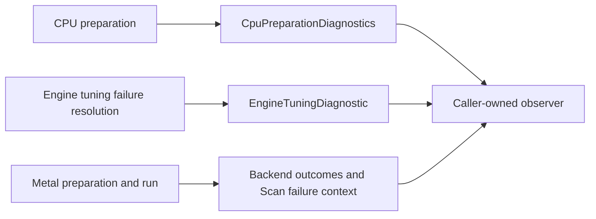

# Diagnose preparation and execution failures

## Outcome

Observe why CPU preparation selected a route, why ordinary Engine autotuning used its configured
heuristic fallback or rejected a request, and where Metal Scan validation failed. Observers are
optional and caller-owned. The ordinary overloads create no diagnostic producer, event IDs or
clock readings. There is no generic log file, serializer or trace viewer.

## Where to observe



Every event uses the existing `TraceEvent` envelope. Read the typed payload instead of parsing
exception text to select a route or recovery policy. Events contain detached facts, not graph,
Tensor, storage, native-handle or Throwable references. Monotonic timestamps are not wall-clock
times; compare them only within the producer's documented clock domain.

## CPU: configured policy is not the selected implementation

Opt in when opening the integration. This fragment uses an existing supported Tensor `input`:

```java
var events = new java.util.concurrent.CopyOnWriteArrayList<
        io.github.pho001.synaptik.trace.TraceEvent<
                ? extends io.github.pho001.synaptik.trace.TracePayload>>();
try (var engine = io.github.pho001.synaptik.engine.Engine.builder()
        .takeOwnership(io.github.pho001.synaptik.backend.cpu.CpuBackendIntegration
                .open(events::add))
        .build()) {
    var value = engine.compute(input.neg());
    for (var event : events) {
        if (event.payload() instanceof
                io.github.pho001.synaptik.backend.cpu.CpuPreparationDiagnostics cpu) {
            System.out.println(cpu.stage() + " " + cpu.selectedRoute());
        }
    }
}
```

For an explicitly configured oneDNN library, use
`CpuBackendIntegration.openOneDnn(absolutePath, api, observer)`. Opening alone emits nothing;
ordinary preparation emits `SELECTED` followed by `FINALIZED`, sharing `preparationId`.
`ANALYSIS_FAILED` or `FINALIZATION_FAILED` identifies the failed boundary instead.

Inspect `configuredApi`, `selectedRoute` and each selected unit's `nativeApi` separately.
A `GRAPH` preference does not prove that Graph or even oneDNN was selected. An ONEDNN partition
may still retain ordinary CPU units. Rejection facts distinguish unqualified geometry,
unsupported realization, an actual native unsupported status, and unit/whole-plan cost decisions.
`NOT_CONFIGURED` and `COMPARISON_SKIPPED` mean no corresponding native comparison was performed.
Each of the unit and rejection lists retains at most 32 facts and has its own truncation flag.
Failure status is present only when the producer actually received that primary native status.
These CPU observations are cold PREPARE facts, not per-element or RUN instrumentation.

## Autotuning: observe fallback without changing its policy

Given an existing `engine`, compiled `graph` and `ModelAutotuningRequest request`:

```java
var events = new java.util.concurrent.CopyOnWriteArrayList<
        io.github.pho001.synaptik.trace.TraceEvent<
                io.github.pho001.synaptik.engine.EngineTuningDiagnostic>>();
var preparation = engine.prepareTuned(graph, request, events::add);
try (var prepared = preparation.preparedExecution()) {
    // Run with the graph's ordinary inputs and consume results before closing them.
}
```

At most one terminal PREPARE event identifies `LOCAL_WORKLOAD` or `COMPLETE_PLAN` and the
producer-known reason: `NO_ELIGIBLE_HANDOFF`, `CACHE_IO`, `CORRECTNESS_MISMATCH` or
`OTHER_TUNING_FAILURE`. `SAFE_HEURISTIC_FALLBACK` means the configured fallback completed
successfully and tuning evidence remains empty. `REJECTED` means the request required a tuned
result; the original failure is rethrown. A successful tuned request emits no failure-resolution
event. The event ID is transaction-local, not a global correlation ID.

This overload does not enable fallback or add retries. Observer exceptions do not replace
business results or primary failures. Do not recursively close the Engine from its callback;
the existing admitted-operation lifecycle rejects self-close. Session-only Metal tuning does
not inspect or publish either supplied persistent-cache path.

## Metal: inspect the actual route and failing Scan coordinate

Open through `MetalBackendIntegration.open(configuration, observer)`. Ordinary preparation and
invocation outcomes correlate by prepared-unit ID and report the actual route. There is no
Metal executable/preparation cache lookup: `NOT_QUERIED` is not a cache miss.

A Scan validation failure additionally emits `MetalScanValidationFailure`. Its native category is
1 for index bounds, 2 for duplicate target and 3 for a noncanonical BOOL value. Read `time`,
`unit`, `operand` and `ordinal`; time is the original sequence coordinate, including in reverse
traversal. Unit `-1` identifies a binder/publication role rather than a compiled body instruction.
The public exception retains its native failure cause. Context is obtained from the bounded,
run-private first-failure record, not by replaying the body or copying tensor values. Inactive
sequence cells remain unread; a source-only active BOOL still validates before publication.

For BFLOAT16/FLOAT16, `LowPrecisionTraceMetadata.selectedRoute` reports the fixed
`CUSTOM_KERNEL` route and `logicalDtypeTuple` orders feeds before targets. FLOAT32 working
arithmetic is a Model guarantee, not an extra trace policy, certificate or accumulator field.
Raw movement preserves represented words. FP8 remains outside Metal's domain.

## When no event appears

The no-observer overload intentionally does no diagnostic work. Other causes include a failure
before the producer's observation boundary or a contained diagnostic failure. An absent event
is not proof that no work or failure occurred. Callbacks must be thread-safe; correlation comes
from typed IDs, not list adjacency across concurrent preparations. Tracing is observational:
it neither changes capability answers nor selects a numerical policy or runtime fallback.

See [tracing architecture](../architecture/tracing.md),
[CPU native configuration](../backend-guide/cpu-backend.md#explicit-onednn-composition),
[Metal guide](../backend-guide/metal-backend.md) and
[public API status](../reference/index.md).
