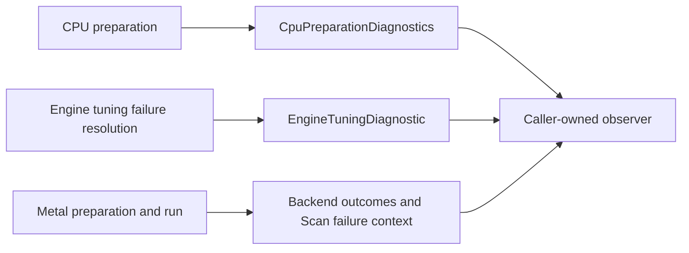

# Diagnose preparation and execution failures

## Outcome

Observe why [CPU](../glossary.md#term-cpu) preparation selected a route, why ordinary [Engine](../glossary.md#term-engine) [autotuning](../glossary.md#autotuning--model-autotuning) used its configured
[heuristic](../glossary.md#term-heuristic) fallback or rejected a request, and where [Metal](../glossary.md#term-metal) [Scan](../glossary.md#term-cumulative-scan) [validation](../glossary.md#term-validation) failed. Observers are
optional and caller-owned. The ordinary overloads create no diagnostic [producer](../glossary.md#term-producer), event IDs or
clock readings. There is no generic [log](../glossary.md#term-log) file, serializer or [trace](../glossary.md#trace) viewer.

An **[observer](../glossary.md#term-observer)** is a [callback](../glossary.md#term-callback) supplied by the caller to receive diagnostic events. A **trace**
records facts about work at selected observation points; it is not a second execution controller.
Each event has an **envelope** containing common identification information and a **[payload](../glossary.md#artifact-envelope-and-atomic-publication)**
containing the producer's specific facts. A **route** is the [backend](../glossary.md#backend)'s chosen implementation path,
not merely the caller's preferred configuration.

## Where to observe



Read the diagram from each [producer](../glossary.md#term-producer) on the left to the shared [observer](../glossary.md#term-observer) on the right. The three
producers explain different boundaries; receiving an event from one does not enable the others.

Every event uses the existing `TraceEvent` envelope. Read the typed [payload](../glossary.md#artifact-envelope-and-atomic-publication) instead of parsing
exception text to select a route or recovery policy. Events contain [detached](../glossary.md#detached-model-results) facts, not [graph](../glossary.md#graph),
[Tensor](../glossary.md#tensor), storage, native-handle or Throwable references. Monotonic timestamps are not wall-clock
times; compare them only within the producer's documented clock domain.

A **correlation identifier** connects facts about the same preparation or invocation without
retaining the live objects. **Detached** facts remain usable without keeping those objects alive.
A **[monotonic clock](../glossary.md#term-monotonic-clock)** measures elapsed progression rather than a calendar date: two timestamps
are comparable only when they share the documented clock source and [scope](../glossary.md#term-scope).

## [CPU](../glossary.md#term-cpu): configured policy is not the selected implementation

Opt in when opening the integration. This fragment uses an existing supported [Tensor](../glossary.md#tensor) `input`:

```java
var events = new java.util.concurrent.CopyOnWriteArrayList<
        io.github.pho001.synaptik.trace.TraceEvent<
                ? extends io.github.pho001.synaptik.trace.TracePayload>>();
try (var engine = io.github.pho001.synaptik.engine.Engine.builder()
        .takeOwnership(io.github.pho001.synaptik.backend.cpu.CpuBackendIntegration
                .open(events::add))
        .build()) {
    var value = engine.compute(input.neg());
    for (var event : events) {
        if (event.payload() instanceof
                io.github.pho001.synaptik.backend.cpu.CpuPreparationDiagnostics cpu) {
            System.out.println(cpu.stage() + " " + cpu.selectedRoute());
        }
    }
}
```

For an explicitly configured [oneDNN](../glossary.md#term-onednn) library, use
`CpuBackendIntegration.openOneDnn(absolutePath, api, observer)`. Opening alone emits nothing;
ordinary preparation emits `SELECTED` followed by `FINALIZED`, sharing `preparationId`.
`ANALYSIS_FAILED` or `FINALIZATION_FAILED` identifies the failed boundary instead.

Inspect `configuredApi`, `selectedRoute` and each selected unit's `nativeApi` separately.
A [`GRAPH`](../glossary.md#graph) preference does not prove that Graph or even oneDNN was selected. An ONEDNN [partition](../glossary.md#partition)
may still retain ordinary CPU units. Rejection facts distinguish unqualified geometry,
unsupported realization, an actual native unsupported status, and unit/whole-plan cost decisions.
`NOT_CONFIGURED` and `COMPARISON_SKIPPED` [mean](../glossary.md#term-mean) no corresponding native comparison was performed.
Each of the unit and rejection lists retains at most 32 facts and has its own [truncation](../glossary.md#term-truncation-toward-zero) flag.
Failure status is present only when the [producer](../glossary.md#term-producer) actually received that primary native status.
These CPU observations are cold [PREPARE](../glossary.md#prepare) facts, not per-[element](../glossary.md#term-element) or [RUN](../glossary.md#term-run) instrumentation.

## [Autotuning](../glossary.md#autotuning--model-autotuning): observe fallback without changing its policy

Given an existing [`engine`](../glossary.md#term-engine), compiled [`graph`](../glossary.md#graph) and `ModelAutotuningRequest request`:

```java
var events = new java.util.concurrent.CopyOnWriteArrayList<
        io.github.pho001.synaptik.trace.TraceEvent<
                io.github.pho001.synaptik.engine.EngineTuningDiagnostic>>();
var preparation = engine.prepareTuned(graph, request, events::add);
try (var prepared = preparation.preparedExecution()) {
    // Run with the graph's ordinary inputs and consume results before closing them.
}
```

At most one terminal [PREPARE](../glossary.md#prepare) event identifies `LOCAL_WORKLOAD` or `COMPLETE_PLAN` and the
[producer](../glossary.md#term-producer)-known reason: `NO_ELIGIBLE_HANDOFF`, `CACHE_IO`, `CORRECTNESS_MISMATCH` or
`OTHER_TUNING_FAILURE`. `SAFE_HEURISTIC_FALLBACK` means the configured fallback completed
successfully and tuning evidence remains empty. `REJECTED` means the request required a tuned
result; the original failure is rethrown. A successful tuned request emits no failure-resolution
event. The event ID is [transaction](../glossary.md#term-transaction)-local, not a global correlation ID.

This overload does not enable fallback or add retries. [Observer](../glossary.md#term-observer) exceptions do not replace
business results or primary failures. Do not recursively close the Engine from its [callback](../glossary.md#term-callback);
the existing admitted-[operation](../glossary.md#operation) [lifecycle](../glossary.md#lifecycle) rejects self-close. Session-only [Metal](../glossary.md#term-metal) tuning does
not inspect or publish either supplied persistent-[cache](../glossary.md#term-cache) path.

## [Metal](../glossary.md#term-metal): inspect the actual route and failing [Scan](../glossary.md#term-cumulative-scan) [coordinate](../glossary.md#axis-rank-scalar-vector-and-matrix)

Open through `MetalBackendIntegration.open(configuration, observer)`. Ordinary preparation and
invocation outcomes correlate by prepared-unit ID and report the actual route. There is no
Metal executable/preparation [cache](../glossary.md#term-cache) [lookup](../glossary.md#term-lookup): `NOT_QUERIED` is not a [cache miss](../glossary.md#cache-and-memoization).

A Scan [validation](../glossary.md#term-validation) failure additionally emits `MetalScanValidationFailure`. Its native category is
1 for index bounds, 2 for duplicate [target](../glossary.md#term-target) and 3 for a noncanonical [BOOL](../glossary.md#data-type--datatype) value. Read `time`,
`unit`, `operand` and `ordinal`; time is the original sequence coordinate, including in reverse
traversal. Unit `-1` identifies a binder/[publication](../glossary.md#term-publication) role rather than a compiled body instruction.
The public exception retains its native failure cause. Context is obtained from the bounded,
[run](../glossary.md#term-run)-private first-failure record, not by replaying the body or copying [tensor](../glossary.md#tensor) values. Inactive
sequence cells remain unread; a source-only active BOOL still validates before publication.

For [BFLOAT16](../glossary.md#term-bfloat16)/[FLOAT16](../glossary.md#term-float16), `LowPrecisionTraceMetadata.selectedRoute` reports the fixed
`CUSTOM_KERNEL` route and `logicalDtypeTuple` orders feeds before targets. [FLOAT32](../glossary.md#term-float32) [working
arithmetic](../glossary.md#accumulator-type) is a [Model](../glossary.md#term-model) guarantee, not an extra [trace](../glossary.md#trace) policy, [certificate](../glossary.md#formal-proof-certificate-and-trusted-assumptions) or [accumulator](../glossary.md#accumulator-type) field.
Raw movement preserves represented words. [FP8](../glossary.md#term-fp8) remains outside Metal's domain.

## When no event appears

The no-[observer](../glossary.md#term-observer) overload intentionally does no diagnostic work. Other causes include a failure
before the [producer](../glossary.md#term-producer)'s observation boundary or a contained diagnostic failure. An absent event
is not proof that no work or failure occurred. Callbacks must be [thread-safe](../glossary.md#term-thread-safe); correlation comes
from typed IDs, not list adjacency across concurrent preparations. Tracing is observational:
it neither changes capability answers nor selects a numerical policy or [runtime](../glossary.md#term-runtime) fallback.

See [tracing architecture](../architecture/tracing.md),
[CPU native configuration](../backend-guide/cpu-backend.md#explicit-onednn-composition)<span data-glossary-navigation="true"> ([CPU glossary](../glossary.md#term-cpu))</span>,
[Metal guide](../backend-guide/metal-backend.md)<span data-glossary-navigation="true"> ([Metal glossary](../glossary.md#term-metal))</span> and
[public API status](../reference/index.md)<span data-glossary-navigation="true"> ([API glossary](../glossary.md#term-application-programming-interface-api))</span>.
