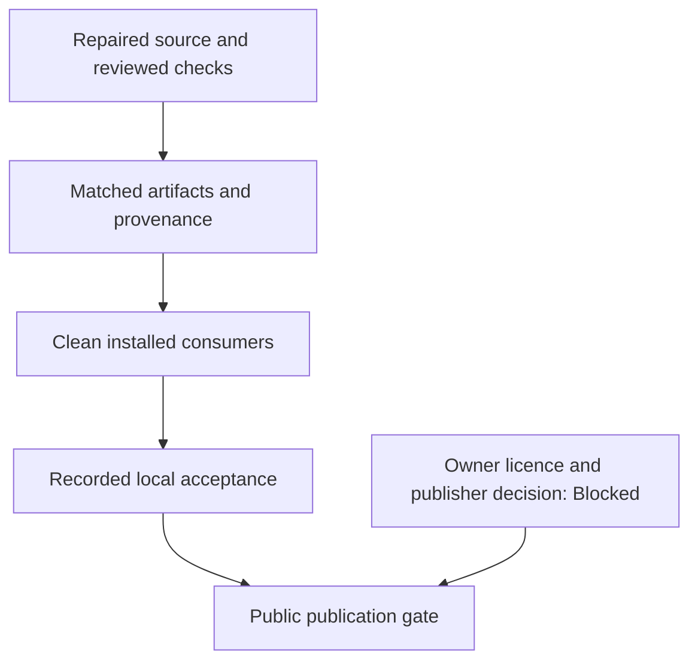

# [Release](../glossary.md#term-release) candidate [qualification](../glossary.md#term-qualification) and [publication](../glossary.md#term-publication) gates

## [Scope](../glossary.md#term-scope) and [ownership](../glossary.md#term-ownership-meanings)

This guide explains how to build and qualify an exact local [release](../glossary.md#term-release) candidate, and why that
[qualification](../glossary.md#term-qualification) is separate from permission to publish. The product goal is now first-public-release
readiness under the [framework-wide audit](../planning/public-release-audit-2026-11-04.md).
The [owner](../glossary.md#term-owner) explicitly retains **no public redistribution grant for now**: public [publication](../glossary.md#term-publication) is
**Blocked** pending a licence/publisher decision. Technical stabilization and local qualification
continue; this guide is not a public-publish procedure.

The standard local packaging mechanism is implemented and independently qualified by
[Engine0024](../planning/modules/engine/tasks/0024-versioned-local-distribution.md#result).
Its component acceptance and earlier private/internal candidate receipts do not qualify changed
audit repairs or permit uploads. No public project licence, [registry](../glossary.md#term-registry), official publisher signing
[identity](../glossary.md#term-identity-meanings) or [notarization](../glossary.md#term-notarization) credential has been selected.

Use the exercised [installation commands](../getting-started.md#install-a-versioned-local-candidate)
and [support matrix](../backend-guide/production-support.md), rather than inventing another
packager or [dependency](../glossary.md#term-dependency) list. Ordinary development defaults to `0.1.0-SNAPSHOT`; the earlier
explicit candidate is `0.1.0`. The current audit qualifies `0.1.0-public-audit.20261104` separately,
without overwriting those receipts. These coordinates do not establish a future compatibility
or semantic-versioning guarantee.

The sequence is repaired source → independent review/joined checks → matched archives and
[provenance](../glossary.md#provenance) → clean installed consumers → recorded local acceptance. Provenance here means the
packaging [manifest](../glossary.md#term-manifest) of selected source paths and [hashes](../glossary.md#term-hash), not proof of publisher identity.
The coordinator owns final audit verification and receipts; repair workers do not manufacture
acceptance by reusing an older package.

For this workflow, an **[artifact](../glossary.md#term-artifact)** is a concrete build output or stored file, such as a [Java
archive](../glossary.md#java-platform-and-build-tools) or [distribution](../glossary.md#term-distribution) ZIP. A **manifest** inventories files and [metadata](../glossary.md#term-metadata). A **[checksum](../glossary.md#term-checksum)** is a
value calculated from bytes to detect a change; [SHA-256](../glossary.md#term-sha-256) is the [hash](../glossary.md#term-hash) algorithm used here. A
matching accompanying checksum can detect accidental corruption, but does not prove who produced
the file. **[Source provenance](../glossary.md#term-source-provenance)** records which source bytes produced the candidate; it is distinct
from authenticating a publisher.

Read the diagram from top to bottom. Local technical acceptance and permission to distribute publicly
are separate gates; neither an archive nor a passed check supplies the owner's missing grant.

## Who supplies each input and reads each result?

1. **The repair implementer and reviewer** establish the accepted source changes
   and affected test evidence. A prior candidate's success cannot substitute for
   changed code's evidence.
2. **The native-package builder** builds and verifies the Metal package separately.
   The Java release task consumes its absolute directory; it does not discover or
   repair a library on the packager's behalf.
3. **The release coordinator** supplies `releaseBaseRevision`, the product version
   and `synaptikMetalNativePackage` to Gradle. The selected current file bytes,
   including accepted uncommitted changes, determine the archived source.
4. **Gradle's release task** produces archives, repository metadata and provenance.
   These are packaging outputs, not publication permission.
5. **External consumer projects** resolve the extracted repository and run supported
   journeys without checkout classes. The coordinator binds their results to exact
   artifact bytes in the acceptance receipt.

For the concrete extraction and consumer commands, follow the
[Metal package installation procedure](../../modules/backend/metal/macos-arm64/README.md#build-prerequisites-and-local-package)
and the [current support/evidence table](../backend-guide/production-support.md).
The former explains native setup; the latter states which bounded results were
accepted. Neither authorizes a public registry upload.

## Candidate outputs

The root `releaseDistribution` task uses ordinary [Gradle](../glossary.md#term-gradle) Java/[Maven](../glossary.md#term-maven) publications for eighteen
implemented products. Each has [binary](../glossary.md#term-binary-descriptor-and-metadata), source and [Javadoc](../glossary.md#term-javadoc) [artifacts](../glossary.md#term-artifact) in the versioned local
Maven repository. Grouping, test, benchmark, [CUDA](../glossary.md#term-cuda), [ONNX](../glossary.md#term-onnx) and [CLI](../glossary.md#term-cli) marker projects are not supported
publications. Their retained source is not silently promoted into the [release](../glossary.md#term-release) [API](../glossary.md#term-application-programming-interface-api).

**Gradle** is the build tool running these tasks. **Maven** names both another build tool and
the repository layout used to resolve Java dependencies. A [publication](../glossary.md#term-publication)'s **coordinates** identify
its group, artifact name and version, often shortened to **[GAV](../glossary.md#term-gav)**. Its **[POM](../glossary.md#term-pom)** ([Project Object Model](../glossary.md#java-platform-and-build-tools))
is the [metadata](../glossary.md#term-metadata) file describing that publication and its declared dependencies. Binary artifacts
contain compiled classes; source artifacts contain source files; Javadoc artifacts contain
generated API documentation. A local Maven repository is a directory of these outputs and
metadata, not evidence of a public [registry](../glossary.md#term-registry) upload.

The task creates source, repository and binary ZIPs below `build/release/<version>/`, plus
`source-provenance.json` and `SHA256SUMS`. The binary ZIP contains the same Java repository and
the [backend](../glossary.md#backend)-owned, independently verified [Metal](../glossary.md#term-metal) local ZIP. There is no [shading](../glossary.md#term-shading), [fat JAR](../glossary.md#term-fat-jar),
remote upload, credential discovery, automatic native installation or [runtime](../glossary.md#term-runtime) library discovery.

`releaseBaseRevision` and the absolute `synaptikMetalNativePackage` directory are explicit
inputs. Build, ad-hoc sign and verify that native package using the
[Metal-owned process](../../modules/backend/metal/macos-arm64/README.md#build-prerequisites-and-local-package).
The release task reuses that verifier; it does not build or repair native bytes. Preserve
permissions during extraction, verify again, retain the installed directory for the [Engine](../glossary.md#term-engine)
[lifetime](../glossary.md#term-lifetime) and pass the [dylib](../glossary.md#term-dylib)'s absolute path to `MetalBackendConfiguration`.

## Exact source and notices

`gradle/release-source-paths.txt` is the reviewed, sorted exact-path inventory shared by source
archiving and [provenance](../glossary.md#provenance). It selects current bytes, including accepted dirty changes, without
requiring Git during the build. Update it when accepted source adds, removes or renames a file.
Do not substitute a HEAD-only archive or an unchecked recursive checkout copy.

Provenance records the base revision, product version and every selected relative path/SHA256.
The base revision alone does not identify a [dirty build](../glossary.md#term-dirty-build). Archive order/timestamps are fixed and
executable modes retained. `SHA256SUMS` is outside the [artifacts](../glossary.md#term-artifact) it [hashes](../glossary.md#term-hash). These accompanying
hashes detect corruption; they do not authenticate hostile replacement or establish publisher
[identity](../glossary.md#term-identity-meanings). The local [Metal](../glossary.md#term-metal) process uses [ad-hoc signing](../glossary.md#term-ad-hoc-signing) and package verification, not an official
trusted publisher [signature](../glossary.md#term-signature) or [notarization](../glossary.md#term-notarization). Native signatures/rebuilds are not promised
bit-identical; never bypass verification or relabel local signing as official trust.

Preserve the complete root `THIRD_PARTY_NOTICES.md` in applicable [CPU](../glossary.md#term-cpu) artifacts and outer
[distributions](../glossary.md#commit-release-distribution-log-and-seed-meanings), including the Cephes conditions and disclaimer. Preserve the [Gradle](../glossary.md#term-gradle) wrapper's
embedded Apache licence. Those notices grant no rights to Synaptik's own code.

## Final [qualification](../glossary.md#term-qualification)

Freeze a new candidate only after the
[Ready audit repairs](../planning/public-release-audit-2026-11-04.md#confirmed-finding-repair-frontiers)
are integrated and independently reviewed. Historical [Pool3d](../glossary.md#pool3d--ncdhw-pooling), typed-[Metal](../glossary.md#term-metal), [oneDNN](../glossary.md#term-onednn) and [CPU](../glossary.md#term-cpu) low-parity
receipts remain limited to their recorded source and [artifacts](../glossary.md#term-artifact). The approved CPU low-parity
cutover supersedes CPU0078's lock; oneDNN still excludes native [F64](../glossary.md#floating-point-precision-and-rounding) and Metal keeps its separate
bounded domain. Neither capability [admission](../glossary.md#term-admission) nor a prior candidate's success proves repaired
numerical, [lifecycle](../glossary.md#lifecycle), import/restore or diagnostic behavior.

Record exact repaired source and native/artifact [identities](../glossary.md#term-identity-meanings), actual commands, failures and
recovery runs. The source inventory, [provenance](../glossary.md#provenance) and authenticated native package must identify
the bytes exercised by the final checks and installed consumers. A stale archive or an older
[native library](../glossary.md#term-native-library) does not qualify current source; later executable/native changes require affected
requalification and regenerated matched artifacts. Then:

1. Run the affected and final repository/architecture checks and public Javadocs with the declared
   JDK/native inputs. Record every skip, observer limitation and unsupported domain honestly.
2. Rebuild the versioned candidate from the qualified source and matched native package. Verify
   every archive/checksum/provenance entry and published dependency closure; bind the acceptance
   receipt to these exact artifacts, not merely the reused `0.1.0` coordinate or base revision.
3. Extract source outside any checkout and compile with the build cache disabled and tasks rerun;
   do not mistake checkout classes or cached outputs for a clean installation.
4. Resolve only the extracted repository from fresh external Maven and Gradle consumers. Compile
   the documented public examples and execute the required CPU/Metal compute, gradient, repeated
   training, save/close/load and newly configured training journeys.
5. Record relevant performance observations and independent code/evidence review before marking
   the candidate accepted. Numerical correctness does not imply universal speed or zero allocation.

The [production ledger](../backend-guide/production-support.md) and
[audit receipts](../planning/public-release-audit-2026-11-04.md#results) record acceptance only after
these checks actually [run](../glossary.md#term-run). A successful packaging task, local archive, ad-hoc native [signature](../glossary.md#term-signature) or
earlier component gate is not a complete public production [release](../glossary.md#term-release). Original failed commands,
successor failures and archived successful candidates keep their original status and [scope](../glossary.md#term-scope).

Public [publication](../glossary.md#term-publication) requires the [owner](../glossary.md#term-owner)'s separate licence/publisher decision; no public upload is
authorized now. Official signing/trusted prebuilt [distribution](../glossary.md#term-distribution), hosted [CI](../glossary.md#term-continuous-integration-ci) promotion and [rollback](../glossary.md#term-rollback)
policy remain separate decisions, not infrastructure or credentials supplied by this process.
They are not hidden prerequisites for building and technically qualifying the local candidate.

## Related documentation

- [Production target](../planning/production-release-goal.md)
- [Public API status](../reference/index.md)
- [Documentation rules](documentation-rules.md)
