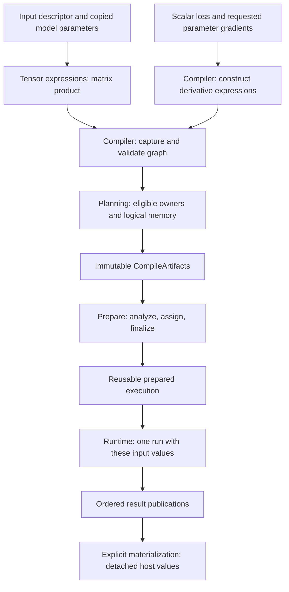

# Follow one program through the framework

> [ARCHITECTURE.md](../../ARCHITECTURE.md) and its incorporated scoped contracts are authoritative.
> This page explains their boundaries using the runnable [learning project](../examples/README.md).

## One computation, several different responsibilities

The learning model predicts $Y=XW^\mathsf{T}$. Here $X$ is a $2\times1$ matrix:
two independent samples, one feature each. The $1\times1$ weight matrix $W$ initially contains
zero; there is no bias. Input values $(1,3)$ have targets $(2,6)$, so the intended
dimensionless teaching relationship is $y=2x$. The
[gradient walkthrough](tensors-and-gradients.md#the-first-training-step) defines the indexed loss
and distinguishes real-number reasoning from actual FLOAT32 evaluation.

A **[Tensor](../glossary.md#tensor)** describes typed values and, for a derived result, how to compute them. The [NN](../glossary.md#neural-network-module-parameter-buffer-and-forward-context)
**Model** owns the layer composition and its private working [parameters](../glossary.md#term-parameter). An **[Engine](../glossary.md#term-engine)** arranges
execution. These names are not interchangeable: the `modules/model` source directory supplies
tensor semantics; the Java `Model` class lives in `nn.module`.

Two further distinctions help throughout this journey. **Semantic** information says what the
program means; **physical** information says which code and memory realize it. An **[occurrence](../glossary.md#term-occurrence)**
is one particular use: two additions with the same name are not automatically the same [producer](../glossary.md#term-producer),
and publishing one result twice creates two result roles, not necessarily two physical copies.

Read this diagram from top to bottom. Each boundary changes the kind of information, not just
its class name. Training adds [gradient](../glossary.md#term-gradient) expressions before the same [compilation](../glossary.md#compiler-engine-and-execution-stage-names) path.

## 1. Build meaning and privately owned state

The project imports concrete [FLOAT32](../glossary.md#term-float32) arrays with
[`TensorFactory`](../../modules/model/src/main/java/io/github/pho001/synaptik/model/tensor/TensorFactory.java).
Flat import copies values into independent [heap](../glossary.md#term-heap) storage; creating a [descriptor](../glossary.md#term-descriptor) alone allocates
no value storage. A descriptor records [data type](../glossary.md#data-type--datatype), [shape](../glossary.md#shape), [layout](../glossary.md#layout) state and [gradient](../glossary.md#term-gradient) eligibility.
A [tensor](../glossary.md#tensor)'s [identity](../glossary.md#term-identity-meanings) is not its storage address or its current numeric value.

`Model.builder().input(...).linear(weight).build()` copies supplied [parameter](../glossary.md#term-parameter) state before
constructing the private composition. The original supplied zero [weight](../glossary.md#term-weight) does not become a
[mutable](../glossary.md#term-mutable) window onto the trained weight. The builder's input [signature](../glossary.md#term-signature) is fixed: another tensor
identity with the same full descriptor is acceptable to `compute`; an extra [batch](../glossary.md#term-batch-machine-learning-and-hyperparameters) row is not.

The layer constructs ordinary [matrix](../glossary.md#term-matrix-meanings)-product/[transpose](../glossary.md#term-transpose) expressions. Expression construction
checks meaning and shape but does not execute the product. A derived tensor's [provenance](../glossary.md#provenance) connects
it to a [producer](../glossary.md#term-producer) and ordered operands. The [compiler](../glossary.md#term-compiler) will later turn that expression structure
into [graph](../glossary.md#graph)-local values and [nodes](../glossary.md#node); it does not reuse tensor IDs as physical memory positions.

At this boundary the application calls the builder, while the builder calls Tensor operations
to construct descriptions. Later the Model's internal execution state calls Engine on the
application's behalf. A **leaf** has no producing expression to follow; input prototypes are
leaves even when they have no values yet. A supplied stored weight is another leaf, but its
builder-created private copy, not the application's original storage, is used for training.
See [which calls copy or borrow](ownership.md#which-call-borrows-or-copies).

Source: [`ModelBuilder`](../../extensions/nn/src/main/java/io/github/pho001/synaptik/nn/module/ModelBuilder.java),
[`Model`](../../extensions/nn/src/main/java/io/github/pho001/synaptik/nn/module/Model.java) ([Model glossary](../glossary.md#term-model)),
and [the Model package atlas](packages/model.md).

## 2. [Capture](../glossary.md#term-capture-meanings) and plan the requested computation

On the first `model.compute(input)`, the [owned Model](../glossary.md#model-module-buffer-and-scan-distinctions) obtains its [Engine](../glossary.md#term-engine) and compiles its retained
output expressions. [Compiler](../glossary.md#term-compiler) validates the [graph](../glossary.md#graph) and records input roles, output publications and
[derivative](../glossary.md#term-derivative) [metadata](../glossary.md#term-metadata). [Planning](../glossary.md#term-planning) asks registered capability providers whether each actual [operation](../glossary.md#operation),
[dtype](../glossary.md#data-type--datatype), [layout](../glossary.md#layout) and geometry is supported, then selects [backend ownership](../glossary.md#backend-ownership) and maximal partitions.

An operation being expressible in [Tensor](../glossary.md#tensor) algebra is not a promise that a chosen [backend](../glossary.md#backend) can
execute it. A capability rejection is not a request to try arbitrary devices or silently cast.
The standard Engine registers [CPU](../glossary.md#term-cpu) [ownership](../glossary.md#term-ownership-meanings); it does not discover a [GPU](../glossary.md#term-gpu) later.

[`CompileArtifacts`](../../modules/compiler/src/main/java/io/github/pho001/synaptik/compiler/CompileArtifacts.java)
contains the [immutable](../glossary.md#term-immutable) graph, partitions, logical memory/[publication](../glossary.md#term-publication)/source-role plans and
[compile diagnostics](../glossary.md#compile-diagnostics)/derivative information. These are recipes. They do not contain native handles,
physical [buffers](../glossary.md#term-buffer), a [device](../glossary.md#term-device) [command queue](../glossary.md#term-command-queue) or [mutable](../glossary.md#term-mutable) invocation state.

## 3. [Prepare](../glossary.md#prepare) the recipe once

Shared Prepare validates the complete [handoff](../glossary.md#term-handoff) and projects each owned [partition](../glossary.md#partition) to its [backend](../glossary.md#backend).
Backend analysis declares the [buffers](../glossary.md#term-buffer)/workspaces and private realization it needs. Shared
assignment gives those requirements stable [runtime](../glossary.md#term-runtime) slots; backend finalization produces reusable
executables against that exact assignment. The assembled schedule explicitly orders computation,
transfers where required, and [publication](../glossary.md#term-publication).

A **partition** is a consecutive group of [graph](../glossary.md#graph) [nodes](../glossary.md#node) with the same backend [owner](../glossary.md#term-owner). **[Lowering](../glossary.md#lowering)**
translates that group's meaning into a backend's implementation form; **[fusion](../glossary.md#term-fusion)** combines eligible
work without storing every intermediate; **[specialization](../glossary.md#term-specialization)** uses known facts to [shape](../glossary.md#shape) executable
code. A **workspace** is declared temporary scratch, while a **slot** is a stable planned
position, not an allocation. These decisions belong to preparation rather than each [run](../glossary.md#term-run).

The [CPU](../glossary.md#term-cpu) backend lowers supported operations into its typed private representation and prepares
ordinary generated execution or a separately qualified native route. The Java learning project
requires no third-party native implementation. Its result is not a performance comparison.

The prepared owner retains reusable code and prepared resources, not one [batch](../glossary.md#term-batch-machine-learning-and-hyperparameters)'s [mutable](../glossary.md#term-mutable) buffers.
Keep the same [Model](../glossary.md#term-model) for repeated same-[signature](../glossary.md#term-signature) [inference](../glossary.md#term-inference): its owned
[`ModelExecutionState`](../../extensions/nn/src/main/java/io/github/pho001/synaptik/nn/module/ModelExecutionState.java)
caches the public [Engine](../glossary.md#term-engine) preparation. In contrast, the low-level `Engine.compute(...)`
convenience compiles and prepares afresh on each call. Those are different APIs, not conflicting
[cache](../glossary.md#term-cache) promises.

## 4. Bind current values, [run](../glossary.md#term-run), publish and detach

For each call, [Model](../glossary.md#term-model) maps fresh [batch](../glossary.md#term-batch-machine-learning-and-hyperparameters) values and its current fixed state to the prepared input
order and uses [`Engine.runValues`](../glossary.md#fresh-value-binding--enginerunvalues). [Runtime](../glossary.md#term-runtime) creates one run's physical representations and executes
the already [prepared schedule](../glossary.md#prepared-schedule--preparedschedule). It does not perform [graph optimization](../glossary.md#forward-graph-optimization), [device](../glossary.md#term-device) discovery or route
selection during each [tensor](../glossary.md#tensor) [element](../glossary.md#term-element)'s computation.

A low-level [`RunResult`](../glossary.md#run-result--runresult) keeps [publication](../glossary.md#term-publication) [leases](../glossary.md#term-lease) alive. Reading a result after closing that lease
is not the same as reading an independent Java array. Model's convenience materializes its outputs
as [immutable](../glossary.md#term-immutable) [`HostTensorValue`](../glossary.md#host-tensor-value--hosttensorvalue) copies and closes the internal result before returning. The tutorial
can therefore inspect a retained [prediction](../glossary.md#term-prediction) after the Model closes.

For this output, two [FLOAT32](../glossary.md#term-float32) elements require eight [canonical](../glossary.md#term-canonical-form) value bytes. Output byte limits
bound [materialization](../glossary.md#materialization); they are not a total training/native-memory quota. The
[ownership explanation](ownership.md) ([ownership glossary](../glossary.md#term-ownership-meanings)) separates all of these lifetimes.

## 5. Turn the [objective](../glossary.md#term-objective) into ordinary [derivative](../glossary.md#term-derivative) expressions

Training compares the initial [prediction](../glossary.md#term-prediction) `[0,0]` with `[2,6]` using squared-error **sum**. A [loss](../glossary.md#loss)
is the [scalar objective](../glossary.md#loss) that measures the chosen error; a [gradient](../glossary.md#term-gradient) is its local [sensitivity](../glossary.md#term-sensitivity) to a
[parameter](../glossary.md#term-parameter). The [geometry and gradient walkthrough](tensors-and-gradients.md#the-first-training-step)
derives the project's first update without treating [AD](../glossary.md#autograd) as a black box.

`configureTraining` invokes the supplied objective builder once per setup attempt. [Compiler](../glossary.md#term-compiler) owns
[reverse-mode](../glossary.md#primal-adjoint-and-differentiation-seed) [automatic differentiation](../glossary.md#autograd): it builds derivative [Tensor](../glossary.md#tensor) expressions **before** [graph
capture](../glossary.md#capture-graph-ports-and-reconstruction). Forward outputs and selected derivative roots then go through the existing [planning](../glossary.md#term-planning),
preparation and execution pipeline. [Backends](../glossary.md#backend) execute the resulting operations; they do not own
another differentiation [engine](../glossary.md#term-engine).

Training owns the [optimizer state](../glossary.md#term-optimizer-state) and the parameter [update transaction](../glossary.md#resource-transaction-and-rollback). The step's returned
objective describes the forward pass **before** its committed update. Computing again assesses the
new [weight](../glossary.md#term-weight); rereading that previous objective does not recompute loss.

Configuring [owned Model](../glossary.md#model-module-buffer-and-scan-distinctions) training may move private parameters to [Model](../glossary.md#term-model)-owned native storage and
closes an earlier [inference](../glossary.md#term-inference) preparation before that transition. Tensor [identities](../glossary.md#term-identity-meanings) and the private
working set remain the model's state. This does not transfer caller input [ownership](../glossary.md#term-ownership-meanings) or serialize an
[optimizer](../glossary.md#term-optimizer) into the model file. `configureTraining` and `train` do not silently change train/[eval mode](../glossary.md#inference-and-evaluation).

## 6. Save source meaning and values; reconstruct fresh execution

`model.save(path)` stores an admitted cold [graph](../glossary.md#graph) source, [signatures](../glossary.md#term-signature) and current named values.
It can save before an [Engine](../glossary.md#term-engine) is created. It does not save generated classes, [Metal](../glossary.md#term-metal) programs, [run](../glossary.md#term-run)
[buffers](../glossary.md#term-buffer), training objectives, [optimizer](../glossary.md#term-optimizer) moments, random-stream state or data progress.

`Model.load(path)` reconstructs a new [evaluation](../glossary.md#term-evaluation)-mode [owned Model](../glossary.md#model-module-buffer-and-scan-distinctions). The first compute prepares its
execution in the selected environment. Training after load requires a new explicit [objective](../glossary.md#term-objective) and
optimizer configuration; a matching [prediction](../glossary.md#term-prediction) is not evidence of resumed [optimizer history](../glossary.md#term-optimizer-history).

The tutorial's small [matrix](../glossary.md#term-matrix-meanings)-product source is inside the bounded wire domain. Other valid [Tensor](../glossary.md#tensor)
programs may still reject [persistence](../glossary.md#term-persistence) independently of their execution support. Use the
[checkpoint reference](../reference/checkpoint/graph.md) ([checkpoint glossary](../glossary.md#term-checkpoint)) for that distinction, not a file suffix
or an assumption that every graph is serializable.

## Where to go deeper

- [Package/native atlas](packages/index.md): implementation mechanisms and source entry points.
- [Execution reference](../reference/engine/lifecycle.md): explicit [compile](../glossary.md#compile)/[prepare](../glossary.md#prepare)/[run](../glossary.md#term-run) control.
- [Training reference](../reference/training/sessions.md): [optimizer state](../glossary.md#term-optimizer-state) and [transaction](../glossary.md#term-transaction) boundaries.
- [Backend choices](../how-to/choose-a-backend.md) ([Backend glossary](../glossary.md#backend)): explicit alternatives and support [qualification](../glossary.md#term-qualification).
- [Normative scopes](../../ARCHITECTURE.md#authority-incorporation-and-precedence) ([Normative glossary](../glossary.md#term-normative)): the actual authority.
