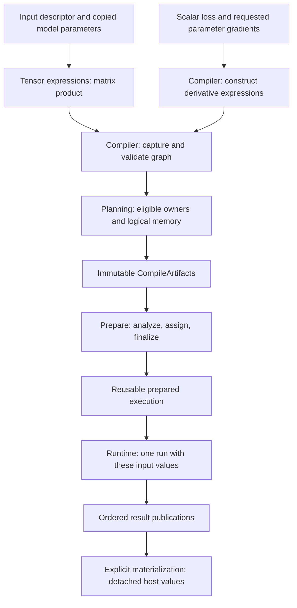

# Follow one program through the framework

> [ARCHITECTURE.md](../../ARCHITECTURE.md) and its incorporated scoped contracts are authoritative.
> This page explains their boundaries using the runnable [learning project](../examples/README.md).

## One computation, several different responsibilities

The learning model predicts `Y = X × transpose(W)`. `X` has shape `[2,1]`: two independent samples,
one feature each. `W` is `[1,1]`, initially zero. There is no bias. The targets `[2,6]` correspond
to inputs `[1,3]`, so the intended relationship is `y = 2x`.

A **Tensor** describes typed values and, for a derived result, how to compute them. The NN
**Model** owns the layer composition and its private working parameters. An **Engine** arranges
execution. These names are not interchangeable: the `modules/model` source directory supplies
tensor semantics; the Java `Model` class lives in `nn.module`.

Two further distinctions help throughout this journey. **Semantic** information says what the
program means; **physical** information says which code and memory realize it. An **occurrence**
is one particular use: two additions with the same name are not automatically the same producer,
and publishing one result twice creates two result roles, not necessarily two physical copies.

Read this diagram from top to bottom. Each boundary changes the kind of information, not just
its class name. Training adds gradient expressions before the same compilation path.

## 1. Build meaning and privately owned state

The project imports concrete FLOAT32 arrays with
[`TensorFactory`](../../modules/model/src/main/java/io/github/pho001/synaptik/model/tensor/TensorFactory.java).
Flat import copies values into independent heap storage; creating a descriptor alone allocates
no value storage. A descriptor records data type, shape, layout state and gradient eligibility.
A tensor's identity is not its storage address or its current numeric value.

`Model.builder().input(...).linear(weight).build()` copies supplied parameter state before
constructing the private composition. The original supplied zero weight does not become a
mutable window onto the trained weight. The builder's input signature is fixed: another tensor
identity with the same full descriptor is acceptable to `compute`; an extra batch row is not.

The layer constructs ordinary matrix-product/transpose expressions. Expression construction
checks meaning and shape but does not execute the product. A derived tensor's provenance connects
it to a producer and ordered operands. The compiler will later turn that expression structure
into graph-local values and nodes; it does not reuse tensor IDs as physical memory positions.

Source: [`ModelBuilder`](../../extensions/nn/src/main/java/io/github/pho001/synaptik/nn/module/ModelBuilder.java),
[`Model`](../../extensions/nn/src/main/java/io/github/pho001/synaptik/nn/module/Model.java),
and [the Model package atlas](packages/model.md).

## 2. Capture and plan the requested computation

On the first `model.compute(input)`, the owned Model obtains its Engine and compiles its retained
output expressions. Compiler validates the graph and records input roles, output publications and
derivative metadata. Planning asks registered capability providers whether each actual operation,
dtype, layout and geometry is supported, then selects backend ownership and maximal partitions.

An operation being expressible in Tensor algebra is not a promise that a chosen backend can
execute it. A capability rejection is not a request to try arbitrary devices or silently cast.
The standard Engine registers CPU ownership; it does not discover a GPU later.

[`CompileArtifacts`](../../modules/compiler/src/main/java/io/github/pho001/synaptik/compiler/CompileArtifacts.java)
contains the immutable graph, partitions, logical memory/publication/source-role plans and
compile diagnostics/derivative information. These are recipes. They do not contain native handles,
physical buffers, a device command queue or mutable invocation state.

## 3. Prepare the recipe once

Shared Prepare validates the complete handoff and projects each owned partition to its backend.
Backend analysis declares the buffers/workspaces and private realization it needs. Shared
assignment gives those requirements stable runtime slots; backend finalization produces reusable
executables against that exact assignment. The assembled schedule explicitly orders computation,
transfers where required, and publication.

A **partition** is a consecutive group of graph nodes with the same backend owner. **Lowering**
translates that group's meaning into a backend's implementation form; **fusion** combines eligible
work without storing every intermediate; **specialization** uses known facts to shape executable
code. A **workspace** is declared temporary scratch, while a **slot** is a stable planned
position, not an allocation. These decisions belong to preparation rather than each run.

The CPU backend lowers supported operations into its typed private representation and prepares
ordinary generated execution or a separately qualified native route. The Java learning project
requires no third-party native implementation. Its result is not a performance comparison.

The prepared owner retains reusable code and prepared resources, not one batch's mutable buffers.
Keep the same Model for repeated same-signature inference: its owned
[`ModelExecutionState`](../../extensions/nn/src/main/java/io/github/pho001/synaptik/nn/module/ModelExecutionState.java)
caches the public Engine preparation. In contrast, the low-level `Engine.compute(...)`
convenience compiles and prepares afresh on each call. Those are different APIs, not conflicting
cache promises.

## 4. Bind current values, run, publish and detach

For each call, Model maps fresh batch values and its current fixed state to the prepared input
order and uses `Engine.runValues`. Runtime creates one run's physical representations and executes
the already prepared schedule. It does not perform graph optimization, device discovery or route
selection during each tensor element's computation.

A low-level `RunResult` keeps publication leases alive. Reading a result after closing that lease
is not the same as reading an independent Java array. Model's convenience materializes its outputs
as immutable `HostTensorValue` copies and closes the internal result before returning. The tutorial
can therefore inspect a retained prediction after the Model closes.

For this output, two FLOAT32 elements require eight canonical value bytes. Output byte limits
bound materialization; they are not a total training/native-memory quota. The
[ownership explanation](ownership.md) separates all of these lifetimes.

## 5. Turn the objective into ordinary derivative expressions

Training compares the initial prediction `[0,0]` with `[2,6]` using squared-error **sum**. A loss
is the scalar objective that measures the chosen error; a gradient is its local sensitivity to a
parameter. The [geometry and gradient walkthrough](tensors-and-gradients.md#the-first-training-step)
derives the project's first update without treating AD as a black box.

`configureTraining` invokes the supplied objective builder once per setup attempt. Compiler owns
reverse-mode automatic differentiation: it builds derivative Tensor expressions **before** graph
capture. Forward outputs and selected derivative roots then go through the existing planning,
preparation and execution pipeline. Backends execute the resulting operations; they do not own
another differentiation engine.

Training owns the optimizer state and the parameter update transaction. The step's returned
objective describes the forward pass **before** its committed update. Computing again assesses the
new weight; rereading that previous objective does not recompute loss.

Configuring owned Model training may move private parameters to Model-owned native storage and
closes an earlier inference preparation before that transition. Tensor identities and the private
working set remain the model's state. This does not transfer caller input ownership or serialize an
optimizer into the model file. `configureTraining` and `train` do not silently change train/eval mode.

## 6. Save source meaning and values; reconstruct fresh execution

`model.save(path)` stores an admitted cold graph source, signatures and current named values.
It can save before an Engine is created. It does not save generated classes, Metal programs, run
buffers, training objectives, optimizer moments, random-stream state or data progress.

`Model.load(path)` reconstructs a new evaluation-mode owned Model. The first compute prepares its
execution in the selected environment. Training after load requires a new explicit objective and
optimizer configuration; a matching prediction is not evidence of resumed optimizer history.

The tutorial's small matrix-product source is inside the bounded wire domain. Other valid Tensor
programs may still reject persistence independently of their execution support. Use the
[checkpoint reference](../reference/checkpoint/graph.md) for that distinction, not a file suffix
or an assumption that every graph is serializable.

## Where to go deeper

- [Package/native atlas](packages/index.md): implementation mechanisms and source entry points.
- [Execution reference](../reference/engine/lifecycle.md): explicit compile/prepare/run control.
- [Training reference](../reference/training/sessions.md): optimizer state and transaction boundaries.
- [Backend choices](../how-to/choose-a-backend.md): explicit alternatives and support qualification.
- [Normative scopes](../../ARCHITECTURE.md#authority-incorporation-and-precedence): the actual authority.
