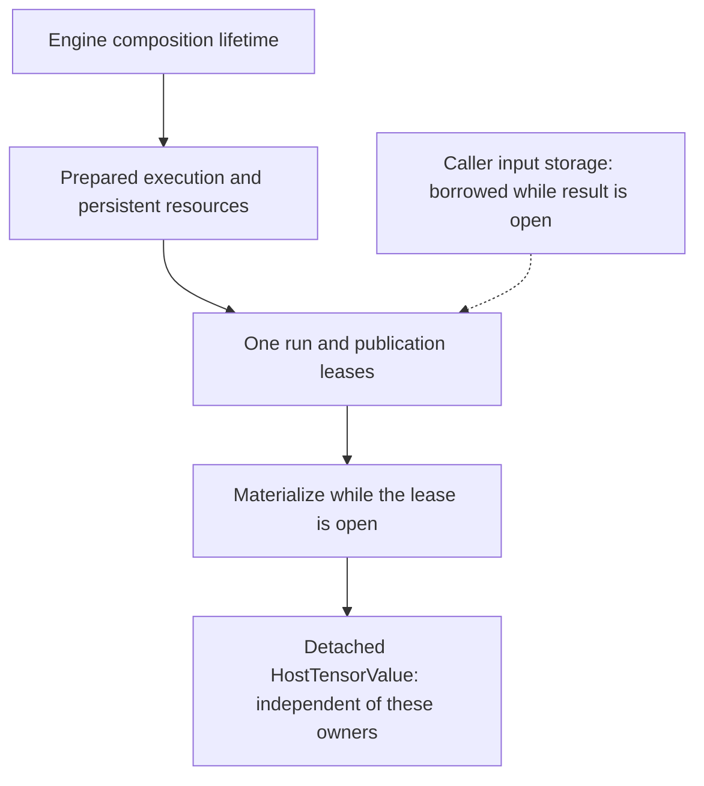

# Ownership and lifetimes

> [ARCHITECTURE.md](../../ARCHITECTURE.md) is authoritative; its
> [Runtime/Prepare/Engine scope](../architecture/contracts/runtime-prepare-engine.md) owns the detailed
> protocol. This explanation tells you which lifetime protects which data.

## A result is not always an independent value

The learning project's `Model.compute` returns a detached host value. The low-level Engine instead
returns a closeable run result and lets you decide which publications to copy. Confusing them can
produce a read from a closed native allocation, or keep an entire run alive unintentionally.

An **owner** is responsible for release; a **borrower** may use a resource while its owner's
lifetime and access conditions hold. A **lease** keeps a defined use alive until release.
**Detached** means the value no longer depends on that borrowed resource. Keeping a Java reference
is not the same as keeping native memory alive. **Quiescent** means no conflicting work or
mutation is in progress; it does not merely mean the current thread is idle.

The lifetime diagram uses nesting for required dependencies, not Java object inheritance.

## What each owner protects

| Value or owner | What it owns or retains | Your obligation |
|---|---|---|
| Imported heap Tensor | Descriptor, identity and heap-backed values | No deterministic close; avoid conflicting mutation |
| Tensor with caller Arena storage | A borrowed reference, not the Arena | Keep storage alive and quiescent for every borrower |
| Owned NN Model | Private working state, cached preparations/session; lazily created Engine if no Engine was supplied | Close the Model; coordinate inherited module mutation |
| Engine | Explicitly transferred backend integrations and public lifecycle | Close after its dependent work; do not reuse transferred integrations |
| Engine `PreparedExecution` | Prepared recipe/resources under that Engine | Close after its runs; do not use with another Engine |
| `RunResult` | One invocation's publication leases and run-owned state | Consume or detach results before closing |
| `HostTensorValue` / `TrainingStep` | Detached values and metadata | May retain after input, run, Model and Engine close |

The Engine and Runtime each have a type named `PreparedExecution`. Applications use the Engine
wrapper; its implementation composes the Runtime owner rather than defining a second lease
protocol. See [the execution atlas](packages/execution.md).

## In the learning project

1. Flat arrays are copied into heap tensors. The supplied weight is copied again into the Model's
   private state by the builder; training does not modify the caller's zero weight.
2. A synchronous Model compute/train borrows each fresh batch only until its internal result closes.
   The caller may then release batch-native storage if it used any.
3. A retained prediction or training-step objective is already detached. Closing the Model does not
   invalidate it.
4. Model closure closes its cached session/preparation before private native storage. A lazily
   created Engine is also owned and closed; an Engine supplied with `withEngine` remains borrowed.

For a borrowed Engine, select it **before** the first valid execution/training setup attempt and
keep it open longer than the Model's prepared work. Engine choice freezes on setup; a later failure
does not grant permission to swap in a different Engine. Do not place a transferred backend
integration in a second independent try-with-resources scope.

## Explicit Engine use

The complete [reusable execution guide](../user-guide/running-models.md#compile-and-prepare-once)
shows the public calls. Close in dependency order: each result, then preparation, then Engine.
Caller storage stays alive until every result borrowing it closes. Synchronous execution finishing
does not itself end a still-open result's borrow.

Materialization copies one publication to canonical host bytes under the requested byte ceiling.
Merely retaining the result descriptor or a Java reference to a Tensor does not extend an Arena's
native allocation. Conversely, retaining a `HostTensorValue` does not retain that run's native buffers.

## Failure and concurrency are ownership questions too

**Admission** is the lifecycle gate that accepts or rejects a new operation. Closing an owner
can reject later admissions while previously accepted work finishes. **Rollback** cleans up
resources acquired by an unsuccessful operation; **suppression** preserves cleanup failures
alongside the original failure instead of replacing its cause.

Preparation and result publication clean up partially acquired resources while preserving the
primary failure and suppressing cleanup failures. Closure attempts all owned cleanup and retains
its failure for repeated/concurrent close. Catching an exception is not a substitute for closing
remaining live owners.

Prepared Engine work admits independent concurrent runs, subject to its exact contract. An owned
Model serializes high-level admission and rejects competing operations as busy; it is not a
license for concurrent parameter mutation. Callers must still exclude inherited module/state
mutation. Do not recursively close an Engine from an observer invoked by its admitted operation.

## Save/load is not a lifetime transfer

A saved file is an independently encoded source/value snapshot, not a leased executable.
Closing the original Model does not delete the file. Loading creates fresh state and later fresh
execution resources. The [save/load guide](../how-to/save-and-restart-training.md) distinguishes
this from in-memory Training state recovery.
