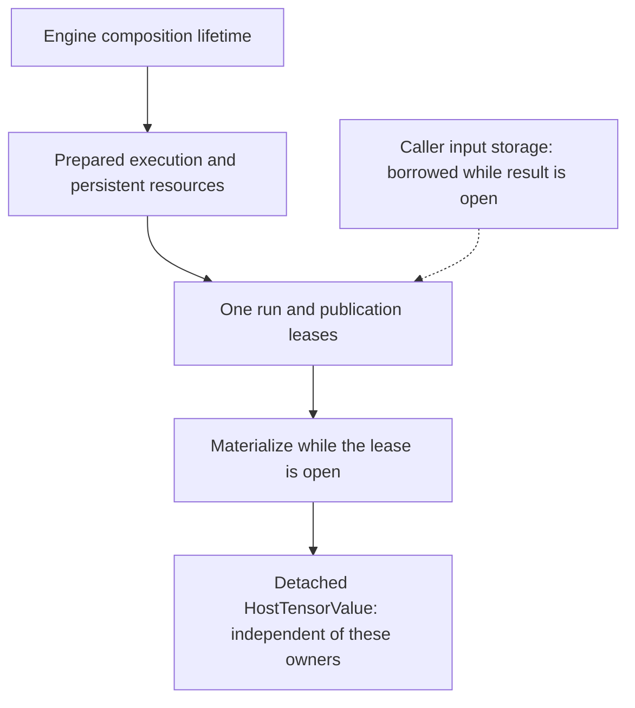

# [Ownership](../glossary.md#term-ownership-meanings) and lifetimes

> [ARCHITECTURE.md](../../ARCHITECTURE.md) is authoritative; its
> [Runtime/Prepare/Engine scope](../architecture/contracts/runtime-prepare-engine.md) ([Runtime glossary](../glossary.md#term-runtime); [Prepare glossary](../glossary.md#prepare); [Engine glossary](../glossary.md#term-engine); [scope glossary](../glossary.md#term-scope)) owns the detailed
> protocol. This explanation tells you which lifetime protects which data. ([lifetime glossary](../glossary.md#term-lifetime))

## A result is not always an independent value

The learning project's `Model.compute` returns a [detached](../glossary.md#detached-model-results) [host](../glossary.md#term-host) value. The low-level [Engine](../glossary.md#term-engine) instead
returns a closeable [run result](../glossary.md#run-result--runresult) and lets you decide which publications to copy. Confusing them can
produce a read from a closed native allocation, or keep an entire [run](../glossary.md#term-run) alive unintentionally.

An **[owner](../glossary.md#term-owner)** is responsible for [release](../glossary.md#term-release); a **borrower** may use a resource while its owner's
[lifetime](../glossary.md#term-lifetime) and access conditions hold. A **[lease](../glossary.md#term-lease)** keeps a defined use alive until release.
**Detached** means the value no longer depends on that [borrowed](../glossary.md#ownership-borrowing-and-lease) resource. Keeping a Java reference
is not the same as keeping [native memory](../glossary.md#aliasing-and-arena) alive. **[Quiescent](../glossary.md#term-quiescent)** means no conflicting work or
mutation is in progress; it does not merely [mean](../glossary.md#term-mean) the current thread is idle.

The lifetime diagram uses nesting for required dependencies, not Java object inheritance.

## Which call borrows or copies?

The participant making a call is its **caller**; the component receiving it is its **callee**.
Ownership means responsibility for keeping a resource usable and eventually releasing it, not
merely having a Java reference. Follow these boundaries rather than assuming every Tensor call
copies values:

| Caller → callee | What crosses the call | Copy or borrow, and until when? |
|---|---|---|
| Application → `TensorFactory` flat import | Descriptor and flat primitive values | Import copies the values into independent heap storage; the original array is not the Tensor's live storage. |
| Application → owned `Model` builder | Supplied parameter Tensors | The builder copies supplied parameter state into private Model state before expression construction; training changes that copy. |
| Application → `Engine.compile` → Compiler | Requested output expressions | Compiler reads expression structure and descriptors; compilation does not acquire the input Arena or execute the expressions. |
| Application, or NN's execution component → `Engine.run` / `runValues` | Current stored input values | Execution borrows storage; its owner keeps it live and quiescent until the resulting `RunResult` closes. |
| Result consumer → `RunResult.materialize` | One live publication and a byte ceiling | Materialization copies canonical host bytes; the returned `HostTensorValue` is independent of the run. |

A **leaf** is a Tensor without a producing expression, not a synonym for allocated data.
A storage-free input prototype is also a leaf. A derived Tensor has a producer even before it
has any computed values. This distinction explains why compilation can inspect a program
without reading input bytes. See [the execution stage handoffs](packages/execution.md#who-supplies-the-expressions-and-what-is-a-leaf)
and [the Tensor storage boundary](packages/model.md#tensor-host-storage).

## What each [owner](../glossary.md#term-owner) protects

| Value or owner | What it owns or retains | Your obligation |
|---|---|---|
| Imported [heap](../glossary.md#term-heap) [Tensor](../glossary.md#tensor) | [Descriptor](../glossary.md#term-descriptor), [identity](../glossary.md#term-identity-meanings) and heap-backed values | No deterministic close; avoid conflicting mutation |
| Tensor with caller [Arena](../glossary.md#term-arena) storage | A [borrowed](../glossary.md#ownership-borrowing-and-lease) reference, not the Arena | Keep storage alive and [quiescent](../glossary.md#term-quiescent) for every borrower |
| Owned [NN Model](../glossary.md#model-module-buffer-and-scan-distinctions) | Private working state, cached preparations/session; lazily created [Engine](../glossary.md#term-engine) if no Engine was supplied | Close the [Model](../glossary.md#term-model); [coordinate](../glossary.md#axis-rank-scalar-vector-and-matrix) inherited [module](../glossary.md#term-module) mutation |
| Engine | Explicitly transferred [backend](../glossary.md#backend) integrations and public [lifecycle](../glossary.md#lifecycle) | Close after its dependent work; do not reuse transferred integrations |
| Engine [`PreparedExecution`](../glossary.md#prepared-execution--preparedexecution) | Prepared recipe/resources under that Engine | Close after its runs; do not use with another Engine |
| [`RunResult`](../glossary.md#run-result--runresult) | One invocation's [publication](../glossary.md#term-publication) [leases](../glossary.md#term-lease) and [run](../glossary.md#term-run)-owned state | Consume or detach results before closing |
| [`HostTensorValue`](../glossary.md#host-tensor-value--hosttensorvalue) / `TrainingStep` | [Detached](../glossary.md#detached-model-results) values and [metadata](../glossary.md#term-metadata) | May retain after input, run, Model and Engine close |

The Engine and [Runtime](../glossary.md#term-runtime) each have a type named `PreparedExecution`. Applications use the Engine
wrapper; its implementation composes the Runtime owner rather than defining a second lease
protocol. See [the execution atlas](packages/execution.md).

## In the learning project

1. Flat arrays are copied into heap tensors. The supplied weight is copied again into the Model's
   private state by the builder; training does not modify the caller's zero weight. ([heap glossary](../glossary.md#term-heap); [tensors glossary](../glossary.md#tensor); [weight glossary](../glossary.md#term-weight))
2. A synchronous Model compute/train borrows each fresh batch only until its internal result closes.
   The caller may then release batch-native storage if it used any. ([synchronous glossary](../glossary.md#term-synchronous); [batch glossary](../glossary.md#term-batch-machine-learning-and-hyperparameters); [release glossary](../glossary.md#term-release))
3. A retained prediction or training-step objective is already detached. Closing the Model does not
   invalidate it. ([prediction glossary](../glossary.md#term-prediction); [objective glossary](../glossary.md#term-objective); [detached glossary](../glossary.md#detached-model-results))
4. Model closure closes its cached session/preparation before private native storage. A lazily
   created Engine is also owned and closed; an Engine supplied with `withEngine` remains [borrowed](../glossary.md#ownership-borrowing-and-lease).

For a borrowed [Engine](../glossary.md#term-engine), select it **before** the first valid execution/training setup attempt and
keep it open longer than the [Model](../glossary.md#term-model)'s prepared work. Engine choice freezes on setup; a later failure
does not grant permission to swap in a different Engine. Do not place a transferred [backend](../glossary.md#backend)
integration in a second independent try-with-resources [scope](../glossary.md#term-scope).

## Explicit [Engine](../glossary.md#term-engine) use

The complete [reusable execution guide](../user-guide/running-models.md#compile-and-prepare-once)
shows the public calls. Close in [dependency](../glossary.md#term-dependency) order: each result, then preparation, then Engine.
Caller storage stays alive until every result [borrowing](../glossary.md#term-borrowing) it closes. [Synchronous](../glossary.md#term-synchronous) execution finishing
does not itself end a still-open result's borrow.

[Materialization](../glossary.md#materialization) copies one [publication](../glossary.md#term-publication) to [canonical](../glossary.md#term-canonical-form) [host](../glossary.md#term-host) bytes under the requested byte ceiling.
Merely retaining the result [descriptor](../glossary.md#term-descriptor) or a Java reference to a [Tensor](../glossary.md#tensor) does not extend an [Arena](../glossary.md#term-arena)'s
native allocation. Conversely, retaining a [`HostTensorValue`](../glossary.md#host-tensor-value--hosttensorvalue) does not retain that [run](../glossary.md#term-run)'s native [buffers](../glossary.md#term-buffer).

## Failure and [concurrency](../glossary.md#term-concurrency) are [ownership](../glossary.md#term-ownership-meanings) questions too

**[Admission](../glossary.md#term-admission)** is the [lifecycle](../glossary.md#lifecycle) gate that accepts or rejects a new [operation](../glossary.md#operation). Closing an [owner](../glossary.md#term-owner)
can reject later admissions while previously accepted work finishes. **[Rollback](../glossary.md#term-rollback)** cleans up
resources acquired by an unsuccessful operation; **suppression** preserves cleanup failures
alongside the original failure instead of replacing its cause.

Preparation and result [publication](../glossary.md#term-publication) clean up partially acquired resources while preserving the
primary failure and suppressing cleanup failures. Closure attempts all owned cleanup and retains
its failure for repeated/concurrent close. Catching an exception is not a substitute for closing
remaining live owners.

Prepared [Engine](../glossary.md#term-engine) work admits independent concurrent runs, subject to its exact contract. An [owned
Model](../glossary.md#model-module-buffer-and-scan-distinctions) serializes high-level admission and rejects competing operations as busy; it is not a
license for concurrent [parameter](../glossary.md#term-parameter) mutation. Callers must still exclude inherited [module](../glossary.md#term-module)/state
mutation. Do not recursively close an Engine from an [observer](../glossary.md#term-observer) invoked by its admitted operation.

## Save/load is not a [lifetime](../glossary.md#term-lifetime) transfer

A saved file is an independently encoded source/value [snapshot](../glossary.md#term-snapshot), not a leased executable.
Closing the original [Model](../glossary.md#term-model) does not delete the file. Loading creates fresh state and later fresh
execution resources. The [save/load guide](../how-to/save-and-restart-training.md) distinguishes
this from in-memory Training state recovery.
