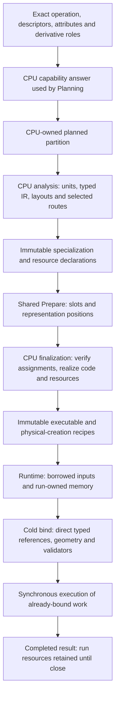

# [CPU](../../glossary.md#term-cpu) execution and native providers

> This is an explanation of the implementation, not a capability or [lifecycle](../../glossary.md#lifecycle) contract.
> [ARCHITECTURE.md](../../../ARCHITECTURE.md) and the incorporated
> [CPU backend routes](../../architecture/contracts/backend-execution.md#cpu-backend-routes),
> [low-precision cutover](../../architecture/contracts/backend-execution.md#cpu-low-precision-parity-cutover) ([precision glossary](../../glossary.md#term-precision)),
> and [Prepare/Run lifecycles](../../architecture/contracts/runtime-prepare-engine.md#prepare-lifecycle) ([Prepare glossary](../../glossary.md#prepare); [Run glossary](../../glossary.md#term-run))
> remain authoritative.

This atlas explains how a CPU-owned [graph](../../glossary.md#graph) [partition](../../glossary.md#partition) becomes reusable executable code, and why
its code can be shared while its [mutable](../../glossary.md#term-mutable) memory cannot. Start with the
[framework explanation](../framework.md) for the whole lifecycle or the
[tutorials](../../tutorials/index.md) for application code. The
[package index](index.md) connects this page to [Model](../../glossary.md#term-model), [Compiler](../../glossary.md#term-compiler), execution and training.

The central distinction is **[backend](../../glossary.md#backend) versus route**. [Planning](../../glossary.md#term-planning) assigns work to the `cpu` backend.
CPU preparation then chooses a *route*: generated [scalar](../../glossary.md#term-scalar) or [Vector API](../../glossary.md#term-vector-api) code, a retained direct
Java recurrence, or a qualified native implementation. [OpenBLAS](../../glossary.md#term-openblas) and [oneDNN](../../glossary.md#term-onednn) are not additional
backends. Installing a [native library](../../glossary.md#term-native-library) does not make an unsupported [operation](../../glossary.md#operation) supported.

**CPU** expands to [central processing unit](../../glossary.md#cpu-gpu-host-and-device). **[Host](../../glossary.md#term-host)** means the application-side processor and
memory, as distinct from an [accelerator](../../glossary.md#term-accelerator)'s **[device](../../glossary.md#term-device)** execution. Native CPU code still runs on the
host: “native” means a platform-library or machine-level boundary, not “[GPU](../../glossary.md#term-gpu).” A **[carrier](../../glossary.md#term-storage-carrier)** is
the primitive storage container for bits; its Java type alone does not determine their numeric
meaning. For example, a `short` can [carry](../../glossary.md#term-carry) either of two different 16-bit floating formats.

## Read the pipeline before the packages

The arrows below show handoffs, not calls made once per [tensor](../../glossary.md#tensor) [element](../../glossary.md#term-element):

A **unit** is [CPU](../../glossary.md#term-cpu)'s selected computation region inside a [partition](../../glossary.md#partition). **[Lowering](../../glossary.md#lowering)** translates [graph](../../glossary.md#graph)
meaning into CPU-specific instructions and access recipes. The **[intermediate representation](../../glossary.md#term-intermediate-representation-ir)
([IR](../../glossary.md#intermediate-representation-dag-and-ssa))** records those instructions, not live [buffers](../../glossary.md#term-buffer). A **[specialization](../../glossary.md#term-specialization)** records facts that
[shape](../../glossary.md#shape) generated code. A **slot** identifies assigned storage in a [prepared memory plan](../../glossary.md#prepared-memory-plan--preparedmemoryplan); it is
not the storage itself. A **workspace** is [run](../../glossary.md#term-run)-owned temporary storage or native invocation state.

Some later shorthand describes the mechanism, not extra capabilities. **[SIMD](../../glossary.md#simd)** means [single
instruction, multiple data](../../glossary.md#simd): one [vector](../../glossary.md#term-vector) [operation](../../glossary.md#operation) handles several element [lanes](../../glossary.md#term-lane). **[FMA](../../glossary.md#term-fused-multiply-add-fma)** means
[fused multiply-add](../../glossary.md#rounding-sites-fma-and-aggregate-floor), with multiplication and addition combined at a defined [rounding](../../glossary.md#term-rounding) boundary.
**[JVM](../../glossary.md#term-java-virtual-machine-jvm)** means [Java Virtual Machine](../../glossary.md#java-platform-and-build-tools); its **[JIT](../../glossary.md#term-just-in-time-compilation-jit)** (just-in-time [compiler](../../glossary.md#term-compiler)) can translate loaded
[bytecode](../../glossary.md#term-bytecode) to [machine code](../../glossary.md#term-machine-code) later. **[ABI](../../glossary.md#term-application-binary-interface-abi)** means [application binary interface](../../glossary.md#application-binary-interface-and-native-bridge): the exact native
calling and data-[layout](../../glossary.md#layout) agreement. **[FFM](../../glossary.md#term-ffm)** means the [JDK](../../glossary.md#term-java-development-kit-jdk) [Foreign Function and Memory API](../../glossary.md#application-binary-interface-and-native-bridge).

Analysis must discover storage before shared assignment. Finalization can realize an already
selected recipe, not invent another workspace. [Runtime](../../glossary.md#term-runtime) binds and executes the result; it does not
inspect the graph, select a route, generate code or recover from a native failure by changing routes.
The important sources are [CpuPartitionPreparer][preparer], [CpuPartitionFinalizer][finalizer],
and [CpuPreparedPartitionExecutable][partition-executable].

### Following the learning program

This is a conceptual [trace](../../glossary.md#trace) of [LearningJourney](../../examples/README.md), not an additional
runnable example or a report of a [run](../../glossary.md#term-run) performed for this page. Its prerequisites are the tutorial's
configured public [Model](../../glossary.md#term-model)/[Engine](../../glossary.md#term-engine)/Training workflow and the audited private [artifacts](../../glossary.md#term-artifact) described there.
The [CPU](../../glossary.md#term-cpu) discussion assumes that workflow is using CPU execution.

| Teaching input or step | Arithmetic and CPU significance |
| --- | --- |
| [FLOAT32](../../glossary.md#term-float32) input `[2,1]` with values `[1,3]`; supplied [gradient](../../glossary.md#term-gradient)-eligible [weight](../../glossary.md#term-weight) `[1,1]` initially `0`; no [bias](../../glossary.md#term-bias) | `prediction = input @ transpose(weight)`. Model copies the supplied [parameter](../../glossary.md#term-parameter); CPU does not own the [optimizer](../../glossary.md#term-optimizer)'s parameter state. |
| First [prediction](../../glossary.md#term-prediction) | `[0,0]`; each output [contraction](../../glossary.md#contraction-dimension) has `K=1`. Generated [MATMUL](../../glossary.md#matrix-multiplication--matmul) preserves exactly one typed product, without an extra [identity](../../glossary.md#term-identity-meanings) ADD or [FMA](../../glossary.md#term-fused-multiply-add-fma). |
| Target `(2,6)`; squared-error SUM | $(-2)^2+(-6)^2=40$. CPU lowers the actual objective/Compiler graph, not a hard-coded training algorithm. |
| Compiler-produced first-order weight gradient | $2((-2)\cdot1+(-6)\cdot3)=-40$. CPU executes the derivative operations through qualified ordinary machinery. |
| `Sgd(0.05)` step | Training gives $w_{\mathrm{new}}=0-0.05(-40)=2$; CPU does not own SGD. |
| Repeated prediction; fresh input `[2,4]` with the same [signature](../../glossary.md#term-signature) | `[2,6]`, then `[4,8]`. Prepared code must bind current storage, not [cache](../../glossary.md#term-cache) the initial weight or an earlier run's values. |

The table uses the finite dimensionless teaching case, not arbitrary floating-point algebra.
The [indexed derivation](../tensors-and-gradients.md#the-first-training-step) defines its
weight, sample indices and learning rate. Typed execution preserves each required rounded site;
sharing a generated class neither freezes current inputs nor erases an intermediate rounding.

The forward `K=1` product is excluded from both native MATMUL routes. A changed example with more
[features](../../glossary.md#term-software-feature) would change `K`, but that alone would still not guarantee native selection: exact [dtype](../../glossary.md#data-type--datatype),
[layout](../../glossary.md#layout), implementation [qualification](../../glossary.md#term-qualification), resource costs and cold selection also matter. Similarly,
changing values to [shape](../../glossary.md#shape) `[1,2]` is not reuse of the tutorial's static `[2,1]` signature; application
[admission](../../glossary.md#term-admission) rejects a mismatched [descriptor](../../glossary.md#term-descriptor) before CPU numerical work. The tutorial and
[reference entry point](../../reference/index.md) explain the public workflow and relevant errors.

## io.github.pho001.synaptik.[backend](../../glossary.md#backend).cpu

**Purpose and entry points.** [CpuBackendIntegration][integration] is the supported
service-provider integration boundary used by [Engine](../../glossary.md#term-engine) and [module](../../glossary.md#term-module) composition, not an ordinary
application execution [facade](../../glossary.md#term-facade). [CpuCapabilityProvider][capability] supplies the stable `cpu`
[identity](../../glossary.md#term-identity-meanings) and an [occurrence](../../glossary.md#term-occurrence)-specific answer: [operation](../../glossary.md#operation), original input/output [descriptors](../../glossary.md#term-descriptor),
attributes and [gradient](../../glossary.md#term-gradient) roles all participate. A [FLOAT32](../../glossary.md#term-float32) answer is not a blanket answer for a
low-[precision](../../glossary.md#term-precision) or symbolic occurrence.

**Mechanism and relations.** `open()` creates [CPU](../../glossary.md#term-cpu) composition with bounded optional [OpenBLAS](../../glossary.md#term-openblas)
setup; portable execution remains available if that optional setup does not qualify. Explicit
`openOneDnn(path, api)` requires the exact external library and fixes an [API](../../glossary.md#term-application-programming-interface-api) preference before
analysis. The preference restricts native candidates, not which route wins. The integration
exposes [partition](../../glossary.md#partition) preparation, schedule contribution and [host](../../glossary.md#term-host)-storage [borrowing](../../glossary.md#term-borrowing) to shared
execution [owners](../../glossary.md#term-owner). Capability itself performs no numerical execution or resource allocation.

**State, [ownership](../../glossary.md#term-ownership-meanings) and errors.** The adapter owns its composition and native-library [lifetime](../../glossary.md#term-lifetime);
returned preparation/tuning collaborators borrow that lifetime. New preparation/[run](../../glossary.md#term-run) [admission](../../glossary.md#term-admission)
requires an open integration. Already issued native resources have their own retained lifetimes
under [Runtime](../../glossary.md#term-runtime)'s resource protocol. Required [oneDNN](../../glossary.md#term-onednn) load, [ABI](../../glossary.md#term-application-binary-interface-abi) or [symbol](../../glossary.md#term-symbol) failures throw; they are
not converted into successful portable execution. The capability predicate and complete-partition
[lowering](../../glossary.md#lowering) are separate checks: admitting an operation does not promise arbitrary [fusion](../../glossary.md#term-fusion), physical
[aliasing](../../glossary.md#term-aliasing) or every native realization.

**Diagnostics, not steering.** [CpuTraceObserver][observer] receives opt-in cold preparation events
with [CpuPreparationDiagnostics][diagnostics] payloads: `SELECTED`, `ANALYSIS_FAILED`, `FINALIZED`
and `FINALIZATION_FAILED`, correlated by preparation identity. Selected route/unit summaries
and bounded rejection reasons distinguish unqualified code, native unavailability and a losing
[heuristic](../../glossary.md#term-heuristic). Candidate rejection positions need not be positions in the selected plan. Payloads
retain no [tensor](../../glossary.md#tensor) values, [buffers](../../glossary.md#term-buffer), native handles or throwable objects. [Observer](../../glossary.md#term-observer) callbacks run
synchronously on preparing threads and may be concurrent; the [borrowed](../../glossary.md#ownership-borrowing-and-lease) sink must be [thread-safe](../../glossary.md#term-thread-safe).
Observer failures disable later diagnostics without changing business/native outcomes. These
hooks do not instrument every run or prove that a selected executable was invoked.
[CpuLocalWorkloadTuning][local-tuning] and [CpuCompletePlanTuning][plan-tuning] expose cold
candidate/decision collaborations; they do not themselves measure workloads or run benchmarks.

**Learning connection.** This package lets the normal Engine composition admit the tutorial's
FLOAT32 operations and [prepare](../../glossary.md#prepare) them. It neither builds the [linear](../../glossary.md#term-linear-meanings) layer nor differentiates the
[objective](../../glossary.md#term-objective) nor applies [SGD](../../glossary.md#term-stochastic-gradient-descent-sgd). Diagnostics can explain a cold route choice without changing the
program's arithmetic.

## io.github.pho001.synaptik.[backend](../../glossary.md#backend).cpu.internal

This [namespace boundary][internal-package] marks unsupported implementation contracts, including
technically public Java types needed for collaboration across [CPU](../../glossary.md#term-cpu) subpackages. It is not a second
application [API](../../glossary.md#term-application-programming-interface-api) or a [module](../../glossary.md#term-module) to import for a shorter tutorial.

The children divide the CPU task into [graph](../../glossary.md#graph) [lowering](../../glossary.md#lowering), [immutable](../../glossary.md#term-immutable) recipes, code realization,
physical representations and invocation. They consume shared [Model](../../glossary.md#term-model)/[Planning](../../glossary.md#term-planning)/[Prepare](../../glossary.md#prepare) facts and
return shared [Runtime](../../glossary.md#term-runtime) contracts; they keep CPU policy out of those shared [owners](../../glossary.md#term-owner). The root
package contains no independent [resource owner](../../glossary.md#ownership-borrowing-and-lease) or executable service. Its key [invariant](../../glossary.md#term-invariant) is the
cold/hot separation: graph inspection and [artifact](../../glossary.md#term-artifact) realization occur before the generated loop,
not through [lookups](../../glossary.md#term-lookup) inside that loop.

**Learning connection.** These implementation packages participate beneath the public learning
workflow. LearningJourney should never construct their plans, slots or invocation objects itself;
doing so would bypass the [Engine](../../glossary.md#term-engine)'s [lifecycle](../../glossary.md#lifecycle) and [ownership](../../glossary.md#term-ownership-meanings) checks.

## io.github.pho001.synaptik.[backend](../../glossary.md#backend).cpu.internal.[lowering](../../glossary.md#lowering)

**Purpose and entry points.** [CpuPartitionDagDecomposer][decomposer] turns a complete [partition](../../glossary.md#partition)
into a deterministic unit sequence; [CpuPartitionLowering][lowering] translates each admitted unit
into typed [CPU](../../glossary.md#term-cpu) facts. Focused [owners](../../glossary.md#term-owner) such as [CpuMatmulLowering][matmul-lowering] handle a family's
[shape](../../glossary.md#shape)/[layout](../../glossary.md#layout) rules rather than asking a route to reinterpret [Model](../../glossary.md#term-model) operations.

**How it works.** Lowering follows partition-local [producer](../../glossary.md#term-producer)/consumer occurrences. External
boundaries are ordered by first use; eligible private intermediate results become virtual typed
values. Published or cross-unit values retain stores. [Pointwise](../../glossary.md#term-pointwise) [fusion](../../glossary.md#term-fusion) therefore removes an
unneeded physical intermediate without removing the arithmetic site that produced it. Layout
composition derives actual bases and [strides](../../glossary.md#term-stride); a private [transpose](../../glossary.md#term-transpose) feeding [MATMUL](../../glossary.md#matrix-multiplication--matmul) can become
strided operand reads instead of a transpose copy. Non-affine movement, indexing, scatter,
folding, reductions, [convolution](../../glossary.md#term-channels-first-convolution-layers), [normalization](../../glossary.md#term-normalization), [loss](../../glossary.md#loss) and [Scan](../../glossary.md#term-cumulative-scan) use family-specific lowerers.
[CpuOutputInjectivity][injectivity] proves that distinct logical output positions do not write the
same cell. [CpuRepresentationPlanner][representation-planner] describes eligible copy alternatives;
it is not an allocator.

**Inputs, outputs and invariants.** Input is the shared [Prepare](../../glossary.md#prepare) projection of semantic, [DAG](../../glossary.md#term-directed-acyclic-graph-dag) and
logical-memory facts. Output is [immutable](../../glossary.md#term-immutable) [IR](../../glossary.md#term-intermediate-representation-ir) plus concrete cold geometry/access [bindings](../../glossary.md#term-binding) and
resource requirements. Lowering owns no [arena](../../glossary.md#term-arena), worker or assigned [Runtime](../../glossary.md#term-runtime) slot. It rejects
unsupported [topology](../../glossary.md#term-topology), shape/type disagreement, unproved layouts and invalid write geometry;
checked span/byte arithmetic can [overflow](../../glossary.md#term-overflow). Fusion respects [publication](../../glossary.md#term-publication), saved-value, use and
numerical boundaries rather than merging merely because two operations are adjacent.
Symbolic geometry uses proved numeric binding recipes, not a [sample](../../glossary.md#term-sample-machine-learning-and-hyperparameters) [batch](../../glossary.md#term-batch-machine-learning-and-hyperparameters) substituted into a
static [graph](../../glossary.md#graph). [General Scan](../../glossary.md#general-differentiable-scan) reuses ordinary unit lowering for its local body, while keeping
activity, carries and saved history explicit; that is not permission for every native or [vector](../../glossary.md#term-vector)
standalone unit to execute inside Scan.

**Learning connection.** The [linear projection](../../glossary.md#linear-projection) and squared-error/[derivative](../../glossary.md#term-derivative) graph enter here as
ordinary operations. The transpose may be absorbed where proved. The [objective](../../glossary.md#term-objective)'s required SUM
and [gradient](../../glossary.md#term-gradient) contributions cannot be deleted just because the initial [parameter](../../glossary.md#term-parameter) is zero: lowering
does not inspect the example's data to specialize its mathematics.

## io.github.pho001.synaptik.[backend](../../glossary.md#backend).cpu.internal.ir

**Purpose and entry points.** [CpuPortableKernelIr][portable-ir] is the common typed family boundary;
[CpuKernelIr][kernel-ir] describes [pointwise](../../glossary.md#term-pointwise) values, ordered instructions, loop access forms and
stores. Family records such as [CpuMatmulIr][matmul-ir] retain [contraction](../../glossary.md#contraction-dimension) algorithm/numerical
facts. [CpuAccessPlan][access-plan] separates an access *form* from its concrete [binding](../../glossary.md#term-binding).

**Mechanism.** [Topology](../../glossary.md#term-topology)-local ordinals replace [graph](../../glossary.md#graph) [identities](../../glossary.md#term-identity-meanings). Values distinguish external input,
virtual local and stored output. The [dtype](../../glossary.md#data-type--datatype) belongs to each value, so a byte [carrier](../../glossary.md#term-storage-carrier) does not turn
[FP8](../../glossary.md#term-fp8) into [BOOL](../../glossary.md#data-type--datatype). A CAST retains ordered source/[target](../../glossary.md#term-target) types and its explicit conversion boundary.
Normalized access regimes describe how a generated loop advances through dense, broadcast or
more general affine storage; bindings retain actual extents, offsets, [strides](../../glossary.md#term-stride) and referenced spans.
This lets compatible structures share code without sharing invocation addresses.

An **ordinal** is a local numbered position. An **affine** access adds a base offset to fixed
stride multiples of [coordinates](../../glossary.md#axis-rank-scalar-vector-and-matrix). A **virtual** value remains a calculated typed value but needs
no separately stored intermediate at that boundary. These terms describe different facts:
sharing normalized access structure does not share a [run](../../glossary.md#term-run)'s actual addresses.

The pointwise [canonical](../../glossary.md#term-canonical-form) [identity](../../glossary.md#term-identity-meanings) excludes graph IDs, assigned slots, live segments and run
bindings. Code-shaping family geometry that is baked into a [specialization](../../glossary.md#term-specialization) must still enter its
appropriate [compatibility identity](../../glossary.md#identity-meanings-and-algebraic-identities); “canonical” does not mean every generated class is
[shape](../../glossary.md#shape)-independent. Record [validation](../../glossary.md#term-validation) rejects malformed ordinals, [arity](../../glossary.md#term-arity), types and family facts.
[IR](../../glossary.md#term-intermediate-representation-ir) owns [immutable](../../glossary.md#term-immutable) description data, never [tensor](../../glossary.md#tensor) memory, worker state or a native [engine](../../glossary.md#term-engine).

**Learning connection.** `K=1` [MATMUL](../../glossary.md#matrix-multiplication--matmul) facts and the actual [objective](../../glossary.md#term-objective)/[AD](../../glossary.md#autograd) operations are represented
here before code exists. The input and [weight](../../glossary.md#term-weight) values `[1,3]` and `0` are not the canonical graph
instruction identity. Replacing the [parameter](../../glossary.md#term-parameter)'s current storage contents must not rewrite IR.

## io.github.pho001.synaptik.[backend](../../glossary.md#backend).cpu.internal.[prepare](../../glossary.md#prepare)

**Purpose and entry points.** [CpuPartitionPreparer][preparer] analyzes;
[CpuPartitionPreparationPlan][preparation-plan] retains the selected result;
[CpuPartitionFinalizer][finalizer] realizes it after shared assignment.
[CpuPreparedScheduleAssembler][schedule-assembler] contributes physical recipes/schedule facts to
shared Prepare rather than creating an alternative scheduler.

**Analysis, then assignment, then realization.** Analysis decomposes and lowers the complete
[partition](../../glossary.md#partition), evaluates legal [fusion](../../glossary.md#term-fusion)/representation alternatives, chooses [scalar](../../glossary.md#term-scalar)/[vector](../../glossary.md#term-vector) computation
and single-range/bounded-parallel orchestration, and compares eligible native peers. Ordinary
preparation retains direct representation [topology](../../glossary.md#term-topology); explicit candidate workflows may select
already-described copy forms. Bounded complete-plan enumeration is not a whole-partition size
limit: longer partitions have a deterministic direct multi-unit path. Analysis declares exact
[buffer](../../glossary.md#term-buffer) spans and workspace sizes/[alignment](../../glossary.md#term-alignment) (or qualified [run](../../glossary.md#term-run)-size recipes) before shared Prepare
assigns storage positions. It performs no generated-[artifact](../../glossary.md#term-artifact) [lookup](../../glossary.md#term-lookup) or [persistence](../../glossary.md#term-persistence) access.

Finalization checks every assigned buffer/workspace and required [borrowed](../../glossary.md#ownership-borrowing-and-lease) execution [owner](../../glossary.md#term-owner) before
artifact realization. It cannot change selected topology, route, [carrier](../../glossary.md#term-storage-carrier) pattern, strategy or
resource geometry. Portable units obtain generated artifacts; fixed direct recurrent units do not
need an artifact-store lookup. Native units authenticate their retained provider session and
configuration. [oneDNN](../../glossary.md#term-onednn) recompilation must reproduce the analyzed scratch size and implementation.
The returned executable retains the exact shared memory plan. Persistent native resources transfer
to [Runtime](../../glossary.md#term-runtime) in acquisition order; failure closes newly acquired resources in reverse order,
preserving cleanup failures as suppressed exceptions, without retrying another route.

**Owned state and failure boundaries.** Plans contain [immutable](../../glossary.md#term-immutable) requirements, choices and
[metadata](../../glossary.md#term-metadata), not run-owned buffers. Wrong assignments, closed borrowed owners, incompatible native
metadata, unsupported [lowering](../../glossary.md#lowering) or checked geometry [overflow](../../glossary.md#term-overflow) fail before a successful preparation
is published. [CpuTraceProducer][trace-producer] supplies the cold diagnostics described above.

**Learning connection.** The first use prepares the concrete forward/[training graph](../../glossary.md#training-graph); later calls
reuse its executable recipes. The updated [weight](../../glossary.md#term-weight) is an invocation input, not an opportunity for
finalization to rebuild a class or silently acquire undeclared training storage.

## io.github.pho001.synaptik.[backend](../../glossary.md#backend).cpu.internal.codegen.emit

**Purpose and entry points.** [CpuClassFileKernelGenerator][generator] uses the Java 26 [Class-File
API](../../glossary.md#term-class-file-api) to emit [JVM](../../glossary.md#term-java-virtual-machine-jvm) [bytecode](../../glossary.md#term-bytecode) directly. It does not generate Java source and call `javac`.
[CpuGeneratedKernel][generated-kernel] strongly retains the verified bytes, hidden-class [lookup](../../glossary.md#term-method-handle-lookup) and
exact static entry [`MethodHandle`](../../glossary.md#native-numerical-library-and-instruction-architecture). Focused emitters include [CpuMatmulEmitter][matmul-emitter],
[CpuScalarEmitter][scalar-emitter], [CpuCastEmitter][cast-emitter] and
[CpuGeneralScanBodyEmitter][scan-body-emitter].

**What the class actually contains.** The generator consumes a selected [specialization](../../glossary.md#term-specialization), not
[Model](../../glossary.md#term-model) operations. It writes typed loads, locals, arithmetic, loops and stores for the chosen
family and exact ordered primitive-array/[`MemorySegment`](../../glossary.md#term-memorysegment) [carrier](../../glossary.md#term-storage-carrier) pattern. A [pointwise](../../glossary.md#term-pointwise) entry takes
primitive [half-open](../../glossary.md#term-half-open-interval) `start`/`end` bounds. Proved dense [heap](../../glossary.md#term-heap) paths narrow bounds/bases once and
use integer addressing; segment/general paths keep long addressing. Eligible [vector](../../glossary.md#term-vector) bodies emit
[Vector API](../../glossary.md#term-vector-api) operations and [scalar](../../glossary.md#term-scalar) tails; parallel range orchestration is outside ordinary
unit classes. Focused families emit their own [contraction](../../glossary.md#contraction-dimension), contributor, index, movement or
reduction loops rather than calling a generic [graph](../../glossary.md#graph) interpreter. This is not a claim that every
body is helper-free: fixed scalar mathematics may share reference helpers, and composed [Scan](../../glossary.md#term-cumulative-scan)
bodies use statically emitted helper calls.

Generated classes have no fields or interfaces. Generation and persisted-byte reuse both check
JVM verification and the emission [owner](../../glossary.md#term-owner)'s complete method inventory, [descriptors](../../glossary.md#term-descriptor) and structural
limits. Definition uses `Lookup.defineHiddenClass(..., NESTMATE)` and resolves the exact static
entry once. A [hidden class](../../glossary.md#term-hidden-class) may contain subsidiary methods for composed work; it is not necessarily
one giant method. These checks reject stale/malformed class [shapes](../../glossary.md#shape); they neither authenticate
hostile [cache](../../glossary.md#term-cache) storage nor prove numerical execution. The [Java Virtual Machine](../../glossary.md#java-platform-and-build-tools) subsequently owns
[just-in-time compilation](../../glossary.md#just-in-time-compilation); stored Class-File bytes are not stored [machine code](../../glossary.md#term-machine-code).

**Ordinary low [precision](../../glossary.md#term-precision).** [BFLOAT16](../../glossary.md#term-bfloat16) and [FLOAT16](../../glossary.md#term-float16) use raw short carriers; FLOAT8_E4M3 and
FLOAT8_E5M2 use raw bytes. Numerical working sites and accumulators use [FLOAT32](../../glossary.md#term-float32), with one final
declared [narrowing](../../glossary.md#term-narrowing) per logical low result, not a narrowing after every reduction contributor.
An explicitly stored/converted intermediate remains its own [rounding](../../glossary.md#term-rounding) boundary even when adjacent
work is [fused](../../glossary.md#specialization-and-fusion). Exact/discrete movement preserves [represented bits](../../glossary.md#term-represented-bits). Pointwise low code uses scalar
arithmetic, not a claim of low Vector API support. Cross-type CAST emits the Model-defined
conversion into the [target](../../glossary.md#term-target)-typed local rather than calling the cold Model conversion [oracle](../../glossary.md#term-test-oracle).
These rules are visible in the generator and the focused
[low-fold regression source][low-fold-test] ([regression glossary](../../glossary.md#term-regression)); they do not imply that every conceivable low [occurrence](../../glossary.md#term-occurrence),
symbolic [layout](../../glossary.md#layout) or native implementation qualifies.

**Resources and errors.** Emitters own generation-time builders and [immutable](../../glossary.md#term-immutable) emitted [artifacts](../../glossary.md#term-artifact),
not [run](../../glossary.md#term-run) [buffers](../../glossary.md#term-buffer). Invalid [IR](../../glossary.md#term-intermediate-representation-ir)/specialization, structural limits, verification or hidden-class/entry
resolution failures reject preparation. [General Scan](../../glossary.md#general-differentiable-scan) emits an actual time loop and fixed ordinary
body helpers; selected row-region execution has narrowly qualified prebound [synchronous](../../glossary.md#term-synchronous) range
[dispatch](../../glossary.md#term-dispatch). It is not a general per-step [callback](../../glossary.md#term-callback)/interpreter facility.

**Learning connection.** The generated forward contraction respects the [singleton](../../glossary.md#term-singleton) typed product;
[objective](../../glossary.md#term-objective) and [gradient](../../glossary.md#term-gradient) units execute the actual lowered arithmetic. Reusing the class after [SGD](../../glossary.md#term-stochastic-gradient-descent-sgd)
shares code, not the old [weight](../../glossary.md#term-weight) or old output. The FLOAT32 example exercises none of the low
narrowing paths; changing [dtype](../../glossary.md#data-type--datatype) requires fresh exact capability and full workflow [qualification](../../glossary.md#term-qualification).

## io.github.pho001.synaptik.[backend](../../glossary.md#backend).cpu.internal.[cache](../../glossary.md#term-cache)

**Purpose and entry points.** [CpuKernelSpecialization][specialization] and
[CpuLoweringFingerprint][fingerprint] describe generated compatibility;
[CpuGeneratedKernelArtifactStore][artifact-store] realizes or reuses an [artifact](../../glossary.md#term-artifact).
[CpuSpecializationBudget][specialization-budget] bounds generated forms. This cache is not a
[parameter](../../glossary.md#term-parameter) cache, output cache or workload-tuning decision store.

**Mechanism.** Before even a weak-[cache hit](../../glossary.md#cache-and-memoization), the store authenticates current [IR](../../glossary.md#term-intermediate-representation-ir)/[specialization](../../glossary.md#term-specialization)
agreement. A process-wide map weakly interns compatible live artifacts. With an explicit trusted
root it may read one bounded current-[schema](../../glossary.md#term-schema) envelope containing compatibility [metadata](../../glossary.md#term-metadata), deterministic
class bytes and a [checksum](../../glossary.md#term-checksum). A persisted hit verifies the bytes and defines a fresh [hidden class](../../glossary.md#term-hidden-class);
it preserves no earlier [JIT](../../glossary.md#term-just-in-time-compilation-jit) [machine code](../../glossary.md#term-machine-code) or profiling state. Missing, corrupt, stale, oversized or
inaccessible entries are safe misses, followed by verified in-memory generation. Optional
[publication](../../glossary.md#term-publication) failure does not change correctness. A checksum detects corruption, not hostile code
substitution: the root must be trusted.

**[Identity](../../glossary.md#term-identity-meanings) and [ownership](../../glossary.md#term-ownership-meanings).** Identity includes the [lowering](../../glossary.md#lowering) [fingerprint](../../glossary.md#term-fingerprint), relevant generator/family
compatibility, typed [carrier](../../glossary.md#term-storage-carrier) pattern, chosen compute form, applicable [vector species](../../glossary.md#term-vector-species) and every
baked code-shaping fact. Concrete addresses, physical resources and worker identity are not cache
keys. Do not generalize [pointwise](../../glossary.md#term-pointwise) geometry sharing to family specializations that bake geometry.
Prepared recipes strongly retain artifacts; the store retains them weakly and drains collected
entries at a later cold realization. It starts no cleanup thread and does no invocation-time [lookup](../../glossary.md#term-lookup).
The artifact has no explicit [close lifecycle](../../glossary.md#ownership-borrowing-and-lease).

**Learning connection.** The same structural code may be reused for repeated [predictions](../../glossary.md#term-prediction) or a
compatible fresh preparation. The cache must not cache `weight=0`, the [objective](../../glossary.md#term-objective) `40`, a [borrowed](../../glossary.md#ownership-borrowing-and-lease)
input [arena](../../glossary.md#term-arena), or the updated parameter `2`. The
[artifact-store test source][artifact-test] illustrates fresh, weak and persisted realization paths;
its presence is not a claim that these paths were [run](../../glossary.md#term-run) while writing this atlas.

## io.github.pho001.synaptik.[backend](../../glossary.md#backend).cpu.internal.route.portable

**Purpose and entry points.** [CpuPortableRoutePlan][portable-plan] pairs route-independent [IR](../../glossary.md#term-intermediate-representation-ir) with
its selected Class-File [specialization](../../glossary.md#term-specialization) and any admitted numeric [batch](../../glossary.md#term-batch-machine-learning-and-hyperparameters)-[binding](../../glossary.md#term-binding) recipe. It is a
realization description, not a [scalar](../../glossary.md#term-scalar) reference interpreter or provider selector.

**Mechanism and state.** Constructors cross-check [canonical](../../glossary.md#term-canonical-form) fingerprints, typed boundary/[carrier](../../glossary.md#term-storage-carrier)
patterns, optional family payloads and baked geometry. [Mutable](../../glossary.md#term-mutable) carriers, bases, ranges and scratch
slices stay outside the route plan. Scalar/[vector](../../glossary.md#term-vector) compute and range orchestration are different
choices: several scalar ranges can invoke the same scalar [artifact](../../glossary.md#term-artifact). Optional generated copy plans
already describe the adjusted consumer form before this seam; the portable route does not decide
to copy during execution.

The package also holds retained direct Java fixed-recurrence implementations, including
[CpuRecurrentScanKernel][recurrent-kernel] and typed siblings. They are not the reference oracles
and not the general [differentiable](../../glossary.md#derivative-and-chain-rule)-[Scan](../../glossary.md#term-cumulative-scan) implementation. They consume checked geometry and
invocation segments, finish projections before replacing carried [coordinates](../../glossary.md#axis-rank-scalar-vector-and-matrix), and keep mutable
[carry](../../glossary.md#term-carry)/scratch in the invocation. [General Scan](../../glossary.md#general-differentiable-scan) instead uses the emitted time-loop/body machinery
in [lowering](../../glossary.md#lowering), [code generation](../../glossary.md#term-code-generation) and executable packages. Both paths require exact independent
[occurrence](../../glossary.md#term-occurrence) [admission](../../glossary.md#term-admission); a class's presence does not grant universal recurrence support.

**Learning connection.** The canonical program uses portable ordinary [MATMUL](../../glossary.md#matrix-multiplication--matmul) and ordinary
[objective](../../glossary.md#term-objective)/[derivative](../../glossary.md#term-derivative) operations, not any fixed recurrence. Its route plan describes reusable code;
Training supplies current [parameters](../../glossary.md#term-parameter) on each call. Corrupt or inconsistent plan/specialization
facts fail before a valid executable is constructed.

## io.github.pho001.synaptik.[backend](../../glossary.md#backend).cpu.internal.executable

**Purpose and entry points.** [CpuPreparedExecutable][unit-executable] is the [immutable](../../glossary.md#term-immutable) direct-unit
recipe; [CpuPreparedPartitionExecutable][partition-executable] composes fixed [topological](../../glossary.md#term-topological-order) children.
[CpuGeneralScanPreparedExecutable][scan-executable] binds emitted [general Scan](../../glossary.md#general-differentiable-scan) work.
[CpuWorkerGroup][workers] ([CpuWorkerGroup glossary](../../glossary.md#cpu-worker-group--cpuworkergroup)) and [CpuConcurrencyBudget][budget] ([CpuConcurrencyBudget glossary](../../glossary.md#cpu-concurrency-budget--cpuconcurrencybudget)) [coordinate](../../glossary.md#axis-rank-scalar-vector-and-matrix) [CPU](../../glossary.md#term-cpu) execution, not [Runtime](../../glossary.md#term-runtime)
[ownership](../../glossary.md#term-ownership-meanings) or [asynchronous](../../glossary.md#term-asynchronous) jobs.

**Bind once, execute direct work.** Cold [binding](../../glossary.md#term-binding) checks exact memory-plan/representation positions,
logical [dtype](../../glossary.md#data-type--datatype), [carrier](../../glossary.md#term-storage-carrier) pattern, [liveness](../../glossary.md#term-liveness), accessibility, mutability, [alignment](../../glossary.md#term-alignment), size, geometry and
write-related overlap. It then [captures](../../glossary.md#term-capture-meanings) typed arrays/segments, primitive address state, fixed
ranges and direct handles in an invocation. The composite binds all children before execution and
executes them in list order; its [dependency](../../glossary.md#term-dependency) indices are diagnostic facts, not a dynamic scheduler.
Required copy units complete before their consumers. No route is selected here.

[Metadata](../../glossary.md#term-metadata) [validation](../../glossary.md#term-validation) and value validation have different timing. Index bounds, replacement
uniqueness, [canonical](../../glossary.md#term-canonical-form) [BOOL](../../glossary.md#data-type--datatype) bytes, index-[loss](../../glossary.md#loss) [targets](../../glossary.md#term-target) or [Scan](../../glossary.md#term-cumulative-scan) lengths may depend on earlier
[producers](../../glossary.md#term-producer). Their validators are prebound without reading values and execute over the current
eligible domain after producers, before the consumer's numerical writes or worker submission.
A physical byte carrier alone never enables BOOL validation for [FP8](../../glossary.md#term-fp8). Validation boundaries do not
mean an entire multi-unit [run](../../glossary.md#term-run) can be rolled back byte-for-byte; failure stops execution and Runtime
returns no successful result.

**Threads and owned state.** A unit borrows its worker group. The group owns named daemon platform
threads and must be closed by its [owner](../../glossary.md#term-owner); it is not a common pool or public executor. Ordinary
parallel submission acquires the selected participant demand from the shared budget, starts
already-bound disjoint ranges and joins all started work before returning. Failure cancels
unclaimed ranges and chooses worker failures deterministically by range index. Interruption joins
started work and restores interrupt status. A narrowly selected row-region path borrows a live
run-owned reservation rather than nesting budget acquisition. [MATMUL](../../glossary.md#matrix-multiplication--matmul) ranges own complete cells,
rows or tiles, never slices of the [contraction](../../glossary.md#contraction-dimension) `K`. Scan's changing geometry, [carry](../../glossary.md#term-carry) banks,
histories, staging and partials remain run-owned, not [mutable](../../glossary.md#term-mutable) fields shared by preparations.

**Learning connection.** A prepared [prediction](../../glossary.md#term-prediction) binds `[1,3]` and the current [weight](../../glossary.md#term-weight); a subsequent
prediction binds fresh values/updated weight. Its output belongs to that run. Keeping a result
open does not turn its [buffers](../../glossary.md#term-buffer) into mutable fields of the reusable executable, and closing a
prepared owner is not permission to close caller-owned [parameter](../../glossary.md#term-parameter)/input storage.

## io.github.pho001.synaptik.[backend](../../glossary.md#backend).cpu.internal.memory

**Purpose and entry points.** [CpuBufferRepresentation][buffer-representation] is the [CPU](../../glossary.md#term-cpu) [view](../../glossary.md#term-view-meanings) of
[Runtime](../../glossary.md#term-runtime) [buffer](../../glossary.md#term-buffer) storage; [CpuBufferArgument][buffer-argument] carries typed direct access facts.
[CpuRepresentationRecipes][representation-recipes] supplies deferred creation callbacks.
[CpuHostSnapshotExporter][snapshot-exporter] explicitly exports caller-owned [host](../../glossary.md#term-host) snapshots.

**Physical [ownership](../../glossary.md#term-ownership-meanings).** [CpuBorrowedBuffer][borrowed-buffer] retains exact caller [host storage](../../glossary.md#host-storage)
without copying it, extending its segment [scope](../../glossary.md#term-scope) or taking its close duty. The caller must keep it
alive while [borrowed](../../glossary.md#ownership-borrowing-and-lease). [CpuNativeBuffer][native-buffer] allocates one exact aligned segment in a
shared [arena](../../glossary.md#term-arena) and closes that arena at most once. Shared arena accessibility supports the
orchestrator, qualified worker threads and [FFM](../../glossary.md#term-ffm) calls; it does not by itself make conflicting
writes safe. [CpuContiguousWorkspace][workspace] owns aligned [run](../../glossary.md#term-run)-local temporary bytes.
Representation recipes defer allocation and [constant](../../glossary.md#term-constant) initialization until Runtime creates a run;
constructing a preparation does not allocate its [tensor](../../glossary.md#tensor) buffers.

**Invariants and failures.** Logical [dtype](../../glossary.md#data-type--datatype) and physical [carrier](../../glossary.md#term-storage-carrier) are separate. [FP8](../../glossary.md#term-fp8) byte storage
preserves raw representations independently of [BOOL](../../glossary.md#data-type--datatype)'s [canonical](../../glossary.md#term-canonical-form) zero/one rule. [Referenced span](../../glossary.md#referenced-element-span),
not just logical [element](../../glossary.md#term-element) count, determines required storage for strided [layouts](../../glossary.md#layout). Sizes,
[alignments](../../glossary.md#term-alignment), whole-element widths, actual [batch](../../glossary.md#term-batch-machine-learning-and-hyperparameters) geometry and access permissions are checked;
[overflow](../../glossary.md#term-overflow), dead/inaccessible segments, insufficient spans or incompatible carriers fail [admission](../../glossary.md#term-admission).
A [materialization](../../glossary.md#materialization) workspace may serve a declared [contiguous](../../glossary.md#term-contiguous) copy, or family scratch may be sliced
into disjoint per-range regions; neither creates a new Runtime [lifetime](../../glossary.md#term-lifetime) [owner](../../glossary.md#term-owner). Runtime orchestrates
creation/[release](../../glossary.md#term-release) and keeps borrowed storage distinct from owned buffers/workspaces.

**Learning connection.** Input and current [parameter](../../glossary.md#term-parameter) storage are borrowed; generated outputs and
required scratch are fresh run-owned resources. Materializing a result is an explicit [snapshot](../../glossary.md#term-snapshot)
[operation](../../glossary.md#operation), not a way to retain an implicitly live native result after its owner closes. The fresh
`[2,4]` invocation must read those values rather than a snapshot of `[1,3]`.

## io.github.pho001.synaptik.[backend](../../glossary.md#backend).cpu.internal.reference

**Purpose and entry points.** [CpuScalarReferenceKernel][scalar-reference] and focused oracles such
as [CpuMatmulReferenceKernel][matmul-reference] provide clean Java semantic/[conformance](../../glossary.md#term-conformance) references
for already-lowered [CPU](../../glossary.md#term-cpu) facts. They are not a selectable [runtime](../../glossary.md#term-runtime) fallback route.

**Mechanism.** References traverse the same typed instructions/access or family geometry in
readable Java. The [MATMUL](../../glossary.md#matrix-multiplication--matmul) [oracle](../../glossary.md#term-test-oracle), for example, traverses increasing logical `K`, keeps `K=0`
[positive zero](../../glossary.md#nan-infinity-and-signed-zero), treats `K=1` as one typed product, and stores a completed result once. Low floating
MATMUL uses [FLOAT32](../../glossary.md#term-float32) working values and final conversion to its represented output. This gives
generated-code tests a precise algorithm to compare rather than merely comparing two unrelated
framework outputs. Some pure [scalar](../../glossary.md#term-scalar) mathematics helpers are intentionally shared by generated
[bytecode](../../glossary.md#term-bytecode); that does not turn reference [graph](../../glossary.md#graph) [evaluation](../../glossary.md#term-evaluation) into runtime execution. Generated CAST
emits conversion directly, while the cold reference can call the [Model](../../glossary.md#term-model) conversion oracle.

Reference inputs/outputs are caller-supplied carriers; references do not own Runtime slots,
provider sessions, prepared resources or a thread pool. [Carrier](../../glossary.md#term-storage-carrier)/type and checked-address errors
reject invalid oracle inputs. Their [scope](../../glossary.md#term-scope) is supported lowered forms, not an interpreter for
arbitrary Model operations.

**Learning connection.** The program's [singleton](../../glossary.md#term-singleton) projection and [gradient](../../glossary.md#term-gradient) contractions can be
reasoned about with these algorithms, but LearningJourney does not invoke them through Runtime.
The numerical walkthrough above is arithmetic explanation, not a claim that the reference or
production generated code was executed for this documentation change.

## io.github.pho001.synaptik.[backend](../../glossary.md#backend).cpu.internal.route.nativeblas.openblas

**Purpose and entry points.** [CpuBackendComposition][composition] owns [CPU](../../glossary.md#term-cpu) [lifetime](../../glossary.md#term-lifetime) composition;
[CpuOpenBlasDiscovery][blas-discovery] attempts bounded loading;
[CpuOpenBlasQualifier][blas-qualifier] issues exact-session compatibility evidence;
[CpuOpenBlasRouteSelector][blas-selector] compares a native candidate with the already-complete
portable [lowering](../../glossary.md#lowering); [CpuOpenBlasPreparedExecutable][blas-executable] binds the selected route.
This policy belongs to CPU, not to the [leaf](../../glossary.md#term-leaf) provider described below.

**Loading is not [qualification](../../glossary.md#term-qualification) or selection.** Discovery may be disabled, use an exact name or
absolute path, or use a fixed platform table. Loading resolves symbols only. Qualification checks
bounded [host](../../glossary.md#term-host)/[ABI](../../glossary.md#term-application-binary-interface-abi)/[binary](../../glossary.md#term-binary-descriptor-and-metadata) facts and small exact-output/special-value [GEMM](../../glossary.md#general-matrix-multiplication--gemm) [smoke](../../glossary.md#term-smoke-test) cases against the
exact live coordinator. Absolute-path inspection can retain binary [identity](../../glossary.md#term-identity-meanings); name loading is
session-only evidence. This is not hostile-binary [authentication](../../glossary.md#term-authentication) or a universal numerical or
performance [certificate](../../glossary.md#formal-proof-certificate-and-trusted-assumptions). Optional failure leaves ordinary CPU available before preparation;
there is no native failure-triggered route switch during execution.

**The selected domain and copies.** The production route is a positive [rank-two](../../glossary.md#axis-rank-scalar-vector-and-matrix) same-type [FLOAT32](../../glossary.md#term-float32)
or [FLOAT64](../../glossary.md#term-float64) bare product with `K>1`, optionally preceded by proved private [transpose](../../glossary.md#term-transpose) prefixes. It
has no low-[precision](../../glossary.md#term-precision), batched/broadcast, `K=0`, `K=1` or arbitrary [epilogue](../../glossary.md#term-epilogue) grant. Common lowering
supplies effective reads; the non-transposed dense [row-major](../../glossary.md#term-row-major) provider may require generated affine
copy-in for either operand and copy-out for a noncanonical result. Each is a separately declared
[run](../../glossary.md#term-run)-owned workspace before shared assignment. The cost comparison includes these transitions
and thread configuration, not only GEMM arithmetic. Ineligibility, [overflow](../../glossary.md#term-overflow), a tie or insufficient
benefit retains portable execution during cold selection. No benchmark/speedup follows from the
dimensionless [cost model](../../glossary.md#compiler-transformations-and-dominance).

**State and threads.** [CpuOpenBlasCoordinator][blas-coordinator] ([CpuOpenBlasCoordinator glossary](../../glossary.md#openblas-coordinator--cpuopenblascoordinator)) owns the transferred provider
resource and coordinates calls/configuration with the common CPU budget. It [captures](../../glossary.md#term-capture-meanings) the original
positive native thread count, installs/verifies the selected count, excludes configuration writers
from admitted calls, and on close quiesces borrowers, restores/verifies the original count, then
closes the provider. Its lock does not serialize arbitrary outside native users of the same binary.
A wrong session/[target](../../glossary.md#term-target), closed [owner](../../glossary.md#term-owner), failed count verification/restoration or invocation error
fails rather than retrying portable execution. Prepared plans retain [immutable](../../glossary.md#term-immutable) facts; actual
segments and copies are run-owned.

**Learning connection.** The forward `K=1` projection is deliberately ineligible, even if [OpenBLAS](../../glossary.md#term-openblas)
is installed. The tutorial's [graph](../../glossary.md#graph) does not establish native selection for its [derivative](../../glossary.md#term-derivative) units
either: each actual prepared [occurrence](../../glossary.md#term-occurrence) must independently meet route and cost conditions.

## io.github.pho001.synaptik.[backend](../../glossary.md#backend).cpu.internal.route.nativeops.onednn

**Purpose and entry points.** [CpuOneDnnProjection][dnn-projection] projects common [CPU](../../glossary.md#term-cpu) units into
typed native recipes; [CpuOneDnnSelector][dnn-selector] performs cold whole-plan comparison;
[CpuOneDnnCompiler][dnn-compiler] authenticates structural/[API](../../glossary.md#term-application-programming-interface-api) [qualification](../../glossary.md#term-qualification) and realizes the chosen
recipe through [CpuOneDnnPrimitives][dnn-primitives] or [CpuOneDnnGraph][dnn-graph]. [Graph](../../glossary.md#graph) here is a
vendor execution API, not Synaptik's graph [compiler](../../glossary.md#term-compiler) or [automatic differentiation](../../glossary.md#autograd).

**External library and exact [admission](../../glossary.md#term-admission).** [CpuOneDnnLibrary][dnn-library] loads an explicitly
required absolute path, checks exact [oneDNN](../../glossary.md#term-onednn) `3.14.0`, [little-endian](../../glossary.md#text-encoding-and-file-boundaries) [LP64](../../glossary.md#term-lp64) and sequential CPU [runtime](../../glossary.md#term-runtime)
`SEQ` (code `1`), then owns the [FFM](../../glossary.md#term-ffm) [lookup](../../glossary.md#term-lookup)/CPU [engine](../../glossary.md#term-engine). There is no bundled oneDNN [binary](../../glossary.md#term-binary-descriptor-and-metadata) or optional
automatic oneDNN discovery. Loading/[authentication](../../glossary.md#term-authentication) failure throws. API preference `AUTO`,
`PRIMITIVES` or `GRAPH` does not force native execution. The bare [MATMUL](../../glossary.md#matrix-multiplication--matmul) baseline requires positive
static dense/permuted-dense or normalized broadcast-[batch](../../glossary.md#term-batch-machine-learning-and-hyperparameters) [layouts](../../glossary.md#layout), [rank](../../glossary.md#term-rank) at most 12 and `K>1`.
Neither symbolic geometry nor [Scan](../../glossary.md#term-cumulative-scan) orchestration inherits native admission.

**LP64** names a native data [model](../../glossary.md#term-model) with 64-bit C `long` and pointer values and 32-bit C `int`
values. **Little-endian** describes the [byte order](../../glossary.md#text-encoding-and-file-boundaries) within a stored multi-byte word. These are
binary-compatibility facts, not statements about a [tensor](../../glossary.md#tensor)'s logical [axes](../../glossary.md#term-axis) or numerical accuracy.

Some ordinary [pointwise](../../glossary.md#term-pointwise)/reduction/movement units and literal substeps of a composite unit have
independently qualified projections. A composite pipeline retains the common unit's arithmetic
sites and saved/public stores; it is not permission to replace [convolution](../../glossary.md#term-channels-first-convolution-layers), [activation](../../glossary.md#term-activation),
[normalization](../../glossary.md#term-normalization) or [pooling](../../glossary.md#term-pooling) wholesale with an [opaque](../../glossary.md#term-opaque) vendor operator. Exact implementation [identity](../../glossary.md#term-identity-meanings)
matters after [descriptor](../../glossary.md#term-descriptor) construction. For example, raw reorder, [extrema](../../glossary.md#saturation-pole-and-extremum) and elementary operations
have implementation-specific checks; identity reductions and several Graph forms are rejected.
Source enums or a native descriptor being available are not a support [matrix](../../glossary.md#term-review-matrix).

**Current low/native limits.** Typed low inputs retain their real [dtype](../../glossary.md#data-type--datatype), origin, span and [alignment](../../glossary.md#term-alignment).
Primitives use strict [FLOAT32](../../glossary.md#term-float32) working/accumulation attributes. Qualified low MATMUL implementations
are explicitly checked (including selected reference, [AArch64](../../glossary.md#term-aarch64) [BF16](../../glossary.md#floating-point-precision-and-rounding)/[F16](../../glossary.md#floating-point-precision-and-rounding) and selected x86 [FP8](../../glossary.md#term-fp8) forms),
not accepted by a broad optimized-name prefix. Graph 3.14 rejects FP8 arithmetic; low Graph binary
and reduction forms have additional restrictions. CPU native [FLOAT64](../../glossary.md#term-float64) is unavailable; [OpenBLAS](../../glossary.md#term-openblas)
remains the separate FLOAT32/FLOAT64 peer. Native FP8 requires an available supported x86 [target](../../glossary.md#term-target);
no native FP8 execution is claimed on Arm. An enum tag, reference recipe or rejected-target test
is not positive execution evidence on another [host](../../glossary.md#term-host).

Current low logical outputs use a declared FLOAT32 result workspace followed by the ordinary
generated final CAST via [CpuOneDnnOutputNarrowing][dnn-narrowing]. This preserves exact Model
[rounding](../../glossary.md#term-rounding) and the logical output/saved boundary instead of trusting an unproved vendor destination
conversion. It does not promote FP8 operands to FLOAT32 and call that native FP8 execution.
The [low-native test source][low-native-test] separates exact generated final [narrowing](../../glossary.md#term-narrowing) from
optional real typed-input native tests gated by an explicit library and available implementation.
It is source evidence, not a report of native tests [run](../../glossary.md#term-run) for this page.

**[Prepare](../../glossary.md#prepare) and run resources.** Analysis queries handle-free descriptor/scratch facts; primitive
queries create no executable, whereas a Graph scratch query temporarily compiles and closes one.
Finalization recompiles exactly the chosen API/recipe, verifies scratch and implementation identity,
and transfers persistent [kernels](../../glossary.md#kernel) to Runtime with transactional cleanup on failure. Native caches
remain library-owned and are unrelated to the CPU Class-File [artifact](../../glossary.md#term-artifact) store.

[CpuOneDnnPreparedExecutable][dnn-executable] supplies workspace creators for fresh run-owned
streams, memory/tensor handles and [ABI](../../glossary.md#term-application-binary-interface-abi) tables. Issued workspaces retain their [kernel](../../glossary.md#kernel)/library until
close independently of prepared-[owner](../../glossary.md#term-owner) closure. [Binding](../../glossary.md#term-binding) validates typed spans/origins and rejects
input/output/scratch [aliasing](../../glossary.md#term-aliasing). Matching logical-value/origin/span ingress copies may be shared
within one [RunState](../../glossary.md#run-state--runstate); the first native consumer refreshes them every run, never across-run [weight](../../glossary.md#term-weight)
snapshots. Graph inputs are variable. Fixed copy/execute/wait work runs synchronously under one
CPU-budget permit; no late selection, allocation of native control objects, numerical repair,
retry or portable fallback is installed in the hot invocation.

**Learning connection.** The forward [singleton](../../glossary.md#term-singleton) MATMUL is not native-eligible. Existing Compiler
[AD](../../glossary.md#autograd), if a different [occurrence](../../glossary.md#term-occurrence) qualifies natively, still produces the ordinary [derivative](../../glossary.md#term-derivative) graph;
oneDNN supplies neither vendor backward semantics nor a second training pipeline. Closing or
failing a required oneDNN integration is not silently repaired by the tutorial's portable path.

## io.github.pho001.synaptik.[backend](../../glossary.md#backend).provider.openblas

**Purpose and entry points.** This separate
[openblas-provider module](../../../modules/backend/openblas-provider) ([module glossary](../../glossary.md#term-module)) is a [JDK](../../glossary.md#term-java-development-kit-jdk)-only [leaf](../../glossary.md#term-leaf) below [CPU](../../glossary.md#term-cpu).
[OpenBlasLibrary][provider-library] ([OpenBlasLibrary glossary](../../glossary.md#openblas-library-handle--openblaslibrary)) explicitly loads the caller's name/path;
[FfmOpenBlasNativeAccess][provider-ffm] binds `cblas_sgemm`, `cblas_dgemm`,
`openblas_set_num_threads` and `openblas_get_num_threads` through the [Foreign Function and Memory](../../glossary.md#application-binary-interface-and-native-bridge)
([FFM](../../glossary.md#term-ffm)) [API](../../glossary.md#term-application-programming-interface-api). C integer [arguments](../../glossary.md#term-argument) select the ordinary 32-bit-`blasint` interface.
[OpenBlasGemmInvocation][provider-gemm] validates and invokes normalized calls;
[OpenBlasThreadControl][provider-threads] exposes thread utilities.

**Mechanism and boundary.** The CPU route calls the provider with normalized dense,
row-major non-transposed segments, not Tensors or a graph. For non-negative integer dimensions
$m,n,k$, inputs $A\in\mathbb R^{m\times k}$, $B\in\mathbb R^{k\times n}$, existing
$C\in\mathbb R^{m\times n}$ and scalar coefficients $\alpha,\beta$, its mathematical request is

$$
C^{\mathrm{new}}_{ij}=\alpha\sum_{q=0}^{k-1}A_{iq}B_{qj}+\beta C^{\mathrm{old}}_{ij},
\qquad 0\le i<m,\quad0\le j<n.
$$

For $m=n=1,k=2$, $A=(1,2)$, $B=(3,4)^\mathsf T$, $\alpha=1,\beta=0$, the requested result
is $11$. This is the real-number meaning, not a numerical guarantee for arbitrary installed
OpenBLAS binaries. Segments begin at byte offset zero; FLOAT32/FLOAT64 remain distinct typed
calls. The provider does not interpret Config, Tensor layouts, packing, costs, fallback or
backend ownership. CPU depends on the provider, not the reverse; a successful raw GEMM call
does not establish production route qualification. The empty/$k=0$ cases below keep their
actual native-call rules rather than being inferred from this positive example.

**Resources, errors and invariants.** The library handle owns a shared-[arena](../../glossary.md#term-arena) [lookup](../../glossary.md#term-lookup) [lifetime](../../glossary.md#term-lifetime), not
caller [matrix](../../glossary.md#term-matrix-meanings) memory. Calls retain, allocate, copy, reinterpret and close no caller segments.
Inputs may be read-only and overlap each other; the required output must be writable, correctly
aligned/sized and disjoint from both required input spans. [Dimensions](../../glossary.md#dimension) must be nonnegative and all
[scope](../../glossary.md#term-scope)/thread accessibility checks hold. [Validation](../../glossary.md#term-validation) finishes even for output-empty calls, which
then make no native call. A raw positive-output `K=0` call still invokes GEMM so `beta` applies;
this differs deliberately from production CPU native-route exclusion of `K<=1`.

Loading/[binding](../../glossary.md#term-binding) failure is reported by `OpenBlasLoadException`; malformed arguments, closed/dead
storage or native invocation failures are not converted into a different algorithm. Callers must
keep library and segments alive and avoid racing close with calls. Native thread count is [mutable](../../glossary.md#term-mutable)
library/process state; the provider supplies no call [serialization](../../glossary.md#term-serialization) or coordination with unrelated
native consumers. CPU's coordinator adds its bounded policy above this leaf. The provider makes
no numerical, determinism or performance guarantee for arbitrary [OpenBLAS](../../glossary.md#term-openblas) binaries.

**Learning connection.** Application code does not use raw GEMM or set native thread counts to
implement the lesson. The forward [singleton](../../glossary.md#term-singleton) product remains portable. If a different prepared
CPU workload selects OpenBLAS, this package performs only its already-normalized GEMM and thread
operations; [objective](../../glossary.md#term-objective) construction, [AD](../../glossary.md#autograd), [SGD](../../glossary.md#term-stochastic-gradient-descent-sgd) and result [ownership](../../glossary.md#term-ownership-meanings) remain elsewhere.

## Native path accounting

“Native” describes several different relationships. Read this table from repository code to the
external implementation it uses; it is not an installation or publishing promise.

| Repository path / external component | Actual role and packaging distinction |
| --- | --- |
| [modules/backend/cpu](../../../modules/backend/cpu), especially `internal/route/nativeops/onednn` | Java [FFM](../../glossary.md#term-ffm) [bindings](../../glossary.md#term-binding) and [CPU](../../glossary.md#term-cpu)-owned recipes/[qualification](../../glossary.md#term-qualification)/[lifetime](../../glossary.md#term-lifetime) handling. [oneDNN](../../glossary.md#term-onednn) is an external exact shared library, not a checked-in C/C++ CPU bridge. |
| [modules/backend/openblas-provider](../../../modules/backend/openblas-provider) | Java FFM [leaf](../../glossary.md#term-leaf) binding to an external [OpenBLAS](../../glossary.md#term-openblas) shared library. The provider [module](../../glossary.md#term-module) is not the OpenBLAS [binary](../../glossary.md#term-binary-descriptor-and-metadata). CPU's discovery/qualification code lives in `internal/route/nativeblas/openblas`, not here. |
| External OpenBLAS name or absolute path | Provides [GEMM](../../glossary.md#general-matrix-multiplication--gemm) and thread-control symbols. Optional bounded CPU discovery is distinct from a caller explicitly opening a provider handle. |
| Explicit external oneDNN 3.14.0 absolute path | Provides primitive/[Graph](../../glossary.md#graph) C APIs and CPU [engine](../../glossary.md#term-engine); exact [ABI](../../glossary.md#term-application-binary-interface-abi)/[runtime](../../glossary.md#term-runtime) loading is required, not optional discovery. Library and issued resources have retained lifetimes. |
| [modules/backend/metal/macos-arm64](../../../modules/backend/metal/macos-arm64) ([arm64 glossary](../../glossary.md#native-packaging-and-platform-vocabulary)) | The colocated native [Metal](../../glossary.md#term-metal) bridge/source/build/package tree belongs to the Metal [backend](../../glossary.md#backend), not to either CPU route. See the [Metal atlas](metal.md) for its native source accounting. |

The CPU and provider paths above contain Java integration, not a packaged Synaptik CPU [JNI](../../glossary.md#term-jni) bridge.
[Classpath](../../glossary.md#term-classpath) FFM deployments require `--enable-native-access=ALL-UNNAMED`; this flag does not install
a library, authenticate an ABI, qualify an implementation or force a route. Portable generated
CPU code does not require installing OpenBLAS or oneDNN. For exact [ownership](../../glossary.md#term-ownership-meanings) rules consult the
[OpenBLAS provider contract](../../architecture/contracts/backend-execution.md#openblas-provider)
and [qualified oneDNN contract](../../architecture/contracts/backend-execution.md#qualified-onednn-cpu-realization).

## What to take away

The [canonical](../../glossary.md#term-canonical-form) program needs public [Model](../../glossary.md#term-model)/[Engine](../../glossary.md#term-engine)/Training [owners](../../glossary.md#term-owner), not fourteen [backend](../../glossary.md#backend) imports.
[CPU](../../glossary.md#term-cpu) capability admits exact occurrences; [lowering](../../glossary.md#lowering) preserves their meaning; shared [Prepare](../../glossary.md#prepare) assigns
resources; finalization creates [immutable](../../glossary.md#term-immutable) recipes and code; each [run](../../glossary.md#term-run) owns current values and
[mutable](../../glossary.md#term-mutable) resources. Native routes can replace only independently qualified physical realizations
chosen before execution. Neither a [native library](../../glossary.md#term-native-library), a [cache hit](../../glossary.md#cache-and-memoization) nor a generated class proves that
the learning program ran, that a [host](../../glossary.md#term-host) supports native [FP8](../../glossary.md#term-fp8), or that execution will be faster.

[integration]: ../../../modules/backend/cpu/src/main/java/io/github/pho001/synaptik/backend/cpu/CpuBackendIntegration.java
[capability]: ../../../modules/backend/cpu/src/main/java/io/github/pho001/synaptik/backend/cpu/CpuCapabilityProvider.java
[observer]: ../../../modules/backend/cpu/src/main/java/io/github/pho001/synaptik/backend/cpu/CpuTraceObserver.java
[diagnostics]: ../../../modules/backend/cpu/src/main/java/io/github/pho001/synaptik/backend/cpu/CpuPreparationDiagnostics.java
[local-tuning]: ../../../modules/backend/cpu/src/main/java/io/github/pho001/synaptik/backend/cpu/CpuLocalWorkloadTuning.java
[plan-tuning]: ../../../modules/backend/cpu/src/main/java/io/github/pho001/synaptik/backend/cpu/CpuCompletePlanTuning.java
[internal-package]: ../../../modules/backend/cpu/src/main/java/io/github/pho001/synaptik/backend/cpu/internal/package-info.java
[preparer]: ../../../modules/backend/cpu/src/main/java/io/github/pho001/synaptik/backend/cpu/internal/prepare/CpuPartitionPreparer.java
[finalizer]: ../../../modules/backend/cpu/src/main/java/io/github/pho001/synaptik/backend/cpu/internal/prepare/CpuPartitionFinalizer.java
[preparation-plan]: ../../../modules/backend/cpu/src/main/java/io/github/pho001/synaptik/backend/cpu/internal/prepare/CpuPartitionPreparationPlan.java
[schedule-assembler]: ../../../modules/backend/cpu/src/main/java/io/github/pho001/synaptik/backend/cpu/internal/prepare/CpuPreparedScheduleAssembler.java
[trace-producer]: ../../../modules/backend/cpu/src/main/java/io/github/pho001/synaptik/backend/cpu/internal/prepare/CpuTraceProducer.java
[decomposer]: ../../../modules/backend/cpu/src/main/java/io/github/pho001/synaptik/backend/cpu/internal/lowering/CpuPartitionDagDecomposer.java
[lowering]: ../../../modules/backend/cpu/src/main/java/io/github/pho001/synaptik/backend/cpu/internal/lowering/CpuPartitionLowering.java
[matmul-lowering]: ../../../modules/backend/cpu/src/main/java/io/github/pho001/synaptik/backend/cpu/internal/lowering/CpuMatmulLowering.java
[injectivity]: ../../../modules/backend/cpu/src/main/java/io/github/pho001/synaptik/backend/cpu/internal/lowering/CpuOutputInjectivity.java
[representation-planner]: ../../../modules/backend/cpu/src/main/java/io/github/pho001/synaptik/backend/cpu/internal/lowering/CpuRepresentationPlanner.java
[portable-ir]: ../../../modules/backend/cpu/src/main/java/io/github/pho001/synaptik/backend/cpu/internal/ir/CpuPortableKernelIr.java
[kernel-ir]: ../../../modules/backend/cpu/src/main/java/io/github/pho001/synaptik/backend/cpu/internal/ir/CpuKernelIr.java
[matmul-ir]: ../../../modules/backend/cpu/src/main/java/io/github/pho001/synaptik/backend/cpu/internal/ir/CpuMatmulIr.java
[access-plan]: ../../../modules/backend/cpu/src/main/java/io/github/pho001/synaptik/backend/cpu/internal/ir/CpuAccessPlan.java
[generator]: ../../../modules/backend/cpu/src/main/java/io/github/pho001/synaptik/backend/cpu/internal/codegen/emit/CpuClassFileKernelGenerator.java
[generated-kernel]: ../../../modules/backend/cpu/src/main/java/io/github/pho001/synaptik/backend/cpu/internal/codegen/emit/CpuGeneratedKernel.java
[matmul-emitter]: ../../../modules/backend/cpu/src/main/java/io/github/pho001/synaptik/backend/cpu/internal/codegen/emit/CpuMatmulEmitter.java
[scalar-emitter]: ../../../modules/backend/cpu/src/main/java/io/github/pho001/synaptik/backend/cpu/internal/codegen/emit/CpuScalarEmitter.java
[cast-emitter]: ../../../modules/backend/cpu/src/main/java/io/github/pho001/synaptik/backend/cpu/internal/codegen/emit/CpuCastEmitter.java
[scan-body-emitter]: ../../../modules/backend/cpu/src/main/java/io/github/pho001/synaptik/backend/cpu/internal/codegen/emit/CpuGeneralScanBodyEmitter.java
[specialization]: ../../../modules/backend/cpu/src/main/java/io/github/pho001/synaptik/backend/cpu/internal/cache/CpuKernelSpecialization.java
[fingerprint]: ../../../modules/backend/cpu/src/main/java/io/github/pho001/synaptik/backend/cpu/internal/cache/CpuLoweringFingerprint.java
[specialization-budget]: ../../../modules/backend/cpu/src/main/java/io/github/pho001/synaptik/backend/cpu/internal/cache/CpuSpecializationBudget.java
[artifact-store]: ../../../modules/backend/cpu/src/main/java/io/github/pho001/synaptik/backend/cpu/internal/cache/CpuGeneratedKernelArtifactStore.java
[artifact-test]: ../../../modules/backend/cpu/src/test/java/io/github/pho001/synaptik/backend/cpu/internal/cache/CpuGeneratedKernelArtifactStoreTest.java
[low-fold-test]: ../../../modules/backend/cpu/src/test/java/io/github/pho001/synaptik/backend/cpu/internal/codegen/emit/CpuLowFoldFp32AccumulationTest.java
[portable-plan]: ../../../modules/backend/cpu/src/main/java/io/github/pho001/synaptik/backend/cpu/internal/route/portable/CpuPortableRoutePlan.java
[recurrent-kernel]: ../../../modules/backend/cpu/src/main/java/io/github/pho001/synaptik/backend/cpu/internal/route/portable/CpuRecurrentScanKernel.java
[unit-executable]: ../../../modules/backend/cpu/src/main/java/io/github/pho001/synaptik/backend/cpu/internal/executable/CpuPreparedExecutable.java
[partition-executable]: ../../../modules/backend/cpu/src/main/java/io/github/pho001/synaptik/backend/cpu/internal/executable/CpuPreparedPartitionExecutable.java
[scan-executable]: ../../../modules/backend/cpu/src/main/java/io/github/pho001/synaptik/backend/cpu/internal/executable/CpuGeneralScanPreparedExecutable.java
[workers]: ../../../modules/backend/cpu/src/main/java/io/github/pho001/synaptik/backend/cpu/internal/executable/CpuWorkerGroup.java
[budget]: ../../../modules/backend/cpu/src/main/java/io/github/pho001/synaptik/backend/cpu/internal/executable/CpuConcurrencyBudget.java
[buffer-representation]: ../../../modules/backend/cpu/src/main/java/io/github/pho001/synaptik/backend/cpu/internal/memory/CpuBufferRepresentation.java
[buffer-argument]: ../../../modules/backend/cpu/src/main/java/io/github/pho001/synaptik/backend/cpu/internal/memory/CpuBufferArgument.java
[representation-recipes]: ../../../modules/backend/cpu/src/main/java/io/github/pho001/synaptik/backend/cpu/internal/memory/CpuRepresentationRecipes.java
[snapshot-exporter]: ../../../modules/backend/cpu/src/main/java/io/github/pho001/synaptik/backend/cpu/internal/memory/CpuHostSnapshotExporter.java
[borrowed-buffer]: ../../../modules/backend/cpu/src/main/java/io/github/pho001/synaptik/backend/cpu/internal/memory/CpuBorrowedBuffer.java
[native-buffer]: ../../../modules/backend/cpu/src/main/java/io/github/pho001/synaptik/backend/cpu/internal/memory/CpuNativeBuffer.java
[workspace]: ../../../modules/backend/cpu/src/main/java/io/github/pho001/synaptik/backend/cpu/internal/memory/CpuContiguousWorkspace.java
[scalar-reference]: ../../../modules/backend/cpu/src/main/java/io/github/pho001/synaptik/backend/cpu/internal/reference/CpuScalarReferenceKernel.java
[matmul-reference]: ../../../modules/backend/cpu/src/main/java/io/github/pho001/synaptik/backend/cpu/internal/reference/CpuMatmulReferenceKernel.java
[composition]: ../../../modules/backend/cpu/src/main/java/io/github/pho001/synaptik/backend/cpu/internal/route/nativeblas/openblas/CpuBackendComposition.java
[blas-discovery]: ../../../modules/backend/cpu/src/main/java/io/github/pho001/synaptik/backend/cpu/internal/route/nativeblas/openblas/CpuOpenBlasDiscovery.java
[blas-qualifier]: ../../../modules/backend/cpu/src/main/java/io/github/pho001/synaptik/backend/cpu/internal/route/nativeblas/openblas/CpuOpenBlasQualifier.java
[blas-selector]: ../../../modules/backend/cpu/src/main/java/io/github/pho001/synaptik/backend/cpu/internal/route/nativeblas/openblas/CpuOpenBlasRouteSelector.java
[blas-executable]: ../../../modules/backend/cpu/src/main/java/io/github/pho001/synaptik/backend/cpu/internal/route/nativeblas/openblas/CpuOpenBlasPreparedExecutable.java
[blas-coordinator]: ../../../modules/backend/cpu/src/main/java/io/github/pho001/synaptik/backend/cpu/internal/route/nativeblas/openblas/CpuOpenBlasCoordinator.java
[dnn-projection]: ../../../modules/backend/cpu/src/main/java/io/github/pho001/synaptik/backend/cpu/internal/route/nativeops/onednn/CpuOneDnnProjection.java
[dnn-selector]: ../../../modules/backend/cpu/src/main/java/io/github/pho001/synaptik/backend/cpu/internal/route/nativeops/onednn/CpuOneDnnSelector.java
[dnn-compiler]: ../../../modules/backend/cpu/src/main/java/io/github/pho001/synaptik/backend/cpu/internal/route/nativeops/onednn/CpuOneDnnCompiler.java
[dnn-primitives]: ../../../modules/backend/cpu/src/main/java/io/github/pho001/synaptik/backend/cpu/internal/route/nativeops/onednn/CpuOneDnnPrimitives.java
[dnn-graph]: ../../../modules/backend/cpu/src/main/java/io/github/pho001/synaptik/backend/cpu/internal/route/nativeops/onednn/CpuOneDnnGraph.java
[dnn-library]: ../../../modules/backend/cpu/src/main/java/io/github/pho001/synaptik/backend/cpu/internal/route/nativeops/onednn/CpuOneDnnLibrary.java
[dnn-narrowing]: ../../../modules/backend/cpu/src/main/java/io/github/pho001/synaptik/backend/cpu/internal/route/nativeops/onednn/CpuOneDnnOutputNarrowing.java
[dnn-executable]: ../../../modules/backend/cpu/src/main/java/io/github/pho001/synaptik/backend/cpu/internal/route/nativeops/onednn/CpuOneDnnPreparedExecutable.java
[low-native-test]: ../../../modules/backend/cpu/src/test/java/io/github/pho001/synaptik/backend/cpu/internal/route/nativeops/onednn/CpuOneDnnLowPrecisionTest.java
[provider-library]: ../../../modules/backend/openblas-provider/src/main/java/io/github/pho001/synaptik/backend/provider/openblas/OpenBlasLibrary.java
[provider-ffm]: ../../../modules/backend/openblas-provider/src/main/java/io/github/pho001/synaptik/backend/provider/openblas/FfmOpenBlasNativeAccess.java
[provider-gemm]: ../../../modules/backend/openblas-provider/src/main/java/io/github/pho001/synaptik/backend/provider/openblas/OpenBlasGemmInvocation.java
[provider-threads]: ../../../modules/backend/openblas-provider/src/main/java/io/github/pho001/synaptik/backend/provider/openblas/OpenBlasThreadControl.java
