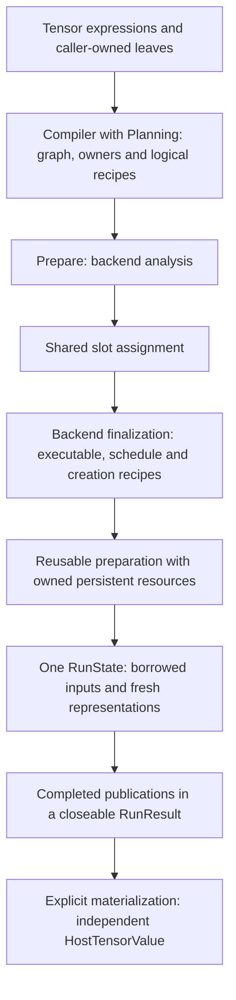

# From an expression to a completed execution

> This atlas explains the current implementation. [The architecture root](../../../ARCHITECTURE.md)
> and its incorporated [foundational](../../architecture/contracts/foundational-modules.md),
> [Compiler/AD](../../architecture/contracts/compiler-autograd.md)<span data-glossary-navigation="true"> ([AD glossary](../../glossary.md#autograd))</span>, and
> [Runtime/Prepare/Engine](../../architecture/contracts/runtime-prepare-engine.md)<span data-glossary-navigation="true"> ([Engine glossary](../../glossary.md#term-engine))</span> contracts are
> authoritative; this page does not extend them.

This page follows the packages that turn a [Tensor](../../glossary.md#tensor) expression into reusable executable work,
then [run](../../glossary.md#term-run) that work with concrete values. Read it to understand **which stage makes a decision,
which object owns a resource, and why changing input values need not [compile](../../glossary.md#compile) another [graph](../../glossary.md#graph)**.
Start with the [learning journey](../../tutorials/index.md) for runnable application code;
this is a source-reading companion, not a recipe for constructing internal execution objects.

Public Java visibility is not the same as an ordinary application entry point. Applications
normally use [Model](../../glossary.md#term-model) and the public `engine.Engine` [lifecycle](../../glossary.md#lifecycle). The [compiler](../../glossary.md#term-compiler), [planning](../../glossary.md#term-planning), [Prepare](../../glossary.md#prepare) and
[Runtime](../../glossary.md#term-runtime) collaborations below explain implementation boundaries; package-private classes are not
supported application [API](../../glossary.md#term-application-programming-interface-api). [Backend](../../glossary.md#backend) implementations remain in their own [modules](../../glossary.md#term-module), not in these
shared packages.

## The distinctions to keep while reading

**Semantic** facts describe required results; **physical** facts describe the code and storage
used to obtain them. An **[occurrence](../../glossary.md#term-occurrence)** is a specific position or use: repeated input ports,
repeated schedule steps and repeated publications retain separate roles even when they refer to
the same object. **[Admission](../../glossary.md#term-admission)** is the gate that checks whether work may start; **[preflight](../../glossary.md#term-preflight)**
checks what can be established before a later [side effect](../../glossary.md#term-side-effect). **[Fail-closed](../../glossary.md#term-fail-closed)** means rejecting an
unsupported or unproved case rather than making a speculative substitution.

Read the flow top to bottom as stage handoffs, not [module](../../glossary.md#term-module) [dependency](../../glossary.md#term-dependency) arrows. Each stage names the
information or owned resources that survive it.



| Term | What it means here | What it is not |
|---|---|---|
| [Compile](../../glossary.md#compile) recipe | [Immutable](../../glossary.md#term-immutable) [graph](../../glossary.md#graph), input/[publication](../../glossary.md#term-publication) associations and [backend](../../glossary.md#backend)-neutral plans | An executable or a [buffer](../../glossary.md#term-buffer) allocation |
| Prepared recipe | Fixed routes, code, resource selections and schedule order | [Mutable](../../glossary.md#term-mutable) invocation data |
| Persistent [prepared resource](../../glossary.md#prepared-resource--preparedresource) | A backend physical [owner](../../glossary.md#term-owner) acquired during finalization, such as a compiled native executable | Per-[run](../../glossary.md#term-run) scratch, or every occurrence of an executable in a schedule |
| Buffer/[workspace slot](../../glossary.md#workspace-slot--workspaceslot) | A plan-local logical position with exact byte/[alignment](../../glossary.md#term-alignment) declarations | An address or a concrete [device](../../glossary.md#term-device) buffer |
| Representation | A [concrete backend](../../glossary.md#concrete-backend) object supplying physical storage for a slot in one run | A graph [`ValueId`](../../glossary.md#logical-valueid-versus-physical-memory-slot) or a new logical value |
| Prepared run [lease](../../glossary.md#term-lease) | [Runtime](../../glossary.md#term-runtime)'s permission for one [synchronous](../../glossary.md#term-synchronous) call to use persistent prepared resources | The returned result [lifetime](../../glossary.md#term-lifetime) |
| [Run result](../../glossary.md#run-result--runresult) | An owner over completed run-state resources and publication lifetime | An [asynchronous](../../glossary.md#term-asynchronous) job, future or implicit [host](../../glossary.md#term-host) copy |
| [Detached](../../glossary.md#detached-model-results) host value | Immutable [canonical](../../glossary.md#term-canonical-form) host bytes copied explicitly from one publication | A [Tensor](../../glossary.md#tensor) expression or a lease into backend storage |

In particular, two classes share the name [`PreparedExecution`](../../glossary.md#prepared-execution--preparedexecution):

- `runtime.execution.PreparedExecution` is the backend-neutral prepared owner: one exact memory
  plan, one same-plan schedule, and unique persistent resource identities.<span data-glossary-navigation="true"> ([identities glossary](../../glossary.md#term-identity-meanings))</span>
- `engine.PreparedExecution` is the owner-bound ordinary public handle around that exact inward
  owner. It also retains compiled metadata and direct boundary adapters. It does <span data-glossary-navigation="true"> ([metadata glossary](../../glossary.md#term-metadata))</span>**not** introduce
  a second prepared-resource lease protocol.<span data-glossary-navigation="true"> ([resource lease glossary](../../glossary.md#ownership-borrowing-and-lease))</span>

The [glossary's compile/prepare/run comparison](../../glossary.md#compile-versus-prepare-versus-run)
provides a shorter reminder of these terms.

## One numerical thread through the packages

This is a **conceptual walkthrough**, not output from a [run](../../glossary.md#term-run) performed for this atlas. The complete
program, prerequisites and commands belong to the [examples](../../examples/README.md).

Use the [canonical](../../glossary.md#term-canonical-form) `LearningJourney` [Model](../../glossary.md#term-model): [FLOAT32](../../glossary.md#term-float32) input `X` of [shape](../../glossary.md#shape) `[2,1]` with values `[1,3]`,
a supplied [gradient](../../glossary.md#term-gradient)-eligible [weight](../../glossary.md#term-weight) `W` of shape `[1,1]` initially `0`, no [bias](../../glossary.md#term-bias), and [target](../../glossary.md#term-target) `[2,6]`.
Model copies the supplied weight into its owned [parameter](../../glossary.md#term-parameter) state. The [prediction](../../glossary.md#term-prediction) is
`X @ transpose(W)`; the [objective](../../glossary.md#term-objective) is the **SUM** of squared errors, not their [mean](../../glossary.md#term-mean).

```text
prediction at W=0:             [0,0]
errors:                        [-2,-6]
objective:                     4 + 36 = 40
weight gradient:               2 * ((-2)*1 + (-6)*3) = -40
Sgd(0.05) update:               W = 0 - 0.05*(-40) = 2
prediction after the update:   [2,6]
fresh same-shape input [2,4]:   [4,8]
```

[Compiler](../../glossary.md#term-compiler) constructs the gradient expression; [backend](../../glossary.md#backend) code executes it; Training applies the [SGD](../../glossary.md#term-stochastic-gradient-descent-sgd)
update. [Runtime](../../glossary.md#term-runtime) neither differentiates nor owns the [optimizer](../../glossary.md#term-optimizer). Reusing `[2,4]` changes values,
not the static input [signature](../../glossary.md#term-signature). Changing `[2,1]` to `[3,1]` is not the same [operation](../../glossary.md#operation): a static
prepared template rejects that [descriptor](../../glossary.md#term-descriptor) rather than silently specializing it. Symbolic-[batch](../../glossary.md#term-batch-machine-learning-and-hyperparameters)
support is a separately qualified path, not a property inferred from these teaching numbers.

## `io.github.pho001.synaptik.trace`

**Purpose and mechanism.** This is the neutral diagnostic envelope, deliberately independent of
[Model](../../glossary.md#term-model), [Compiler](../../glossary.md#term-compiler), [Runtime](../../glossary.md#term-runtime) and concrete [backends](../../glossary.md#backend).
[`TraceEvent<T>`](../../../modules/trace/src/main/java/io/github/pho001/synaptik/trace/TraceEvent.java)
pairs an event [identity](../../glossary.md#term-identity-meanings), [lifecycle](../../glossary.md#lifecycle) phase, severity, monotonic nanoseconds and typed [payload](../../glossary.md#artifact-envelope-and-atomic-publication).
Construction validates required references; it does not read a clock, emit, store, filter or
serialize the event. Time is a reading in the [producer](../../glossary.md#term-producer)'s clock domain, not an [epoch](../../glossary.md#term-time-epoch) timestamp or
a global ordering guarantee. The envelope is shallowly [immutable](../../glossary.md#term-immutable): an implementation of the open
[`TracePayload`](../../../modules/trace/src/main/java/io/github/pho001/synaptik/trace/TracePayload.java)<span data-glossary-navigation="true"> ([TracePayload glossary](../../glossary.md#trace-payload--tracepayload))</span>
marker is responsible for providing immutable [detached](../../glossary.md#detached-model-results) diagnostic data.

**Relations and state.** Producers construct these values and observers consume them. [Trace](../../glossary.md#trace) owns
the vocabulary, not the producers' [graph](../../glossary.md#graph), exceptions, storage, native handles or event sinks.
[`TracePhase`](../../../modules/trace/src/main/java/io/github/pho001/synaptik/trace/TracePhase.java)<span data-glossary-navigation="true"> ([TracePhase glossary](../../glossary.md#trace-phase--tracephase))</span>
classifies [compile](../../glossary.md#compile), [prepare](../../glossary.md#prepare) and [run](../../glossary.md#term-run) facts without executing those stages.
[`TraceEventId`](../../../modules/trace/src/main/java/io/github/pho001/synaptik/trace/TraceEventId.java)<span data-glossary-navigation="true"> ([TraceEventId glossary](../../glossary.md#trace-event-identity--traceeventid))</span>
rejects negative values; its producer defines uniqueness. A severity is classification, not a
request to abort execution.

**In the example.** Trace does not calculate `40` or `-40`, and the existence of an envelope type
does not mean every ordinary run emits events. An actual optional producer is [Engine](../../glossary.md#term-engine)'s
[`EngineTuningTraceProducer`](../../../modules/engine/src/main/java/io/github/pho001/synaptik/engine/EngineTuningTraceProducer.java):
only the observed tuning path constructs it. It emits at most one terminal fallback/rejection
event with a PREPARE phase; the unobserved path does not create it. This distinction prevents a
source tour from being mistaken for evidence of a trace captured from `LearningJourney`.

## `io.github.pho001.synaptik.trace.id`

**Purpose and mechanism.** These are [nominal](../../glossary.md#term-nominal) correlation domains: [backend](../../glossary.md#backend), [device](../../glossary.md#term-device), prepared unit,
invocation, [node](../../glossary.md#node), logical value and public [Tensor](../../glossary.md#tensor). Each is an [immutable](../../glossary.md#term-immutable) non-negative `long`, with
zero valid. The [producer](../../glossary.md#term-producer) translates its own [identity](../../glossary.md#term-identity-meanings) to the appropriate [trace](../../glossary.md#trace) type and owns that
translation's uniqueness and [lifetime](../../glossary.md#term-lifetime); the package neither allocates IDs nor stores a mapping.
The [package contract](../../../modules/trace/src/main/java/io/github/pho001/synaptik/trace/id/package-info.java)
explains why an equal number need not identify the same object across streams.

For example,
[`TracePreparedUnitId`](../../../modules/trace/src/main/java/io/github/pho001/synaptik/trace/id/TracePreparedUnitId.java)<span data-glossary-navigation="true"> ([TracePreparedUnitId glossary](../../glossary.md#trace-prepared-unit-correlation-identity--tracepreparedunitid))</span>
correlates a finalized prepared unit, while
[`TraceInvocationId`](../../../modules/trace/src/main/java/io/github/pho001/synaptik/trace/id/TraceInvocationId.java)<span data-glossary-navigation="true"> ([TraceInvocationId glossary](../../glossary.md#trace-invocation-correlation-identity--traceinvocationid))</span>
correlates an invocation. Reusing a prepared recipe therefore need not reuse invocation identity.
[`TraceTensorId`](../../../modules/trace/src/main/java/io/github/pho001/synaptik/trace/id/TraceTensorId.java)<span data-glossary-navigation="true"> ([TraceTensorId glossary](../../glossary.md#trace-tensor-correlation-identity--tracetensorid))</span>
and [`TraceValueId`](../../../modules/trace/src/main/java/io/github/pho001/synaptik/trace/id/TraceValueId.java)<span data-glossary-navigation="true"> ([TraceValueId glossary](../../glossary.md#trace-value-correlation-identity--tracevalueid))</span>
separate source-level Tensor correlation from compiled logical values; neither is a [buffer slot](../../glossary.md#buffer-slot--bufferslot).

**Relations, invariants and example.** Payloads retain these [detached](../../glossary.md#detached-model-results) values, not execution [owners](../../glossary.md#term-owner).
Negative construction fails with `IllegalArgumentException`; the types provide no process-wide
or cross-stream uniqueness. In an instrumented version of the example, a [weight](../../glossary.md#term-weight) Tensor,
its generated [gradient](../../glossary.md#term-gradient) value, a prepared backend unit and repeated calls would be different
correlation roles. The atlas assigns no invented numeric IDs to them. These records retain no
resources and add no execution step to the teaching path.

## `io.github.pho001.synaptik.trace.payload`

**Purpose and mechanism.** Shared payloads describe [backend](../../glossary.md#backend) outcomes using neutral categories,
not [concrete backend](../../glossary.md#concrete-backend) classes.
[`BackendPreparationOutcome`](../../../modules/trace/src/main/java/io/github/pho001/synaptik/trace/payload/BackendPreparationOutcome.java)
records a finalized unit's backend/[device](../../glossary.md#term-device)/unit correlations, outcome, route, [cache](../../glossary.md#term-cache) fact and
optional native status.
[`BackendInvocationOutcome`](../../../modules/trace/src/main/java/io/github/pho001/synaptik/trace/payload/BackendInvocationOutcome.java)
adds the separate invocation correlation. They validate that success includes native SUCCESS,
and failure never includes native SUCCESS; failure before native return may have no native status.

[`TraceNativeStatus`](../../../modules/trace/src/main/java/io/github/pho001/synaptik/trace/payload/TraceNativeStatus.java)<span data-glossary-navigation="true"> ([TraceNativeStatus glossary](../../glossary.md#trace-native-status--tracenativestatus))</span>
preserves the exact signed [native code](../../glossary.md#native-numerical-library-and-instruction-architecture). Zero means SUCCESS, and only SUCCESS may have zero;
nonzero codes retain a [producer](../../glossary.md#term-producer) interpretation, including UNKNOWN. There is no universal numeric
error mapping across backends. A cache fact describes what that producer queried, not proof that
an enclosing [Engine](../../glossary.md#term-engine) [cache hit](../../glossary.md#cache-and-memoization) or missed.
[`LowPrecisionTraceMetadata`](../../../modules/trace/src/main/java/io/github/pho001/synaptik/trace/payload/LowPrecisionTraceMetadata.java)
is a bounded custom-[kernel](../../glossary.md#kernel) route/[dtype](../../glossary.md#data-type--datatype) diagnostic, not a numerical policy selector.

**Relations, state and example.** Backend producers supply these [immutable](../../glossary.md#term-immutable) data-transfer objects;
observers may retain them without retaining physical resources. Null references or inconsistent
status/code combinations reject at construction. These payloads do not choose routes, retry a
failed native [operation](../../glossary.md#operation) or perform a transfer. The [FLOAT32](../../glossary.md#term-float32) learning example needs no low-[precision](../../glossary.md#term-precision)
[metadata](../../glossary.md#term-metadata) or explicit [trace payload](../../glossary.md#trace-payload--tracepayload) construction, and no outcome event is claimed here as [runtime](../../glossary.md#term-runtime)
evidence.

## `io.github.pho001.synaptik.backend.contract`

**Purpose and mechanism.** This package lets [compile](../../glossary.md#compile)-time [ownership](../../glossary.md#term-ownership-meanings) say *which [backend](../../glossary.md#backend) domain*
without holding the backend's live implementation.
[`BackendId`](../../../modules/backend-contract/src/main/java/io/github/pho001/synaptik/backend/contract/BackendId.java)<span data-glossary-navigation="true"> ([BackendId glossary](../../glossary.md#backend-identity--backendid))</span>
retains an exact nonblank string. It does not trim, case-fold, normalize or resolve [aliases](../../glossary.md#aliasing-and-arena):
`"cpu"` and `"CPU"` are different IDs.
[`BackendDeviceId`](../../../modules/backend-contract/src/main/java/io/github/pho001/synaptik/backend/contract/BackendDeviceId.java)<span data-glossary-navigation="true"> ([BackendDeviceId glossary](../../glossary.md#backend-device-identity--backenddeviceid))</span>
scopes a [device](../../glossary.md#term-device) [identity](../../glossary.md#term-identity-meanings) to a backend; [`DeviceClass`](../../glossary.md#device-class--deviceclass) supplies a coarse class rather than a [kernel](../../glossary.md#kernel)
capability. Requirements can name a backend, one backend/device, or a [device class](../../glossary.md#device-class--deviceclass).

[`BackendAvailabilitySnapshot`](../../../modules/backend-contract/src/main/java/io/github/pho001/synaptik/backend/contract/BackendAvailabilitySnapshot.java)<span data-glossary-navigation="true"> ([BackendAvailabilitySnapshot glossary](../../glossary.md#backend-availability-snapshot--backendavailabilitysnapshot))</span>
copies a caller-supplied device-to-class map, checks every device belongs to its backend, and
keeps the backend ID meaningful even when the map is empty. It does not discover devices or
refresh itself. [Planning](../../glossary.md#term-planning) combines that [snapshot](../../glossary.md#term-snapshot) with a separate capability provider; availability
alone cannot establish [operation](../../glossary.md#operation) support or choose a physical device.

**Relations and ownership.** Config carries declarative requirements; Planning consumes them and
returns IDs; [Engine](../../glossary.md#term-engine) later resolves selected [owners](../../glossary.md#term-owner) through its private composition. These are
[immutable](../../glossary.md#term-immutable) facts with no resource [lifecycle](../../glossary.md#lifecycle), [service locator](../../glossary.md#term-service-locator) or kernel [registry](../../glossary.md#term-registry). Blank IDs,
null fields and cross-backend device entries fail construction.

**In the example.** A [CPU](../../glossary.md#term-cpu)-owned compiled [node](../../glossary.md#node) retains a CPU identity, not an [OpenBLAS](../../glossary.md#term-openblas) service,
CPU [buffer](../../glossary.md#term-buffer) or generated kernel. This is why [compile artifacts](../../glossary.md#compile-artifacts) remain logical recipes even though
they already have ownership decisions. The ordinary example uses `Engine.standard()`'s CPU
composition; it does not infer [Metal](../../glossary.md#term-metal) execution from the workstation's hardware.

## `io.github.pho001.synaptik.config.compile`

**Purpose and mechanism.** These values request [graph](../../glossary.md#graph) [scope](../../glossary.md#term-scope) and [planning](../../glossary.md#term-planning) policy without performing
the work. [`CompileMode`](../../../modules/config/src/main/java/io/github/pho001/synaptik/config/compile/CompileMode.java)<span data-glossary-navigation="true"> ([CompileMode glossary](../../glossary.md#compile-mode--compilemode))</span>
distinguishes FORWARD_ONLY, FORWARD_AND_BACKWARD and TRAINING_STEP. [Compiler](../../glossary.md#term-compiler) interprets backward
modes by constructing [gradient](../../glossary.md#term-gradient) expressions before [capture](../../glossary.md#term-capture-meanings); the TRAINING_STEP name does not itself
insert [optimizer](../../glossary.md#term-optimizer) updates.

[`BackendIntent.unconstrained()` / `requiring(...)`](../../../modules/config/src/main/java/io/github/pho001/synaptik/config/compile/BackendIntent.java)
[carry](../../glossary.md#term-carry) an optional **hard** eligibility requirement.
[`PartitionScoringConfig.neutral()` / `preferring(...)`](../../../modules/config/src/main/java/io/github/pho001/synaptik/config/compile/PartitionScoringConfig.java)
carry a **soft** [device](../../glossary.md#term-device)-class preference. A soft preference may [rank](../../glossary.md#term-rank) eligible candidates but cannot
restore one rejected by capability or a hard requirement. Current baseline selection uses provider
order and this coarse preference, not a calibrated numerical [cost model](../../glossary.md#compiler-transformations-and-dominance).

[`GraphOptimizationConfig.standard()` / `disabled()`](../../../modules/config/src/main/java/io/github/pho001/synaptik/config/compile/GraphOptimizationConfig.java)
permits or disables optional exact optimizations. Disabling them does not disable [inference](../../glossary.md#term-inference),
mandatory [canonicalization](../../glossary.md#occurrence-identity-and-canonical-form) or [validation](../../glossary.md#term-validation), and enabling them permits no approximate arithmetic.
The optional/required references reject null; these [immutable](../../glossary.md#term-immutable) records own neither live services
nor [runtime](../../glossary.md#term-runtime) state. Compiler and Planning consume the values; [concrete backend](../../glossary.md#concrete-backend) route selection
belongs later to [backend](../../glossary.md#backend) preparation.

**In the example.** The [prediction](../../glossary.md#term-prediction)-only call and the first-order [training graph](../../glossary.md#training-graph) have different
[compile](../../glossary.md#compile) scope, but the [SGD](../../glossary.md#term-stochastic-gradient-descent-sgd) update still belongs to Training. Neither a preference nor an
optimization permission explains the numerical `-40`; that follows from the expression's semantics.

## `io.github.pho001.synaptik.config.tuning`

**Purpose and mechanism.**
[`ModelAutotuningConfig`](../../../modules/config/src/main/java/io/github/pho001/synaptik/config/tuning/ModelAutotuningConfig.java)<span data-glossary-navigation="true"> ([ModelAutotuningConfig glossary](../../glossary.md#model-autotuning-request-facade--modelautotuningconfig))</span>
is an explicit request for later measured selection, not a tuning algorithm. It carries an
[objective](../../glossary.md#term-objective), local-workload budget, [representative-profile identity](../../glossary.md#representative-profile-identity), fallback policy, workload-[cache](../../glossary.md#term-cache)
path, independent complete-plan budget and [model](../../glossary.md#term-model)-plan-cache path. Paths are retained without
[normalization](../../glossary.md#term-normalization) or filesystem I/O. The representative [identity](../../glossary.md#term-identity-meanings) defensively copies its [opaque](../../glossary.md#term-opaque) bytes;
it is not a retained [Tensor](../../glossary.md#tensor) [batch](../../glossary.md#term-batch-machine-learning-and-hyperparameters).

The objective selects the first encountered minimum-[median](../../glossary.md#term-median) candidate. Budget records validate
positive candidate limits, non-negative warmups and positive odd timed [sample](../../glossary.md#term-sample-machine-learning-and-hyperparameters) counts. Complete-plan
bounds are independent of local-workload bounds; later [admission](../../glossary.md#term-admission) checks the actual candidate count
`N` against `N * (1 + W + S)` executions, including correctness, warmups and timed samples, plus
an aggregate correctness-byte ceiling. Null components, invalid counts and an empty model-plan
cache path reject construction.

**Relations and state.** [Engine](../../glossary.md#term-engine) joins this declarative policy with model identity and live
representative inputs, then composes the tuning tool and selected [backend](../../glossary.md#backend)'s opaque handoffs.
Config performs no measurement, cache mutation, preparation or execution. A safe-[heuristic](../../glossary.md#term-heuristic) fallback
policy is not permission to change [compile](../../glossary.md#compile)-time [ownership](../../glossary.md#term-ownership-meanings) or silently use another backend.

**In the example.** [Autotuning](../../glossary.md#autotuning--model-autotuning) is not required to obtain `[2,6]` or reuse the static prepared
[signature](../../glossary.md#term-signature). The ordinary learning path does not request these caches or budgets. Introducing a
representative tuning trial would be a separate workflow, not a hidden part of every `compute`.

## `io.github.pho001.synaptik.planning.capability`

**Purpose and actual [admission](../../glossary.md#term-admission).** [Compiler](../../glossary.md#term-compiler) calls
[`BackendOwnerPlanning.selectOwner(...)`](../../../modules/planning/src/main/java/io/github/pho001/synaptik/planning/capability/BackendOwnerPlanning.java)
once for each final [node](../../glossary.md#node) [occurrence](../../glossary.md#term-occurrence). Its
[`OperationCapabilityQuery`](../../../modules/planning/src/main/java/io/github/pho001/synaptik/planning/capability/OperationCapabilityQuery.java)<span data-glossary-navigation="true"> ([OperationCapabilityQuery glossary](../../glossary.md#operation-capability-query--operationcapabilityquery))</span>
carries [operation](../../glossary.md#operation) semantics and ordered input/output [descriptors](../../glossary.md#term-descriptor); a [general Scan](../../glossary.md#general-differentiable-scan) also carries
its complete independently scoped body and applicable activity [metadata](../../glossary.md#term-metadata). Support for individual
body operations does not prove support for the complete [Scan](../../glossary.md#term-cumulative-scan) binder.

The package-private
[`BackendEligibility.evaluate(...)`](../../../modules/planning/src/main/java/io/github/pho001/synaptik/planning/capability/BackendEligibility.java)
first validates the complete provider/[snapshot](../../glossary.md#term-snapshot) composition: unique [backend](../../glossary.md#backend) IDs and exactly matching
[identity](../../glossary.md#term-identity-meanings) sets. Only then does it filter empty availability and unmet hard requirements, calling
`BackendCapabilityProvider.supports(query)` once for each remaining provider in encounter order.
An exact-[device](../../glossary.md#term-device) requirement proves matching availability, not a selected device. Provider failures
propagate rather than being interpreted as a fallback opportunity.

**Scoring is currently a baseline, not a hidden [optimizer](../../glossary.md#term-optimizer).**
[`BackendOwnerSelection.select(...)`](../../../modules/planning/src/main/java/io/github/pho001/synaptik/planning/capability/BackendOwnerSelection.java)
chooses the first hard-eligible [owner](../../glossary.md#term-owner), or the first eligible owner with the preferred [device class](../../glossary.md#device-class--deviceclass).
If no preferred-class candidate exists, it keeps the first eligible owner. It calculates no numeric
cost, selects no route or device, and retains no provider. An empty eligible set fails with
`no hard-eligible backend is available for ownership selection`; Compiler adds node context.

**Relations and example.** Input is [compile](../../glossary.md#compile)-time query + intent + provider/availability snapshots;
output is a [`BackendId`](../../glossary.md#backend-identity--backendid), consumed by Compiler's node-to-owner map. No physical state is owned here.
In the training example, the provider must support the **actual generated [gradient](../../glossary.md#term-gradient) [topology](../../glossary.md#term-topology)**, not
just forward [MATMUL](../../glossary.md#matrix-multiplication--matmul) and SUM. Requesting an unavailable hard [target](../../glossary.md#term-target) fails; it does not weaken the
request to make the example [run](../../glossary.md#term-run).

## `io.github.pho001.synaptik.planning.partition`

**Purpose and mechanism.**
[`MaximalSameOwnerPartitioning.partition(graph, ownershipByNodeId)`](../../../modules/planning/src/main/java/io/github/pho001/synaptik/planning/partition/MaximalSameOwnerPartitioning.java)
groups the stored [topological](../../glossary.md#term-topological-order) [node](../../glossary.md#node) sequence into maximal **consecutive** equal-[owner](../../glossary.md#term-owner) runs. It
validates every key, complete [graph](../../glossary.md#graph) coverage and every owner before constructing a result.
Graph edges do not redefine adjacency: [fan-out](../../glossary.md#term-fan-out), a phase boundary or an output [publication](../../glossary.md#term-publication) does
not by itself split a same-owner [run](../../glossary.md#term-run). A multi-output [producer](../../glossary.md#term-producer) stays one indivisible node.

A concrete owner sequence `CPU, CPU, Metal, CPU` therefore forms three partitions, not two.
The final [CPU](../../glossary.md#term-cpu) node cannot join the earlier CPU run across the intervening [Metal](../../glossary.md#term-metal) node.

Each [`PlannedPartition`](../../../modules/planning/src/main/java/io/github/pho001/synaptik/planning/partition/PlannedPartition.java)
retains an owner and [immutable](../../glossary.md#term-immutable) ordered node IDs. The result is not a [fused](../../glossary.md#specialization-and-fusion) [kernel](../../glossary.md#kernel) or a [backend](../../glossary.md#backend)
execution unit. Backend preparation may realize a [partition](../../glossary.md#partition) with its own selected units, but
[Planning](../../glossary.md#term-planning) has not made that implementation decision. Unknown/missing nodes, null owners and
inconsistent [ownership](../../glossary.md#term-ownership-meanings) maps reject; a valid zero-node graph produces an empty partition list,
which is not a promise that ordinary [Engine](../../glossary.md#term-engine) preparation accepts it.

**Relations, state and example.** [Compiler](../../glossary.md#term-compiler) supplies graph-wide ownership and consumes the returned
recipes; logical-memory planning and [Prepare](../../glossary.md#prepare) use their exact membership/order. There is no live
resource, allocator or scheduler here. Consecutive CPU-owned forward and backward nodes in the
example can share one partition even across phases. That says who owns them, not whether [MATMUL](../../glossary.md#matrix-multiplication--matmul)
uses [native code](../../glossary.md#native-numerical-library-and-instruction-architecture) or the [elementwise](../../glossary.md#term-elementwise) work is fused.

## `io.github.pho001.synaptik.planning.memory`

**Purpose and mechanism.**
[`LogicalMemoryPlanning.plan(graph, partitions)`](../../../modules/planning/src/main/java/io/github/pho001/synaptik/planning/memory/LogicalMemoryPlanning.java)
answers who produces and consumes each logical value, not where bytes reside. It first checks
that partitions cover every [node](../../glossary.md#node) exactly once in stored [graph](../../glossary.md#graph) order and are maximal adjacent
[owner](../../glossary.md#term-owner) runs. It then indexes [producer](../../glossary.md#term-producer) partitions and derives one requirement per [graph value](../../glossary.md#graph-value) in
stored value order. Each consuming [partition](../../glossary.md#partition) appears at most once, even if it reads that value
several times.

[`LogicalMemoryRequirement`](../../../modules/planning/src/main/java/io/github/pho001/synaptik/planning/memory/LogicalMemoryRequirement.java)
retains value ID, [descriptor](../../glossary.md#term-descriptor), optional producer partition, ordered consumer partitions and a
graph-output flag. An input has no producer; a dead or pass-through source may have no consumer.
[`LogicalMemoryPlan`](../../../modules/planning/src/main/java/io/github/pho001/synaptik/planning/memory/LogicalMemoryPlan.java)
collects those [immutable](../../glossary.md#term-immutable) facts. They are not byte allocations, [buffer](../../glossary.md#term-buffer) slots, lifetimes from a
pool, transfer recipes or a saved-[gradient](../../glossary.md#term-gradient) tape. Not every logical intermediate needs a shared
physical slot; [backend](../../glossary.md#backend) analysis declares which shared resources are actually required.

**Relations, failures and example.** [Compiler](../../glossary.md#term-compiler) stores this plan in [artifacts](../../glossary.md#term-artifact); [Prepare](../../glossary.md#prepare) uses it for
coverage and boundary [validation](../../glossary.md#term-validation); [Engine](../../glossary.md#term-engine) derives cross-owner paths from producer/consumer facts.
Duplicate, unknown, missing or out-of-order partition nodes and adjacent equal-owner partitions
reject instead of being repaired. In the example, a [weight](../../glossary.md#term-weight) [leaf](../../glossary.md#term-leaf) and the [prediction](../../glossary.md#term-prediction) result have
different source/consumer/[publication](../../glossary.md#term-publication) facts even when all work has a [CPU](../../glossary.md#term-cpu) owner. Logical memory
has no responsibility for applying the weight update or keeping [optimizer state](../../glossary.md#term-optimizer-state).

## `io.github.pho001.synaptik.compiler`

**Entry and purpose.**
[`GraphCompilationPort.compile(...)`](../../../modules/compiler/src/main/java/io/github/pho001/synaptik/compiler/GraphCompilationPort.java)
is the narrow [lifecycle](../../glossary.md#lifecycle)-integration boundary used by [Engine](../../glossary.md#term-engine); ordinary applications use Engine.
The package-private
[`GraphCompiler.compile(...)`](../../../modules/compiler/src/main/java/io/github/pho001/synaptik/compiler/GraphCompiler.java)
turns the ordered [Tensor](../../glossary.md#tensor) boundary into a verified [immutable](../../glossary.md#term-immutable) recipe, never a [backend](../../glossary.md#backend) executable.
Its ordinary port supplies empty explicit forward-[constant](../../glossary.md#term-constant) ingress: a stored [leaf](../../glossary.md#term-leaf) is still a
caller-[bindable input](../../glossary.md#bindable-input), not a constant inferred by inspecting its bytes.

**[Automatic differentiation](../../glossary.md#autograd) ([AD](../../glossary.md#autograd)) precedes [capture](../../glossary.md#term-capture-meanings).** Forward-only mode captures the requested
forward expressions. Backward-capable modes [run](../../glossary.md#term-run)
[`AutogradPreflight`](../../../modules/compiler/src/main/java/io/github/pho001/synaptik/compiler/AutogradPreflight.java)
over the requested [derivative](../../glossary.md#term-derivative) routes and use
[`FirstOrderAutograd.expand(...)`](../../../modules/compiler/src/main/java/io/github/pho001/synaptik/compiler/FirstOrderAutograd.java)
to construct ordinary Tensor expressions for [gradients](../../glossary.md#term-gradient). Per-request [identity](../../glossary.md#term-identity-meanings) maps collect
contributions; multiple uses accumulate with ordinary addition. The [compiler](../../glossary.md#term-compiler) then captures
forward outputs **and** requested gradient roots together once, with phase and derivative-order
[metadata](../../glossary.md#term-metadata). It is not differentiating captured [Runtime](../../glossary.md#term-runtime) instructions, and Tensor has acquired no
[mutable](../../glossary.md#term-mutable) backward tape. The functional request can express the separately bounded second stage;
that is not unrestricted higher-order support for every [operation](../../glossary.md#operation).

For the learning [objective](../../glossary.md#term-objective), SUM restores the [cotangent](../../glossary.md#cotangent) to the error [shape](../../glossary.md#shape), multiplication
contributes through both squared-error operands, and [MATMUL](../../glossary.md#matrix-multiplication--matmul) uses transposed contractions.
The implementation [owners](../../glossary.md#term-owner) are
[`ReductionGradientRules`](../../../modules/compiler/src/main/java/io/github/pho001/synaptik/compiler/ReductionGradientRules.java),
[`ElementwiseGradientRules`](../../../modules/compiler/src/main/java/io/github/pho001/synaptik/compiler/ElementwiseGradientRules.java)
and [`LinearAlgebraGradientRules`](../../../modules/compiler/src/main/java/io/github/pho001/synaptik/compiler/LinearAlgebraGradientRules.java).
Broadcasted contributions reduce back to the selected operand shape. These formulas explain the
`[1,1]` [weight](../../glossary.md#term-weight) gradient `-40`; there is no backend-global [autograd](../../glossary.md#autograd) implementation to rediscover it.

**[Inference](../../glossary.md#term-inference) and transformation.** Captured [graph](../../glossary.md#graph) inference verifies family semantics and [descriptors](../../glossary.md#term-descriptor).
[`ForwardGraphOptimization.optimize(...)`](../../../modules/compiler/src/main/java/io/github/pho001/synaptik/compiler/ForwardGraphOptimization.java)
performs mandatory [canonicalization](../../glossary.md#occurrence-identity-and-canonical-form)/[validation](../../glossary.md#term-validation), then, when enabled, bounded exact arithmetic
rewriting, logical-splat folding, [dead-code elimination](../../glossary.md#term-dead-code-elimination-dce), phase/order-local [common-subexpression
elimination](../../glossary.md#term-common-subexpression-elimination-cse) and cleanup dead-code elimination. Changed candidates are revalidated. These are
not floating arithmetic [evaluation](../../glossary.md#term-evaluation) of caller storage, approximate rewrites or backend [fusion](../../glossary.md#term-fusion).
Final descriptor-closure passes resolve only their qualified materialized results and constant
sources, not arbitrary unresolved caller/[view](../../glossary.md#term-view-meanings) [layouts](../../glossary.md#layout). [Publication](../../glossary.md#term-publication) and capability queries see
that final graph.

**The output boundary.**
[`CompileArtifacts`](../../../modules/compiler/src/main/java/io/github/pho001/synaptik/compiler/CompileArtifacts.java)
contains eight parts: mode, final graph, maximal partitions, logical memory, [publication plan](../../glossary.md#publication-plan),
input-source classification, deferred diagnostics and exact-graph derivative metadata. Its
constructor cross-checks graph identity, source coverage, mode, [partition](../../glossary.md#partition)/memory agreement and
diagnostic membership. Compiler builds ordered forward/gradient publication associations, selects
owners per final [node](../../glossary.md#node) through [Planning](../../glossary.md#term-planning), partitions them, and derives logical memory. No retained
Tensor, source [producer](../../glossary.md#term-producer), provider, physical [buffer](../../glossary.md#term-buffer), route or mutable [run state](../../glossary.md#run-state--runstate) crosses this boundary.

**Other callers and failures.** The same port's `captureSource`, `validateSource` and
`reconstructSource` support a separately bounded cold source workflow used by acquisition and
[persistence](../../glossary.md#term-persistence) integrations. The raw source graph is not the optimized [artifact](../../glossary.md#term-artifact) graph; its [borrowed](../../glossary.md#ownership-borrowing-and-lease)
ordered leaf sidecar is temporary and does not become artifact state. Cold [admission](../../glossary.md#term-admission) does not
prove backend execution. Invalid mode/request combinations, unsupported derivative routes,
inference/closure failures or incompatible artifact parts reject; deferred successful diagnostics
are not permission for [Prepare](../../glossary.md#prepare) to guess missing facts.

**In the example.** Forward computation and configured training use this same compiler [ownership](../../glossary.md#term-ownership-meanings).
Compiler constructs the gradient but never changes `W` to `2`: Training does that after successful
execution. Fresh `[2,4]` values go through [binding](../../glossary.md#term-binding) on an existing compatible preparation, not
through expression recapture or another derivative pass.

## `io.github.pho001.synaptik.prepare.analysis`

**Purpose and input projection.** This package is the first half of preparation: give a [backend](../../glossary.md#backend)
all facts it is allowed to analyze without giving it the [Compiler](../../glossary.md#term-compiler) aggregate.
[`PrepareContext<I>`](../../../modules/prepare/src/main/java/io/github/pho001/synaptik/prepare/analysis/PrepareContext.java)
retains an [immutable](../../glossary.md#term-immutable)
[`PartitionDag`](../../../modules/prepare/src/main/java/io/github/pho001/synaptik/prepare/analysis/PartitionDag.java)<span data-glossary-navigation="true"> ([PartitionDag glossary](../../glossary.md#partition-dag-partitiondag))</span>,
projected values and logical requirements, exact-typed logical splats, backend-owned immutable
inputs, and scoped [Scan](../../glossary.md#term-cumulative-scan) activity associations. It validates [partition](../../glossary.md#partition) order, reference closure,
[descriptor](../../glossary.md#term-descriptor)/requirement agreement, [constant](../../glossary.md#term-constant) roles and the admitted static or bounded named-[batch](../../glossary.md#term-batch-machine-learning-and-hyperparameters)
[shape](../../glossary.md#shape) vocabulary before backend analysis. [Scan body](../../glossary.md#backpropagation-through-time-and-recurrent-state) IDs are local to their body, never [aliases](../../glossary.md#aliasing-and-arena)
of equal-numbered outer values.

**Actual backend collaboration.**
[`BackendPartitionPreparer<I,P>.analyze(context)`](../../../modules/prepare/src/main/java/io/github/pho001/synaptik/prepare/analysis/BackendPartitionPreparer.java)
is implemented by the [concrete backend](../../glossary.md#concrete-backend). It deterministically lowers, specializes and selects a
supported route/configuration using explicit inputs. It returns
[`BackendPartitionAnalysis<P>`](../../../modules/prepare/src/main/java/io/github/pho001/synaptik/prepare/analysis/BackendPartitionAnalysis.java):
the exact partition reference, an [opaque](../../glossary.md#term-opaque) immutable selected plan, and ordered exact
[`PreparationResourceRequirement`](../../../modules/prepare/src/main/java/io/github/pho001/synaptik/prepare/analysis/PreparationResourceRequirement.java)
[buffer](../../glossary.md#term-buffer)/workspace declarations. Generics preserve the backend-input/plan association; shared
[Prepare](../../glossary.md#prepare) transports it without casts to concrete [CPU](../../glossary.md#term-cpu)/[Metal](../../glossary.md#term-metal) types or a string [parameter](../../glossary.md#term-parameter) map.

Requirements name outer logical values or analysis-local workspace IDs and declare byte size
and [alignment](../../glossary.md#term-alignment). Fixed bytes and complete immutable [run](../../glossary.md#term-run)-size recipes are distinct declarations;
analyzer/finalizer cannot defer discovering another shared slot until a run. Duplicate buffer
IDs, duplicate workspace IDs, unsupported inputs or unresolved route-critical facts reject.
Analysis constructs no executable, physical allocation, persistent resource or per-[run state](../../glossary.md#run-state--runstate).

**Tuning and example.**
[`BackendPartitionTuningHandoff`](../../../modules/prepare/src/main/java/io/github/pho001/synaptik/prepare/analysis/BackendPartitionTuningHandoff.java)
transports an exact partition, opaque [candidate batch](../../glossary.md#candidate-batch) and optional decision. It neither measures
candidates nor interprets private settings. Compatible explicit tuning decisions can be inputs
to later analysis; ordinary `analyze` is not a benchmark loop. For the teaching [graph](../../glossary.md#graph), the CPU
analyzer chooses realizations and declares output/scratch needs for the actual forward or
combined graph. Shared analysis does not compute `40`, allocate an [SGD](../../glossary.md#term-stochastic-gradient-descent-sgd) state or select the
[weight](../../glossary.md#term-weight)'s [learning rate](../../glossary.md#term-learning-rate).

## `io.github.pho001.synaptik.prepare`

**Purpose and orchestration.**
[`GraphPreparation.prepare(...)`](../../../modules/prepare/src/main/java/io/github/pho001/synaptik/prepare/GraphPreparation.java)
bridges one complete [compile](../../glossary.md#compile) recipe to one [Runtime](../../glossary.md#term-runtime) prepared [owner](../../glossary.md#term-owner). [Engine](../../glossary.md#term-engine) supplies one typed
[`PartitionPreparation`](../../../modules/prepare/src/main/java/io/github/pho001/synaptik/prepare/PartitionPreparation.java)
per compile [partition](../../glossary.md#partition) and one explicit schedule assembler. Shared [Prepare](../../glossary.md#prepare) projects and validates
**all** contexts before invoking the first analyzer. It checks source-only published caller/[constant](../../glossary.md#term-constant)
resources too; a published [graph](../../glossary.md#graph) input must not disappear merely because no partition produces it.
`GraphPreparation.project(...)` exposes the focused single-partition projection, not another
complete execution [lifecycle](../../glossary.md#lifecycle).

**Assignment is between analysis and finalization.** After every analysis has returned and
cross-partition declarations agree,
[`BackendPartitionFinalizationHandoff`](../../../modules/prepare/src/main/java/io/github/pho001/synaptik/prepare/BackendPartitionFinalizationHandoff.java)
assigns stable [`BufferSlot`](../../glossary.md#buffer-slot--bufferslot)/[`WorkspaceSlot`](../../glossary.md#workspace-slot--workspaceslot) [identities](../../glossary.md#term-identity-meanings) and dense plan positions. Caller [buffers](../../glossary.md#term-buffer)
lead in [Compiler](../../glossary.md#term-compiler) bindable-input [occurrence](../../glossary.md#term-occurrence) order; ordinary remaining buffers retain declaration
order, with source-only constants last in graph-value order. Repeated fixed-byte declarations
aggregate the maximum required size and [alignment](../../glossary.md#term-alignment); [run](../../glossary.md#term-run)-bound declarations must agree structurally.
Distinct [backend](../../glossary.md#backend) owners receive stable representation positions:
[producer](../../glossary.md#term-producer) first, or first consumer for a producerless value, then distinct consumers in order.
Workspaces remain partition-owned requirements, not shared logical [Tensor](../../glossary.md#tensor) values.

[`PreparationResourceAssignment`](../../../modules/prepare/src/main/java/io/github/pho001/synaptik/prepare/PreparationResourceAssignment.java)
associates each exact declaration with the slot, dense plan index and, for buffers, the owner's
representation index. The matching
[`BackendPartitionFinalizer`](../../../modules/prepare/src/main/java/io/github/pho001/synaptik/prepare/BackendPartitionFinalizer.java)
then receives its typed analysis and complete assignments. Only now does it construct executable
code/objects and optionally acquire [immutable](../../glossary.md#term-immutable) persistent resources. It cannot change route or
add undeclared shared requirements. The returned
[`PreparedPartition`](../../../modules/prepare/src/main/java/io/github/pho001/synaptik/prepare/PreparedPartition.java)<span data-glossary-navigation="true"> ([PreparedPartition glossary](../../glossary.md#prepared-partition--preparedpartition))</span>
associates the exact planned partition with its finalized executable.

**Schedule and [ownership](../../glossary.md#term-ownership-meanings) [transaction](../../glossary.md#term-transaction).** Backend contributions describe physical creation recipes
for assigned buffer/workspace [coordinates](../../glossary.md#axis-rank-scalar-vector-and-matrix), not alternative schedulers. The explicit assembler
builds the complete schedule; shared Prepare checks exact memory-plan association, contribution
coverage, execution order, representation coordinates and [publication](../../glossary.md#term-publication) order against the compile
recipe. Successful construction transfers persistent-[resource ownership](../../glossary.md#term-resource-ownership) to Runtime's
[`PreparedExecution`](../../glossary.md#prepared-execution--preparedexecution).

“Transaction” here means acquired resources either reach one completed owner or are cleaned up
on failure. It does not mean executed tensor writes can be undone. The
[resource-transaction diagram](../../architecture/runtime-prepare-backend-boundary.md#per-run-resources-and-cold-binding)
shows the finalizer-to-Prepare-to-Runtime [handoff](../../glossary.md#term-handoff).

A finalizer owns [rollback](../../glossary.md#term-rollback) until it returns. Thereafter shared Prepare tracks the unique resource
identities in acquisition order across partitions. A later finalizer, contribution, schedule,
[validation](../../glossary.md#term-validation) or aggregate failure closes them in reverse acquisition order, preserves the primary
failure and suppresses distinct cleanup failures. Duplicate returned resource identities reject;
repeating an executable in a schedule is not another ownership acquisition. Shared Prepare does
not implement physical storage or per-run allocation, and it transports run-size recipes without
evaluating backend geometry.

**In the example.** Preparation freezes the executable realization of the [prediction](../../glossary.md#term-prediction)/[gradient](../../glossary.md#term-gradient)
graph, not the numeric contents of [mutable](../../glossary.md#term-mutable) [Model](../../glossary.md#term-model) [parameters](../../glossary.md#term-parameter). It neither executes the [objective](../../glossary.md#term-objective)
nor applies [SGD](../../glossary.md#term-stochastic-gradient-descent-sgd). Repeated same-[signature](../../glossary.md#term-signature) calls reuse these recipes and stable slot positions while
Runtime creates distinct mutable [run state](../../glossary.md#run-state--runstate). Feeding a different [shape](../../glossary.md#shape) is not permission to
reanalyze or change the selected route inside a run.

## `io.github.pho001.synaptik.runtime.memory`

**Purpose and mechanism.**
[`PreparedMemoryPlan`](../../../modules/runtime/src/main/java/io/github/pho001/synaptik/runtime/memory/PreparedMemoryPlan.java)<span data-glossary-navigation="true"> ([PreparedMemoryPlan glossary](../../glossary.md#prepared-memory-plan--preparedmemoryplan))</span>
is the [immutable](../../glossary.md#term-immutable) plan-ordered geometry of [buffers](../../glossary.md#term-buffer) and workspaces. A
[`BufferSlot`](../../../modules/runtime/src/main/java/io/github/pho001/synaptik/runtime/memory/BufferSlot.java)<span data-glossary-navigation="true"> ([BufferSlot glossary](../../glossary.md#buffer-slot--bufferslot))</span>
and a [`WorkspaceSlot`](../../../modules/runtime/src/main/java/io/github/pho001/synaptik/runtime/memory/WorkspaceSlot.java)<span data-glossary-navigation="true"> ([WorkspaceSlot glossary](../../glossary.md#workspace-slot--workspaceslot))</span>
are separate [nominal](../../glossary.md#term-nominal) domains, even when their numeric values happen to match. [Runtime](../../glossary.md#term-runtime) indexes
plan list positions; it does not treat arbitrary slot numeric components as array offsets.

Each entry declares non-negative usable bytes and positive power-of-two [byte alignment](../../glossary.md#term-byte-alignment). The
`ByteSize` boundary distinguishes `FixedByteSize` from an immutable checked numeric recipe
resolved for an admitted [batch](../../glossary.md#term-batch-machine-learning-and-hyperparameters) size. `requiresBatchSize` is explicit: a symbolic plan can require
B even when a particular resource always has zero or [constant](../../glossary.md#term-constant) bytes. A static-mode plan rejects
[run](../../glossary.md#term-run)-bound declarations rather than [sampling](../../glossary.md#term-sampling-machine-learning-and-hyperparameters) a recipe to pretend it is fixed.

**Relations and state.** Shared [Prepare](../../glossary.md#prepare) constructs the plan; executable, transfer, creation and
[publication](../../glossary.md#term-publication) recipes retain that exact reference; run geometry is authenticated to it. The plan
copies entry lists, checks duplicate slots in each domain and allocates no physical storage.
Invalid size/[alignment](../../glossary.md#term-alignment), null entries and duplicate slots fail construction. It contains no
[Compiler](../../glossary.md#term-compiler) [graph](../../glossary.md#graph), [backend](../../glossary.md#backend) [lookup](../../glossary.md#term-lookup) or source-to-slot mapping.

**In the example.** [FLOAT32](../../glossary.md#term-float32) `[2,1]` has eight logical dense bytes and `[1,1]` has four, but those
numbers alone are not a complete [prepared memory plan](../../glossary.md#prepared-memory-plan--preparedmemoryplan): internal [materialization](../../glossary.md#materialization) and scratch
requirements come from backend analysis. The atlas does not invent a slot count or workspace
size for a graph it has not prepared. Static fresh values reuse the same plan geometry.

## `io.github.pho001.synaptik.runtime.resource`

**Purpose and mechanism.** This package separates a reusable description of physical origins
from the concrete physical objects that exist during a [run](../../glossary.md#term-run).
[`PreparedRepresentationPlan`](../../../modules/runtime/src/main/java/io/github/pho001/synaptik/runtime/resource/PreparedRepresentationPlan.java)<span data-glossary-navigation="true"> ([PreparedRepresentationPlan glossary](../../glossary.md#prepared-representation-plan--preparedrepresentationplan))</span>
contains, for each dense [buffer](../../glossary.md#term-buffer)/representation position, a `CallerInput`, `CreatedBuffer` or
`InitializedBuffer` origin, plus one creator per workspace. Construction snapshots the recipe;
it invokes no [callback](../../glossary.md#term-callback). A caller [occurrence](../../glossary.md#term-occurrence) consumes a [borrowed](../../glossary.md#ownership-borrowing-and-lease) input. A created buffer begins
invalid until work writes its logical value; an initialized buffer begins valid. Both are
run-owned. Workspace scratch has no logical-value validity bit.

[`BufferRepresentation`](../../../modules/runtime/src/main/java/io/github/pho001/synaptik/runtime/resource/BufferRepresentation.java)
and [`WorkspaceRepresentation`](../../../modules/runtime/src/main/java/io/github/pho001/synaptik/runtime/resource/WorkspaceRepresentation.java)
are [nominal](../../glossary.md#term-nominal) close contracts implemented by [backends](../../glossary.md#backend). [Runtime](../../glossary.md#term-runtime) can retain and orchestrate cleanup
without knowing a [CPU](../../glossary.md#term-cpu) native segment or [Metal](../../glossary.md#term-metal) storage type. Creator callbacks receive exact usable
bytes/[alignment](../../glossary.md#term-alignment) and return fresh per-run objects. They do not cause shared Runtime to become a
physical allocator or a backend dispatcher.

[`PreparedResource`](../../../modules/runtime/src/main/java/io/github/pho001/synaptik/runtime/resource/PreparedResource.java)<span data-glossary-navigation="true"> ([PreparedResource glossary](../../glossary.md#prepared-resource--preparedresource))</span>
is a different [lifetime](../../glossary.md#term-lifetime): an [immutable](../../glossary.md#term-immutable) persistent physical [owner](../../glossary.md#term-owner) acquired during finalization.
Runtime's prepared owner closes its unique [identities](../../glossary.md#term-identity-meanings); a backend may supply fresh run-owned
read-only child [bindings](../../glossary.md#term-binding) that keep immutable prepared storage resident. Such a child is not
another prepared-resource registration and not shared [mutable](../../glossary.md#term-mutable) scratch.

**Invariants and example.** Recipe counts must match the memory plan and every buffer has a
nonempty origin list. Callback results must be fresh and non-null; Runtime creation rejects
reused representation identities and rolls back newly acquired owners. In the example, caller
input storage remains borrowed while internal/output buffers and scratch are run-owned. These
contracts do not expose the [parameter](../../glossary.md#term-parameter) as a mutable shared prepared field or authorize a hidden
copy-back from an output into [Model](../../glossary.md#term-model) state.

## `io.github.pho001.synaptik.runtime.execution`

**Purpose and [binding](../../glossary.md#term-binding) mechanism.**
[`PreparedExecutable`](../../../modules/runtime/src/main/java/io/github/pho001/synaptik/runtime/execution/PreparedExecutable.java)<span data-glossary-navigation="true"> ([PreparedExecutable glossary](../../glossary.md#prepared-executable--preparedexecutable))</span>
is an [immutable](../../glossary.md#term-immutable) [backend](../../glossary.md#backend)-owned recipe for a region, with dense [buffer](../../glossary.md#term-buffer)/representation selections,
workspace selections and explicit READ_ONLY/WRITE_ONLY/READ_WRITE access declarations.
`bind(RunState)` is the cold boundary: shared checks validate plan/ranges; [concrete backend](../../glossary.md#concrete-backend) checks
validate physical representation compatibility once, then create a typed
[`BoundInvocation`](../../../modules/runtime/src/main/java/io/github/pho001/synaptik/runtime/execution/BoundInvocation.java)<span data-glossary-navigation="true"> ([BoundInvocation glossary](../../glossary.md#bound-invocation--boundinvocation))</span>
with direct references. Repeated operand selections express roles, not duplicate [ownership](../../glossary.md#term-ownership-meanings).
Execution is not a [graph](../../glossary.md#graph) traversal or repeated concrete-type [lookup](../../glossary.md#term-lookup).

[`PreparedBufferTransfer`](../../../modules/runtime/src/main/java/io/github/pho001/synaptik/runtime/execution/PreparedBufferTransfer.java)<span data-glossary-navigation="true"> ([PreparedBufferTransfer glossary](../../glossary.md#prepared-buffer-transfer--preparedbuffertransfer))</span>
and [`BoundBufferTransfer`](../../../modules/runtime/src/main/java/io/github/pho001/synaptik/runtime/execution/BoundBufferTransfer.java)<span data-glossary-navigation="true"> ([BoundBufferTransfer glossary](../../glossary.md#bound-buffer-transfer--boundbuffertransfer))</span>
apply the same prepared/cold-bound distinction to explicit copying between two representations
of one logical buffer. An already-valid destination is a no-op; otherwise a valid source is
required, physical work occurs, and success marks the destination valid while keeping the source
valid. Failure leaves [Runtime](../../glossary.md#term-runtime) validity unchanged. Transfer is prepared work, not on-demand
discovery or an implicit coherence mechanism.

**Prepared ownership.**
[`PreparedExecution`](../../../modules/runtime/src/main/java/io/github/pho001/synaptik/runtime/execution/PreparedExecution.java)<span data-glossary-navigation="true"> ([PreparedExecution glossary](../../glossary.md#prepared-execution--preparedexecution))</span>
retains exactly one memory plan and same-reference schedule, and snapshots unique persistent
resource [identities](../../glossary.md#term-identity-meanings) in acquisition order. `acquireRunLease()` serializes [admission](../../glossary.md#term-admission) with `close()`;
[lease](../../glossary.md#term-lease) allocation precedes incrementing the active-[run](../../glossary.md#term-run) count. Close rejects new runs immediately
but does not wait for admitted [synchronous](../../glossary.md#term-synchronous) runs. With active leases, the last [release](../../glossary.md#term-release) performs
deferred reverse-order attempt-all physical cleanup. Without them, close cleans immediately.
Runtime repeated close is [idempotent](../../glossary.md#term-idempotent) and does not replay a previous cleanup failure; the outward
[Engine](../../glossary.md#term-engine) wrapper has its own close-failure replay behavior.

**Relations, errors and example.** Shared [Prepare](../../glossary.md#prepare) constructs this inward [owner](../../glossary.md#term-owner), the stateless
runner uses it, and the Engine wrapper delegates [resource lifetime](../../glossary.md#ownership-borrowing-and-lease) to it. Foreign plan references,
out-of-range selections and incompatible concrete representations fail before hot execution;
a closed prepared owner reports `prepared execution is closed`. No executable owns selected
run buffers. In the learning path, generated [gradient](../../glossary.md#term-gradient) operations are already executable recipes:
Runtime executes them but never dispatches [derivative](../../glossary.md#term-derivative) rules or performs [SGD](../../glossary.md#term-stochastic-gradient-descent-sgd) itself.

## `io.github.pho001.synaptik.runtime.schedule`

**Purpose and mechanism.**
[`PreparedSchedule`](../../../modules/runtime/src/main/java/io/github/pho001/synaptik/runtime/schedule/PreparedSchedule.java)<span data-glossary-navigation="true"> ([PreparedSchedule glossary](../../glossary.md#prepared-schedule--preparedschedule))</span>
is an [immutable](../../glossary.md#term-immutable) ordered list of **occurrences**, all tied to one exact memory-plan reference.
An optional `RepresentationCreationStep` is permitted only at index zero. Execution and explicit
[buffer](../../glossary.md#term-buffer)-transfer steps follow; [publication](../../glossary.md#term-publication) steps form a dense final suffix with result indices
`0,1,...`. Once publication starts, no later execution/transfer is permitted. Constructor checks
enforce these structural invariants without allocating physical resources or running work.

The distinction between recipe and [occurrence](../../glossary.md#term-occurrence) matters: placing the same executable twice means
execute it twice, not own its persistent resources twice. A repeated transfer occurrence invokes
the transfer action again, but its already-valid-destination check may avoid another physical copy.
The schedule does not infer dependencies at [run](../../glossary.md#term-run) time, select [kernels](../../glossary.md#kernel) or provide another [resource
owner](../../glossary.md#ownership-borrowing-and-lease). Shared [Prepare](../../glossary.md#prepare) validates its relationship to the [graph](../../glossary.md#graph); [Runtime](../../glossary.md#term-runtime)
later cold-binds and traverses it. Immutable schedules can be shared by calls, but their [mutable](../../glossary.md#term-mutable)
run states cannot.

**In the example.** A [CPU](../../glossary.md#term-cpu)-only preparation needs no cross-[owner](../../glossary.md#term-owner) transfer. Its final publications
name the requested forward/[gradient](../../glossary.md#term-gradient) occurrences after their producing work; they are not [host](../../glossary.md#term-host)
copies inserted after each arithmetic [operation](../../glossary.md#operation). In a mixed-owner graph, [Engine](../../glossary.md#term-engine)'s assembler
places one explicit transfer before each destination owner's first consumer, without changing
[Planning](../../glossary.md#term-planning)'s owners. An empty schedule is structurally representable, but the runner requires a
creation prefix for a nonempty memory plan; representability is not ordinary preparation [admission](../../glossary.md#term-admission).

## `io.github.pho001.synaptik.runtime.run`

**Purpose and actual call sequence.**
[`PreparedExecutionRunner.run(...)`](../../../modules/runtime/src/main/java/io/github/pho001/synaptik/runtime/run/PreparedExecutionRunner.java)
first acquires the inward prepared [lease](../../glossary.md#term-lease), then validates exact-plan numeric geometry and supplied
inputs. [`RunStateCreation.create(...)`](../../../modules/runtime/src/main/java/io/github/pho001/synaptik/runtime/run/RunStateCreation.java)
validates the complete dense [borrowed](../../glossary.md#ownership-borrowing-and-lease)-input list before any creator call, creates [buffers](../../glossary.md#term-buffer) in
buffer/representation order and workspaces afterward, and transactionally constructs exactly one
[`RunState`](../../../modules/runtime/src/main/java/io/github/pho001/synaptik/runtime/run/RunState.java)
for the whole logical [run](../../glossary.md#term-run). Failed creation closes only fresh acquired [owners](../../glossary.md#term-owner) in reverse order;
borrowed inputs are never acquired as owned storage.

Before the first action, the runner cold-binds **every** executable, transfer and [publication
occurrence](../../glossary.md#publication-occurrence) into a direct-reference action array. Traversal then follows schedule order. For an
executable, declared reads must be valid; before writes, other copies of each written logical
buffer are invalidated; after successful invocation, the written representations become valid.
A representation is *resident* when the physical object is bound, and *valid* when it contains
the logical value. Allocating storage establishes [residency](../../glossary.md#residency), not a computed result.

**[Publication](../../glossary.md#term-publication) is not copying.**
[`PreparedPublication.bind(...)`](../../../modules/runtime/src/main/java/io/github/pho001/synaptik/runtime/run/PreparedPublication.java)
resolves a direct representation once.
[`BoundPublication.publish()`](../../../modules/runtime/src/main/java/io/github/pho001/synaptik/runtime/run/BoundPublication.java)
checks the open state, one-shot [occurrence](../../glossary.md#term-occurrence) and valid copy, then marks only that occurrence complete.
It transfers no bytes and changes no [ownership](../../glossary.md#term-ownership-meanings). Multiple publication occurrences can name one
physical representation while retaining different result roles. [Runtime](../../glossary.md#term-runtime)
[`RunResult`](../../../modules/runtime/src/main/java/io/github/pho001/synaptik/runtime/run/RunResult.java)<span data-glossary-navigation="true"> ([RunResult glossary](../../glossary.md#run-result--runresult))</span>
owns the completed state/publication [lifetime](../../glossary.md#term-lifetime), not an in-flight command.

**Lifetime and errors.** Successful [synchronous](../../glossary.md#term-synchronous) return is the completion barrier. The prepared
run lease is released before return; the result's run-state lifetime continues until result close.
Closing preparation therefore need not close an already returned result. A [backend](../../glossary.md#backend) child [binding](../../glossary.md#term-binding)
can keep [immutable](../../glossary.md#term-immutable) prepared physical storage alive independently. Failure after state creation
closes the state and returns no result; if releasing the prepared lease fails after execution,
the runner closes the unpublished result too. Cleanup preserves the triggering failure and adds
distinct suppressed failures. Closing a result clears direct invocation-[payload](../../glossary.md#artifact-envelope-and-atomic-publication) references even
when cleanup fails, without closing borrowed caller storage. Plan/count/geometry inspection
remains, not physical access. [`RunState`](../../glossary.md#run-state--runstate) and inward result objects are not [thread-safe](../../glossary.md#term-thread-safe); separate
calls create isolated [mutable](../../glossary.md#term-mutable) state. There is no [asynchronous](../../glossary.md#term-asynchronous)/[cancellation](../../glossary.md#term-cancellation)/polling contract.

[`RunMemoryGeometry`](../../../modules/runtime/src/main/java/io/github/pho001/synaptik/runtime/run/RunMemoryGeometry.java)<span data-glossary-navigation="true"> ([RunMemoryGeometry glossary](../../glossary.md#run-memory-geometry--runmemorygeometry))</span>
is authenticated checked numeric sizing for an exact plan, not [Model](../../glossary.md#term-model) [shape](../../glossary.md#shape) [inference](../../glossary.md#term-inference). Runtime
receives no [Compiler](../../glossary.md#term-compiler) [graph](../../glossary.md#graph) for symbolic binding and performs no tuning-[cache](../../glossary.md#term-cache) [lookup](../../glossary.md#term-lookup) or route search.

**In the example.** The first call's [predictions](../../glossary.md#term-prediction) and [gradient](../../glossary.md#term-gradient) belong to that call's completed
state; a later call with `[2,4]` gets another state and fresh writable representations. The
Training [owner](../../glossary.md#term-owner) consumes the gradient before its internal result closes and applies [SGD](../../glossary.md#term-stochastic-gradient-descent-sgd) outside
Runtime. Keeping one result open is not permission to mutate its borrowed caller storage or reuse
another run's mutable workspace.

## `io.github.pho001.synaptik.engine`

**Ordinary application entry points.**
[`Engine`](../../../modules/engine/src/main/java/io/github/pho001/synaptik/engine/Engine.java)
is the [composition root](../../glossary.md#term-composition-root): [`compile`](../../glossary.md#compile), [`prepare`](../../glossary.md#prepare), [`run`](../../glossary.md#term-run), `runValues`, explicit `prepareTuned`, and
closure [coordinate](../../glossary.md#axis-rank-scalar-vector-and-matrix) the [owners](../../glossary.md#term-owner) above. `Engine.standard()` transfers a [CPU](../../glossary.md#term-cpu) integration into the
builder; it is not reflective hardware discovery. `Engine.builder().takeOwnership(...)` composes
supported [backend](../../glossary.md#backend)-owned integrations explicitly. The builder and [Engine](../../glossary.md#term-engine) own accepted integrations;
concrete backends do not depend back on Engine. Public `AdvancedEngine` and advanced handles expose
lower-level composition, not a second [compiler](../../glossary.md#term-compiler), scheduler or [lease](../../glossary.md#term-lease) system.

**Compile and prepare, concretely.** The package-private orchestration in
[`AdvancedEngine`](../../../modules/engine/src/main/java/io/github/pho001/synaptik/engine/AdvancedEngine.java)
passes frozen provider/availability lists to Compiler. The outward
[`CompiledGraph`](../../../modules/engine/src/main/java/io/github/pho001/synaptik/engine/CompiledGraph.java)
retains [owner](../../glossary.md#term-owner)-bound final input and [publication](../../glossary.md#term-publication) [metadata](../../glossary.md#term-metadata). It is not caller storage or a [prepared
executable](../../glossary.md#prepared-executable--preparedexecutable). Ordinary [compilation](../../glossary.md#compiler-engine-and-execution-stage-names) exposes forward outputs, or explicit [cotangent](../../glossary.md#cotangent) [seeds](../../glossary.md#commit-release-distribution-log-and-seed-meanings) and [targets](../../glossary.md#term-target)
for first-order [gradients](../../glossary.md#term-gradient); [scalar](../../glossary.md#term-scalar)-[objective](../../glossary.md#term-objective) convenience constructs the appropriate [seed](../../glossary.md#term-seed) through
the same compiler path.

The private
[`EngineBackendRegistry.prepare(...)`](../../../modules/engine/src/main/java/io/github/pho001/synaptik/engine/EngineBackendRegistry.java)
rejects empty plans and missing exact owners, then preflights every cross-owner path **before**
backend analysis. It routes each [partition](../../glossary.md#partition) by exact [`BackendId`](../../glossary.md#backend-identity--backendid) to a typed preparation and calls
shared [`GraphPreparation`](../../glossary.md#graph-preparation--graphpreparation). There is no owner substitution, retry on CPU or normalized-ID [alias](../../glossary.md#aliasing-and-arena).
[`CompositePreparedScheduleAssembler.assemble(...)`](../../../modules/engine/src/main/java/io/github/pho001/synaptik/engine/CompositePreparedScheduleAssembler.java)
combines exact owner-local creation contributions, emits one creation prefix, executions in
compile-partition order, transfers before first destination consumption, and the publication
suffix. It uses fixed [producer](../../glossary.md#term-producer)/consumer facts rather than rescoring [ownership](../../glossary.md#term-ownership-meanings). Backend transfer
adapters implement supported physical movement; Engine does not implement arithmetic [kernels](../../glossary.md#kernel).

The resulting public
[`PreparedExecution`](../../../modules/engine/src/main/java/io/github/pho001/synaptik/engine/PreparedExecution.java)<span data-glossary-navigation="true"> ([PreparedExecution glossary](../../glossary.md#prepared-execution--preparedexecution))</span>
wraps the exact inward [Runtime](../../glossary.md#term-runtime) owner, borrows the Engine composition [lifetime](../../glossary.md#term-lifetime), and retains direct
input/publication adapters aligned with final [occurrence](../../glossary.md#term-occurrence) order. Wrapper construction and Engine
registration are part of transactional publication. Failed outward publication rolls back inward
ownership; it is not acceptable to leak a valid inward preparation because wrapping failed.

**Two [binding](../../glossary.md#term-binding) modes on the same preparation.** `run` accepts every exact compiled [TensorId](../../glossary.md#tensorid) once,
in arbitrary order, with the complete matching [descriptor](../../glossary.md#term-descriptor). `runValues` accepts fresh values in
`CompiledGraph.inputs()` order, without matching TensorIds; the same fresh [Tensor](../../glossary.md#tensor) may fill multiple
matching positions. For static templates, type, [shape](../../glossary.md#shape), [layout](../../glossary.md#layout) and gradient eligibility match
exactly. Engine checks its own [admission](../../glossary.md#term-admission), exact prepared owner and closed inward delegate before
inspecting inputs. Under an open Engine, a closed preparation wins over malformed input errors.

Engine snapshots storage associations and validates all selected values for presence, [dtype](../../glossary.md#data-type--datatype),
[liveness](../../glossary.md#term-liveness), current-thread accessibility and capacity before [borrowing](../../glossary.md#term-borrowing) any. Non-owning wrappers
borrow only required referenced storage spans, never transfer caller ownership. Qualified
symbolic-[batch](../../glossary.md#term-batch-machine-learning-and-hyperparameters) paths additionally use Compiler's
[`BatchBindingPlan`](../../../modules/compiler/src/main/java/io/github/pho001/synaptik/compiler/BatchBindingPlan.java)
for fresh complete semantic binding and checked numeric sizing; that is not implicit static
respecialization. Runtime receives numeric geometry, not the Compiler binding metadata. The
[registry](../../glossary.md#term-registry)/provider inventory has no execution or [materialization](../../glossary.md#materialization) [lookup](../../glossary.md#term-lookup) role after preparation.

**Completed results and [detached](../../glossary.md#detached-model-results) values.** Ordinary
[`RunResult`](../../../modules/engine/src/main/java/io/github/pho001/synaptik/engine/RunResult.java)<span data-glossary-navigation="true"> ([RunResult glossary](../../glossary.md#run-result--runresult))</span>
exposes distinct forward-then-gradient publication occurrences with descriptors, Tensor IDs,
roles and [derivative](../../glossary.md#term-derivative) target/order metadata. `materialize(publication, maximumBytes)` authenticates
an exact occurrence object from that result, enforces the byte limit and invokes the already
selected publication adapter synchronously. Equal metadata or an occurrence from another run
is not a valid selector. Each success returns a fresh
[`HostTensorValue`](../../../modules/engine/src/main/java/io/github/pho001/synaptik/engine/HostTensorValue.java)<span data-glossary-navigation="true"> ([HostTensorValue glossary](../../glossary.md#host-tensor-value--hosttensorvalue))</span>:
[immutable](../../glossary.md#term-immutable) [canonical](../../glossary.md#term-canonical-form) dense [row-major](../../glossary.md#term-row-major) bytes, with multi-byte [elements](../../glossary.md#term-element) [big-endian](../../glossary.md#text-encoding-and-file-boundaries). It retains no
Engine, result, representation, [arena](../../glossary.md#term-arena) or storage. It is usable after all those owners close;
`bytes()` provides an independent read-only [view](../../glossary.md#term-view-meanings). Materialization is explicit, not automatic
publication, dtype conversion or construction of another Tensor expression.

**Closure and failure boundaries.** Caller storage remains live and free of conflicting mutation
until its result closes. Prepared close rejects new runs without waiting for already leased runs
and does not close their completed results. Result materialization remains valid after prepared
close while result and Engine are open. Engine close rejects new operations, waits for admitted
work, then closes results in reverse publication order, prepared handles in reverse publication
order, and integrations in reverse registration order. Cleanup is attempt-all with failure
suppression. A thread cannot synchronously close an Engine from its own admitted [operation](../../glossary.md#operation);
cleanup-owner recursive close is [idempotent](../../glossary.md#term-idempotent). Outward close paths serialize concurrent closure
and replay their recorded failure; this must not be confused with inward Runtime repeated-close
semantics. Result-wrapper construction and registration also belong to the [rollback](../../glossary.md#term-rollback) boundary:
a completed run is not published to the application unless the entire outward [transaction](../../glossary.md#term-transaction) succeeds.

**Tuning stays cold and owner-preserving.** `prepareTuned` joins Config, caller [model](../../glossary.md#term-model)/profile
[identity](../../glossary.md#term-identity-meanings) and live representative values through
[`ModelAutotuningRequest`](../../../modules/engine/src/main/java/io/github/pho001/synaptik/engine/ModelAutotuningRequest.java).
Engine owns representative execution and correctness collaboration; tooling owns bounded search
and [cache](../../glossary.md#term-cache) work; the backend owns candidate vocabulary. Current admission is one eligible CPU
partition or the bounded [singleton](../../glossary.md#term-singleton)-NEG [Metal](../../glossary.md#term-metal) plan with its complete local route batch, not an
arbitrary [heterogeneous](../../glossary.md#term-heterogeneous) model. A permitted recoverable safe-[heuristic](../../glossary.md#term-heuristic) fallback prepares through
the exact selected adapter. It does not replan ownership or introduce run-time tuning. Optional
[`EngineTuningObserver`](../../../modules/engine/src/main/java/io/github/pho001/synaptik/engine/EngineTuningObserver.java)
receives detached diagnostic envelopes; observation does not become another execution owner.

**In the example.** Model and Training compose this public [lifecycle](../../glossary.md#lifecycle): initial execution explains
`[0,0]` and `40`, Compiler-generated backward execution supplies `-40`, and Training updates the
owned [parameter](../../glossary.md#term-parameter) to `2`. Repeated Model computation with same-shape fresh `[2,4]` uses cached
compatible preparation to obtain `[4,8]`. Engine has not become the parameter owner or [optimizer](../../glossary.md#term-optimizer).
The concrete static mismatch `[3,1]` is a binding error, not a request to compile another model.

## Following the boundary into [backend](../../glossary.md#backend) code

None of these 18 packages owns a C/C++/[Objective-C](../../glossary.md#native-packaging-and-platform-vocabulary)++ [kernel](../../glossary.md#kernel) or native source tree. [Engine](../../glossary.md#term-engine) contains
Java [CPU](../../glossary.md#term-cpu)/[Metal](../../glossary.md#term-metal) composition and transfer adapters, but concrete [lowering](../../glossary.md#lowering), Foreign Function & Memory
[bindings](../../glossary.md#term-binding), allocation/[release](../../glossary.md#term-release) mechanics and native execution live in backend/provider [modules](../../glossary.md#term-module).
Follow the [CPU package atlas](cpu.md) and [Metal package atlas](metal.md) for those physical paths;
this page's [`PreparedResource`](../../glossary.md#prepared-resource--preparedresource) and representation interfaces are [ownership](../../glossary.md#term-ownership-meanings) boundaries, not native
implementations. In particular, neither [trace](../../glossary.md#trace)'s native-status [DTO](../../glossary.md#data-transfer-object--dto) nor `BackendId("metal")` loads
a library or proves native availability.

## Reading failures by the stage that owns them

This table is a source-based diagnostic guide, not a transcript of exercised failures.

| When the failure appears | Question to ask | Do not work around it by |
|---|---|---|
| [Compile](../../glossary.md#compile)/[AD](../../glossary.md#autograd) | Is the exact [operation](../../glossary.md#operation)/attribute/[derivative](../../glossary.md#term-derivative) route admitted, and is its generated closure supported? | Asking [Runtime](../../glossary.md#term-runtime) to differentiate the [forward graph](../../glossary.md#forward-graph) |
| [Planning](../../glossary.md#term-planning) | Do provider/[snapshot](../../glossary.md#term-snapshot) [identities](../../glossary.md#term-identity-meanings) agree, and does an available [backend](../../glossary.md#backend) satisfy hard requirements and the whole query? | Treating a soft preference as fallback authorization |
| [Prepare](../../glossary.md#prepare) analysis | Are all facts sufficient to choose one supported route and declare exact resources? | Discovering a new slot or [kernel](../../glossary.md#kernel) during [binding](../../glossary.md#term-binding) |
| Assignment/finalization | Do exact [partition](../../glossary.md#partition), declaration, plan and resource identities agree? | Reusing a foreign memory plan or registering the same persistent [owner](../../glossary.md#term-owner) twice |
| [Engine](../../glossary.md#term-engine) binding | Are order/IDs, full [descriptors](../../glossary.md#term-descriptor), storage [lifetime](../../glossary.md#term-lifetime) and capacity valid for this prepared handle? | Mutating [prototypes](../../glossary.md#term-prototype) or silently specializing a static [signature](../../glossary.md#term-signature) |
| Runtime action/[publication](../../glossary.md#term-publication) | Is the selected physical representation valid at this point in the fixed schedule? | Marking fresh uncomputed storage valid or publishing after a failed [producer](../../glossary.md#term-producer) |
| [Materialization](../../glossary.md#materialization)/close | Is the exact result [occurrence](../../glossary.md#term-occurrence) open, within the byte limit and still backed by live owners? | Treating a publication [lease](../../glossary.md#term-lease) as [detached](../../glossary.md#detached-model-results) [host](../../glossary.md#term-host) bytes |

For the supported-facing sequence, return to the [tutorials](../../tutorials/index.md) or
[API reference](../../reference/index.md)<span data-glossary-navigation="true"> ([API glossary](../../glossary.md#term-application-programming-interface-api))</span>. For relationships beyond execution, continue through
the [framework explanation](../framework.md) and [package index](index.md).
