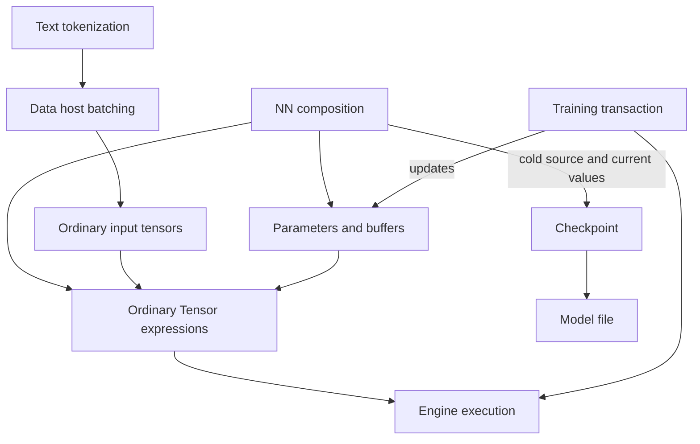

# Extensions, training, persistence, and tools

This atlas explains how application-facing composition surrounds the tensor execution core, and which similarly named packages are only inert module markers. It is explanatory: [the architecture root](../../../ARCHITECTURE.md), the [extensions and training contract](../../architecture/contracts/extensions-training.md), and the [performance-tooling boundary](../../architecture/contracts/backend-execution.md#performance-evidence-and-optimization-tooling) remain authoritative.

Read the [framework journey](../framework.md) first, or use the [package index](index.md) to explore adjacent packages. Source links below lead to implementation and Javadoc, not additional supported APIs: package-private helpers remain implementation details even when described here.

## Mental model: three different kinds of state

Read arrows as data or collaboration flow, not as permission for every module to depend on every other module. Text depends on Data; NN does not depend on either. Training uses public Model and Engine APIs without an NN dependency. Generic Checkpoint uses Model and Compiler's cold reconstruction boundary, not Engine or Training.

* **Model state** is named parameters and persistent buffers, plus the ordinary expressions that refer to them.
* **Execution state** includes prepared resources, bindings and native memory lifetimes. It is not a checkpoint payload.
* **Optimizer/session state** includes update slots, counters and pending gradient accumulation. In-memory snapshots exist, but the model files discussed here do not persist this state.

### The example carried through this atlas

The [tutorial](../../tutorials/index.md) and [LearningJourney example](../../examples/README.md) use FLOAT32 input `[2,1]` with values `[1,3]`, one supplied gradient-eligible weight `[1,1]` initially `0`, and no bias. Prediction is `input @ transpose(weight)`. Against target `[2,6]`, squared-error **SUM** starts at `40`; its weight gradient is `-40`. `Sgd(0.05)` changes the owned weight to `2`, giving prediction `[2,6]`; fresh input `[2,4]` then gives `[4,8]`.

These are explanatory arithmetic, not measurements from running this page. The important ownership detail is that the owned Model copies the supplied weight: training changes its private parameter, not the caller's original tensor. The package sections explain where each part belongs and explicitly identify packages not used by this path.

## io.github.pho001.synaptik.nn.module

**Purpose.** This package provides both generic Java module composition and the more specialized owned tensor Model workflow. They are related, but `forward` and `compute` are not synonyms.

Important entry points are [Module](../../../extensions/nn/src/main/java/io/github/pho001/synaptik/nn/module/Module.java), [Model](../../../extensions/nn/src/main/java/io/github/pho001/synaptik/nn/module/Model.java), [ModelBuilder](../../../extensions/nn/src/main/java/io/github/pho001/synaptik/nn/module/ModelBuilder.java), [Sequential](../../../extensions/nn/src/main/java/io/github/pho001/synaptik/nn/module/Sequential.java), and [StateDictionary](../../../extensions/nn/src/main/java/io/github/pho001/synaptik/nn/module/StateDictionary.java).

### Composition before execution

A `Module` owns named `Parameter` and `Buffer` wrappers and permanently registered children. Direct state and children share a local-name namespace. Recursive discovery visits parameters, then buffers, then children, producing stable dot-separated paths. A child has one parent: repeated ownership and cycles are rejected. Parameters must be floating and gradient-eligible; the wrapper does not initialize, optimize or execute them.

`Module` intentionally has no universal forward signature. `UnaryTensorModule` covers one tensor to one tensor; `Sequential` composes that narrower interface. `Model<I,O>` permits application records and other Java boundary types. `Model.define` seals the named topology once and retains the supplied forward body; it does not inspect captured Java variables or infer execution from a callback. `ModelSpecification` and `DeclarativeModel` offer a separate closed semantic description rather than serialization of arbitrary Java code.

`train()` and `eval()` propagate forward mode through the tree; `ForwardContext` is an immutable mode snapshot for operations that require an explicit context. These modes do not themselves allocate an optimizer or perform differentiation. Ordinary module mutation and forward construction are caller-coordinated, not generally thread-safe. Strict state loading validates the whole schema before installing compatible bindings; discovery or loading fails on unbound automatic parameter reservations instead of exposing half-created parameters.

### Owned tensor Models

`Model.builder().input(FLOAT32, 2, 1).linear(suppliedWeight).build()` creates a private static source. The builder checks its input and layer recipes, copies each supplied state identity once before expression construction, preserves exact aliases, builds fresh private children for each build, and composes their prototype expression in evaluation mode. This differs from constructing a standalone `Linear(weight)`, which retains the exact supplied weight.

`defineTensor` acquires a source after one definition/prototype forward; `graph` acquires an explicitly described input/output/state source. These routes use generic Checkpoint's cold boundary to acquire private state. Registered wrappers determine PARAMETER and BUFFER roles; reachable stored leaves outside that state become constants. Constants are not state-dictionary entries. Callback side effects are not rolled back by a failed acquisition.

The internal [OwnedModelSource](../../../extensions/nn/src/main/java/io/github/pho001/synaptik/nn/module/OwnedModelSource.java) and [ModelExecutionState](../../../extensions/nn/src/main/java/io/github/pho001/synaptik/nn/module/ModelExecutionState.java) retain the fixed source and cached execution owners. They are not application extension points. Cold `forward` constructs expressions with exact-descriptor substitutions; `compute` executes the fixed source through public Engine preparations and returns detached `HostTensorValue` values. It does not rebuild the source or mutate input prototypes for each batch. All static input descriptors, including layout presence and gradient eligibility, must match; merely matching element count is insufficient.

`withEngine` selects a borrowed Engine. Otherwise execution lazily creates a model-owned CPU Engine; construction, cold forward, load and save do not create it. Execution/configuration freezes that selection. `configureTraining` succeeds once, invokes an objective builder once per explicit attempt, and leaves mode unchanged. It closes inference preparations before copying parameters into a model-owned shared native arena and delegates subsequent updates to one `TrainingSession`. A failed setup cleans unpublished resources and can permit an explicit retry, but it does not silently unfreeze or recapture the source.

Before high-level work, the owner guards module modes, ordered paths, wrappers, tensor identities and storage associations. Structural/binding mutation invalidates cached capability rather than adopting replacement state or resetting optimizer history. Changed bytes from successful training remain valid. Only one high-level operation is admitted at a time; competing work fails busy. Close waits for admitted work and closes session/preparations before native owners and an owned Engine; it never closes a borrowed Engine.

**In the example:** this package owns the copied zero weight, fixed `[2,1]` signature, one configured objective and reusable compute/train lifecycle. A loaded file restores source/current values and starts in evaluation mode; configuring a new optimizer after load is fresh training, not exact optimizer continuation. Unsupported tensor capabilities on generic/custom Models fail with `UnsupportedOperationException`, not an implicit conversion to an owned Model. See the precise [owned Model lifecycle](../../architecture/contracts/extensions-training.md#owned-tensor-models).

## io.github.pho001.synaptik.nn.layers

**Purpose.** Layers bind named state to ordinary Model tensor operations. They are not numerical kernels, a compiler, or a second execution engine. Start with [Linear](../../../extensions/nn/src/main/java/io/github/pho001/synaptik/nn/layers/Linear.java), [the package Javadoc](../../../extensions/nn/src/main/java/io/github/pho001/synaptik/nn/layers/package-info.java), [BatchNorm](../../../extensions/nn/src/main/java/io/github/pho001/synaptik/nn/layers/BatchNorm.java), [Dropout](../../../extensions/nn/src/main/java/io/github/pho001/synaptik/nn/layers/Dropout.java), and [RnnSequence](../../../extensions/nn/src/main/java/io/github/pho001/synaptik/nn/layers/RnnSequence.java).

`Linear` keeps weight `[outFeatures,inFeatures]` and optional bias `[outFeatures]`, then delegates forward to Tensor linear composition: transpose/permute, matrix multiplication and optional addition. A standalone supplied-state constructor retains exact references. Automatic constructors either initialize eagerly or reserve names until a compatible first input supplies the missing feature width. A failed deferred initialization publishes no partial wrapper group; consumed random draws and identifiers are not rolled back. Later input widths must remain compatible.

Convolution layers similarly infer only input channels and construct channels-first Model convolution expressions. Grouped weight initialization uses per-group fans. `LayerNorm` owns affine scale/bias; `Embedding` owns an ordinary trainable table and delegates lookup semantics to Model. In particular, an embedding has no special frozen padding row: token ID zero is not automatically masked or zeroed.

Not every layer is unary or mode-insensitive. BatchNorm uses explicit context to choose inference versus training expressions; training replaces its stable running-statistic buffer bindings with the producer's next-statistic expressions, not an eager numerical update. Dropout owns only its probability, not a hidden random stream. Training consumes explicit graph random state and returns output/next-state references; evaluation returns the exact input and incoming state without creating a dropout occurrence. Probability outside finite `[0,1)` rejects.

Recurrent cells receive explicit input and hidden state (plus cell state for LSTM); they do not remember the last invocation's hidden state. Static sequence containers reuse their cell parameters while constructing fresh per-time-step expressions. Java lengths specialize that topology by gathering active rows; bidirectional containers own independent directional cells and realign outputs. This is distinct from the sequence `forwardScan` APIs and runtime length tensors: static unrolling is not evidence of graph reuse for changed Java lengths or physical runtime work skipping. Model/Compiler/backend admission still governs execution and derivatives of the resulting topology.

**State and failures.** These modules own wrappers, configuration and any declared buffers, not backend memory owners. Shape, dtype, state, context and recurrence geometry are checked before the relevant expression construction. Unbound reservations fail discovery. Parameter replacement changes future expressions; already constructed expressions keep their old references. Backend support for an entire composed graph must be established separately.

**In the example:** only a no-bias Linear is needed. Its weight orientation makes `[2,1] @ transpose([1,1])` produce `[2,1]`; normalization, embedding, randomness and recurrence add no hidden behavior to that calculation.

## io.github.pho001.synaptik.nn.initialization

[ParameterInitializers](../../../extensions/nn/src/main/java/io/github/pho001/synaptik/nn/initialization/ParameterInitializers.java) creates eager, host-backed, contiguous, provenance-free floating leaves with `requiresGrad=true`. [ParameterInitialization](../../../extensions/nn/src/main/java/io/github/pho001/synaptik/nn/initialization/ParameterInitialization.java) describes the closed constant, normal, uniform, Glorot and Kaiming-ReLU policies. Layer constructors and builder recipes consume these policies; a Parameter wrapper itself owns no initialization policy.

The mechanism is deliberate: constant policies call Model factories without a generator; random policies pass the exact caller-supplied `RandomGenerator` to Model random factories. Each logical element consumes the documented draw, and an empty tensor consumes none. The utility retains no generator, seed, arena or initialized parameter. Fan-based methods require positive rank-two `[fanOut,fanIn]` weights; they do not infer convolution fans. Dynamic shapes, non-floating types, invalid distributions and inappropriate policy/overload combinations reject. Sampling failures can leave the caller's generator advanced without returning a tensor.

The owned builder's automatic layers use their existing seed/policy rules, while the canonical example supplies an explicit zero weight and therefore does not depend on random initialization. Changing to an automatic initializer changes the starting arithmetic, not the optimizer formula.

## io.github.pho001.synaptik.training

**Purpose.** [TrainingSession](../../../modules/training/src/main/java/io/github/pho001/synaptik/training/TrainingSession.java) combines one public Engine preparation with generic live parameter admission and backend-neutral optimizer mathematics. [TrainingParameters](../../../modules/training/src/main/java/io/github/pho001/synaptik/training/TrainingParameters.java), [Sgd](../../../modules/training/src/main/java/io/github/pho001/synaptik/training/Sgd.java), [Adam](../../../modules/training/src/main/java/io/github/pho001/synaptik/training/Adam.java), [AdamW](../../../modules/training/src/main/java/io/github/pho001/synaptik/training/AdamW.java), [GradientMode](../../../modules/training/src/main/java/io/github/pho001/synaptik/training/GradientMode.java), and [TrainingStep](../../../modules/training/src/main/java/io/github/pho001/synaptik/training/TrainingStep.java) are the main entry points. This physical module retains Gradle identity `:extensions:training`.

Training has no NN dependency. NN's `trainingParameters()` adapter supplies ordered paths/tensors and a live `validateUnchanged` guard; other owners can implement the same boundary. `TrainingSession.open` admits the complete parameter set before private seed allocation/compilation, snapshots identities and host-storage associations, compiles the scalar objective and exact differentiation targets, and opens one reusable Engine preparation. `runValues` binds fresh stored external values in session input order, while the identity-oriented `run` uses compiled input identities. Neither executes a supplied expression instead of its stored bytes.

### Where an update becomes a transaction

The session first validates inputs and parameter views, executes, authenticates objective/gradient publications, detaches values, closes the execution result, decodes gradients and calculates candidates. Finiteness checks cover parameters, objective, gradients, accumulation, optimizer intermediates and candidates. A second complete parameter validation precedes writes. Ordinary precommit failure leaves parameter bytes, optimizer slots, counters and pending gradients unchanged. This prevents a bad gradient in a later parameter from partially updating earlier parameters. Fatal VM failure and caller violations of exclusive storage access are outside that guarantee.

Gradient modes distinguish gradient accumulation from an actual optimizer step; accumulation is a sum, not automatic sample averaging. The canonical owned workflow uses RESET_AND_STEP. `ParameterGroup` assigns algorithms to explicit paths while retaining one execution and atomic commit for the whole set. Low-width logical parameters use private FLOAT32 masters where documented; FLOAT64 retains FLOAT64 optimizer arithmetic. SGD momentum and adaptive moments are session state, not NN buffers.

Admission requires supported connected nonempty floating parameters, exact static contiguous offset-zero non-view descriptors, finite values, and exact-capacity writable shareable native host storage. [TrainingParameterStorage](../../../modules/training/src/main/java/io/github/pho001/synaptik/training/TrainingParameterStorage.java) provides an explicit pre-session copy into caller-owned shared native memory; the owned Model performs that step with its own arena. Parameter overlap, changed bindings, nonempty external-input overlap and nonfinite candidates reject rather than silently converting, skipping or splitting updates.

The session owns its preparation, private seed arena and optimizer state, but borrows Engine and parameter storage. One operation is admitted at a time; busy/closed admission precedes argument validation. Close waits, cleans owned resources, and leaves borrowed owners alone. Detached `TrainingStep` and [TrainingState](../../../modules/training/src/main/java/io/github/pho001/synaptik/training/TrainingState.java) snapshots remain readable after closure. Restoring an in-memory state validates configuration, paths/schema, counters, slot widths and finite contents before installation; it is not a disk checkpoint facility.

**In the example:** the objective is `0-2` squared plus `0-6` squared, hence `40`; the gradient is `2*(-2)*1 + 2*(-6)*3 = -40`. SGD computes `0 - 0.05*(-40) = 2`. Training performs the update only after all execution/materialization/validation succeeds. It does not choose NN train/eval mode or backend kernels. See the [training contract](../../architecture/contracts/extensions-training.md#modulestraining).

## io.github.pho001.synaptik.checkpoint.artifact

**Purpose.** This package stores bounded opaque bytes in one regular file. [ArtifactEnvelope](../../../modules/checkpoint/src/main/java/io/github/pho001/synaptik/checkpoint/artifact/ArtifactEnvelope.java) is a detached immutable image; [ArtifactFile](../../../modules/checkpoint/src/main/java/io/github/pho001/synaptik/checkpoint/artifact/ArtifactFile.java) reads/publishes it; [ArtifactLimits](../../../modules/checkpoint/src/main/java/io/github/pho001/synaptik/checkpoint/artifact/ArtifactLimits.java) provides explicit encoded-size ceilings. The physical `modules/checkpoint` directory retains Gradle identity `:extensions:checkpoint`.

Framing uses canonical names, bounded lengths, a SHA-256 manifest digest and per-payload digests. The reader bounds the manifest before its allocation, checks aggregate arithmetic before payload allocation, validates the complete image and returns no partial candidate. It rejects symlinks/nonregular inputs, corrupt, truncated, trailing, unsupported, noncanonical or over-limit data through `ArtifactFormatException`/I/O failures. Digests detect corruption; they do not authenticate the writer.

Save writes a sibling temporary file, forces/closes it, reopens and validates it, then attempts one atomic move. There is no non-atomic fallback. After an uncertain move failure the caller must inspect the target; success establishes atomic live visibility, not portable rename power-loss durability. Trusted directory/quiescent-file requirements matter because this is not a hostile-filesystem sandbox.

The package owns detached bytes and temporary publication resources only. It assigns no meaning to a weight, graph, optimizer or tokenizer. Generic graph and retained NN codecs supply that meaning above it. Limits bound encoded data, not total peak heap or Engine workspace. **In the example:** Model save/load reaches this framing layer, but the application normally stays at the Model facade.

## io.github.pho001.synaptik.checkpoint.graph

[GraphCheckpoint](../../../modules/checkpoint/src/main/java/io/github/pho001/synaptik/checkpoint/graph/GraphCheckpoint.java) persists **cold source and current named values**, not an executable continuation. Its public `Source(inputs,outputs,leaves)` is a borrowed carrier for ordinary tensors; `Leaf` adds a name and explicit PARAMETER, BUFFER or CONSTANT role. Internal [GraphSource](../../../modules/checkpoint/src/main/java/io/github/pho001/synaptik/checkpoint/graph/GraphSource.java) and [GraphValueStorage](../../../modules/checkpoint/src/main/java/io/github/pho001/synaptik/checkpoint/graph/GraphValueStorage.java) perform capture/admission and host-value handling. They are not supported application APIs.

Inputs must be unique provenance-free prototypes; outputs are nonempty distinct roots. Every reachable non-input leaf must be named, and every named identity reachable. Exact tensor identity defines aliases, not equal bytes or overlapping physical storage. Roles are explicit; gradient eligibility alone does not turn a buffer into a parameter. Full descriptor and name validation precedes state acquisition.

`copy` copies each named identity once to private heap state, creates storage-free input prototypes and delegates reconstruction to Compiler. `rebind` checks full replacement descriptors and reconstructs ordinary outputs with substitutions while retaining named state; it reads no state storage and can accept produced substitutions with upstream provenance. Neither compiles an executable. Compiler alone owns capture/reconstruction of supported operations and scan bodies, avoiding a second graph interpreter in Checkpoint.

`save` validates source, geometry, encoded bounds and every named storage association before raw value copying and file publication. It reads named host values only, never input prototype contents. Raw floating bits, including signed zero and NaN payloads, survive; BOOL lanes must be canonical 0/1. Absent/dead/inaccessible/short state rejects. Callers exclude mutation, rebinding and closure for the operation; there is no hidden execution to materialize missing values.

`load` validates framing, the closed wire schema, descriptors, aliases, lengths and Compiler cold admission before importing final heap state and reconstructing expressions. Stored semantic failures become `ArtifactFormatException`; invalid live sources normally fail with `IllegalArgumentException`, unavailable state with `IllegalStateException`, and checked sizing can overflow. No partial source is published.

The codec chooses the smallest sufficient supported graph format: older arithmetic/activation and CNN/static recurrent slices retain earlier versions; bounded all-valid scan bodies, runtime-length bodies, Pool3d and FP8 select their respective later formats through v7. This is a **closed** constructor inventory, not persistence of arbitrary Model-valid operations. Cold dtype/source acceptance does not qualify backend execution or gradients. External runtime lengths are signature inputs, not saved batch values. See [generic graph source and values](../../architecture/contracts/extensions-training.md#generic-graph-source-and-values).

**In the example:** the owned Model's private linear source/current weight can be saved before execution or after the step. Reloading weight `2` can predict `[4,8]` for fresh `[2,4]`, but the file contains no target objective, optimizer slots, random stream, dataset cursor, prepared code or native handles. Reconfiguring training after loading is not exact continuation.

## io.github.pho001.synaptik.nn.checkpoint

This is a **separate retained NN persistence family**, not an alias for generic graph persistence. Important entry points are [ModelCheckpoint](../../../extensions/nn/src/main/java/io/github/pho001/synaptik/nn/checkpoint/ModelCheckpoint.java), [ModelCheckpointInspection](../../../extensions/nn/src/main/java/io/github/pho001/synaptik/nn/checkpoint/ModelCheckpointInspection.java), and [InputArtifactFingerprint](../../../extensions/nn/src/main/java/io/github/pho001/synaptik/nn/checkpoint/InputArtifactFingerprint.java). Codec/candidate/capture/restoration classes in the package are internal implementation, not an alternative public workflow.

Values-only capture takes an NN state dictionary and caller configuration digest, validates paths, shape, dtype, canonical sizes and limits, deduplicates exact tensor identities for public Engine materialization, and copies detached values into an opaque artifact envelope. Loading requires a recreated compatible target and delegates installation to NN's strict whole-tree loader. Inspection does not authorize a later load without revalidation. Configuration/input digests bind caller-declared identity, not authenticity or inferred tokenizer semantics.

Whole-model operations add a closed definition for supported Sequential/DeclarativeModel trees and reconstruct independent heap-backed evaluation state without an Engine on load. Arbitrary callbacks, custom children and recurrent layers are outside this definition format. Definition description and value capture are separate reads, so caller quiescence spans both; this is not a combined concurrent snapshot. FP8 selects model/whole-model v2; non-FP8 retains v1 encoding. These kinds remain distinct from graph-model kinds.

Capture/load errors include unbound state, incompatible schema/configuration, unsupported composition, invalid fingerprints, resource ceilings, corrupt files and Engine materialization failures. No live Engine or storage handle escapes a detached candidate, and no optimizer/session continuation is saved. **In the canonical path:** use owned `Model.save`/load APIs backed by generic graph persistence, not these retained flexible NN readers. The distinction matters when choosing a file reader; one format is not silently converted into the other. See [retained NN checkpoint APIs](../../architecture/contracts/extensions-training.md#retained-nn-checkpoint-apis).

## io.github.pho001.synaptik.data

**Purpose.** Prepare host-side numeric sequences before computation. [LongSequenceBatcher](../../../extensions/data/src/main/java/io/github/pho001/synaptik/data/LongSequenceBatcher.java) pads ordered `long[]` rows; [PaddedSequenceBatch](../../../extensions/data/src/main/java/io/github/pho001/synaptik/data/PaddedSequenceBatch.java) describes an existing tensor and valid intervals; [ValidSequenceLengths](../../../extensions/data/src/main/java/io/github/pho001/synaptik/data/ValidSequenceLengths.java) owns copied nonnegative row counts. Data depends only on public Model APIs, not NN or Engine.

The batcher finds maximum row length T and batch size B, checks geometry before allocation, allocates one rank-two INT64 heap tensor and fills the destination directly. It preserves row order and pads left/right in time-major `[T,B]` or batch-major `[B,T]` order. Configuration requires explicit padding value, side and order; it has no hidden defaults or truncation policy. The result retains no source arrays. Empty input and empty rows are supported, while null rows and oversized/overflowing geometry reject.

The batch record itself performs metadata-only validation: leading static axes must match B/T and each valid count must fit T. It retains the exact values reference, not a copied tensor, and does not inspect storage or infer valid lengths from zero/sentinel values. RIGHT means valid prefix `[0,L)`; LEFT means `[T-L,T)`. Trailing dimensions and dtype remain ordinary Model metadata. A declared interval does not prove its contents are correctly padded.

`toScanLengthsTensor` explicitly copies counts into a fresh heap INT64 `[B]` input and accepts only RIGHT/TIME_MAJOR metadata. It does not transpose, mask or execute the values tensor, and does not make Text IDs a floating scan input. Data owns no native lifetime, dataset/epoch lifecycle, device transfer or optimizer. **In the canonical example:** fixed FLOAT32 `[2,1]` values need no sequence padding, so Data is not on the path. Do not substitute the batcher's INT64 output for that FLOAT32 signature.

## io.github.pho001.synaptik.text

[WhitespaceTokenizer](../../../extensions/text/src/main/java/io/github/pho001/synaptik/text/WhitespaceTokenizer.java) freezes exact token-to-ID assignments; [TextSequenceBatcher](../../../extensions/text/src/main/java/io/github/pho001/synaptik/text/TextSequenceBatcher.java) adapts encoded strings to Data. Text depends on Data and transitively Model, not on NN, Training or execution packages.

Ordinary vocabulary tokens get IDs starting at 2 in supplied order; PAD=0 and UNK=1 are reserved numeric IDs, not magical spellings. Encoding scans maximal runs separated by `Character.isWhitespace` code points, looks up exact substrings and returns a fresh array. Case, punctuation and non-normalized UTF-16 remain exact. The vocabulary is immutable; it does not grow during encoding. Null entries, duplicates, empty ordinary tokens and whitespace inside vocabulary tokens reject.

Text batching encodes each row once and delegates padding/count/allocation to one configured `LongSequenceBatcher`, with tokenizer PAD as padding value. Side and axis order must be explicit. Its result is an ordinary Data batch; no embedding, mask, gradient suppression or computation occurs. PAD remains an ordinary trainable row if a caller later composes an Embedding. Neither tokenizer nor batcher owns native resources or performs file/network I/O, vocabulary training or persistence.

For a conceptual host-only check, vocabulary `["red","blue"]` maps `"red unknown blue"` to `[2,1,3]`. Right-padding that row with the encoding of `"blue"` yields batch-major values `[[2,1,3],[3,0,0]]` and lengths `[3,1]`; the zeros are padding only because the lengths/side declare them so. Changing to left padding changes placement, not token IDs, and cannot be exported unchanged to the right-prefix scan-length helper. This is source-derived expected behavior, not an executed example.

**In the canonical example:** there are no strings or token IDs, so this package does not participate. Adding Text is a separate input-preparation/Embedding composition, not a prerequisite for scalar linear learning.

## io.github.pho001.synaptik.tools.tuning

**Purpose.** Explicit cold tuning transactions coordinate caller-provided candidate work and backend-owned decision codecs. Main entry points are [WorkloadTuning](../../../tools/tuning/src/main/java/io/github/pho001/synaptik/tools/tuning/WorkloadTuning.java), [WorkloadTuningRequest](../../../tools/tuning/src/main/java/io/github/pho001/synaptik/tools/tuning/WorkloadTuningRequest.java), [CompletePlanTuning](../../../tools/tuning/src/main/java/io/github/pho001/synaptik/tools/tuning/CompletePlanTuning.java), and [CompletePlanTuningRequest](../../../tools/tuning/src/main/java/io/github/pho001/synaptik/tools/tuning/CompletePlanTuningRequest.java). This is not automatic tuning hidden inside Model.compute/train.

Workload tuning groups compatible occurrences while retaining context and weights, reuses compatible explicit-cache entries, preflights miss/candidate/execution budgets, and measures misses through a caller-supplied complete-candidate action. Integer median elapsed nanoseconds selects a winner; backend codecs authenticate the decision against each exact occurrence batch. Measurement deduplication does not erase occurrence weighting or permit reusing a decision against an unauthenticated batch.

Complete-plan tuning handles a bounded complete candidate batch rather than repeating local route search. A persistent hit is decoded/authenticated before reuse and avoids candidate enumeration/execution. On a miss it preflights `N * (1 + W + S)` complete executions for N candidates, W warmups and S samples. All caller-owned exact correctness comparisons finish before timing; then median selection preserves encounter order on ties. A clean mismatch has a distinct `CorrectnessMismatchException`; callback execution/cleanup failures keep their original exceptions.

Backend collaboration interfaces supply compatibility identities, candidates and opaque codecs; measurement/correctness callbacks own actual execution and cleanup. The tooling does not discover backends, extract a Model itself, define graph semantics, prepare kernels, orchestrate Runtime, or serialize an executable. It collaborates with Prepare's typed handoffs without exposing private backend vocabulary as a universal setting.

Internal [WorkloadCacheFile](../../../tools/tuning/src/main/java/io/github/pho001/synaptik/tools/tuning/WorkloadCacheFile.java) and [ModelPlanCacheFile](../../../tools/tuning/src/main/java/io/github/pho001/synaptik/tools/tuning/ModelPlanCacheFile.java) own bounded explicit cache files; rich evidence remains separate from compact decisions. Session-scoped requests perform no cache filesystem access. Persistent transactions validate caches before candidate work and do not expose success before required publication succeeds. Invalid identities/candidates/budgets, bad samples, backward clocks, incompatible codec round trips, corrupt caches, arithmetic overflow and callback failures propagate instead of installing a partial successful result.

**In the canonical example:** no tuning request or cache is involved, and correctness does not depend on tuning. The two-element teaching arithmetic is not a representative performance workload. Observing a fast benchmark is not authorization to populate a production tuning decision.

## io.github.pho001.synaptik.tools.benchmarks

**Purpose.** Produce observational performance reports, not production settings. [CpuLifecycleBenchmark](../../../tools/benchmarks/src/main/java/io/github/pho001/synaptik/tools/benchmarks/CpuLifecycleBenchmark.java), [CpuOneDnnBenchmark](../../../tools/benchmarks/src/main/java/io/github/pho001/synaptik/tools/benchmarks/CpuOneDnnBenchmark.java), and [MetalRouteBenchmark](../../../tools/benchmarks/src/main/java/io/github/pho001/synaptik/tools/benchmarks/MetalRouteBenchmark.java) are actual executable harnesses. [BenchmarksToolModule](../../../tools/benchmarks/src/main/java/io/github/pho001/synaptik/tools/benchmarks/BenchmarksToolModule.java) is an inert marker, not their runner or a benchmarking service.

The CPU lifecycle harness uses fixed public Tensor/Engine/prepared-execution workflows and emits environment/configuration/source identity with measurements; its evidence profile requires explicit metadata rather than silently inventing provenance. The oneDNN harness compares fixed workloads/configurations and requires an absolute external library path for the exact supported oneDNN ABI; it records the library hash and report-only status. Its numerical checks are benchmark checks, not a new production numerical policy.

The Metal harness fixes a singleton NEG workload and compares the two local route candidates. Separate traced execution attests route facts; ordinary no-trace execution provides timings. It requires Apple-silicon macOS and the configured native library, and checks the expected candidate/partition/publication structure rather than accepting an arbitrary workload. Its report explicitly excludes production-decision/autotuning eligibility.

Harnesses own their temporary execution/native resources and measurement state; reports outlive those resources. Invalid profiles, missing evidence metadata, unsupported hosts/libraries, failed output checks or changed expected route structure reject. Native CPU/Metal providers remain owned by their backend modules; this package adds no native implementation, CUDA route or production fallback. **In the canonical example:** these harnesses are not invoked. The tutorial's exact arithmetic neither supplies benchmark evidence nor demonstrates a speedup. See the [performance evidence boundary](../../architecture/contracts/backend-execution.md#performance-evidence-and-optimization-tooling) before interpreting timings.

## io.github.pho001.synaptik.onnx

[OnnxModule](../../../extensions/onnx/src/main/java/io/github/pho001/synaptik/onnx/OnnxModule.java) is an **inert marker**: a final class with a private constructor and no callable operations. It identifies `extensions/onnx`; it is not an importer, exporter, parser, operator mapper or ONNX Runtime integration. There are no model inputs/outputs, owned runtime resources, conversion errors or persistence mechanisms in this production package. Architectural responsibility for a future integration is not an implemented product. It has no role in LearningJourney; saving a Model here does not produce ONNX.

## io.github.pho001.synaptik.backend.cuda

[CudaBackendModule](../../../modules/backend/cuda/src/main/java/io/github/pho001/synaptik/backend/cuda/CudaBackendModule.java) is an **inert marker** with a private constructor and no operations. It identifies `modules/backend/cuda`, not a usable backend provider. This package supplies no candidate discovery, kernels, CUDA allocation/stream lifetime, device transfer or execution admission. Consequently there is no CUDA native path accounted for by this marker and no CUDA inference/training claim. It owns no mutable state or failure protocol beyond ordinary class loading. LearningJourney does not use it; selecting a Java package name cannot move its tensors onto CUDA.

## io.github.pho001.synaptik.tools.cli

[CliToolModule](../../../tools/cli/src/main/java/io/github/pho001/synaptik/tools/cli/CliToolModule.java) is an **inert marker**, not a command-line entry point. Its private constructor and empty body provide no `main`, command parser, file workflow or invocation lifecycle. There are no accepted CLI arguments, emitted results, resources or command-specific errors to document. LearningJourney's executable example is not supplied by this marker; use the [examples entry point](../../examples/README.md), not an imagined `synaptik` command.

## io.github.pho001.synaptik.testing.architecture

[ArchitectureTestsModule](../../../testing/architecture-tests/src/main/java/io/github/pho001/synaptik/testing/architecture/ArchitectureTestsModule.java) is an **inert production marker** for the architecture-test module, not an application API or a runtime architecture validator. It contains only a private constructor, with no state, inputs/outputs, dependency scanner or resource/error lifecycle. Actual test sources belong to the testing module's test tree; this class does not run them. It is not called by LearningJourney and cannot certify that an application's module dependencies are valid.

## io.github.pho001.synaptik.testing.conformance

[BackendConformanceTestsModule](../../../testing/backend-conformance/src/main/java/io/github/pho001/synaptik/testing/conformance/BackendConformanceTestsModule.java) is an **inert production marker** for backend conformance testing. It does not implement a conformance runner, numerical oracle, backend adapter or provider qualification mechanism. Its private constructor exposes no usable operation and owns no state/resources or special failures. Test-tree evidence is separate from this marker; merely linking it grants no backend capability. LearningJourney neither depends on nor invokes it.

## io.github.pho001.synaptik.testing.integration

[IntegrationTestsModule](../../../testing/integration-tests/src/main/java/io/github/pho001/synaptik/testing/integration/IntegrationTestsModule.java) is an **inert production marker** for integration tests. It adds no application integration facade, test launcher, model execution, data flow, state or resource lifetime. Its only constructor is private. Actual cross-module tests live outside this main-source marker, and their existence is not runtime evidence for a program that has not been run. LearningJourney uses the real public packages above, not this marker.

## Where to go next

* Follow the [tutorial journey](../../tutorials/index.md) for complete runnable inputs and expected results.
* Use the [reference entry point](../../reference/index.md) for supported API boundaries and the [package index](index.md) for lower execution layers.
* Consult the [extensions/training authority](../../architecture/contracts/extensions-training.md) when exact lifecycle, wire-format or admission details matter. This atlas explains those distinctions; it does not widen any supported source, backend or continuation domain.
