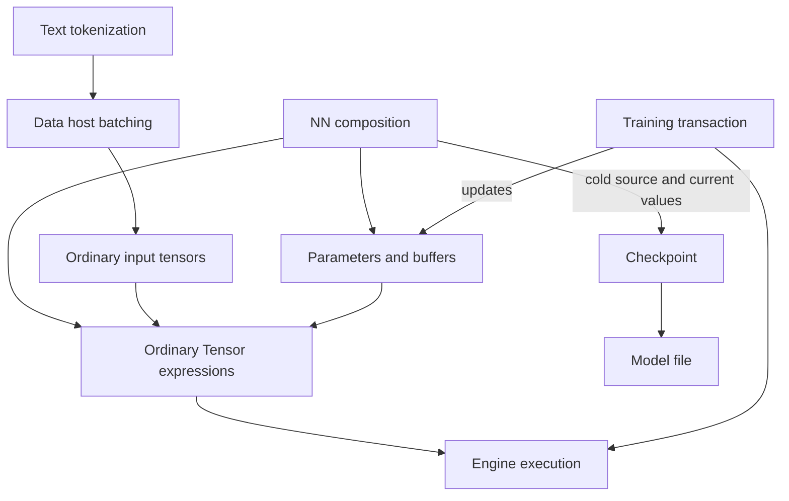

# Extensions, training, [persistence](../../glossary.md#term-persistence), and tools

This atlas explains how application-facing composition surrounds the [tensor](../../glossary.md#tensor) execution core, and which similarly named packages are only inert [module](../../glossary.md#term-module) markers. It is explanatory: [the architecture root](../../../ARCHITECTURE.md), the [extensions and training contract](../../architecture/contracts/extensions-training.md), and the [performance-tooling boundary](../../architecture/contracts/backend-execution.md#performance-evidence-and-optimization-tooling) remain authoritative.

Read the [framework journey](../framework.md) first, or use the [package index](index.md) to explore adjacent packages. Source links below lead to implementation and [Javadoc](../../glossary.md#term-javadoc), not additional supported APIs: package-private helpers remain implementation details even when described here.

## [Mental model](../../glossary.md#term-mental-model): three different kinds of state

Read arrows as data or collaboration flow, not as permission for every [module](../../glossary.md#term-module) to depend on every other module. Text depends on Data; [NN](../../glossary.md#neural-network-module-parameter-buffer-and-forward-context) does not depend on either. Training uses public [Model](../../glossary.md#term-model) and [Engine](../../glossary.md#term-engine) APIs without an NN [dependency](../../glossary.md#term-dependency). Generic [Checkpoint](../../glossary.md#term-checkpoint) uses Model and [Compiler](../../glossary.md#term-compiler)'s [cold reconstruction](../../glossary.md#term-cold-reconstruction) boundary, not Engine or Training.

* **Model state** is named [parameters](../../glossary.md#term-parameter) and persistent [buffers](../../glossary.md#term-buffer), plus the ordinary expressions that refer to them.
* **Execution state** includes prepared resources, [bindings](../../glossary.md#term-binding) and [native memory](../../glossary.md#aliasing-and-arena) lifetimes. It is not a checkpoint [payload](../../glossary.md#artifact-envelope-and-atomic-publication).
* **[Optimizer](../../glossary.md#term-optimizer)/session state** includes update slots, counters and pending [gradient accumulation](../../glossary.md#term-gradient-accumulation). In-memory snapshots exist, but the model files discussed here do not persist this state.

A **cold** source describes computation without running it or preparing a [device](../../glossary.md#term-device). A **[codec](../../glossary.md#term-codec)**
encodes/decodes a defined byte format; a **[schema](../../glossary.md#term-schema)** defines its records and allowed fields.
**[Admission](../../glossary.md#term-admission)** checks whether a source or [operation](../../glossary.md#operation) belongs to an allowed domain. These are
separate from execution support: a file can reconstruct a valid expression without any selected
[backend](../../glossary.md#backend) being able to execute it. NN abbreviates [neural network](../../glossary.md#neural-network-module-parameter-buffer-and-forward-context); its Module composition is
different from a repository/build module.

### The example carried through this atlas

The tutorial and [LearningJourney example](../../examples/README.md) use FLOAT32 input `[2,1]`
with values $(1,3)$, one supplied gradient-eligible `[1,1]` weight $w=0$, and no bias.
Predictions are $y_i=x_iw$ for inputs $x_i$ and samples $i\in\{1,2\}$; targets $t_i$ are $(2,6)$.
The squared-error **sum** is $L=\sum_{i=1}^{2}(y_i-t_i)^2=40$, with
$dL/dw=-40$. SGD with learning rate $\eta=0.05$ gives $w-\eta\,dL/dw=2$,
predicting $(2,6)$ and then $(4,8)$ for fresh $(2,4)$.
These are finite, dimensionless real-number teaching values, not permission to reorder
FLOAT32 sites. The [complete gradient walkthrough](../tensors-and-gradients.md#the-first-training-step)
defines each contribution and the sum-versus-mean distinction.

These are explanatory arithmetic, not measurements from running this page. The important [ownership](../../glossary.md#term-ownership-meanings) detail is that the [owned Model](../../glossary.md#model-module-buffer-and-scan-distinctions) copies the supplied weight: training changes its private [parameter](../../glossary.md#term-parameter), not the caller's original [tensor](../../glossary.md#tensor). The package sections explain where each part belongs and explicitly identify packages not used by this path.

## io.github.pho001.synaptik.nn.[module](../../glossary.md#term-module)

**Purpose.** This package provides both generic [Java module](../../glossary.md#model-module-buffer-and-scan-distinctions) composition and the more specialized owned [tensor](../../glossary.md#tensor) [Model](../../glossary.md#term-model) workflow. They are related, but `forward` and `compute` are not synonyms.

Important entry points are [Module](../../../extensions/nn/src/main/java/io/github/pho001/synaptik/nn/module/Module.java), [Model](../../../extensions/nn/src/main/java/io/github/pho001/synaptik/nn/module/Model.java), [ModelBuilder](../../../extensions/nn/src/main/java/io/github/pho001/synaptik/nn/module/ModelBuilder.java), [Sequential](../../../extensions/nn/src/main/java/io/github/pho001/synaptik/nn/module/Sequential.java), and [StateDictionary](../../../extensions/nn/src/main/java/io/github/pho001/synaptik/nn/module/StateDictionary.java).

### Composition before execution

A [`Module`](../../glossary.md#term-module) owns named [`Parameter`](../../glossary.md#term-parameter) and [`Buffer`](../../glossary.md#term-buffer) wrappers and permanently registered children. Direct state and children share a local-name namespace. Recursive discovery visits parameters, then buffers, then children, producing stable dot-separated paths. A child has one parent: repeated [ownership](../../glossary.md#term-ownership-meanings) and cycles are rejected. Parameters must be floating and [gradient](../../glossary.md#term-gradient)-eligible; the wrapper does not initialize, optimize or execute them.

`Module` intentionally has no universal forward [signature](../../glossary.md#term-signature). `UnaryTensorModule` covers one [tensor](../../glossary.md#tensor) to one tensor; `Sequential` composes that narrower interface. `Model<I,O>` permits application records and other Java boundary types. `Model.define` seals the named [topology](../../glossary.md#term-topology) once and retains the supplied forward body; it does not inspect captured Java variables or infer execution from a [callback](../../glossary.md#term-callback). `ModelSpecification` and `DeclarativeModel` offer a separate closed semantic description rather than [serialization](../../glossary.md#term-serialization) of arbitrary Java code.

`train()` and `eval()` propagate forward mode through the tree; `ForwardContext` is an [immutable](../../glossary.md#term-immutable) mode [snapshot](../../glossary.md#term-snapshot) for operations that require an explicit context. These modes do not themselves allocate an [optimizer](../../glossary.md#term-optimizer) or perform differentiation. Ordinary module mutation and forward construction are caller-coordinated, not generally [thread-safe](../../glossary.md#term-thread-safe). Strict state loading validates the whole [schema](../../glossary.md#term-schema) before installing compatible [bindings](../../glossary.md#term-binding); discovery or loading fails on unbound automatic parameter reservations instead of exposing half-created parameters.

### Owned [tensor](../../glossary.md#tensor) Models

`Model.builder().input(FLOAT32, 2, 1).linear(suppliedWeight).build()` creates a private static source. The builder checks its input and layer recipes, copies each supplied state [identity](../../glossary.md#term-identity-meanings) once before expression construction, preserves exact [aliases](../../glossary.md#aliasing-and-arena), builds fresh private children for each build, and composes their [prototype](../../glossary.md#term-prototype) expression in [evaluation](../../glossary.md#term-evaluation) mode. This differs from constructing a standalone `Linear(weight)`, which retains the exact supplied [weight](../../glossary.md#term-weight).

`defineTensor` acquires a source after one definition/prototype forward; [`graph`](../../glossary.md#graph) acquires an explicitly described input/output/state source. These routes use generic [Checkpoint](../../glossary.md#term-checkpoint)'s cold boundary to acquire private state. Registered wrappers determine [PARAMETER](../../glossary.md#term-parameter) and [BUFFER](../../glossary.md#term-buffer) roles; reachable stored [leaves](../../glossary.md#term-leaf) outside that state become [constants](../../glossary.md#term-constant). Constants are not state-dictionary entries. [Callback](../../glossary.md#term-callback) side effects are not rolled back by a failed acquisition.

The internal [OwnedModelSource](../../../extensions/nn/src/main/java/io/github/pho001/synaptik/nn/module/OwnedModelSource.java) and [ModelExecutionState](../../../extensions/nn/src/main/java/io/github/pho001/synaptik/nn/module/ModelExecutionState.java) retain the fixed source and cached execution [owners](../../glossary.md#term-owner). They are not application extension points. Cold `forward` constructs expressions with exact-[descriptor](../../glossary.md#term-descriptor) substitutions; `compute` executes the fixed source through public [Engine](../../glossary.md#term-engine) preparations and returns [detached](../../glossary.md#detached-model-results) [`HostTensorValue`](../../glossary.md#host-tensor-value--hosttensorvalue) values. It does not rebuild the source or mutate input prototypes for each [batch](../../glossary.md#term-batch-machine-learning-and-hyperparameters). All static input descriptors, including [layout](../../glossary.md#layout) presence and [gradient](../../glossary.md#term-gradient) eligibility, must match; merely matching [element](../../glossary.md#term-element) count is insufficient.

`withEngine` selects a [borrowed](../../glossary.md#ownership-borrowing-and-lease) Engine. Otherwise execution lazily creates a [model](../../glossary.md#term-model)-owned [CPU](../../glossary.md#term-cpu) Engine; construction, cold forward, load and save do not create it. Execution/configuration freezes that selection. `configureTraining` succeeds once, invokes an [objective](../../glossary.md#term-objective) builder once per explicit attempt, and leaves mode unchanged. It closes [inference](../../glossary.md#term-inference) preparations before copying parameters into a model-owned shared native [arena](../../glossary.md#term-arena) and delegates subsequent updates to one [`TrainingSession`](../../glossary.md#training-session--trainingsession). A failed setup cleans unpublished resources and can permit an explicit retry, but it does not silently unfreeze or recapture the source.

Before high-level work, the [owner](../../glossary.md#term-owner) guards [module](../../glossary.md#term-module) modes, ordered paths, wrappers, tensor identities and storage associations. Structural/[binding](../../glossary.md#term-binding) mutation invalidates cached capability rather than adopting replacement state or resetting [optimizer history](../../glossary.md#term-optimizer-history). Changed bytes from successful training remain valid. Only one high-level [operation](../../glossary.md#operation) is admitted at a time; competing work fails busy. Close waits for admitted work and closes session/preparations before native owners and an owned Engine; it never closes a borrowed Engine.

**In the example:** this package owns the copied zero weight, fixed `[2,1]` [signature](../../glossary.md#term-signature), one configured objective and reusable compute/train [lifecycle](../../glossary.md#lifecycle). A loaded file restores source/current values and starts in evaluation mode; configuring a new [optimizer](../../glossary.md#term-optimizer) after load is fresh training, not exact optimizer continuation. Unsupported tensor capabilities on generic/custom Models fail with `UnsupportedOperationException`, not an implicit conversion to an [owned Model](../../glossary.md#model-module-buffer-and-scan-distinctions). See the precise [owned Model lifecycle](../../architecture/contracts/extensions-training.md#owned-tensor-models).

## io.github.pho001.synaptik.nn.layers

**Purpose.** Layers bind named state to ordinary [Model](../../glossary.md#term-model) [tensor](../../glossary.md#tensor) operations. They are not numerical [kernels](../../glossary.md#kernel), a [compiler](../../glossary.md#term-compiler), or a second execution [engine](../../glossary.md#term-engine). Start with [Linear](../../../extensions/nn/src/main/java/io/github/pho001/synaptik/nn/layers/Linear.java), [the package Javadoc](../../../extensions/nn/src/main/java/io/github/pho001/synaptik/nn/layers/package-info.java) ([Javadoc glossary](../../glossary.md#term-javadoc)), [BatchNorm](../../../extensions/nn/src/main/java/io/github/pho001/synaptik/nn/layers/BatchNorm.java), [Dropout](../../../extensions/nn/src/main/java/io/github/pho001/synaptik/nn/layers/Dropout.java), and [RnnSequence](../../../extensions/nn/src/main/java/io/github/pho001/synaptik/nn/layers/RnnSequence.java).

[`Linear`](../../glossary.md#term-linear-meanings) keeps [weight](../../glossary.md#term-weight) `[outFeatures,inFeatures]` and optional [bias](../../glossary.md#term-bias) `[outFeatures]`, then delegates forward to Tensor linear composition: [transpose](../../glossary.md#term-transpose)/permute, [matrix multiplication](../../glossary.md#matrix-multiplication--matmul) and optional addition. A standalone supplied-state constructor retains exact references. Automatic constructors either initialize eagerly or reserve names until a compatible first input supplies the missing [feature](../../glossary.md#term-feature) width. A failed deferred initialization publishes no partial wrapper group; consumed random draws and identifiers are not rolled back. Later input widths must remain compatible.

[Convolution](../../glossary.md#term-channels-first-convolution-layers) layers similarly infer only input channels and construct channels-first Model convolution expressions. Grouped weight initialization uses per-group fans. `LayerNorm` owns affine scale/bias; [`Embedding`](../../glossary.md#embedding) owns an ordinary trainable table and delegates [lookup](../../glossary.md#term-lookup) semantics to Model. In particular, an embedding has no special frozen [padding](../../glossary.md#padding) row: [token ID](../../glossary.md#frozen-whitespace-tokenizer) zero is not automatically masked or zeroed.

Not every layer is [unary](../../glossary.md#term-unary) or mode-insensitive. BatchNorm uses explicit context to choose [inference](../../glossary.md#term-inference) versus training expressions; training replaces its stable running-[statistic](../../glossary.md#term-statistic) [buffer](../../glossary.md#term-buffer) [bindings](../../glossary.md#term-binding) with the [producer](../../glossary.md#term-producer)'s next-statistic expressions, not an [eager](../../glossary.md#term-eager-evaluation) numerical update. [Dropout](../../glossary.md#dropout--inverted-dropout) owns only its probability, not a hidden [random stream](../../glossary.md#graph-rng-state--graphrngstate). Training consumes explicit [graph](../../glossary.md#graph) random state and returns output/next-state references; [evaluation](../../glossary.md#term-evaluation) returns the exact input and incoming state without creating a dropout [occurrence](../../glossary.md#term-occurrence). Probability outside [finite](../../glossary.md#term-finite) `[0,1)` rejects.

Recurrent cells receive explicit input and hidden state (plus cell state for [LSTM](../../glossary.md#term-long-short-term-memory-lstm)); they do not remember the last invocation's hidden state. Static sequence containers reuse their cell [parameters](../../glossary.md#term-parameter) while constructing fresh per-time-step expressions. Java lengths specialize that [topology](../../glossary.md#term-topology) by gathering active rows; bidirectional containers own independent directional cells and realign outputs. This is distinct from the sequence `forwardScan` APIs and [runtime](../../glossary.md#term-runtime) length tensors: static [unrolling](../../glossary.md#term-unrolling) is not evidence of graph reuse for changed Java lengths or physical runtime work skipping. Model/Compiler/[backend](../../glossary.md#backend) [admission](../../glossary.md#term-admission) still governs execution and [derivatives](../../glossary.md#term-derivative) of the resulting topology.

**State and failures.** These [modules](../../glossary.md#term-module) own wrappers, configuration and any declared buffers, not backend memory [owners](../../glossary.md#term-owner). [Shape](../../glossary.md#shape), [dtype](../../glossary.md#data-type--datatype), state, context and recurrence geometry are checked before the relevant expression construction. Unbound reservations fail discovery. Parameter replacement changes future expressions; already constructed expressions keep their old references. Backend support for an entire composed graph must be established separately.

**In the example:** only a no-bias Linear is needed. Its weight orientation makes `[2,1] @ transpose([1,1])` produce `[2,1]`; [normalization](../../glossary.md#term-normalization), embedding, randomness and recurrence add no hidden behavior to that calculation.

## io.github.pho001.synaptik.nn.initialization

[ParameterInitializers](../../../extensions/nn/src/main/java/io/github/pho001/synaptik/nn/initialization/ParameterInitializers.java) creates [eager](../../glossary.md#term-eager-evaluation), [host](../../glossary.md#term-host)-backed, [contiguous](../../glossary.md#term-contiguous), [provenance](../../glossary.md#provenance)-free floating leaves with `requiresGrad=true`. [ParameterInitialization](../../../extensions/nn/src/main/java/io/github/pho001/synaptik/nn/initialization/ParameterInitialization.java) describes the closed [constant](../../glossary.md#term-constant), normal, uniform, [Glorot](../../glossary.md#term-glorot-uniform) and [Kaiming](../../glossary.md#term-kaiming)-[ReLU](../../glossary.md#term-relu) policies. Layer constructors and builder recipes consume these policies; a [Parameter](../../glossary.md#term-parameter) wrapper itself owns no initialization policy.

The mechanism is deliberate: constant policies call [Model](../../glossary.md#term-model) factories without a generator; random policies pass the exact caller-supplied `RandomGenerator` to Model random factories. Each logical [element](../../glossary.md#term-element) consumes the documented draw, and an empty [tensor](../../glossary.md#tensor) consumes none. The utility retains no generator, [seed](../../glossary.md#term-seed), [arena](../../glossary.md#term-arena) or initialized parameter. Fan-based methods require positive [rank-two](../../glossary.md#axis-rank-scalar-vector-and-matrix) `[fanOut,fanIn]` [weights](../../glossary.md#term-weight); they do not infer [convolution](../../glossary.md#term-channels-first-convolution-layers) fans. Dynamic [shapes](../../glossary.md#shape), non-floating types, invalid [distributions](../../glossary.md#commit-release-distribution-log-and-seed-meanings) and inappropriate policy/overload combinations reject. [Sampling](../../glossary.md#term-sampling-machine-learning-and-hyperparameters) failures can leave the caller's generator advanced without returning a tensor.

The owned builder's automatic layers use their existing seed/policy rules, while the [canonical](../../glossary.md#term-canonical-form) example supplies an explicit zero weight and therefore does not depend on random initialization. Changing to an automatic initializer changes the starting arithmetic, not the [optimizer](../../glossary.md#term-optimizer) formula.

## io.github.pho001.synaptik.training

**Purpose.** [TrainingSession](../../../modules/training/src/main/java/io/github/pho001/synaptik/training/TrainingSession.java) ([TrainingSession glossary](../../glossary.md#training-session--trainingsession)) combines one public [Engine](../../glossary.md#term-engine) preparation with generic live [parameter](../../glossary.md#term-parameter) [admission](../../glossary.md#term-admission) and [backend](../../glossary.md#backend)-neutral [optimizer](../../glossary.md#term-optimizer) mathematics. [TrainingParameters](../../../modules/training/src/main/java/io/github/pho001/synaptik/training/TrainingParameters.java) ([TrainingParameters glossary](../../glossary.md#live-parameter-source--trainingparameters)), [Sgd](../../../modules/training/src/main/java/io/github/pho001/synaptik/training/Sgd.java), [Adam](../../../modules/training/src/main/java/io/github/pho001/synaptik/training/Adam.java) ([Adam glossary](../../glossary.md#adaptive-optimizer--adam-adamw)), [AdamW](../../../modules/training/src/main/java/io/github/pho001/synaptik/training/AdamW.java) ([AdamW glossary](../../glossary.md#adaptive-optimizer--adam-adamw)), [GradientMode](../../../modules/training/src/main/java/io/github/pho001/synaptik/training/GradientMode.java), and [TrainingStep](../../../modules/training/src/main/java/io/github/pho001/synaptik/training/TrainingStep.java) are the main entry points. This physical [module](../../glossary.md#term-module) retains [Gradle](../../glossary.md#term-gradle) [identity](../../glossary.md#term-identity-meanings) `:extensions:training`.

Training has no [NN](../../glossary.md#neural-network-module-parameter-buffer-and-forward-context) [dependency](../../glossary.md#term-dependency). NN's `trainingParameters()` adapter supplies ordered paths/[tensors](../../glossary.md#tensor) and a live `validateUnchanged` [guard](../../glossary.md#term-guard); other [owners](../../glossary.md#term-owner) can implement the same boundary. `TrainingSession.open` admits the complete parameter set before private [seed](../../glossary.md#term-seed) allocation/[compilation](../../glossary.md#compiler-engine-and-execution-stage-names), snapshots identities and [host](../../glossary.md#term-host)-storage associations, compiles the [scalar objective](../../glossary.md#loss) and exact differentiation [targets](../../glossary.md#term-target), and opens one reusable Engine preparation. `runValues` binds fresh stored external values in session input order, while the identity-oriented [`run`](../../glossary.md#term-run) uses compiled input identities. Neither executes a supplied expression instead of its stored bytes.

### Where an update becomes a [transaction](../../glossary.md#term-transaction)

Here a **transaction** stages candidate values before committing the complete update. **[Atomic](../../glossary.md#resource-transaction-and-rollback)**
means the described change is exposed as one complete transition under its stated access rules,
not that every surrounding [operation](../../glossary.md#operation) is reversible or protected from a fatal process failure.
A **[precommit](../../glossary.md#term-precommit)** check is the last [validation](../../glossary.md#term-validation) before writes. The session's live-membership check
observes current paths and exact objects rather than trusting an old copied list.

The session first validates inputs and [parameter](../../glossary.md#term-parameter) [views](../../glossary.md#term-view-meanings), executes, authenticates [objective](../../glossary.md#term-objective)/[gradient](../../glossary.md#term-gradient) publications, detaches values, closes the execution result, decodes gradients and calculates candidates. Finiteness checks cover parameters, objective, gradients, accumulation, [optimizer](../../glossary.md#term-optimizer) intermediates and candidates. A second complete parameter validation precedes writes. Ordinary precommit failure leaves parameter bytes, optimizer slots, counters and pending gradients unchanged. This prevents a bad gradient in a later parameter from partially updating earlier parameters. Fatal VM failure and caller violations of exclusive storage access are outside that guarantee.

Gradient modes distinguish [gradient accumulation](../../glossary.md#term-gradient-accumulation) from an actual [optimizer step](../../glossary.md#optimizer-and-stochastic-gradient-descent); accumulation is a sum, not automatic [sample](../../glossary.md#term-sample-machine-learning-and-hyperparameters) averaging. The [canonical](../../glossary.md#term-canonical-form) owned workflow uses RESET_AND_STEP. [`ParameterGroup`](../../glossary.md#parameter-group--parametergroup) assigns algorithms to explicit paths while retaining one execution and atomic [commit](../../glossary.md#term-commit) for the whole set. Low-width logical parameters use private [FLOAT32](../../glossary.md#term-float32) masters where documented; [FLOAT64](../../glossary.md#term-float64) retains FLOAT64 optimizer arithmetic. [SGD](../../glossary.md#term-stochastic-gradient-descent-sgd) [momentum](../../glossary.md#term-momentum) and adaptive moments are session state, not [NN](../../glossary.md#neural-network-module-parameter-buffer-and-forward-context) [buffers](../../glossary.md#term-buffer).

[Admission](../../glossary.md#term-admission) requires supported connected nonempty floating parameters, exact static [contiguous](../../glossary.md#term-contiguous) offset-zero non-view [descriptors](../../glossary.md#term-descriptor), [finite](../../glossary.md#term-finite) values, and exact-capacity writable shareable native [host storage](../../glossary.md#host-storage). [TrainingParameterStorage](../../../modules/training/src/main/java/io/github/pho001/synaptik/training/TrainingParameterStorage.java) ([TrainingParameterStorage glossary](../../glossary.md#native-parameter-copy--trainingparameterstorage)) provides an explicit pre-session copy into caller-owned shared [native memory](../../glossary.md#aliasing-and-arena); the [owned Model](../../glossary.md#model-module-buffer-and-scan-distinctions) performs that step with its own [arena](../../glossary.md#term-arena). Parameter overlap, changed [bindings](../../glossary.md#term-binding), nonempty external-input overlap and nonfinite candidates reject rather than silently converting, skipping or splitting updates.

The session owns its preparation, private [seed](../../glossary.md#term-seed) arena and [optimizer state](../../glossary.md#term-optimizer-state), but borrows [Engine](../../glossary.md#term-engine) and parameter storage. One operation is admitted at a time; busy/closed admission precedes [argument](../../glossary.md#term-argument) validation. Close waits, cleans owned resources, and leaves [borrowed](../../glossary.md#ownership-borrowing-and-lease) [owners](../../glossary.md#term-owner) alone. [Detached](../../glossary.md#detached-model-results) `TrainingStep` and [TrainingState](../../../modules/training/src/main/java/io/github/pho001/synaptik/training/TrainingState.java) snapshots remain readable after closure. Restoring an in-memory state validates configuration, paths/[schema](../../glossary.md#term-schema), counters, slot widths and finite contents before installation; it is not a disk [checkpoint](../../glossary.md#term-checkpoint) facility.

**In the example:** the errors are $-2,-6$, so $L=(-2)^2+(-6)^2=40$ and
$dL/dw=2(-2)\cdot1+2(-6)\cdot3=-40$. SGD gives $0-0.05(-40)=2$.
Training performs that update only after all execution, materialization and validation succeed.
It does not choose NN train/eval mode or backend kernels. See the
[training contract](../../architecture/contracts/extensions-training.md#modulestraining).

## io.github.pho001.synaptik.[checkpoint](../../glossary.md#term-checkpoint).[artifact](../../glossary.md#term-artifact)

**Purpose.** This package stores bounded [opaque](../../glossary.md#term-opaque) bytes in one regular file. [ArtifactEnvelope](../../../modules/checkpoint/src/main/java/io/github/pho001/synaptik/checkpoint/artifact/ArtifactEnvelope.java) is a [detached](../../glossary.md#detached-model-results) [immutable](../../glossary.md#term-immutable) image; [ArtifactFile](../../../modules/checkpoint/src/main/java/io/github/pho001/synaptik/checkpoint/artifact/ArtifactFile.java) reads/publishes it; [ArtifactLimits](../../../modules/checkpoint/src/main/java/io/github/pho001/synaptik/checkpoint/artifact/ArtifactLimits.java) provides explicit encoded-size ceilings. The physical `modules/checkpoint` directory retains [Gradle](../../glossary.md#term-gradle) [identity](../../glossary.md#term-identity-meanings) `:extensions:checkpoint`.

[Framing](../../glossary.md#term-framing) uses [canonical](../../glossary.md#term-canonical-form) names, bounded lengths, a [SHA-256](../../glossary.md#term-sha-256) [manifest](../../glossary.md#term-manifest) [digest](../../glossary.md#term-digest) and per-[payload](../../glossary.md#artifact-envelope-and-atomic-publication) digests. The reader bounds the manifest before its allocation, checks aggregate arithmetic before payload allocation, validates the complete image and returns no partial candidate. It rejects symlinks/nonregular inputs, corrupt, truncated, trailing, unsupported, noncanonical or over-limit data through `ArtifactFormatException`/I/O failures. Digests detect corruption; they do not authenticate the writer.

Save writes a sibling temporary file, forces/closes it, reopens and validates it, then attempts one [atomic move](../../glossary.md#term-atomic-move). There is no non-[atomic](../../glossary.md#resource-transaction-and-rollback) fallback. After an uncertain move failure the caller must inspect the [target](../../glossary.md#term-target); success establishes atomic live visibility, not portable rename power-loss [durability](../../glossary.md#term-durability). Trusted directory/[quiescent](../../glossary.md#term-quiescent)-file requirements matter because this is not a hostile-filesystem sandbox.

The package owns detached bytes and temporary [publication](../../glossary.md#term-publication) resources only. It assigns no meaning to a [weight](../../glossary.md#term-weight), [graph](../../glossary.md#graph), [optimizer](../../glossary.md#term-optimizer) or [tokenizer](../../glossary.md#frozen-whitespace-tokenizer). Generic graph and retained [NN](../../glossary.md#neural-network-module-parameter-buffer-and-forward-context) codecs supply that meaning above it. Limits bound encoded data, not total peak [heap](../../glossary.md#term-heap) or [Engine](../../glossary.md#term-engine) workspace. **In the example:** [Model](../../glossary.md#term-model) save/load reaches this framing layer, but the application normally stays at the Model [facade](../../glossary.md#term-facade).

## io.github.pho001.synaptik.[checkpoint](../../glossary.md#term-checkpoint).[graph](../../glossary.md#graph)

[GraphCheckpoint](../../../modules/checkpoint/src/main/java/io/github/pho001/synaptik/checkpoint/graph/GraphCheckpoint.java) persists **cold source and current named values**, not an executable continuation. Its public `Source(inputs,outputs,leaves)` is a [borrowed](../../glossary.md#ownership-borrowing-and-lease) carrier for ordinary [tensors](../../glossary.md#tensor); [`Leaf`](../../glossary.md#term-leaf) adds a name and explicit [PARAMETER](../../glossary.md#term-parameter), [BUFFER](../../glossary.md#term-buffer) or [CONSTANT](../../glossary.md#term-constant) role. Internal [GraphSource](../../../modules/checkpoint/src/main/java/io/github/pho001/synaptik/checkpoint/graph/GraphSource.java) and [GraphValueStorage](../../../modules/checkpoint/src/main/java/io/github/pho001/synaptik/checkpoint/graph/GraphValueStorage.java) perform [capture](../../glossary.md#term-capture-meanings)/[admission](../../glossary.md#term-admission) and [host](../../glossary.md#term-host)-value handling. They are not supported application APIs.

Inputs must be unique [provenance](../../glossary.md#provenance)-free [prototypes](../../glossary.md#term-prototype); outputs are nonempty distinct roots. Every reachable non-input leaf must be named, and every named [identity](../../glossary.md#term-identity-meanings) reachable. Exact tensor [identity](../../glossary.md#term-reference-identity) defines [aliases](../../glossary.md#aliasing-and-arena), not equal bytes or overlapping physical storage. Roles are explicit; [gradient](../../glossary.md#term-gradient) eligibility alone does not turn a buffer into a parameter. Full [descriptor](../../glossary.md#term-descriptor) and name [validation](../../glossary.md#term-validation) precedes state acquisition.

`copy` copies each named identity once to private [heap](../../glossary.md#term-heap) state, creates storage-free input prototypes and delegates reconstruction to [Compiler](../../glossary.md#term-compiler). [`rebind`](../../glossary.md#capture-graph-ports-and-reconstruction) checks full replacement descriptors and reconstructs ordinary outputs with substitutions while retaining named state; it reads no state storage and can accept produced substitutions with upstream provenance. Neither compiles an executable. Compiler alone owns capture/reconstruction of supported operations and [scan](../../glossary.md#general-differentiable-scan) bodies, avoiding a second graph interpreter in Checkpoint.

`save` validates source, geometry, encoded bounds and every named storage association before raw value copying and file [publication](../../glossary.md#term-publication). It reads named host values only, never input prototype contents. Raw floating bits, including [signed zero](../../glossary.md#term-signed-zero) and [NaN](../../glossary.md#term-nan) payloads, survive; [BOOL](../../glossary.md#data-type--datatype) [lanes](../../glossary.md#term-lane) must be [canonical](../../glossary.md#term-canonical-form) 0/1. Absent/dead/inaccessible/short state rejects. Callers exclude mutation, rebinding and closure for the [operation](../../glossary.md#operation); there is no hidden execution to materialize missing values.

`load` validates [framing](../../glossary.md#term-framing), the closed wire [schema](../../glossary.md#term-schema), descriptors, aliases, lengths and Compiler cold admission before importing final heap state and reconstructing expressions. Stored semantic failures become `ArtifactFormatException`; invalid live sources normally fail with `IllegalArgumentException`, unavailable state with `IllegalStateException`, and checked sizing can [overflow](../../glossary.md#term-overflow). No partial source is published.

The [codec](../../glossary.md#term-codec) chooses the smallest sufficient supported graph format: older arithmetic/[activation](../../glossary.md#term-activation) and [CNN](../../glossary.md#term-convolutional-neural-network-cnn)/static recurrent slices retain earlier versions; bounded all-valid scan bodies, [runtime](../../glossary.md#term-runtime)-length bodies, [Pool3d](../../glossary.md#pool3d--ncdhw-pooling) and [FP8](../../glossary.md#term-fp8) select their respective later formats through v7. This is a **closed** constructor inventory, not [persistence](../../glossary.md#term-persistence) of arbitrary [Model](../../glossary.md#term-model)-valid operations. Cold [dtype](../../glossary.md#data-type--datatype)/source acceptance does not qualify [backend](../../glossary.md#backend) execution or gradients. External runtime lengths are [signature](../../glossary.md#term-signature) inputs, not saved [batch](../../glossary.md#term-batch-machine-learning-and-hyperparameters) values. See [generic graph source and values](../../architecture/contracts/extensions-training.md#generic-graph-source-and-values).

**In the example:** the [owned Model](../../glossary.md#model-module-buffer-and-scan-distinctions)'s private [linear](../../glossary.md#term-linear-meanings) source/current [weight](../../glossary.md#term-weight) can be saved before execution or after the step. Reloading weight `2` can predict `[4,8]` for fresh `[2,4]`, but the file contains no [target](../../glossary.md#term-target) [objective](../../glossary.md#term-objective), [optimizer](../../glossary.md#term-optimizer) slots, [random stream](../../glossary.md#graph-rng-state--graphrngstate), [dataset cursor](../../glossary.md#term-dataset-cursor), prepared code or native handles. Reconfiguring training after loading is not exact continuation.

## io.github.pho001.synaptik.nn.[checkpoint](../../glossary.md#term-checkpoint)

This is a **separate retained [NN](../../glossary.md#neural-network-module-parameter-buffer-and-forward-context) [persistence](../../glossary.md#term-persistence) family**, not an [alias](../../glossary.md#aliasing-and-arena) for generic [graph](../../glossary.md#graph) persistence. Important entry points are [ModelCheckpoint](../../../extensions/nn/src/main/java/io/github/pho001/synaptik/nn/checkpoint/ModelCheckpoint.java), [ModelCheckpointInspection](../../../extensions/nn/src/main/java/io/github/pho001/synaptik/nn/checkpoint/ModelCheckpointInspection.java), and [InputArtifactFingerprint](../../../extensions/nn/src/main/java/io/github/pho001/synaptik/nn/checkpoint/InputArtifactFingerprint.java). [Codec](../../glossary.md#term-codec)/candidate/[capture](../../glossary.md#term-capture-meanings)/restoration classes in the package are internal implementation, not an alternative public workflow.

Values-only capture takes an NN state dictionary and caller configuration [digest](../../glossary.md#term-digest), validates paths, [shape](../../glossary.md#shape), [dtype](../../glossary.md#data-type--datatype), [canonical](../../glossary.md#term-canonical-form) sizes and limits, deduplicates exact [tensor](../../glossary.md#tensor) [identities](../../glossary.md#term-reference-identity) for public [Engine](../../glossary.md#term-engine) [materialization](../../glossary.md#materialization), and copies [detached](../../glossary.md#detached-model-results) values into an [opaque](../../glossary.md#term-opaque) [artifact envelope](../../glossary.md#term-artifact-envelope). Loading requires a recreated compatible [target](../../glossary.md#term-target) and delegates installation to NN's strict whole-tree loader. Inspection does not authorize a later load without revalidation. Configuration/input digests bind caller-declared [identity](../../glossary.md#term-identity-meanings), not [authenticity](../../glossary.md#term-authenticity) or inferred [tokenizer](../../glossary.md#frozen-whitespace-tokenizer) semantics.

Whole-[model](../../glossary.md#term-model) operations add a closed definition for supported Sequential/DeclarativeModel trees and reconstruct independent [heap](../../glossary.md#term-heap)-backed [evaluation](../../glossary.md#term-evaluation) state without an Engine on load. Arbitrary callbacks, custom children and recurrent layers are outside this definition format. Definition description and value capture are separate reads, so caller [quiescence](../../glossary.md#term-quiescence) spans both; this is not a combined concurrent [snapshot](../../glossary.md#term-snapshot). [FP8](../../glossary.md#term-fp8) selects model/whole-model v2; non-FP8 retains v1 encoding. These kinds remain distinct from graph-model kinds.

Capture/load errors include unbound state, incompatible [schema](../../glossary.md#term-schema)/configuration, unsupported composition, invalid fingerprints, resource ceilings, corrupt files and Engine materialization failures. No live Engine or storage handle escapes a detached candidate, and no [optimizer](../../glossary.md#term-optimizer)/session continuation is saved. **In the canonical path:** use owned `Model.save`/load APIs backed by generic graph persistence, not these retained flexible NN readers. The distinction matters when choosing a file reader; one format is not silently converted into the other. See [retained NN checkpoint APIs](../../architecture/contracts/extensions-training.md#retained-nn-checkpoint-apis).

## io.github.pho001.synaptik.data

**Purpose.** [Prepare](../../glossary.md#prepare) [host](../../glossary.md#term-host)-side numeric sequences before computation. [LongSequenceBatcher](../../../extensions/data/src/main/java/io/github/pho001/synaptik/data/LongSequenceBatcher.java) pads ordered `long[]` rows; [PaddedSequenceBatch](../../../extensions/data/src/main/java/io/github/pho001/synaptik/data/PaddedSequenceBatch.java) describes an existing [tensor](../../glossary.md#tensor) and valid intervals; [ValidSequenceLengths](../../../extensions/data/src/main/java/io/github/pho001/synaptik/data/ValidSequenceLengths.java) owns copied nonnegative row counts. Data depends only on public [Model](../../glossary.md#term-model) APIs, not [NN](../../glossary.md#neural-network-module-parameter-buffer-and-forward-context) or [Engine](../../glossary.md#term-engine).

The batcher finds maximum row length T and [batch](../../glossary.md#term-batch-machine-learning-and-hyperparameters) size B, checks geometry before allocation, allocates one [rank-two](../../glossary.md#axis-rank-scalar-vector-and-matrix) [INT64](../../glossary.md#data-type--datatype) [heap](../../glossary.md#term-heap) tensor and fills the destination directly. It preserves row order and pads left/right in [time-major](../../glossary.md#term-time-major) `[T,B]` or batch-major `[B,T]` order. Configuration requires explicit [padding](../../glossary.md#padding) value, side and order; it has no hidden defaults or truncation policy. The result retains no source arrays. Empty input and empty rows are supported, while null rows and oversized/overflowing geometry reject.

The batch record itself performs [metadata](../../glossary.md#term-metadata)-only [validation](../../glossary.md#term-validation): leading static [axes](../../glossary.md#term-axis) must match B/T and each valid count must fit T. It retains the exact values reference, not a copied tensor, and does not inspect storage or infer valid lengths from zero/sentinel values. RIGHT means valid prefix `[0,L)`; LEFT means `[T-L,T)`. Trailing [dimensions](../../glossary.md#dimension) and [dtype](../../glossary.md#data-type--datatype) remain ordinary Model metadata. A declared interval does not prove its contents are correctly padded.

`toScanLengthsTensor` explicitly copies counts into a fresh heap INT64 `[B]` input and accepts only RIGHT/TIME_MAJOR metadata. It does not [transpose](../../glossary.md#term-transpose), [mask](../../glossary.md#term-boolean-mask) or execute the values tensor, and does not make Text IDs a floating scan input. Data owns no native [lifetime](../../glossary.md#term-lifetime), [dataset](../../glossary.md#term-dataset)/[epoch](../../glossary.md#term-epoch-meanings) [lifecycle](../../glossary.md#lifecycle), [device](../../glossary.md#term-device) transfer or [optimizer](../../glossary.md#term-optimizer). **In the [canonical](../../glossary.md#term-canonical-form) example:** fixed [FLOAT32](../../glossary.md#term-float32) `[2,1]` values need no sequence padding, so Data is not on the path. Do not substitute the batcher's INT64 output for that FLOAT32 [signature](../../glossary.md#term-signature).

## io.github.pho001.synaptik.text

[WhitespaceTokenizer](../../../extensions/text/src/main/java/io/github/pho001/synaptik/text/WhitespaceTokenizer.java) freezes exact [token](../../glossary.md#term-token)-to-ID assignments; [TextSequenceBatcher](../../../extensions/text/src/main/java/io/github/pho001/synaptik/text/TextSequenceBatcher.java) adapts encoded strings to Data. Text depends on Data and transitively [Model](../../glossary.md#term-model), not on [NN](../../glossary.md#neural-network-module-parameter-buffer-and-forward-context), Training or execution packages.

Ordinary vocabulary tokens get IDs starting at 2 in supplied order; [PAD](../../glossary.md#frozen-whitespace-tokenizer)=0 and [UNK](../../glossary.md#frozen-whitespace-tokenizer)=1 are reserved numeric IDs, not magical spellings. Encoding scans maximal runs separated by `Character.isWhitespace` code points, looks up exact substrings and returns a fresh array. Case, punctuation and non-normalized [UTF-16](../../glossary.md#term-utf-16) remain exact. The vocabulary is [immutable](../../glossary.md#term-immutable); it does not grow during encoding. Null entries, duplicates, empty ordinary tokens and whitespace inside vocabulary tokens reject.

Text batching encodes each row once and delegates [padding](../../glossary.md#padding)/count/allocation to one configured `LongSequenceBatcher`, with [tokenizer](../../glossary.md#frozen-whitespace-tokenizer) PAD as padding value. Side and [axis](../../glossary.md#term-axis) order must be explicit. Its result is an ordinary Data [batch](../../glossary.md#term-batch-machine-learning-and-hyperparameters); no [embedding](../../glossary.md#embedding), [mask](../../glossary.md#term-boolean-mask), [gradient](../../glossary.md#term-gradient) suppression or computation occurs. PAD remains an ordinary trainable row if a caller later composes an Embedding. Neither tokenizer nor batcher owns native resources or performs file/network I/O, vocabulary training or [persistence](../../glossary.md#term-persistence).

For a conceptual [host](../../glossary.md#term-host)-only check, vocabulary `["red","blue"]` maps `"red unknown blue"` to `[2,1,3]`. Right-padding that row with the encoding of `"blue"` yields batch-major values `[[2,1,3],[3,0,0]]` and lengths `[3,1]`; the zeros are padding only because the lengths/side declare them so. Changing to left padding changes placement, not token IDs, and cannot be exported unchanged to the right-prefix scan-length helper. This is source-derived expected behavior, not an executed example.

**In the [canonical](../../glossary.md#term-canonical-form) example:** there are no strings or token IDs, so this package does not participate. Adding Text is a separate input-preparation/Embedding composition, not a prerequisite for [scalar](../../glossary.md#term-scalar) [linear](../../glossary.md#term-linear-meanings) learning.

## io.github.pho001.synaptik.tools.tuning

**Purpose.** Explicit cold tuning transactions coordinate caller-provided candidate work and [backend](../../glossary.md#backend)-owned decision codecs. Main entry points are [WorkloadTuning](../../../tools/tuning/src/main/java/io/github/pho001/synaptik/tools/tuning/WorkloadTuning.java), [WorkloadTuningRequest](../../../tools/tuning/src/main/java/io/github/pho001/synaptik/tools/tuning/WorkloadTuningRequest.java), [CompletePlanTuning](../../../tools/tuning/src/main/java/io/github/pho001/synaptik/tools/tuning/CompletePlanTuning.java), and [CompletePlanTuningRequest](../../../tools/tuning/src/main/java/io/github/pho001/synaptik/tools/tuning/CompletePlanTuningRequest.java). This is not automatic tuning hidden inside [Model](../../glossary.md#term-model).compute/train.

The **[median](../../glossary.md#term-median)** is the middle ordered [timing sample](../../glossary.md#benchmark-measurement-vocabulary); **warmups** precede measured [samples](../../glossary.md#term-sample-machine-learning-and-hyperparameters).
A **budget** bounds the candidate work allowed for this explicit search. A **[fingerprint](../../glossary.md#term-fingerprint)** labels
specified [identity](../../glossary.md#term-identity-meanings) facts; it is not automatically proof of [authenticity](../../glossary.md#term-authenticity). **Session-scoped**
compatibility permits reuse only within the associated live session, unlike a persistently
reusable decision. These measurements choose among already allowed candidates, not meanings.

Workload tuning groups compatible occurrences while retaining context and [weights](../../glossary.md#term-weight), reuses compatible explicit-[cache](../../glossary.md#term-cache) entries, preflights miss/candidate/execution budgets, and measures misses through a caller-supplied complete-candidate action. Integer median elapsed nanoseconds selects a winner; backend codecs authenticate the decision against each exact [occurrence](../../glossary.md#term-occurrence) [batch](../../glossary.md#term-batch-machine-learning-and-hyperparameters). Measurement deduplication does not erase occurrence weighting or permit reusing a decision against an unauthenticated batch.

Complete-plan tuning handles a bounded complete candidate batch, not another local route search.
A persistent hit is authenticated before reuse and avoids candidate enumeration/execution.
On a miss, let integer $N>0$ count candidates, integer $W\ge0$ count warmups per candidate
and positive odd integer $S$ count timed samples per candidate.
The integer execution budget is $E=N(1+W+S)$, including one
correctness action per candidate. For $N=2,W=1,S=3$, $E=10$ complete executions are required.
Engine supplies the correctness/execution callbacks and owns their fresh preparations/results;
the tuning tool calls them but does not borrow their device buffers as evidence.
All exact correctness comparisons finish before timing. Median selection preserves encounter
order on ties; a clean mismatch has `CorrectnessMismatchException`, while callback execution
or cleanup failures retain their original exceptions. These counts are not a timing estimate.

Backend collaboration interfaces supply compatibility identities, candidates and [opaque](../../glossary.md#term-opaque) codecs; measurement/correctness callbacks own actual execution and cleanup. The tooling does not discover backends, extract a Model itself, define [graph](../../glossary.md#graph) semantics, [prepare](../../glossary.md#prepare) [kernels](../../glossary.md#kernel), orchestrate [Runtime](../../glossary.md#term-runtime), or serialize an executable. It collaborates with Prepare's typed handoffs without exposing private backend vocabulary as a universal setting.

Internal [WorkloadCacheFile](../../../tools/tuning/src/main/java/io/github/pho001/synaptik/tools/tuning/WorkloadCacheFile.java) and [ModelPlanCacheFile](../../../tools/tuning/src/main/java/io/github/pho001/synaptik/tools/tuning/ModelPlanCacheFile.java) own bounded explicit cache files; rich evidence remains separate from compact decisions. Session-scoped requests perform no cache filesystem access. Persistent transactions validate caches before candidate work and do not expose success before required [publication](../../glossary.md#term-publication) succeeds. Invalid identities/candidates/budgets, bad samples, backward clocks, incompatible [codec](../../glossary.md#term-codec) round trips, corrupt caches, arithmetic [overflow](../../glossary.md#term-overflow) and callback failures propagate instead of installing a partial successful result.

**In the [canonical](../../glossary.md#term-canonical-form) example:** no tuning request or cache is involved, and correctness does not depend on tuning. The two-[element](../../glossary.md#term-element) teaching arithmetic is not a representative performance workload. Observing a fast benchmark is not authorization to populate a production tuning decision.

## io.github.pho001.synaptik.tools.benchmarks

**Purpose.** Produce observational performance reports, not production settings. [CpuLifecycleBenchmark](../../../tools/benchmarks/src/main/java/io/github/pho001/synaptik/tools/benchmarks/CpuLifecycleBenchmark.java), [CpuOneDnnBenchmark](../../../tools/benchmarks/src/main/java/io/github/pho001/synaptik/tools/benchmarks/CpuOneDnnBenchmark.java), and [MetalRouteBenchmark](../../../tools/benchmarks/src/main/java/io/github/pho001/synaptik/tools/benchmarks/MetalRouteBenchmark.java) are actual executable harnesses. [BenchmarksToolModule](../../../tools/benchmarks/src/main/java/io/github/pho001/synaptik/tools/benchmarks/BenchmarksToolModule.java) is an inert marker, not their runner or a [benchmarking](../../glossary.md#term-benchmarking) service.

The [CPU](../../glossary.md#term-cpu) [lifecycle](../../glossary.md#lifecycle) harness uses fixed public [Tensor](../../glossary.md#tensor)/[Engine](../../glossary.md#term-engine)/prepared-execution workflows and emits environment/configuration/source [identity](../../glossary.md#term-identity-meanings) with measurements; its evidence profile requires explicit [metadata](../../glossary.md#term-metadata) rather than silently inventing [provenance](../../glossary.md#provenance). The [oneDNN](../../glossary.md#term-onednn) harness compares fixed workloads/configurations and requires an absolute external library path for the exact supported oneDNN [ABI](../../glossary.md#term-application-binary-interface-abi); it records the library [hash](../../glossary.md#term-hash) and report-only status. Its numerical checks are benchmark checks, not a new production numerical policy.

The [Metal](../../glossary.md#term-metal) harness fixes a [singleton](../../glossary.md#term-singleton) NEG workload and compares the two local route candidates. Separate traced execution attests route facts; ordinary no-[trace](../../glossary.md#trace) execution provides timings. It requires Apple-silicon macOS and the configured [native library](../../glossary.md#term-native-library), and checks the expected candidate/[partition](../../glossary.md#partition)/[publication](../../glossary.md#term-publication) structure rather than accepting an arbitrary workload. Its report explicitly excludes production-decision/[autotuning](../../glossary.md#autotuning--model-autotuning) eligibility.

Harnesses own their temporary execution/native resources and measurement state; reports outlive those resources. Invalid profiles, missing evidence metadata, unsupported hosts/libraries, failed output checks or changed expected route structure reject. Native CPU/Metal providers remain owned by their [backend](../../glossary.md#backend) [modules](../../glossary.md#term-module); this package adds no native implementation, [CUDA](../../glossary.md#term-cuda) route or production fallback. **In the [canonical](../../glossary.md#term-canonical-form) example:** these harnesses are not invoked. The tutorial's exact arithmetic neither supplies benchmark evidence nor demonstrates a speedup. See the [performance evidence boundary](../../architecture/contracts/backend-execution.md#performance-evidence-and-optimization-tooling) before interpreting timings.

## io.github.pho001.synaptik.onnx

[OnnxModule](../../../extensions/onnx/src/main/java/io/github/pho001/synaptik/onnx/OnnxModule.java) is an **inert marker**: a final class with a private constructor and no callable operations. It identifies `extensions/onnx`; it is not an importer, exporter, parser, operator mapper or [ONNX](../../glossary.md#term-onnx) [Runtime](../../glossary.md#term-runtime) integration. There are no [model](../../glossary.md#term-model) inputs/outputs, owned runtime resources, conversion errors or [persistence](../../glossary.md#term-persistence) mechanisms in this production package. Architectural responsibility for a future integration is not an implemented product. It has no role in LearningJourney; saving a Model here does not produce ONNX.

## io.github.pho001.synaptik.[backend](../../glossary.md#backend).cuda

[CudaBackendModule](../../../modules/backend/cuda/src/main/java/io/github/pho001/synaptik/backend/cuda/CudaBackendModule.java) is an **inert marker** with a private constructor and no operations. It identifies `modules/backend/cuda`, not a usable backend provider. This package supplies no candidate discovery, [kernels](../../glossary.md#kernel), [CUDA](../../glossary.md#term-cuda) allocation/stream [lifetime](../../glossary.md#term-lifetime), [device](../../glossary.md#term-device) transfer or execution [admission](../../glossary.md#term-admission). Consequently there is no CUDA native path accounted for by this marker and no CUDA [inference](../../glossary.md#term-inference)/training claim. It owns no [mutable](../../glossary.md#term-mutable) state or failure protocol beyond ordinary class loading. LearningJourney does not use it; selecting a Java package name cannot move its [tensors](../../glossary.md#tensor) onto CUDA.

## io.github.pho001.synaptik.tools.cli

[CliToolModule](../../../tools/cli/src/main/java/io/github/pho001/synaptik/tools/cli/CliToolModule.java) is an **inert marker**, not a command-line entry point. Its private constructor and empty body provide no `main`, command parser, file workflow or invocation [lifecycle](../../glossary.md#lifecycle). There are no accepted [CLI](../../glossary.md#term-cli) [arguments](../../glossary.md#term-argument), emitted results, resources or command-specific errors to document. LearningJourney's executable example is not supplied by this marker; use the [examples entry point](../../examples/README.md), not an imagined `synaptik` command.

## io.github.pho001.synaptik.testing.architecture

[ArchitectureTestsModule](../../../testing/architecture-tests/src/main/java/io/github/pho001/synaptik/testing/architecture/ArchitectureTestsModule.java) is an **inert production marker** for the architecture-test [module](../../glossary.md#term-module), not an application [API](../../glossary.md#term-application-programming-interface-api) or a [runtime](../../glossary.md#term-runtime) architecture validator. It contains only a private constructor, with no state, inputs/outputs, [dependency](../../glossary.md#term-dependency) scanner or resource/error [lifecycle](../../glossary.md#lifecycle). Actual test sources belong to the testing module's test tree; this class does not [run](../../glossary.md#term-run) them. It is not called by LearningJourney and cannot certify that an application's module dependencies are valid.

## io.github.pho001.synaptik.testing.[conformance](../../glossary.md#term-conformance)

[BackendConformanceTestsModule](../../../testing/backend-conformance/src/main/java/io/github/pho001/synaptik/testing/conformance/BackendConformanceTestsModule.java) is an **inert production marker** for [backend](../../glossary.md#backend) conformance testing. It does not implement a conformance runner, [numerical oracle](../../glossary.md#adr-ci-and-qualification), backend adapter or provider [qualification](../../glossary.md#term-qualification) mechanism. Its private constructor exposes no usable [operation](../../glossary.md#operation) and owns no state/resources or special failures. Test-tree evidence is separate from this marker; merely linking it grants no [backend capability](../../glossary.md#backend-capability). LearningJourney neither depends on nor invokes it.

## io.github.pho001.synaptik.testing.integration

[IntegrationTestsModule](../../../testing/integration-tests/src/main/java/io/github/pho001/synaptik/testing/integration/IntegrationTestsModule.java) is an **inert production marker** for integration tests. It adds no application integration [facade](../../glossary.md#term-facade), test launcher, [model](../../glossary.md#term-model) execution, data flow, state or [resource lifetime](../../glossary.md#ownership-borrowing-and-lease). Its only constructor is private. Actual cross-[module](../../glossary.md#term-module) tests live outside this main-source marker, and their existence is not [runtime](../../glossary.md#term-runtime) evidence for a program that has not been [run](../../glossary.md#term-run). LearningJourney uses the real public packages above, not this marker.

## Where to go next

* Follow the [tutorial journey](../../tutorials/index.md) for complete runnable inputs and expected results.
* Use the [reference entry point](../../reference/index.md) for supported [API](../../glossary.md#term-application-programming-interface-api) boundaries and the [package index](index.md) for lower execution layers.
* Consult the [extensions/training authority](../../architecture/contracts/extensions-training.md) when exact [lifecycle](../../glossary.md#lifecycle), wire-format or [admission](../../glossary.md#term-admission) details matter. This atlas explains those distinctions; it does not widen any supported source, [backend](../../glossary.md#backend) or continuation domain.
