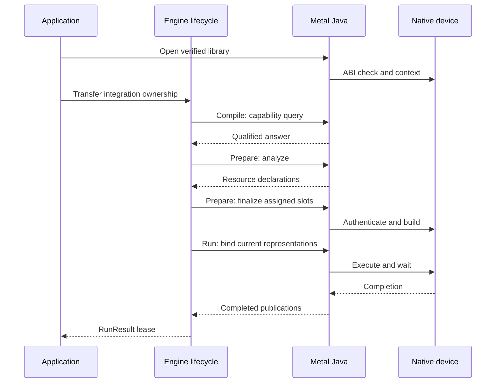
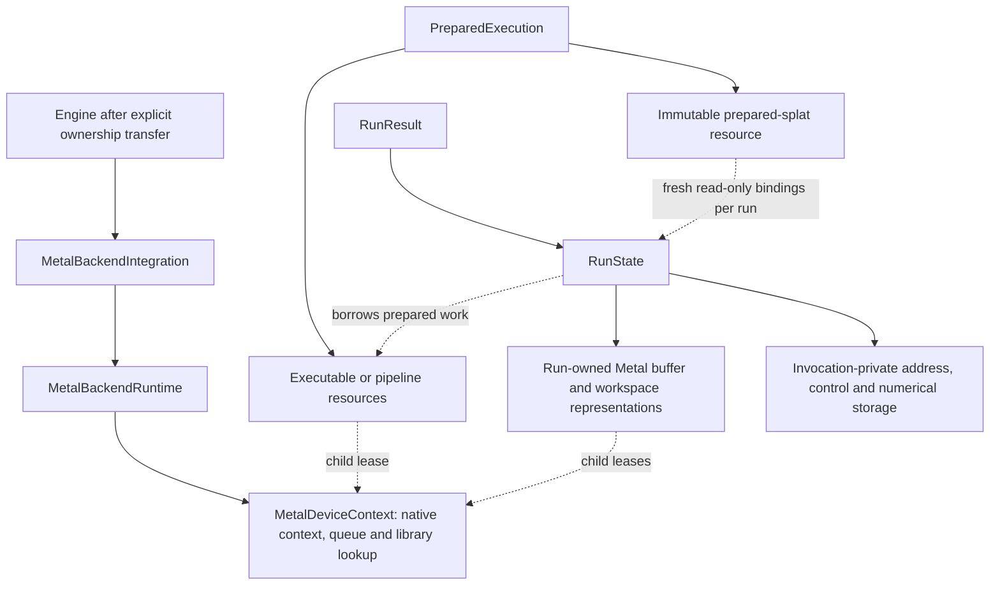

# [Metal](../../glossary.md#term-metal): from an admitted [operation](../../glossary.md#operation) to a completed [device](../../glossary.md#term-device) invocation

> This is an implementation explanation, not a new capability or [ABI](../../glossary.md#term-application-binary-interface-abi) contract.
> [The architecture root](../../../ARCHITECTURE.md), its
> [Metal backend contract](../../architecture/contracts/backend-execution.md#metal-backend) ([backend glossary](../../glossary.md#backend)),
> [Prepare/Run lifecycle](../../architecture/contracts/runtime-prepare-engine.md#prepare-lifecycle) ([Prepare glossary](../../glossary.md#prepare); [Run glossary](../../glossary.md#term-run); [lifecycle glossary](../../glossary.md#lifecycle)),
> and [general Scan semantics](../../architecture/contracts/recurrent-scan.md#general-differentiable-scan) ([general Scan glossary](../../glossary.md#general-differentiable-scan))
> remain authoritative.

## `io.github.pho001.synaptik.backend.metal`

This package turns an explicitly [Metal](../../glossary.md#term-metal)-owned [graph](../../glossary.md#graph) [partition](../../glossary.md#partition) into a reusable native executable
and binds each invocation to its own [device](../../glossary.md#term-device) [buffers](../../glossary.md#term-buffer). It is useful to distinguish three questions:
**is this exact [operation](../../glossary.md#operation) supported, what physical program will execute it, and who keeps its
resources alive?** Capability, preparation, and invocation answer those questions separately.

The Java implementation is in
[`modules/backend/metal`](../../../modules/backend/metal/src/main/java/io/github/pho001/synaptik/backend/metal/package-info.java).
Its [Objective-C](../../glossary.md#native-packaging-and-platform-vocabulary) bridge and embedded [Metal Shading Language](../../glossary.md#term-metal-shading-language-msl) ([MSL](../../glossary.md#device-submission-synchronization-and-execution-context)) sources live in
[`modules/backend/metal/macos-arm64`](../../../modules/backend/metal/macos-arm64/README.md).
MSL is the language compiled into device [kernels](../../glossary.md#kernel); Objective-C owns the Apple framework objects
that [compile](../../glossary.md#compile), bind, and submit those kernels. Neither is an application-facing graph [API](../../glossary.md#term-application-programming-interface-api).

Start with the [lifecycle](../../glossary.md#lifecycle) and teaching-example sections below. The native component tables are a
second reading path for maintainers tracing a particular operation or failure.

In this page, **[host](../../glossary.md#term-host)** is the [CPU](../../glossary.md#term-cpu)-side Java/native program and **device** is the [GPU](../../glossary.md#term-gpu) ([graphics
processing unit](../../glossary.md#cpu-gpu-host-and-device)) executing Metal work. A **[dispatch](../../glossary.md#term-dispatch)** submits a prepared [kernel](../../glossary.md#kernel)'s work to that
device; a **[command queue](../../glossary.md#term-command-queue)** orders submitted commands. Apple shared storage can expose memory to
both sides, but shared accessibility does not mean shared cleanup [ownership](../../glossary.md#term-ownership-meanings) or automatic
completion. An explicit completion wait and a resource's eventual [release](../../glossary.md#term-release) are different events.

### Purpose, callers, and non-goals

Applications enter through [MetalBackendConfiguration][configuration] and
[MetalBackendIntegration][integration], then give the opened integration to the public [Engine](../../glossary.md#term-engine)
builder. [MetalCapabilityProvider][capability] is the stateless [Planning](../../glossary.md#term-planning)-facing [admission](../../glossary.md#term-admission) boundary.
Shared [Prepare](../../glossary.md#prepare) calls the integration's analysis/finalization collaborators; [Runtime](../../glossary.md#term-runtime) calls the
resulting [prepared executable](../../glossary.md#prepared-executable--preparedexecutable). Engine owns composition and scheduling, not [native library](../../glossary.md#term-native-library) discovery
or [device](../../glossary.md#term-device) construction. [Metal](../../glossary.md#term-metal) has no [dependency](../../glossary.md#term-dependency) on Engine and no [CPU](../../glossary.md#term-cpu) execution fallback.

Most types here are package-private implementation details. Their links explain the implementation,
not supported application APIs. In particular, the `MetalNeg…` names retain their original narrow
NEG naming but now participate in whole supported-[operation](../../glossary.md#operation) [partition](../../glossary.md#partition) preparation; they do not mean
that every partition contains negation. [MetalOperationRouteCatalog][catalog] is descriptive cold
[metadata](../../glossary.md#term-metadata), not a second admission authority or an execution-time [dispatch](../../glossary.md#term-dispatch) [registry](../../glossary.md#term-registry).

Metal does **not** own [Tensor](../../glossary.md#tensor) semantics, [graph capture](../../glossary.md#capture-graph-ports-and-reconstruction), [automatic differentiation](../../glossary.md#autograd) ([AD](../../glossary.md#autograd)), partition
[ownership](../../glossary.md#term-ownership-meanings) selection, the shared memory plan, or the training algorithm. AD means constructing the
[derivative](../../glossary.md#term-derivative) [graph](../../glossary.md#graph); [Compiler](../../glossary.md#term-compiler) does that before Metal sees a partition. Metal lowers the resulting
ordinary operations and scans. It does not implement a [second derivative](../../glossary.md#term-second-derivative) algebra.

## The [lifecycle](../../glossary.md#lifecycle) and its three kinds of state

Read this successful-path sequence from top to bottom. The [Engine](../../glossary.md#term-engine) lifecycle [lane](../../glossary.md#term-lane) summarizes calls
through [Compiler](../../glossary.md#term-compiler), shared [Prepare](../../glossary.md#prepare) and [Runtime](../../glossary.md#term-runtime); their [distinct owners](execution.md) ([owners glossary](../../glossary.md#term-owner)) do not merge.
Native failures preserve their cause and do not publish a successful result.

A **[descriptor](../../glossary.md#term-descriptor)** describes a logical value's type, [shape](../../glossary.md#shape), [layout](../../glossary.md#layout), and [gradient](../../glossary.md#term-gradient) eligibility. A
**representation** is the physical [buffer](../../glossary.md#term-buffer) that holds its bytes. A **slot** is an assigned position
in the shared [prepared memory plan](../../glossary.md#prepared-memory-plan--preparedmemoryplan), not a [device](../../glossary.md#term-device) pointer. Keeping them separate prevents a [view](../../glossary.md#term-view-meanings)'s
logical [strides](../../glossary.md#term-stride) from being applied twice to an already materialized buffer.

### 1. Admit an [occurrence](../../glossary.md#term-occurrence), not an [operation](../../glossary.md#operation) name

[MetalCapabilityProvider.supports][capability] examines original input/output carriers (stored
numeric types), attributes, [shapes](../../glossary.md#shape), [layouts](../../glossary.md#layout), and [gradient](../../glossary.md#term-gradient) roles. Focused support [owners](../../glossary.md#term-owner) handle
[exact operations][exact-support], [reductions][reduction-support],
[scatter][scatter-support], [normalization/loss][normalization-support] ([normalization glossary](../../glossary.md#term-normalization); [loss glossary](../../glossary.md#loss)),
[attention][attention-support], and [fixed recurrence][recurrent-support]. [General Scan](../../glossary.md#general-differentiable-scan) delegates
to [MetalScanLowering][scan-lowering], which checks the containing body as well as its boundaries.
An unsupported or unproved occurrence returns false; an available [GPU](../../glossary.md#term-gpu) does not change that answer.

An **occurrence** includes these particular operands, attributes and result roles, not merely the
name `ADD` or [`SCAN`](../../glossary.md#general-differentiable-scan). **[Admission](../../glossary.md#term-admission)** checks that exact case. **[Fail-closed](../../glossary.md#term-fail-closed)** rejection means an
unproved case does not proceed by trying a different [owner](../../glossary.md#term-owner), type or implementation.

For numerical [FLOAT32](../../glossary.md#term-float32), [BFLOAT16](../../glossary.md#term-bfloat16), and [FLOAT16](../../glossary.md#term-float16) routes, admission retains the actual type at every
role. The shared shaders use FLOAT32 working sites and publish in the declared output [carrier](../../glossary.md#term-storage-carrier);
they do not obtain a low-type capability by replacing its [descriptors](../../glossary.md#term-descriptor) with FLOAT32 descriptors.
Mixed-type combinations still need their own admission. In particular, direct unlike
BFLOAT16/FLOAT16 comparison or WHERE branches reject.

The current typed storage boundary has seven carriers: FLOAT32, [INT32](../../glossary.md#data-type--datatype), [BOOL](../../glossary.md#data-type--datatype), [FLOAT64](../../glossary.md#term-float64), BFLOAT16,
[INT64](../../glossary.md#data-type--datatype), and FLOAT16. **Neither [FP8](../../glossary.md#term-fp8) carrier is admitted, even for empty storage/[publication](../../glossary.md#term-publication).**
FLOAT64 raw movement, comparison, selected exact word operations, and conversion are not general
FLOAT64 arithmetic. There is no software-[FP64](../../glossary.md#term-fp64) arithmetic fallback. Layout and empty-domain
admission are operation-specific: [rank](../../glossary.md#term-rank) zero has one [element](../../glossary.md#term-element); an empty output does not excuse an
invalid nonempty index domain or reduction denominator.

### 2. Lower once, declare resources, then [compile](../../glossary.md#compile)

[MetalNegPartitionPreparer][preparer] walks the complete [partition](../../glossary.md#partition) in [producer](../../glossary.md#term-producer) order, assigns stable
native value ordinals, preserves ordered operands and [canonical](../../glossary.md#term-canonical-form) siblings, and separates feeds,
internal values, and [publication](../../glossary.md#term-publication) [targets](../../glossary.md#term-target). It authenticates logical [descriptors](../../glossary.md#term-descriptor) against the actual
physical source geometry. A local [transpose](../../glossary.md#term-transpose) can avoid a copy only under the specific earlier-local
PERMUTE/[MATMUL](../../glossary.md#matrix-multiplication--matmul) proof; arbitrary logical ancestry is not a physical [buffer](../../glossary.md#term-buffer) proof.

The route becomes fixed **before** resource declaration:

- [`MPSGRAPH`](../../glossary.md#term-mpsgraph) constructs and compiles an Apple MPSGraph executable for admitted [graph](../../glossary.md#graph) operations.
- `CUSTOM_PROGRAM` carries a fixed prepared sequence of custom kernels and any admitted MPSGraph
  boundary steps. It is not a Java operation interpreter. Any BFLOAT16/FLOAT16-containing partition
  and required exact-custom occurrence fixes the partition to this route. ([kernels glossary](../../glossary.md#kernel); [occurrence glossary](../../glossary.md#term-occurrence))
- The dedicated `CUSTOM_SINGLE_NEG` route has a separate pipeline resource and no address workspace;
  it is a bounded singleton optimization, not a generic kernel selector. ([singleton glossary](../../glossary.md#term-singleton); [kernel glossary](../../glossary.md#kernel))

[MetalPointwiseFusionPlanner][fusion-planner] uses consumer and target facts to keep eligible
[FLOAT32](../../glossary.md#term-float32) chain interiors virtual rather than allocating a buffer after every [operation](../../glossary.md#operation).
[MetalAnchorEpilogueRecognizer][anchor-recognizer] proves eligible MATMUL/[convolution](../../glossary.md#term-channels-first-convolution-layers) epilogues,
including operand order and observable boundaries. Both are restricted independently of ordinary
numerical capability. A partition containing [BFLOAT16](../../glossary.md#term-bfloat16)/[FLOAT16](../../glossary.md#term-float16) has no generated [pointwise](../../glossary.md#term-pointwise) or anchor
[fusion](../../glossary.md#term-fusion), including for FLOAT32 [nodes](../../glossary.md#node) within that partition. Source-size and instruction caps are
cold [planning](../../glossary.md#term-planning) facts, not [runtime](../../glossary.md#term-runtime) retries.

The [immutable](../../glossary.md#term-immutable) [MetalNegPreparationPlan][preparation-plan] contains exact declarations. Shared
[Prepare](../../glossary.md#prepare) assigns slots; only then does [MetalNegPartitionFinalizer][finalizer] create the selected
native resource. It does not change the route or discover new shared scratch. Failure during
finalization closes acquired resources in reverse order while preserving the primary failure.
The [schedule assembler][schedule-assembler] contributes physical buffer/workspace creators and
prepared occurrences to shared assembly; it does not create another [run](../../glossary.md#term-run) [owner](../../glossary.md#term-owner).

### 3. Authenticate the encoded program on both sides

Despite its historical name, [MetalMpsGraphProgram][program] encodes both whole-program routes.
The current image uses **[schema](../../glossary.md#term-schema) 22, a 124-byte header, and ordinary [operation](../../glossary.md#operation) wires 1–115 plus
[General Scan](../../glossary.md#general-differentiable-scan) wire 116**. It is [little-endian](../../glossary.md#text-encoding-and-file-boundaries) and binds the [descriptors](../../glossary.md#term-descriptor), [dimensions](../../glossary.md#dimension), [strides](../../glossary.md#term-stride),
references, attributes, route, and section sizes. Custom images additionally bind step, [binding](../../glossary.md#term-binding),
[materialization](../../glossary.md#materialization), instruction, and [canonical](../../glossary.md#term-canonical-form)-[manifest](../../glossary.md#term-manifest) records. [MPSGraph](../../glossary.md#term-mpsgraph) images omit that extension
rather than carrying an unused custom schedule.

[MetalNativeApi][native-api] independently validates the Java-side physical [occurrence](../../glossary.md#term-occurrence) before the
[Foreign Function and Memory](../../glossary.md#application-binary-interface-and-native-bridge) ([FFM](../../glossary.md#term-ffm)) [downcall](../../glossary.md#term-downcall). FFM is the [JDK](../../glossary.md#term-java-development-kit-jdk) [API](../../glossary.md#term-application-programming-interface-api) for calling a [native library](../../glossary.md#term-native-library) and
accessing [native memory](../../glossary.md#aliasing-and-arena). Its private `Ffm` implementation loads the caller's exact path through
`SymbolLookup.libraryLookup`, verifies [ABI](../../glossary.md#term-application-binary-interface-abi) 7, resolves all thirteen required exports, and retains
the [lookup](../../glossary.md#term-lookup) in a shared [Arena](../../glossary.md#term-arena) (the FFM [lifetime](../../glossary.md#term-lifetime) [owner](../../glossary.md#term-owner)). [Opaque](../../glossary.md#term-opaque) handles stay inside this package.
Call-scoped image/output-cell arenas do not become executable owners.

The native decoder in [synaptik_metal_foundation.m][foundation] independently checks section
geometry, [topology](../../glossary.md#term-topology), types, [layouts](../../glossary.md#layout), [gradients](../../glossary.md#term-gradient), bindings, and manifest contents; it does not trust a
successful Java provider answer. The custom source assembler checks each fixed source component's
[UTF-8](../../glossary.md#term-utf-8) length and [SHA-256](../../glossary.md#term-sha-256), assembles them in [dependency](../../glossary.md#term-dependency) order, then checks the complete corpus and
assembled generated suffix. The current fixed corpus has **23 components, 190,781 UTF-8 bytes**;
its [digest](../../glossary.md#term-digest) is recorded in `synaptik_authenticated_fixed_source`. [Host](../../glossary.md#term-host)-only headers are not [shader](../../glossary.md#term-shader)
components, and some headers contribute more than one component.

A **wire** is a numbered field or tag in the encoded program. A **schema** defines that program's
record format; an **ABI** ([application binary interface](../../glossary.md#application-binary-interface-and-native-bridge)) defines how Java and [native code](../../glossary.md#native-numerical-library-and-instruction-architecture) call
one another. A **manifest** lists the expected components and their identifying facts.
**SHA-256** is the digest algorithm used to detect byte changes; a matching digest alone does
not establish who authorized the bytes. These checks concern compatibility and consistency,
not whether an operation has been numerically qualified.

These are different compatibility boundaries:

| Boundary | Current value | Why it matters |
|---|---|---|
| Native exported [calling convention](../../glossary.md#term-calling-convention) | ABI 7; thirteen exports | A loadable library must provide the exact typed seam. |
| Encoded program | Schema 22; header 124 bytes | Creation rejects incompatible or malformed images. |
| [Scan](../../glossary.md#general-differentiable-scan) attributes inside that image | Grammar 2 | Version 1 lacks the current failure-record workspace and is incompatible. |
| Workload/exact-policy/candidate/compatibility/route/session [codec](../../glossary.md#term-codec) | [Identity](../../glossary.md#term-identity-meanings) 45 | Stale tuning handoffs reject even if their outer [checksum](../../glossary.md#term-checksum) is valid. |

The source [constants](../../glossary.md#term-constant), not older task-era comments, determine these current values. See
[program constants][program], [Scan encoding][scan-encoding],
[candidate identity generation][candidate-generator], and [the session codec][tuning-codec].
[Authentication](../../glossary.md#term-authentication) here establishes consistency with the implementation's expected program/source;
it is not a public [signature](../../glossary.md#term-signature) service or a substitute for [release](../../glossary.md#term-release) authorization.

### 4. Bind a fresh invocation without changing the prepared plan

[MetalNegPreparedExecutable][executable] cold-binds assigned [buffer](../../glossary.md#term-buffer) positions once, checking exact
context, openness, byte extents, access, and forbidden overlap. Its bound action retains direct
typed references and slices of a [run](../../glossary.md#term-run)-owned address workspace. Custom execution binds only compact
materialized slots; generated interiors have no hidden [device](../../glossary.md#term-device) allocations. Numerical scratch,
including attention and [Scan](../../glossary.md#general-differentiable-scan) workspaces, belongs to that invocation, not to a [mutable](../../glossary.md#term-mutable) executable
field. The Java hot invocation makes one matching native route call.

The native [owner](../../glossary.md#term-owner) submits through the context's [command queue](../../glossary.md#term-command-queue). Custom routes explicitly [commit](../../glossary.md#term-commit)
and wait; [MPSGraph](../../glossary.md#term-mpsgraph) uses a waiting execution [descriptor](../../glossary.md#term-descriptor). A successful return means device work has
completed, **not** that output buffers have been released. `RunResult.close()` [releases](../../glossary.md#commit-release-distribution-log-and-seed-meanings) run-owned
resources; the [prepared execution](../../glossary.md#prepared-execution--preparedexecution) separately owns reusable executable/pipeline resources. There is
no [asynchronous](../../glossary.md#term-asynchronous) result, [cancellation](../../glossary.md#term-cancellation), timeout, output pool, or promise of [GPU](../../glossary.md#term-gpu) overlap between calls.

### Cold tuning and optional observation do not become execution policy

[MetalLocalWorkloadTuning](../../../modules/backend/metal/src/main/java/io/github/pho001/synaptik/backend/metal/MetalLocalWorkloadTuning.java)
exposes exactly associated [opaque](../../glossary.md#term-opaque) candidates for an admitted [singleton](../../glossary.md#term-singleton) NEG with both custom and
[MPSGraph](../../glossary.md#term-mpsgraph) routes. It does not measure or pick a winner. Trials and selected preparation repeat
authoritative analysis; compatibility belongs to the live integration session.
[MetalCompletePlanTuning](../../../modules/backend/metal/src/main/java/io/github/pho001/synaptik/backend/metal/MetalCompletePlanTuning.java)
then exposes one authenticated [complete-plan candidate](../../glossary.md#complete-plan-candidate) with that local route fixed, not another
search over execution plans. Measurement, evidence, [cache](../../glossary.md#term-cache) IO, and winner selection remain with
their orchestration/tooling [owners](../../glossary.md#term-owner). A stale decision is an error, not a request to retune during [run](../../glossary.md#term-run).

The traced `MetalBackendIntegration.open(configuration, observer)` overload retains a caller-owned,
concurrently callable [MetalTraceObserver](../../../modules/backend/metal/src/main/java/io/github/pho001/synaptik/backend/metal/MetalTraceObserver.java) ([MetalTraceObserver glossary](../../glossary.md#metal-trace-observer--metaltraceobserver)).
[MetalTraceProducer](../../../modules/backend/metal/src/main/java/io/github/pho001/synaptik/backend/metal/MetalTraceProducer.java)
reports bounded structural, route, aggregate-byte and outcome facts, not [Tensor](../../glossary.md#tensor) payloads, pointers
or [shader](../../glossary.md#term-shader) source. Observation does not select routes or add [synchronization](../../glossary.md#term-synchronization) policy. Structural
[callback](../../glossary.md#term-callback) failures disable tracing without aborting [backend](../../glossary.md#backend) work; outcome RuntimeExceptions are
also contained. An [observer](../../glossary.md#term-observer) Error propagates from successful outcome reporting, but a backend
failure remains primary during failure reporting. [Metal](../../glossary.md#term-metal) never closes the observer. The untraced
opening path creates no [trace](../../glossary.md#trace) [producer](../../glossary.md#term-producer).

## [Ownership](../../glossary.md#term-ownership-meanings) from Java to `MTLBuffer`

Solid arrows show ownership; dashed arrows show retained [lifetime](../../glossary.md#term-lifetime) relationships, not execution
order. A [run](../../glossary.md#term-run) borrows prepared resources rather than becoming their second [owner](../../glossary.md#term-owner).

[MetalDeviceContext][context] starts with one owner reference. A successful child acquisition adds
a [lease](../../glossary.md#term-lease). Context close marks the owner closed and rejects further allocation/access, but defers the
single native context [release](../../glossary.md#term-release) until its children close. [MetalBufferRepresentation][buffer] and
[MetalWorkspaceRepresentation][workspace] each own an [opaque](../../glossary.md#term-opaque) native [buffer](../../glossary.md#term-buffer) handle and a context
lease. [MetalProgramExecutableResource][program-resource] consumes its executable handle before
ending its lease. Close gates and partial-construction [rollback](../../glossary.md#term-rollback) prevent a child from using an
unloaded library or releasing a handle twice.

In [native code](../../glossary.md#native-numerical-library-and-instruction-architecture), [Objective-C](../../glossary.md#native-packaging-and-platform-vocabulary) boxes strongly retain the `MTLDevice`, `MTLCommandQueue`, `MTLBuffer`,
[compiled graph](../../glossary.md#compiled-graph--compiledgraphmodel), library/pipelines, and [immutable](../../glossary.md#term-immutable) [metadata](../../glossary.md#term-metadata) required by their role. Successful creates
use `__bridge_retained`; matching [releases](../../glossary.md#commit-release-distribution-log-and-seed-meanings) use `__bridge_transfer` under [Automatic Reference Counting](../../glossary.md#native-packaging-and-platform-vocabulary)
([ARC](../../glossary.md#term-arc)). A zero-logical-byte buffer receives a one-byte physical allocation while retaining logical
size zero; that byte is not an extra [Tensor](../../glossary.md#tensor) [element](../../glossary.md#term-element). Buffers use `MTLResourceStorageModeShared`.
Upload/download validate the requested logical byte range and copy through `buffer.contents`.
[FFM](../../glossary.md#term-ffm) entry points that create autoreleased temporaries provide their own autorelease pools, so mapped
exits drain those temporaries even though the calling Java thread did not establish a Cocoa pool.

One integration creates one system-default-[device context](../../glossary.md#device-submission-synchronization-and-execution-context) and queue. The availability [token](../../glossary.md#term-token)
`BackendDeviceId(metal, "default")` is an abstract slot, not hardware [identity](../../glossary.md#term-identity-meanings) or a selector.
Every buffer and executable is tied to its exact creating context; two integrations on the same
physical [device](../../glossary.md#term-device) do not make their resources interchangeable. There is no multi-device scheduling,
physical-device enumeration, hot-plug, or failover contract.

[Host](../../glossary.md#term-host) ingress is also explicit. [MetalBackendRuntime.borrow][backend-runtime] copies raw storage
into a [Metal](../../glossary.md#term-metal)-owned representation and retains, but never closes, the caller's storage. [Heap](../../glossary.md#term-heap) ingress
may stage through [native memory](../../glossary.md#aliasing-and-arena). This is distinct from a prepared **cross-owner transfer**: that
path binds [CPU](../../glossary.md#term-cpu)-owned native staging and exact Metal endpoints once, then performs one native copy
without conversion. Its positive-[stride](../../glossary.md#term-stride), non-overlapping, checked physical-span domain preserves
prefix/gap bytes. [Descriptor](../../glossary.md#term-descriptor)-aware [BOOL](../../glossary.md#data-type--datatype) download validates logical bytes before committing host
destination mutation; storage holes are not interpreted as BOOL values.
[Producerless publication][producerless] ([publication glossary](../../glossary.md#term-publication)) authenticates source-only values and zero-aware spans,
while [prepared splats][splats] own immutable [constant](../../glossary.md#term-constant) storage with read-only run [bindings](../../glossary.md#term-binding).

## Native [ABI](../../glossary.md#term-application-binary-interface-abi) entry points

All thirteen exports are implemented in
[`modules/backend/metal/macos-arm64/src/synaptik_metal_foundation.m`][foundation].
The table spells out the full export names so a maintainer can connect an [FFM](../../glossary.md#term-ffm) handle to its [owner](../../glossary.md#term-owner).
Native creation returns a status and an output handle; failure is not a valid partially published
Java resource.

| Export(s) | Caller, input/output, and [ownership](../../glossary.md#term-ownership-meanings) |
|---|---|
| `synaptik_metal_foundation_abi_version` | FFM opening checks the returned integer before publishing the [API](../../glossary.md#term-application-programming-interface-api) [binding](../../glossary.md#term-binding). |
| `synaptik_metal_context_create`, `synaptik_metal_context_release` | DeviceContext acquires/[releases](../../glossary.md#commit-release-distribution-log-and-seed-meanings) one [opaque](../../glossary.md#term-opaque) context box; creation calls `MTLCreateSystemDefaultDevice` and creates its queue. No path-based [device](../../glossary.md#term-device) discovery occurs. |
| `synaptik_metal_buffer_create`, `synaptik_metal_buffer_release` | [Buffer](../../glossary.md#term-buffer)/workspace acquisition supplies the creating context and logical bytes; the returned box authenticates context [identity](../../glossary.md#term-identity-meanings) and owns shared-storage `MTLBuffer` memory. |
| `synaptik_metal_buffer_upload`, `synaptik_metal_buffer_download` | Typed Java wrappers supply a live handle, offset, pointer, and count. Range [validation](../../glossary.md#term-validation) precedes `memcpy`; zero-byte copies read no payload. |
| `synaptik_metal_mpsgraph_executable_create`, `synaptik_metal_mpsgraph_executable_release`, `synaptik_metal_mpsgraph_executable_run` | Finalization supplies the authenticated image and owns the executable; each [run](../../glossary.md#term-run) supplies exact input/[target](../../glossary.md#term-target) handle tables. The historical [`mpsgraph`](../../glossary.md#term-mpsgraph) name also covers CUSTOM_PROGRAM. Run checks context/device/length/[alias](../../glossary.md#aliasing-and-arena) facts before writes and returns synchronously. |
| `synaptik_metal_neg_kernel_pipeline_create`, `synaptik_metal_neg_kernel_pipeline_release`, `synaptik_metal_neg_kernel_pipeline_run` | Dedicated [singleton](../../glossary.md#term-singleton)-NEG resource fixes an admitted positive [element](../../glossary.md#term-element) count, compiles its [kernel](../../glossary.md#kernel), and runs against distinct context-local input/output buffers. This does not expose general pipeline creation to applications. |

Status zero is success. Other statuses distinguish invalid [arguments](../../glossary.md#term-argument), absent device/queue,
allocation/copy/range failures, unsupported [shapes](../../glossary.md#shape)/operations, [graph](../../glossary.md#graph)/kernel [compilation](../../glossary.md#compiler-engine-and-execution-stage-names),
incompatible resources, internal exceptions, and execution failure. Java's `NativeFailure` retains
the [operation](../../glossary.md#operation) name and raw status, including unknown values. Prepared public execution reconstructs
applicable [Model](../../glossary.md#term-model) bounds/duplicate exception classes; it does not silently retry on [CPU](../../glossary.md#term-cpu). An
operation-local validation failure preserves its affected write targets and inputs, not all earlier
[producers](../../glossary.md#term-producer) in the [partition](../../glossary.md#partition).

## [General Scan](../../glossary.md#general-differentiable-scan): one body, native traversal, explicit activity

A general Scan repeats a pure ordinary [Tensor](../../glossary.md#tensor) body over a fixed time [axis](../../glossary.md#term-axis), carrying explicit state
and optionally publishing emissions and demanded histories. It is not a while loop. [Compiler](../../glossary.md#term-compiler) owns
its [reverse-mode](../../glossary.md#primal-adjoint-and-differentiation-seed) construction and the **activity plan**: structural presence of [derivative](../../glossary.md#term-derivative)
contributors, which is different from a numeric zero. A missing contributor must not read an
inactive payload just because adding zero would seem numerically harmless.

[MetalScanLowering][scan-lowering] checks the exact captured body, formal/actual [descriptors](../../glossary.md#term-descriptor),
ordered result roles (including repeated roles), demand, row-[coordinate](../../glossary.md#axis-rank-scalar-vector-and-matrix) [provenance](../../glossary.md#provenance), and activity.
It lowers ordinary operations once through [MetalScanOrdinaryOperation][scan-ordinary];
[MetalScanBodySupport][scan-body-support] admits the bounded body-specific empty geometry without
substituting a fictitious positive [extent](../../glossary.md#term-extent). [MetalScanPlan][scan-plan] freezes local physical values,
[producer](../../glossary.md#term-producer)-ordered units, [carry](../../glossary.md#term-carry) banks, scratch offsets, demanded roles, and control bytes.
Local ordinals never become outer [graph](../../glossary.md#graph) IDs. Demand, rather than the existence of a latent [residual
port](../../glossary.md#scan-residual-port-and-history-demand), decides whether history is allocated/stored. The body encoding grows with the body, not T;
demanded history can still grow with T.

[MetalScanEncoding][scan-encoding] and the independent [MetalScanDecoding][scan-decoding] bind
grammar 2 attributes inside [schema](../../glossary.md#term-schema) 22. The native plan authenticates the same ordinary grammar and
row/terminal facts before constructing controlled steps. At [run](../../glossary.md#term-run) time it validates all [INT64](../../glossary.md#data-type--datatype) length
values after their producers and before [Scan](../../glossary.md#general-differentiable-scan)-local writes, then binds time slices, executes body
units, updates carries, and stores histories at **original** time indices. Reverse traversal changes
visit order, not history indexing. `T=0` executes no body and preserves initial carry [represented
bits](../../glossary.md#term-represented-bits); real zero extents do not bypass structural or value-domain checks.

Controlled [kernels](../../glossary.md#kernel) append control [buffers](../../glossary.md#term-buffer) at [MSL](../../glossary.md#term-metal-shading-language-msl) [binding](../../glossary.md#term-binding) positions 28 and 29 without changing
ordinary [argument](../../glossary.md#term-argument) meanings. [Scope](../../glossary.md#term-scope)/row guards precede inactive operand loads. An activity ADD with
one present input copies that input's represented word; it is not `0 + input`. Carry presence is
updated simultaneously using separate staging, so one carry's update cannot change another carry's
same-step premise. The native loop flushes completed producers before [host](../../glossary.md#term-host) value checks or control
changes require their data; it is not an application [callback](../../glossary.md#term-callback) per time step.

The [mutable](../../glossary.md#term-mutable) control prefix has fifteen 64-bit words: ten traversal/activity words plus a five-word
first-failure record. That record adds forty declared bytes per Scan before shared slot assignment.
It reports category, original time, unit, operand, and logical ordinal. The invocation resets it;
only [synchronous](../../glossary.md#term-synchronous) failure reads it back through [MetalNegPreparedExecutable][executable] and
[MetalScanValidationFailure][scan-failure]. No Tensor payload, [device](../../glossary.md#term-device) pointer, body replay, or
second Java body loop is needed for those diagnostics.

Numeric Scan supports independently admitted static [FLOAT32](../../glossary.md#term-float32)/[BFLOAT16](../../glossary.md#term-bfloat16)/[FLOAT16](../../glossary.md#term-float16) occurrences, including
proved strided numeric ingress canonicalized through the ordinary [CONTIGUOUS](../../glossary.md#term-contiguous) [owner](../../glossary.md#term-owner). External typed
controls require [canonical](../../glossary.md#term-canonical-form) descriptors; a separately proved local dense [view](../../glossary.md#term-view-meanings) does not inherit an
external-control exemption. [FLOAT64](../../glossary.md#term-float64) Scan is **canonical, non-[gradient](../../glossary.md#term-gradient), source-only raw binding**:
it may forward a formal's bits, but no ordinary body instruction may read/write [F64](../../glossary.md#floating-point-precision-and-rounding) arithmetic.
Source-only [BOOL](../../glossary.md#data-type--datatype) roles validate active published bytes; inactive sequence cells remain unread.
There is no dynamic-B [Metal](../../glossary.md#term-metal) Scan, [FP8](../../glossary.md#term-fp8), implicit conversion, mixed-owner body, nested Scan, [runtime](../../glossary.md#term-runtime)
fallback, or general FLOAT64 body/[AD](../../glossary.md#autograd) permission.

### Native [Scan](../../glossary.md#general-differentiable-scan) components and their division of work

Every path in the following native tables is relative to `modules/backend/metal/macos-arm64/`;
each link resolves the complete repository path. These are implementation components included in
the one bridge translation unit, not separately exported libraries.

| Path | Mechanism, caller, and boundary |
|---|---|
| [`src/synaptik_general_scan.h`](../../../modules/backend/metal/macos-arm64/src/synaptik_general_scan.h) | Shared [host](../../glossary.md#term-host)/[shader](../../glossary.md#term-shader) control [layout](../../glossary.md#layout), [scope](../../glossary.md#term-scope)/row eligibility, operand-[coordinate](../../glossary.md#axis-rank-scalar-vector-and-matrix) guards, and first-failure writer. Native plan/validators and controlled [MSL](../../glossary.md#term-metal-shading-language-msl) use the same word offsets; numeric values never define presence. |
| [`src/synaptik_general_scan_plan.h`](../../../modules/backend/metal/macos-arm64/src/synaptik_general_scan_plan.h) | Decodes grammar 2 into [immutable](../../glossary.md#term-immutable) local [bindings](../../glossary.md#term-binding)/ordinary stages, checks disjoint writers and exact workspace, prepares ingress, and owns native traversal. Invocation-owned workspace holds changing addresses, [carry](../../glossary.md#term-carry) data, length/presence bits and failure words. It [commits](../../glossary.md#commit-release-distribution-log-and-seed-meanings)/waits at required boundaries and publishes final carries/histories. |
| [`src/synaptik_general_scan_binding_kernels.h`](../../../modules/backend/metal/macos-arm64/src/synaptik_general_scan_binding_kernels.h) | Raw-word binding [kernel](../../glossary.md#kernel) publishes present emissions or +0 [padding](../../glossary.md#padding) and implements carry replacement/[accumulator](../../glossary.md#accumulator-type) finishing. It takes source/destination/old-carry plus control, preserving [identity](../../glossary.md#term-identity-meanings) bits without inventing arithmetic. |
| [`src/synaptik_general_scan_coordinates.h`](../../../modules/backend/metal/macos-arm64/src/synaptik_general_scan_coordinates.h) | Cold structural proof of original ROW versus SHARED coordinates and terminal contractions. It derives output facts from already-proved inputs, including independent neural sibling roles; equal physical extents alone do not prove the same row. It allocates/evaluates no numeric [Tensor](../../glossary.md#tensor). |
| [`src/synaptik_general_scan_validation.h`](../../../modules/backend/metal/macos-arm64/src/synaptik_general_scan_validation.h) | Scan-local physical [admission](../../glossary.md#term-admission) reuses ordinary attribute/[shape](../../glossary.md#shape)/numerical validators and retains real empty extents. It rejects unsupported body occurrences before pipeline construction rather than admitting a family by name. |
| [`src/synaptik_general_scan_value_validation.h`](../../../modules/backend/metal/macos-arm64/src/synaptik_general_scan_value_validation.h) | Prepared per-operand [validation](../../glossary.md#term-validation) roles retain original semantic row facts and scatter reduction. [Runtime](../../glossary.md#term-runtime) checks eligible [BOOL](../../glossary.md#data-type--datatype)/index/label domains and replacement uniqueness before affected writes; it checks eligibility before resolving an inactive [buffer](../../glossary.md#term-buffer)'s bytes. |
| [`src/synaptik_general_scan_bridge.h`](../../../modules/backend/metal/macos-arm64/src/synaptik_general_scan_bridge.h) | Adapts each ordinary builder to controlled stages, including multi-stage exact replacement and genuine zero-work markers. Binds current [borrowed](../../glossary.md#ownership-borrowing-and-lease) buffers/offsets through the shared binding [codec](../../glossary.md#term-codec); missing controlled [kernels](../../glossary.md#kernel) fail admission. No invocation buffer is retained in the bridge's prepared [metadata](../../glossary.md#term-metadata). |

## Ordinary native components: geometry, words, and arithmetic

The native builder creates [immutable](../../glossary.md#term-immutable) [metadata](../../glossary.md#term-metadata)/pipelines; shaders receive [buffers](../../glossary.md#term-buffer) plus that checked
metadata. A source string's existence does not grant capability. Raw-image [validation](../../glossary.md#term-validation), focused [host](../../glossary.md#term-host)
metadata construction, and exact bound-resource checks still precede [dispatch](../../glossary.md#term-dispatch). Most headers below
embed [MSL](../../glossary.md#term-metal-shading-language-msl) strings; the explicitly host-only headers do not [run](../../glossary.md#term-run) on the [GPU](../../glossary.md#term-gpu).

### Common decoding and [binding](../../glossary.md#term-binding) ([host](../../glossary.md#term-host)-side)

| Path | Mechanism and relation to execution |
|---|---|
| [`src/synaptik_metal_foundation.m`](../../../modules/backend/metal/macos-arm64/src/synaptik_metal_foundation.m) | The sole compiled [Objective-C](../../glossary.md#native-packaging-and-platform-vocabulary) translation unit: owns exports/boxes, independent image parsing, source [authentication](../../glossary.md#term-authentication), [MPSGraph](../../glossary.md#term-mpsgraph) construction, fixed custom pipeline/[metadata](../../glossary.md#term-metadata) creation, command encoding, completion checks, and native status mapping. It includes the focused components below after their required type/helper declarations. |
| [`src/synaptik_ordinary_attributes.h`](../../../modules/backend/metal/macos-arm64/src/synaptik_ordinary_attributes.h) | One normalized attribute decoder for outer ordinary [nodes](../../glossary.md#node) and [Scan body](../../glossary.md#backpropagation-through-time-and-recurrent-state) units. Raw [signatures](../../glossary.md#term-signature)/[scalar](../../glossary.md#term-scalar) carriers are checked before [normalization](../../glossary.md#term-normalization) can erase them; [Scan](../../glossary.md#general-differentiable-scan) additionally preserves semantic scatter reduction for [preflight](../../glossary.md#term-preflight). |
| [`src/synaptik_extended_gradients.h`](../../../modules/backend/metal/macos-arm64/src/synaptik_extended_gradients.h) | Checks original per-port [gradient](../../glossary.md#term-gradient) flags before decoded nodes discard them, including distinct neural sibling roles and ordinary/Scan consistency. This validates metadata; it constructs no gradients. |
| [`src/synaptik_program_bindings.h`](../../../modules/backend/metal/macos-arm64/src/synaptik_program_bindings.h) | Fixed [buffer](../../glossary.md#term-buffer)-slot [codec](../../glossary.md#term-codec) shared by direct ordinary invocation and Scan's buffer/offset table. It borrows the authenticated table, binds family-specific [arguments](../../glossary.md#term-argument), and dispatches prepared steps without per-step resource mirrors or math selection. |
| [`src/synaptik_program_control_preflight.h`](../../../modules/backend/metal/macos-arm64/src/synaptik_program_control_preflight.h) | Checks feed controls before the first [partition](../../glossary.md#partition) write and produced controls only after [producer](../../glossary.md#term-producer) completion, just before consumption. Its batching predicate excludes steps needing a [synchronization](../../glossary.md#term-synchronization)/[validation](../../glossary.md#term-validation) boundary. This prevents reading uninitialized produced controls. |

### Shared storage and elementary arithmetic

| Path | Mechanism, inputs/outputs, and constraints |
|---|---|
| [`src/synaptik_numeric_codec.h`](../../../modules/backend/metal/macos-arm64/src/synaptik_numeric_codec.h) | Shared integer-word storage [codec](../../glossary.md#term-codec): widths, [round-to-nearest](../../glossary.md#floating-point-precision-and-rounding)-even packing, floating/integer/[BOOL](../../glossary.md#data-type--datatype) conversion, [NaN](../../glossary.md#term-nan)/zero/order predicates, and [FLOAT32](../../glossary.md#term-float32) widen/narrow helpers. Numerical families call it at declared storage sites. [F64](../../glossary.md#floating-point-precision-and-rounding) bit manipulation/conversion here is not F64 arithmetic. |
| [`src/synaptik_task0059_data_kernels.h`](../../../modules/backend/metal/macos-arm64/src/synaptik_task0059_data_kernels.h) | Defines common DataMeta, logical/physical [coordinate](../../glossary.md#axis-rank-scalar-vector-and-matrix) decoding, raw load/store/copy, signed-step [slice](../../glossary.md#slice) mapping, and exact data-movement [kernels](../../glossary.md#kernel). Checked [element](../../glossary.md#term-element) coordinates become byte accesses using [carrier](../../glossary.md#term-storage-carrier) width; [padding](../../glossary.md#padding)/unfold fill sites do not read absent source positions. |
| [`src/synaptik_task0066_dtype_layout_kernels.h`](../../../modules/backend/metal/macos-arm64/src/synaptik_task0066_dtype_layout_kernels.h) | Uses the shared codec for typed casts/classification and original-[layout](../../glossary.md#layout) movement, including controlled variants. Its folds give each output one ordered contributor traversal: zero contributors yield raw zero, one retains raw [identity](../../glossary.md#term-identity-meanings), multiple admitted floating contributors add in FLOAT32 and narrow at [publication](../../glossary.md#term-publication). No overlapping F64/integral arithmetic is implied. |
| [`src/synaptik_exact_kernels.h`](../../../modules/backend/metal/macos-arm64/src/synaptik_exact_kernels.h) | Supplies point/[binary](../../glossary.md#term-binary-descriptor-and-metadata) [metadata](../../glossary.md#term-metadata) and exact stored-word [unary](../../glossary.md#term-unary)/comparison/[scalar](../../glossary.md#term-scalar)/integral [owners](../../glossary.md#term-owner) plus controlled source components. Reuses coordinate, codec, and ordering helpers; preserves full integer magnitudes and selected F64 word semantics without [FP64](../../glossary.md#term-fp64) hardware arithmetic. |
| [`src/synaptik_exact_host.h`](../../../modules/backend/metal/macos-arm64/src/synaptik_exact_host.h) | Independently rebuilds exact [operation](../../glossary.md#operation) grammar, promotion, original physical reads, [canonical](../../glossary.md#term-canonical-form) outputs, scalar-word bounds, and [dispatch](../../glossary.md#term-dispatch) metadata. It rejects unlike-low pairs; raw decoder checks the [gradient](../../glossary.md#term-gradient)/scalar facts absent from normalized [nodes](../../glossary.md#node). |
| [`src/synaptik_float32_math_kernels.h`](../../../modules/backend/metal/macos-arm64/src/synaptik_float32_math_kernels.h) | Shared elementary FLOAT32 working functions and unary/POW entries for ordinary and compound kernels. Named LOG1P/EXPM1 and [activation](../../glossary.md#term-activation) intermediates preserve their intended sites; controlled guards precede loads. Native compiles with safe math rather than treating composites as arbitrary fast-math identities. |
| [`src/synaptik_f32_ordinary_kernels.h`](../../../modules/backend/metal/macos-arm64/src/synaptik_f32_ordinary_kernels.h) | Shared FLOAT32/[BFLOAT16](../../glossary.md#term-bfloat16)/[FLOAT16](../../glossary.md#term-float16) binary, unary, affine-read and scalar/clamp primitives. Ordinary and `_scan` entries share arithmetic; the controlled ADD path preserves a sole present operand's raw word. Output geometry/carrier stays original, not a FLOAT32 proxy. |

### Reductions, contractions, indexing, and [spatial](../../glossary.md#term-spatial-axes) work

| Path | Mechanism, caller/IO, and resource/error boundary |
|---|---|
| [`src/synaptik_task0060_reduction_kernels.h`](../../../modules/backend/metal/macos-arm64/src/synaptik_task0060_reduction_kernels.h) | Common exact fold/[slice](../../glossary.md#slice)-update/replacement-copy and integral/[BOOL](../../glossary.md#data-type--datatype) reduction primitives. [Coordinate](../../glossary.md#axis-rank-scalar-vector-and-matrix) helpers are reused by later [dtype](../../glossary.md#data-type--datatype)/[layout](../../glossary.md#layout) [kernels](../../glossary.md#kernel); exact placement writes raw source words or zero, not a floating reduction by conversion. |
| [`src/synaptik_audit_reduction_kernels.h`](../../../modules/backend/metal/macos-arm64/src/synaptik_audit_reduction_kernels.h) | Current numerical reductions use one workitem per output with ordered source traversal, optional broadcast BOOL [mask](../../glossary.md#term-boolean-mask), and real selected counts. SUM/[MEAN](../../glossary.md#term-mean) controlled variants test activity before data/mask reads. No atomics or partial-[buffer](../../glossary.md#term-buffer) workspace is introduced by this component. |
| [`src/synaptik_reduction_host.h`](../../../modules/backend/metal/macos-arm64/src/synaptik_reduction_host.h) | Revalidates reduction [axes](../../glossary.md#term-axis)/result equations, [scalar](../../glossary.md#term-scalar) grammar and affine byte spans before [metadata](../../glossary.md#term-metadata) creation. Common raw-layout [validation](../../glossary.md#term-validation) has already proved [view](../../glossary.md#term-view-meanings)/[injectivity](../../glossary.md#storage-mapping-contiguity-and-injectivity) facts. Empty and [Scan](../../glossary.md#general-differentiable-scan)-local reductions keep actual geometry rather than a B=1 surrogate. |
| [`src/synaptik_task0061_matmul_kernels.h`](../../../modules/backend/metal/macos-arm64/src/synaptik_task0061_matmul_kernels.h) | Output-owned [MATMUL](../../glossary.md#matrix-multiplication--matmul) coordinates handle [vector](../../glossary.md#term-vector) promotion, [broadcasting](../../glossary.md#broadcasting) and [contraction](../../glossary.md#contraction-dimension) addressing. Numeric K=0 returns +0, K=1 performs one product, longer contractions use ordered [FMA](../../glossary.md#term-fused-multiply-add-fma); integral entries use modular accumulators. A separate controlled component in this header guards both operands before loads. |
| [`src/synaptik_task0063_ordering_kernels.h`](../../../modules/backend/metal/macos-arm64/src/synaptik_task0063_ordering_kernels.h) | SORT/ARGSORT/TOP_K and [extrema](../../glossary.md#saturation-pole-and-extremum) compare raw [carrier](../../glossary.md#term-storage-carrier) keys; source index resolves ties, and [NaN](../../glossary.md#term-nan) handling is explicit. [Ranking](../../glossary.md#term-ranking) a candidate against axis peers produces deterministic destinations without treating [INT64](../../glossary.md#data-type--datatype) or [F64](../../glossary.md#floating-point-precision-and-rounding) words as [FLOAT32](../../glossary.md#term-float32). Metadata bounds axis/inner/output sizes. |
| [`src/synaptik_scatter_kernels.h`](../../../modules/backend/metal/macos-arm64/src/synaptik_scatter_kernels.h) | Output-owned scatter traverses ordered updates against actual affine base/index/update reads. Replacement and ADD/MUL/MIN/MAX remain distinct modes; duplicates are legal only where the mode permits them. Numeric additions/multiplications use FLOAT32 sites, integral arithmetic is modular, F64 retains raw extrema. No [atomic](../../glossary.md#resource-transaction-and-rollback) winner or [host](../../glossary.md#term-host) numeric repair. |
| [`src/synaptik_scatter_host.h`](../../../modules/backend/metal/macos-arm64/src/synaptik_scatter_host.h) | Builds checked original-carrier geometry plus stable [logical index](../../glossary.md#axis-rank-scalar-vector-and-matrix) bounds/uniqueness [preflight](../../glossary.md#term-preflight). Replacement alone needs uniqueness scratch; legal arithmetic collisions must not enter that check. Produced indices require completion before validation and any affected write. |
| [`src/synaptik_task0069_aggregate_kernels.h`](../../../modules/backend/metal/macos-arm64/src/synaptik_task0069_aggregate_kernels.h) | The retained FLOAT32 scatter-add component gives each output an ordered update scan and explicit ADD sites, preserving an unaddressed base word. It is part of the authenticated corpus, not evidence that every scatter [occurrence](../../glossary.md#term-occurrence) selects this entry instead of the current general scatter [owner](../../glossary.md#term-owner). |
| [`src/synaptik_task0064_convolution_pooling_kernels.h`](../../../modules/backend/metal/macos-arm64/src/synaptik_task0064_convolution_pooling_kernels.h) | [Conv2d](../../glossary.md#convolution--conv2d)/3d map checked grouped window coordinates, accumulate the complete FLOAT32 contraction, then add [bias](../../glossary.md#term-bias) before [narrowing](../../glossary.md#term-narrowing). [Pooling](../../glossary.md#term-pooling) preserves winner/NaN/zero/divisor rules at real window positions. Controlled variants [guard](../../glossary.md#term-guard) eligible inputs before loads; ordinary shared adjoints use unfold/MATMUL/reduction/fold rather than a new backward executor. |

### Compound neural operations and explicit [RNG state](../../glossary.md#graph-rng-state--graphrngstate)

| Path | Mechanism, caller/IO, and [lifetime](../../glossary.md#term-lifetime) |
|---|---|
| [`src/synaptik_normalization_loss_kernels.h`](../../../modules/backend/metal/macos-arm64/src/synaptik_normalization_loss_kernels.h) | Original-[carrier](../../glossary.md#term-storage-carrier) affine read [descriptors](../../glossary.md#term-descriptor) feed [softmax](../../glossary.md#softmax--log-softmax)/[log-softmax](../../glossary.md#softmax--log-softmax), layer/RMS/[batch normalization](../../glossary.md#batch-normalization--batch-normalization-inference-and-training) and categorical [losses](../../glossary.md#loss). Row/[feature](../../glossary.md#term-feature) traversal uses [FLOAT32](../../glossary.md#term-float32) working sites; [canonical](../../glossary.md#term-canonical-form) outputs and each neural sibling retain their declared type and role. Index labels remain [INT32](../../glossary.md#data-type--datatype)/[INT64](../../glossary.md#data-type--datatype). |
| [`src/synaptik_normalization_host.h`](../../../modules/backend/metal/macos-arm64/src/synaptik_normalization_host.h) | [Host](../../glossary.md#term-host)-only [metadata](../../glossary.md#term-metadata) proof of actual types, complete sibling [shapes](../../glossary.md#shape), [epsilon](../../glossary.md#epsilon)/[momentum](../../glossary.md#term-momentum) words, affine reads and canonical writes. Categorical [target](../../glossary.md#term-target) [preflight](../../glossary.md#term-preflight) checks ignore-index before bounds and completes before loss writes; [buffer](../../glossary.md#term-buffer) extents/[topology](../../glossary.md#term-topology)/[gradient](../../glossary.md#term-gradient) flags retain their separate [owners](../../glossary.md#term-owner). |
| [`src/synaptik_attention_kernels.h`](../../../modules/backend/metal/macos-arm64/src/synaptik_attention_kernels.h) | [Scaled dot-product attention](../../glossary.md#scaled-dot-product-attention) computes per-row scores/probabilities and output from Q/K/V plus optional [BOOL](../../glossary.md#data-type--datatype) [mask](../../glossary.md#term-boolean-mask). It declares FLOAT32 score/probability workspace; a canonical FLOAT32 [weights](../../glossary.md#term-weight) sibling can provide that storage, while low-type siblings cannot [alias](../../glossary.md#aliasing-and-arena) the FLOAT32 working buffer. Zero-key/row cases follow explicit geometry rules. |
| [`src/synaptik_attention_host.h`](../../../modules/backend/metal/macos-arm64/src/synaptik_attention_host.h) | Host-only proof of Q/K/V [embedding](../../glossary.md#embedding)/length relations, [batch](../../glossary.md#term-batch-machine-learning-and-hyperparameters)/mask [broadcasting](../../glossary.md#broadcasting), [finite](../../glossary.md#term-finite) positive scale, actual carrier [layouts](../../glossary.md#layout), grid and scratch size. [Runtime](../../glossary.md#term-runtime) additionally validates logical BOOL mask bytes and disjoint buffers before [dispatch](../../glossary.md#term-dispatch). |
| [`src/synaptik_recurrent_kernels.h`](../../../modules/backend/metal/macos-arm64/src/synaptik_recurrent_kernels.h) | Fixed RNN_TANH/GRU_RESET_AFTER/[LSTM](../../glossary.md#term-long-short-term-memory-lstm) [kernels](../../glossary.md#kernel) retain FLOAT32 projections/gates and publish hidden/cell values at typed step boundaries. Shared [sigmoid](../../glossary.md#term-sigmoid)/[tanh](../../glossary.md#term-tanh) functions come from the math component. The header also supplies complete signed-INT64 length preflight before any target write, including T=0. |
| [`src/synaptik_recurrent_host.h`](../../../modules/backend/metal/macos-arm64/src/synaptik_recurrent_host.h) | Host-only original-descriptor proof of fixed-cell shapes, optional [bias](../../glossary.md#term-bias), types, physical geometry and output grid. B=0 means no dispatch, not a synthetic row. The invocation must still perform the header's length-value preflight after [producers](../../glossary.md#term-producer). Fixed recurrence is not the [general Scan](../../glossary.md#general-differentiable-scan) binder. |
| [`src/synaptik_task0065_rng_dropout_kernels.h`](../../../modules/backend/metal/macos-arm64/src/synaptik_task0065_rng_dropout_kernels.h) | INITIAL_STATE publishes explicit key/counter words; [dropout](../../glossary.md#dropout--inverted-dropout) derives per-[element](../../glossary.md#term-element) words from them, publishes canonical BOOL mask and scaled typed output, and returns next state. No [backend](../../glossary.md#backend)-global RNG state is mutated. [RNG](../../glossary.md#graph-rng-state--graphrngstate) remains outside a pure general Scan body. |

### [Fusion](../../glossary.md#term-fusion) source generation and retained candidate [artifacts](../../glossary.md#term-artifact)

| Path | Actual role, not a capability promise |
|---|---|
| [`src/SynaptikPointwiseFusionKernelSource.h`](../../../modules/backend/metal/macos-arm64/src/SynaptikPointwiseFusionKernelSource.h) | [Host](../../glossary.md#term-host)-side bounded source generator/size [oracle](../../glossary.md#term-test-oracle) for authenticated [pointwise](../../glossary.md#term-pointwise)/anchor instruction records. It enforces unit/instruction/function/total-source caps and emits the suffix appended to the authenticated fixed corpus. It is not itself another native [ABI](../../glossary.md#term-application-binary-interface-abi) or a general [shader](../../glossary.md#term-shader) [compiler](../../glossary.md#term-compiler) [API](../../glossary.md#term-application-programming-interface-api). |
| [`src/synaptik_task0071_anchor_epilogue_kernels.h`](../../../modules/backend/metal/macos-arm64/src/synaptik_task0071_anchor_epilogue_kernels.h) | Fixed anchor [kernels](../../glossary.md#kernel) call the shared [MATMUL](../../glossary.md#matrix-multiplication--matmul)/[convolution](../../glossary.md#term-channels-first-convolution-layers) working functions, then apply proved [scalar](../../glossary.md#term-scalar) multiply/add/[ReLU](../../glossary.md#term-relu)/clamp sites in the retained order before final output. Java/native recognizers must admit the exact unit; a shader entry name alone does not authorize fusion, especially in low-containing partitions. |
| [`src/task0053_integer_core.h`](../../../modules/backend/metal/macos-arm64/src/task0053_integer_core.h) | Retained candidate [EXP](../../glossary.md#term-expx)/[SIGMOID](../../glossary.md#term-sigmoid) algorithm over raw [FLOAT32](../../glossary.md#term-float32) words using [fixed-point](../../glossary.md#fixed-point-arithmetic)/integer tables, [saturation](../../glossary.md#term-saturation) and [rounding](../../glossary.md#term-rounding) helpers. C/[MSL](../../glossary.md#term-metal-shading-language-msl) macro [bindings](../../glossary.md#term-binding) let evidence models share the same core. It is not the production elementary-math [owner](../../glossary.md#term-owner). |
| [`src/task0053_candidate.metal`](../../../modules/backend/metal/macos-arm64/src/task0053_candidate.metal) | Candidate-only MSL wrapper includes that integer core and maps guarded 3-D launch ordinals to raw-word EXP/SIGMOID inputs/outputs. It does not supply a production route or imply accepted numerical [qualification](../../glossary.md#term-qualification). |
| [`src/synaptik_task0053_candidate_kernels.h`](../../../modules/backend/metal/macos-arm64/src/synaptik_task0053_candidate_kernels.h) | Embedded candidate source counterpart of the wrapper/core, retained for evidence tooling. Production foundation neither imports it nor appends it to the authenticated corpus. [The generator](../../../modules/backend/metal/macos-arm64/generate-task0053-header.py) embeds the core deterministically; this is not a [runtime](../../glossary.md#term-runtime) [compilation](../../glossary.md#compiler-engine-and-execution-stage-names) input. |

The `task00…` filenames in the other rows are historical names of **current included components**;
they are not all obsolete candidates. Conversely, the three Task-0053 artifacts above have an
explicit evidence-only role. The foundation import list and authenticated component table, not the
filename, establish that distinction.

## Building a library is different from opening one

These three scripts complete the native path accounting. They [prepare](../../glossary.md#prepare)/check [artifacts](../../glossary.md#term-artifact) for an
explicit caller-selected library; [Engine](../../glossary.md#term-engine) does not [run](../../glossary.md#term-run) them or search their output directory.
They do not authorize public [publication](../../glossary.md#term-publication) or alter the sealed `0.1.0-public-audit.20261104` candidate.

| Path | Inputs, mechanism, output, and failure/[lifetime](../../glossary.md#term-lifetime) context |
|---|---|
| [`build.sh`](../../../modules/backend/metal/macos-arm64/build.sh) | Requires the configured full Xcode installation. Compiles the one [Objective-C](../../glossary.md#native-packaging-and-platform-vocabulary) translation unit with [arm64](../../glossary.md#native-packaging-and-platform-vocabulary), macOS 26.0 minimum, [ARC](../../glossary.md#term-arc), hidden visibility, warnings-as-errors and Foundation/[Metal](../../glossary.md#term-metal)/[MPSGraph](../../glossary.md#term-mpsgraph) linkage. It stages a [dylib](../../glossary.md#term-dylib), rejects symlink/non-file outputs, and publishes `build/libsynaptik_metal_foundation.dylib` only after [compiler](../../glossary.md#term-compiler) success; its exit trap removes temporary staging. It does not ad-hoc-sign or package the result. |
| [`package-local.sh`](../../../modules/backend/metal/macos-arm64/package-local.sh) | Takes one already ad-hoc-signed regular dylib. Copies it into staging with [canonical](../../glossary.md#term-canonical-form) modes, writes exact [manifest](../../glossary.md#term-manifest)/[schema](../../glossary.md#term-schema)/[ABI](../../glossary.md#term-application-binary-interface-abi)/platform/[hash](../../glossary.md#term-hash) facts and SHA256SUMS, invokes the verifier, then replaces `build/package-v1/macos-arm64`. On pre-publication failure it cleans staging and attempts to restore a moved previous package. It rejects unsafe path spellings and symlink destinations. |
| [`verify-package.sh`](../../../modules/backend/metal/macos-arm64/verify-package.sh) | Takes a package directory; requires exactly dylib, manifest and checksums with canonical modes. Inspects arm64 [Mach-O](../../glossary.md#term-mach-o)/minimum OS/[install name](../../glossary.md#term-install-name), no rpaths, allowed system dependencies and the exact thirteen exports; checks strict ad-hoc [signature](../../glossary.md#term-signature) identifier, byte-exact manifest and checksums. It cleans its scratch directory on exit. This is package-structure/[integrity](../../glossary.md#term-integrity) verification, not execution of [kernels](../../glossary.md#kernel) or proof of numerical support. |

For prerequisites and an actual build/sign/package workflow, use the
[native bridge guide](../../../modules/backend/metal/macos-arm64/README.md) ([native bridge glossary](../../glossary.md#term-native-bridge)), not a reconstructed
build command from this atlas. A package that passes structural verification can still fail to
open or execute because of an incompatible [host](../../glossary.md#term-host), missing [device](../../glossary.md#term-device)/queue, source mismatch, malformed
program, or [runtime](../../glossary.md#term-runtime) resource failure.

## Connection to the [canonical](../../glossary.md#term-canonical-form) learning journey

The [canonical tutorial](../../tutorials/index.md) remains [CPU](../../glossary.md#term-cpu)-based. **None of this [Metal](../../glossary.md#term-metal) package,
its [native bridge](../../glossary.md#term-native-bridge), or its packaging scripts is on that default execution path.** Its [FLOAT32](../../glossary.md#term-float32) input
`[2,1] = [1,3]`, [gradient](../../glossary.md#term-gradient)-eligible supplied [weight](../../glossary.md#term-weight) `[1,1] = 0`, no [bias](../../glossary.md#term-bias), [target](../../glossary.md#term-target) `[2,6]`, squared-error
SUM, and `Sgd(0.05)` teach one fixed calculation:

| [Checkpoint](../../glossary.md#term-checkpoint) in the CPU learning project | Value |
|---|---|
| Initial [prediction](../../glossary.md#term-prediction) | `[0,0]` |
| Squared-error sum | `40` |
| Weight gradient | `-40` |
| Weight after `0 - 0.05*(-40)` | `2` |
| Updated prediction on the original input | `[2,6]` |
| Prediction on fresh `[2,4]` | `[4,8]` |

Those values explain [Model](../../glossary.md#term-model)/[Compiler](../../glossary.md#term-compiler)/training semantics; they are not evidence that the tutorial
loaded Metal or that a [GPU](../../glossary.md#term-gpu) benchmark ran. Do not replace `Engine.standard()` with a claimed
“automatic [accelerator](../../glossary.md#term-accelerator)” mode, and do not assume that an owned [NN](../../glossary.md#neural-network-module-parameter-buffer-and-forward-context) training workflow changes [owner](../../glossary.md#term-owner)
because Metal is present on the [classpath](../../glossary.md#term-classpath).

A precise **alternate owner scenario**, separate from the tutorial, is the existing public
[Metal Engine NEG example](../../backend-guide/metal-backend.md#exact-general-axis-unfold) ([Engine glossary](../../glossary.md#term-engine)):

1. On the supported Apple-silicon/macOS host, with the Java backend and a compatible explicitly
   built/verified native library, construct  ([host glossary](../../glossary.md#term-host); [backend glossary](../../glossary.md#backend); [native library glossary](../../glossary.md#term-native-library))`MetalBackendConfiguration` with the absolute [dylib](../../glossary.md#term-dylib) path.
2. Open `MetalBackendIntegration` and transfer it through `Engine.Builder.takeOwnership(...)`.
   Registering only this integration makes Metal the available execution owner, rather than
   promising that a mixed CPU/Metal score will choose it.
3. [Compile](../../glossary.md#compile) `input.neg()` for canonical FLOAT32 input `[1.0,-2.0]`, prepare, and run with that input.
   Materialize while  ([prepare glossary](../../glossary.md#prepare); [run glossary](../../glossary.md#term-run))[`RunResult`](../../glossary.md#run-result--runresult) is open. The expected [detached value](../../glossary.md#detached-model-results) is `[-1.0,2.0]`.
4. Close result, preparation, and Engine at their respective ownership boundaries. The builder owns
   a transferred integration until a successful build transfers it onward; do not independently
   close that same owner a second time as an application ownership strategy. ([ownership glossary](../../glossary.md#term-ownership-meanings))

This scenario demonstrates explicit owner composition and [synchronous](../../glossary.md#term-synchronous) [publication](../../glossary.md#term-publication), not a specific
selected NEG route or speed. Changing the input values while preserving the prepared [descriptor](../../glossary.md#term-descriptor)
reuses the plan; changing to unsupported [FP8](../../glossary.md#term-fp8) or supplying a wrong [shape](../../glossary.md#shape) does not request fallback.
The linked example supplies the [API](../../glossary.md#term-application-programming-interface-api) fragment; this atlas walkthrough is source-derived and was not
executed as a new native demonstration.

## Troubleshooting by boundary

| Symptom or question | Boundary to inspect |
|---|---|
| Relative/missing/incompatible [dylib](../../glossary.md#term-dylib); missing [symbol](../../glossary.md#term-symbol); [ABI](../../glossary.md#term-application-binary-interface-abi) mismatch | Configuration/opening and `MetalNativeApi.Ffm`; fail before a usable integration is published. Supply an explicitly compatible library, not an inferred search path. |
| `supports` is false despite an available [GPU](../../glossary.md#term-gpu) | Original [operation](../../glossary.md#operation) [occurrence](../../glossary.md#term-occurrence): [dtype](../../glossary.md#data-type--datatype)/[gradient](../../glossary.md#term-gradient)/[scalar](../../glossary.md#term-scalar)/[layout](../../glossary.md#layout)/[shape](../../glossary.md#shape)/body restrictions. Availability and capability are independent. |
| Stale candidate or tuning decision | [Identity](../../glossary.md#term-identity-meanings) 45 workload/session association and [codec](../../glossary.md#term-codec); do not migrate an older decision by rewriting only its outer version/[checksum](../../glossary.md#term-checksum). |
| Program creation rejects a seemingly supported [graph](../../glossary.md#graph) | Independent image/layout/[manifest](../../glossary.md#term-manifest)/source [authentication](../../glossary.md#term-authentication). Provider support is not permission to forge physical [metadata](../../glossary.md#term-metadata) or omit a [canonical](../../glossary.md#term-canonical-form) sibling. |
| Foreign-context, closed, undersized, or overlapping resource | Cold [binding](../../glossary.md#term-binding) and native [run](../../glossary.md#term-run) [validation](../../glossary.md#term-validation). A common physical GPU is not common context [ownership](../../glossary.md#term-ownership-meanings). |
| Bounds/duplicate/[BOOL](../../glossary.md#data-type--datatype)/length failure after [producers](../../glossary.md#term-producer) | Complete logical [preflight](../../glossary.md#term-preflight) before that operation's writes; for [Scan](../../glossary.md#general-differentiable-scan) use original time/unit/operand/ordinal diagnostics. Inactive values must not be inspected to explain a failure. |
| Successful run but retained [device](../../glossary.md#term-device) memory | Check open [RunResult](../../glossary.md#run-result--runresult), prepared resources, [borrowed](../../glossary.md#ownership-borrowing-and-lease) input wrappers and context child [leases](../../glossary.md#term-lease). Completion is not [release](../../glossary.md#term-release); this implementation promises no general pool. |

## Source evidence and next reading

The mechanisms above are grounded in source/[Javadoc](../../glossary.md#term-javadoc) and focused test **definitions**, not a claim
of fresh [device](../../glossary.md#term-device) execution. [MetalScanPlanTest](../../../modules/backend/metal/src/test/java/io/github/pho001/synaptik/backend/metal/MetalScanPlanTest.java)
covers encoded demand/resource/control distinctions; its [metadata](../../glossary.md#term-metadata) assertions are not arithmetic
proof. [MetalNativeBoundaryRepairTest](../../../modules/backend/metal/src/test/java/io/github/pho001/synaptik/backend/metal/MetalNativeBoundaryRepairTest.java)
defines native cases for source-only [F64](../../glossary.md#floating-point-precision-and-rounding)/[BOOL](../../glossary.md#data-type--datatype), empty results, physical reads, context [identity](../../glossary.md#term-identity-meanings) and
bounded [Scan](../../glossary.md#general-differentiable-scan) failure diagnostics. Native tests require the configured native environment; their
presence does not mean they were [run](../../glossary.md#term-run) for this editorial change.

Continue with the [framework lifecycle](../framework.md) ([lifecycle glossary](../../glossary.md#lifecycle)), [package atlas index](index.md),
[public reference](../../reference/index.md), or the focused
[Metal backend guide](../../backend-guide/metal-backend.md) ([Metal glossary](../../glossary.md#term-metal); [backend glossary](../../glossary.md#backend)). The
[current audit-driven backend contract](../../architecture/contracts/backend-execution.md#audit-driven-backend-completion)
provides the qualified-domain authority; historical [checkpoint](../../glossary.md#term-checkpoint) descriptions do not widen it.

[configuration]: ../../../modules/backend/metal/src/main/java/io/github/pho001/synaptik/backend/metal/MetalBackendConfiguration.java
[integration]: ../../../modules/backend/metal/src/main/java/io/github/pho001/synaptik/backend/metal/MetalBackendIntegration.java
[capability]: ../../../modules/backend/metal/src/main/java/io/github/pho001/synaptik/backend/metal/MetalCapabilityProvider.java
[catalog]: ../../../modules/backend/metal/src/main/java/io/github/pho001/synaptik/backend/metal/MetalOperationRouteCatalog.java
[exact-support]: ../../../modules/backend/metal/src/main/java/io/github/pho001/synaptik/backend/metal/MetalExactSupport.java
[reduction-support]: ../../../modules/backend/metal/src/main/java/io/github/pho001/synaptik/backend/metal/MetalReductionSupport.java
[scatter-support]: ../../../modules/backend/metal/src/main/java/io/github/pho001/synaptik/backend/metal/MetalScatterSupport.java
[normalization-support]: ../../../modules/backend/metal/src/main/java/io/github/pho001/synaptik/backend/metal/MetalNormalizationSupport.java
[attention-support]: ../../../modules/backend/metal/src/main/java/io/github/pho001/synaptik/backend/metal/MetalAttentionSupport.java
[recurrent-support]: ../../../modules/backend/metal/src/main/java/io/github/pho001/synaptik/backend/metal/MetalRecurrentSupport.java
[preparer]: ../../../modules/backend/metal/src/main/java/io/github/pho001/synaptik/backend/metal/MetalNegPartitionPreparer.java
[preparation-plan]: ../../../modules/backend/metal/src/main/java/io/github/pho001/synaptik/backend/metal/MetalNegPreparationPlan.java
[finalizer]: ../../../modules/backend/metal/src/main/java/io/github/pho001/synaptik/backend/metal/MetalNegPartitionFinalizer.java
[schedule-assembler]: ../../../modules/backend/metal/src/main/java/io/github/pho001/synaptik/backend/metal/MetalNegPreparedScheduleAssembler.java
[fusion-planner]: ../../../modules/backend/metal/src/main/java/io/github/pho001/synaptik/backend/metal/MetalPointwiseFusionPlanner.java
[anchor-recognizer]: ../../../modules/backend/metal/src/main/java/io/github/pho001/synaptik/backend/metal/MetalAnchorEpilogueRecognizer.java
[program]: ../../../modules/backend/metal/src/main/java/io/github/pho001/synaptik/backend/metal/MetalMpsGraphProgram.java
[native-api]: ../../../modules/backend/metal/src/main/java/io/github/pho001/synaptik/backend/metal/MetalNativeApi.java
[candidate-generator]: ../../../modules/backend/metal/src/main/java/io/github/pho001/synaptik/backend/metal/MetalNegRouteCandidateGenerator.java
[tuning-codec]: ../../../modules/backend/metal/src/main/java/io/github/pho001/synaptik/backend/metal/MetalNegTuningCodec.java
[executable]: ../../../modules/backend/metal/src/main/java/io/github/pho001/synaptik/backend/metal/MetalNegPreparedExecutable.java
[backend-runtime]: ../../../modules/backend/metal/src/main/java/io/github/pho001/synaptik/backend/metal/MetalBackendRuntime.java
[context]: ../../../modules/backend/metal/src/main/java/io/github/pho001/synaptik/backend/metal/MetalDeviceContext.java
[buffer]: ../../../modules/backend/metal/src/main/java/io/github/pho001/synaptik/backend/metal/MetalBufferRepresentation.java
[workspace]: ../../../modules/backend/metal/src/main/java/io/github/pho001/synaptik/backend/metal/MetalWorkspaceRepresentation.java
[program-resource]: ../../../modules/backend/metal/src/main/java/io/github/pho001/synaptik/backend/metal/MetalProgramExecutableResource.java
[producerless]: ../../../modules/backend/metal/src/main/java/io/github/pho001/synaptik/backend/metal/MetalProducerlessPublishedValues.java
[splats]: ../../../modules/backend/metal/src/main/java/io/github/pho001/synaptik/backend/metal/MetalPreparedSplatResource.java
[scan-lowering]: ../../../modules/backend/metal/src/main/java/io/github/pho001/synaptik/backend/metal/MetalScanLowering.java
[scan-plan]: ../../../modules/backend/metal/src/main/java/io/github/pho001/synaptik/backend/metal/MetalScanPlan.java
[scan-encoding]: ../../../modules/backend/metal/src/main/java/io/github/pho001/synaptik/backend/metal/MetalScanEncoding.java
[scan-decoding]: ../../../modules/backend/metal/src/main/java/io/github/pho001/synaptik/backend/metal/MetalScanDecoding.java
[scan-ordinary]: ../../../modules/backend/metal/src/main/java/io/github/pho001/synaptik/backend/metal/MetalScanOrdinaryOperation.java
[scan-body-support]: ../../../modules/backend/metal/src/main/java/io/github/pho001/synaptik/backend/metal/MetalScanBodySupport.java
[scan-failure]: ../../../modules/backend/metal/src/main/java/io/github/pho001/synaptik/backend/metal/MetalScanValidationFailure.java
[foundation]: ../../../modules/backend/metal/macos-arm64/src/synaptik_metal_foundation.m
