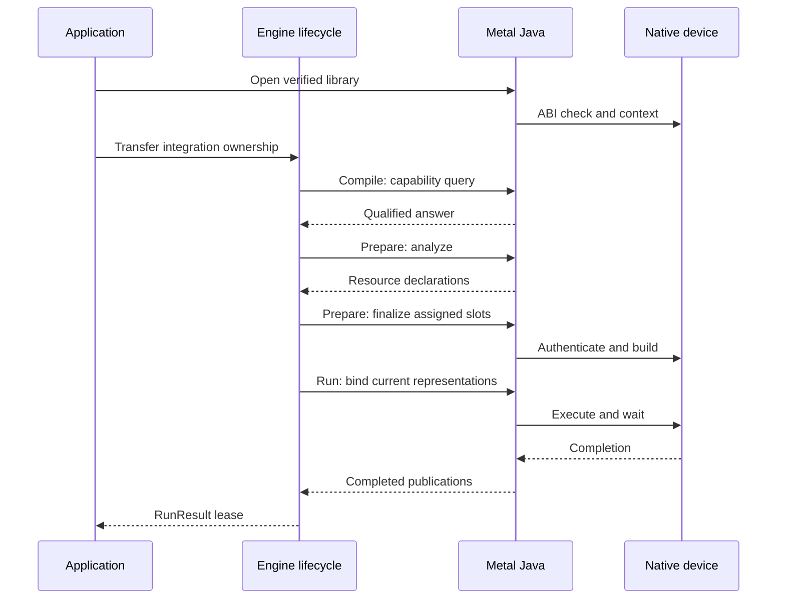
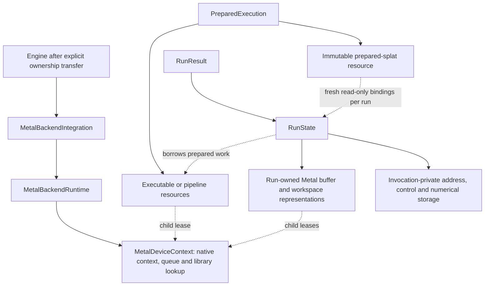

# Metal: from an admitted operation to a completed device invocation

> This is an implementation explanation, not a new capability or ABI contract.
> [The architecture root](../../../ARCHITECTURE.md), its
> [Metal backend contract](../../architecture/contracts/backend-execution.md#metal-backend),
> [Prepare/Run lifecycle](../../architecture/contracts/runtime-prepare-engine.md#prepare-lifecycle),
> and [general Scan semantics](../../architecture/contracts/recurrent-scan.md#general-differentiable-scan)
> remain authoritative.

## `io.github.pho001.synaptik.backend.metal`

This package turns an explicitly Metal-owned graph partition into a reusable native executable
and binds each invocation to its own device buffers. It is useful to distinguish three questions:
**is this exact operation supported, what physical program will execute it, and who keeps its
resources alive?** Capability, preparation, and invocation answer those questions separately.

The Java implementation is in
[`modules/backend/metal`](../../../modules/backend/metal/src/main/java/io/github/pho001/synaptik/backend/metal/package-info.java).
Its Objective-C bridge and embedded Metal Shading Language (MSL) sources live in
[`modules/backend/metal/macos-arm64`](../../../modules/backend/metal/macos-arm64/README.md).
MSL is the language compiled into device kernels; Objective-C owns the Apple framework objects
that compile, bind, and submit those kernels. Neither is an application-facing graph API.

Start with the lifecycle and teaching-example sections below. The native component tables are a
second reading path for maintainers tracing a particular operation or failure.

In this page, **host** is the CPU-side Java/native program and **device** is the GPU (graphics
processing unit) executing Metal work. A **dispatch** submits a prepared kernel's work to that
device; a **command queue** orders submitted commands. Apple shared storage can expose memory to
both sides, but shared accessibility does not mean shared cleanup ownership or automatic
completion. An explicit completion wait and a resource's eventual release are different events.

### Purpose, callers, and non-goals

Applications enter through [MetalBackendConfiguration][configuration] and
[MetalBackendIntegration][integration], then give the opened integration to the public Engine
builder. [MetalCapabilityProvider][capability] is the stateless Planning-facing admission boundary.
Shared Prepare calls the integration's analysis/finalization collaborators; Runtime calls the
resulting prepared executable. Engine owns composition and scheduling, not native library discovery
or device construction. Metal has no dependency on Engine and no CPU execution fallback.

Most types here are package-private implementation details. Their links explain the implementation,
not supported application APIs. In particular, the `MetalNeg…` names retain their original narrow
NEG naming but now participate in whole supported-operation partition preparation; they do not mean
that every partition contains negation. [MetalOperationRouteCatalog][catalog] is descriptive cold
metadata, not a second admission authority or an execution-time dispatch registry.

Metal does **not** own Tensor semantics, graph capture, automatic differentiation (AD), partition
ownership selection, the shared memory plan, or the training algorithm. AD means constructing the
derivative graph; Compiler does that before Metal sees a partition. Metal lowers the resulting
ordinary operations and scans. It does not implement a second derivative algebra.

## The lifecycle and its three kinds of state

Read this successful-path sequence from top to bottom. The Engine lifecycle lane summarizes calls
through Compiler, shared Prepare and Runtime; their [distinct owners](execution.md) do not merge.
Native failures preserve their cause and do not publish a successful result.

A **descriptor** describes a logical value's type, shape, layout, and gradient eligibility. A
**representation** is the physical buffer that holds its bytes. A **slot** is an assigned position
in the shared prepared memory plan, not a device pointer. Keeping them separate prevents a view's
logical strides from being applied twice to an already materialized buffer.

### 1. Admit an occurrence, not an operation name

[MetalCapabilityProvider.supports][capability] examines original input/output carriers (stored
numeric types), attributes, shapes, layouts, and gradient roles. Focused support owners handle
[exact operations][exact-support], [reductions][reduction-support],
[scatter][scatter-support], [normalization/loss][normalization-support],
[attention][attention-support], and [fixed recurrence][recurrent-support]. General Scan delegates
to [MetalScanLowering][scan-lowering], which checks the containing body as well as its boundaries.
An unsupported or unproved occurrence returns false; an available GPU does not change that answer.

An **occurrence** includes these particular operands, attributes and result roles, not merely the
name `ADD` or `SCAN`. **Admission** checks that exact case. **Fail-closed** rejection means an
unproved case does not proceed by trying a different owner, type or implementation.

For numerical FLOAT32, BFLOAT16, and FLOAT16 routes, admission retains the actual type at every
role. The shared shaders use FLOAT32 working sites and publish in the declared output carrier;
they do not obtain a low-type capability by replacing its descriptors with FLOAT32 descriptors.
Mixed-type combinations still need their own admission. In particular, direct unlike
BFLOAT16/FLOAT16 comparison or WHERE branches reject.

The current typed storage boundary has seven carriers: FLOAT32, INT32, BOOL, FLOAT64, BFLOAT16,
INT64, and FLOAT16. **Neither FP8 carrier is admitted, even for empty storage/publication.**
FLOAT64 raw movement, comparison, selected exact word operations, and conversion are not general
FLOAT64 arithmetic. There is no software-FP64 arithmetic fallback. Layout and empty-domain
admission are operation-specific: rank zero has one element; an empty output does not excuse an
invalid nonempty index domain or reduction denominator.

### 2. Lower once, declare resources, then compile

[MetalNegPartitionPreparer][preparer] walks the complete partition in producer order, assigns stable
native value ordinals, preserves ordered operands and canonical siblings, and separates feeds,
internal values, and publication targets. It authenticates logical descriptors against the actual
physical source geometry. A local transpose can avoid a copy only under the specific earlier-local
PERMUTE/MATMUL proof; arbitrary logical ancestry is not a physical buffer proof.

The route becomes fixed **before** resource declaration:

- `MPSGRAPH` constructs and compiles an Apple MPSGraph executable for admitted graph operations.
- `CUSTOM_PROGRAM` carries a fixed prepared sequence of custom kernels and any admitted MPSGraph
  boundary steps. It is not a Java operation interpreter. Any BFLOAT16/FLOAT16-containing partition
  and required exact-custom occurrence fixes the partition to this route.
- The dedicated `CUSTOM_SINGLE_NEG` route has a separate pipeline resource and no address workspace;
  it is a bounded singleton optimization, not a generic kernel selector.

[MetalPointwiseFusionPlanner][fusion-planner] uses consumer and target facts to keep eligible
FLOAT32 chain interiors virtual rather than allocating a buffer after every operation.
[MetalAnchorEpilogueRecognizer][anchor-recognizer] proves eligible MATMUL/convolution epilogues,
including operand order and observable boundaries. Both are restricted independently of ordinary
numerical capability. A partition containing BFLOAT16/FLOAT16 has no generated pointwise or anchor
fusion, including for FLOAT32 nodes within that partition. Source-size and instruction caps are
cold planning facts, not runtime retries.

The immutable [MetalNegPreparationPlan][preparation-plan] contains exact declarations. Shared
Prepare assigns slots; only then does [MetalNegPartitionFinalizer][finalizer] create the selected
native resource. It does not change the route or discover new shared scratch. Failure during
finalization closes acquired resources in reverse order while preserving the primary failure.
The [schedule assembler][schedule-assembler] contributes physical buffer/workspace creators and
prepared occurrences to shared assembly; it does not create another run owner.

### 3. Authenticate the encoded program on both sides

Despite its historical name, [MetalMpsGraphProgram][program] encodes both whole-program routes.
The current image uses **schema 22, a 124-byte header, and ordinary operation wires 1–115 plus
General Scan wire 116**. It is little-endian and binds the descriptors, dimensions, strides,
references, attributes, route, and section sizes. Custom images additionally bind step, binding,
materialization, instruction, and canonical-manifest records. MPSGraph images omit that extension
rather than carrying an unused custom schedule.

[MetalNativeApi][native-api] independently validates the Java-side physical occurrence before the
Foreign Function and Memory (FFM) downcall. FFM is the JDK API for calling a native library and
accessing native memory. Its private `Ffm` implementation loads the caller's exact path through
`SymbolLookup.libraryLookup`, verifies ABI 7, resolves all thirteen required exports, and retains
the lookup in a shared Arena (the FFM lifetime owner). Opaque handles stay inside this package.
Call-scoped image/output-cell arenas do not become executable owners.

The native decoder in [synaptik_metal_foundation.m][foundation] independently checks section
geometry, topology, types, layouts, gradients, bindings, and manifest contents; it does not trust a
successful Java provider answer. The custom source assembler checks each fixed source component's
UTF-8 length and SHA-256, assembles them in dependency order, then checks the complete corpus and
assembled generated suffix. The current fixed corpus has **23 components, 190,781 UTF-8 bytes**;
its digest is recorded in `synaptik_authenticated_fixed_source`. Host-only headers are not shader
components, and some headers contribute more than one component.

A **wire** is a numbered field or tag in the encoded program. A **schema** defines that program's
record format; an **ABI** (application binary interface) defines how Java and native code call
one another. A **manifest** lists the expected components and their identifying facts.
**SHA-256** is the digest algorithm used to detect byte changes; a matching digest alone does
not establish who authorized the bytes. These checks concern compatibility and consistency,
not whether an operation has been numerically qualified.

These are different compatibility boundaries:

| Boundary | Current value | Why it matters |
|---|---|---|
| Native exported calling convention | ABI 7; thirteen exports | A loadable library must provide the exact typed seam. |
| Encoded program | Schema 22; header 124 bytes | Creation rejects incompatible or malformed images. |
| Scan attributes inside that image | Grammar 2 | Version 1 lacks the current failure-record workspace and is incompatible. |
| Workload/exact-policy/candidate/compatibility/route/session codec | Identity 45 | Stale tuning handoffs reject even if their outer checksum is valid. |

The source constants, not older task-era comments, determine these current values. See
[program constants][program], [Scan encoding][scan-encoding],
[candidate identity generation][candidate-generator], and [the session codec][tuning-codec].
Authentication here establishes consistency with the implementation's expected program/source;
it is not a public signature service or a substitute for release authorization.

### 4. Bind a fresh invocation without changing the prepared plan

[MetalNegPreparedExecutable][executable] cold-binds assigned buffer positions once, checking exact
context, openness, byte extents, access, and forbidden overlap. Its bound action retains direct
typed references and slices of a run-owned address workspace. Custom execution binds only compact
materialized slots; generated interiors have no hidden device allocations. Numerical scratch,
including attention and Scan workspaces, belongs to that invocation, not to a mutable executable
field. The Java hot invocation makes one matching native route call.

The native owner submits through the context's command queue. Custom routes explicitly commit
and wait; MPSGraph uses a waiting execution descriptor. A successful return means device work has
completed, **not** that output buffers have been released. `RunResult.close()` releases run-owned
resources; the prepared execution separately owns reusable executable/pipeline resources. There is
no asynchronous result, cancellation, timeout, output pool, or promise of GPU overlap between calls.

### Cold tuning and optional observation do not become execution policy

[MetalLocalWorkloadTuning](../../../modules/backend/metal/src/main/java/io/github/pho001/synaptik/backend/metal/MetalLocalWorkloadTuning.java)
exposes exactly associated opaque candidates for an admitted singleton NEG with both custom and
MPSGraph routes. It does not measure or pick a winner. Trials and selected preparation repeat
authoritative analysis; compatibility belongs to the live integration session.
[MetalCompletePlanTuning](../../../modules/backend/metal/src/main/java/io/github/pho001/synaptik/backend/metal/MetalCompletePlanTuning.java)
then exposes one authenticated complete-plan candidate with that local route fixed, not another
search over execution plans. Measurement, evidence, cache IO, and winner selection remain with
their orchestration/tooling owners. A stale decision is an error, not a request to retune during run.

The traced `MetalBackendIntegration.open(configuration, observer)` overload retains a caller-owned,
concurrently callable [MetalTraceObserver](../../../modules/backend/metal/src/main/java/io/github/pho001/synaptik/backend/metal/MetalTraceObserver.java).
[MetalTraceProducer](../../../modules/backend/metal/src/main/java/io/github/pho001/synaptik/backend/metal/MetalTraceProducer.java)
reports bounded structural, route, aggregate-byte and outcome facts, not Tensor payloads, pointers
or shader source. Observation does not select routes or add synchronization policy. Structural
callback failures disable tracing without aborting backend work; outcome RuntimeExceptions are
also contained. An observer Error propagates from successful outcome reporting, but a backend
failure remains primary during failure reporting. Metal never closes the observer. The untraced
opening path creates no trace producer.

## Ownership from Java to `MTLBuffer`

Solid arrows show ownership; dashed arrows show retained lifetime relationships, not execution
order. A run borrows prepared resources rather than becoming their second owner.

[MetalDeviceContext][context] starts with one owner reference. A successful child acquisition adds
a lease. Context close marks the owner closed and rejects further allocation/access, but defers the
single native context release until its children close. [MetalBufferRepresentation][buffer] and
[MetalWorkspaceRepresentation][workspace] each own an opaque native buffer handle and a context
lease. [MetalProgramExecutableResource][program-resource] consumes its executable handle before
ending its lease. Close gates and partial-construction rollback prevent a child from using an
unloaded library or releasing a handle twice.

In native code, Objective-C boxes strongly retain the `MTLDevice`, `MTLCommandQueue`, `MTLBuffer`,
compiled graph, library/pipelines, and immutable metadata required by their role. Successful creates
use `__bridge_retained`; matching releases use `__bridge_transfer` under Automatic Reference Counting
(ARC). A zero-logical-byte buffer receives a one-byte physical allocation while retaining logical
size zero; that byte is not an extra Tensor element. Buffers use `MTLResourceStorageModeShared`.
Upload/download validate the requested logical byte range and copy through `buffer.contents`.
FFM entry points that create autoreleased temporaries provide their own autorelease pools, so mapped
exits drain those temporaries even though the calling Java thread did not establish a Cocoa pool.

One integration creates one system-default-device context and queue. The availability token
`BackendDeviceId(metal, "default")` is an abstract slot, not hardware identity or a selector.
Every buffer and executable is tied to its exact creating context; two integrations on the same
physical device do not make their resources interchangeable. There is no multi-device scheduling,
physical-device enumeration, hot-plug, or failover contract.

Host ingress is also explicit. [MetalBackendRuntime.borrow][backend-runtime] copies raw storage
into a Metal-owned representation and retains, but never closes, the caller's storage. Heap ingress
may stage through native memory. This is distinct from a prepared **cross-owner transfer**: that
path binds CPU-owned native staging and exact Metal endpoints once, then performs one native copy
without conversion. Its positive-stride, non-overlapping, checked physical-span domain preserves
prefix/gap bytes. Descriptor-aware BOOL download validates logical bytes before committing host
destination mutation; storage holes are not interpreted as BOOL values.
[Producerless publication][producerless] authenticates source-only values and zero-aware spans,
while [prepared splats][splats] own immutable constant storage with read-only run bindings.

## Native ABI entry points

All thirteen exports are implemented in
[`modules/backend/metal/macos-arm64/src/synaptik_metal_foundation.m`][foundation].
The table spells out the full export names so a maintainer can connect an FFM handle to its owner.
Native creation returns a status and an output handle; failure is not a valid partially published
Java resource.

| Export(s) | Caller, input/output, and ownership |
|---|---|
| `synaptik_metal_foundation_abi_version` | FFM opening checks the returned integer before publishing the API binding. |
| `synaptik_metal_context_create`, `synaptik_metal_context_release` | DeviceContext acquires/releases one opaque context box; creation calls `MTLCreateSystemDefaultDevice` and creates its queue. No path-based device discovery occurs. |
| `synaptik_metal_buffer_create`, `synaptik_metal_buffer_release` | Buffer/workspace acquisition supplies the creating context and logical bytes; the returned box authenticates context identity and owns shared-storage `MTLBuffer` memory. |
| `synaptik_metal_buffer_upload`, `synaptik_metal_buffer_download` | Typed Java wrappers supply a live handle, offset, pointer, and count. Range validation precedes `memcpy`; zero-byte copies read no payload. |
| `synaptik_metal_mpsgraph_executable_create`, `synaptik_metal_mpsgraph_executable_release`, `synaptik_metal_mpsgraph_executable_run` | Finalization supplies the authenticated image and owns the executable; each run supplies exact input/target handle tables. The historical `mpsgraph` name also covers CUSTOM_PROGRAM. Run checks context/device/length/alias facts before writes and returns synchronously. |
| `synaptik_metal_neg_kernel_pipeline_create`, `synaptik_metal_neg_kernel_pipeline_release`, `synaptik_metal_neg_kernel_pipeline_run` | Dedicated singleton-NEG resource fixes an admitted positive element count, compiles its kernel, and runs against distinct context-local input/output buffers. This does not expose general pipeline creation to applications. |

Status zero is success. Other statuses distinguish invalid arguments, absent device/queue,
allocation/copy/range failures, unsupported shapes/operations, graph/kernel compilation,
incompatible resources, internal exceptions, and execution failure. Java's `NativeFailure` retains
the operation name and raw status, including unknown values. Prepared public execution reconstructs
applicable Model bounds/duplicate exception classes; it does not silently retry on CPU. An
operation-local validation failure preserves its affected write targets and inputs, not all earlier
producers in the partition.

## General Scan: one body, native traversal, explicit activity

A general Scan repeats a pure ordinary Tensor body over a fixed time axis, carrying explicit state
and optionally publishing emissions and demanded histories. It is not a while loop. Compiler owns
its reverse-mode construction and the **activity plan**: structural presence of derivative
contributors, which is different from a numeric zero. A missing contributor must not read an
inactive payload just because adding zero would seem numerically harmless.

[MetalScanLowering][scan-lowering] checks the exact captured body, formal/actual descriptors,
ordered result roles (including repeated roles), demand, row-coordinate provenance, and activity.
It lowers ordinary operations once through [MetalScanOrdinaryOperation][scan-ordinary];
[MetalScanBodySupport][scan-body-support] admits the bounded body-specific empty geometry without
substituting a fictitious positive extent. [MetalScanPlan][scan-plan] freezes local physical values,
producer-ordered units, carry banks, scratch offsets, demanded roles, and control bytes.
Local ordinals never become outer graph IDs. Demand, rather than the existence of a latent residual
port, decides whether history is allocated/stored. The body encoding grows with the body, not T;
demanded history can still grow with T.

[MetalScanEncoding][scan-encoding] and the independent [MetalScanDecoding][scan-decoding] bind
grammar 2 attributes inside schema 22. The native plan authenticates the same ordinary grammar and
row/terminal facts before constructing controlled steps. At run time it validates all INT64 length
values after their producers and before Scan-local writes, then binds time slices, executes body
units, updates carries, and stores histories at **original** time indices. Reverse traversal changes
visit order, not history indexing. `T=0` executes no body and preserves initial carry represented
bits; real zero extents do not bypass structural or value-domain checks.

Controlled kernels append control buffers at MSL binding positions 28 and 29 without changing
ordinary argument meanings. Scope/row guards precede inactive operand loads. An activity ADD with
one present input copies that input's represented word; it is not `0 + input`. Carry presence is
updated simultaneously using separate staging, so one carry's update cannot change another carry's
same-step premise. The native loop flushes completed producers before host value checks or control
changes require their data; it is not an application callback per time step.

The mutable control prefix has fifteen 64-bit words: ten traversal/activity words plus a five-word
first-failure record. That record adds forty declared bytes per Scan before shared slot assignment.
It reports category, original time, unit, operand, and logical ordinal. The invocation resets it;
only synchronous failure reads it back through [MetalNegPreparedExecutable][executable] and
[MetalScanValidationFailure][scan-failure]. No Tensor payload, device pointer, body replay, or
second Java body loop is needed for those diagnostics.

Numeric Scan supports independently admitted static FLOAT32/BFLOAT16/FLOAT16 occurrences, including
proved strided numeric ingress canonicalized through the ordinary CONTIGUOUS owner. External typed
controls require canonical descriptors; a separately proved local dense view does not inherit an
external-control exemption. FLOAT64 Scan is **canonical, non-gradient, source-only raw binding**:
it may forward a formal's bits, but no ordinary body instruction may read/write F64 arithmetic.
Source-only BOOL roles validate active published bytes; inactive sequence cells remain unread.
There is no dynamic-B Metal Scan, FP8, implicit conversion, mixed-owner body, nested Scan, runtime
fallback, or general FLOAT64 body/AD permission.

### Native Scan components and their division of work

Every path in the following native tables is relative to `modules/backend/metal/macos-arm64/`;
each link resolves the complete repository path. These are implementation components included in
the one bridge translation unit, not separately exported libraries.

| Path | Mechanism, caller, and boundary |
|---|---|
| [`src/synaptik_general_scan.h`](../../../modules/backend/metal/macos-arm64/src/synaptik_general_scan.h) | Shared host/shader control layout, scope/row eligibility, operand-coordinate guards, and first-failure writer. Native plan/validators and controlled MSL use the same word offsets; numeric values never define presence. |
| [`src/synaptik_general_scan_plan.h`](../../../modules/backend/metal/macos-arm64/src/synaptik_general_scan_plan.h) | Decodes grammar 2 into immutable local bindings/ordinary stages, checks disjoint writers and exact workspace, prepares ingress, and owns native traversal. Invocation-owned workspace holds changing addresses, carry data, length/presence bits and failure words. It commits/waits at required boundaries and publishes final carries/histories. |
| [`src/synaptik_general_scan_binding_kernels.h`](../../../modules/backend/metal/macos-arm64/src/synaptik_general_scan_binding_kernels.h) | Raw-word binding kernel publishes present emissions or +0 padding and implements carry replacement/accumulator finishing. It takes source/destination/old-carry plus control, preserving identity bits without inventing arithmetic. |
| [`src/synaptik_general_scan_coordinates.h`](../../../modules/backend/metal/macos-arm64/src/synaptik_general_scan_coordinates.h) | Cold structural proof of original ROW versus SHARED coordinates and terminal contractions. It derives output facts from already-proved inputs, including independent neural sibling roles; equal physical extents alone do not prove the same row. It allocates/evaluates no numeric Tensor. |
| [`src/synaptik_general_scan_validation.h`](../../../modules/backend/metal/macos-arm64/src/synaptik_general_scan_validation.h) | Scan-local physical admission reuses ordinary attribute/shape/numerical validators and retains real empty extents. It rejects unsupported body occurrences before pipeline construction rather than admitting a family by name. |
| [`src/synaptik_general_scan_value_validation.h`](../../../modules/backend/metal/macos-arm64/src/synaptik_general_scan_value_validation.h) | Prepared per-operand validation roles retain original semantic row facts and scatter reduction. Runtime checks eligible BOOL/index/label domains and replacement uniqueness before affected writes; it checks eligibility before resolving an inactive buffer's bytes. |
| [`src/synaptik_general_scan_bridge.h`](../../../modules/backend/metal/macos-arm64/src/synaptik_general_scan_bridge.h) | Adapts each ordinary builder to controlled stages, including multi-stage exact replacement and genuine zero-work markers. Binds current borrowed buffers/offsets through the shared binding codec; missing controlled kernels fail admission. No invocation buffer is retained in the bridge's prepared metadata. |

## Ordinary native components: geometry, words, and arithmetic

The native builder creates immutable metadata/pipelines; shaders receive buffers plus that checked
metadata. A source string's existence does not grant capability. Raw-image validation, focused host
metadata construction, and exact bound-resource checks still precede dispatch. Most headers below
embed MSL strings; the explicitly host-only headers do not run on the GPU.

### Common decoding and binding (host-side)

| Path | Mechanism and relation to execution |
|---|---|
| [`src/synaptik_metal_foundation.m`](../../../modules/backend/metal/macos-arm64/src/synaptik_metal_foundation.m) | The sole compiled Objective-C translation unit: owns exports/boxes, independent image parsing, source authentication, MPSGraph construction, fixed custom pipeline/metadata creation, command encoding, completion checks, and native status mapping. It includes the focused components below after their required type/helper declarations. |
| [`src/synaptik_ordinary_attributes.h`](../../../modules/backend/metal/macos-arm64/src/synaptik_ordinary_attributes.h) | One normalized attribute decoder for outer ordinary nodes and Scan body units. Raw signatures/scalar carriers are checked before normalization can erase them; Scan additionally preserves semantic scatter reduction for preflight. |
| [`src/synaptik_extended_gradients.h`](../../../modules/backend/metal/macos-arm64/src/synaptik_extended_gradients.h) | Checks original per-port gradient flags before decoded nodes discard them, including distinct neural sibling roles and ordinary/Scan consistency. This validates metadata; it constructs no gradients. |
| [`src/synaptik_program_bindings.h`](../../../modules/backend/metal/macos-arm64/src/synaptik_program_bindings.h) | Fixed buffer-slot codec shared by direct ordinary invocation and Scan's buffer/offset table. It borrows the authenticated table, binds family-specific arguments, and dispatches prepared steps without per-step resource mirrors or math selection. |
| [`src/synaptik_program_control_preflight.h`](../../../modules/backend/metal/macos-arm64/src/synaptik_program_control_preflight.h) | Checks feed controls before the first partition write and produced controls only after producer completion, just before consumption. Its batching predicate excludes steps needing a synchronization/validation boundary. This prevents reading uninitialized produced controls. |

### Shared storage and elementary arithmetic

| Path | Mechanism, inputs/outputs, and constraints |
|---|---|
| [`src/synaptik_numeric_codec.h`](../../../modules/backend/metal/macos-arm64/src/synaptik_numeric_codec.h) | Shared integer-word storage codec: widths, round-to-nearest-even packing, floating/integer/BOOL conversion, NaN/zero/order predicates, and FLOAT32 widen/narrow helpers. Numerical families call it at declared storage sites. F64 bit manipulation/conversion here is not F64 arithmetic. |
| [`src/synaptik_task0059_data_kernels.h`](../../../modules/backend/metal/macos-arm64/src/synaptik_task0059_data_kernels.h) | Defines common DataMeta, logical/physical coordinate decoding, raw load/store/copy, signed-step slice mapping, and exact data-movement kernels. Checked element coordinates become byte accesses using carrier width; padding/unfold fill sites do not read absent source positions. |
| [`src/synaptik_task0066_dtype_layout_kernels.h`](../../../modules/backend/metal/macos-arm64/src/synaptik_task0066_dtype_layout_kernels.h) | Uses the shared codec for typed casts/classification and original-layout movement, including controlled variants. Its folds give each output one ordered contributor traversal: zero contributors yield raw zero, one retains raw identity, multiple admitted floating contributors add in FLOAT32 and narrow at publication. No overlapping F64/integral arithmetic is implied. |
| [`src/synaptik_exact_kernels.h`](../../../modules/backend/metal/macos-arm64/src/synaptik_exact_kernels.h) | Supplies point/binary metadata and exact stored-word unary/comparison/scalar/integral owners plus controlled source components. Reuses coordinate, codec, and ordering helpers; preserves full integer magnitudes and selected F64 word semantics without FP64 hardware arithmetic. |
| [`src/synaptik_exact_host.h`](../../../modules/backend/metal/macos-arm64/src/synaptik_exact_host.h) | Independently rebuilds exact operation grammar, promotion, original physical reads, canonical outputs, scalar-word bounds, and dispatch metadata. It rejects unlike-low pairs; raw decoder checks the gradient/scalar facts absent from normalized nodes. |
| [`src/synaptik_float32_math_kernels.h`](../../../modules/backend/metal/macos-arm64/src/synaptik_float32_math_kernels.h) | Shared elementary FLOAT32 working functions and unary/POW entries for ordinary and compound kernels. Named LOG1P/EXPM1 and activation intermediates preserve their intended sites; controlled guards precede loads. Native compiles with safe math rather than treating composites as arbitrary fast-math identities. |
| [`src/synaptik_f32_ordinary_kernels.h`](../../../modules/backend/metal/macos-arm64/src/synaptik_f32_ordinary_kernels.h) | Shared FLOAT32/BFLOAT16/FLOAT16 binary, unary, affine-read and scalar/clamp primitives. Ordinary and `_scan` entries share arithmetic; the controlled ADD path preserves a sole present operand's raw word. Output geometry/carrier stays original, not a FLOAT32 proxy. |

### Reductions, contractions, indexing, and spatial work

| Path | Mechanism, caller/IO, and resource/error boundary |
|---|---|
| [`src/synaptik_task0060_reduction_kernels.h`](../../../modules/backend/metal/macos-arm64/src/synaptik_task0060_reduction_kernels.h) | Common exact fold/slice-update/replacement-copy and integral/BOOL reduction primitives. Coordinate helpers are reused by later dtype/layout kernels; exact placement writes raw source words or zero, not a floating reduction by conversion. |
| [`src/synaptik_audit_reduction_kernels.h`](../../../modules/backend/metal/macos-arm64/src/synaptik_audit_reduction_kernels.h) | Current numerical reductions use one workitem per output with ordered source traversal, optional broadcast BOOL mask, and real selected counts. SUM/MEAN controlled variants test activity before data/mask reads. No atomics or partial-buffer workspace is introduced by this component. |
| [`src/synaptik_reduction_host.h`](../../../modules/backend/metal/macos-arm64/src/synaptik_reduction_host.h) | Revalidates reduction axes/result equations, scalar grammar and affine byte spans before metadata creation. Common raw-layout validation has already proved view/injectivity facts. Empty and Scan-local reductions keep actual geometry rather than a B=1 surrogate. |
| [`src/synaptik_task0061_matmul_kernels.h`](../../../modules/backend/metal/macos-arm64/src/synaptik_task0061_matmul_kernels.h) | Output-owned MATMUL coordinates handle vector promotion, broadcasting and contraction addressing. Numeric K=0 returns +0, K=1 performs one product, longer contractions use ordered FMA; integral entries use modular accumulators. A separate controlled component in this header guards both operands before loads. |
| [`src/synaptik_task0063_ordering_kernels.h`](../../../modules/backend/metal/macos-arm64/src/synaptik_task0063_ordering_kernels.h) | SORT/ARGSORT/TOP_K and extrema compare raw carrier keys; source index resolves ties, and NaN handling is explicit. Ranking a candidate against axis peers produces deterministic destinations without treating INT64 or F64 words as FLOAT32. Metadata bounds axis/inner/output sizes. |
| [`src/synaptik_scatter_kernels.h`](../../../modules/backend/metal/macos-arm64/src/synaptik_scatter_kernels.h) | Output-owned scatter traverses ordered updates against actual affine base/index/update reads. Replacement and ADD/MUL/MIN/MAX remain distinct modes; duplicates are legal only where the mode permits them. Numeric additions/multiplications use FLOAT32 sites, integral arithmetic is modular, F64 retains raw extrema. No atomic winner or host numeric repair. |
| [`src/synaptik_scatter_host.h`](../../../modules/backend/metal/macos-arm64/src/synaptik_scatter_host.h) | Builds checked original-carrier geometry plus stable logical index bounds/uniqueness preflight. Replacement alone needs uniqueness scratch; legal arithmetic collisions must not enter that check. Produced indices require completion before validation and any affected write. |
| [`src/synaptik_task0069_aggregate_kernels.h`](../../../modules/backend/metal/macos-arm64/src/synaptik_task0069_aggregate_kernels.h) | The retained FLOAT32 scatter-add component gives each output an ordered update scan and explicit ADD sites, preserving an unaddressed base word. It is part of the authenticated corpus, not evidence that every scatter occurrence selects this entry instead of the current general scatter owner. |
| [`src/synaptik_task0064_convolution_pooling_kernels.h`](../../../modules/backend/metal/macos-arm64/src/synaptik_task0064_convolution_pooling_kernels.h) | Conv2d/3d map checked grouped window coordinates, accumulate the complete FLOAT32 contraction, then add bias before narrowing. Pooling preserves winner/NaN/zero/divisor rules at real window positions. Controlled variants guard eligible inputs before loads; ordinary shared adjoints use unfold/MATMUL/reduction/fold rather than a new backward executor. |

### Compound neural operations and explicit RNG state

| Path | Mechanism, caller/IO, and lifetime |
|---|---|
| [`src/synaptik_normalization_loss_kernels.h`](../../../modules/backend/metal/macos-arm64/src/synaptik_normalization_loss_kernels.h) | Original-carrier affine read descriptors feed softmax/log-softmax, layer/RMS/batch normalization and categorical losses. Row/feature traversal uses FLOAT32 working sites; canonical outputs and each neural sibling retain their declared type and role. Index labels remain INT32/INT64. |
| [`src/synaptik_normalization_host.h`](../../../modules/backend/metal/macos-arm64/src/synaptik_normalization_host.h) | Host-only metadata proof of actual types, complete sibling shapes, epsilon/momentum words, affine reads and canonical writes. Categorical target preflight checks ignore-index before bounds and completes before loss writes; buffer extents/topology/gradient flags retain their separate owners. |
| [`src/synaptik_attention_kernels.h`](../../../modules/backend/metal/macos-arm64/src/synaptik_attention_kernels.h) | Scaled dot-product attention computes per-row scores/probabilities and output from Q/K/V plus optional BOOL mask. It declares FLOAT32 score/probability workspace; a canonical FLOAT32 weights sibling can provide that storage, while low-type siblings cannot alias the FLOAT32 working buffer. Zero-key/row cases follow explicit geometry rules. |
| [`src/synaptik_attention_host.h`](../../../modules/backend/metal/macos-arm64/src/synaptik_attention_host.h) | Host-only proof of Q/K/V embedding/length relations, batch/mask broadcasting, finite positive scale, actual carrier layouts, grid and scratch size. Runtime additionally validates logical BOOL mask bytes and disjoint buffers before dispatch. |
| [`src/synaptik_recurrent_kernels.h`](../../../modules/backend/metal/macos-arm64/src/synaptik_recurrent_kernels.h) | Fixed RNN_TANH/GRU_RESET_AFTER/LSTM kernels retain FLOAT32 projections/gates and publish hidden/cell values at typed step boundaries. Shared sigmoid/tanh functions come from the math component. The header also supplies complete signed-INT64 length preflight before any target write, including T=0. |
| [`src/synaptik_recurrent_host.h`](../../../modules/backend/metal/macos-arm64/src/synaptik_recurrent_host.h) | Host-only original-descriptor proof of fixed-cell shapes, optional bias, types, physical geometry and output grid. B=0 means no dispatch, not a synthetic row. The invocation must still perform the header's length-value preflight after producers. Fixed recurrence is not the general Scan binder. |
| [`src/synaptik_task0065_rng_dropout_kernels.h`](../../../modules/backend/metal/macos-arm64/src/synaptik_task0065_rng_dropout_kernels.h) | INITIAL_STATE publishes explicit key/counter words; dropout derives per-element words from them, publishes canonical BOOL mask and scaled typed output, and returns next state. No backend-global RNG state is mutated. RNG remains outside a pure general Scan body. |

### Fusion source generation and retained candidate artifacts

| Path | Actual role, not a capability promise |
|---|---|
| [`src/SynaptikPointwiseFusionKernelSource.h`](../../../modules/backend/metal/macos-arm64/src/SynaptikPointwiseFusionKernelSource.h) | Host-side bounded source generator/size oracle for authenticated pointwise/anchor instruction records. It enforces unit/instruction/function/total-source caps and emits the suffix appended to the authenticated fixed corpus. It is not itself another native ABI or a general shader compiler API. |
| [`src/synaptik_task0071_anchor_epilogue_kernels.h`](../../../modules/backend/metal/macos-arm64/src/synaptik_task0071_anchor_epilogue_kernels.h) | Fixed anchor kernels call the shared MATMUL/convolution working functions, then apply proved scalar multiply/add/ReLU/clamp sites in the retained order before final output. Java/native recognizers must admit the exact unit; a shader entry name alone does not authorize fusion, especially in low-containing partitions. |
| [`src/task0053_integer_core.h`](../../../modules/backend/metal/macos-arm64/src/task0053_integer_core.h) | Retained candidate EXP/SIGMOID algorithm over raw FLOAT32 words using fixed-point/integer tables, saturation and rounding helpers. C/MSL macro bindings let evidence models share the same core. It is not the production elementary-math owner. |
| [`src/task0053_candidate.metal`](../../../modules/backend/metal/macos-arm64/src/task0053_candidate.metal) | Candidate-only MSL wrapper includes that integer core and maps guarded 3-D launch ordinals to raw-word EXP/SIGMOID inputs/outputs. It does not supply a production route or imply accepted numerical qualification. |
| [`src/synaptik_task0053_candidate_kernels.h`](../../../modules/backend/metal/macos-arm64/src/synaptik_task0053_candidate_kernels.h) | Embedded candidate source counterpart of the wrapper/core, retained for evidence tooling. Production foundation neither imports it nor appends it to the authenticated corpus. [The generator](../../../modules/backend/metal/macos-arm64/generate-task0053-header.py) embeds the core deterministically; this is not a runtime compilation input. |

The `task00…` filenames in the other rows are historical names of **current included components**;
they are not all obsolete candidates. Conversely, the three Task-0053 artifacts above have an
explicit evidence-only role. The foundation import list and authenticated component table, not the
filename, establish that distinction.

## Building a library is different from opening one

These three scripts complete the native path accounting. They prepare/check artifacts for an
explicit caller-selected library; Engine does not run them or search their output directory.
They do not authorize public publication or alter the sealed `0.1.0-public-audit.20261104` candidate.

| Path | Inputs, mechanism, output, and failure/lifetime context |
|---|---|
| [`build.sh`](../../../modules/backend/metal/macos-arm64/build.sh) | Requires the configured full Xcode installation. Compiles the one Objective-C translation unit with arm64, macOS 26.0 minimum, ARC, hidden visibility, warnings-as-errors and Foundation/Metal/MPSGraph linkage. It stages a dylib, rejects symlink/non-file outputs, and publishes `build/libsynaptik_metal_foundation.dylib` only after compiler success; its exit trap removes temporary staging. It does not ad-hoc-sign or package the result. |
| [`package-local.sh`](../../../modules/backend/metal/macos-arm64/package-local.sh) | Takes one already ad-hoc-signed regular dylib. Copies it into staging with canonical modes, writes exact manifest/schema/ABI/platform/hash facts and SHA256SUMS, invokes the verifier, then replaces `build/package-v1/macos-arm64`. On pre-publication failure it cleans staging and attempts to restore a moved previous package. It rejects unsafe path spellings and symlink destinations. |
| [`verify-package.sh`](../../../modules/backend/metal/macos-arm64/verify-package.sh) | Takes a package directory; requires exactly dylib, manifest and checksums with canonical modes. Inspects arm64 Mach-O/minimum OS/install name, no rpaths, allowed system dependencies and the exact thirteen exports; checks strict ad-hoc signature identifier, byte-exact manifest and checksums. It cleans its scratch directory on exit. This is package-structure/integrity verification, not execution of kernels or proof of numerical support. |

For prerequisites and an actual build/sign/package workflow, use the
[native bridge guide](../../../modules/backend/metal/macos-arm64/README.md), not a reconstructed
build command from this atlas. A package that passes structural verification can still fail to
open or execute because of an incompatible host, missing device/queue, source mismatch, malformed
program, or runtime resource failure.

## Connection to the canonical learning journey

The [canonical tutorial](../../tutorials/index.md) remains CPU-based. **None of this Metal package,
its native bridge, or its packaging scripts is on that default execution path.** Its FLOAT32 input
`[2,1] = [1,3]`, gradient-eligible supplied weight `[1,1] = 0`, no bias, target `[2,6]`, squared-error
SUM, and `Sgd(0.05)` teach one fixed calculation:

| Checkpoint in the CPU learning project | Value |
|---|---|
| Initial prediction | `[0,0]` |
| Squared-error sum | `40` |
| Weight gradient | `-40` |
| Weight after `0 - 0.05*(-40)` | `2` |
| Updated prediction on the original input | `[2,6]` |
| Prediction on fresh `[2,4]` | `[4,8]` |

Those values explain Model/Compiler/training semantics; they are not evidence that the tutorial
loaded Metal or that a GPU benchmark ran. Do not replace `Engine.standard()` with a claimed
“automatic accelerator” mode, and do not assume that an owned NN training workflow changes owner
because Metal is present on the classpath.

A precise **alternate owner scenario**, separate from the tutorial, is the existing public
[Metal Engine NEG example](../../backend-guide/metal-backend.md#exact-general-axis-unfold):

1. On the supported Apple-silicon/macOS host, with the Java backend and a compatible explicitly
   built/verified native library, construct `MetalBackendConfiguration` with the absolute dylib path.
2. Open `MetalBackendIntegration` and transfer it through `Engine.Builder.takeOwnership(...)`.
   Registering only this integration makes Metal the available execution owner, rather than
   promising that a mixed CPU/Metal score will choose it.
3. Compile `input.neg()` for canonical FLOAT32 input `[1.0,-2.0]`, prepare, and run with that input.
   Materialize while `RunResult` is open. The expected detached value is `[-1.0,2.0]`.
4. Close result, preparation, and Engine at their respective ownership boundaries. The builder owns
   a transferred integration until a successful build transfers it onward; do not independently
   close that same owner a second time as an application ownership strategy.

This scenario demonstrates explicit owner composition and synchronous publication, not a specific
selected NEG route or speed. Changing the input values while preserving the prepared descriptor
reuses the plan; changing to unsupported FP8 or supplying a wrong shape does not request fallback.
The linked example supplies the API fragment; this atlas walkthrough is source-derived and was not
executed as a new native demonstration.

## Troubleshooting by boundary

| Symptom or question | Boundary to inspect |
|---|---|
| Relative/missing/incompatible dylib; missing symbol; ABI mismatch | Configuration/opening and `MetalNativeApi.Ffm`; fail before a usable integration is published. Supply an explicitly compatible library, not an inferred search path. |
| `supports` is false despite an available GPU | Original operation occurrence: dtype/gradient/scalar/layout/shape/body restrictions. Availability and capability are independent. |
| Stale candidate or tuning decision | Identity 45 workload/session association and codec; do not migrate an older decision by rewriting only its outer version/checksum. |
| Program creation rejects a seemingly supported graph | Independent image/layout/manifest/source authentication. Provider support is not permission to forge physical metadata or omit a canonical sibling. |
| Foreign-context, closed, undersized, or overlapping resource | Cold binding and native run validation. A common physical GPU is not common context ownership. |
| Bounds/duplicate/BOOL/length failure after producers | Complete logical preflight before that operation's writes; for Scan use original time/unit/operand/ordinal diagnostics. Inactive values must not be inspected to explain a failure. |
| Successful run but retained device memory | Check open RunResult, prepared resources, borrowed input wrappers and context child leases. Completion is not release; this implementation promises no general pool. |

## Source evidence and next reading

The mechanisms above are grounded in source/Javadoc and focused test **definitions**, not a claim
of fresh device execution. [MetalScanPlanTest](../../../modules/backend/metal/src/test/java/io/github/pho001/synaptik/backend/metal/MetalScanPlanTest.java)
covers encoded demand/resource/control distinctions; its metadata assertions are not arithmetic
proof. [MetalNativeBoundaryRepairTest](../../../modules/backend/metal/src/test/java/io/github/pho001/synaptik/backend/metal/MetalNativeBoundaryRepairTest.java)
defines native cases for source-only F64/BOOL, empty results, physical reads, context identity and
bounded Scan failure diagnostics. Native tests require the configured native environment; their
presence does not mean they were run for this editorial change.

Continue with the [framework lifecycle](../framework.md), [package atlas index](index.md),
[public reference](../../reference/index.md), or the focused
[Metal backend guide](../../backend-guide/metal-backend.md). The
[current audit-driven backend contract](../../architecture/contracts/backend-execution.md#audit-driven-backend-completion)
provides the qualified-domain authority; historical checkpoint descriptions do not widen it.

[configuration]: ../../../modules/backend/metal/src/main/java/io/github/pho001/synaptik/backend/metal/MetalBackendConfiguration.java
[integration]: ../../../modules/backend/metal/src/main/java/io/github/pho001/synaptik/backend/metal/MetalBackendIntegration.java
[capability]: ../../../modules/backend/metal/src/main/java/io/github/pho001/synaptik/backend/metal/MetalCapabilityProvider.java
[catalog]: ../../../modules/backend/metal/src/main/java/io/github/pho001/synaptik/backend/metal/MetalOperationRouteCatalog.java
[exact-support]: ../../../modules/backend/metal/src/main/java/io/github/pho001/synaptik/backend/metal/MetalExactSupport.java
[reduction-support]: ../../../modules/backend/metal/src/main/java/io/github/pho001/synaptik/backend/metal/MetalReductionSupport.java
[scatter-support]: ../../../modules/backend/metal/src/main/java/io/github/pho001/synaptik/backend/metal/MetalScatterSupport.java
[normalization-support]: ../../../modules/backend/metal/src/main/java/io/github/pho001/synaptik/backend/metal/MetalNormalizationSupport.java
[attention-support]: ../../../modules/backend/metal/src/main/java/io/github/pho001/synaptik/backend/metal/MetalAttentionSupport.java
[recurrent-support]: ../../../modules/backend/metal/src/main/java/io/github/pho001/synaptik/backend/metal/MetalRecurrentSupport.java
[preparer]: ../../../modules/backend/metal/src/main/java/io/github/pho001/synaptik/backend/metal/MetalNegPartitionPreparer.java
[preparation-plan]: ../../../modules/backend/metal/src/main/java/io/github/pho001/synaptik/backend/metal/MetalNegPreparationPlan.java
[finalizer]: ../../../modules/backend/metal/src/main/java/io/github/pho001/synaptik/backend/metal/MetalNegPartitionFinalizer.java
[schedule-assembler]: ../../../modules/backend/metal/src/main/java/io/github/pho001/synaptik/backend/metal/MetalNegPreparedScheduleAssembler.java
[fusion-planner]: ../../../modules/backend/metal/src/main/java/io/github/pho001/synaptik/backend/metal/MetalPointwiseFusionPlanner.java
[anchor-recognizer]: ../../../modules/backend/metal/src/main/java/io/github/pho001/synaptik/backend/metal/MetalAnchorEpilogueRecognizer.java
[program]: ../../../modules/backend/metal/src/main/java/io/github/pho001/synaptik/backend/metal/MetalMpsGraphProgram.java
[native-api]: ../../../modules/backend/metal/src/main/java/io/github/pho001/synaptik/backend/metal/MetalNativeApi.java
[candidate-generator]: ../../../modules/backend/metal/src/main/java/io/github/pho001/synaptik/backend/metal/MetalNegRouteCandidateGenerator.java
[tuning-codec]: ../../../modules/backend/metal/src/main/java/io/github/pho001/synaptik/backend/metal/MetalNegTuningCodec.java
[executable]: ../../../modules/backend/metal/src/main/java/io/github/pho001/synaptik/backend/metal/MetalNegPreparedExecutable.java
[backend-runtime]: ../../../modules/backend/metal/src/main/java/io/github/pho001/synaptik/backend/metal/MetalBackendRuntime.java
[context]: ../../../modules/backend/metal/src/main/java/io/github/pho001/synaptik/backend/metal/MetalDeviceContext.java
[buffer]: ../../../modules/backend/metal/src/main/java/io/github/pho001/synaptik/backend/metal/MetalBufferRepresentation.java
[workspace]: ../../../modules/backend/metal/src/main/java/io/github/pho001/synaptik/backend/metal/MetalWorkspaceRepresentation.java
[program-resource]: ../../../modules/backend/metal/src/main/java/io/github/pho001/synaptik/backend/metal/MetalProgramExecutableResource.java
[producerless]: ../../../modules/backend/metal/src/main/java/io/github/pho001/synaptik/backend/metal/MetalProducerlessPublishedValues.java
[splats]: ../../../modules/backend/metal/src/main/java/io/github/pho001/synaptik/backend/metal/MetalPreparedSplatResource.java
[scan-lowering]: ../../../modules/backend/metal/src/main/java/io/github/pho001/synaptik/backend/metal/MetalScanLowering.java
[scan-plan]: ../../../modules/backend/metal/src/main/java/io/github/pho001/synaptik/backend/metal/MetalScanPlan.java
[scan-encoding]: ../../../modules/backend/metal/src/main/java/io/github/pho001/synaptik/backend/metal/MetalScanEncoding.java
[scan-decoding]: ../../../modules/backend/metal/src/main/java/io/github/pho001/synaptik/backend/metal/MetalScanDecoding.java
[scan-ordinary]: ../../../modules/backend/metal/src/main/java/io/github/pho001/synaptik/backend/metal/MetalScanOrdinaryOperation.java
[scan-body-support]: ../../../modules/backend/metal/src/main/java/io/github/pho001/synaptik/backend/metal/MetalScanBodySupport.java
[scan-failure]: ../../../modules/backend/metal/src/main/java/io/github/pho001/synaptik/backend/metal/MetalScanValidationFailure.java
[foundation]: ../../../modules/backend/metal/macos-arm64/src/synaptik_metal_foundation.m
