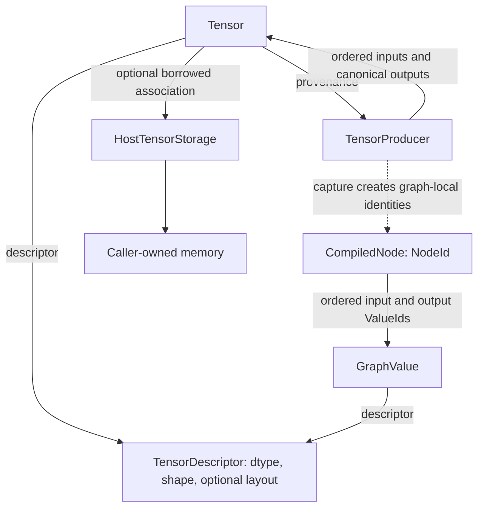
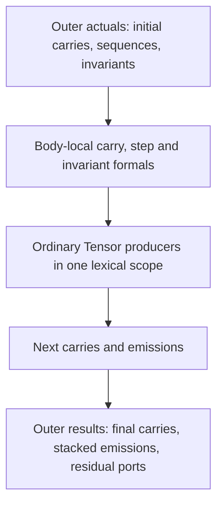

# [Model](../../glossary.md#term-model): values, expressions, and [graph](../../glossary.md#graph) meaning

This atlas explains how `modules/model` describes a computation without executing it. Start with the [learning journey](../../tutorials/index.md) for a runnable application, or the [framework explanation](../framework.md) for the [lifecycle](../../glossary.md#lifecycle) around these packages.

> This is explanatory documentation. The [architecture root](../../../ARCHITECTURE.md), [Model ownership contract](../../architecture/contracts/foundational-modules.md#modulesmodel) ([ownership glossary](../../glossary.md#term-ownership-meanings)), [numerical semantics](../../architecture/contracts/foundational-modules.md#profile-free-numerical-semantics), and [scan contract](../../architecture/contracts/recurrent-scan.md) ([scan glossary](../../glossary.md#term-cumulative-scan)) remain authoritative.

## Read the [model](../../glossary.md#term-model) in three layers

Read the upper arrows as semantic relationships, not execution. A [Tensor](../../glossary.md#tensor) has stable expression origin even when its [borrowed](../../glossary.md#ownership-borrowing-and-lease) storage is replaced or cleared. [Capture](../../glossary.md#term-capture-meanings) creates [graph](../../glossary.md#graph)-local [identities](../../glossary.md#term-identity-meanings); it does not turn a Tensor into a [node](../../glossary.md#node). The bottom arrow concerns [host](../../glossary.md#term-host) memory only, not a [device](../../glossary.md#term-device) allocation or [prepared executable](../../glossary.md#prepared-executable--preparedexecutable).

### Who constructs these objects?

An application, an NN layer's `forward` method, or Compiler's derivative builder calls Tensor
operations with operand Tensors. The callee checks descriptors and returns new **descriptions**
of derived results; it does not evaluate the operands or take ownership of their storage.
Compiler later follows producer links to capture the requested computation. A Tensor with no
producer is a **leaf**: it can be a storage-free input declaration as well as a stored parameter.
Thus the diagram's “caller-owned memory” applies only when storage was actually supplied.

For a `MemorySegmentStorage` constructor, the caller supplies the native segment and keeps its
Arena alive; the wrapper borrows that segment without copying or closing it. Flat primitive-array
import is a different boundary that copies values into heap storage. The owned NN Model builder
then copies supplied parameters into its own private state; that is not a property of every
Tensor operation. The [call-by-call ownership table](../ownership.md#which-call-borrows-or-copies)
explains when these borrowed bytes must remain available.

The [operation](../../glossary.md#operation)-family sections below share a specific boundary: kind and attributes are [immutable](../../glossary.md#term-immutable) semantic values consumed by Tensor construction and [Compiler](../../glossary.md#term-compiler) inspection. They do not own operand memory, [gradients](../../glossary.md#term-gradient), [kernels](../../glossary.md#kernel), [runtime](../../glossary.md#term-runtime) scratch, or [backend capability](../../glossary.md#backend-capability). Family-specific guards and input/output relationships differ; those differences are the reason for separate packages. Public Tensor methods are the application composition surface. Package-private `Tensor*Expressions` helpers are implementation details, not supported application [API](../../glossary.md#term-application-programming-interface-api). A source-valid expression is not proof of differentiation, [serialization](../../glossary.md#term-serialization), or [backend](../../glossary.md#backend) execution support.

An **[occurrence](../../glossary.md#term-occurrence)** is one particular [producer](../../glossary.md#term-producer) or port position, not just a formula name.
**[Provenance](../../glossary.md#provenance)** is the connection from a result to its producing occurrence and output position.
**Semantic** facts describe what that calculation means; **physical** facts describe where bytes
live and how executable code accesses them. **[Canonical](../../glossary.md#term-canonical-form) output wrappers** are the original Tensor
objects retained for a producer's output positions, not freshly reconstructed equal objects.

## A concrete walk through LearningJourney

This [trace](../../glossary.md#trace) connects the [canonical](../../glossary.md#term-canonical-form) program's actual [Tensor](../../glossary.md#tensor) expression families. The [examples entry point](../../examples/README.md) supplies the complete source, commands and checked [runtime](../../glossary.md#term-runtime) output; the algebra below explains why that output follows.

The program supplies [FLOAT32](../../glossary.md#term-float32) input `[2,1]` containing `[1,3]`, a [gradient](../../glossary.md#term-gradient)-eligible [weight](../../glossary.md#term-weight) `[1,1]` containing zero, no [bias](../../glossary.md#term-bias), and [target](../../glossary.md#term-target) `[2,1]` containing `[2,6]`. The public builder copies the supplied weight into [model](../../glossary.md#term-model)-owned [parameter](../../glossary.md#term-parameter) state; that [ownership](../../glossary.md#term-ownership-meanings) is above this [Model module](../../glossary.md#model-module-buffer-and-scan-distinctions).

1. `linear(weight)` describes `input @ transpose(weight)`. [Transpose](../../glossary.md#term-transpose) is a `PERMUTE` with [axes](../../glossary.md#term-axis) `[1,0]`; [MATMUL](../../glossary.md#matrix-multiplication--matmul) contracts the [feature](../../glossary.md#term-feature) axes. Its result [descriptor](../../glossary.md#term-descriptor) is FLOAT32 `[2,1]`, not a computed array.
2. `squaredErrorSum` constructs `prediction.sub(target)`, `error.mul(error)` and `.sum()`:
   binary arithmetic followed by aggregate reduction. At the initial zero weight, predictions
   are $(0,0)$ and the sum is $4+36=40$. A first-class loss-family occurrence is an alternative
   representation, not the occurrence used by LearningJourney.
3. The [Compiler](../../glossary.md#term-compiler) [captures](../../glossary.md#term-capture-meanings) [producer](../../glossary.md#term-producer) occurrences and assigns NodeIds and ValueIds. It owns [automatic differentiation](../../glossary.md#autograd). `requiresGrad` in a descriptor requests eligibility; no gradient field is installed on Tensor.
4. For finite real teaching inputs, the weight sensitivity is
   $2((-2)\cdot1+(-6)\cdot3)=-40$; `Sgd(0.05)` gives $w_{\mathrm{new}}=0-0.05(-40)=2$.
   [The full derivation](../tensors-and-gradients.md#the-first-training-step) defines the sample
   indices and rounding boundary. Training/NN owns this state transition, not an operation enum
   or Tensor provenance.
5. Re-execution predicts `[2,6]`; fresh values `[2,4]` under the same `[2,1]` [signature](../../glossary.md#term-signature) predict `[4,8]`. Replacing values is different from changing [shape](../../glossary.md#shape): a mismatching static signature is an error, not implicit recompilation.

The direct expression path therefore exercises datatype, shape, [layout](../../glossary.md#layout), storage, tensor, [graph](../../glossary.md#graph), operation, operation.layout, operation.linalg, operation.[elementwise](../../glossary.md#term-elementwise).binary and operation.reduction. Compiler constructs [derivative](../../glossary.md#term-derivative) algebra from those expressions before [capture](../../glossary.md#term-capture-meanings); this trace does not promise an exact optimized [node](../../glossary.md#node) [decomposition](../../glossary.md#term-decomposition). The loss family is an alternative, and other families below are intentionally absent from this tiny [linear](../../glossary.md#term-linear-meanings) example.

## io.github.pho001.synaptik.[model](../../glossary.md#term-model).datatype

Important entry points: [DataType](../../../modules/model/src/main/java/io/github/pho001/synaptik/model/datatype/DataType.java) ([DataType glossary](../../glossary.md#data-type--datatype)), [DataTypePromotion](../../../modules/model/src/main/java/io/github/pho001/synaptik/model/datatype/DataTypePromotion.java), and [ScalarValue](../../../modules/model/src/main/java/io/github/pho001/synaptik/model/datatype/ScalarValue.java).

This package answers what one [element](../../glossary.md#term-element) means: logical category, byte width, differentiability, promotion, and low-[precision](../../glossary.md#term-precision) representation. [FLOAT64](../../glossary.md#term-float64), [FLOAT32](../../glossary.md#term-float32), [BFLOAT16](../../glossary.md#term-bfloat16), [FLOAT16](../../glossary.md#term-float16), FLOAT8_E4M3, FLOAT8_E5M2, [INT32](../../glossary.md#data-type--datatype), [INT64](../../glossary.md#data-type--datatype), and [BOOL](../../glossary.md#data-type--datatype) are Model meanings, not statements about installed native hardware. Promotion is used by input-aware expression construction; arbitrary cross-category arithmetic is not implied by the existence of casts.

A [`ScalarValue`](../../glossary.md#typed-scalar-value--scalarvalue) stores a [dtype](../../glossary.md#data-type--datatype) and exact primitive bits. It is [operation](../../glossary.md#operation) [metadata](../../glossary.md#term-metadata), not a [rank-zero](../../glossary.md#axis-rank-scalar-vector-and-matrix) [Tensor](../../glossary.md#tensor) or [borrowed](../../glossary.md#ownership-borrowing-and-lease) storage. Its equality distinguishes signed floating zeros and raw [NaN](../../glossary.md#term-nan) payloads, and a wrong-type accessor fails rather than converting. [BFloat16Bits](../../../modules/model/src/main/java/io/github/pho001/synaptik/model/datatype/BFloat16Bits.java), [Float16Bits](../../../modules/model/src/main/java/io/github/pho001/synaptik/model/datatype/Float16Bits.java), and the two Float8 bit utilities define representation conversions. This keeps low-format semantics independent of [CPU](../../glossary.md#term-cpu)/[Metal](../../glossary.md#term-metal) availability. These [immutable](../../glossary.md#term-immutable) values own no memory [lifetime](../../glossary.md#term-lifetime). LearningJourney uses FLOAT32; its [learning rate](../../glossary.md#term-learning-rate) belongs to [optimizer](../../glossary.md#term-optimizer) configuration, not a Tensor dtype promotion request.

## io.github.pho001.synaptik.[model](../../glossary.md#term-model).[shape](../../glossary.md#shape)

Important entry points: [Shape](../../../modules/model/src/main/java/io/github/pho001/synaptik/model/shape/Shape.java), [Dimension](../../../modules/model/src/main/java/io/github/pho001/synaptik/model/shape/Dimension.java), [DimensionExpressions](../../../modules/model/src/main/java/io/github/pho001/synaptik/model/shape/DimensionExpressions.java), and [ShapeBroadcast](../../../modules/model/src/main/java/io/github/pho001/synaptik/model/shape/ShapeBroadcast.java).

A Shape is an [immutable](../../glossary.md#term-immutable) ordered list of static extents, named dynamic [dimensions](../../glossary.md#dimension), or dimension expressions. [Rank](../../glossary.md#term-rank) zero is a [scalar](../../glossary.md#term-scalar) with one logical [element](../../glossary.md#term-element); a static zero [extent](../../glossary.md#term-extent) makes an empty [tensor](../../glossary.md#tensor). Static sizes cannot be negative. Numeric `-1` reshape syntax is normalized by the expression boundary and is not stored as a negative dimension.

“Normalized” has several meanings in this atlas. Normalizing an [axis](../../glossary.md#term-axis) turns a caller-facing
negative index into the corresponding non-negative axis; normalizing reshape syntax resolves the
special request before storing a Shape. Neither is numerical [normalization](../../glossary.md#term-normalization) such as [softmax](../../glossary.md#softmax--log-softmax).

Shape transformations consume dimensions and return dimensions; they do not bind [runtime](../../glossary.md#term-runtime) values or provide [strides](../../glossary.md#term-stride). [Broadcasting](../../glossary.md#broadcasting) aligns trailing axes, permitting equal dimensions or [singleton](../../glossary.md#term-singleton) expansion and retaining unresolved obligations where proof must wait. Expression dimensions describe derived geometry rather than inventing a sampled extent. Checked element-count arithmetic may [overflow](../../glossary.md#term-overflow) even though individual dimensions are valid. [Compiler](../../glossary.md#term-compiler)/[Prepare](../../glossary.md#prepare) owns later symbolic [binding](../../glossary.md#term-binding). In LearningJourney, `[2,1] @ [1,1]` yields `[2,1]`; the [objective](../../glossary.md#term-objective) is scalar. See the [tensor guide](../../user-guide/tensors.md) for shape-facing operations.

## io.github.pho001.synaptik.[model](../../glossary.md#term-model).[layout](../../glossary.md#layout)

Important entry points: [LayoutDescriptor](../../../modules/model/src/main/java/io/github/pho001/synaptik/model/layout/LayoutDescriptor.java), [LayoutGeometry](../../../modules/model/src/main/java/io/github/pho001/synaptik/model/layout/LayoutGeometry.java), and [LayoutKind](../../../modules/model/src/main/java/io/github/pho001/synaptik/model/layout/LayoutKind.java).

Layout describes resolved element geometry, not memory ownership. For rank $r\ge0$, let
$i_a$ be the logical coordinate on axis $a\in\{0,\ldots,r-1\}$, with
$0\le i_a<d_a$ for axis extent $d_a$. With storage offset $o$ and stride $s_a$, the
element position is $p=o+\sum_{a=0}^{r-1}i_as_a$. Offsets and strides are in **elements**,
not bytes. For a zero-offset $2\times3$ matrix with strides $(3,1)$, coordinate $(1,2)$
reads element $5$. For rank zero the sum is empty and the scalar reads $o$; an empty axis has
no legal coordinate. This is checked integer geometry, not rounded floating arithmetic.
A descriptor holds copied strides, derived classification, a view flag and referenced span;
it retains neither the originating Shape nor storage. See
[the geometry walkthrough](../tensors-and-gradients.md#layout-says-which-stored-element-an-index-references).

Only fully static shapes admit numeric layouts. Stride count must equal [rank](../../glossary.md#term-rank); strides and offset are nonnegative; repeating a [dimension](../../glossary.md#dimension) larger than one with stride zero requires `isView=true`. Geometry arithmetic is checked. Empty geometry references no elements, while [scalar](../../glossary.md#term-scalar) geometry references one. [Canonical](../../glossary.md#term-canonical-form) [contiguity](../../glossary.md#storage-mapping-contiguity-and-injectivity) and [alias](../../glossary.md#aliasing-and-arena) [metadata](../../glossary.md#term-metadata) answer different questions: a view may have [contiguous](../../glossary.md#term-contiguous) geometry without owning storage. TensorDescriptor separately validates the layout against its paired Shape.

LearningJourney's dense [host](../../glossary.md#term-host) inputs use resolved geometry. Its [weight](../../glossary.md#term-weight) [transpose](../../glossary.md#term-transpose) describes a view mapping; this does not itself attach the weight's storage to the fresh result [Tensor](../../glossary.md#tensor). Most computed expression layouts may remain unresolved until later [inference](../../glossary.md#term-inference)/[materialization](../../glossary.md#materialization) decisions.

## io.github.pho001.synaptik.[model](../../glossary.md#term-model).storage

Important entry points: [HostTensorStorage](../../../modules/model/src/main/java/io/github/pho001/synaptik/model/storage/HostTensorStorage.java) and [MemorySegmentStorage](../../../modules/model/src/main/java/io/github/pho001/synaptik/model/storage/MemorySegmentStorage.java).

This is the [borrowed](../../glossary.md#ownership-borrowing-and-lease) [host](../../glossary.md#term-host)-memory boundary. `MemorySegmentStorage` retains an exact caller-supplied [JDK](../../glossary.md#term-java-development-kit-jdk) [MemorySegment](../../glossary.md#term-memorysegment), logical [dtype](../../glossary.md#data-type--datatype), physical [element](../../glossary.md#term-element) capacity, and checked byte size. It neither allocates nor copies nor closes the segment. Its constructor requires nonnegative capacity, exact `capacity * byteWidth == segment.byteSize()`, and an initially live [scope](../../glossary.md#term-scope). Zero capacity requires a live zero-byte segment. It makes no [alignment](../../glossary.md#term-alignment) or byte-order promise and does not itself check a [Tensor](../../glossary.md#tensor)'s [layout](../../glossary.md#layout).

The caller must keep the [arena](../../glossary.md#term-arena) alive and obey its thread-access/read-only policy. [Metadata](../../glossary.md#term-metadata) remains readable after closure, but accessing the dead segment fails under JDK rules. Tensor association validates compatibility separately; synchronized reference replacement does not synchronize underlying memory writes. Logical element count, referenced layout span, and physical capacity must not be conflated. LearningJourney's input/[target](../../glossary.md#term-target)/[weight](../../glossary.md#term-weight) values eventually need host values, but [operation](../../glossary.md#operation) construction alone does not read them. [Device](../../glossary.md#term-device) storage and native [buffers](../../glossary.md#term-buffer) belong elsewhere; there is no native component in `modules/model`.

## io.github.pho001.synaptik.[model](../../glossary.md#term-model).[tensor](../../glossary.md#tensor)

Important entry points: [Tensor](../../../modules/model/src/main/java/io/github/pho001/synaptik/model/tensor/Tensor.java), [TensorFactory](../../../modules/model/src/main/java/io/github/pho001/synaptik/model/tensor/TensorFactory.java), [TensorDescriptor](../../../modules/model/src/main/java/io/github/pho001/synaptik/model/tensor/TensorDescriptor.java), [TensorProducer](../../../modules/model/src/main/java/io/github/pho001/synaptik/model/tensor/TensorProducer.java) ([TensorProducer glossary](../../glossary.md#producer--tensorproducer)), and [TensorProvenance](../../../modules/model/src/main/java/io/github/pho001/synaptik/model/tensor/TensorProvenance.java).

A Tensor has [immutable](../../glossary.md#term-immutable) [TensorId](../../glossary.md#tensorid), [descriptor](../../glossary.md#term-descriptor), diagnostic label, and optional [provenance](../../glossary.md#provenance). Its only [mutable](../../glossary.md#term-mutable) state is an optional [borrowed](../../glossary.md#ownership-borrowing-and-lease) [host](../../glossary.md#term-host)-storage association. Object equality is [identity](../../glossary.md#term-identity-meanings) equality, not descriptor equality or matching ID text. Factory allocations receive [JVM](../../glossary.md#term-java-virtual-machine-jvm)-unique TensorIds; this is a different [identity domain](../../glossary.md#term-identity-domain) from a [graph](../../glossary.md#graph)'s [NodeId](../../glossary.md#nodeid)/[ValueId](../../glossary.md#logical-valueid-versus-physical-memory-slot).

A descriptor contains [dtype](../../glossary.md#data-type--datatype), [Shape](../../glossary.md#shape), optional resolved [layout](../../glossary.md#layout), and `requiresGrad`. A fully static Shape may still have unresolved layout; a dynamic Shape cannot have a resolved numeric layout. A true [gradient](../../glossary.md#term-gradient) request is rejected for a nondifferentiable dtype and never proves an [operation](../../glossary.md#operation) has a [derivative](../../glossary.md#term-derivative) implementation.

Expression methods validate operand [metadata](../../glossary.md#term-metadata) and create storage-free results. A [producer](../../glossary.md#term-producer) owns one exact operation [occurrence](../../glossary.md#term-occurrence), ordered input references and output descriptors, and all [canonical](../../glossary.md#term-canonical-form) output wrappers, created together by the factory. Provenance identifies the producer and output slot. Repeated access returns the same wrapper, not a reconstructed equal Tensor. Multi-output results such as TopK, [dropout](../../glossary.md#dropout--inverted-dropout), attention, [batch normalization](../../glossary.md#batch-normalization--batch-normalization-inference-and-training) and recurrence retain sibling relationships; keeping one result can keep its siblings alive. These ordinary Java reference cycles own no external resource.

The important distinction is visible in LearningJourney: its [prediction](../../glossary.md#term-prediction) expression knows how it was requested even before any numerical prediction exists. Rebinding or clearing [host storage](../../glossary.md#host-storage) cannot rewrite that origin. Tensor owns neither accumulated gradients nor [optimizer state](../../glossary.md#term-optimizer-state). Read [autograd](../../user-guide/autograd.md) ([autograd glossary](../../glossary.md#autograd)) for the separate derivative workflow.

### [Scan](../../glossary.md#term-cumulative-scan) bodies and lexical containment

[ScanBody](../../../modules/model/src/main/java/io/github/pho001/synaptik/model/tensor/ScanBody.java), [Scan](../../../modules/model/src/main/java/io/github/pho001/synaptik/model/tensor/Scan.java), and [ScanResult](../../../modules/model/src/main/java/io/github/pho001/synaptik/model/tensor/ScanResult.java) describe fixed-count composition over ordinary [Tensor](../../glossary.md#tensor) algebra. This is not a [callback](../../glossary.md#term-callback) retained for [runtime](../../glossary.md#term-runtime) invocation.

The diagram separates outer actual [bindings](../../glossary.md#term-binding) from body-local formals. Body [leaves](../../glossary.md#term-leaf) must be the exact declared formals by [identity](../../glossary.md#term-identity-meanings); hidden Tensor [constants](../../glossary.md#term-constant) must instead be explicit invariants. Formals are distinct, storage/[provenance](../../glossary.md#provenance)-free and disjoint from actual bindings. Unused declared formals are allowed; repeated actual identities in different positions are not deduplicated. Free leaves, [host](../../glossary.md#term-host)-backed constants, mutation, [RNG](../../glossary.md#graph-rng-state--graphrngstate), and nested/recursive bodies reject.

The [immutable](../../glossary.md#term-immutable) template may be reused by several scan occurrences, but [producers](../../glossary.md#term-producer) cannot escape into the outer expression or be shared across different lexical templates. Captured body ValueIds are local: the same number in two bodies does not name the same value. Retained [residual](../../glossary.md#scan-residual-port-and-history-demand) ports identify semantic body values potentially needed later; they do not allocate saved [buffers](../../glossary.md#term-buffer). `ScanBody.describeOrdinary` checks output [descriptors](../../glossary.md#term-descriptor) without creating Tensors, IDs or storage. Its descriptor proof is not [backend](../../glossary.md#backend) [admission](../../glossary.md#term-admission) or [Compiler](../../glossary.md#term-compiler) [inference](../../glossary.md#term-inference).

Current source admits more [PURE](../../glossary.md#term-pure) algebra/type combinations than every downstream execution or [persistence](../../glossary.md#term-persistence) route. Symbolic-[batch](../../glossary.md#term-batch-machine-learning-and-hyperparameters) and length-aware forms have additional exact role/[coordinate](../../glossary.md#axis-rank-scalar-vector-and-matrix) constraints; the [focused Scan explanation](../../architecture/general-differentiable-scan.md) and [owning contract](../../architecture/contracts/recurrent-scan.md#general-differentiable-scan) separate those domains. None participates in LearningJourney.

## io.github.pho001.synaptik.[model](../../glossary.md#term-model).[graph](../../glossary.md#graph)

Important entry points: [CompiledGraphModel](../../../modules/model/src/main/java/io/github/pho001/synaptik/model/graph/CompiledGraphModel.java) ([CompiledGraphModel glossary](../../glossary.md#compiled-graph--compiledgraphmodel)), [CompiledNode](../../../modules/model/src/main/java/io/github/pho001/synaptik/model/graph/CompiledNode.java), [GraphValue](../../../modules/model/src/main/java/io/github/pho001/synaptik/model/graph/GraphValue.java), [CompiledScanBody](../../../modules/model/src/main/java/io/github/pho001/synaptik/model/graph/CompiledScanBody.java), and [ForwardPublicationBinding](../../../modules/model/src/main/java/io/github/pho001/synaptik/model/graph/ForwardPublicationBinding.java).

[Compiler](../../glossary.md#term-compiler) emits [immutable](../../glossary.md#term-immutable) graph values ([ValueId](../../glossary.md#logical-valueid-versus-physical-memory-slot) plus [descriptor](../../glossary.md#term-descriptor)) and topologically ordered computation [nodes](../../glossary.md#node) ([NodeId](../../glossary.md#nodeid), [operation](../../glossary.md#operation), ordered ports, optional compiled [Scan body](../../glossary.md#backpropagation-through-time-and-recurrent-state)). The graph snapshots values, nodes, ordered boundaries and per-node forward/backward phases. It validates structural closure: IDs are unique within their domain/[scope](../../glossary.md#term-scope); every reference resolves; inputs are [producer](../../glossary.md#term-producer)-free; every non-input has one producer; node inputs are available before use; phases cover exactly the nodes. Cycles, later-node dependencies and duplicate producers reject. Repeated node inputs, unused inputs and a zero-node pass-through are legitimate.

A **[directed acyclic graph](../../glossary.md#term-directed-acyclic-graph-dag) ([DAG](../../glossary.md#intermediate-representation-dag-and-ssa))** has arrows from producers to consumers and no path back to its
starting node. **[Topological order](../../glossary.md#term-topological-order)** lists each producer before nodes that use its outputs.
**Closure** means all referenced [identities](../../glossary.md#term-identity-meanings) exist in the intended graph scope; it is not resource
closure via `close()`. **[Arity](../../glossary.md#term-arity)** or [signature](../../glossary.md#term-signature) [cardinality](../../glossary.md#term-cardinality) means the number of input/output positions.

Graph structural [validation](../../glossary.md#term-validation) does not infer family descriptors, allocate IDs, [capture](../../glossary.md#term-capture-meanings) public [Tensors](../../glossary.md#tensor), select [backends](../../glossary.md#backend) or build an executable. Forward [publication](../../glossary.md#term-publication) [bindings](../../glossary.md#term-binding) describe the public Tensor/graph-value relationship without [embedding](../../glossary.md#embedding) [mutable](../../glossary.md#term-mutable) public Tensors in graph structure. A compiled Scan body contains the one nested captured graph and ordered role/result bindings; graph outputs are unique even when role bindings intentionally repeat a value.

LearningJourney reaches this layer during [compilation](../../glossary.md#compiler-engine-and-execution-stage-names), with separate forward and [derivative](../../glossary.md#term-derivative) work as needed. Graph IDs describe that capture, not the globally allocated input TensorIds or physical memory slots. See [compiling graphs](../../user-guide/compiling-graphs.md).

## io.github.pho001.synaptik.[model](../../glossary.md#term-model).[operation](../../glossary.md#operation)

Important entry points: [Operation](../../../modules/model/src/main/java/io/github/pho001/synaptik/model/operation/Operation.java), [OperationKind](../../../modules/model/src/main/java/io/github/pho001/synaptik/model/operation/OperationKind.java) ([OperationKind glossary](../../glossary.md#operationkind)), [OperationAttrs](../../../modules/model/src/main/java/io/github/pho001/synaptik/model/operation/OperationAttrs.java) ([OperationAttrs glossary](../../glossary.md#operationattrs)), and [OperationSignature](../../../modules/model/src/main/java/io/github/pho001/synaptik/model/operation/OperationSignature.java).

An Operation pairs a typed semantic kind with [immutable](../../glossary.md#term-immutable) attributes. A family declares accepted **exact attribute classes** and inclusive input/output count ranges. Kind [signature](../../glossary.md#term-signature) resolution fails closed for undeclared pairings or malformed declarations. Parameterless operations use `NoOperationAttrs.INSTANCE`, never null. A diagnostic enum name is not a [kernel](../../glossary.md#kernel) name, [registry](../../glossary.md#term-registry) key or wire [token](../../glossary.md#term-token); two families may use the same text without becoming the same kind.

There are three different checks: attributes validate their intrinsic [parameters](../../glossary.md#term-parameter); Operation validates kind/attribute pairing; input-aware [Tensor](../../glossary.md#tensor) methods validate ranks, [dtype](../../glossary.md#data-type--datatype)/[Shape](../../glossary.md#shape) compatibility and derive results. Signature [cardinality](../../glossary.md#term-cardinality) alone cannot establish a valid [MATMUL](../../glossary.md#matrix-multiplication--matmul). Attributes contain no Tensor, [graph](../../glossary.md#graph), storage, service or body closure. [TensorProducer](../../glossary.md#producer--tensorproducer) and CompiledNode supply [occurrence](../../glossary.md#term-occurrence) [identity](../../glossary.md#term-identity-meanings) and ordered operands. These packages describe LearningJourney's [transpose](../../glossary.md#term-transpose), multiplication and [loss](../../glossary.md#loss); execution occurs only in later layers.

## io.github.pho001.synaptik.[model](../../glossary.md#term-model).[operation](../../glossary.md#operation).attention

[ScaledDotProductAttentionKind](../../../modules/model/src/main/java/io/github/pho001/synaptik/model/operation/attention/ScaledDotProductAttentionKind.java) consumes `[query,key,value]` with an optional fourth [Boolean mask](../../glossary.md#term-boolean-mask). It produces attention output and, when explicitly requested, normalized [weights](../../glossary.md#term-weight) as a second [canonical](../../glossary.md#term-canonical-form) output. It contracts query/key embeddings, applies exact [mask](../../glossary.md#masks-padding-and-eager-evaluation)/causal eligibility, normalizes eligible scores, and aggregates value rows; it is not just an [alias](../../glossary.md#aliasing-and-arena) for [MATMUL](../../glossary.md#matrix-multiplication--matmul).

[ScaledDotProductAttentionAttrs](../../../modules/model/src/main/java/io/github/pho001/synaptik/model/operation/attention/ScaledDotProductAttentionAttrs.java) stores an optional [finite](../../glossary.md#term-finite) positive typed scale and causal flag. Absence means `1/sqrt(E)` for positive bound [embedding](../../glossary.md#embedding) [extent](../../glossary.md#term-extent). Scale [metadata](../../glossary.md#term-metadata) accepts [FLOAT64](../../glossary.md#term-float64), [FLOAT32](../../glossary.md#term-float32) or [BFLOAT16](../../glossary.md#term-bfloat16); [Tensor](../../glossary.md#tensor) construction owns operand-dependent geometry and compatibility. No eligible positions produce positive-zero output, and eligibility cannot be approximated. The attributes own no [cache](../../glossary.md#term-cache) or saved weights; auxiliary weights are ordinary [producer](../../glossary.md#term-producer) results. Attention is absent from LearningJourney.

## io.github.pho001.synaptik.[model](../../glossary.md#term-model).[operation](../../glossary.md#operation).[convolution](../../glossary.md#term-channels-first-convolution-layers)

[Conv2dKind](../../../modules/model/src/main/java/io/github/pho001/synaptik/model/operation/convolution/Conv2dKind.java) and [Conv3dKind](../../../modules/model/src/main/java/io/github/pho001/synaptik/model/operation/convolution/Conv3dKind.java) describe grouped [NCHW](../../glossary.md#term-nchw)/[NCDHW](../../glossary.md#conv3d--ncdhw) **cross-correlation**, not a spatially reversed mathematical convolution. Ordered inputs are `[input,weight]` with optional per-output-[channel](../../glossary.md#term-channel) [bias](../../glossary.md#term-bias). Each output contracts the exact channel/[kernel](../../glossary.md#kernel) contributors; symmetric [padding](../../glossary.md#padding) supplies [positive zero](../../glossary.md#nan-infinity-and-signed-zero).

[Conv2dAttrs](../../../modules/model/src/main/java/io/github/pho001/synaptik/model/operation/convolution/Conv2dAttrs.java) and Conv3dAttrs require positive [stride](../../glossary.md#term-stride), [dilation](../../glossary.md#term-dilation) and groups and nonnegative padding. Kernel extents and bias presence remain operand/[occurrence](../../glossary.md#term-occurrence) facts. Channel divisibility, ranks and output geometry are input-aware checks, not guaranteed by valid attributes. Conv1dAttrs is a convenience translated to [singleton](../../glossary.md#term-singleton)-height 2D geometry; no Conv1d occurrence retains it. No [weights](../../glossary.md#term-weight), workspace or native handle are owned here. This [spatial](../../glossary.md#term-spatial-axes) family is not used by LearningJourney's [linear](../../glossary.md#term-linear-meanings) layer.

## io.github.pho001.synaptik.[model](../../glossary.md#term-model).[operation](../../glossary.md#operation).[elementwise](../../glossary.md#term-elementwise).[binary](../../glossary.md#term-binary-descriptor-and-metadata)

[BinaryArithmeticKind](../../../modules/model/src/main/java/io/github/pho001/synaptik/model/operation/elementwise/binary/BinaryArithmeticKind.java) defines ordered two-input ADD, SUB, MUL, DIV, MIN, MAX and POW with no attributes. [Tensor](../../glossary.md#tensor) construction right-aligns broadcast [shapes](../../glossary.md#shape) and promotes same-category operands. Integral ADD/SUB/MUL wrap at their fixed width; DIV/POW remain floating-only. MIN/MAX select using represented values and explicit [NaN](../../glossary.md#term-nan)/[signed-zero](../../glossary.md#nan-infinity-and-signed-zero) rules rather than arithmetic [tolerance](../../glossary.md#term-tolerance).

Only the request is stored: no broadcast [buffer](../../glossary.md#term-buffer) or computed [element](../../glossary.md#term-element) array exists in the kind. LearningJourney's mathematical error and [derivative](../../glossary.md#term-derivative) formulas involve subtraction and multiplication, but the first-class [loss](../../glossary.md#loss) may keep its own [occurrence](../../glossary.md#term-occurrence) instead of materializing this elementary [graph](../../glossary.md#graph).

## io.github.pho001.synaptik.[model](../../glossary.md#term-model).[operation](../../glossary.md#operation).[elementwise](../../glossary.md#term-elementwise).cast

[CastKind](../../../modules/model/src/main/java/io/github/pho001/synaptik/model/operation/elementwise/cast/CastKind.java), [CastAttrs](../../../modules/model/src/main/java/io/github/pho001/synaptik/model/operation/elementwise/cast/CastAttrs.java), and [CastValueConversions](../../../modules/model/src/main/java/io/github/pho001/synaptik/model/operation/elementwise/cast/CastValueConversions.java) separate a one-input cast request from the [scalar](../../glossary.md#term-scalar) conversion [oracle](../../glossary.md#term-test-oracle). Attributes store only [target](../../glossary.md#term-target) [dtype](../../glossary.md#data-type--datatype); source dtype comes from the input [descriptor](../../glossary.md#term-descriptor). Every current source/target pair has a defined conversion.

The oracle preserves object [identity](../../glossary.md#term-reference-identity) for same-type [ScalarValue](../../glossary.md#typed-scalar-value--scalarvalue) conversion, rounds directly to floating targets with [ties-to-even](../../glossary.md#term-ties-to-even), and defines [saturation](../../glossary.md#term-saturation), [NaN](../../glossary.md#term-nan), [infinity](../../glossary.md#term-infinity), [Boolean](../../glossary.md#data-type--datatype) and integral-width cases. Casts are exact conversions, not floating arithmetic sites: arithmetic [denormals-are-zero](../../glossary.md#subnormal-daz-ftz-overflow-and-underflow)/[flush-to-zero](../../glossary.md#subnormal-daz-ftz-overflow-and-underflow) permissions do not apply. [Tensor](../../glossary.md#tensor) preserves [Shape](../../glossary.md#shape) and [gradient](../../glossary.md#term-gradient) eligibility only across floating-to-floating casts. The oracle reads no Tensor storage and is not a [backend](../../glossary.md#backend) [element](../../glossary.md#term-element) loop. LearningJourney deliberately stays [FLOAT32](../../glossary.md#term-float32) and needs no cast.

## io.github.pho001.synaptik.[model](../../glossary.md#term-model).[operation](../../glossary.md#operation).[elementwise](../../glossary.md#term-elementwise).classification

[FloatingClassificationKind](../../../modules/model/src/main/java/io/github/pho001/synaptik/model/operation/elementwise/classification/FloatingClassificationKind.java) describes one-input [finite](../../glossary.md#term-finite)/infinite/[NaN](../../glossary.md#term-nan) tests, each producing same-[Shape](../../glossary.md#shape) nondifferentiable [BOOL](../../glossary.md#data-type--datatype) [metadata](../../glossary.md#term-metadata) through [Tensor](../../glossary.md#tensor) construction. It reads the meaning of the stored representation, including [subnormals](../../glossary.md#term-subnormal), not an approximate arithmetic predicate. There are no [parameters](../../glossary.md#term-parameter), counters or diagnostic services: these are [graph](../../glossary.md#graph)-visible [Boolean](../../glossary.md#data-type--datatype) values, unlike [trace](../../glossary.md#trace) events. Nonfloating input rejects at expression construction. LearningJourney has no classification branch.

## io.github.pho001.synaptik.[model](../../glossary.md#term-model).[operation](../../glossary.md#operation).[elementwise](../../glossary.md#term-elementwise).comparison

[BinaryComparisonKind](../../../modules/model/src/main/java/io/github/pho001/synaptik/model/operation/elementwise/comparison/BinaryComparisonKind.java) describes ordered two-input relations with [singleton](../../glossary.md#term-singleton) attributes. [Tensor](../../glossary.md#tensor) methods validate same-category numeric operands, promote/broadcast them and publish [BOOL](../../glossary.md#data-type--datatype) results without [gradients](../../glossary.md#term-gradient). Floating equality compares represented numeric values, not [raw bits](../../glossary.md#storage-mapping-contiguity-and-injectivity): signed zeros are equal, [NaN](../../glossary.md#term-nan) is unequal to everything, and ordered relations with NaN are false. No [epsilon](../../glossary.md#epsilon) is available.

These semantics differ from [ScalarValue](../../glossary.md#typed-scalar-value--scalarvalue) [metadata](../../glossary.md#term-metadata) equality and ordering-family winner rules. The kind retains no comparator or operand storage. LearningJourney's arithmetic [objective](../../glossary.md#term-objective) does not use [Boolean](../../glossary.md#data-type--datatype) comparisons.

## io.github.pho001.synaptik.[model](../../glossary.md#term-model).[operation](../../glossary.md#operation).[elementwise](../../glossary.md#term-elementwise).logical

[BooleanLogicalKind](../../../modules/model/src/main/java/io/github/pho001/synaptik/model/operation/elementwise/logical/BooleanLogicalKind.java) gives two-input AND/OR and one-input NOT exact truth-table meaning. [Tensor](../../glossary.md#tensor) construction requires [BOOL](../../glossary.md#data-type--datatype), broadcasts [binary](../../glossary.md#term-binary-descriptor-and-metadata) operands and creates nondifferentiable BOOL results. Numeric truthiness requires an explicit cast rather than implicit logical coercion. There is no [mutable](../../glossary.md#term-mutable) [Boolean](../../glossary.md#data-type--datatype) state or short-circuit control-flow body here. LearningJourney does not use logical operations.

## io.github.pho001.synaptik.[model](../../glossary.md#term-model).[operation](../../glossary.md#operation).[elementwise](../../glossary.md#term-elementwise).[scalar](../../glossary.md#term-scalar)

[ScalarElementwiseKind](../../../modules/model/src/main/java/io/github/pho001/synaptik/model/operation/elementwise/scalar/ScalarElementwiseKind.java) refines one [Tensor](../../glossary.md#tensor) input with [ScalarValueAttrs](../../../modules/model/src/main/java/io/github/pho001/synaptik/model/operation/elementwise/scalar/ScalarValueAttrs.java) or [ClampRangeAttrs](../../../modules/model/src/main/java/io/github/pho001/synaptik/model/operation/elementwise/scalar/ClampRangeAttrs.java). The scalar is [metadata](../../glossary.md#term-metadata), not a second Tensor [leaf](../../glossary.md#term-leaf). Exact matching scalar [dtype](../../glossary.md#data-type--datatype) avoids implicit promotion; Java-double conveniences [mean](../../glossary.md#term-mean) [FLOAT64](../../glossary.md#term-float64), which matters for a [FLOAT32](../../glossary.md#term-float32) receiver.

Range clamp means ordered `MIN(MAX(input,min),max)` but remains one [occurrence](../../glossary.md#term-occurrence). Bounds must have equal numeric dtype and not be strictly inverted; [NaN](../../glossary.md#term-nan) endpoints and either [signed-zero](../../glossary.md#nan-infinity-and-signed-zero) ordering are structurally accepted under the stated comparison rule. DIV, POW and range CLAMP expression forms are floating-only, while selected scalar arithmetic also accepts integrals. No scalar [buffer](../../glossary.md#term-buffer) is allocated by the attrs. This family can explain elementary learning formulas, but [SGD](../../glossary.md#term-stochastic-gradient-descent-sgd)'s [learning-rate](../../glossary.md#gradient-and-learning-rate) configuration is not itself a scalar Tensor operation.

## io.github.pho001.synaptik.[model](../../glossary.md#term-model).[operation](../../glossary.md#operation).[elementwise](../../glossary.md#term-elementwise).selection

[WhereSelectionKind](../../../modules/model/src/main/java/io/github/pho001/synaptik/model/operation/elementwise/selection/WhereSelectionKind.java) defines ordered `[condition,trueBranch,falseBranch]` inputs and one output. [Tensor](../../glossary.md#tensor) methods require [BOOL](../../glossary.md#data-type--datatype) condition, floating branches, branch promotion and compatible combined [broadcasting](../../glossary.md#broadcasting). [Gradient](../../glossary.md#term-gradient) eligibility comes from branches, not the predicate.

WHERE chooses exactly before any required cast; same-type selection preserves chosen bits, including [NaN](../../glossary.md#term-nan) payloads and [subnormals](../../glossary.md#term-subnormal). It neither specifies [eager](../../glossary.md#term-eager-evaluation) versus [lazy evaluation](../../glossary.md#term-lazy-evaluation) nor creates a conditional [graph](../../glossary.md#graph) region. It owns no branch closure. LearningJourney has no masked selection.

## io.github.pho001.synaptik.[model](../../glossary.md#term-model).[operation](../../glossary.md#operation).[elementwise](../../glossary.md#term-elementwise).[unary](../../glossary.md#term-unary)

[UnaryElementwiseKind](../../../modules/model/src/main/java/io/github/pho001/synaptik/model/operation/elementwise/unary/UnaryElementwiseKind.java) gives nineteen parameterless one-input floating transforms/[activations](../../glossary.md#term-activation) their formulas. [Tensor](../../glossary.md#tensor) construction preserves logical [Shape](../../glossary.md#shape)/type and eligibility; the enum does not install [derivative](../../glossary.md#term-derivative) rules. ABS/NEG sign operations and SIGN/FLOOR/CEIL/RELU have exact represented-value rules. LOG1P and EXPM1 are first-class [targets](../../glossary.md#term-target), not separately rounded `LOG(1+x)` or `EXP(x)-1` [graphs](../../glossary.md#graph).

Numerical domains and [infinity](../../glossary.md#term-infinity)/[NaN](../../glossary.md#term-nan)/zero behavior belong to each formula, not construction-time [evaluation](../../glossary.md#term-evaluation) of stored input values. No activation array or [cache](../../glossary.md#term-cache) is owned here. LearningJourney is deliberately [bias](../../glossary.md#term-bias)-free and activation-free, so this family is outside its forward path.

## io.github.pho001.synaptik.[model](../../glossary.md#term-model).[operation](../../glossary.md#operation).index

Important entry points: [AxisGatherKind](../../../modules/model/src/main/java/io/github/pho001/synaptik/model/operation/index/AxisGatherKind.java), [AxisScatterKind](../../../modules/model/src/main/java/io/github/pho001/synaptik/model/operation/index/AxisScatterKind.java), [GatherNdKind](../../../modules/model/src/main/java/io/github/pho001/synaptik/model/operation/index/GatherNdKind.java), [ScatterNdKind](../../../modules/model/src/main/java/io/github/pho001/synaptik/model/operation/index/ScatterNdKind.java), and [ScatterReduction](../../../modules/model/src/main/java/io/github/pho001/synaptik/model/operation/index/ScatterReduction.java).

[Gather](../../glossary.md#gather) consumes `[data,indices]`; scatter consumes `[data,indices,updates]` and returns a new value rather than mutating data. [Axis](../../glossary.md#term-axis) gather replaces one data axis with the indices [Shape](../../glossary.md#shape); gather-[elements](../../glossary.md#term-element) aligns same-[rank](../../glossary.md#term-rank) [coordinates](../../glossary.md#axis-rank-scalar-vector-and-matrix). [ND](../../glossary.md#term-nd) indexing uses a shared [batch](../../glossary.md#term-batch-machine-learning-and-hyperparameters) prefix B and final indices [tuple depth](../../glossary.md#term-tuple-depth) K: output/update Shape is `indices[:-1] + data[B+K:]`. [Scalar SELECT](../../glossary.md#scalar-select) instead stores one [normalized axis](../../glossary.md#normalized-axis)/index and removes that axis. ONE_HOT adds a positive-depth final [BOOL](../../glossary.md#data-type--datatype) axis to signed-integral indices.

Attributes check intrinsic nonnegative axes/batch counts and positive depth, but cannot know input rank or index values. [Tensor](../../glossary.md#tensor) construction requires [INT32](../../glossary.md#data-type--datatype)/[INT64](../../glossary.md#data-type--datatype) indices and checks structural Shape/type relationships. [Runtime](../../glossary.md#term-runtime)-value bounds and duplicate replacement [targets](../../glossary.md#term-target) need later value-aware [validation](../../glossary.md#term-validation). NONE replacement requires unique targets; reductions combine the base and every addressed update once, including duplicate contributions. Unaddressed coordinates preserve the original base. Selected raw payloads and mappings remain exact. This package owns no index [buffer](../../glossary.md#term-buffer) or [atomic](../../glossary.md#resource-transaction-and-rollback)-update implementation, and LearningJourney does not index or scatter.

## io.github.pho001.synaptik.[model](../../glossary.md#term-model).[operation](../../glossary.md#operation).[layout](../../glossary.md#layout)

Important entry points: [AxisTransformKind](../../../modules/model/src/main/java/io/github/pho001/synaptik/model/operation/layout/AxisTransformKind.java), [ShapeTransformKind](../../../modules/model/src/main/java/io/github/pho001/synaptik/model/operation/layout/ShapeTransformKind.java), [SliceAttrs](../../../modules/model/src/main/java/io/github/pho001/synaptik/model/operation/layout/SliceAttrs.java), [WindowTransformKind](../../../modules/model/src/main/java/io/github/pho001/synaptik/model/operation/layout/WindowTransformKind.java), and [ContiguousKind](../../../modules/model/src/main/java/io/github/pho001/synaptik/model/operation/layout/ContiguousKind.java).

This package describes **changes of logical mapping**, unlike `model.layout`, which describes resolved geometry. PERMUTE reorders [axes](../../glossary.md#term-axis); [rank-two](../../glossary.md#axis-rank-scalar-vector-and-matrix) [transpose](../../glossary.md#term-transpose) is `[1,0]`, the mapping used by LearningJourney. EXPAND_DIMS/SQUEEZE insert/remove [singleton](../../glossary.md#term-singleton) axes. RESHAPE preserves logical [element](../../glossary.md#term-element) order; EXPAND repeats singleton [coordinates](../../glossary.md#axis-rank-scalar-vector-and-matrix). CONCAT joins an ordered nonempty input list along an existing axis; STACK introduces a new one. [PAD](../../glossary.md#padding) inserts exact typed [constants](../../glossary.md#term-constant); TILE repeats whole patterns rather than individual cells.

Intrinsic guards matter: permutations are complete and duplicate-free; [padding](../../glossary.md#padding) widths are nonnegative and paired; tile counts are positive. Input-aware methods normalize caller axes and validate [rank](../../glossary.md#term-rank)/[Shape](../../glossary.md#shape) compatibility. TargetShapeAttrs stores [normalized Shape](../../glossary.md#normalized-shape), not an unresolved `-1` request. Expansion can retain [target](../../glossary.md#term-target)-one-or-equal [binding](../../glossary.md#term-binding) obligations. [CONTIGUOUS](../../glossary.md#term-contiguous) is a [materialization](../../glossary.md#materialization) request, not merely the `DENSE_CONTIGUOUS` geometric classifier.

[SLICE](../../glossary.md#slice) stores [finite](../../glossary.md#term-finite) normalized sequences `start + k*step`, with nonnegative starts/lengths, distinct axes and signed nonzero steps. Empty entries have [canonical](../../glossary.md#term-canonical-form) start zero. Negative logical traversal is valid even though resolved physical LayoutDescriptor [strides](../../glossary.md#term-stride) cannot be negative. Whether a [view](../../glossary.md#term-view-meanings) can be proved or materialization is needed is separate from the slice request. SLICE_UPDATE is functional replacement; CropToShapeAttrs can express a symbolic region by target and prefix Shapes without storing a [runtime](../../glossary.md#term-runtime) coordinate.

UNFOLD_AXIS replaces an axis with window positions and appends window size; FOLD_AXIS scatters overlap sums into an explicit output [extent](../../glossary.md#term-extent). Image unfold/fold uses [NCHW](../../glossary.md#term-nchw) or [NCDHW](../../glossary.md#conv3d--ncdhw) canonical columns. Windows require positive [kernels](../../glossary.md#kernel)/strides/dilations and nonnegative padding; floor versus literal ceil geometry affects terminal [samples](../../glossary.md#term-sample-machine-learning-and-hyperparameters). Fold sums overlaps without dividing by coverage; explicit output size is necessary because trailing uncovered positions cannot be recovered from columns. These [immutable](../../glossary.md#term-immutable) [parameters](../../glossary.md#term-parameter) own no aliased memory or [im2col](../../glossary.md#term-im2col) workspace. Other than transpose, these operations are absent from the canonical forward path.

## io.github.pho001.synaptik.[model](../../glossary.md#term-model).[operation](../../glossary.md#operation).linalg

[MatmulKind](../../../modules/model/src/main/java/io/github/pho001/synaptik/model/operation/linalg/MatmulKind.java) declares two ordered inputs and one output with no intrinsic attrs. It contracts the left final [axis](../../glossary.md#term-axis) with the right final axis for a [vector](../../glossary.md#term-vector) or penultimate axis for a [matrix](../../glossary.md#term-matrix-meanings), promotes vector ranks temporarily, and broadcasts leading [batch](../../glossary.md#term-batch-machine-learning-and-hyperparameters) [dimensions](../../glossary.md#dimension). [Tensor](../../glossary.md#tensor) construction validates ranks, floating promotion and [contraction](../../glossary.md#contraction-dimension) compatibility.

Every mapped product participates once in the declared contraction. [FLOAT64](../../glossary.md#term-float64) uses FLOAT64 working accumulation; [FLOAT32](../../glossary.md#term-float32) and low floating results use FLOAT32, with final low [narrowing](../../glossary.md#term-narrowing) where applicable. This does not select a [BLAS](../../glossary.md#term-blas) call, tile [shape](../../glossary.md#shape), [native library](../../glossary.md#term-native-library) or [backend](../../glossary.md#backend). LearningJourney's `[2,1] @ [1,1]` is the small [rank-two](../../glossary.md#axis-rank-scalar-vector-and-matrix) instance, yielding two rows with one [prediction](../../glossary.md#term-prediction) each.

## io.github.pho001.synaptik.[model](../../glossary.md#term-model).[operation](../../glossary.md#operation).[loss](../../glossary.md#loss)

[LossKind](../../../modules/model/src/main/java/io/github/pho001/synaptik/model/operation/loss/LossKind.java), [MeanSquaredErrorAttrs](../../../modules/model/src/main/java/io/github/pho001/synaptik/model/operation/loss/MeanSquaredErrorAttrs.java), and [LossReduction](../../../modules/model/src/main/java/io/github/pho001/synaptik/model/operation/loss/LossReduction.java) describe ordered [prediction](../../glossary.md#term-prediction)/[target](../../glossary.md#term-target) objectives, not a [training session](../../glossary.md#training-session--trainingsession). [MSE](../../glossary.md#mean-squared-error--mse) computes one subtraction and squared delta per logical position, then explicit NONE, SUM or [MEAN](../../glossary.md#term-mean) reduction. LearningJourney uses SUM, so its two squared errors produce 40, not the mean 20.

Dense/index categorical cross-entropy operates directly on logits using guarded [log-sum-exp](../../glossary.md#log-sum-exp) semantics, not a request to first round [softmax](../../glossary.md#softmax--log-softmax) probabilities. Class [axes](../../glossary.md#term-axis) are normalized [metadata](../../glossary.md#term-metadata). Index targets use signed integral indices; optional typed ignore-index matches before bounds or logits [evaluation](../../glossary.md#term-evaluation), and mean divides by nonignored target count. An empty/all-ignored sum is [positive zero](../../glossary.md#nan-infinity-and-signed-zero) and mean is [NaN](../../glossary.md#term-nan). Attributes cannot know class [extent](../../glossary.md#term-extent) or target bounds; expression and execution boundaries own those checks. No target values, accumulated loss, [gradients](../../glossary.md#term-gradient) or [optimizer](../../glossary.md#term-optimizer) resources are retained by this family.

## io.github.pho001.synaptik.[model](../../glossary.md#term-model).[operation](../../glossary.md#operation).[normalization](../../glossary.md#term-normalization)

Important entry points: [SoftmaxKind](../../../modules/model/src/main/java/io/github/pho001/synaptik/model/operation/normalization/SoftmaxKind.java), [LayerNormKind](../../../modules/model/src/main/java/io/github/pho001/synaptik/model/operation/normalization/LayerNormKind.java), [RmsNormKind](../../../modules/model/src/main/java/io/github/pho001/synaptik/model/operation/normalization/RmsNormKind.java), and [BatchNormKind](../../../modules/model/src/main/java/io/github/pho001/synaptik/model/operation/normalization/BatchNormKind.java).

[Softmax](../../glossary.md#softmax--log-softmax)/[log-softmax](../../glossary.md#softmax--log-softmax) normalize one [axis](../../glossary.md#term-axis) without reducing [Shape](../../glossary.md#shape). All-[finite](../../glossary.md#term-finite) slices use maximum shifts; log-softmax is not the logarithm of already rounded probabilities. Layer [norm](../../glossary.md#term-norm) standardizes exact trailing axes using [population variance](../../glossary.md#population-variance) and [epsilon](../../glossary.md#epsilon) inside sqrt, with optional explicit scale/[bias](../../glossary.md#term-bias). RMS norm uses [uncentered mean square](../../glossary.md#uncentered-mean-square), optionally scale. Attributes require nonempty [normalized Shape](../../glossary.md#normalized-shape) [rank](../../glossary.md#term-rank) and finite positive typed epsilon; matching actual trailing extents is an input-aware proof.

[Batch normalization](../../glossary.md#batch-normalization--batch-normalization-inference-and-training) consumes `[input,scale,bias,runningMean,runningVariance]`. [Inference](../../glossary.md#term-inference) returns one output. Training returns five ordinary outputs, including next running statistics and saved [batch](../../glossary.md#term-batch-machine-learning-and-hyperparameters) values, rather than mutating hidden statistics. [Momentum](../../glossary.md#term-momentum) is the new-batch [weight](../../glossary.md#term-weight) and must be finite in `[0,1]`; epsilon is positive finite. [Channel](../../glossary.md#term-channel) axes are logical, not hard-coded [layout](../../glossary.md#layout) positions. Exact [scalar](../../glossary.md#term-scalar) [metadata](../../glossary.md#term-metadata)/type compatibility is checked by the owning expression boundary. Model attrs own no [mutable](../../glossary.md#term-mutable) running state or saved-[buffer](../../glossary.md#term-buffer) [lifetime](../../glossary.md#term-lifetime); [NN](../../glossary.md#neural-network-module-parameter-buffer-and-forward-context)/training and later execution layers do. LearningJourney contains no normalization or running-[statistic](../../glossary.md#term-statistic) transition.

## io.github.pho001.synaptik.[model](../../glossary.md#term-model).[operation](../../glossary.md#operation).ordering

[OrderingKind](../../../modules/model/src/main/java/io/github/pho001/synaptik/model/operation/ordering/OrderingKind.java), [SortAttrs](../../../modules/model/src/main/java/io/github/pho001/synaptik/model/operation/ordering/SortAttrs.java), [TopKKind](../../../modules/model/src/main/java/io/github/pho001/synaptik/model/operation/ordering/TopKKind.java), and [TopKAttrs](../../../modules/model/src/main/java/io/github/pho001/synaptik/model/operation/ordering/TopKAttrs.java) describe [axis](../../glossary.md#term-axis)-local value ordering and original logical indices. SORT/ARGSORT each have one output; TopK has [canonical](../../glossary.md#term-canonical-form) value and index outputs from one [occurrence](../../glossary.md#term-occurrence).

Stable equal keys retain increasing logical input-index order; NaNs are last in either direction, and signed zeros have a defined order. These decisions use represented values without [epsilon](../../glossary.md#epsilon). Attributes require normalized nonnegative axis and nonnegative k; [Tensor](../../glossary.md#tensor) construction checks [rank](../../glossary.md#term-rank) and k against known [extent](../../glossary.md#term-extent). Selection does not choose a sort implementation or own scratch memory. Index outputs are nondifferentiable [INT64](../../glossary.md#data-type--datatype), not storage addresses. LearningJourney needs no [ranking](../../glossary.md#term-ranking).

## io.github.pho001.synaptik.[model](../../glossary.md#term-model).[operation](../../glossary.md#operation).[pooling](../../glossary.md#term-pooling)

[Pool2dKind](../../../modules/model/src/main/java/io/github/pho001/synaptik/model/operation/pooling/Pool2dKind.java), [Pool3dKind](../../../modules/model/src/main/java/io/github/pho001/synaptik/model/operation/pooling/Pool3dKind.java), and their distinct max/average attrs describe one floating input and one [spatial](../../glossary.md#term-spatial-axes) output. Positive [kernels](../../glossary.md#kernel)/[strides](../../glossary.md#term-stride)/dilations, nonnegative symmetric [padding](../../glossary.md#padding) and literal ceil mode determine exact [sample](../../glossary.md#term-sample-machine-learning-and-hyperparameters) membership. The 1D attrs translate to [singleton](../../glossary.md#term-singleton)-height 2D occurrences rather than a separate Pool1d kind.

Max pooling excludes padding, prefers [NaN](../../glossary.md#term-nan), orders [positive zero](../../glossary.md#nan-infinity-and-signed-zero) above [negative zero](../../glossary.md#nan-infinity-and-signed-zero) and retains the first equal logical sample. An all-padding window yields [negative infinity](../../glossary.md#nan-infinity-and-signed-zero), or [canonical NaN](../../glossary.md#term-canonical-nan) for [E4M3](../../glossary.md#term-e4m3). Average pooling counts every [kernel](../../glossary.md#kernel) position in a fixed divisor, with out-of-bounds positive-zero contributions; it has no divisor override. Thus max and average cannot share an inferred generic padding [identity](../../glossary.md#term-identity-meanings). No winner [cache](../../glossary.md#term-cache) or pooling workspace is owned by these attrs. LearningJourney uses no spatial windows.

## io.github.pho001.synaptik.[model](../../glossary.md#term-model).[operation](../../glossary.md#operation).random

[GraphRngKind](../../../modules/model/src/main/java/io/github/pho001/synaptik/model/operation/random/GraphRngKind.java), [GraphRngStateAttrs](../../../modules/model/src/main/java/io/github/pho001/synaptik/model/operation/random/GraphRngStateAttrs.java), [DropoutKind](../../../modules/model/src/main/java/io/github/pho001/synaptik/model/operation/random/DropoutKind.java), and [DropoutAttrs](../../../modules/model/src/main/java/io/github/pho001/synaptik/model/operation/random/DropoutAttrs.java) make random state explicit in [provenance](../../glossary.md#provenance). An initial-state [occurrence](../../glossary.md#term-occurrence) records exact unsigned key/counter words, exposed through the [opaque](../../glossary.md#term-opaque) [GraphRngState](../../glossary.md#graph-rng-state--graphrngstate) [carrier](../../glossary.md#term-storage-carrier) rather than an ordinary numerical [Tensor](../../glossary.md#tensor) [API](../../glossary.md#term-application-programming-interface-api).

[Dropout](../../glossary.md#dropout--inverted-dropout) consumes `[input,state]` and has `[output,keepMask,nextState]` [canonical](../../glossary.md#term-canonical-form) outputs; the keep [mask](../../glossary.md#term-boolean-mask) is [compiler](../../glossary.md#term-compiler)-facing auxiliary state. Probability must be [finite](../../glossary.md#term-finite) in `[0,1)`. One abstract draw per logical [element](../../glossary.md#term-element) advances the counter modulo `2^64`; probability zero still advances it. Dropped values are [positive zero](../../glossary.md#nan-infinity-and-signed-zero), kept values use inverse-keep scaling. The [immutable](../../glossary.md#term-immutable) attrs hold neither a [mutable](../../glossary.md#term-mutable) generator nor a chosen [sampling](../../glossary.md#term-sampling-machine-learning-and-hyperparameters) algorithm. This effect-like explicit state is not admitted inside a pure [general Scan](../../glossary.md#general-differentiable-scan) body. LearningJourney supplies a deterministic zero [weight](../../glossary.md#term-weight) and uses no [graph](../../glossary.md#graph) [RNG](../../glossary.md#graph-rng-state--graphrngstate)/dropout.

## io.github.pho001.synaptik.[model](../../glossary.md#term-model).[operation](../../glossary.md#operation).recurrent

[RecurrentScanKind](../../../modules/model/src/main/java/io/github/pho001/synaptik/model/operation/recurrent/RecurrentScanKind.java) and [RecurrentDirection](../../../modules/model/src/main/java/io/github/pho001/synaptik/model/operation/recurrent/RecurrentDirection.java) describe fixed RNN_TANH, GRU_RESET_AFTER and [LSTM](../../glossary.md#term-long-short-term-memory-lstm) equations. They consume explicit sequences, valid lengths, initial state, packed [weights](../../glossary.md#term-weight) and optional input-side [bias](../../glossary.md#term-bias); result carriers expose dense outputs and final hidden state, plus final cell for LSTM. Gate packing and equations are fixed, not a configurable cell [callback](../../glossary.md#term-callback).

FORWARD/REVERSE traverse each row's valid prefix; reverse does not traverse [padding](../../glossary.md#padding) or reverse dense output [coordinates](../../glossary.md#axis-rank-scalar-vector-and-matrix). Length bounds `[0,time]` require [runtime](../../glossary.md#term-runtime) values. All carried state is explicit and no [parameter](../../glossary.md#term-parameter), hidden mutation or persistent recurrent workspace lives in Model. Crucially, this is one flat multi-output [producer](../../glossary.md#term-producer)/[node](../../glossary.md#node), not the body-bearing [Scan](../../glossary.md#term-cumulative-scan) described below. LearningJourney's [linear](../../glossary.md#term-linear-meanings) layer has no [recurrent state](../../glossary.md#backpropagation-through-time-and-recurrent-state). See the [fixed-family contract](../../architecture/contracts/recurrent-scan.md#fixed-recurrent-scan-without-graph-regions) for exact equations and empty-prefix behavior.

## io.github.pho001.synaptik.[model](../../glossary.md#term-model).[operation](../../glossary.md#operation).reduction

[AggregateReductionKind](../../../modules/model/src/main/java/io/github/pho001/synaptik/model/operation/reduction/AggregateReductionKind.java), [MultiAxisReductionAttrs](../../../modules/model/src/main/java/io/github/pho001/synaptik/model/operation/reduction/MultiAxisReductionAttrs.java), [StatisticalReductionAttrs](../../../modules/model/src/main/java/io/github/pho001/synaptik/model/operation/reduction/StatisticalReductionAttrs.java), and [SumToShapeAttrs](../../../modules/model/src/main/java/io/github/pho001/synaptik/model/operation/reduction/SumToShapeAttrs.java) describe combining exact contributor domains. Full reductions use no attrs; [axis](../../glossary.md#term-axis)/multi-axis forms store normalized axes and retention flags. An empty axis list means a point domain, not all axes. Lists are [immutable](../../glossary.md#term-immutable) snapshots and reject negative/duplicate axes.

Numeric SUM/PROD/MIN/MAX and [Boolean](../../glossary.md#data-type--datatype) ALL/ANY have different type and empty-[identity](../../glossary.md#term-identity-meanings) rules. Masked SUM/[MEAN](../../glossary.md#term-mean) consumes `[input,mask]`; the [BOOL](../../glossary.md#data-type--datatype) [mask](../../glossary.md#term-boolean-mask) must broadcast exactly to input [Shape](../../glossary.md#shape), and false entries exclude even [NaN](../../glossary.md#term-nan)/[infinity](../../glossary.md#term-infinity) before arithmetic. [Statistical correction](../../glossary.md#statistical-correction) is nonnegative and requires `N > correction`; a provably invalid static domain rejects while dynamic proof may defer. Arg-[extrema](../../glossary.md#saturation-pole-and-extremum) produces [INT64](../../glossary.md#data-type--datatype) indices with explicit first/last logical-index tie policy, preferring NaNs and distinguishing zero signs; a statically empty selected axis rejects.

SUM_TO_SHAPE right-aligns an exact [target](../../glossary.md#term-target): remove leading axes, reduce aligned target-one axes and preserve equal axes. It retains [binding](../../glossary.md#term-binding) obligations rather than guessing axes for unresolved [dimensions](../../glossary.md#dimension). The package owns semantic [parameters](../../glossary.md#term-parameter), not accumulation arrays or a chosen reduction tree. LearningJourney's SUM [objective](../../glossary.md#term-objective) uses this mathematics through the [loss](../../glossary.md#loss) family; [derivative](../../glossary.md#term-derivative) construction may also need reductions to reverse broadcasts.

## io.github.pho001.synaptik.[model](../../glossary.md#term-model).[operation](../../glossary.md#operation).[scan](../../glossary.md#term-cumulative-scan)

[CumulativeScanKind](../../../modules/model/src/main/java/io/github/pho001/synaptik/model/operation/scan/CumulativeScanKind.java) and [CumulativeScanAttrs](../../../modules/model/src/main/java/io/github/pho001/synaptik/model/operation/scan/CumulativeScanAttrs.java) describe same-[Shape](../../glossary.md#shape) cumulative sum/product along one [axis](../../glossary.md#term-axis). Exclusive mode omits the current position; reverse changes traversal, not output [coordinates](../../glossary.md#axis-rank-scalar-vector-and-matrix). For input `[1,2,3]`, sum gives `[1,3,6]`, exclusive sum `[0,1,3]`, reverse sum `[6,5,3]`, and exclusive reverse sum `[5,3,0]`. These are formula examples, not [runtime](../../glossary.md#term-runtime) output collected here. A zero-length axis has no position to receive an [identity](../../glossary.md#term-identity-meanings).

[ScanKind](../../../modules/model/src/main/java/io/github/pho001/synaptik/model/operation/scan/ScanKind.java) and [ScanAttrs](../../../modules/model/src/main/java/io/github/pho001/synaptik/model/operation/scan/ScanAttrs.java) instead describe the bounded general body-bearing scan. Attrs contain [scalar](../../glossary.md#term-scalar) time/count/direction/length-mode/row-role header [metadata](../../glossary.md#term-metadata) only. They validate counts and role-header consistency with checked count arithmetic; the actual source body belongs on [TensorProducer](../../glossary.md#producer--tensorproducer) and the captured body on CompiledNode, never inside attrs or a [registry](../../glossary.md#term-registry). Source body scoping is explained in the [tensor](../../glossary.md#tensor) section above.

A valid header neither executes iterations nor allocates [residual](../../glossary.md#scan-residual-port-and-history-demand) storage. [Compiler](../../glossary.md#term-compiler), [Prepare](../../glossary.md#prepare) and [backend](../../glossary.md#backend) each independently admit the actual body, types and [layouts](../../glossary.md#layout). Neither cumulative nor [general Scan](../../glossary.md#general-differentiable-scan) participates in LearningJourney; its two input rows are a [matrix](../../glossary.md#term-matrix-meanings) [batch](../../glossary.md#term-batch-machine-learning-and-hyperparameters), not two recurrent time steps.

## Where to go next

- [Tensor guide](../../user-guide/tensors.md) ([Tensor glossary](../../glossary.md#tensor)): creation, [metadata](../../glossary.md#term-metadata) and expression use.
- [Declarative models](../../user-guide/declarative-models.md): the higher-level builder used by the learning program.
- [Autograd](../../user-guide/autograd.md) ([Autograd glossary](../../glossary.md#autograd)): [derivative](../../glossary.md#term-derivative) [ownership](../../glossary.md#term-ownership-meanings) beyond `requiresGrad`.
- [General differentiable Scan](../../architecture/general-differentiable-scan.md) ([General differentiable Scan glossary](../../glossary.md#general-differentiable-scan)): body roles and bounded support.
- [Package atlas index](index.md) and [reference entry point](../../reference/index.md): adjacent layers and [API](../../glossary.md#term-application-programming-interface-api) navigation.

This atlas accounts for all 28 [Model](../../glossary.md#term-model) packages. It introduces no [operation](../../glossary.md#operation) capability or public API change; source links and paper arithmetic explain existing meaning, not an independently exercised [backend route](../../glossary.md#backend-route).
