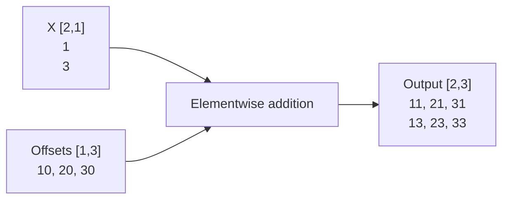
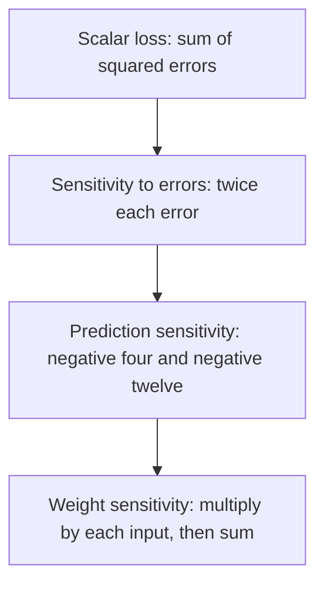

# [Tensor](../glossary.md#tensor) geometry and [gradients](../glossary.md#term-gradient)

> This explanation follows the [Model semantic contract](../architecture/contracts/foundational-modules.md#modulesmodel)<span data-glossary-navigation="true"> ([Model glossary](../glossary.md#term-model))</span>
> and [Compiler AD contract](../architecture/contracts/compiler-autograd.md#compiler-owned-automatic-differentiation)<span data-glossary-navigation="true"> ([Compiler glossary](../glossary.md#term-compiler); [AD glossary](../glossary.md#autograd))</span>.
> It adds a worked mental model, not different arithmetic rules.<span data-glossary-navigation="true"> ([mental model glossary](../glossary.md#term-mental-model))</span>

## [Shape](../glossary.md#shape) says what an index means

A [tensor](../glossary.md#tensor) is typed, indexed data. Its **shape** lists [axis](../glossary.md#term-axis) extents; its **[rank](../glossary.md#term-rank)** is the number of
axes, not its number of [elements](../glossary.md#term-element). The learning input `[2,1]` has rank two and two [FLOAT32](../glossary.md#term-float32) elements:
two [samples](../glossary.md#term-sample-machine-learning-and-hyperparameters), one [feature](../glossary.md#term-feature) per sample. The [weight](../glossary.md#term-weight) `[1,1]` maps that feature to one output.

[Matrix multiplication](../glossary.md#matrix-multiplication--matmul) contracts the input-feature axis. The final output keeps the sample axis:

```text
X: [samples=2, input_features=1]
W: [output_features=1, input_features=1]
X @ transpose(W): [samples=2, output_features=1]
```

This is [dimension](../glossary.md#dimension) reasoning, not executable Java. The complete program imports and constructs
these values in [LearningJourney](../examples/README.md). The low-level [Model](../glossary.md#term-model) supports some named
symbolic dimensions, but the tutorial's owned builder [signature](../glossary.md#term-signature) is deliberately fully static.
Changing its [batch](../glossary.md#term-batch-machine-learning-and-hyperparameters) from two to three is not supported by that same Model.

## [Layout](../glossary.md#layout) says which stored [element](../glossary.md#term-element) an index references

A **layout** maps logical coordinates to element offsets. For a canonical contiguous
$2\times3$ FLOAT32 matrix, let $r\in\{0,1\}$ be the row and $c\in\{0,1,2\}$ the column.
With zero starting offset and strides of three and one **elements**, respectively,
the element position is $p(r,c)=3r+c$. Each FLOAT32 element occupies four bytes, so the
byte offset is $b(r,c)=4p(r,c)$. At $(r,c)=(1,2)$, $p=5$ and $b=20$ bytes.
This checked integer address calculation is not floating-point arithmetic, and an offset is
not a Tensor identity.

A [transpose](../glossary.md#term-transpose) can describe different index geometry without changing the meaning of the underlying
values. Whether execution needs a physical copy is a separate preparation/[backend](../glossary.md#backend) question.
A resolved layout does not allocate storage, and a [view](../glossary.md#term-view-meanings) does not own or prolong an [Arena](../glossary.md#term-arena).
See [layout reference](../reference/tensor/index.md) and [ownership](ownership.md)<span data-glossary-navigation="true"> ([ownership glossary](../glossary.md#term-ownership-meanings))</span>.

Read this table as two ways to name cells in the **same conceptual six-element storage**, not as
an executed transpose or an automatically shared Tensor storage association. The transpose has a
different [shape](../glossary.md#shape) and strides, while a hypothetical contiguous copy would store the logical result
in a new order.

| Description | Shape | Strides in elements | Logical `[0,1]` reads storage position |
|---|---|---|---|
| Original matrix | `[2,3]` | `[3,1]` | `1` |
| Transposed mapping | `[3,2]` | `[1,3]` | `3` |
| Separate contiguous realization of the transpose | `[3,2]` | `[2,1]` | `1` in the new storage |

“Canonical” here means the conventional dense [row-major](../glossary.md#term-row-major) ordering, with the last [axis](../glossary.md#term-axis) changing
fastest. It is a storage-order convention, not a promise that every intermediate is copied.

## [Broadcasting](../glossary.md#broadcasting) expands an indexing rule, not the [dataset](../glossary.md#term-dataset)

Broadcasting aligns [shapes](../glossary.md#shape) from the right. Equal extents agree; an [extent](../glossary.md#term-extent) of one can be reused
along the other operand's matching [axis](../glossary.md#term-axis). For example, `[2,1] + [1,3]` produces `[2,3]`.
The diagram shows a separate [FLOAT32](../glossary.md#term-float32) addition example, not an extra [bias](../glossary.md#term-bias) in the no-bias learning [Model](../glossary.md#term-model).



The same source [element](../glossary.md#term-element) may be read at several output [coordinates](../glossary.md#axis-rank-scalar-vector-and-matrix). Broadcasting by itself does
not promise a materialized repeated input array. `[2,2]` and `[2,3]` cannot broadcast because the
rightmost extents are unequal and neither is one. [Matrix multiplication](../glossary.md#matrix-multiplication--matmul)'s contracted axes are a
different rule: adding a broadcast axis does not repair an invalid [matrix](../glossary.md#term-matrix-meanings) product.

## The first training step

Let $x_i$ be input, $t_i$ target, and $y_i=x_iw$ prediction for sample $i\in\{1,2\}$.
The scalar weight is $w$, with $x=(1,3)$, $t=(2,6)$ and initially $w=0$.
For finite real values, the **sum**, not mean, of squared errors and its derivative are

$$
L(w)=\sum_{i=1}^{2}(x_iw-t_i)^2,\qquad
\frac{dL}{dw}=\sum_{i=1}^{2}2(x_iw-t_i)x_i.
$$

Each derivative contribution multiplies the error's sensitivity $2(y_i-t_i)$ by the
prediction's sensitivity $dy_i/dw=x_i$. The table follows this chain rule before the optimizer
mutates the weight; the data and predictions are dimensionless teaching values.

| Sample $i$ | Input $x_i$ | Target $t_i$ | Prediction $y_i$ | Error $y_i-t_i$ | Squared error | Contribution $2x_i(y_i-t_i)$ to $dL/dw$ |
|---|---:|---:|---:|---:|---:|---:|
| First | 1 | 2 | 0 | -2 | 4 | -4 |
| Second | 3 | 6 | 0 | -6 | 36 | -36 |
| Aggregate | | | | | **40** | **-40** |

A [gradient](../glossary.md#term-gradient) is a local [sensitivity](../glossary.md#term-sensitivity). [Reverse-mode](../glossary.md#primal-adjoint-and-differentiation-seed) [automatic differentiation](../glossary.md#autograd) applies the [chain rule](../glossary.md#term-chain-rule)
from the scalar [loss](../glossary.md#loss) back to requested [parameters](../glossary.md#term-parameter); it is not [finite-difference](../glossary.md#term-finite-difference-gradient-check) probing or a
[backend](../glossary.md#backend)-specific training loop.



SGD subtracts the gradient scaled by learning rate $\eta>0$:
$w_{\mathrm{new}}=w-\eta\,dL/dw$. With the project's `Sgd(0.05)`,
$w_{\mathrm{new}}=0-0.05(-40)=2$. A fresh forward pass therefore predicts $(2,6)$ and has
zero squared error on this batch. The formulas above are real-number reasoning; execution uses
typed FLOAT32 rounding at the declared sites, not arbitrary algebraic reassociation.
The chosen case does not establish convergence for arbitrary data, equivalent lower-precision
behavior, or handling of NaN/infinity. Fitting one batch does not establish generalization.

With a [mean](../glossary.md#term-mean)-squared objective the initial loss and gradient would both be divided by two. Reusing
the same learning rate would give a different update. If you change the reduction, reason about
that scale instead of assuming that optimizer settings are independent of the objective.

## [Parameters](../glossary.md#term-parameter), data and [evaluation](../glossary.md#term-evaluation) have different roles

The [weight](../glossary.md#term-weight) is [gradient](../glossary.md#term-gradient)-eligible state; input and [target](../glossary.md#term-target) are fresh data, not parameters to update.
The returned `TrainingStep` contains the [objective](../glossary.md#term-objective) evaluated before the update. Use a new compute
(or explicit objective evaluation) to assess the updated [model](../glossary.md#term-model), preferably on separate examples.
The tutorial uses fresh inputs `[2,4]`, whose learned [predictions](../glossary.md#term-prediction) are `[4,8]`.

A Model's train/[eval mode](../glossary.md#inference-and-evaluation) controls mode-sensitive layers; it is not the [optimizer](../glossary.md#term-optimizer) itself.
`configureTraining` and `train(input,target)` do not toggle it. This [owned Model](../glossary.md#model-module-buffer-and-scan-distinctions) [captures](../glossary.md#term-capture-meanings)
evaluation mode: **do not call inherited no-[argument](../glossary.md#term-argument) `model.train()`** to start its optimizer.
Changing a captured mode invalidates its source rather than rebuilding it. Our [Linear](../glossary.md#term-linear-meanings) has no
mode-dependent arithmetic, but its captured-state [guard](../glossary.md#term-guard) still applies; the same distinction is
essential for [Dropout](../glossary.md#dropout--inverted-dropout) and BatchNorm.

Next: [follow these expressions through compilation and execution](framework.md)<span data-glossary-navigation="true"> ([compilation glossary](../glossary.md#compiler-engine-and-execution-stage-names))</span>, or
[run the training chapter](../tutorials/index.md)<span data-glossary-navigation="true"> ([run glossary](../glossary.md#term-run))</span>.
