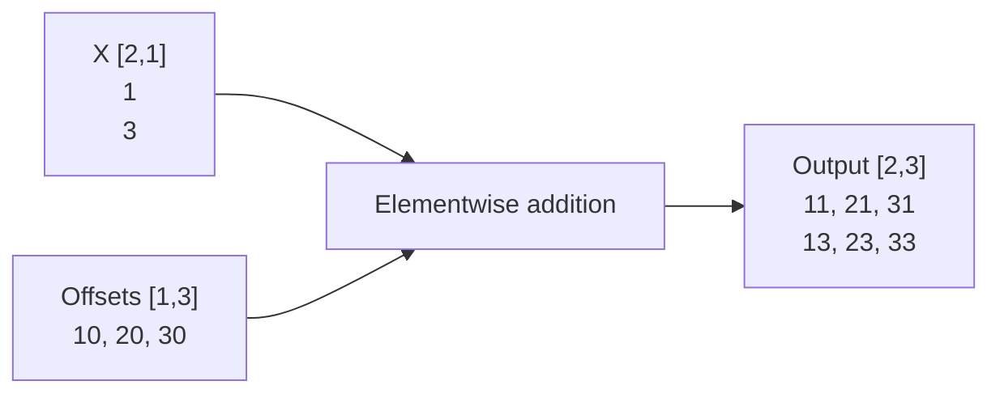
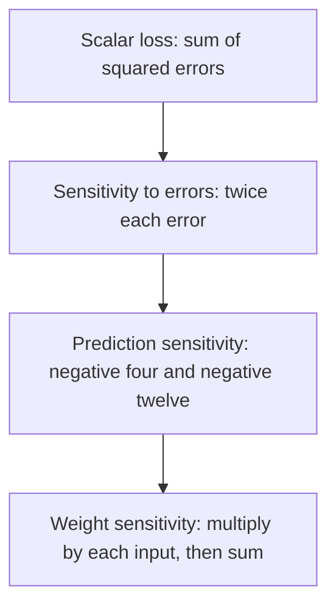

# Tensor geometry and gradients

> This explanation follows the [Model semantic contract](../architecture/contracts/foundational-modules.md#modulesmodel)
> and [Compiler AD contract](../architecture/contracts/compiler-autograd.md#compiler-owned-automatic-differentiation).
> It adds a worked mental model, not different arithmetic rules.

## Shape says what an index means

A tensor is typed, indexed data. Its **shape** lists axis extents; its **rank** is the number of
axes, not its number of elements. The learning input `[2,1]` has rank two and two FLOAT32 elements:
two samples, one feature per sample. The weight `[1,1]` maps that feature to one output.

Matrix multiplication contracts the input-feature axis. The final output keeps the sample axis:

```text
X: [samples=2, input_features=1]
W: [output_features=1, input_features=1]
X @ transpose(W): [samples=2, output_features=1]
```

This is dimension reasoning, not executable Java. The complete program imports and constructs
these values in [LearningJourney](../examples/README.md). The low-level Model supports some named
symbolic dimensions, but the tutorial's owned builder signature is deliberately fully static.
Changing its batch from two to three is not supported by that same Model.

## Layout says which stored element an index references

A **layout** maps logical coordinates to element offsets. For a canonical contiguous `[2,3]`
FLOAT32 matrix, row stride is three elements and column stride is one. Element `[1,2]` is at
`1*3 + 2*1 = 5`, hence byte offset `5*4 = 20`. An offset is not a Tensor identity.

A transpose can describe different index geometry without changing the meaning of the underlying
values. Whether execution needs a physical copy is a separate preparation/backend question.
A resolved layout does not allocate storage, and a view does not own or prolong an Arena.
See [layout reference](../reference/tensor/index.md) and [ownership](ownership.md).

## Broadcasting expands an indexing rule, not the dataset

Broadcasting aligns shapes from the right. Equal extents agree; an extent of one can be reused
along the other operand's matching axis. For example, `[2,1] + [1,3]` produces `[2,3]`.
The diagram shows a separate FLOAT32 addition example, not an extra bias in the no-bias learning Model.



The same source element may be read at several output coordinates. Broadcasting by itself does
not promise a materialized repeated input array. `[2,2]` and `[2,3]` cannot broadcast because the
rightmost extents are unequal and neither is one. Matrix multiplication's contracted axes are a
different rule: adding a broadcast axis does not repair an invalid matrix product.

## The first training step

For inputs `X=[1,3]`, targets `T=[2,6]` and scalar weight `w=0`, each prediction is `y_i=x_i*w`.
The objective is the **sum**, not mean, of squared errors. The table follows one forward and
reverse pass, before the optimizer mutates the weight.

| Sample | Input x | Target t | Prediction y | Error y−t | Squared error | Contribution 2x(y−t) to dL/dw |
|---|---:|---:|---:|---:|---:|---:|
| First | 1 | 2 | 0 | -2 | 4 | -4 |
| Second | 3 | 6 | 0 | -6 | 36 | -36 |
| Aggregate | | | | | **40** | **-40** |

A gradient is a local sensitivity. Reverse-mode automatic differentiation applies the chain rule
from the scalar loss back to requested parameters; it is not finite-difference probing or a
backend-specific training loop.



SGD applies `new_weight = old_weight - learning_rate * gradient`. The project's `Sgd(0.05)` gives
`0 - 0.05*(-40) = 2`, so a fresh forward pass produces `[2,6]` and zero squared error on this batch.
These deliberately chosen numbers teach one update. They do not show that this learning rate
converges for arbitrary data, that lower precision has the same result, or that fitting one batch
generalizes to unseen data.

With a mean-squared objective the initial loss and gradient would both be divided by two. Reusing
the same learning rate would give a different update. If you change the reduction, reason about
that scale instead of assuming that optimizer settings are independent of the objective.

## Parameters, data and evaluation have different roles

The weight is gradient-eligible state; input and target are fresh data, not parameters to update.
The returned `TrainingStep` contains the objective evaluated before the update. Use a new compute
(or explicit objective evaluation) to assess the updated model, preferably on separate examples.
The tutorial uses fresh inputs `[2,4]`, whose learned predictions are `[4,8]`.

A Model's train/eval mode controls mode-sensitive layers; it is not the optimizer itself.
`configureTraining` and `train(input,target)` do not toggle it. This owned Model captures
evaluation mode: **do not call inherited no-argument `model.train()`** to start its optimizer.
Changing a captured mode invalidates its source rather than rebuilding it. Our Linear has no
mode-dependent arithmetic, but its captured-state guard still applies; the same distinction is
essential for Dropout and BatchNorm.

Next: [follow these expressions through compilation and execution](framework.md), or
[run the training chapter](../tutorials/index.md).
