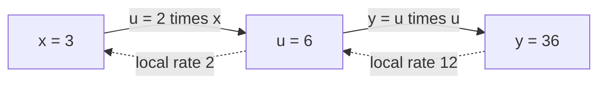
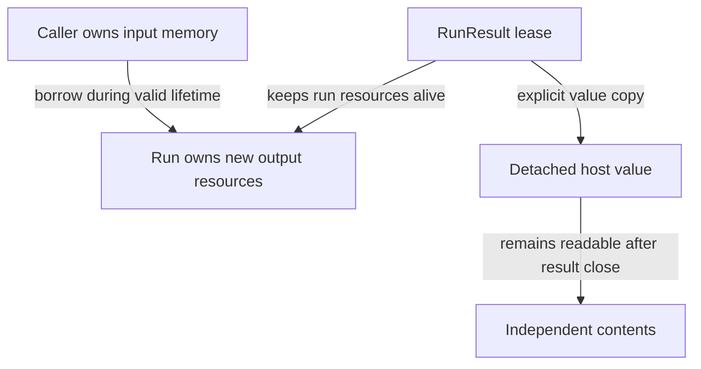

# Synaptik glossary

This glossary is the central dictionary for Synaptik terminology. It explains how terms are used in this repository; it is not an independent [architecture contract](#architecture-contract). If a definition conflicts with [`ARCHITECTURE.md`](../ARCHITECTURE.md), the architecture contract wins.

Some entries describe contracts planned by the architecture but not yet implemented. The
[implementation roadmap](planning/roadmap.md) is the source for current task status.

New readers can use [First terms](terms.md) as a short reading-order guide, then follow the
worked [tensor geometry and gradient explanation](explanation/tensors-and-gradients.md).
Definitions distinguish current capabilities from explicitly planned or historical material.

You can also enter at any heading or inline definition. An API name denotes a particular
programming type or call; an ordinary word such as “operation,” “view,” or “ownership” can have
several meanings. Follow the qualified explanation rather than assuming a Tensor-specific sense.
The examples teach meaning, not an additional promise of execution support.

Mathematical examples use real numbers unless a floating-point rule is stated. Stored values
have limited precision: an ideal identity or derivative is not permission to reorder rounded
operations. [Special values and signed zero](#nan-infinity-and-signed-zero) and the operation's
empty-domain rules still apply. Sizes and indices count logical positions unless bytes or another
unit are named.

## Grouped quick index

Start with the foundation that matches your question, then use the existing detailed entries.
Examples of arithmetic and data geometry below are conceptual unless an entry states a particular
implemented route; they do not expand [backend](#backend) support.

| Reader question | Start here | Related detailed homes |
|---|---|---|
| What do [tensor](#tensor) [coordinates](#axis-rank-scalar-vector-and-matrix) mean? | [Axes, rank, scalars, vectors, matrices](#axis-rank-scalar-vector-and-matrix) | [Shape](#shape), [Dimension](#dimension), [Layout](#layout), [broadcasting](#broadcasting), [storage mapping](#storage-mapping-contiguity-and-injectivity) |
| What is the [model](#term-model) learning? | [Data vocabulary](#learning-data-vocabulary), [loss and objective](#loss), [bias and activation](#bias-and-activation) | [Parameters](#trainable-parameter), [optimizer and SGD](#optimizer-and-stochastic-gradient-descent), [training session](#training-session--trainingsession) |
| How are [derivatives](#term-derivative) built? | [Derivative and chain rule](#derivative-and-chain-rule), [Jacobian products](#jacobian-and-vector-jacobian-product) | [Autograd](#autograd), [primal and adjoint](#primal-adjoint-and-differentiation-seed), [cotangent](#cotangent), [Hessian](#hessian-and-higher-derivatives) |
| What repeats through a sequence? | [Recurrent networks and BPTT](#backpropagation-through-time-and-recurrent-state) | [Scan distinctions](#model-module-buffer-and-scan-distinctions), [general scan](#general-differentiable-scan), [residuals and history](#scan-residual-port-and-history-demand) |
| Which object must stay alive? | [Ownership, borrowing, lease](#ownership-borrowing-and-lease), [alias and arena](#aliasing-and-arena) | [RunResult](#run-result--runresult), [detached value](#host-tensor-value--hosttensorvalue), [transactions](#resource-transaction-and-rollback) |
| How does a description become executable? | [Compile / prepare / run](#compile-versus-prepare-versus-run), [capture and ports](#capture-graph-ports-and-reconstruction) | [IR / DAG / SSA](#intermediate-representation-dag-and-ssa), [specialization and fusion](#specialization-and-fusion), [cache](#cache-and-memoization) |
| Where does computation run? | [CPU / GPU / host / device](#cpu-gpu-host-and-device), [backend](#backend) | [Routes](#backend-route), [SIMD](#simd), [MPS / MPSGraph / OpenBLAS](#mps-mpsgraph-and-openblas), [native ABI](#application-binary-interface-and-native-bridge) |
| Why can numerical answers differ? | [Precision and rounding](#floating-point-precision-and-rounding), [NaN / infinity / signed zero](#nan-infinity-and-signed-zero) | [Subnormal / DAZ / FTZ](#subnormal-daz-ftz-overflow-and-underflow), [ULP and tolerance](#ulp-and-numerical-tolerance), [conditioning](#conditioning-and-numerical-stability), [rounding sites and FMA](#rounding-sites-fma-and-aggregate-floor) |
| What does a saved file preserve? | [Schema / serialization / checkpoint](#schema-serialization-and-checkpoint) | [Integrity vs authentication](#integrity-checksum-and-authentication), [atomic publication vs durability](#artifact-envelope-and-atomic-publication), [exact continuation](#exact-training-continuation) |
| What do contributor abbreviations mean? | [API / SPI / DTO](#api-spi-and-dto), [Java and build tools](#java-platform-and-build-tools) | [ADR / CI / qualification](#adr-ci-and-qualification), [artifacts and provenance](#artifact-manifest-and-source-provenance), [measurement vocabulary](#benchmark-measurement-vocabulary), [native packaging](#native-packaging-and-platform-vocabulary), [text encodings](#text-encoding-and-file-boundaries) |

Use [implementation status](#implementation-status-convention) to distinguish meaning from
availability, and [common distinctions](#common-distinctions) to compare similar-looking names.

## Implementation-status convention

A definition explains meaning and [ownership](#term-ownership-meanings); it is not a promise that every [operation](#operation), [dtype](#data-type--datatype),
[layout](#layout) or execution strategy is available. The [roadmap](planning/roadmap.md) and owning task
briefs record implementation status. Source and the architecture's incorporated contracts remain
authoritative when a historical status description is stale.

The current implemented [lifecycle](#lifecycle) is:

```text
Tensor/NN expressions
    → Compiler graph, bounded autograd and Planning ownership
    → Prepare analysis, shared assignment and backend finalization
    → Runtime bound schedule
    → Engine result and explicit host materialization
```

[Model](#term-model) defines typed expression semantics without executing them. [Compiler](#term-compiler) [captures](#term-capture-meanings) and validates
[graphs](#graph) and supports a bounded functional-[gradient](#term-gradient) domain; unsupported [derivative](#term-derivative) paths reject.
[Planning](#term-planning) selects ownership from actual [occurrence](#term-occurrence) capabilities. [Prepare](#prepare) coordinates the [resource
transaction](#resource-transaction-and-rollback), while [backends](#backend) provide concrete representations, prepared computations and transfers.
[Runtime](#term-runtime) executes the prepared recipe; [Engine](#term-engine) composes the lifecycle, reusable sessions and bounded
tuning. Runtime representation [leases](#term-lease) are not a public backend-memory escape hatch.

[CPU](#term-cpu) and [Metal](#term-metal) have implemented, occurrence-specific execution domains; neither supports every
combination implied by Model construction. CPU↔Metal composition and bounded [detached](#detached-model-results) [host](#term-host)
[materialization](#materialization) are current. [NN](#neural-network-module-parameter-buffer-and-forward-context) constructs graphs and owns declared model state. Training has
sessions, accumulation and [SGD](#term-stochastic-gradient-descent-sgd)/[Adam](#adaptive-optimizer--adam-adamw)/[AdamW](#adaptive-optimizer--adam-adamw) state with in-memory snapshots; durable cross-[owner](#term-owner)
[checkpoint](#term-checkpoint)/[resume](#schema-serialization-and-checkpoint) behavior remains future work.

[CUDA](#term-cuda) and [ONNX](#term-onnx) are currently marker projects. The separate [CLI](#term-cli)
and [interactive TUI](#term-tui) share real [numeric training/prediction/inspection workflows](how-to/train-with-cli.md)
without changing numerical owners. Checkpoint now has a bounded [opaque](#term-opaque) [artifact](#term-artifact)
file [API](#term-application-programming-interface-api) and public model-state save/inspect/load. Data implements [host sequence metadata](#host-sequence-metadata) and
[INT64](#data-type--datatype) sequence [padding](#padding) without runtime [binding](#term-binding). Text implements frozen whitespace [tokenization](#frozen-whitespace-tokenizer)
and delegates numeric batching to Data; Vision remains unimplemented and separately gated.
Broader [trace](#trace) payloads/[serialization](#term-serialization) remain unfinished;
generic backend discovery is not an authorized foundation and requires an explicit architecture
decision before any convenience layer is planned. Consult the relevant area map before treating
a glossary term as an implemented API.

## Terms

These foundational entries explain shared language before the detailed [operation](#operation) and [lifecycle](#lifecycle)
entries. Follow a linked home when a word has several meanings.

### Machine learning and hyperparameters

<a id="term-machine-learning-ml"></a>**Machine learning (ML)** uses data to learn useful behavior instead of manually listing every answer. In this tutorial, learning changes a [weight](#term-weight) so numerical inputs produce better [predictions](#term-prediction). A <a id="term-dataset"></a>**dataset** is a collection of examples or observations. <a id="term-supervised-learning"></a>**Supervised learning** pairs inputs with desired outputs, called training [targets](#term-target) or labels. A diagnostic [Tensor](#tensor) label is different: it is a name for debugging, not the desired answer. A <a id="term-regression-model"></a>**regression model** predicts numerical quantities; a <a id="term-classification-model"></a>**classification model** distinguishes categories. This statistical use of [regression](#term-regression) is different from a software regression test.

A <a id="term-hyperparameter"></a>**hyperparameter** is a chosen setting of the learning procedure, such as the [learning rate](#term-learning-rate), rather than a weight learned by an ordinary training step. A <a id="term-metric"></a>**metric** measures some aspect of a result; it need not be the [objective](#term-objective) the [optimizer](#term-optimizer) minimizes.

A <a id="term-training-set"></a>**training set** supplies examples used for [parameter](#term-parameter) updates. A <a id="term-validation-set"></a>**validation set** helps choose settings; a separate <a id="term-test-set"></a>**test set** assesses the selected procedure. <a id="term-generalization"></a>**Generalization** means useful behavior on new examples. <a id="term-overfitting"></a>**Overfitting** means fitting training-specific details that do not transfer well. A framework executing a training step does not automatically create these splits or guarantee generalization. See [data vocabulary](#learning-data-vocabulary), [loss](#loss), and [optimizer updates](#optimizer-and-stochastic-gradient-descent).

A <a id="term-sample-machine-learning-and-hyperparameters"></a>**sample** more generally means one observation: a training example and one measured timing
are different kinds of samples. <a id="term-sampling-machine-learning-and-hyperparameters"></a>**Sampling** means selecting or collecting observations. A
<a id="term-batch-machine-learning-and-hyperparameters"></a>**batch** can group learning examples, while a [candidate batch](#candidate-batch) groups
alternative implementation choices; the grouping does not make those alternatives training data.

### Compiler, Engine, and execution-stage names

A <a id="term-compiler"></a>**compiler** translates a structured description into another form. The Java compiler turns Java source into class files; Synaptik's **Compiler** instead [captures](#term-capture-meanings) [Tensor](#tensor) expressions into a [graph](#graph), constructs selected [derivatives](#term-derivative), and validates/transforms that graph. An <a id="term-abstract-syntax-tree-ast"></a>**abstract syntax tree (AST)** represents parsed syntax as a hierarchy. A computation graph represents data dependencies and is not necessarily that syntax tree.

<a id="term-code-generation"></a>**Code generation** or code emission produces implementation code. This is different from a [Scan](#general-differentiable-scan)
emission, which records an output at a sequence step. Generating Java class bytes and later
[JIT](#term-just-in-time-compilation-jit)-compiling them into [machine code](#term-machine-code) are also distinct stages.

Synaptik's **[Planning](#term-planning)** selects the [backend](#backend) [owner](#term-owner) of supported work. **[Prepare](#prepare)** turns the selected description into a reusable executable recipe and assigned resource requirements, with each backend realizing its own work. **[Runtime](#term-runtime)** invokes that prepared recipe using one [run](#term-run)'s values and resources. The <a id="term-engine"></a>**Engine** joins these owners into application-facing workflows and controls prepared/result lifetimes; it is not itself a [CPU](#term-cpu) or [GPU](#term-gpu) [kernel](#kernel). See [the stage comparison](#compile-versus-prepare-versus-run) and [the complete program walkthrough](explanation/framework.md).

### Neural-network families

A <a id="term-multilayer-perceptron-mlp"></a>**multilayer perceptron (MLP)** combines [linear](#term-linear-meanings)/affine layers and [nonlinear](#term-nonlinear) [activations](#term-activation) to transform fixed [feature](#term-feature) [coordinates](#axis-rank-scalar-vector-and-matrix). A <a id="term-convolutional-neural-network-cnn"></a>**convolutional neural network (CNN)** uses learned window operations that share [parameters](#term-parameter) across positions. These describe [model](#term-model) families, not new execution [backends](#backend).

A <a id="term-recurrent-neural-network-rnn"></a>**recurrent neural network (RNN)** passes a state from one sequence step to the next. A <a id="term-gated-recurrent-unit-gru"></a>**gated recurrent unit (GRU)** uses learned gates to control state updates; a <a id="term-long-short-term-memory-lstm"></a>**long short-term memory (LSTM)** cell uses gates and a separate cell state to [carry](#term-carry) information across steps. A gate is a computed coefficient controlling how much information is retained or added, not a [runtime](#term-runtime) capability switch. See [recurrent modules and their exact implemented rules](#neural-network-module-parameter-buffer-and-forward-context), [Scan distinctions](#model-module-buffer-and-scan-distinctions), and [backpropagation through time](#backpropagation-through-time-and-recurrent-state).

### Leaf, prototype, and constant

A <a id="term-leaf"></a>**leaf** is a [Tensor](#tensor) with no producing expression. This says where its expression history stops, not whether it has stored values: a supplied [weight](#term-weight) may be a stored leaf, while an input <a id="term-prototype"></a>**prototype** may be a storage-free leaf used only to describe the expected type and geometry. A derived expression records a [producer](#term-producer) but is not thereby an already-computed [buffer](#term-buffer).

A <a id="term-constant"></a>**constant** has a fixed meaning at the boundary describing it. Not every stored leaf is a [compile](#compile)-time constant: callers can provide new input values, and a [model](#term-model)'s private [trainable parameters](#trainable-parameter) can change. [Compiler](#term-compiler) constant classification, caller input [binding](#term-binding), and owning storage are separate facts. See [Tensor](#tensor), [provenance](#provenance), [bindable input](#bindable-input), and [compile-time constant source](#compile-time-constant-source).

The word “leaf” also appears in other structures. A [dependency leaf](#term-dependency-leaf) has no further project dependencies in the graph being discussed; a proof-tree leaf is one terminal premise or numerical contributor. Neither classification implies a producerless Tensor or stored input values. Eager [random initialization](#tensor-random-initialization) creates stored Tensor leaves, whereas a descriptor-only input prototype need not contain values.

### Parameter, argument, and target meanings

A <a id="term-parameter"></a>**parameter** can mean a declared input or setting of a function/[operation](#operation); an <a id="term-argument"></a>**argument** is the actual value supplied for it. For example, a reduction [axis](#term-axis) is an operation parameter. A **[trainable parameter](#trainable-parameter)** instead means persistent [model](#term-model) state, such as a weight, selected for [optimizer](#term-optimizer) updates. A Java method parameter is not automatically trainable state.

A <a id="term-weight"></a>**weight** is a numerical coefficient multiplying a contribution. It may be a
[trainable parameter](#trainable-parameter), a fixed coefficient or a target-[distribution](#term-distribution) weight; the word alone does not establish
[gradient](#term-gradient) eligibility or permission for [optimizer](#term-optimizer) updates.

A <a id="term-target"></a>**target** is something a particular operation is directed toward. A [training target](#loss) is the desired answer compared with a [prediction](#term-prediction); a [differentiation target](#functional-gradient-request) selects what to differentiate with respect to; a [graph](#graph) output target is a requested result; a [backend](#backend)/[device](#term-device) target identifies where work is intended to [run](#term-run). The surrounding phrase determines the meaning. See [loss](#loss), [functional gradients](#functional-gradient-request), [graph values](#graph-value), and [backend requirement](#backend-requirement--backendrequirement).

### Binding, signature, and token meanings

A <a id="term-binding"></a>**binding** associates a declared name, role or slot with an actual value/resource: a symbolic [batch](#term-batch-machine-learning-and-hyperparameters) size can be bound to a number, a [graph](#graph) input to caller storage, or a foreign function name to a native entry point. Binding does not by itself mean copying values or transferring cleanup responsibility. Each owning [API](#term-application-programming-interface-api) states which association it performs.

A <a id="term-signature"></a>**signature** describes an agreement or [identity](#term-identity-meanings) in context. An [operation signature](#operation-signature) describes accepted inputs, outputs and attributes; a method signature/[descriptor](#term-descriptor) describes its callable types; a workload signature identifies compatible work. A [digital signature](#term-digital-signature) is different: it is cryptographic signing evidence, not an [operation](#operation) descriptor.

A <a id="term-token"></a>**token** is an identified unit whose meaning depends on its [producer](#term-producer). A text token identifies a vocabulary item; an [opaque](#term-opaque) [ownership](#term-ownership-meanings) token may identify a resource or permitted use; a parser token represents a syntax unit. A numeric [token ID](#frozen-whitespace-tokenizer) is not a [backend](#backend) [buffer](#term-buffer) or permission to close a resource. See [tokenization](#frozen-whitespace-tokenizer), [operation signatures](#operation-signature), [native ABI](#application-binary-interface-and-native-bridge), and [integrity/authentication](#integrity-checksum-and-authentication).

### Commit, release, distribution, log, and seed meanings

A <a id="term-commit"></a>**commit** in Git identifies a recorded [source revision](#term-source-revision); committing a resource/[update transaction](#resource-transaction-and-rollback) instead publishes newly accepted state. <a id="term-release"></a>**Release** can mean giving up a resource reference or issuing a software version. <a id="term-distribution"></a>**Distribution** can mean a supplied software package or a statistical description of values. These meanings must not be interchanged when reading [qualification](#term-qualification) or [ownership](#term-ownership-meanings) records.

A <a id="term-log"></a>**log** can mean a diagnostic record; mathematical log instead means logarithm. A random-number <a id="term-seed"></a>**seed** chooses a generator's initial state; a differentiation seed chooses the [sensitivity](#term-sensitivity) that starts a [derivative](#term-derivative) calculation. <a id="term-scope"></a>**Scope** can mean where a name is visible, the validity/[lifetime](#term-lifetime) of a memory region, or the selected extent of a task. Follow the surrounding qualifier, not the spelling alone. See [source provenance](#artifact-manifest-and-source-provenance), [transactions](#resource-transaction-and-rollback), [measurement statistics](#benchmark-measurement-vocabulary), [elementary functions](#norms-elementary-functions-and-probability-distributions), [graph RNG](#graph-rng-state--graphrngstate), and [differentiation seeds](#primal-adjoint-and-differentiation-seed).

Numerical <a id="term-cancellation"></a>**cancellation** removes leading significant digits when nearly equal opposite
contributions combine. It can expose or amplify existing error without necessarily introducing
new [rounding](#term-rounding) at that subtraction. [Operation](#operation) cancellation instead means stopping requested work;
this vocabulary does not imply that a particular [synchronous](#term-synchronous) Synaptik [API](#term-application-programming-interface-api) supports cancellation.

### Descriptor and metadata

A <a id="term-descriptor"></a>**descriptor** records properties needed to interpret something, rather than holding that thing's computed contents. A TensorDescriptor records a [tensor](#tensor)'s type, [shape](#shape), [layout](#layout) and [gradient](#term-gradient) eligibility; it does not supply tensor values. A Java method descriptor instead encodes [argument](#term-argument)/result types, and a native record describes its own wire-format fields.

<a id="term-metadata"></a>**Metadata** is descriptive information about other data or work. Shape `[2, 3]` describes geometry; the six numerical [elements](#term-element) are payload. Possessing metadata does not by itself allocate storage, establish [ownership](#term-ownership-meanings), prove execution capability or execute the described calculation. See [Tensor descriptor](#tensor-descriptor), [data types](#data-type--datatype), and [layout](#layout).

<a id="term-binary-descriptor-and-metadata"></a>**Binary** can describe base-two encoding, a non-text file, an [operation](#operation) with two operands, or a
two-category classification task. A Java binary class name is another naming convention, not an
operation's operand count. The surrounding qualifier determines the relevant meaning.

<a id="term-binary-operation"></a>**Binary operation** means a computation with two logical operand positions, such as addition of two [Tensor expressions](#tensor). Each operand can contain many elements; “two” counts roles, not rank, bit width, or stored numbers. If the same Tensor fills both positions, there are still two [input occurrences](#term-occurrence). Binary file encoding and two-category classification are different senses.

### Linear algebra building blocks

A <a id="term-dot-product"></a>**dot product** measures the combined contribution of matching [coordinates](#axis-rank-scalar-vector-and-matrix): multiply each pair, then add those products. For real vectors $a$ and $b$ of equal non-negative length $n$,

$$
a\cdot b=\sum_{i=0}^{n-1}a_i b_i.
$$

Here $i$ is a zero-based position, and $a_i,b_i$ are the two values at that position. An empty sum ($n=0$) is zero. For $a=(1,3)$ and $b=(2,2)$, $a\cdot b=1\times2+3\times2=8$: both positions contribute, rather than selecting one. This is real arithmetic, not a prescribed floating reduction tree. [Matrix multiplication](#matrix-multiplication--matmul)
combines many such contractions; the [operation definition](#matrix-multiplication--matmul)
specifies its [dimensions](#dimension) and numerical rules, rather than a dictionary example fixing execution order.

A [matrix](#term-matrix-meanings) <a id="term-transpose"></a>**transpose** exchanges row and column coordinates: position `[i, j]` becomes `[j, i]`,
and [shape](#shape) `[2, 3]` becomes `[3, 2]`. [Axis](#term-axis) [permutation](#permutation) generalizes reordering to more axes.
Changing logical coordinates does not itself prove a physical copy or shared-storage [alias](#aliasing-and-arena).

A <a id="term-linear-transform"></a>**linear transform** preserves addition and scaling; a weighted sum without an independent
offset is an example. An **[affine transform](#affine-transform)** also permits a [constant](#term-constant) offset, such as [bias](#term-bias).
A <a id="term-nonlinear"></a>**nonlinear** function does not obey that linearity rule; [ReLU](#term-relu) is an example. A layer named
[`Linear`](#term-linear-meanings) in an [ML](#term-machine-learning-ml) [API](#term-application-programming-interface-api) can include optional bias, so its configured operation may be affine.
See [linear projection](#linear-projection), [affine transform](#affine-transform), and
[bias and activation](#bias-and-activation).

### Caller, callee, and the call boundary

The <a id="term-caller"></a>**caller** is the component making a particular API call; the
<a id="term-callee"></a>**callee** is the component receiving it. Always name the call being
discussed. When a Java application supplies parameter values to an NN Model builder, the
application is the caller and the builder is the callee. When Runtime invokes a backend's
prepared work, Runtime is the caller of that internal call—not the application directly.

A <a id="term-caller-owned-leaf"></a>**caller-owned leaf** is a [leaf Tensor](#term-leaf) supplied
by that calling component, which keeps the original Tensor and any responsibility for its
supplied storage. “Leaf” means no expression produced it; it does not by itself mean stored data.
A storage-free [prototype](#term-prototype) can also be a leaf. “Owned” must identify the actual
[responsibility](#term-ownership-meanings), not imply that every Tensor is a closeable resource.

At the [owned-Model construction boundary](architecture/contracts/extensions-training.md#owned-tensor-models),
supplied parameter values are copied into the model's private working state. The application's
original value is not the parameter later updated by training. A later execution call can
instead borrow input storage under its own lifetime contract. Copying, borrowing, and ownership
transfer are different actions; name which one the particular API performs.

At these concrete boundaries, “owns” does not always mean the same action:

| Call and participants | What crosses the call | What the receiver retains or copies | Lifetime consequence |
|---|---|---|---|
| Application calls `TensorFactory.fromFlatArray` | Descriptor and flat represented values | A copy in new heap storage | Later source-array mutation cannot change the imported Tensor |
| Application calls `Parameter.replace` on a module wrapper | A compatible Tensor reference | The exact reference, not a value copy | Existing expressions still refer to the old Tensor; new forwards use the new binding |
| Application builds an owned NN Model from supplied parameters | External state values | Private Model working copies, once per external identity | Training changes private state, not the application's original values |
| Application calls ordinary `Engine.run` | Input Tensor identities and current storage associations | Borrowed captured storage, not copied or pinned bytes | Keep input memory alive and free of conflicting writes through result close |
| Runtime cold-binds a backend executable | Run-specific representations selected by the recipe | Checked direct borrowed references | RunState/RunResult, not the bound action, governs resource cleanup |

For the storage consequences in a full call sequence, read [ownership and lifetimes](explanation/ownership.md). For constructing descriptions without execution, read [the framework stages](explanation/framework.md).

### Index mappings and cost dominance

A <a id="term-cartesian-product"></a>**Cartesian product** contains every tuple made by choosing one [coordinate](#axis-rank-scalar-vector-and-matrix) from each [axis](#term-axis).
[Shape](#shape) `[2, 3]` has six such coordinate pairs. A <a id="term-bijection"></a>**bijection** maps each input to one distinct
output and covers every output; <a id="term-bijective"></a>**bijective** means having both properties.

<a id="term-mixed-radix"></a>**Mixed-radix** indexing uses a different positional base for each axis [extent](#term-extent). For logical
[row-major](#term-row-major) shape `[2, 3]`, flat index `4` becomes coordinate `[1, 1]`: `4 / 3` gives row `1`
and `4 % 3` gives column `1`. This explains a coordinate mapping, not an arbitrary physical [layout](#layout).
An <a id="term-unsigned-integer"></a>**unsigned integer** has no sign bit interpretation: a 64-bit unsigned count ranges from zero
through `2^64 - 1`. That is not the same numeric domain as the public signed [`INT64`](#data-type--datatype) type.

A <a id="term-cost-dimension"></a>**cost dimension** is one comparison criterion, such as
dispatch count, temporary bytes, or elapsed time. It is not a Tensor axis or a symbolic
`Dimension` describing an axis size.

In cost comparisons, <a id="term-structural-dominance-index-mappings-and-cost-dominance"></a>**structural dominance** means one alternative is no worse on every
specified cost [dimension](#term-cost-dimension) and strictly better on at least one, under identical required semantics
and domain. One [dispatch](#term-dispatch) with zero temporary bytes can dominate two dispatches with temporary
storage on those dimensions; that does not establish a universal elapsed-time speedup.
[Compiler](#term-compiler) <a id="term-control-flow-dominance-index-mappings-and-cost-dominance"></a>**control-flow dominance** is different: a node lies on every relevant path to another
node. See [compiler transformations](#compiler-transformations-and-dominance),
[proof assumptions](#formal-proof-certificate-and-trusted-assumptions), and
[benchmark vocabulary](#benchmark-measurement-vocabulary).

### Lookup and lookup permissions

A <a id="term-lookup"></a>**lookup** asks for an item by a name, key, or index. A [cache](#term-cache) lookup asks
whether a reusable entry exists; an [embedding](#embedding) lookup selects rows by index; a [classpath](#term-classpath) lookup
searches for a class or resource. Looking something up does not imply copying it or acquiring its
cleanup responsibility. A Java [method-handle lookup](#term-method-handle-lookup) is a more
specific access-permission object, not the general search [operation](#operation).

<a id="term-validation-pass"></a>A **validation pass** visits a declared input domain to check conditions before dependent work. A bounds pass checks every index before writes; an **overlap check** compares referenced memory regions to detect conflicting use. Here “scan” can simply mean an inspection pass, not a [cumulative operation](#cumulative-scan), recurrent loop or [general Scan](#general-differentiable-scan). Proving that all accessed regions are safe is separate from checking only logical element counts.

### Logical alignment and byte alignment

<a id="term-alignment"></a>**Alignment** must name what is being lined up. Logical alignment
matches [axes](#term-axis) or positions: for example, [broadcasting](#broadcasting) compares [shapes](#shape) from their
last axes and supplies missing leading axes of [extent](#term-extent) one. [Byte alignment](#term-byte-alignment)
instead constrains memory addresses, such as a region beginning at an address divisible by eight.
An axis-alignment check does not by itself prove a byte-alignment requirement, or vice versa.

### Linear work, chains, and addressing

<a id="term-linear-meanings"></a>**Linear** has several technical meanings. A
[linear transform](#term-linear-transform) preserves addition and scaling. <a id="term-linear-work"></a>**Linear work** means
the work grows in proportion to an input count, such as one visit per [element](#term-element), rather than
comparing every pair. A <a id="term-linear-chain"></a>**linear chain** is an unbranched sequence of dependent operations;
its individual functions need not be linear transforms. <a id="term-linear-addressing"></a>**Linear addressing** advances through
consecutive storage positions. Neither a straight chain nor a simple address increment proves
the function is mathematically linear.

### Identity meanings and algebraic identities

<a id="term-identity-meanings"></a>**Identity** depends on the question being asked.
[Reference identity](#term-reference-identity) means the same object; [structural equality](#term-structural-equality) compares
the stated contents. An <a id="term-identity-element"></a>**identity element** leaves the other
operand unchanged, such as zero for addition or one for multiplication. An <a id="term-algebraic-identity"></a>**algebraic identity**
is an equality intended to hold over its stated domain; [floating-point](#term-floating-point) rewrites still require
their own proof. A compatibility identity or version identifies a format or implementation
agreement, not a Java object. A signing identity identifies the signing key or claimed signer;
[ad-hoc signing](#term-ad-hoc-signing) alone does not authenticate a public publisher.

### General producers, recording, and views

A <a id="term-producer"></a>**producer** creates or supplies something for a consumer. A diagnostic
producer emits diagnostic facts; a [TensorProducer](#producer--tensorproducer) instead records
the [operation](#operation) that produced symbolic [Tensor](#tensor) expressions. An event producer is not thereby a
TensorProducer or an [owner](#term-owner) of the values mentioned by its event.

A <a id="term-capture-meanings"></a>**capture** records selected information for later use.
[Structural graph capture](#term-structural-capture) records expression operations and dependencies.
Capturing standard output or retaining benchmark evidence instead records text or files;
it does not create a computation [graph](#graph).

A <a id="term-view-meanings"></a>**view** presents existing information through another interface.
A collection view can expose members without copying the collection; a diagnostic view can
present a report. A [tensor view](#view) is the specific case that changes the interpretation of
tensor [coordinates](#axis-rank-scalar-vector-and-matrix) while potentially sharing storage. “Read-only view” alone says neither that
the underlying objects are [immutable](#term-immutable) nor that a [detached value](#detached-model-results) copy was made.

### Forks and independent JVM processes

A <a id="term-fork-meanings"></a>**fork** can mean a separate development line or a separate
process; the qualifier matters. A [repository fork](#term-fork) is a development copy with its
own history. A [JVM fork](#term-jvm-fork) is a fresh Java process with independent runtime state.
Several timing [samples](#term-sample-machine-learning-and-hyperparameters) in one process are not several [JVM forks](#java-preview-incubator-modules-and-compiler-tiers), and creating a repository fork
does not isolate benchmark runtime state.

### Hash codes and content digests

A <a id="term-hash"></a>**hash** maps a value or sequence of bytes to a bounded-size value for indexing or comparison.
A Java <a id="term-hash-code"></a>**hash code** helps collections find candidate equal values:
equal values must have equal hash codes, but different values may share one. Hash-code equality
does not establish object equality. A [cryptographic hash](#term-cryptographic-hash) is designed
for stronger content-[integrity](#term-integrity) properties; it is not interchangeable with Java `hashCode()`,
and an untrusted [digest](#term-digest) alone does not authenticate the publisher.

### Review tables and support matrices

A <a id="term-review-matrix"></a>**support matrix** or <a id="term-review-matrix-review-tables-and-support-matrices"></a>**review matrix** is a table crossing
categories, such as operations against [backends](#backend) or reader tasks against documents. Read its
legend: one cell may mean implemented, exercised in a named environment, unsupported, or merely
planned. The table is not a numerical [matrix Tensor](#term-matrix), and a passing cell is not
proof of combinations outside its stated [scope](#term-scope).


### Axis, rank, scalar, vector, and matrix

An <a id="term-axis"></a>**axis** is one coordinate direction in a [tensor](#tensor), and its <a id="term-extent"></a>**extent** is the number of positions on that direction. <a id="term-rank"></a>**Rank** counts axes, not elements. An <a id="term-element"></a>**element** is one value at a full coordinate; an **index** names a position, usually starting at zero. [Shape](#shape) `[2, 3]` has rank two, axis-zero extent two, axis-one extent three, and six elements.

<a id="term-matrix-meanings"></a>**Matrix** can name a numerical tensor or a comparison table.
The numerical meaning below has two axes. A [support or review matrix](#term-review-matrix)
instead organizes categories and recorded findings; its cells are not automatically Tensor
values, and its presence is not evidence that every combination was exercised.

A <a id="term-scalar"></a>**scalar** has no axes (shape `[]`) and holds one value; a <a id="term-vector"></a>**vector** has one axis (for example `[3]`); a <a id="term-matrix"></a>**matrix** has two axes (for example `[2, 3]`). Shape `[1]` is a one-element vector, not a scalar, and `[0, 3]` is an empty rank-two tensor, not rank zero. These are logical categories, independent of storage. See [Shape](#shape) and [Dimension](#dimension). Hardware “vector” execution instead means processing several [lanes](#term-lane) together; see [SIMD](#simd).

Tensor rank here counts axes. [Linear](#term-linear-meanings)-algebra matrix rank instead counts independent rows or
columns; the two measures answer different questions.

<a id="term-ranking"></a>**Ranking** instead orders candidates by stated criteria, such as
correctness eligibility followed by measured cost. “Rank the candidates” does not count tensor
axes or compute a matrix's linear-algebra rank.

### Bias and activation

A <a id="term-bias"></a>**bias** is an added [model](#term-model) [parameter](#trainable-parameter) that shifts a calculation independently of the current input. For real input $x$, coefficient $w$ (weight), and offset $b$ (bias), the affine prediction is $y=xw+b$. For $x=0$, $w=2$, and $b=3$, the prediction remains $y=3$: the offset is not multiplied by the input. This is different from statistical bias, which means systematic estimation error.

An <a id="term-activation"></a>**activation** is a function applied to a layer’s values, usually to let several layers express more than one [linear transformation](#linear-algebra-building-blocks). <a id="term-relu"></a>**ReLU** (rectified linear unit) keeps positive inputs and maps negative inputs to zero. <a id="term-sigmoid"></a>**Sigmoid** maps [finite](#term-finite) inputs smoothly between zero and one; <a id="term-tanh"></a>**tanh** (hyperbolic tangent) maps them between minus one and one. These functions are not themselves evidence that a [backend](#backend) supports their execution or differentiation. See [GELU](#gaussian-error-linear-unit--gelu), [SiLU](#sigmoid-linear-unit--silu), and [affine transform](#affine-transform).

In configuration or workflow prose, **activation** can instead mean enabling a [software feature](#term-software-feature) or making
a selected plan effective. Enabling [Java preview features](#java-preview-incubator-modules-and-compiler-tiers) is not applying a neural-network
activation function; the surrounding qualifier selects the meaning.

### Optimizer and stochastic gradient descent

An <a id="term-optimizer"></a>**optimizer** changes [trainable parameters](#trainable-parameter) using computed [gradients](#term-gradient), aiming to reduce a selected scalar [objective](#term-objective). A reporting metric need not be that objective and can even be a quantity to maximize. Compiler owns differentiation; Training applies the optimizer after Engine evaluates the objective and gradients.

Plain <a id="term-stochastic-gradient-descent-sgd"></a>**stochastic gradient descent (SGD)** updates each parameter coordinate by

$$
\theta_{t+1}=\theta_t-\eta g_t.
$$

Here $t\ge0$ counts accepted updates, $\theta_t$ is one real parameter value before update $t$, $g_t$ is the objective's derivative with respect to that value, and $\eta>0$ is the learning rate. With $\theta_t=3$, $g_t=4$, and $\eta=0.1$, the ideal result is $2.6$: a positive derivative moves the parameter downward. A finite step does not guarantee a lower objective. Implemented arithmetic rounds in the session's working format. “Stochastic” refers to sampled training data, often a [mini-batch](#term-mini-batch), not a random draw in this formula.

<a id="term-momentum"></a>**Momentum** remembers a moving update direction across steps. <a id="term-weight-decay"></a>**Weight decay** shrinks parameters according to an explicit optimizer rule; it is not the gradient itself. **[Adam](#adaptive-optimizer--adam-adamw)** expands to adaptive moment estimation; **[AdamW](#adaptive-optimizer--adam-adamw)** means Adam with decoupled weight decay. See their [existing definition](#adaptive-optimizer--adam-adamw), [gradients and learning rates](#gradient-and-learning-rate), and [TrainingSession](#training-session--trainingsession) for the implemented [ownership](#term-ownership-meanings) and restrictions.

### Derivative and chain rule

A <a id="term-derivative"></a>**derivative** measures a local rate of change. For a real function $f$ at input $x$, it is the limit

$$
f'(x)=\lim_{h\to0}\frac{f(x+h)-f(x)}{h},
$$

when that finite limit exists; $h$ is a nonzero input perturbation tending to zero. For $f(x)=x^2$, $f'(x)=2x$, so $f'(3)=6$: sufficiently small input changes produce approximately six times that output change. This mathematical limit is not a floating-point evaluation procedure.

A <a id="term-partial-derivative"></a>**partial derivative** is the same rate for one input [coordinate](#axis-rank-scalar-vector-and-matrix) of a multi-input function while all other coordinates remain fixed. For $f(x,z)=x^2+z$, $\partial f/\partial x=2x$ and $\partial f/\partial z=1$. A <a id="term-sensitivity"></a>**sensitivity** expresses how an output changes with an earlier value, often scaled by a supplied [differentiation seed](#primal-adjoint-and-differentiation-seed); doubling that seed doubles the rate being propagated.

The <a id="term-chain-rule"></a>**chain rule** combines local [derivatives](#term-derivative) through intermediate values. If differentiable real functions compose as $u=u(x)$ and $y=y(u)$, then $dy/dx=(dy/du)(du/dx)$. For $u=2x$, $y=u^2$, and $x=3$, the intermediate value is $u=6$, the local rates are $du/dx=2$ and $dy/du=2u=12$, and their product is $dy/dx=24$. Contributions from several dependency paths add. A mathematically differentiable function need not have a supported Synaptik rule; see [autograd](#autograd).

Read solid arrows as the forward calculation and dashed arrows as the backward sensitivity
calculation at x=3. Multiplying the two local rates gives input sensitivity 24.



### Jacobian and vector-Jacobian product

A <a id="term-jacobian"></a>**Jacobian** collects the [partial derivatives](#term-partial-derivative) of a differentiable function $f:\mathbb{R}^n\to\mathbb{R}^m$. Its entry $J_{ij}=\partial f_i/\partial x_j$ gives output coordinate $i$'s rate with respect to input coordinate $j$, for $0\le i<m$ and $0\le j<n$. For $f(x,z)=(x+z,x-z)$,

$$
J=\begin{pmatrix}1&1\\1&-1\end{pmatrix}.
$$

A <a id="term-vector-jacobian-product-vjp"></a>**vector-Jacobian product (VJP)** propagates chosen output [sensitivities](#term-sensitivity) $v\in\mathbb{R}^m$ back to inputs through a [Jacobian](#term-jacobian) $J$: input component $j$ is $\sum_{i=0}^{m-1}v_iJ_{ij}$, for $0\le j<n$ inputs and $m$ outputs. For the function $(x+z,x-z)$, $v=(2,3)$ gives $(2+3,2-3)=(5,-1)$. [Reverse mode](#term-reverse-mode) can build this product without storing the whole table.

A <a id="term-jacobian-vector-product-jvp"></a>**Jacobian-vector product (JVP)** propagates an input perturbation $u\in\mathbb{R}^n$ forward through a differentiable function's [Jacobian](#term-jacobian) $J$: output component $i$ is $\sum_{j=0}^{n-1}J_{ij}u_j$, for $0\le i<m$. With the same two-input function and $u=(1,0)$, it gives $(1,1)$: changing only the first input changes both outputs equally. These are mathematical constructions, not promises of unrestricted public APIs or every operation's derivative support.

### Primal, adjoint, and differentiation seed

A <a id="term-primal"></a>**primal** is an original forward value, rather than a value describing a [derivative](#term-derivative). For real $x$ and $y=x^2$, both $x$ and $y$ are primals; $2x$ describes a rate, not another original input. An <a id="term-adjoint"></a>**adjoint** is the reverse-propagated [sensitivity](#term-sensitivity) associated with a primal. With unit sensitivity at $y$, the adjoint at $x=3$ is $6$; with sensitivity two at $y$, it is $12$. Synaptik represents these questions by [cotangent expressions](#cotangent), not mutable gradient fields on the original Tensors.

A differentiation **[seed](#term-seed)** chooses the output sensitivity that starts the backward calculation. Seed one for [scalar](#term-scalar) y asks for y’s own derivative; seed two asks for twice that derivative. This is not a random-number seed. <a id="term-reverse-mode"></a>**Reverse mode** starts with output sensitivities and works toward inputs; <a id="term-forward-mode"></a>**forward mode** propagates a chosen input change, called a <a id="term-tangent"></a>**tangent**, toward outputs. See the [chain rule](#derivative-and-chain-rule) and [Jacobian products](#jacobian-and-vector-jacobian-product).

### Ownership, borrowing, and lease

An <a id="term-owner"></a>**owner** is responsible for the thing named by the surrounding contract.
<a id="term-ownership-meanings"></a>**Ownership** may assign authority over semantics, responsibility
for integrating an editorial change, ownership of [model](#term-model) state, or resource cleanup. These are
different responsibilities: a semantic or integration owner does not thereby have to close
every object it discusses. <a id="term-resource-ownership"></a>**Resource ownership**, described next, specifically assigns cleanup.

<a id="term-ownership"></a>**Ownership** identifies who must eventually [release](#term-release) a resource. <a id="term-borrowing"></a>**Borrowing** permits another component to use it without transferring that cleanup responsibility. A <a id="term-lease"></a>**lease** is a controlled period of use that prevents the owner from releasing required resources too early. <a id="term-lifetime"></a>**Lifetime** is the interval during which a resource is valid to use; keeping a Java reference is not sufficient to extend caller-controlled [native memory](#aliasing-and-arena) lifetime.

In [backend](#backend) [planning](#term-planning), **[backend ownership](#backend-ownership)** instead identifies which backend executes selected
work. That decision is different from resource-cleanup ownership, even when one backend is
responsible for both. See [backend ownership](#backend-ownership).

For example, a [run](#term-run) can borrow caller input memory while owning its new output memory. A low-level [RunResult](#run-result--runresult) keeps the run alive by a lease until closed; a [detached host value](#host-tensor-value--hosttensorvalue) instead owns a separate copy. Using a resource after its valid lifetime is <a id="term-use-after-close"></a>**use-after-close**. The component’s exact close contract decides whether close waits, defers cleanup, or rejects new work.

Read this as a lifetime distinction, not a transfer of every resource into the result. The
RunResult keeps run-owned output resources alive; caller input memory must still satisfy its
own borrowed lifetime. A detached copy is a separate value.



### Aliasing and arena

An <a id="term-alias-meanings"></a>**alias** is another name or reference for something.
A <a id="term-vocabulary-alias"></a>**vocabulary alias** is an alternative spelling for one concept,
such as “ML” and “machine learning”; it does not imply shared storage. Memory aliasing, described
next, is the different case where references or coordinate mappings reach the same object or bytes.

<a id="term-aliasing"></a>**Aliasing** means two references or [coordinate](#axis-rank-scalar-vector-and-matrix) interpretations reach the same underlying object or memory. Two array slices can overlap even if their wrapper objects differ; equal copied bytes do not establish an alias. A [view](#term-view-meanings) may share storage while changing the coordinate mapping.

The Java <a id="term-heap"></a>**heap** is memory managed as ordinary Java objects, such as primitive arrays. **Native** or <a id="term-off-heap-memory"></a>**off-heap memory** is managed outside that ordinary object allocation model. A Java <a id="term-memorysegment"></a>**MemorySegment** describes an accessible memory region. An <a id="term-arena"></a>**Arena** controls the [lifetime](#term-lifetime) of memory allocated in its [scope](#term-scope); closing a closeable arena invalidates those segments. A wrapper [borrowing](#term-borrowing) a segment does not acquire permission to close the caller’s arena. Aliasing [metadata](#term-metadata), physical overlap checks, and [ownership](#term-ownership-meanings) are distinct questions.

### Cache and memoization

A <a id="term-cache"></a>**cache** retains a reusable result so later work can avoid recomputing or reloading it. A <a id="term-cache-key"></a>**cache key** identifies the relevant inputs and compatibility facts. A **hit** means a usable matching entry was found; a **miss** means it was not. A [lookup](#term-lookup) that was never attempted is neither a hit nor a miss.

<a id="term-memoization"></a>**Memoization** is caching the result of a computation for matching inputs. A cache of generated code does not store current [tensor](#tensor) values, and a [metadata](#term-metadata) memo must not retain [mutable](#term-mutable) [run](#term-run) resources. Reuse is safe only inside the owning cache’s compatibility and [lifetime](#term-lifetime) rules. See the [generated artifact store](#cpu-generated-kernel-artifact-store) and the explicitly future [Engine geometry memo](#engine-geometry-memo).

### Specialization and fusion

<a id="term-specialization"></a>**Specialization** creates or selects an implementation for known facts, such as a particular [element](#term-element) type or access pattern. It does not bake in current input values unless that is explicitly part of the specialization contract.

<a id="term-fusion"></a>**Fusion** implements several operations together, often avoiding a stored intermediate. For `a * b + c`, a fused loop can compute each product and addition before storing the final value. An <a id="term-epilogue"></a>**epilogue** is extra work attached to the end of a main calculation, such as adding [bias](#term-bias) after a [matrix](#term-matrix-meanings) product. <a id="term-decomposition"></a>**Decomposition** expresses one [operation](#operation) using smaller operations. None of these choices permits changing required numerical semantics; arithmetic multiply/add fusion has its own [rounding](#term-rounding) consequences.

### Intermediate representation, DAG, and SSA

An <a id="term-intermediate-representation-ir"></a>**intermediate representation (IR)** is a structured form used between an original request and its final executable implementation. A [graph](#graph) and a loop-oriented [kernel](#kernel) description can both be IRs at different stages.

A <a id="term-directed-acyclic-graph-dag"></a>**directed acyclic graph (DAG)** has directed [dependency](#term-dependency) arrows and no cycle back to the same [node](#node). <a id="term-topology"></a>**Topology** describes those connections. A <a id="term-topological-order"></a>**topological order** lists [producers](#term-producer) before consumers, so each needed value is available before use. <a id="term-dataflow"></a>**Dataflow** is the movement of logical values along these dependencies; an arrow is a <a id="term-dependency-edge"></a>**dependency edge**, not necessarily a memory copy.

<a id="term-static-single-assignment-ssa"></a>**Static single assignment (SSA)** is a representation discipline in which each logical value name is defined once. A changed value gets a new name rather than overwriting the old logical definition. This does not mean [runtime](#term-runtime) memory can never be written or reused. See [Graph](#graph) and the concrete [CPU kernel IR](#cpu-kernel-intermediate-representation).

### Application binary interface and native bridge

An <a id="term-application-binary-interface-abi"></a>**application binary interface (ABI)** specifies how compiled components call each other: [argument](#term-argument) layout, integer widths, symbol names, return values, and related machine-level rules. A source-level method name match alone does not prove ABI compatibility.

A <a id="term-native-bridge"></a>**native bridge** connects Java to non-Java compiled code. <a id="term-jni"></a>**JNI** expands to Java Native Interface. <a id="term-ffm"></a>**FFM** expands to Foreign Function and Memory, Java’s facilities for foreign calls and memory access. A <a id="term-downcall"></a>**downcall** goes from Java to [native code](#native-numerical-library-and-instruction-architecture); an <a id="term-upcall"></a>**upcall** lets native code call Java. A <a id="term-symbol"></a>**symbol** is a named entry in a compiled library; a <a id="term-calling-convention"></a>**calling convention** specifies how values cross the call boundary.

In [BLAS](#term-blas) interface discussions, <a id="term-lp64"></a>**LP64** (long and pointer are 64-bit) commonly denotes a 32-bit BLAS integer interface on a 64-bit platform, while <a id="term-ilp64"></a>**ILP64** (integer, long, and pointer are 64-bit) denotes a 64-bit BLAS integer interface. These labels are not interchangeable with “the process is 64-bit”; Synaptik’s qualified [OpenBLAS](#term-openblas) boundary documents its exact supported integer width.

### Just-in-time compilation

<a id="term-bytecode"></a>**Bytecode** is the instruction format stored in a Java class file for the [Java virtual machine](#term-java-virtual-machine-jvm) to execute. <a id="term-machine-code"></a>**Machine code** is instructions for a particular processor. <a id="term-just-in-time-compilation-jit"></a>**Just-in-time compilation (JIT)** translates or optimizes executable code while a program runs, often using observed behavior.

Generating a Java class during preparation and the [JVM](#java-platform-and-build-tools) later JIT-compiling that class are separate events. The Java <a id="term-class-file-api"></a>**Class-File API** constructs or reads class-file structures; a <a id="term-hidden-class"></a>**hidden class** is a JVM class defined for restricted runtime use rather than normal name-based discovery. Saving generated class bytes does not save already-optimized JIT machine code. See [generated CPU kernels](#generated-cpu-computation-kernel).

An <a id="term-opcode"></a>**opcode** identifies an instruction; a <a id="term-bytecode-index-bci"></a>**bytecode index (BCI)** is its offset in a method. <a id="term-decompilation"></a>**Decompilation** reconstructs source-like text, not the original source. <a id="term-inlining"></a>**Inlining** incorporates a callee into its caller. <a id="term-on-stack-replacement-osr"></a>**On-stack replacement (OSR)** enters compiled code within an already-running loop. An <a id="term-nmethod"></a>**nmethod** is [HotSpot](#term-hotspot)’s installed compiled-method object; <a id="term-deoptimization"></a>**deoptimization** returns execution to a less specialized form. A <a id="term-nestmate"></a>**nestmate** can share permitted private access with its nest host; this is an access rule, not a memory [owner](#term-owner).

### SIMD

**SIMD** means single instruction, multiple data: one instruction performs the same kind of calculation on several values at once. Each simultaneous position is a <a id="term-lane"></a>**lane**. This hardware execution use of “[vector](#term-vector)” is different from a [rank-one](#axis-rank-scalar-vector-and-matrix) [tensor](#tensor).

The Java <a id="term-vector-api"></a>**Vector API** expresses such lane-wise computation. A <a id="term-vector-species"></a>**vector species** describes a lane [element](#term-element) type and vector size. If a vector processes four elements at a time, a length-ten loop can process two full vectors and then a <a id="term-scalar-tail"></a>**scalar tail** of two elements. SIMD capability does not imply every [operation](#operation), [layout](#layout), or length can use the vector route.

### CPU, GPU, host, and device

A <a id="term-cpu"></a>**CPU** (central processing unit) is a general-purpose processor. A <a id="term-gpu"></a>**GPU** (graphics processing unit) is a processor designed for large amounts of parallel work, including non-graphics numerical computation. An <a id="term-accelerator"></a>**accelerator** is a device used to offload selected computation; not every accelerator is a GPU.

<a id="term-host"></a>**Host** usually means the application’s CPU-side environment; <a id="term-device"></a>**device** means the selected execution hardware, often an accelerator. Shared physical memory does not remove explicit [ownership](#term-ownership-meanings), representation, transfer, or [synchronization](#term-synchronization) rules.

<a id="term-metal"></a>**Metal** is Apple’s GPU programming framework. <a id="term-cuda"></a>**CUDA** is NVIDIA’s GPU computing platform and programming environment. <a id="term-onnx"></a>**ONNX** expands to Open Neural Network Exchange, a [model](#term-model) interchange format. <a id="term-cli"></a>**CLI** means command-line interface. Naming these technologies in a document does not establish their implementation status in Synaptik; use the [status convention](#implementation-status-convention) and owning area’s current evidence.

### CSV and numeric dataset rows

<a id="term-csv"></a>**CSV** means comma-separated values: a text row contains fields separated
by commas. The name alone does not specify headers, quoting, decimal syntax or missing values.
Synaptik's numeric CLI format deliberately accepts finite FLOAT32 numbers without headers or
quoted fields: one row is one [example](#term-sample), its leading columns are
[features](#term-feature), and the declared final columns are training [targets](#term-target).
It is not a saved [Model](#term-model) or an unrestricted spreadsheet importer.

### Terminal, TTY, standard streams and ANSI controls

<a id="term-terminal"></a>A **terminal** displays a command-line program's text and can interpret
cursor controls. <a id="term-tty"></a>A **TTY** is the operating system's terminal-device interface
(historically “teletype”); a redirected file or pipe is not an interactive terminal merely
because it receives text.

<a id="term-pty"></a>A **PTY**, or pseudoterminal, is a pair of operating-system endpoints.
A terminal emulator or driver writes the master endpoint; the application sees the slave
endpoint as a real terminal device, including dimensions, keyboard mode and signals.
This permits real terminal interaction without a physical serial terminal. A mocked `isTTY`
boolean or a redirected text file does not provide those behaviors.

<a id="term-tui"></a>A **TUI** is a text-based user interface with interactive screens, fields
and keyboard navigation. A CLI normally receives one command and arguments; a TUI keeps an
interaction loop alive. They can call the same application workflows without one spawning the
other. Neither presentation style changes who owns Model state or performs numerical execution.

<a id="term-standard-streams"></a>**Standard input** (`stdin`), **standard output** (`stdout`) and
**standard error** (`stderr`) are a process's conventional input, result and diagnostic streams.
Keeping progress on stderr lets stdout remain usable as prediction data. These stream names
do not imply ownership of the caller's tensor storage.

<a id="term-ansi"></a>**ANSI/VT-style control sequences** are special character sequences that
can move the cursor or change presentation; they are not model data. A live display redraws its
own lines only when the terminal supports it. **Plain output** appends ordinary lines instead,
so files, pipes and unsupported terminals do not receive escape-code debris.

<a id="term-raw-terminal-mode"></a>**Raw terminal mode** lets an application handle keys without
the operating system's usual line editing/echo behavior. The application must then interpret
control keys and restore the previous terminal settings. This “raw” concerns keyboard input,
not a tensor's raw floating-point bits.

<a id="term-canonical-terminal-mode"></a>**Canonical terminal input** lets the operating system
collect and edit a line before making it available to the application, normally after Enter.
In raw mode the application receives keys without that line-processing delay and must supply
its own editing. Input mode, cursor visibility and alternate screen are separate settings.

<a id="term-alternate-screen"></a>An **alternate screen** is a separate terminal display buffer
used by a full-screen TUI. Leaving it restores the previous main screen; it does not save a model,
restore optimizer state or roll back computation. The TUI owns this display lifetime and must
restore screen, cursor and input mode even when an operation fails.

### Text loss plot and sparkline

<a id="term-text-loss-plot"></a>A **text loss plot** maps actual [loss](#loss) observations to
character positions. A **sparkline** is a very compact, often single-line version. Horizontal
position represents observation order; vertical position represents loss on the stated scale.
A bounded recent history is not the complete dataset history or proof of convergence.
Constant values need a nonzero display range; [NaN and infinity](#nan-infinity-and-signed-zero)
need visible markers or gaps, not invented finite replacements. Pre-update training loss and
evaluation of the final Model are different measurements.

### MPS, MPSGraph, and OpenBLAS

<a id="term-mps"></a>**MPS** expands to Metal Performance Shaders, Apple’s optimized building blocks for [GPU](#term-gpu) computation. <a id="term-mpsgraph"></a>**MPSGraph** (Metal Performance Shaders Graph) describes and executes connected [tensor](#tensor) calculations using that platform. A prepared [graph](#graph) executable and a custom [Metal](#term-metal) [kernel](#kernel) are different implementation routes inside Metal, not separate Synaptik [backend](#backend) [owners](#term-owner).

<a id="term-blas"></a>**BLAS** means Basic Linear Algebra Subprograms, a family of low-level numerical routines. <a id="term-openblas"></a>**OpenBLAS** is an implementation of those routines. Synaptik’s [CPU](#term-cpu) native integration uses its documented bounded [matrix multiplication](#matrix-multiplication--matmul) interface, not every [operation](#operation) the library might offer. See [GEMM](#general-matrix-multiplication--gemm), [qualification](#openblas-qualification), and [backend route](#backend-route).

<a id="term-cblas"></a>**CBLAS** is the C interface to Basic Linear Algebra Subprograms, not another backend [owner](#term-owner).

<a id="term-mpp"></a>**MPP** means Metal Performance Primitives, a separate Apple numerical interface. “Classic-MPS” refers to older Metal Performance Shaders interfaces, not MPSGraph. The [environment-bound certificate decision](design/decisions/0024-environment-bound-metal-raw-certificates.md) records that neither classic-MPS nor MPP is positively certified there; these names must not be read as additional qualified routes.

### Floating-point precision and rounding

A <a id="term-floating-point"></a>**floating-point** number stores a sign, a limited set of significant digits (the <a id="term-significand"></a>**significand**, sometimes called mantissa), and an <a id="term-exponent"></a>**exponent** that sets its scale. <a id="term-precision"></a>**Precision** concerns how finely numbers can be distinguished; exponent range concerns how large or small their magnitudes can be. These are different limits.

<a id="term-rounding"></a>**Rounding** chooses a representable value when the exact answer is unavailable. For example, decimal `0.1` cannot be represented exactly in ordinary [binary](#term-binary-descriptor-and-metadata) floating-point formats. Round-to-nearest with <a id="term-ties-to-even"></a>**ties-to-even** chooses the nearer value, and in an exact halfway tie chooses the one with an even least-significant retained digit.

<a id="term-float32"></a>**FLOAT32** (binary32) and <a id="term-float64"></a>**FLOAT64** (binary64) use 32 and 64 bits. <a id="term-float16"></a>**FLOAT16** is a 16-bit floating format; <a id="term-bfloat16"></a>**BFLOAT16** is brain floating point with 16 bits and a different precision/range balance. FLOAT8 format names identify their exponent/significand allocation. <a id="term-narrowing"></a>**Narrowing** converts to a format with less range or precision; <a id="term-widening"></a>**widening** converts to a wider format without recovering information already lost. <a id="term-mixed-precision"></a>**Mixed precision** uses different formats for different parts of a calculation. Exact format and conversion rules remain in [data types](#data-type--datatype) and [numerical semantics](#profile-free-numerical-semantics).

<a id="term-fp8"></a>**FP8**, <a id="term-fp16"></a>**FP16**, <a id="term-fp32"></a>**FP32**, and <a id="term-fp64"></a>**FP64** abbreviate eight-, sixteen-, thirty-two-, and sixty-four-bit floating point. <a id="term-e4m3"></a>**E4M3** and <a id="term-e5m2"></a>**E5M2** name four exponent/three fraction bits and five exponent/two fraction bits, respectively, plus a sign bit. Different formats have different special-value rules; no format name alone grants native execution support.

BF16 abbreviates BFLOAT16; F16, F32, and F64 are context-dependent short names for the corresponding floating formats. Binary16 means the ordinary 16-bit binary format, not BFLOAT16. <a id="term-ocp"></a>**OCP** means Open Compute Project; <a id="term-ofp8"></a>**OFP8** names its eight-bit floating-point format work, not a separate [backend](#backend).

### NaN, infinity, and signed zero

<a id="term-nan"></a>**NaN** means not-a-number, a [floating-point](#term-floating-point) value class used for invalid or undefined numerical results, such as zero divided by zero. A NaN can carry [payload bits](#term-nan-payload); equality and propagation rules differ from ordinary numbers.

<a id="term-nan-payload"></a>**NaN payload** means information encoded in the fraction bits of a [floating-point NaN](#term-nan), beyond merely identifying it as not-a-number. Two NaNs can have different raw representations. An operation may preserve, canonicalize or leave these bits unspecified under its contract. These are not artifact-file payloads, and equal payload bits do not make NaNs numerically equal.

Positive and negative <a id="term-infinity"></a>**infinity** represent unbounded magnitudes in the floating format, not the largest finite numbers. A <a id="term-finite"></a>**finite** value is neither NaN nor infinity. <a id="term-signed-zero"></a>**Signed zero** has positive-zero and negative-zero representations; their numerical equality does not make their bits or every [operation](#operation)’s behavior identical. For example, reciprocal zero sign distinguishes positive and negative infinity. Synaptik operation families specify selection, propagation, and zero-sign behavior; no universal “ignore NaN” rule should be assumed.

**Quiet** and <a id="term-signaling-nan"></a>**signaling NaN** are distinct encoded NaN classes. A <a id="term-canonical-nan"></a>**canonical NaN** is a chosen standard pattern, not necessarily the original payload. <a id="term-gradual-underflow"></a>**Gradual underflow** retains [subnormal](#term-subnormal) values near zero instead of immediately flushing them. <a id="term-correct-rounding"></a>**Correct rounding** applies the specified [rounding](#term-rounding) rule to the exact mathematical answer; it does not make the stored answer mathematically exact.

### ULP and numerical tolerance

A <a id="term-unit-in-the-last-place-ulp"></a>**unit in the last place (ULP)** is the spacing represented by the final retained digit at a particular [floating-point](#term-floating-point) scale. Spacing changes with magnitude, so a one-ULP difference is not one fixed real-number distance everywhere. An ordered-bit distance counts representable floating values under a specified ordering; it must not be casually substituted for another ULP convention.

A <a id="term-tolerance"></a>**tolerance** is an acceptance threshold for a numerical comparison, not exact equality. If $a$ is an evaluated real-valued answer and $r$ a chosen finite reference, <a id="term-absolute-error"></a>**absolute error** is $|a-r|$, in the values' units. <a id="term-relative-error"></a>**Relative error** is $|a-r|/|r|$ for $r\ne0$, a dimensionless ratio. For $a=10.1$ and $r=10$, these are $0.1$ and $0.01$ (one percent). Relative error is undefined at zero and unhelpful near zero. NaN, infinity and signed-zero comparisons require their own rules.

An <a id="term-error-envelope"></a>**error envelope** states permitted comparison error over a named domain, such as an absolute threshold on finite test outputs. It is not permission for arbitrary [compiler rewrites](#compiler-transformations-and-dominance). See [profile-free numerical semantics](#profile-free-numerical-semantics).

### Subnormal, DAZ, FTZ, overflow, and underflow

A <a id="term-subnormal"></a>**subnormal** (also called denormal) is a nonzero representable [floating-point](#term-floating-point) value whose magnitude is below the format’s smallest positive normal magnitude, with reduced effective [precision](#term-precision). It is not automatically zero.

<a id="term-daz"></a>**DAZ** means denormals-are-zero: a permitted arithmetic input site can treat a subnormal as same-[signed zero](#term-signed-zero). <a id="term-ftz"></a>**FTZ** means flush-to-zero: a permitted arithmetic result site can replace a subnormal result with zero according to the specified sign rule. These are narrowly scoped numerical freedoms, not blanket permission to change stored values; see [numerical semantics](#profile-free-numerical-semantics).

<a id="term-overflow"></a>**Overflow** occurs when a result exceeds a representable range. <a id="term-underflow"></a>**Underflow** concerns a tiny floating-point result below the normal range, possibly becoming subnormal or zero after [rounding](#term-rounding). Integer overflow is a separate issue: <a id="term-modular-arithmetic"></a>**modular arithmetic** or <a id="term-wraparound"></a>**wraparound** retains results modulo the fixed bit width where explicitly specified; it does not produce floating [infinity](#term-infinity).

### Conditioning and numerical stability

<a id="term-conditioning"></a>**Conditioning** asks how much the exact mathematical answer changes when the problem’s inputs change slightly. An ill-conditioned problem can magnify tiny input changes even if the calculation is performed carefully. A <a id="term-condition-number"></a>**condition number** quantifies that [sensitivity](#term-sensitivity) for a stated problem and scale.

<a id="term-numerical-stability"></a>**Numerical stability** asks how an algorithm handles [rounding](#term-rounding) and approximation for that problem. Subtracting nearly equal rounded values can lose most useful significant digits, called **[cancellation](#term-cancellation)**; an algebraically equivalent stable formulation may avoid unnecessary loss of numerical information. Stable computation cannot recover information already absent from the inputs or make an ill-conditioned problem insensitive. “Stable sorting” is unrelated: it concerns tie order, not numerical error.

### Schema, serialization, and checkpoint

A <a id="term-schema"></a>**schema** defines the structure and interpretation of data, including version and field rules. <a id="term-serialization"></a>**Serialization** encodes structured data into bytes or another transport form; <a id="term-deserialization"></a>**deserialization** reads it back. A <a id="term-codec"></a>**codec** performs that encoding/decoding, and a <a id="term-wire-format"></a>**wire format** is the exact transferable byte representation. A <a id="term-round-trip"></a>**round trip** writes then reads data and checks the required preserved meaning.

A <a id="term-snapshot"></a>**snapshot** [captures](#term-capture-meanings) state at a defined boundary. A <a id="term-checkpoint"></a>**checkpoint** saves selected state for later use; <a id="term-persistence"></a>**persistence** means that state can survive the current process. A saved [model](#term-model), saved generated code, and full training continuation contain different state. Loading [parameter](#term-parameter) bytes does not automatically resume a [dataset](#term-dataset) iterator, [random stream](#graph-rng-state--graphrngstate), [optimizer](#term-optimizer), or active execution. See the bounded [graph checkpoint source](#generic-graph-checkpoint-source) and [exact training continuation](#exact-training-continuation).

A <a id="term-dataset-cursor"></a>**dataset cursor** records where the caller should read input next. It is separate from learned parameter values and must be included explicitly in any whole-program continuation claim.

A <a id="term-wire-value"></a>**wire value** is an encoded field/tag number understood by an exact format. <a id="term-marshalling"></a>**Marshalling** arranges structured [arguments](#term-argument) into the agreed exchange representation; it does not establish execution capability.

### Integrity, checksum, and authentication

<a id="term-integrity"></a>**Integrity** asks whether data matches the expected content and structure. A <a id="term-checksum"></a>**checksum** is a compact value used to detect changes or corruption. A <a id="term-cryptographic-hash"></a>**cryptographic hash** produces a fixed-size <a id="term-digest"></a>**digest** designed to make unnoticed content substitution difficult when the expected digest is trusted. <a id="term-sha-256"></a>**SHA-256** expands to Secure [Hash](#term-hash) Algorithm with a 256-bit output.

A matching untrusted file and untrusted digest do not establish who produced them. <a id="term-authentication"></a>**Authentication** or <a id="term-authenticity"></a>**authenticity** concerns verified [identity](#term-identity-meanings) or origin; a <a id="term-digital-signature"></a>**digital signature** can bind data to a signing key under a stated trust policy. Neither a checksum nor successful parsing alone establishes numerical compatibility or safe executable content. [Graph](#graph) [provenance](#provenance) records expression origin and is a different concept from authenticated [source provenance](#term-source-provenance).

### API, SPI, and DTO

An <a id="term-application-programming-interface-api"></a>**application programming interface (API)** is the supported way a caller interacts with a component: names, types, behavior, and [lifecycle](#lifecycle) rules. A <a id="term-service-provider-interface-spi"></a>**service provider interface (SPI)** is an interface intended for implementations that plug into another component’s collaboration. Public Java visibility alone does not establish a supported extension point.

A **[DTO](#data-transfer-object--dto)** ([data-transfer object](#data-transfer-object--dto)) carries structured information across a boundary; its [existing entry](#data-transfer-object--dto) explains that role. For example, a caller API can accept a request DTO while an internal provider collaboration supplies the implementation. These labels do not authorize generic [backend](#backend) discovery or new integration mechanisms.

### ADR, CI, and qualification

An <a id="term-architecture-decision-record-adr"></a>**architecture decision record (ADR)** records a significant decision, its context, and consequences. It is historical evidence, not a substitute for current architecture authority. <a id="term-continuous-integration-ci"></a>**Continuous integration (CI)** automatically runs selected build and review checks when changes are integrated.

<a id="term-conformance"></a>**Conformance** means meeting a stated contract. <a id="term-qualification"></a>**Qualification** is bounded evidence that a particular implementation, [target](#term-target), or route meets the checks required for a stated use; it is not universal support. A <a id="term-fixture"></a>**fixture** is controlled setup/data used by a test. A <a id="term-mock"></a>**mock** is a substitute with arranged behavior and cannot prove that the real [backend](#backend) works. A <a id="term-regression"></a>**regression** is an unintended loss of behavior previously expected. A <a id="term-smoke-test"></a>**smoke test** checks a small important path, not exhaustive correctness. A <a id="term-test-oracle"></a>**test oracle** supplies the expected answer. <a id="term-junit"></a>**JUnit** is a Java testing framework. <a id="term-tck"></a>**TCK** means technology compatibility kit, a suite used to check a stated compatibility contract.

<a id="term-differential-testing"></a>**Differential testing** compares implementations; a <a id="term-canary"></a>**canary** is a deliberate sentinel value used to detect unintended writes. A numerical oracle must provide an independently justified expected answer, not just a repeated [hash](#term-hash) of one implementation’s output.

### Java platform and build tools

The <a id="term-java-development-kit-jdk"></a>**Java Development Kit (JDK)** supplies Java development tools and runtime components. The <a id="term-java-virtual-machine-jvm"></a>**Java virtual machine (JVM)** executes Java [bytecode](#term-bytecode). <a id="term-javadoc"></a>**Javadoc** is Java’s [API](#term-application-programming-interface-api)-documentation system. A <a id="term-toolchain"></a>**toolchain** is the selected set of [compiler](#term-compiler)/runtime tools used for a build; installing some Java version does not prove the build selected it.

<a id="term-gradle"></a>**Gradle** and <a id="term-maven"></a>**Maven** automate builds and dependency handling. A <a id="term-dependency"></a>**dependency** is another component needed to compile or run; dependency direction says which component is allowed to rely on which. Maven’s <a id="term-pom"></a>**POM** (Project Object Model) describes a project. <a id="term-gav"></a>**GAV** means group, [artifact](#term-artifact), version: coordinates identifying a published component. A <a id="term-jar"></a>**JAR** (Java archive) packages Java classes and resources; “artifact” also has a broader [meaning](#artifact-manifest-and-source-provenance).

The <a id="term-java-platform-module-system-jpms"></a>**Java Platform Module System (JPMS)** gives Java [modules](#term-module) named dependency and export boundaries. A module is such a unit in module-system discussions, not a neural-network layer. The <a id="term-classpath"></a>**classpath** locates ordinary classes/resources; the <a id="term-module-path"></a>**module path** locates named modules. Build-tool project boundaries, Java modules, and [NN](#neural-network-module-parameter-buffer-and-forward-context) modules are distinct uses of “module”.

A <a id="term-transitive-dependency"></a>**transitive dependency** is required by another dependency rather than directly declared by the application. A <a id="term-file-repository"></a>**file repository** stores published packages in a local directory layout; it does not imply public upload or [distribution](#term-distribution) permission.

### Artifact, manifest, and source provenance

An <a id="term-artifact"></a>**artifact** is a produced object intended for later use: a [JAR](#term-jar), [model](#term-model) file, generated class, or evidence report. The surrounding [owner](#term-owner) defines which kind is meant; the word alone does not imply executable code or a durable file.

A <a id="term-manifest"></a>**manifest** lists the content, [identities](#term-identity-meanings), or [metadata](#term-metadata) needed to interpret a package or evidence set. <a id="term-source-provenance"></a>**Source provenance** records which [source revision](#term-source-revision) and inputs produced an artifact, unlike [Tensor provenance](#provenance), which records an expression’s [producer](#term-producer). A <a id="term-reproducible-build"></a>**reproducible build** aims to produce the same specified output from the same stated inputs and environment. Reproducibility claims must name their boundary; matching filenames or [hashes](#term-hash) without trusted context do not prove origin or capability.

### Benchmark measurement vocabulary

<a id="term-warmup"></a>**Warmup** runs work before collecting the intended measurements, for example to let [JVM](#term-java-virtual-machine-jvm) [compilation](#compiler-engine-and-execution-stage-names) settle. <a id="term-sampling"></a>**[Sampling](#term-sampling-machine-learning-and-hyperparameters)** collects measured observations; a timing sample is not a training-data [sample](#term-sample-machine-learning-and-hyperparameters). <a id="term-latency"></a>**Latency** is time for one defined unit of work, while <a id="term-throughput"></a>**throughput** is completed work per unit time. Their units and measured [lifecycle](#lifecycle) boundary must be stated.

<a id="term-mbit-per-second"></a>**Mbit/s** means decimal megabits per second:
one megabit is $10^6$ bits, one byte is eight bits, and a bit records a zero or one.
For $b\ge0$ completed payload bytes over an interval of $\Delta t>0$ seconds, the rate is

$$
R_{\mathrm{Mbit/s}}=\frac{8b}{10^6\Delta t}.
$$

For example, $b=125000$ bytes over $\Delta t=1$ second gives $1$ Mbit/s.
This is not MiB/s: one mebibyte is $2^{20}$ bytes. A label such as **training input+target
payload** counts the actual decoded numeric data consumed by completed batches, including
repeated epoch consumption. It does not additionally count CSV text, parameters,
gradients, unused physical-storage padding, or copies between host and device.
Logical padding elements that are actually consumed still count; this is not measured
network or GPU bandwidth. Always state which bytes and time boundary a throughput number includes.

A measurement **[distribution](#term-distribution)** describes how observed values vary, rather than a software package. For $n>0$ finite timing measurements $t_i$, indexed by $0\le i<n$ in one common unit, the <a id="term-mean"></a>**mean** is $\bar t=n^{-1}\sum_{i=0}^{n-1}t_i$. Times $(1,2,9)$ milliseconds have mean $4$ milliseconds: the slow sample affects the average.

The <a id="term-median"></a>**median** is a middle [ordered observation](#stable-full-ordering). For $(1,2,9)$ milliseconds it is $2$ milliseconds, unlike the mean of $4$. An even sample count needs a stated rule, such as averaging the two middle observations. A <a id="term-percentile"></a>**percentile** marks a position in the ordered measurement distribution; the 90th percentile describes its upper portion, not an average. A finite sample's rank/interpolation convention must be stated because several are valid.

<a id="term-variance"></a>**Variance** measures squared spread around a mean. For $n>0$ finite observations $t_i$, indexed by $0\le i<n$, population variance is $v=n^{-1}\sum_{i=0}^{n-1}(t_i-\bar t)^2$, with $\bar t$ their [mean](#term-mean). The divisor or [statistical correction](#statistical-correction) must be named. <a id="term-standard-deviation"></a>**Standard deviation** is the non-negative root $\sqrt v$ of that variance, restoring the original units. Times $(1,3)$ milliseconds have population variance $1$ square millisecond and standard deviation $1$ millisecond. These real definitions do not select a floating algorithm.

An <a id="term-outlier"></a>**outlier** is an observation unusually distant from the rest, such as one long pause among otherwise similar timings. The label alone does not authorize discarding it. These summaries answer different questions; none proves correctness or authorizes production defaults. See [benchmark boundaries](#benchmark-report--benchmarking) and [statistical correction](#statistical-correction).

The <a id="term-geometric-mean"></a>**geometric mean** combines positive measurements multiplicatively. For $n>0$ real measurements $a_i>0$, indexed by $0\le i<n$, it is $G=(\prod_{i=0}^{n-1}a_i)^{1/n}$. For two dimensionless ratios $2$ and $8$, $G=\sqrt{2\times8}=4$, whereas their [arithmetic mean](#term-mean) is $(2+8)/2=5$. Times must use one common unit before aggregation. The real identity does not require a floating implementation to form the raw product, which might overflow. An estimator must name its mean and domain.

<a id="term-steady-state"></a>**Steady state** means behavior has stabilized under stated conditions; <a id="term-nonstationary"></a>**nonstationary** measurements change with time. A <a id="term-censored"></a>**censored** observation stops before its completion time is observed. Warmup alone proves neither steady state nor causality.

### Occurrence, identity, and canonical form

An <a id="term-occurrence"></a>**occurrence** is one position or use, even when the same object appears elsewhere. In `add(x, x)`, there are two input occurrences but one referenced [Tensor](#tensor) object. <a id="term-reference-identity"></a>**Reference identity** asks whether two references designate the same object; <a id="term-structural-equality"></a>**structural equality** asks whether their compared contents match.

An <a id="term-identity-domain"></a>**identity domain** states where an identifier is meaningful. <a id="term-nominal"></a>**Nominal** identifier types keep different categories separate even if they contain the same number: a [node](#node) ID is not a value ID. A <a id="term-canonical-form"></a>**canonical form** is a chosen consistent representation; it does not automatically establish global [identity](#term-identity-meanings) or compatibility.

<a id="term-immutable"></a>**Immutable** state cannot change after construction; <a id="term-mutable"></a>**mutable** state can. A membership [snapshot](#term-snapshot) can freeze a list’s membership while retaining references to objects with their own state and lifetimes. Freezing a list therefore does not automatically copy or freeze the memory referenced by its elements.

### Admission, preflight, and fail-closed validation

<a id="term-validation"></a>**Validation** checks stated requirements against the thing being
accepted. Documentation validation can check links, anchors, examples, and source consistency;
[runtime](#term-runtime) validation can check input geometry, storage, or values. A passing check establishes only
the requirements and cases actually checked. [Lifecycle](#lifecycle) admission and fail-closed preflight below
are particular uses of validation, not the meaning of every documentation or review check.

<a id="term-admission"></a>**Admission** decides whether requested work may enter a [lifecycle](#lifecycle) [owner](#term-owner). <a id="term-preflight"></a>**Preflight** checks required facts before the action that depends on them, such as validating storage before [borrowing](#term-borrowing) it. A <a id="term-guard"></a>**guard** is a check enforcing a condition; an <a id="term-invariant"></a>**invariant** is a condition required to stay true across the relevant operations.

<a id="term-fail-closed"></a>**Fail-closed** means rejecting when required safety or support cannot be established, rather than silently proceeding. This is not a fallback that pretends success. **Semantic** facts concern what a calculation means; **physical** facts concern its actual storage and execution. Valid semantic construction alone does not prove a physical route exists.

A <a id="term-pure"></a>**pure** calculation depends only on its explicit inputs and does not introduce hidden state changes. PURE is also used as a precise [scan](#general-differentiable-scan) effect classification; its owning contract, not this general explanation, determines admission. A pure expression can still require resources when it is eventually executed.

### Resource transaction and rollback

A <a id="term-handoff"></a>**handoff** passes information or responsibility across an explicit
boundary. An editorial handoff gives another contributor the changed files, decisions, and
verification evidence. A resource handoff transfers a stated responsibility only at the success
point defined by its contract; passing a review packet does not perform a resource transaction.

A <a id="term-transaction"></a>**transaction** groups work so incomplete changes or acquired resources are not published as a successful whole. **[Commit](#term-commit)** makes the checked result effective; <a id="term-rollback"></a>**rollback** [releases](#commit-release-distribution-log-and-seed-meanings) or abandons partial work on failure. <a id="term-precommit"></a>**Precommit** checks happen before that [publication](#term-publication) point. <a id="term-atomicity"></a>**Atomicity** must name its boundary: a complete resource handoff is not automatically a whole-program persistent transaction.

<a id="term-concurrency"></a>**Concurrency** means work may overlap in time. A <a id="term-race"></a>**race** occurs when correctness depends on uncoordinated timing. <a id="term-thread-safe"></a>**Thread-safe** means the stated operations remain correct under their documented concurrent use. <a id="term-quiescent"></a>**Quiescent** means no relevant admitted work is active. <a id="term-idempotent"></a>**Idempotent** close has the same cleanup effect when repeated, rather than releasing the resource twice.

<a id="term-synchronous"></a>**Synchronous** work completes before its call returns; <a id="term-asynchronous"></a>**asynchronous** work can continue afterward. A <a id="term-hot-path"></a>**hot path** is frequently repeated work whose avoidable overhead matters; a <a id="term-cold-path"></a>**cold path** handles less frequent setup or analysis. These labels do not replace each [owner](#term-owner)’s exact [admission](#term-admission), completion, and cleanup contract.

### Native packaging and platform vocabulary

<a id="term-pod"></a>**POD** means plain old data: in a native boundary discussion, ordinary data fields without an implicit object [ownership](#term-ownership-meanings) protocol. The exact layout still belongs to the [ABI](#term-application-binary-interface-abi). <a id="term-arc"></a>**ARC** means automatic reference counting, a [compiler](#term-compiler)-managed ownership mechanism used by Objective-C. Objective-C is a programming language used by Apple frameworks; its reference counting does not automatically govern Java-owned resources. A retained reference keeps an object alive; [release](#term-release) gives up that claim. An autorelease pool groups temporary deferred [releases](#commit-release-distribution-log-and-seed-meanings) until the pool drains.

A <a id="term-dynamic-library"></a>**dynamic library** is compiled code loaded for use by a process. On Apple platforms, <a id="term-dylib"></a>**dylib** is its usual filename suffix and <a id="term-mach-o"></a>**Mach-O** (Mach Object) is the executable/object-file format. <a id="term-elf"></a>**ELF** means Executable and Linkable Format, common on Unix-like systems; <a id="term-pe"></a>**PE** means Portable Executable, used on Windows. <a id="term-aarch64"></a>**AArch64** (often called arm64) and <a id="term-x86-64"></a>**x86-64** name 64-bit processor instruction architectures, not interchangeable [binary](#term-binary-descriptor-and-metadata) formats.

An <a id="term-rpath"></a>**rpath** (runtime search path) helps a loader locate dependencies. <a id="term-ad-hoc-signing"></a>**Ad-hoc signing** gives a binary a local code [signature](#term-signature) without establishing an authenticated publisher [identity](#term-identity-meanings). <a id="term-notarization"></a>**Notarization** is Apple’s separate service-based assessment workflow; it is not a synonym for local signing, a [checksum](#term-checksum), or a guarantee of numerical correctness. See [integrity and authentication](#integrity-checksum-and-authentication).

<a id="term-dll"></a>**DLL** means dynamic-link library. A <a id="term-thin-binary"></a>**thin binary** [targets](#term-target) one architecture; a <a id="term-universal-binary"></a>**universal binary** packages several architecture slices. An <a id="term-install-name"></a>**install name** identifies how a [native library](#term-native-library) is referenced for loading; it is not publisher authentication.

### Text encoding and file boundaries

<a id="term-unicode"></a>**Unicode** assigns code points to text characters. <a id="term-utf-8"></a>**UTF-8** (Unicode Transformation Format, 8-bit) encodes each code point as one to four bytes. <a id="term-utf-16"></a>**UTF-16** (Unicode Transformation Format, 16-bit) uses one or two 16-bit code units per code point; one Java `char` is therefore not always a complete Unicode character.

A <a id="term-bom"></a>**BOM** (byte order mark) is a special initial encoding marker; in UTF-8 it is not needed to choose byte order. <a id="term-eof"></a>**EOF** means end of file, the boundary where no more file content remains, not a required visible character.

<a id="term-endianness"></a>**Endianness** specifies the order of bytes in a multi-byte value. Big-endian stores the most-significant byte first; little-endian stores it last. [Host](#term-host)-native byte order and a persisted [canonical](#term-canonical-form) byte order need not match. Encoding text and encoding numeric [tensor](#tensor) bytes are distinct contracts.

### Words with several technical meanings

A <a id="term-stride"></a>**stride** can mean a [storage-element step](#element-stride) when moving one logical [coordinate](#axis-rank-scalar-vector-and-matrix), or a [window-start step](#nchw-pooling-window-geometry) between [convolution](#term-channels-first-convolution-layers)/[pooling](#term-pooling) outputs. [Dilation](#term-dilation) instead spaces [samples](#term-sample-machine-learning-and-hyperparameters) inside one window. The [operation](#operation) and units decide which meaning applies.

<a id="term-normalization"></a>**Normalization** can choose a consistent representation, as in [axis](#term-axis) normalization or [graph canonicalization](#graph-canonicalization), or transform numerical values using statistics, as in [layer normalization](#layer-normalization). [Unicode normalization](#term-unicode-normalization) concerns text representations; [image normalization](#text-formats-image-terms-and-decoding-limits) concerns pixel-number ranges. These operations do not share one numerical formula.

<a id="term-publication"></a>**Publication** can expose a [run result](#publication-occurrence) or distribute a [release artifact](#artifact-manifest-and-source-provenance). Publishing a result does not itself create an independent [host](#term-host) copy; distributing an artifact does not establish release authorization.

<a id="term-planning"></a>**Planning** can mean [compile](#compile)-time [backend ownership planning](#planning) or project task coordination, where an [authorized frontier](#term-authorized-frontier) identifies permitted work. A project plan does not override the [architecture contract](#architecture-contract). <a id="term-precision-loss"></a>**Precision loss** means information lost through numerical representation or [rounding](#term-rounding), not a neural-network [loss function](#loss).

### Model, module, buffer, and Scan distinctions

<a id="term-model"></a>**Model** has two important repository meanings: the foundational Model module defines symbolic [tensor](#tensor) descriptions and operations, while an owned neural-network **Model** is a stateful composition with its own working [parameter](#term-parameter)/buffer state and a caller-facing computation boundary. Constructing a Model-level expression is not the same as executing an owned NN Model. See [Tensor](#tensor), [functional Model](#functional-model-and-model-topology), and [owned Model source](#owned-model-source).

A <a id="term-module"></a>**module** can mean a repository/build unit, a [Java module](#java-platform-and-build-tools), or a [neural-network module](#neural-network-module-parameter-buffer-and-forward-context). A <a id="term-buffer"></a>**buffer** can mean execution storage or persistent non-parameter [NN](#neural-network-module-parameter-buffer-and-forward-context) state, such as running [normalization](#term-normalization) statistics. [Persistence](#term-persistence) as model state does not make that NN buffer a [Runtime](#term-runtime) [BufferSlot](#buffer-slot--bufferslot).

A <a id="term-mental-model"></a>**mental model** or <a id="term-reader-model"></a>**reader model** is a simplified explanation
used to reason about a system. It is not an executable Model, a neural-network instance, or saved
model state. Likewise, a repository layout or the structure of a document describes organization,
not a tensor's storage [layout](#layout) or numerical shape.

A <a id="term-cumulative-scan"></a>**[cumulative scan](#cumulative-scan)** produces running combinations along an [axis](#term-axis), such as `[1, 3, 6]` from cumulative sum of `[1, 2, 3]`. A **[general scan](#general-differentiable-scan)** repeats a body with explicit carried state and other inputs/outputs. They are separate [operation](#operation) families, not interchangeable names for every loop. See [cumulative scan](#cumulative-scan) and [general differentiable scan](#general-differentiable-scan).

### Capture, graph ports, and reconstruction

<a id="term-structural-capture"></a>**Structural capture** records [tensor](#tensor) expression operations and dependencies as [graph](#graph) [nodes](#node) and values. Capturing `x.mul(x)` records one multiplication with two input occurrences referencing the same value; it does not multiply stored numbers.

A <a id="term-graph-port"></a>**graph port** is one numbered operand or result position on an [operation](#operation) [occurrence](#term-occurrence). A multi-output operation has distinct output ports even if only some are public results. An <a id="term-integration-port"></a>**integration port** instead means a narrow [API](#term-application-programming-interface-api) across [module](#term-module) boundaries, such as the [compiler](#term-compiler) collaboration used by [Engine](#term-engine); it is not a physical network port.

<a id="term-cold-reconstruction"></a>**Cold reconstruction** rebuilds supported ordinary Tensor expressions from stored or retained descriptions without running them. **Rebinding** substitutes compatible new source inputs at that descriptive boundary. Rebuilding the description does not load a native executable or qualify execution support; [runtime](#term-runtime) [binding](#term-binding) is a different setup step.

### Optimizer history and master parameter

<a id="term-optimizer-history"></a>**Optimizer history** or <a id="term-optimizer-state"></a>**optimizer state** is information retained between updates, such as [momentum](#term-momentum), running [gradient](#term-gradient) moments, and step counters. An <a id="term-optimizer-slot"></a>**optimizer slot** stores per-[parameter](#term-parameter) history, not a [Runtime](#term-runtime) [BufferSlot](#buffer-slot--bufferslot). Restoring learned [weights](#term-weight) alone omits this update history.

A <a id="term-master-parameter"></a>**master parameter** is a higher-[precision](#term-precision) working value used to update a lower-precision declared parameter. A [FLOAT16](#term-float16) parameter can have a [FLOAT32](#term-float32) master; [narrowing](#term-narrowing) the accepted update back to FLOAT16 does not change the [graph](#graph)’s declared type. <a id="term-gradient-accumulation"></a>**Gradient accumulation** combines gradients across several executions before an [optimizer](#term-optimizer) update. A <a id="term-micro-batch"></a>**micro-batch** is one smaller [batch](#term-batch-machine-learning-and-hyperparameters) used within such a larger training procedure; the caller must respect the session’s actual accumulation and averaging rules.

### Artifact envelope and atomic publication

An <a id="term-artifact-envelope"></a>**artifact envelope** is an outer container of named byte payloads whose higher-level meanings belong to another reader. <a id="term-opaque"></a>**Opaque** means the current layer carries a value without interpreting its private content. A [trace event envelope](#trace-event-envelope) is a different kind of wrapper around a diagnostic fact.

<a id="term-atomic-publication"></a>**Atomic publication** makes a complete new result visible without intentionally exposing partial intermediate content. For a file, a successful <a id="term-atomic-move"></a>**atomic move** can make live readers see the old complete file or the new complete file. <a id="term-durability"></a>**Durability** asks whether the published state survives a process or machine failure; [atomic](#resource-transaction-and-rollback) live visibility alone does not guarantee crash durability or a provider-independent failed-move outcome.

<a id="term-quiescence"></a>**Quiescence** is a period without conflicting changes or closure. [Checkpoint](#term-checkpoint) [capture](#term-capture-meanings) can require the caller to keep [parameter](#term-parameter) [bindings](#term-binding) and storage unchanged and alive; the presence of a [snapshot](#term-snapshot) [API](#term-application-programming-interface-api) does not automatically provide that exclusion. See [schema and checkpoint](#schema-serialization-and-checkpoint) and [resource transactions](#resource-transaction-and-rollback).

### Composition root, service locator, and convention plugin

A <a id="term-composition-root"></a>**composition root** is where selected concrete components are assembled with explicit dependencies and [ownership](#term-ownership-meanings). A <a id="term-service-locator"></a>**service locator** instead looks up an implementation when code asks for it. A <a id="term-registry"></a>**registry** stores associations for [lookup](#term-lookup). An interface or builder does not by itself authorize implicit discovery or a global service locator.

A <a id="term-facade"></a>**facade** is a caller-facing entry point that composes narrower collaborations behind it. A <a id="term-dependency-leaf"></a>**dependency leaf** adds no further project dependencies in the [dependency](#term-dependency) graph being discussed; this is a code relationship, not a statement that it executes last.

A build <a id="term-plugin"></a>**plugin** adds or configures build behavior. A [Gradle](#term-gradle) <a id="term-convention-plugin"></a>**convention plugin** packages shared project build choices, such as [compiler](#term-compiler) options or test setup, so projects use one consistent configuration instead of copying it. It is unrelated to [runtime](#term-runtime) [backend](#backend) discovery.

### Java preview, incubator modules, and compiler tiers

A Java <a id="term-preview-feature"></a>**preview feature** is an [evaluation](#term-evaluation)-stage language/platform [feature](#term-software-feature) requiring explicit [activation](#term-activation). An <a id="term-incubator-module"></a>**incubator module** is an experimental [JDK](#term-java-development-kit-jdk) library [module](#term-module) requiring its module configuration; preview activation and incubator module inclusion are not interchangeable.

<a id="term-hotspot"></a>**HotSpot** is a [JVM](#term-java-virtual-machine-jvm) implementation. Its [compiler](#term-compiler) names <a id="term-c1"></a>**C1** (client compiler) and <a id="term-c2"></a>**C2** (server compiler) refer to different JVM runtime compilation strategies: C1 generally compiles quickly with less optimization, while C2 generally spends more effort optimizing hot code. These are not Synaptik capability levels or arbitrary C1/C2 [dimension](#dimension) labels. A <a id="term-jvm-fork"></a>**JVM fork** is a fresh Java process with separate runtime state.

A <a id="term-fat-jar"></a>**fat JAR** bundles [dependency](#term-dependency) contents into one [Java archive](#java-platform-and-build-tools). <a id="term-shading"></a>**Shading** rewrites or relocates packaged dependency contents, often to avoid name conflicts. Neither packaging technique proves compatibility or grants [distribution](#term-distribution) rights.

<a id="term-semantic-oracle"></a>A **semantic oracle** supplies an independently justified expected [numerical meaning](#profile-free-numerical-semantics), such as known results and exceptional-value behavior for a fixed input. A <a id="term-structural-oracle"></a>**structural oracle** instead compares a stated program representation or projection, such as control flow, carrier access or dataflow. Equal outputs on sampled inputs do not prove identical program structure; equal selected structure does not by itself prove all numerical behavior. Both are bounded [test oracles](#term-test-oracle), not performance evidence or a general formal-equivalence proof. See the [historical finite scalar-immediate matrix](planning/backends/cpu/tasks/0008q1-finite-scalar-immediate-clamp-matrix.md).

### Review and test workflow vocabulary

A <a id="term-unit-test"></a>**unit test** [targets](#term-target) a small behavior; an <a id="term-integration-test"></a>**integration test** checks real components working together; an <a id="term-architecture-test"></a>**architecture test** checks selected structural rules such as forbidden dependencies. A <a id="term-benchmark-harness"></a>**benchmark harness** is the program collecting measurements; its <a id="term-measurement-protocol"></a>**measurement protocol** states the boundary, repetitions, retained [samples](#term-sample-machine-learning-and-hyperparameters), and interpretation rules. None of these checks proves unexercised inputs or environments.

<a id="term-normative"></a>**Normative** documentation states mandatory rules within its assigned authority; **explanatory** documentation teaches without adding authority. An <a id="term-authorized-frontier"></a>**authorized frontier** is work explicitly allowed to start after prerequisites and [scope](#term-scope) checks; <a id="term-ready"></a>**Ready** status alone is not proof of implementation. A **superseded** decision has been replaced in a stated scope. A **retrospective** record documents known rationale after the original event, without inventing missing history. <a id="term-pseudocode"></a>**Pseudocode** illustrates a procedure without promising runnable syntax.

<a id="term-nullability"></a>**Nullability** states whether Java `null` is permitted, distinct from an empty [tensor](#tensor) or collection. An <a id="term-observer"></a>**observer** receives facts through a supplied <a id="term-callback"></a>**callback**, an [operation](#operation) invoked by another component. A <a id="term-monotonic-clock"></a>**monotonic clock** measures elapsed progression, unlike a <a id="term-wall-clock"></a>**wall clock** for calendar time; readings require their documented clock domain to be comparable.

A <a id="term-source-revision"></a>**source revision** identifies recorded repository state. A <a id="term-dirty-build"></a>**dirty build** additionally includes uncommitted working-tree changes, so the base revision alone does not identify its bytes. A version-control <a id="term-fork"></a>**fork** is a separate repository line of development; it is unrelated to a [JVM](#term-java-virtual-machine-jvm) [process fork](#forks-and-independent-jvm-processes).

### Storage mapping, contiguity, and injectivity

An <a id="term-affine-storage-mapping"></a>**affine storage mapping** converts logical coordinates to a storage-element position. For rank $R\ge0$, extents $d_j\ge0$, coordinates $0\le i_j<d_j$, offset $o$ and element strides $s_j$, the position is

$$
p=o+\sum_{j=0}^{R-1}i_js_j.
$$

All of $p,o,s_j$ count elements, not bytes; actual layouts also require their checked bounds and permitted stride signs. With offset $o=0$, strides $(3,1)$ and coordinate $(1,2)$, $p=0+1\times3+2\times1=5$. A zero extent has no legal complete coordinate to address. This addressing sense of “affine” differs from a layer's [scale-and-bias transform](#affine-transform).

<a id="term-row-major"></a>**Row-major** order changes the last [axis](#term-axis) fastest; <a id="term-column-major"></a>**column-major** changes the first axis fastest. <a id="term-contiguous"></a>**Contiguous** means adjacent values in the stated traversal occupy adjacent storage positions. An offset-contiguous region can begin after position zero. An <a id="term-injective"></a>**injective** mapping sends different logical coordinates to different storage positions; repeated reads may be allowed where overlapping independent writes would be unsafe.

A <a id="term-storage-carrier"></a>**storage carrier** is the actual array or memory region holding encoded values. **Raw** or <a id="term-represented-bits"></a>**represented bits** are their exact stored patterns, not an approximately equal numerical answer. <a id="term-byte-alignment"></a>**Byte alignment** constrains where a region begins, for example at an address divisible by eight. Logical element count, [referenced span](#referenced-element-span), and allocated capacity are different quantities.

<a id="term-homogeneous"></a>**Homogeneous** means one common type in the stated domain; <a id="term-heterogeneous"></a>**heterogeneous** means several types or implementations. <a id="term-arity"></a>**Arity** counts [operation](#operation) input/output positions, and <a id="term-cardinality"></a>**cardinality** counts members or occurrences in a stated collection. Neither count describes [tensor](#tensor) [rank](#term-rank) or establishes [shape](#shape) compatibility.

A <a id="term-storage-offset"></a>**storage offset** is the element position reached when all logical coordinates are zero; it is not itself a byte address or a crop-prefix shape.

A matrix <a id="term-leading-dimension"></a>**leading dimension** is a storage step between rows or columns under the chosen native interface convention, not tensor rank or necessarily its first logical [extent](#term-extent).

### Rounding sites, FMA, and aggregate floor

A <a id="term-rounding-site"></a>**rounding site** is a specified point where an arithmetic result is rounded to its working format. A primitive site is one such elementary arithmetic or function [evaluation](#term-evaluation) boundary. <a id="term-fused-multiply-add-fma"></a>**Fused multiply-add (FMA)** calculates `a * b + c` with one final [rounding](#term-rounding), unlike separately rounding the product and then the addition. It can therefore change a [floating-point](#term-floating-point) answer even when the real-number formulas agree.

An <a id="term-aggregate-floor"></a>**aggregate floor** is a minimum numerical obligation, not the FLOOR function: every declared contributor must participate exactly once, with the required [identities](#term-identity-meanings), counts, divisors, and allowed arithmetic sites. A different reduction tree is not permission to omit a term. <a id="term-compensated-summation"></a>**Compensated summation** retains corrections for some rounding loss while adding the same selected terms. **[Working arithmetic](#accumulator-type)** is the numerical format used before final output conversion; see [accumulator type](#accumulator-type) and [numerical semantics](#profile-free-numerical-semantics).

### Device submission, synchronization, and execution context

A <a id="term-shader"></a>**shader** is a program for [GPU](#term-gpu) execution; a compute shader performs numerical work rather than necessarily drawing an image. <a id="term-metal-shading-language-msl"></a>**Metal Shading Language (MSL)** is the language for [Metal](#term-metal) shader source. A <a id="term-compute-pipeline"></a>**compute pipeline** is reusable prepared [device](#term-device) setup around a compiled compute function.

A <a id="term-command-buffer"></a>**command buffer** records device commands; a <a id="term-command-queue"></a>**command queue** submits such work. <a id="term-dispatch"></a>**Dispatch** requests execution with a specified work geometry. A <a id="term-threadgroup"></a>**threadgroup** or <a id="term-workgroup"></a>**workgroup** groups cooperating device work items; it is not a [batch](#term-batch-machine-learning-and-hyperparameters) [axis](#term-axis) or a Java worker thread group. Recording or submitting work does not by itself prove completion.

<a id="term-synchronization"></a>**Synchronization** establishes required ordering or visibility. A **fence** is an ordering marker for relevant device operations; it does not automatically mean [host](#term-host)-visible completion. In GPU discussions, a **stream** orders submitted work and an **event** records a point that later work may wait on or measure. A device <a id="term-execution-context"></a>**execution context** associates resources and submissions with a particular execution environment; it is not the [NN](#neural-network-module-parameter-buffer-and-forward-context) forward context.

[CUDA](#term-cuda) <a id="term-compute-capability"></a>**compute capability** is a device architectural [feature](#term-software-feature) level, not Synaptik’s [occurrence](#term-occurrence)-specific [backend capability](#backend-capability). These general definitions do not create a public [asynchronous](#term-asynchronous), stream, event, or CUDA execution [API](#term-application-programming-interface-api); the owning [backend](#backend) guide states actual support.

<a id="term-air"></a>**AIR** expands to Apple Intermediate Representation, an intermediate compiled shader form. Inspecting source, inspecting compiled shader output, and executing it on a device are separate evidence layers.

### Native numerical library and instruction architecture

<a id="term-onednn"></a>**oneDNN** is the oneAPI Deep Neural Network Library, an external library of deep-learning numerical building blocks. <a id="term-dnn"></a>**DNN** means deep neural network. A library’s Primitive [API](#term-application-programming-interface-api) and [Graph](#graph) API are separate interfaces; presence of one does not establish availability of the other or [qualification](#term-qualification) of a particular recipe.

<a id="onednn-primitive-and-graph-apis"></a>In the **oneDNN Primitive API**, a *primitive* is a compiled
operation object configured for concrete data types, shapes and memory layouts, such as a matrix
multiplication. A larger Synaptik unit may execute several such primitives in a fixed sequence.
The **oneDNN Graph API** accepts a description of operations and edges, then partitions and
compiles the admitted graph. It does not perform Synaptik automatic differentiation or replace
Synaptik's Compiler. The CPU backend still decides which realization is qualified and declares
its resources before execution. `AUTO` permits the current comparison; `PRIMITIVES` and `GRAPH`
restrict eligible native API choices but do not force native execution. See the
[qualified CPU realization](architecture/contracts/backend-execution.md#qualified-onednn-cpu-realization).
Apple's [MPSGraph](#term-mpsgraph) is a separate GPU framework, not this oneDNN interface.

An <a id="term-instruction-set-architecture-isa"></a>**instruction set architecture (ISA)** specifies processor instructions and machine rules. A library supporting a format on one processor does not prove native support for it on another. A <a id="term-native-library"></a>**native library** supplies platform-compiled code through an explicit boundary; native does not mean [GPU](#term-gpu), faster, trusted, or universally supported.

A Java <a id="term-method-handle"></a>**method handle** is a typed callable reference to a method or [operation](#operation). A <a id="term-method-handle-lookup"></a>**method-handle lookup** carries access permissions used to obtain handles or define classes. It is not a filesystem search, [cache](#term-cache) [lookup](#term-lookup), or permission to bypass [module](#term-module) [ownership](#term-ownership-meanings) rules.

<a id="term-onemkl"></a>**oneMKL** is the oneAPI Math Kernel Library; <a id="term-vml"></a>**VML** is Vector Math Library; <a id="term-aocl"></a>**AOCL** is AMD Optimizing CPU Libraries, where <a id="term-amd"></a>**AMD** expands to Advanced Micro Devices. <a id="term-zendnn"></a>**ZenDNN** is a named deep-learning library for Zen processors. An <a id="term-sdk"></a>**SDK** (software development kit) supplies platform development resources. These names do not establish selected or qualified Synaptik routes.

### Compiler transformations and dominance

<a id="term-dead-code-elimination-dce"></a>**Dead-code elimination (DCE)** removes calculations not needed by retained results. <a id="term-common-subexpression-elimination-cse"></a>**Common-subexpression elimination (CSE)** shares computations proved equivalent under the relevant guards. <a id="term-constant-folding"></a>**Constant folding** evaluates supported fixed expressions during [compilation](#compiler-engine-and-execution-stage-names). These transformations do not authorize reading [mutable](#term-mutable) caller storage or applying approximate [floating-point](#term-floating-point) [identities](#term-identity-meanings).

<a id="term-control-flow-dominance"></a>**[Control-flow dominance](#term-control-flow-dominance-index-mappings-and-cost-dominance)** means every path reaching one instruction first passes through another; it can prove a check or initialization happens before access. <a id="term-structural-dominance"></a>**[Structural dominance](#term-structural-dominance-index-mappings-and-cost-dominance)** in candidate comparison instead means one candidate is no worse on every stated resource measure and better on at least one. Nondominated candidates have not been beaten by that rule; resource counts are not measured timings.

A <a id="term-heuristic"></a>**heuristic** is a rule-based estimate among legal alternatives, not a speed guarantee. A **projection** supplies selected facts needed at a boundary without exposing the complete original object. <a id="term-shallow-immutability"></a>**Shallow immutability** freezes an object’s own structure while its referenced objects can retain separate mutable state and lifetimes. See [graph optimization](#forward-graph-optimization) and [identity and snapshots](#occurrence-identity-and-canonical-form).

### Hessian and higher derivatives

A <a id="term-second-derivative"></a>**second derivative** measures how a [first derivative](#term-derivative) changes. For real $f(x)=x^3$, $f'(x)=3x^2$ and $f''(x)=6x$, so $f''(2)=12$ describes a changing slope, not an optimizer update.

A <a id="term-hessian"></a>**Hessian** collects second [partial derivatives](#term-partial-derivative) of a twice continuously differentiable scalar function $f:\mathbb{R}^n\to\mathbb{R}$: $H_{ij}=\partial^2 f/(\partial x_i\partial x_j)$ for $0\le i,j<n$. For $f(x,z)=x^2+3z^2$, it is $H=\begin{pmatrix}2&0\\0&6\end{pmatrix}$.

A <a id="term-hessian-vector-product-hvp"></a>**Hessian-vector product (HVP)** applies that [Hessian](#term-hessian) to a direction $v\in\mathbb{R}^n$, with component $(Hv)_i=\sum_{j=0}^{n-1}H_{ij}v_j$. In the example, $v=(1,2)$ yields $(2,12)$, showing how the gradient changes in that direction. The full table need not be published. Synaptik's [functional-gradient request](#functional-gradient-request) admits only its bounded stages and operation-specific rules, not arbitrary derivative orders.

### Optimizer refinements and initialization

In [optimizer](#term-optimizer) configuration, <a id="term-dampening"></a>**dampening** reduces the new [gradient](#term-gradient) contribution to [momentum](#term-momentum) under the stated update rule. <a id="term-nesterov"></a>**Nesterov** is a momentum update variant combining the current gradient with a momentum contribution. <a id="term-bias-correction"></a>**Bias correction** in [Adam](#adaptive-optimizer--adam-adamw) compensates for moving averages starting at zero; it is unrelated to a layer’s added [bias](#term-bias) or a floating format’s fixed <a id="term-exponent-bias"></a>**exponent bias** encoding offset.

<a id="term-glorot-uniform"></a>**Glorot-uniform** (also called Xavier) initialization [samples](#term-sample-machine-learning-and-hyperparameters) starting [weights](#term-weight) from a uniform interval scaled using input/output widths. Initialization chooses starting values; it is not a learned update or restored [optimizer history](#term-optimizer-history).

### Saturation, pole, and extremum

<a id="term-saturation"></a>**Saturation** clamps an out-of-range value to a boundary where the conversion's rule permits it. For an illustrative signed 8-bit saturating conversion, mathematical integer $200$ becomes the maximum $127$; a modular conversion would produce a different result. This example does not introduce a public INT8 Tensor type. [Overflow](#term-overflow) alone does not imply saturation.

A <a id="term-pole"></a>**pole** is an input near which a function's magnitude becomes unbounded. For the real reciprocal $f(x)=1/x$ on $x\ne0$, zero is a pole; it is not assigned an ordinary finite real value. Floating signed-zero reciprocal rules are separate.

An <a id="term-extremum"></a>**extremum** is a minimum or maximum over a specified domain. For values $(2,7,4)$, the maximum is $7$; [arg-max](#arg-extrema-tie-policy) instead identifies its position. An empty domain has no selected input, so each reduction must use its explicit empty-domain boundary rule.

### Elementwise, unary, binary, and interval vocabulary

An <a id="term-elementwise"></a>**elementwise** or <a id="term-pointwise"></a>**pointwise** [operation](#operation) calculates at corresponding positions without combining neighboring positions; [broadcasting](#broadcasting) may repeat an input [coordinate](#axis-rank-scalar-vector-and-matrix). <a id="term-unary"></a>**Unary** means one logical input and <a id="term-binary"></a>**[binary](#term-binary-descriptor-and-metadata)** means two, not the number of bits per [element](#term-element). <a id="term-variadic"></a>**Variadic** permits a variable input/output count within the stated bounds. A <a id="term-singleton"></a>**singleton** [axis](#term-axis) has [extent](#term-extent) one.

A <a id="term-half-open-interval"></a>**half-open interval** includes one endpoint and excludes the other: `[2, 5)` contains integer positions two, three, and four. A <a id="term-coordinate-tuple"></a>**coordinate tuple** supplies positions for several axes together; <a id="term-tuple-depth"></a>**tuple depth** counts how many data axes it selects, not how many axes the index [tensor](#tensor) has. <a id="term-nd"></a>**ND** means N-dimensional.

A <a id="term-deferred-obligation"></a>**deferred obligation** remains mandatory even when current [metadata](#term-metadata) cannot prove it yet. The owning later stage must check it when the needed concrete sizes or values become available. See [deferred graph constraint](#deferred-graph-constraint).

### Norms, elementary functions, and probability distributions

A <a id="term-norm"></a>**norm** measures the size of a vector. For real coordinates $x_i$, indexed by $0\le i<n$ for a non-negative integer length $n$, <a id="term-l1"></a>**L1** is the sum of coordinate magnitudes, $\lVert x\rVert_1=\sum_{i=0}^{n-1}|x_i|$, and <a id="term-l2"></a>**L2** is Euclidean length, $\lVert x\rVert_2=\sqrt{\sum_{i=0}^{n-1}x_i^2}$. Empty sums are zero. For $x=(3,4)$, L1 is $3+4=7$ and L2 is $\sqrt{9+16}=5$. The absolute value $|x_i|$ removes a sign and the square root is non-negative. These real-number definitions do not prescribe a floating summation algorithm. A norm measures size; [normalization](#term-normalization) changes values using a shared scale.

The natural exponential <a id="term-expx"></a>**exp(x)** is $e^x$ for a real input $x$, where the constant $e\approx2.71828$. The natural logarithm **log(x)** is its inverse for $x>0$: $\log(e^x)=x$ and $\log(1)=0$. For example, $\exp(0)=1$. These identities do not specify an overflow-safe [floating-point](#term-floating-point) algorithm or behavior for NaN and infinities; operation-specific numerical rules do.

A <a id="term-probability-distribution"></a>**probability distribution** describes how likely outcomes are. A normal or <a id="term-gaussian-distribution"></a>**Gaussian [distribution](#term-distribution)** is bell-shaped around its [mean](#term-mean); a <a id="term-uniform-distribution"></a>**uniform distribution** gives equal probability to equal-sized regions in its interval; a <a id="term-bernoulli-distribution"></a>**Bernoulli distribution** has two outcomes with a specified probability of success. A <a id="term-statistic"></a>**statistic** summarizes a collection; a <a id="term-running-statistic"></a>**running statistic** combines information across successive collections, such as [batches](#term-batch-machine-learning-and-hyperparameters).

<a id="term-phi"></a>**Phi** in [GELU](#gaussian-error-linear-unit--gelu) denotes the standard normal cumulative probability, the probability of a mean-zero, unit-standard-deviation normal value being at most its [argument](#term-argument). The <a id="term-error-function"></a>**error function**, written <a id="term-erf"></a>**erf**, is a related mathematical function used by the exact GELU formula, not an error estimate for a [backend](#backend). See [GELU](#gaussian-error-linear-unit--gelu) and [random initialization](#tensor-random-initialization).

### Spatial axes, channels, and window sampling

A <a id="term-channel"></a>**channel** is one [feature](#term-feature) plane over spatial positions, such as a color component or learned feature. <a id="term-spatial-axes"></a>**Spatial [axes](#term-axis)** locate positions, such as width, height, and depth. <a id="term-nchw"></a>**NCHW** orders number-of-[samples](#term-sample-machine-learning-and-hyperparameters), channels, height, width; <a id="term-nhwc"></a>**NHWC** orders number-of-samples, height, width, channels (channels-last). **[NCDHW](#conv3d--ncdhw)** inserts depth before height, while <a id="term-ncw"></a>**NCW** has one spatial width axis. These describe logical roles, not guaranteed physical [contiguity](#storage-mapping-contiguity-and-injectivity).

<a id="term-tbf"></a>**TBF** means time, [batch](#term-batch-machine-learning-and-hyperparameters), features; <a id="term-tbh"></a>**TBH** means time, batch, hidden-state width. <a id="term-time-major"></a>**Time-major** places time first. Letters and isolated [dimensions](#dimension) are context-dependent, not globally reserved [tensor](#tensor) axes.

An <a id="term-io-channel"></a>**I/O channel** is a byte-input/output connection, such as a Java
file channel. It is unrelated to an image's feature channel: opening a read-only file channel
does not create or transform a tensor axis.

A <a id="term-window-stride"></a>**window stride** moves the window’s start between outputs; <a id="term-dilation"></a>**dilation** spaces sampled positions inside a window. Effective kernel size includes those internal gaps. These are different from storage-[element](#term-element) [strides](#term-stride). <a id="term-im2col"></a>**Im2col** means image-to-columns window extraction; <a id="term-col2im"></a>**col2im** means columns-to-image contribution folding, which adds overlaps rather than generally undoing extraction.

A **[convolutional neural network](#term-convolutional-neural-network-cnn) ([CNN](#neural-network-families))** reuses learned local [weight](#term-weight) patterns across positions. <a id="term-fan-in"></a>**Fan-in** counts input connections contributing to an output; <a id="term-fan-out"></a>**fan-out** counts output connections reached from an input. They are not the total weight count. <a id="term-kaiming"></a>**Kaiming** initialization scales starting weights for rectified-[linear](#term-linear-meanings) [activations](#term-activation) under a stated policy; it is not a learned [optimizer](#term-optimizer) update.

### Masks, padding, and eager evaluation

A <a id="term-boolean-mask"></a>**boolean mask** supplies true/false flags whose meaning belongs to the consuming [operation](#operation). Excluding a value before arithmetic is not the same as multiplying it by zero: [NaN](#term-nan) multiplied by zero is still NaN in ordinary floating arithmetic.

Sequence **[padding](#padding)** fills unused positions of a rectangular [batch](#term-batch-machine-learning-and-hyperparameters); a <a id="term-valid-length"></a>**valid length** declares how many positions belong to a sequence. A leading active prefix is one particular validity convention, not a universal consequence of zero-filled storage. A [scan](#general-differentiable-scan)’s inactive transitions do not automatically mask a later classifier or [loss](#loss). See [sequence metadata](#host-sequence-metadata).

<a id="term-eager-evaluation"></a>**Eager evaluation** performs numerical work immediately; <a id="term-lazy-evaluation"></a>**lazy evaluation** records work for later. Immediate metadata [validation](#term-validation) does not imply immediate numerical [evaluation](#term-evaluation). A <a id="term-closed-inventory"></a>**closed inventory** is a fixed supported set of cases, not a closed resource. <a id="term-bound-state"></a>**Bound state** can mean required state positions are established without implying allocated values or an executable; use the owning [API](#term-application-programming-interface-api)’s exact [binding](#term-binding) meaning.

### Arithmetic rearrangement and finite-difference checks

<a id="term-commutation"></a>**Commutation** exchanges operand order; a commutative [operation](#operation) retains its required result under that exchange. <a id="term-reassociation"></a>**Reassociation** changes grouping, such as `(a + b) + c` to `a + (b + c)`. <a id="term-distributivity"></a>**Distributivity** relates `a * (b + c)` to `a * b + a * c`. Equality over real numbers is not automatic permission for a [floating-point](#term-floating-point) rewrite.

<a id="term-twos-complement"></a>**Two’s-complement** is the fixed-width signed integer encoding used here. <a id="term-sign-extension"></a>**Sign extension** widens it by repeating the sign bit, preserving the represented integer. <a id="term-truncation-toward-zero"></a>**Truncation toward zero** removes a fractional part. Checked size arithmetic must reject [overflow](#term-overflow) where required; it must not silently adopt a numeric operation’s modular rule.

A <a id="term-finite-difference-gradient-check"></a>**finite-difference gradient check** estimates a [derivative](#term-derivative) from nearby function values to compare with a separately derived answer. <a id="term-central-differences"></a>**Central differences** use perturbations on both sides:

$$
f'(x)\approx\frac{f(x+h)-f(x-h)}{2h},\qquad h>0.
$$

Here $f$ is a real function differentiable near input $x$ and $h$ is a small input step. For $f(x)=x^2$, $x=3$, and $h=0.01$, the ideal quotient is $(3.01^2-2.99^2)/0.02=6$. Rounded evaluation need not give exactly six. Very small $h$ can cause cancellation; larger $h$ can miss local curvature. This is approximate checking, not Compiler's differentiation procedure, and does not establish a derivative at a nondifferentiable point.

<a id="term-ieee"></a>**IEEE** expands to Institute of Electrical and Electronics Engineers; <a id="term-ieee-754"></a>**IEEE 754** is its floating-point standard. Mentioning it does not override operation-specific rules or make every compact format identical. A <a id="term-binade"></a>**binade** is the magnitude interval between successive powers of two, within which normal [binary](#term-binary-descriptor-and-metadata) floating values have uniform spacing.

### Memory management, atomic counters, and complexity

<a id="term-garbage-collection-gc"></a>**Garbage collection (GC)** reclaims unreachable Java-managed objects. <a id="term-out-of-memory-oom"></a>**Out of memory (OOM)** means required memory could not be obtained; <a id="term-oome"></a>**OOME** abbreviates Java’s OutOfMemoryError. Garbage collection is not a substitute for deterministic native-resource cleanup, and [heap](#term-heap) exhaustion does not by itself prove native-memory exhaustion.

<a id="term-compare-and-set-cas"></a>**Compare-and-set (CAS)** updates a stored value only when it still matches an expected value, with comparison and update as one indivisible action. It does not make surrounding allocations or publications failure-[atomic](#resource-transaction-and-rollback). <a id="term-reentrancy"></a>**Reentrancy** enters an [operation](#operation) again before an earlier call on the same thread finishes. A <a id="term-deadlock"></a>**deadlock** is a waiting relationship that prevents required progress; it differs from ordinary overlapping concurrent calls.

A <a id="term-defensive-copy"></a>**defensive copy** protects retained data against later changes through the caller’s container. A memory **[scope](#term-scope)** determines when a region is usable and sometimes which threads may access it. <a id="term-lexical-scope"></a>**Lexical scope** instead determines which declaration a reference denotes in a body. A <a id="term-sealed"></a>**sealed** type family declares permitted variants; a <a id="term-marker-interface"></a>**marker interface** declares a role without methods. Neither proves execution support.

A <a id="term-side-effect"></a>**side effect** changes state beyond the returned result. <a id="term-liveness"></a>**Liveness** identifies values/work still needed. <a id="term-dependency-injection"></a>**Dependency injection** supplies collaborators explicitly rather than having inner code find them globally.

<a id="term-asymptotic-complexity"></a>**Asymptotic complexity**, often expressed using <a id="term-big-o"></a>**Big O**, bounds how work or storage grows with problem size while ignoring fixed factors and smaller terms. O(1) means a [constant](#term-constant) growth bound, not zero work; O(B) means growth bounded proportionally to [batch](#term-batch-machine-learning-and-hyperparameters) count B in the stated analysis. Neither is a measured speed guarantee.

<a id="term-java-flight-recorder-jfr"></a>**Java Flight Recorder (JFR)** records [JVM](#term-java-virtual-machine-jvm) events and [samples](#term-sample-machine-learning-and-hyperparameters). <a id="term-resident-set-size-rss"></a>**Resident set size (RSS)** measures process pages currently in physical <a id="term-random-access-memory-ram"></a>**random-access memory (RAM)**. <a id="term-allocation-churn"></a>**Allocation churn** counts repeated allocations; <a id="term-shallow-size"></a>**shallow size** counts an object’s own storage, not referenced objects. Allocated bytes, live heap, [native memory](#aliasing-and-arena), and RSS are different measurements. <a id="term-failure-atomicity"></a>**Failure atomicity** means a failed operation does not expose the partial change it promised to make as one unit, not that every external side effect can be undone.

### Text formats, image terms, and decoding limits

Image value normalization changes numerical pixel ranges by a stated rule, such as subtracting a selected [channel](#term-channel) [mean](#term-mean) and dividing by a selected [standard deviation](#term-standard-deviation). It is neither Unicode normalization nor automatically a neural-network [normalization](#term-normalization) layer.

<a id="term-json"></a>**JSON** (JavaScript Object Notation) is a text format for named fields, arrays, strings, numbers, booleans, and null. Syntax alone does not define the data [schema](#term-schema). <a id="term-ascii"></a>**ASCII** (American Standard Code for Information Interchange) is a small character encoding; [Unicode](#term-unicode) covers a broader set. <a id="term-unicode-normalization"></a>**Unicode normalization** chooses standardized code-point sequences and is not the same as preserving exact original text. A [UTF-16](#term-utf-16) <a id="term-surrogate-pair"></a>**surrogate pair** uses two code units for one code point.

<a id="term-byte-pair-encoding-bpe"></a>**Byte-pair encoding (BPE)** forms reusable text pieces through repeated merges. <a id="term-bos"></a>**BOS** (beginning-of-sequence) and <a id="term-eos"></a>**EOS** (end-of-sequence) [tokens](#term-token) mark boundaries. These general terms do not add subword learning or boundary-token insertion to the implemented [frozen whitespace tokenizer](#frozen-whitespace-tokenizer).

<a id="term-rgb"></a>**RGB** means red, green, blue color components; <a id="term-srgb"></a>**sRGB** means standard RGB with defined color/brightness-response rules. <a id="term-grayscale"></a>**Grayscale** represents brightness without separate RGB components. Image **alpha** describes opacity or coverage; **compositing** combines foreground and background under an explicit rule. Resize **interpolation** computes new pixel values when [sample](#term-sample-machine-learning-and-hyperparameters) positions change, unlike cropping or [metadata](#term-metadata)-only reshape. These terms do not announce implemented Vision support.

A <a id="term-decompression-bomb"></a>**decompression bomb** is small encoded content whose expansion needs unexpectedly large memory/work. <a id="term-dry-sizing"></a>**Dry sizing** counts an encoding’s required bytes without allocating its complete output. <a id="term-framing"></a>**Framing** marks container boundaries; <a id="term-magic-bytes"></a>**magic bytes** identify a format. A <a id="term-fingerprint"></a>**fingerprint** identifies specified content or metadata, not unspecified universal compatibility. <a id="term-fnv-1a"></a>**FNV-1a** is Fowler–Noll–Vo [hash](#term-hash) variant 1a, a non-[cryptographic hash](#term-cryptographic-hash), not publisher [authentication](#term-authentication).

A <a id="term-microbenchmark"></a>**microbenchmark** measures a deliberately small unit of work. <a id="term-java-microbenchmark-harness-jmh"></a>**Java Microbenchmark Harness (JMH)** organizes such measurements; defining it does not make it a repository [dependency](#term-dependency) or imply a historical baseline used it.

### Backpropagation through time and recurrent state

A recurrent calculation processes a sequence while carrying state from one position to the next. The [existing neural-network module entry](#neural-network-module-parameter-buffer-and-forward-context) defines [recurrent neural network](#term-recurrent-neural-network-rnn) ([RNN](#neural-network-families)), [gated recurrent unit](#term-gated-recurrent-unit-gru) ([GRU](#neural-network-families)), and [long short-term memory](#term-long-short-term-memory-lstm) ([LSTM](#neural-network-families)) cells and their separate state roles.

<a id="term-backpropagation"></a>**Backpropagation** applies [reverse-mode](#primal-adjoint-and-differentiation-seed) differentiation through a network. <a id="term-backpropagation-through-time-bptt"></a>**Backpropagation through time (BPTT)** applies it through repeated steps and state connections, combining contributions to [weights](#term-weight) reused across time. It does not reverse the sequence as a data [operation](#operation) or automatically establish backward support for every fixed recurrent layer.

In a [scan](#general-differentiable-scan), the **body** is the repeated calculation, a <a id="term-carry"></a>**carry** is state passed between steps, an <a id="term-invariant-input"></a>**invariant input** stays unchanged across steps, and an <a id="term-emission"></a>**emission** is an output recorded per step. <a id="term-unrolling"></a>**Unrolling** represents fixed steps as separate operations. Reusing a [Model](#term-model) does not automatically carry state into a later call.

### Exact superaccumulator and limbs

A superaccumulator stores an exact running sum in a sufficiently wide integer representation and rounds only when producing the final [floating-point](#term-floating-point) result. A limb is one machine-sized piece of a larger integer. Guard-bit and sticky-bit information record discarded bits needed to decide final [rounding](#term-rounding).

Example: The historical [CPU](#term-cpu) SUM implementation adds decoded values into long-sized limbs before one result conversion.

An exact intermediate sum does not make the final result arbitrary [precision](#term-precision) and is not the same algorithm as [compensated summation](#term-compensated-summation).

### Dependency-convex fusion region

A group of operations is dependency-convex when a [dependency](#term-dependency) path between operations inside the group does not leave the group and later reenter it.

Example: If a [fused](#specialization-and-fusion) candidate needs an outside [operation](#operation) to finish a value before continuing its own row work, it cannot execute as that single-pass region.

Adjacent source positions or equal [dimension](#dimension) sizes do not establish this dependency property.

### Control-flow graph

A <a id="term-control-flow-graph-cfg"></a>**control-flow graph (CFG)** describes the possible instruction paths. A graph describing which blocks of instructions can execute next through branches and loops. A loop guard decides whether work proceeds; a latch is the end-of-iteration control that returns to the loop. Graph isomorphism compares connection structure after renaming nodes.

Example: Two equivalent loops can place their [guard](#term-guard) branches differently and therefore have different control-flow graphs.

Literal [structural equality](#term-structural-equality) is neither necessary nor sufficient for general semantic equivalence.

### Fixed-point arithmetic

**Fixed-point arithmetic** represents fractions with one fixed scale. If $q$ is the stored integer and $F\ge0$ is the number of fractional binary positions, the represented real value is $x=q/2^F$. With $F=4$ and $q=24$, $x=24/16=1.5$. In the historical Q48 and Q32 calculations, $F$ is respectively $48$ or $32$; the range still depends on integer width and sign convention. A [floating-point exponent](#term-exponent) instead varies between values. Multiplication and rescaling need explicit rounding and overflow rules; the notation alone supplies neither.

For example, a Q48 integer $q$ denotes $q/2^{48}$ while the implementation uses integer operations. This explains a historical representation, not a public Tensor data type.

A fixed-point scale is explicit and fixed; a [floating-point](#term-floating-point) [exponent](#term-exponent) varies with each encoded number.

### Range reduction and approximation

Range reduction transforms an input into a smaller interval where a function is easier to approximate, then reconstructs the original result. Polynomial approximations use sums of powers; rational approximations divide polynomials. A Taylor enclosure adds a justified error bound to a truncated expansion.

Example: An exponential implementation reduces its [argument](#term-argument) using multiples of a logarithmic [constant](#term-constant), approximates the reduced argument, and restores the scale.

Coefficient error, arithmetic [rounding](#term-rounding), approximation error, and reconstruction error are separate obligations.

### Interval arithmetic and directed rounding

Represent an uncertain or exact value by lower and upper bounds guaranteed to contain it. Arithmetic rounds the lower bound downward and upper bound upward so the enclosure remains safe. Adaptive precision increases the number of retained digits when existing bounds cannot settle a question.

Example: An interval straddling a [rounding](#term-rounding) boundary may require tighter bounds before a result can be certified.

An enclosure is a justified containment claim, not a statistical confidence interval or a sampled minimum and maximum.

### Formal proof, certificate, and trusted assumptions

A formal proof expresses a claim and its reasoning in a form a small checker can verify. A certificate supplies evidence for that checker to replay. A trusted assumption is accepted without being proved in that development. Constructive real-number work represents real values through justified approximations and proves that operations on them match their mathematical meaning.

Example: Checking every [finite](#term-finite) input word can corroborate a candidate without supplying a missing theorem connecting its arithmetic to mathematical exponential.

A passing [log](#term-log), solver answer, sampled test, or finite certificate does not automatically discharge every source-equivalence and mathematical obligation.

### Proof-assistant and model-checking tools

Lean and Coq are proof assistants that check formal reasoning. Flocq supplies formal [floating-point](#term-floating-point) mathematics, and Gappa can generate numerical proof obligations or certificates. SMT means satisfiability modulo theories: automated reasoning over logical formulas with specified mathematical operations. CBMC means C Bounded Model Checker; Kani is another named program-verification tool.

Example: The historical proof plan accepts solver-produced evidence only when its relied-on claims are replayed through the required trusted checker.

These tools serve different roles; merely running one does not establish the complete required proof.

### High-precision numerical tools

MPFR is the Multiple Precision Floating-Point Reliable Library, providing configurable-[precision](#term-precision) arithmetic with controlled [rounding](#term-rounding). MPFI is the Multiple Precision Floating-point Interval library. GMP is the GNU Multiple Precision Arithmetic Library. Sollya is a named tool for numerical function analysis and approximation.

Example: These tools can generate coefficients or independently check numerical bounds for a candidate implementation.

Coefficient generation and numerical corroboration are not substitutes for the proof-assistant theorem required by the historical plan. GNU is the recursive name “GNU’s Not Unix”, the free-software project behind GMP; the library name does not imply a new Synaptik [dependency](#term-dependency).

### Weak reference and weak interning

A weak reference allows an object to be reclaimed when no strong [owner](#term-owner) keeps it reachable. Weak interning reuses an equivalent live object without keeping it alive solely because it appears in the [lookup](#term-lookup) table. A reference queue reports references whose [targets](#term-target) have become reclaimable.

Example: A [prepared executable](#prepared-executable--preparedexecutable) can strongly retain a generated [artifact](#term-artifact) while a shared interner holds only a weak reference.

Reclaimability does not promise when collection or class unloading will occur.

### Single-flight and least-recently-used caching

Single-flight lets concurrent equivalent requests share one in-progress attempt. Least recently used, or LRU, is a policy that evicts entries not used recently. Negative caching retains a failed or absent result so later requests reuse that outcome.

Example: The [artifact](#term-artifact)-store plan shares an in-progress generation attempt but removes the attempt after success or failure.

Sharing an attempt, retaining a completed artifact, and persisting bytes to disk are separate mechanisms.

### Alternative convolution algorithms

Different methods can compute the same [convolution](#term-channels-first-convolution-layers) formula. The fast Fourier transform, or FFT, efficiently changes data into a frequency representation where convolution can be computed through multiplication and an inverse transform. Winograd methods use algebraic transformations to reduce multiplication counts for suitable small convolutions.

Example: A direct convolution implementation can explicitly exclude both FFT and Winograd routes.

Mentioning an algorithm in non-goals is not evidence that the [backend](#backend) implements or qualifies it.

### Non-uniform memory access

<a id="term-numa"></a>**NUMA** means non-uniform memory access. A hardware arrangement in which the time needed to access memory depends on which processor or processor group owns the nearby memory.

Example: A memory allocator can explicitly exclude policies for choosing NUMA placement.

This concerns physical machine locality, not [tensor](#tensor) [axis](#term-axis) order or Java thread [ownership](#term-ownership-meanings).

### TensorFloat-32

<a id="term-tf32"></a>**TF32** abbreviates TensorFloat-32. A reduced-[precision](#term-precision) multiplication format that retains a [FLOAT32](#term-float32)-like [exponent](#term-exponent) range but fewer significant digits than full FLOAT32, commonly used with FLOAT32 accumulation on particular hardware.

Example: The row-[fusion](#term-fusion) proposal explicitly prohibits substituting TF32 for its selected arithmetic.

FLOAT32 storage does not establish full-FLOAT32 multiplication precision, and mentioning TF32 does not authorize it.

### Domain-specific language

<a id="term-dsl"></a>**DSL** means domain-specific language. A language designed to express a narrow class of problems rather than general-purpose programs.

Example: A [fusion](#term-fusion) design can explicitly reject adding a public pattern language and instead use existing typed code.

A typed internal record or a small helper method is not automatically a new language.

### Continuous integration and hosted runners

[Continuous integration](#term-continuous-integration-ci), or [CI](#adr-ci-and-qualification), runs automated checks for repository changes. A hosted runner is a provider-managed machine executing those jobs. An immutable pin selects an exact [dependency](#term-dependency) revision instead of a moving label. OpenID Connect, or OIDC, exchanges verifiable [identity](#term-identity-meanings) information. Git Large File Storage, or LFS, stores large-file content separately from ordinary Git objects.

Example: A macOS runner that can compile [native code](#native-numerical-library-and-instruction-architecture) may still lack the [device](#term-device) access needed for real [Metal](#term-metal) execution.

A compile-only job or skipped device test is not hardware [qualification](#term-qualification). Mentioned security [features](#term-software-feature) can be explicitly forbidden rather than enabled.


### Learning data vocabulary

<a id="term-feature-meanings"></a>**Feature** depends on the domain: an [input attribute](#term-feature) in
[machine learning](#term-machine-learning-ml), or an ability or characteristic of software or hardware.
A [software feature](#term-software-feature) is not a feature coordinate of a learning example.
A Java [preview feature](#term-preview-feature) is a specific language/platform feature under
evaluation. “Feature width” in a Tensor explanation counts learning coordinates, not software
capabilities.

A [dataset](#term-dataset) is the caller’s collection of examples. [Samples](#term-sample-machine-learning-and-hyperparameters) are its individual examples, features describe each example, and batching groups examples for one calculation; an epoch counts a dataset pass, not necessarily one [optimizer](#term-optimizer) update.

A <a id="term-sample"></a>**sample** is one example supplied to a [model](#term-model). A <a id="term-feature"></a>**feature** is an input [coordinate](#axis-rank-scalar-vector-and-matrix) describing
that sample. A <a id="term-batch"></a>**[batch](#term-batch-machine-learning-and-hyperparameters)** groups samples processed together; a <a id="term-mini-batch"></a>**mini-batch** is a subset of a
larger dataset used by a training procedure. In the learning project, `[2,1]` means two samples
with one feature each, not two features of one sample. Other [operation](#operation) families use different
[axis](#term-axis) conventions, so “axis zero is batch” is not a universal [Tensor](#tensor) rule.

An <a id="term-epoch-meanings"></a>**epoch** names a period, reference origin, or generation within
a stated domain. A training epoch counts a dataset pass; a time epoch is a timestamp origin;
a state-generation epoch distinguishes versions of state. These counts and origins are not
interchangeable and do not share an implied unit.

An <a id="term-epoch"></a>**epoch** is one pass through an application-defined training dataset. Synaptik's Model and
[TrainingSession](#training-session--trainingsession) do not own a dataset iterator or save an epoch/cursor in a model file. The caller
chooses batches and coordinates progress. See the [learning journey](tutorials/index.md).

A <a id="term-software-feature"></a>**software feature** is a capability provided by software,
not an input coordinate of a learning example. A Java [preview feature](#term-preview-feature)
is a language/platform feature under [evaluation](#term-evaluation) and requires its documented enabling option.

A <a id="term-time-epoch"></a>**time epoch** is a reference origin for timestamps. An epoch-based
wall-clock timestamp is not a training-data pass, and a monotonic elapsed-time reading need not
use a wall-clock epoch. Follow the clock-domain and units stated by the diagnostic [API](#api-spi-and-dto).

### Trainable parameter

A trainable parameter is a number, or collection of numbers, that learning is allowed to change. In `prediction = input * weight`, the [weight](#term-weight) can be a [parameter](#term-parameter) while the input remains supplied data.

[Model](#term-model) state selected for [gradient](#term-gradient) computation and [optimizer](#term-optimizer) updates, such as a [Linear](#term-linear-meanings) weight,
as distinct from fresh inputs, [targets](#term-target), persistent non-parameter [buffers](#term-buffer) or [immutable](#term-immutable) [constants](#term-constant).
The learning project's supplied weight is gradient-eligible and copied into the [owned Model](#model-module-buffer-and-scan-distinctions)'s
private working set; its caller's original zero value is not updated. Gradient eligibility alone
does not make every expression, storage [layout](#layout) or [alias](#aliasing-and-arena) configuration admissible to Training.

### Gradient and learning rate

A gradient tells you how a small [parameter](#term-parameter) change would change the chosen error; the learning rate controls how far an [optimizer](#term-optimizer) moves using that information. A positive [weight](#term-weight) gradient means increasing that weight locally increases the [objective](#term-objective).

A <a id="term-gradient"></a>**gradient** collects a [scalar objective](#loss)'s local [derivatives](#term-derivative) with respect to selected
parameters. [Reverse-mode](#primal-adjoint-and-differentiation-seed) [automatic differentiation](#autograd) constructs those sensitivities by the [chain
rule](#term-chain-rule) over supported [Tensor](#tensor) expressions before [graph capture](#capture-graph-ports-and-reconstruction); it does not evaluate [finite
differences](#arithmetic-rearrangement-and-finite-difference-checks) or delegate differentiation [ownership](#term-ownership-meanings) to a [backend](#backend). A <a id="term-learning-rate"></a>**learning rate** is an
optimizer configuration scale, not part of differentiation: plain [SGD](#term-stochastic-gradient-descent-sgd) applies
`parameter - learning_rate * gradient`.

In the [worked training step](explanation/tensors-and-gradients.md#the-first-training-step), the weight gradient is $-40$ and the learning rate is $0.05$. Plain SGD changes the weight by $-0.05\times(-40)=+2$ in real arithmetic. The objective returned by that step was evaluated before the update; seeing a new parameter does not retroactively change that loss. A new evaluation assesses the updated state. Changing reduction or data scale changes the gradient. See [Compiler-owned differentiation](#autograd).

<a id="term-inference-meanings"></a>**Inference** generally derives facts from known information. In Compiler, descriptor inference derives a result's type, shape and layout facts from an operation and its input descriptions; it does not read Tensor values. In machine learning, [model inference](#term-inference) instead computes predictions using current parameter values. For example, deriving result Shape `[2,4]` from compatible matrix descriptors is not multiplying the matrices. These meanings share a word, not an execution stage.

### Inference and evaluation

<a id="term-inference"></a>**Inference** computes outputs from current [model](#term-model) state without requesting an [optimizer](#term-optimizer) update.
<a id="term-evaluation"></a>**Evaluation** means computing a value or assessing a result in context.
Evaluating an expression computes its value; evaluating a model assesses its outputs, commonly
on data not used for the current training step. A platform [feature](#term-software-feature) “under evaluation” is being
assessed, not put into a neural-network evaluation mode.
These describe a computation or application procedure. [Module](#term-module) train/eval mode is a separate
captured-state property for mode-sensitive layers; calling an optimizer is not a mode toggle.
Owned static Models [guard](#term-guard) their captured module modes. Follow the
[owned-Model contract](architecture/contracts/extensions-training.md#owned-tensor-models)
rather than mutating a captured mode and assuming automatic recapture.

### Aggregate reduction

Reduction means combining many values into fewer values: summing `[2, 3, 5]` gives the single value `10`. Selecting an [axis](#term-axis) chooses which groups are combined; retaining that axis with size one preserves its position in the [shape](#shape).

A computation that combines values from a selected domain into fewer logical positions. The
implemented `AggregateReductionKind` vocabulary includes numeric `SUM`, [`MEAN`](#term-mean), `PROD`, `MIN`, and
`MAX`, [boolean](#data-type--datatype) `ALL` and `ANY`, floating `LOG_SUM_EXP`, [`VARIANCE`](#term-variance), `STANDARD_DEVIATION`,
`L1_NORM`, and `L2_NORM`, plus index-producing `ARG_MIN` and `ARG_MAX`. An ordinary full
reduction selects every input axis and uses `NoOperationAttrs.INSTANCE`; an ordinary single-axis
reduction uses `AxisReductionAttrs`; ordered multi-axis forms use `MultiAxisReductionAttrs`, or
`StatisticalReductionAttrs` when correction is intrinsic. Representing the full form through
[parameter](#term-parameter) absence avoids a negative all-axis sentinel. False `keepDimensions` removes selected
axes, while true retains them with [extent](#term-extent) one.

The public sum, product, minimum, and maximum families accept floating or exact [INT32](#data-type--datatype)/[INT64](#data-type--datatype) input;
mean remains floating-only. Integral sum and product use [fixed-width modular arithmetic](#arithmetic-rearrangement-and-finite-difference-checks) in the
exact result type and permit [reassociation](#term-reassociation). Integral minimum and maximum use signed order. Their
empty-domain [identities](#term-identity-meanings) are zero, one, the bounded type maximum, and the bounded type minimum,
respectively, for full and selected-axis domains. Floating SUM/MEAN/PROD/MIN/MAX and [BOOL](#data-type--datatype) ALL/ANY
have explicit [NaN](#term-nan), [infinity](#term-infinity), [signed-zero](#nan-infinity-and-signed-zero), and empty-domain policies. Dynamic selected extents
use the same identities when later bound to zero. Aggregate minimum/maximum use one input and are
distinct from pairwise `minimum`/`maximum`, which use two ordered inputs and
`BinaryArithmeticKind`.

A masked, axis-removing `SUM` or `MEAN` instead uses `MaskedReductionAttrs`, which stores one
[normalized axis](#normalized-axis). Public `sum(axis, mask)` and `mean(axis, mask)` require ordinary right-aligned
[broadcasting](#broadcasting) of the BOOL [mask](#term-boolean-mask) to produce exactly the input Shape and record [provenance](#provenance) order
`[input, mask]`. False mask positions exclude their inputs, including NaN and infinity. No selected
values produces zero for masked sum and NaN for masked mean. Masked forms remain floating-only.

For [FLOAT32](#term-float32), every arithmetic reduction uses the [Model](#term-model) [aggregate floor](#term-aggregate-floor): exact
axes, masks, contributor sets, identities, counts, and divisors remain, and every selected term
participates exactly once under any [binary](#term-binary-descriptor-and-metadata) tree with per-step FLOAT32 [rounding](#term-rounding), [DAZ](#term-daz)/[FTZ](#term-ftz), and only
corresponding multiply/add [fusion](#term-fusion). Masked-out positions remain excluded before arithmetic.
Irreducible elementary sites in statistics and norms use the inclusive [ordered-binary32
distance](#ulp-and-numerical-tolerance)-at-most-five primitive-site rule, never a final reduction envelope; [extrema](#saturation-pole-and-extremum),
arg-extrema, and Boolean reductions retain exact selection/index/truth rules. Existing qualifying
final exact-zero SUM/MEAN freedoms remain local to their final results. Non-FLOAT32 behavior stays
strict.

Public `argMin` and `argMax` accept floating or integral input, normalize one selected axis, and
produce exact INT64 with false [gradient](#term-gradient) eligibility. They use shared `ArgExtremaAttrs` because the
explicit first/last tie policy is intrinsic to both semantics; neither has a full form. A
statically empty selected axis is invalid, while an unselected zero axis and an unbound selected
extent are structurally accepted. Expression construction records all these meanings but performs
no value aggregation or selection, gradient work, [compiler](#term-compiler) [capture](#term-capture-meanings), [lowering](#lowering), or execution. The
current [CPU portable route](#cpu-portable-route) separately supports exactly one fully static resolved-[layout](#layout)
[occurrence](#term-occurrence) across [FLOAT64](#term-float64), FLOAT32, [BFLOAT16](#term-bfloat16), INT32, and INT64, returning logical INT64 axis
[coordinates](#axis-rank-scalar-vector-and-matrix) through [scalar](#cpu-portable-execution-strategy) or complete-output-cell parallel-scalar execution. It supports legal
array, [`MemorySegment`](#term-memorysegment), and mixed carriers and arbitrary legal non-negative layouts, while using
zero workspace and [materialization](#materialization). See
[Numeric aggregate expressions](reference/tensor/reductions.md#numeric-aggregate-expressions), [Aggregate
reduction semantic kinds and attributes](reference/tensor/operation-reductions.md#aggregate-reduction-semantic-kinds-and-attributes),
[Boolean aggregate expressions](reference/tensor/masked-index-reductions.md#boolean-aggregate-expressions), [Arg-extrema
expressions](reference/tensor/masked-index-reductions.md#arg-extrema-expressions), [Multi-axis and statistical reduction
expressions](reference/tensor/reductions.md#multi-axis-and-statistical-reduction-expressions), and [Masked sum and mean
expressions](reference/tensor/masked-index-reductions.md#masked-sum-and-mean-expressions).

### Sum-to-Shape

Sum-to-Shape adds away repetitions until the result has a requested [shape](#shape). For example, reducing rows of `[[1, 2, 3], [4, 5, 6]]` to shape `[1, 3]` gives `[[5, 7, 9]]`; it does not merely rearrange the six values.

An implemented [binding](#term-binding)-aware [`aggregate reduction`](#aggregate-reduction) that adds a numeric
[Tensor](#tensor) into an exact [target](#term-target) `Shape`. `Tensor.sumToShape(Shape)` right-aligns that target with the
input: unmatched leading input [axes](#term-axis) reduce and disappear, aligned target-one axes reduce and
remain with [extent](#term-extent) one, and equal aligned axes preserve their [coordinates](#axis-rank-scalar-vector-and-matrix). Other fully concrete
pairs are invalid. A pair involving an unresolved [Dimension](#dimension) is accepted as a
target-one-or-input-equal obligation for later binding [validation](#term-validation).

The [operation](#operation) uses the existing `AggregateReductionKind.SUM` with
`SumToShapeAttrs(targetShape)`; it is not a new operation kind. The fresh result retains exact
input type and [gradient](#term-gradient) eligibility, the exact target Shape, unresolved [layout](#layout), and ordered
one-input/output-index-zero [provenance](#provenance). [Model](#term-model) construction does not bind dimensions, resolve axes,
read values, [capture](#term-capture-meanings) a [graph](#graph), build a gradient, lower, or execute. An equal-Shape or otherwise
unreduced coordinate copies the selected input bits without addition. For
the current [FLOAT32](#term-float32) contract, exact target mapping and contributor membership remain while each actually
reduced cell uses the [all-contributors-once](#rounding-sites-fma-and-aggregate-floor) [aggregate floor](#term-aggregate-floor). Existing qualifying final exact-zero
[publication](#term-publication) freedom remains local to the final cell; intermediate arithmetic gains no such rule.
The current [CPU portable route](#cpu-portable-route)
separately executes exactly the fully bound, fully static, resolved-layout form over the five
numeric types: it proves the same right-aligned obligation, uses exact floating or modular integral
SUM for reduced axes, and copies [represented bits](#term-represented-bits) when no axis reduces. [CPU](#term-cpu) [schema](#term-schema) 43 adds no
dynamic binding, [vector](#term-vector)/native reduction, or [fusion](#term-fusion) capability.

Sum-to-Shape differs from reshape, which changes coordinate interpretation while preserving
[element](#term-element) count; from ordinary fixed-axis SUM, whose axes are known when the expression is built;
and from [broadcasting](#broadcasting), which repeats values toward a larger compatible Shape. A future [compiler](#term-compiler)
may use this public semantic variant when constructing adjoints, but compiler-generated backward
graphs and target binding proof are not current capabilities. See [Binding-aware sum-to-Shape
expressions](reference/tensor/reductions.md#binding-aware-sum-to-shape-expressions).

### Multi-axis reduction

A multi-axis reduction combines values along several [axes](#term-axis) at once. For [shape](#shape) `[2, 3, 4]`, summing axes zero and two leaves three results, one for each position on axis one.

An implemented aggregate [occurrence](#term-occurrence) over a caller-ordered set of distinct normalized axes.
`MultiAxisReductionAttrs` snapshots the ordered axes plus `keepDimensions`;
`StatisticalReductionAttrs` adds correction. Axis order is semantic [metadata](#term-metadata) but does not prescribe
physical traversal or a sequential fold. Shape derivation uses membership: selected axes are
removed or replaced with [extent](#term-extent) one, while unselected [Dimension](#dimension) references remain exact. An empty
axis list selects a point domain and is distinct from full reduction over every axis.

### Statistical correction

**Statistical correction** changes a spread estimate's divisor. For $N>0$ finite real values $x_i$ with $0\le i<N$, mean $\mu=N^{-1}\sum_{i=0}^{N-1}x_i$, and correction $c\ge0$, corrected variance is

$$
v_c=\frac{\sum_{i=0}^{N-1}(x_i-\mu)^2}{N-c},\qquad N>c.
$$

The standard deviation is $\sqrt{v_c}$, in the input's units; variance has squared units. For $(1,3)$, $N=2$, $\mu=2$, and the squared-deviation numerator is $2$. Thus $c=0$ gives $v_0=1$, while $c=1$ gives $v_1=2$. This real formula does not choose a floating accumulation algorithm.

The implemented non-negative `long` value subtracted from selected-domain count `N` in [variance](#term-variance) and
[standard deviation](#term-standard-deviation). Correction zero requests population statistics; correction one is the usual
[sample](#term-sample-machine-learning-and-hyperparameters) estimator only when `N > 1`. A statically known `N <= correction` is rejected during [Tensor](#tensor)
construction, while dynamic proof belongs to a later [compiler](#term-compiler) or [binding](#term-binding) layer. Correction is not
an [accumulator type](#accumulator-type), [rounding](#term-rounding) mode, denominator clamp, or invalid-domain sentinel.

### Log-sum-exp

**Log-sum-exp** combines scores already expressed on a logarithmic scale. For a non-empty finite real slice with entries $x_i$, indexed by $0\le i<n$,

$$
\operatorname{LSE}(x)=\log\!\left(\sum_{i=0}^{n-1}e^{x_i}\right).
$$

The natural logarithm reverses exponentiation; two zero scores give $\log(e^0+e^0)=\log2$. With $m=\max_i x_i$, the real identity $\operatorname{LSE}(x)=m+\log\sum_i e^{x_i-m}$ explains why shifting can avoid huge intermediate exponentials. Rounded evaluation follows the operation's sites, not unrestricted real rearrangement. Empty and special-value domains use the explicit family rules, not this finite derivation.

The implemented floating reduction meaning `log(sum(exp(x_i)))` over selected [axes](#term-axis). It is one
first-class `LOG_SUM_EXP` [occurrence](#term-occurrence) rather than stored [exp](#term-expx), sum, and [log](#term-log) operations. The contract
fixes empty, [NaN](#term-nan), [infinity](#term-infinity), [singleton](#term-singleton), and [signed-zero](#nan-infinity-and-signed-zero) meaning while leaving [stable algorithm](#conditioning-and-numerical-stability),
[gradient](#term-gradient), [compiler](#term-compiler) [lowering](#lowering), [backend route](#backend-route), and execution separately owned.

### Arg-extrema tie policy

An arg-min or arg-max returns the position of a smallest or largest value, not the value itself. A tie policy answers which position wins: for `[7, 7, 2]`, first-maximum selects index `0` and last-maximum selects index `1`.

The implemented `ArgExtremaTiePolicy` choice for selecting a logical [axis index](#axis-rank-scalar-vector-and-matrix) when several
values share a minimum or maximum. `FIRST_INDEX` requests the smallest [logical index](#axis-rank-scalar-vector-and-matrix), and
`LAST_INDEX` requests the largest. A logical index is a position along the selected [axis](#term-axis) rather
than a physical [storage offset](#term-storage-offset). `ArgExtremaAttrs` requires an explicit non-null policy; the
semantic value supplies no default. Public `Tensor.argMin` and `Tensor.argMax` convenience
overloads supply `FIRST_INDEX` explicitly, while complete overloads retain a caller policy.
Integral candidates use signed order. Floating candidates prefer [NaN](#term-nan) to non-NaN, treat multiple
NaNs as ties, order [negative zero](#nan-infinity-and-signed-zero) below [positive zero](#nan-infinity-and-signed-zero), and order [infinities](#nan-infinity-and-signed-zero) normally. These
semantics define the requested index independently of physical [layout](#layout). The current [CPU](#term-cpu) portable
implementation traverses increasing logical [coordinates](#axis-rank-scalar-vector-and-matrix) and applies the policy in direct typed
generated loops; that implementation does not make the policy a storage-order or [backend](#backend)-route
contract.
Current [Metal](#term-metal) realizes this policy for [canonical](#term-canonical-form) dense fully static numeric occurrences whose
positive geometry and logical indices fit unsigned 32 bits, under the one [Model](#term-model) contract through
one custom program. It does not admit [BOOL](#data-type--datatype), empty/dynamic selected axes, over-limit geometry, or a
generated [backward graph](#backward-graph).

### Stable full ordering

Sorting puts values in order; argsort returns the original positions in that order. Stable sorting preserves the original relative order of ties, so two equal scores keep their earlier/later relationship.

An implemented [axis](#term-axis)-wise request represented by `OrderingKind.SORT` for values or
`OrderingKind.ARGSORT` for logical indices. **Stable** means values in the same ordering class
retain increasing original logical-[axis index](#axis-rank-scalar-vector-and-matrix), independently of physical [layout](#layout) or [backend](#backend)
traversal. **[NaN](#term-nan)-last** means all floating [not-a-number](#nan-infinity-and-signed-zero) (NaN) values form one final class after
every non-NaN in both ascending and descending requests; NaNs remain stable within that class.
[Negative zero](#nan-infinity-and-signed-zero) precedes [positive zero](#nan-infinity-and-signed-zero) ascending and follows it descending, while [infinities](#nan-infinity-and-signed-zero) use
ordinary numerical order. `SortAttrs` stores only the [normalized axis](#normalized-axis) and descending flag because
stability and NaN placement are fixed family semantics. Public `Tensor.sort` preserves input type,
[Shape](#shape) reference, and [gradient](#term-gradient) eligibility; `Tensor.argsort` preserves the exact Shape reference
but produces non-[differentiable](#derivative-and-chain-rule) [INT64](#data-type--datatype) indices. Both construct [metadata](#term-metadata) and independent
single-output [provenance](#provenance) without comparing values or providing [compiler](#term-compiler), backend, [runtime](#term-runtime), or
execution behavior. See [Stable sort and argsort
expressions](reference/tensor/sort-topk.md#stable-sort-and-argsort-expressions).
Current [Metal](#term-metal) realizes both kinds for all seven carriers under the one [Model](#term-model) contract over [canonical](#term-canonical-form) dense
fully static positive unsigned-32-bit-bounded geometry. Its custom route uses integer raw-word
ordering and copies selected representations exactly. Floating SORT backward uses stable ARGSORT.

### Top-K selected set

Top-K selects only a requested number of best-ranked entries rather than returning the full sorted list. For `[4, 9, 6]`, the largest two are values `[9, 6]` at indices `[1, 2]` when sorted output is requested.

The implemented [model](#term-model) request represented by `TopKKind.TOP_K` and
`TopKAttrs(axis, k, largest, sorted)`. The **selected set** is the first `k` entries of the same
complete stable numerical order used by full ordering, requested largest or smallest. NaNs remain
after all non-NaNs in either direction, [signed zero](#term-signed-zero) and [infinities](#nan-infinity-and-signed-zero) use the fixed numerical policy,
and equal candidates prefer increasing original logical-[axis index](#axis-rank-scalar-vector-and-matrix). When `sorted` is false, the
same selected value/index pairs use deterministic increasing original logical-index order; the
flag never permits a [backend](#backend)-dependent [permutation](#permutation).

Public `Tensor.topK` returns `TopKResult(values, indices)` from one shared [producer](#term-producer) at output slots
zero and one. Construction replaces the selected [Shape](#shape) [dimension](#dimension) with static `k`, checks a known
static [extent](#term-extent), and defers a dynamic or expression-bound capacity obligation to later [compiler](#term-compiler) or
[binding](#term-binding) [validation](#term-validation). This is model meaning and [provenance](#provenance), not value [evaluation](#term-evaluation), an algorithm,
[gradient](#term-gradient) construction, compiler support, backend [lowering](#lowering), [runtime](#term-runtime) behavior, or execution. See
[Top-K values and indices](reference/tensor/sort-topk.md#top-k-values-and-indices).
Current [Metal](#term-metal) realizes positive-K top-K for all seven carriers under the same profile-free contract over the same
[canonical](#term-canonical-form) dense unsigned-32-bit-bounded domain. One custom native step owns both values and [INT64](#data-type--datatype)
indices through [target](#term-target) subsets, composition, reuse, and [publication](#term-publication); floating values-output
backward uses the retained indices followed by replacement scatter.

### Gather

Gather reads values at requested indices. Gathering indices `[2, 0]` from `[10, 20, 30]` returns `[30, 10]`; the source is not changed.

An implemented [backend](#backend)-independent [tensor](#tensor)-index meaning represented by `AxisGatherKind.GATHER`
and `IndexAxisAttrs(axis)`. It consumes ordered logical inputs `[data, indices]` and replaces
the selected data [axis](#term-axis) with the complete indices [Shape](#shape):

```text
result = data[:axis] + indices[:] + data[axis + 1:]
```

Data `[2, 3, 4]`, axis `1`, and indices `[5, 6]` therefore produce
`[2, 5, 6, 4]`; [scalar](#term-scalar) indices produce `[2, 4]`. Public `Tensor.gather` requires [INT32](#data-type--datatype) or
[INT64](#data-type--datatype) indices, normalizes the caller axis, preserves [data type](#data-type--datatype) and [gradient](#term-gradient) eligibility, leaves
[layout](#layout) unresolved, and records exact `[data, indices]` [provenance](#provenance) without reading index values
or checking bounds. The current [CPU portable route](#cpu-portable-route) executes one fully static resolved-layout
[occurrence](#term-occurrence) with complete deterministic pre-write bounds [validation](#term-validation); this does not move bounds
checking into [Model](#term-model) construction or make dynamic layouts executable. See [Gather and Gather Elements semantic kinds and
attributes](reference/tensor/operation-indexing.md#gather-and-gather-elements-semantic-kinds-and-attributes) and
[axis-gather expressions](reference/tensor/gather.md#axis-gather-expressions).

### Embedding

An embedding looks up a row of learned numbers for each integer identifier. A [token ID](#frozen-whitespace-tokenizer) can select one row from a vocabulary table; the resulting [vector](#term-vector) represents that [token](#term-token) for later computation, rather than treating the ID itself as a numerical measurement.

An implemented [Model](#term-model) convenience, and a current stateful [NN](#neural-network-module-parameter-buffer-and-forward-context) layer that delegates to it, for using
a [rank-two](#axis-rank-scalar-vector-and-matrix) floating [weight](#term-weight) table as an ordinary [axis](#term-axis)-zero [Gather](#gather). At the Model boundary,
weights `[vocabulary, embeddingSize]` and [INT32](#data-type--datatype) or [INT64](#data-type--datatype) indices produce [metadata](#term-metadata) shaped
`indices.shape + [embeddingSize]`. The result retains the exact indices [Dimensions](#dimension) followed by the
exact weight axis-one Dimension, with type and [gradient](#term-gradient) eligibility inherited only from weights.

Embedding is not a separate [operation](#operation) kind: each call creates one `GATHER` [occurrence](#term-occurrence) with
`IndexAxisAttrs(0)`, ordered `[weights, indices]` [provenance](#provenance), one output at index zero, and one
fresh [Tensor](#tensor) [identity](#term-identity-meanings). Construction reads no index values. Negative and out-of-range values are
invalid for later ordinary Gather execution, and there is no wrapping, [padding](#padding) row, sparse
gradient, maximum-[norm](#term-norm), or frequency-scaling option. Gradient construction, [compiler](#term-compiler) analysis,
bounds enforcement, [lowering](#lowering), [backend](#backend) behavior, and execution remain separately owned. See the
[embedding convenience](reference/tensor/gather.md#embedding-convenience).

The final NN `Embedding` [module](#term-module) owns exactly one [`Parameter`](#term-parameter) named `weight`. Its caller-supplied
table must additionally be gradient-eligible, fully static, [rank](#term-rank) two, and positive on both axes.
Alternatively, its [eager](#term-eager-evaluation) initialized constructor accepts explicit positive vocabulary size,
embedding size, floating type, one `ParameterInitialization`, and a [seed](#term-seed). It initializes the
complete `[vocabularySize, embeddingSize]` table before declaring `weight`: six random policies
use one fresh seeded standard `L64X128MixRandom` and the random dispatcher once, while zero and one
use the generator-free dispatcher once. Fan policies interpret vocabulary as [fan-out](#term-fan-out) and embedding
width as [fan-in](#term-fan-in). Successful initialization creates one fresh gradient-eligible Tensor [leaf](#term-leaf) and
consumes its one Tensor identifier. A later eager failure does not roll back completed draws or
allocations, but publishes no parameter wrapper or layer.

Neither size is inferred from token IDs or a [batch](#term-batch-machine-learning-and-hyperparameters). Every row, including row zero, is ordinary
trainable state; there is no padding index, special or [invariant](#term-invariant) zero row, frozen-row contract,
gradient/[optimizer](#term-optimizer) masking, or [runtime](#term-runtime)-skipping behavior. Text input preparation owns
padding-token identity; Data's implemented [host sequence metadata](#host-sequence-metadata)
declares valid intervals independently of token IDs. Neither changes Embedding state or adds a
[tokenizer](#frozen-whitespace-tokenizer) or runtime-length [binding](#term-binding).
`forward(indices)` reads the current parameter Tensor once and calls its Model
`embedding(indices)` convenience. It is mode-insensitive and adds no [buffer](#term-buffer) or separate operation.
A compatible parameter replacement affects later calls; an expression already constructed from
the old Tensor keeps that exact old table.

For example, a current [FLOAT32](#term-float32) table with [Shape](#shape) `[10, 4]` and INT64 indices with Shape `[2, 3]`
produce a fresh expression with Shape `[2, 3, 4]`, ordinary `GATHER` at axis zero, and ordered
`[currentWeight, indices]` provenance. This example describes declarative metadata only: neither
the layer nor Model expression construction reads index values, selects rows, computes gradients,
or executes the [lookup](#term-lookup).

### One-hot encoding

One-hot encoding turns a class index into a row of flags with exactly one selected position. At depth four, index `2` means `[false, false, true, false]`; it is not an [embedding](#embedding) [lookup](#term-lookup) with learned [weights](#term-weight).

An implemented [backend](#backend)-independent index-encoding meaning represented by
`OneHotKind.ONE_HOT` and `OneHotAttrs(depth)`. It consumes one [INT32](#data-type--datatype) or [INT64](#data-type--datatype) indices [Tensor](#tensor) and
adds a positive static trailing [class axis](#class-axis). For each input [coordinate](#axis-rank-scalar-vector-and-matrix) `p` with eventual value `i`,
its dense [BOOL](#data-type--datatype) meaning is:

```text
result[p..., j] = (i == j), for 0 <= j < depth
```

Public `indices.oneHot(depth)` retains every input [Dimension](#dimension) reference, appends one fresh
`StaticDimension(depth)`, and creates a storage-free BOOL result with `requiresGrad=false`, one
[producer](#term-producer), output index zero, and one fresh Tensor [identity](#term-identity-meanings). [Scalar](#term-scalar) indices produce [Shape](#shape)
`[depth]`; zero-[element](#term-element) input and `Long.MAX_VALUE` depth are structurally valid without result
[materialization](#materialization).

One-hot differs from [Gather](#gather): Gather uses index values to select existing data, whereas
one-hot turns each index into a new trailing indicator row. Construction reads no values. Valid
eventual execution requires `0 <= i < depth`; negative and out-of-range values do not wrap,
clamp, select a default, or produce an all-false row. [Compiler](#term-compiler) analysis and [gradient](#term-gradient) construction
remain separately owned. The current [CPU portable route](#cpu-portable-route) supplies the first fully static resolved-
[layout](#layout) backend [lowering](#lowering), strict bounds enforcement, and execution path; other layouts, backends,
and general composition remain planned. See
[one-hot encoding expressions in the Tensor API](reference/tensor/gather.md#one-hot-encoding-expressions).

### Gather Elements

Gather Elements chooses a source position separately for each output [coordinate](#axis-rank-scalar-vector-and-matrix), along one selected [axis](#term-axis). Unlike ordinary [Gather](#gather), its index [tensor](#tensor) has the same number of axes as the data rather than inserting an entire independent index [shape](#shape).

An implemented aligned tensor-index meaning represented by
`AxisGatherKind.GATHER_ELEMENTS` and `IndexAxisAttrs(axis)`. Data and indices must have equal
[rank](#term-rank) and structurally equal [Dimensions](#dimension) away from the selected axis; the selected extents may
differ. The result retains the exact indices Shape. Data `[2, 3, 4]`, axis `1`, and indices
`[2, 7, 4]` therefore produce `[2, 7, 4]`.

Public `Tensor.gatherElements` requires [INT32](#data-type--datatype) or [INT64](#data-type--datatype) indices and performs the rank and
increasing-axis [alignment](#term-alignment) checks before constructing fresh unresolved-[layout](#layout) exact
`[data, indices]` [provenance](#provenance). It reads no index value and defines no bound, [gradient](#term-gradient), [compiler](#term-compiler),
[backend](#backend), or execution behavior. The current [CPU portable route](#cpu-portable-route) separately executes one fully
static resolved-layout [occurrence](#term-occurrence) after complete deterministic pre-write bounds [validation](#term-validation).

### Scatter Add

Scatter Add makes a new result by adding updates at indexed destinations. Starting from `[10, 20, 30]`, two updates `2` and `3` both addressed to index `1` produce `[10, 25, 30]`; the original input is not modified.

An implemented [Gather](#gather)-compatible functional fixed-add meaning represented by
`AxisScatterKind.SCATTER_ADD` and `IndexAxisAttrs(axis)`. Its ordered inputs are
`[data, indices, updates]`. For [normalized axis](#normalized-axis) `a`, updates must have the exact [Shape](#shape) produced by
ordinary [Gather](#gather):

```text
updates.shape = data.shape[:a] + indices.shape + data.shape[a + 1:]
```

The fresh functional result retains the exact data Shape and type. An updates [coordinate](#axis-rank-scalar-vector-and-matrix)
`[before..., i..., after...]` addresses result coordinate
`[before..., indices[i...], after...]`. Each [target](#term-target) starts with its base data value and adds all
addressed updates; duplicate indices therefore accumulate. Signed-integral addition is fixed-
width modular, while floating addition may be reassociated and has no bitwise-order guarantee.

Public `Tensor.scatterAdd(indices, updates, axis)` accepts exact [INT32](#data-type--datatype)/[INT64](#data-type--datatype) indices, exact matching
numeric data/update types, normalizes the [axis](#term-axis), and validates the formula without [broadcasting](#broadcasting) or
[binding](#term-binding). [Scalar](#term-scalar) indices insert no [Dimensions](#dimension); zero, dynamic, and expression Dimensions are
preserved structurally. Every success has data/update [gradient](#term-gradient)-eligibility OR, unresolved [layout](#layout),
no label or storage, output index zero, a fresh [Tensor](#tensor) [identity](#term-identity-meanings), and exact ordered [provenance](#provenance).
Construction reads no values, checks no bounds, performs no addition, mutates no input, and defines
no gradient, [compiler](#term-compiler), [backend](#backend), [runtime](#term-runtime), or execution behavior. This differs from
[Scatter Elements](#scatter-elements), whose indices and updates are aligned and same-[rank](#term-rank) with
data, and [Scatter-ND](#scatter-nd), whose indices contain multi-axis coordinate tuples. See
[Gather-compatible Scatter Add expressions](reference/tensor/scatter.md#gather-compatible-scatter-add-expressions).

The current [CPU portable route](#cpu-portable-route) separately executes one fully static resolved-layout [occurrence](#term-occurrence).
It validates every INT32/INT64 index before any output write or worker submission, then adds the
base and all duplicate contributions in deterministic [CPU](#term-cpu) [row-major](#term-row-major) order through scalar or
parallel-scalar disjoint output ranges. That order is a CPU realization, not a stronger [Model](#term-model)
[floating-point](#term-floating-point) guarantee.

### Functional-scatter target group

A [target](#term-target) group collects everything that contributes to one scatter destination. If two different updates both contain `3` and address the same destination, both count; equal numerical values do not make them one update.

For one concrete result [coordinate](#axis-rank-scalar-vector-and-matrix) `c` in configurable [Scatter Elements](#scatter-elements) or [Scatter-ND](#scatter-nd) reduction,
the logical multiset containing exactly one base value `data[c]` and exactly one [scalar](#term-scalar) from every
updates position addressed to `c`. Equal values from distinct positions remain distinct members,
so duplicate indices or tuples contribute more than once. In Scatter-ND, every tuple position
contributes its complete update suffix [slice](#slice) scalar by scalar. If no update addresses `c`, the
result is the exact unchanged representation of `data[c]`; no [identity](#term-identity-meanings) arithmetic or
[canonicalization](#occurrence-identity-and-canonical-form) occurs.

For `MUL`, `MIN`, and `MAX`, the target-group result is independent of encounter order, [layout](#layout),
[strides](#term-stride), [atomic](#resource-transaction-and-rollback) scheduling, reduction tree, and [backend](#backend) traversal. When at least one update
addresses the coordinate, floating `MUL` is one abstract unchanged-format product: [NaN](#term-nan) propagates;
zero with [infinity](#term-infinity) produces NaN; otherwise zero or infinity has the parity sign of all negative
factors; and a [finite](#term-finite) non-zero exact product rounds once with [round-to-nearest, ties-to-even](#floating-point-precision-and-rounding),
including signed [overflow](#term-overflow), [underflow](#term-underflow), [subnormal](#term-subnormal), and zero results. [BFLOAT16](#term-bfloat16) begins from its exact
represented 16-bit values and rounds the final product to BFLOAT16. Floating [extrema](#saturation-pole-and-extremum) for such a
non-empty update group propagate NaN, use ordinary numeric order including [infinities](#nan-infinity-and-signed-zero), and select
[negative zero](#nan-infinity-and-signed-zero) for `MIN` or [positive zero](#nan-infinity-and-signed-zero) for `MAX` when both zero signs occur. No [NaN
payload](#nan-infinity-and-signed-zero), sign, signaling, source, fixed factor sequence, or bitwise result is promised. Integral
`MUL` is exact-width [two's-complement](#arithmetic-rearrangement-and-finite-difference-checks) modular multiplication; integral extrema use signed order.
Data and updates keep one exact type without promotion, [widening](#term-widening), [saturation](#term-saturation), or conversion.
`NONE`, configurable `ADD`, and fixed [Scatter Add](#scatter-add) retain their existing meanings,
and the forward contract chooses no [derivative](#term-derivative) or subgradient policy. See
[Scatter Elements expressions](reference/tensor/scatter.md#scatter-elements-expressions).

### Scatter Elements

Scatter Elements writes or combines updates at positions selected along one [axis](#term-axis), returning a new [tensor](#tensor). Think of it as distributing updates to destinations, whereas [Gather Elements](#gather-elements) reads from selected source positions.

An implemented functional same-[rank](#term-rank) scatter meaning represented by
`AxisScatterKind.SCATTER_ELEMENTS`, `ScatterElementsAttrs(axis, reduction)`, and
`ScatterReduction`. Its ordered inputs are `[data, indices, updates]`. Indices and updates have
equal rank and [Shape](#shape) and match data away from the selected axis; the functional result has exact
data Shape and does not mutate data.

`NONE` means replacement and requires unique [targets](#term-target). `ADD`, `MUL`, `MAX`, and `MIN`
combine the [functional-scatter target group](#functional-scatter-target-group). Public
construction validates types, reduction
eligibility, axis, rank, and Shape, preserves exact data Shape/type with unresolved [layout](#layout),
combines data/update [gradient](#term-gradient) eligibility, and records ordered [provenance](#provenance). It reads no values,
checks no bounds or duplicate targets, and performs no write or reduction. See
[Scatter Elements expressions](reference/tensor/scatter.md#scatter-elements-expressions) and
[axis-scatter semantic kinds, reduction, and
attributes](reference/tensor/operation-indexing.md#axis-scatter-semantic-kinds-reduction-and-attributes).

The current [CPU portable route](#cpu-portable-route) separately executes one fully static resolved-layout [occurrence](#term-occurrence).
It validates all bounds before the `NONE` target-uniqueness pass and before writing. Numeric
reductions preserve the target-group contract; only floating `MUL` receives declared per-range
exact-product scratch. [Scalar](#cpu-portable-execution-strategy) and parallel-scalar ranges own disjoint output [coordinates](#axis-rank-scalar-vector-and-matrix). The
current [Metal](#term-metal) route separately admits only [canonical](#term-canonical-form) positive-rank
[`FLOAT32`](#term-float32)/[`INT32`](#data-type--datatype)/`FLOAT32` `NONE` under the one [Model](#term-model) contract. It validates all resources,
then every bound, then complete-coordinate uniqueness before tensor-data construction, [dispatch](#term-dispatch), or
target writes. Valid addressed updates and unaddressed data preserve exact bits and every input is
unchanged. Bounds and duplicate failures publish exact [CPU](#term-cpu)-parity messages and leave targets
unchanged; arithmetic scatter, [Scatter-ND](#scatter-nd), [INT64](#data-type--datatype), and a complete backward route remain unsupported.

### Gather-ND

Gather-ND reads using [coordinate](#axis-rank-scalar-vector-and-matrix) tuples, where [ND](#term-nd) means [N-dimensional](#elementwise-unary-binary-and-interval-vocabulary). A tuple `[1, 2]` can select row one, column two of a [matrix](#term-matrix-meanings); shorter tuples can select whole remaining slices rather than single numbers.

An implemented [backend](#backend)-independent tuple-index meaning represented by
`GatherNdKind.GATHER_ND` and `GatherNdAttrs(batchDimensions)`. Its ordered logical inputs are
`[data, indices]`. The normalized non-negative [batch](#term-batch-machine-learning-and-hyperparameters) count `B` identifies shared leading data and
indices [Dimensions](#dimension) `[0, B)`. The final indices Dimension supplies [tuple depth](#term-tuple-depth) `K`; each tuple
indexes data [axes](#term-axis) `[B, B + K)`, while data axes after `B + K` form the untouched suffix.

For data [rank](#term-rank) `R` and indices rank `Q`, the conceptual result [Shape](#shape) is:

```text
indices.shape[0:Q-1] + data.shape[B+K:R]
```

The indices prefix is equivalently `indices.shape[:-1]`. Data `[2, 3, 4]` with indices `[5, 2]`,
`B=0`, and `K=2` therefore means result `[5, 4]`. The same data with indices `[2, 5, 1]`, `B=1`,
and `K=1` means `[2, 5, 4]`. Data `[2, 3]` with indices `[2]`, `B=0`, and `K=2` means the [canonical](#term-canonical-form)
[scalar](#term-scalar) Shape `[]` because neither formula term contributes a Dimension.

`GatherNdAttrs` rejects a negative batch count but stores no input rank, Shape, tuple depth, or
index type. Tuple depth is not an attribute because it belongs to the final indices Dimension of
each [operation](#operation) [occurrence](#term-occurrence). The family [signature](#term-signature) enforces `GatherNdAttrs` and declares the ordered
two-input, one-output occurrence. The current zero-batch `Tensor.gatherNd(indices)`
convenience uses `new GatherNdAttrs(0)`, not another kind or default value.

The current public [Tensor](#tensor) boundary accepts only [`INT32`](#data-type--datatype) or [`INT64`](#data-type--datatype) indices, requires both ranks to
fit the batch count, compares shared batch Dimensions structurally, and requires static positive
tuple depth no greater than the remaining data rank. It constructs the formula above once,
retaining exact prefix/suffix Dimension references and returning canonical scalar Shape when both
parts are empty. Each result preserves the [data type](#data-type--datatype) and [gradient](#term-gradient) eligibility, leaves [layout](#layout)
unresolved, has no label or storage, and records fresh exact `[data, indices]` [provenance](#provenance). It never
reads an index value or checks its bounds. The current [CPU portable route](#cpu-portable-route) separately lowers and
executes one fully static resolved-layout occurrence with deterministic tuple-component bounds
[validation](#term-validation) before any output write; other backend and dynamic-layout work remain planned.
Gather-ND differs from [scalar select](#scalar-select),
whose coordinate is an intrinsic attribute; [Gather](#gather), whose index values
address one selected data axis; and [scatter-ND](#scatter-nd), which writes or combines updates. Gradients,
[compiler](#term-compiler) behavior, [materialization](#materialization), backend behavior, and execution remain separately owned. See
[Gather-ND semantic kind and attributes](reference/tensor/operation-indexing.md#gather-nd-semantic-kind-and-attributes)
and [Gather-ND expressions](reference/tensor/scatter.md#gather-nd-expressions).

### Scatter-ND

Scatter-ND distributes updates using [N-dimensional](#elementwise-unary-binary-and-interval-vocabulary) [coordinate](#axis-rank-scalar-vector-and-matrix) tuples and returns a new [tensor](#tensor). A [matrix](#term-matrix-meanings) destination can be named by `[row, column]`; several tuples naming the same destination are combined according to the explicit reduction rule.

An implemented [backend](#backend)-independent functional tuple-index scatter meaning represented by
`ScatterNdKind.SCATTER_ND` and `ScatterNdAttrs(batchDimensions, reduction)`. It has ordered logical
inputs `[data, indices, updates]`. `data` supplies the base and exact result [Shape](#shape), `indices`
supplies coordinate tuples, and `updates` supplies the values applied at addressed [targets](#term-target). The
result is a new value and does not mutate `data` in place.

For data [rank](#term-rank) `R`, indices rank `Q`, normalized shared-[batch](#term-batch-machine-learning-and-hyperparameters) count `B`, and [tuple depth](#term-tuple-depth) `K` from
the final indices [Dimension](#dimension), each tuple indexes data [axes](#term-axis) `[B, B + K)`. Data axes `[B + K, R)`
form the untouched suffix represented by one update [slice](#slice). The exact updates formula is
`updates.shape == indices.shape[0:Q-1] + data.shape[B+K:R]`, equivalently
`indices.shape[:-1] + data.shape[batchDimensions + K:]`, and the result Shape is exactly the data
Shape. Data `[2, 3, 4]` with indices `[5, 2]`, `B=0`, and `K=2` therefore uses updates `[5, 4]`;
the same data with indices `[2, 5, 1]`, `B=1`, and `K=1` uses updates `[2, 5, 4]`. Data `[2, 3]`
with indices `[2]`, `B=0`, and `K=2` uses [canonical](#term-canonical-form) [scalar](#term-scalar) updates `[]`. Their respective result
Shapes are `[2, 3, 4]`, `[2, 3, 4]`, and `[2, 3]`.

The shared `ScatterReduction` values mean replacement, addition, multiplication, maximum, or
minimum over each [functional-scatter target group](#functional-scatter-target-group). `NONE`
replacement requires unique target tuples; duplicate tuples are invalid, but
detection requires index values and does not occur during current expression construction. The
attributes reject a negative batch count before rejecting a null reduction. They store no inputs,
ranks, Shapes, tuple depth, types, [descriptor](#term-descriptor), or [provenance](#provenance). The three current public overloads
default to `NONE` and zero batch Dimensions, accept an explicit reduction with zero batch
Dimensions, or accept both values explicitly. They require exact [`INT32`](#data-type--datatype)/[`INT64`](#data-type--datatype) indices and exact
matching data/update types; `NONE` accepts every current [data type](#data-type--datatype), while arithmetic reductions
accept floating or integral values and reject [`BOOL`](#data-type--datatype). They validate both ranks, the structurally
equal shared batch prefix, static positive tuple depth, and the exact updates Shape. Every valid
request is fresh and produces an unlabeled, storage-free, unresolved-[layout](#layout) result with exact data
Shape/type, data/update [gradient](#term-gradient)-eligibility OR, and ordered `[data, indices, updates]` provenance.
Construction does not read values, check bounds or duplicates, mutate data, write, or reduce.
Scatter-ND differs from [Gather-ND](#gather-nd), which
reads selected data, and [Scatter Elements](#scatter-elements), whose indices address one selected axis.
See [Scatter-ND semantic kind and attributes](reference/tensor/operation-indexing.md#scatter-nd-semantic-kind-and-attributes)
and [Scatter-ND expressions](reference/tensor/scatter.md#scatter-nd-expressions).

The current [CPU portable route](#cpu-portable-route) separately executes one fully static resolved-layout [occurrence](#term-occurrence).
It validates tuple components in logical scalar order, then checks `NONE` tuple uniqueness within
each shared batch before any generated work. It supports the same represented reduction matrix as
[CPU](#term-cpu) Scatter Elements, including per-range exact-product scratch only for floating `MUL`.

### Axis transform

[Axis](#term-axis) transforms change how [coordinates](#axis-rank-scalar-vector-and-matrix) are organized, not the intended numerical values. A [permutation](#permutation) exchanges axis positions; expanding [dimensions](#dimension) inserts a size-one axis; squeezing removes a size-one axis.

An implemented [backend](#backend)-independent semantic change to axis coordinates. The
`AxisTransformKind` vocabulary contains exactly `PERMUTE`, `EXPAND_DIMS`, and `SQUEEZE`.
`PERMUTE` uses [`PermutationAttrs`](#permutation); `EXPAND_DIMS` and `SQUEEZE` use one
`AxisTransformAttrs` value whose non-negative axis is interpreted as an output insertion position
or an input removal position, respectively.

These semantic values do not retain a [Tensor](#tensor), [Shape](#shape), [layout](#layout), or input [rank](#term-rank) and cannot by themselves
prove an insertion bound, removal bound, or [singleton](#term-singleton) dimension. Public `Tensor.permute` now owns
raw negative-axis [normalization](#term-normalization), complete input-rank [validation](#term-validation), result Shape/layout derivation,
and [provenance](#provenance). [Rank-two](#axis-rank-scalar-vector-and-matrix) `transpose()` is implemented over `PERMUTE` mapping `[1, 0]`, not a
separate semantic kind. Public `Tensor.expandDims` normalizes against rank plus one and inserts a
static singleton; public `Tensor.squeeze` normalizes an existing axis and removes it only when the
dimension is statically known as one. Resolved geometry inserts or removes one [stride](#term-stride) in a new
same-offset logical [view](#term-view-meanings) [descriptor](#term-descriptor), while unresolved geometry remains unresolved. Current
package-private [compiler](#term-compiler) [autograd](#autograd) reverses supported floating rank edits through the opposite
public Tensor [operation](#operation). Public [gradient](#term-gradient) requests/[publication](#term-publication), [materialization](#materialization), backend behavior,
and execution remain planned. See
[Expand-dimensions and squeeze expressions](reference/tensor/axis-transforms.md#expand-dimensions-and-squeeze-expressions)
and [Axis-transform semantic kinds and
attributes](reference/tensor/operation-geometry.md#axis-transform-semantic-kinds-and-attributes).

### Architecture contract

An architecture contract is the project’s rulebook for which component may do which work. An explanation or historical plan can help you understand the rulebook but cannot change it.

The [normative](#term-normative) rules that define Synaptik's [module](#term-module) responsibilities, [dependency direction](#java-platform-and-build-tools), [lifecycle](#lifecycle) boundaries, and core invariants. The repository's architecture contract is [`ARCHITECTURE.md`](../ARCHITECTURE.md). Guides, plans, ADRs, and this glossary may explain those rules but do not override them.

### Autograd

**Automatic differentiation (AD)**, also called autograd, builds a calculation of how outputs change with selected inputs. For real $y=x^2$, it constructs the derivative $dy/dx=2x$ rather than trying nearby stored values. [Reverse mode](#term-reverse-mode) applies the [chain rule](#term-chain-rule) from outputs toward inputs. Compiler owns that transformation; a backend later evaluates only assigned forward or derivative expressions.

Automatic differentiation: a [compiler](#term-compiler) transformation that derives [gradient](#term-gradient) computations from the
forward computation when the [compile mode](#compile-mode--compilemode) requires them. In Synaptik, the compiler owns global
reverse traversal, gradient-rule selection, [seeds](#commit-release-distribution-log-and-seed-meanings), [targets](#term-target), ordered contribution accumulation,
one phase-aware combined [capture](#term-capture-meanings), [validation](#term-validation), and combined-[graph optimization](#forward-graph-optimization). A [concrete backend](#concrete-backend)
does not perform global autograd; it prepares and executes only its assigned regions.

The accepted [pre-capture Tensor-expression autograd](#pre-capture-tensor-expression-autograd)
design uses ordinary public [Tensor](#tensor) operations over the original forward expression. This strategy
does not add public Tensor gradient/backward [lifecycle](#lifecycle) state. [Model](#term-model) task 0025 is Complete and
supplies [canonical](#term-canonical-form) [producer](#term-producer)-output wrappers; Compiler task 0004 is Complete with its first
bounded package-private implementation; Compiler task 0004A is Complete with its first
policy-free exact-composition rule extension; and Compiler task 0004B is Complete with mixed-
floating [cotangent normalization](#cotangent-normalization), ordinary DIV/[MEAN](#term-mean) formulas, and the selected direct-zero local
conventions. Compiler task 0005A is Complete with the exact [elementwise](#term-elementwise)/[activation](#term-activation) policy, and
Compiler task 0005B is Complete with [binding](#term-binding)-aware expansion plus reduction, [scan](#term-cumulative-scan), [softmax](#softmax--log-softmax),
statistics, [norm](#term-norm), and [normalization](#term-normalization) formulas. Compiler task 0005C is Complete with [layout](#layout),
window, indexing/scatter, ordering, and explicit-state [dropout](#dropout--inverted-dropout) formulas. Compiler task 0005D is
Complete with the representable attention, [convolution](#term-channels-first-convolution-layers), [pooling](#term-pooling), and [loss](#loss) formulas. See
[Training graph](architecture/training-graph.md).

### Autotuning / model autotuning

Autotuning measures several valid ways to perform the same work and chooses among them for a particular situation. It differs from [benchmarking](#benchmark-report--benchmarking), which reports measurements without changing production choices, and from training, which changes [model](#term-model) [parameters](#term-parameter).

One explicit optional workflow for a model and [target](#term-target). Its first phase extracts actual tunable
workloads, reuses compatible [canonical](#term-canonical-form) [signatures](#term-signature) from an explicit workload tuning [cache](#term-cache), and
measures only misses. Its second phase measures a bounded set of complete valid [graph](#graph) and plan
candidates end to end and selects an explicit model plan or prepared [artifact](#term-artifact) without repeating
local route-parameter search.

The current Phase-1 boundary is a generic caller-supplied cold workload tuner. Its caller
supplies stable model/profile evidence [identities](#term-identity-meanings), already formed occurrences, [backend](#backend)-owned
compatibility and candidate identities, complete candidate enumeration, a decision [codec](#term-codec), and
complete candidate execution. The tool performs cache-first deduplication, bounded [warmup](#term-warmup) and
[sampling](#term-sampling-machine-learning-and-hyperparameters), integer-middle-[median](#term-median) selection with encounter-order ties, and [atomic](#resource-transaction-and-rollback) workload-cache
[publication](#term-publication) while returning richer raw evidence separately. The supported [CPU](#term-cpu)-local adapter now
supplies [opaque](#term-opaque) candidate/decision and exact prepared-recipe operations. [Engine](#term-engine) publicly joins
these foundations for one eligible CPU or [Metal](#term-metal) [partition](#partition) and one representative input set. Metal
is limited to the singleton [FLOAT32](#term-float32) NEG case with both custom-[kernel](#kernel) and [MPSGraph](#term-mpsgraph) candidates;
an MPSGraph-only plan is not tunable. Engine maps [occurrence](#term-occurrence) index 0, partition index 0, and [weight](#term-weight)
1, authenticates the Phase-1 decision, and passes that exact decision unchanged to the selected
backend's [complete-plan candidate](#complete-plan-candidate) production. It supplies no model extraction or
multiple-occurrence tuning.

The current Phase-2 boundary is a separate generic complete-plan [transaction](#term-transaction) in `tools/tuning`.
It accepts one caller-supplied complete stable [batch](#term-batch-machine-learning-and-hyperparameters), checks the whole-transaction
`N * (1 + W + S)` execution ceiling, completes caller-owned exact correctness for every candidate
before timing, and deterministically selects the smallest integer-middle median. The [producer](#term-producer) owns
candidate meaning, compatibility, reuse [scope](#term-scope), decision construction, and codecs. The caller owns
representative execution, canonical publication bytes, the opaque correctness reference, byte
bounds, and cleanup. The result contains a decision-present [Prepare](#prepare) [handoff](#term-handoff), a compact selected-
plan record, and separate rich in-memory evidence.

Tuning is optional for correctness and never runs in the [runtime](#term-runtime) [hot path](#term-hot-path). Running the same
workflow over a representative model corpus may eventually prepopulate the same workload cache; this
is not a separate platform-calibration subsystem. Public Engine composition now invokes both
phases for the bounded single-[owner](#term-owner) [lifecycle](#lifecycle). Every Phase-2 candidate completes exact canonical-byte
correctness before timing; each correctness, warmup, and timed action receives a fresh
preparation. After [authentication](#term-authentication) and representative cleanup, Engine prepares exactly one fresh
production recipe for the winner. Model extraction, multiple-occurrence aggregation, broader
graph/partition alternatives, and mixed backends remain planned. Config carries declarative
inputs for both phases and performs no translation or execution itself.

A **workload tuning cache** is the current explicit bounded file-backed reusable artifact keyed by
backend-supplied canonical workload/target compatibility plus objective and sampling policy. Its
versioned deterministic [binary](#term-binary-descriptor-and-metadata) entries contain opaque decision and winner identities and a compact
minimum/median/maximum/count summary; [checksum](#term-checksum) and structure [validation](#term-validation) precede reuse, and changed
state is published by same-directory atomic replacement. Raw [samples](#term-sample-machine-learning-and-hyperparameters) remain only in returned rich
evidence. A **model plan cache** is the current separate Phase-2 bounded file format keyed by
producer/codec, model, profile, target, compatibility, objective, correctness/policy, and sampling
identities. It contains only opaque selected-decision and winner bytes plus a compact timing
summary, and a hit is usable only after the current producer decodes it as compatible. A
session-scoped producer performs no model-plan-cache I/O; the current CPU and Metal complete-plan
producers are session-scoped. Metal's local workload decisions are also session-only, with no
persistent workload-cache access. A **selected-plan record** is the current [immutable](#term-immutable) in-memory compatibility,
winner-[identity](#term-identity-meanings), and timing-summary value. Neither the cache nor the record is hidden global
state, Java object [serialization](#term-serialization), a [prepared executable](#prepared-executable--preparedexecutable), Runtime state, or rich measurement
evidence.

### Tuning inspection

Tuning inspection lets a reader examine saved tuning evidence without running a competition again or changing the files. A missing or malformed [cache](#term-cache) is reported as evidence, not silently repaired by inspection.

A bounded, read-only diagnostic [view](#term-view-meanings) of the current workload-cache and [model](#term-model)-plan-cache [schema](#term-schema)-1
[artifacts](#term-artifact), or a [detached](#detached-model-results) redacted summary of already-created rich tuning evidence. Path inspection
uses one read-only [channel](#term-channel) and reports missing files, typed malformed-content reasons, and compact
entries without creating, repairing, or replacing anything. Byte-array inspection snapshots at
most 16 MiB and retains no supplied bytes. [Opaque](#term-opaque) values appear only as their schema when present,
byte length, and lowercase [SHA-256](#term-sha-256) [digest](#term-digest).

Optional expectations compare only fields stored in the compact key, in deterministic field order.
An exact persistent key match still requires the current [producer](#term-producer)-owned decoder; it is not proof of
compatibility, freshness, legality, performance, or executability. `SESSION` expectations are
explicitly ineligible for persistent reuse. Evidence summaries can retain existing occurrences,
[weights](#term-weight), raw nanosecond [samples](#term-sample-machine-learning-and-hyperparameters), and correctness actions, but inspection cannot reconstruct those
rich facts from compact files or persist them. Tuning inspection is not a command-line renderer,
[backend](#backend) decoder, trust mechanism, cache repair tool, preparation step, or [Runtime](#term-runtime) [operation](#operation).

### Model-autotuning request facade / `ModelAutotuningConfig`

This configuration records the caller’s explicit request to search for a faster valid execution plan. Recording a request is not the same as having measured candidates or obtained a tuned result.

The implemented [immutable](#term-immutable) Config-owned value that records one request for later [model](#term-model)-[autotuning](#autotuning--model-autotuning)
composition. Possessing it means tuning was requested; it has no enabled flag, disabled sentinel,
implicit default, or default [cache](#term-cache) location. Its seven ordered components contain an objective,
Phase-1 bounded [sampling](#term-sampling-machine-learning-and-hyperparameters) budget,
[`representative-profile identity`](#representative-profile-identity),
[`fallback policy`](#model-autotuning-fallback-policy), explicit workload-cache path, independent
Phase-2 `CompletePlanBudget`, and explicit model-plan-cache path.

The Phase-1 budget alone bounds workload-cache misses, complete local candidates per miss,
warmups, and timed [samples](#term-sample-machine-learning-and-hyperparameters). The Phase-2 budget separately bounds actual complete-plan candidates,
its own warmups and positive odd timed samples, whole-[transaction](#term-transaction) executions, and aggregate
[canonical](#term-canonical-form)-[publication](#term-publication) correctness bytes. Later [preflight](#term-preflight) checks the actual candidate count `N`
with `N * (1 + W + S)`. The correctness-byte value is a later collaboration ceiling, not a
cache-file limit or per-result allocation promise.

The [facade](#term-facade) is declarative data. It retains both exact non-null paths without [normalization](#term-normalization) or I/O
and owns no model [fingerprint](#term-fingerprint), representative inputs, occurrences, candidates, cache behavior,
translation, correctness execution, measurement, selection, preparation, or [Runtime](#term-runtime) state.
Current [Engine](#term-engine) composition translates both budgets and both paths while
`ModelAutotuningRequest` supplies the caller-defined model [identity](#term-identity-meanings) and live representative
inputs. The current [CPU](#term-cpu) and [Metal](#term-metal) complete-plan [producers](#term-producer) declare `SESSION`, so the explicit model-plan path
is passed unchanged but not accessed. This mapping remains valid for a future [producer](#term-producer) that can
declare `PERSISTENT`.

### Model-autotuning request / preparation result

A tuning request joins the requested policy to representative inputs and a caller-defined [model](#term-model) label. A preparation result is the outcome of the later work, not merely proof that the request object exists.

`ModelAutotuningRequest` joins one [`ModelAutotuningConfig`](#model-autotuning-request-facade--modelautotuningconfig), one caller-defined model [identity](#term-identity-meanings), and
an [immutable](#term-immutable) list [snapshot](#term-snapshot) of live representative [Tensor](#tensor) references. It does not copy or own
Tensor storage. The model identity labels evidence under the caller's [schema](#term-schema) and revision
discipline; it is neither a [canonical](#term-canonical-form) [graph](#graph) [fingerprint](#term-fingerprint) nor [cache](#term-cache)-compatibility authority.

`ModelAutotuningPreparation` contains a fresh [owner](#term-owner)-bound [`PreparedExecution`](#prepared-execution--preparedexecution), an outcome, and
evidence present exactly for `TUNED`. The evidence contains unchanged Phase-1 workload evidence
and required complete-plan evidence: compatibility and reuse [scope](#term-scope), the exact budget, source,
winner, and either one rich correctness/timing row per measured candidate or no rows for an
authenticated persistent hit. Rich per-call rows are immutable and retain correctness actions and
raw [samples](#term-sample-machine-learning-and-hyperparameters); compact reusable cache records do not. Current [CPU](#term-cpu) and bounded [Metal](#term-metal) complete-plan
evidence is session-scoped and measured. `SAFE_HEURISTIC_FALLBACK` identifies one fresh ordinary
safe preparation through the already-selected [backend](#backend) and has empty evidence. The supported
domain is one eligible CPU [partition](#partition) or the singleton [FLOAT32](#term-float32) Metal NEG case described above,
not model extraction, broader graph/partition alternatives, mixed backends, or multi-[occurrence](#term-occurrence)
tuning. Fallback never changes [backend ownership](#backend-ownership).

### Representative-profile identity

A representative profile is a caller-chosen example situation used for tuning, such as a particular [batch](#term-batch-machine-learning-and-hyperparameters) size. Its [identity](#term-identity-meanings) is a label for that situation; matching labels alone do not prove that two computations are compatible.

A caller-defined, [schema](#term-schema)-versioned [opaque](#term-opaque) byte identity for the one representative profile named
by a [`ModelAutotuningConfig`](#model-autotuning-request-facade--modelautotuningconfig). It
identifies the profile attached to later tuning evidence; it is not the profile's [Tensor](#tensor) values,
[Shapes](#shape), input map, resources, description, [model](#term-model) [fingerprint](#term-fingerprint), or proof of equivalent execution.
Construction snapshots a non-empty byte sequence, access returns a fresh copy, and equality and
hashing compare the positive schema version and byte content.

### Model-autotuning fallback policy

A fallback policy says what to do when tuning cannot produce a complete result: fail the request or allow the ordinary safe preparation path. Allowing a fallback never permits an unsupported computation.

The declarative distinction between requiring a complete tuning result and allowing ordinary safe
[heuristic](#term-heuristic) preparation when a tuning [transaction](#term-transaction) is unavailable or fails. `REQUIRE_TUNED_RESULT`
is strict: later composition reports failure when the requested transaction cannot produce a
complete selected result. `ALLOW_SAFE_HEURISTIC` permits that composition to abandon the tuning
transaction and continue through the ordinary safe path.

Safe heuristic fallback is not relaxed mathematics. It grants no candidate eligibility, [cache](#term-cache)
compatibility, partial-result acceptance, or permission to suppress an unrelated preparation
failure. Config only records this choice; later composition implements the control flow.

### Auxiliary mask

An auxiliary mask is a hidden set of true/false flags needed by another calculation. For [dropout](#dropout--inverted-dropout), the flags remember which values were kept so the backward calculation uses the same selection.

A non-public [BOOL](#data-type--datatype) result of a multi-output [operation](#operation) that records which logical positions were
selected during eventual forward execution. Current dropout describes its keep [mask](#term-boolean-mask) at [producer](#term-producer)
output slot one while returning only output slots zero and two. Current [Compiler](#term-compiler) [capture](#term-capture-meanings) retains
the [canonical](#term-canonical-form) same-[occurrence](#term-occurrence) wrapper and its first-order rule consumes that mask through WHERE;
current [CPU](#term-cpu) and [Metal](#term-metal) execution keep the physical mask live for the generated consumer.

### Backend

An execution [target](#term-target) identified at [planning](#term-planning) time, such as [CPU](#term-cpu), [Metal](#term-metal), or [CUDA](#term-cuda). A backend is
responsible for reporting capabilities and preparing the partitions assigned to it. Generic
architecture discussions use “backend” for this role; a [concrete backend](#concrete-backend) is
the [module](#term-module) that implements it. The current [`BackendId`](#backend-identity--backendid) value names
this [ownership](#term-ownership-meanings) domain but does not implement the backend role.

### Backend composition

Backend composition connects explicitly supplied execution implementations to one [Engine](#term-engine). It is wiring chosen by the caller, not automatic discovery of everything installed on the machine.

The Engine-owned construction-time association between explicitly supplied [backend](#backend) integrations,
their equal [`BackendId`](#backend-identity--backendid) values, stable capability providers, and
point-in-time availability snapshots. The public implementation uses an ordered private
`Engine.Builder` [registry](#term-registry): [ownership](#term-ownership-meanings) transfers through concrete [CPU](#term-cpu) and [Metal](#term-metal) overloads,
duplicate [identities](#term-identity-meanings) fail, and [compile](#compile)-time [Planning](#term-planning) receives the frozen provider/[snapshot](#term-snapshot) order.

Composition is not backend discovery, a public or global registry, a [Runtime](#term-runtime) [service locator](#term-service-locator), or
a fallback chain. Current ordinary preparation accepts non-empty single-[owner](#term-owner) or mixed CPU/Metal
plans, assigns one logical slot plus deterministic owner-indexed representations, and schedules
bounded bidirectional [rank](#term-rank)-0..16 static transfer for all seven carriers over [canonical](#term-canonical-form) or positive-
[stride](#term-stride) non-overlapping [layouts](#layout) with checked physical spans. Prepared handles retain direct adapters
per input and [publication occurrence](#publication-occurrence), so [run](#term-run) and [materialization](#materialization) do not consult the registry.

### Backend availability snapshot / `BackendAvailabilitySnapshot`

An availability [snapshot](#term-snapshot) is a frozen report of which devices a [backend](#backend) says are present at one moment. Presence does not establish that a particular [operation](#operation) is supported or that a [device](#term-device) will be selected.

The implemented [immutable](#term-immutable) point-in-time fact for one backend's currently reported available
devices. It stores an explicit [`BackendId`](#backend-identity--backendid) and an immutable
structural copy of a map from same-backend
[`BackendDeviceId`](#backend-device-identity--backenddeviceid) values to
[`DeviceClass`](#device-class--deviceclass) values. The exact backend, device-key, and class-value
references are retained, but later structural changes to a [mutable](#term-mutable) source map cannot affect the
snapshot and the copied map's iteration order is unspecified. An empty map means that the
supplying context reports no currently available device for the named backend.

The snapshot is supplied data, not a provider or service. It performs no discovery, registration,
refresh, [liveness](#term-liveness) monitoring, capability [evaluation](#term-evaluation), [ownership](#term-ownership-meanings) selection, [planning](#term-planning), preparation,
execution, or [trace](#trace) translation and carries no timestamp, status, or absence reason.

### Backend capability

Capability answers “can this [backend](#backend) own this exact [operation](#operation)?” It does not answer “is the [device](#term-device) present?”, “is this fastest?”, or “which [kernel](#kernel) will [run](#term-run)?”.

A backend's declarative answer about computation it can semantically own. The current [planning](#term-planning)
contract asks about one [immutable](#term-immutable) [`OperationCapabilityQuery`](#operation-capability-query--operationcapabilityquery)
through one explicitly supplied
[`BackendCapabilityProvider`](#backend-capability-provider--backendcapabilityprovider). The answer
is backend-level and [boolean](#data-type--datatype); it is separate from registration, availability, device selection,
scoring, route selection, preparation, and execution. Current internal hard eligibility combines
that answer with separate availability and intent facts without changing its level. A capability is not a
kernel, a live executable service, a rejection diagnostic, or a promise that one fixed
implementation route will always be selected. See [Partition scoring](architecture/partition-scoring.md).

### Backend capability provider / `BackendCapabilityProvider`

A capability provider is the object asked the capability question. It reports support for described work; it does not execute that work or select a [device](#term-device).

The implemented [planning](#term-planning)-owned interface through which one named [backend](#backend) answers
[backend-capability](#backend-capability) questions. `backendId()` returns one stable non-null
[`BackendId`](#backend-identity--backendid). `supports(query)` deterministically reports semantic
[ownership](#term-ownership-meanings) support for an [immutable](#term-immutable) query and unchanged immutable provider configuration, rejects
null with `NullPointerException("query")`, and returns no rejection reason.

For a [general scan](#general-differentiable-scan), true qualifies the complete header, body occurrences and [descriptors](#term-descriptor),
ordered [bindings](#term-binding), [residual](#scan-residual-port-and-history-demand)/demand requirements and generated [topology](#term-topology) together with the loop
binder. Missing, malformed or unsupported semantics return false even at zero steps or empty
demand; supported children alone are insufficient. CPU0030 qualifies a bounded [FLOAT32](#term-float32) same-[shape](#shape)
[pointwise](#term-pointwise) body and binder, independently for the actual forward and [Compiler](#term-compiler)-generated reverse
occurrences. The provider contract itself grants neither that capability nor [Metal](#term-metal) support; the
CPU0031 extension qualifies [homogeneous](#term-homogeneous) FLOAT32 broadcast, SUM/sumToShape and bounded shape/[layout](#layout)
closure, including actual reverse bodies. CPU0032 adds static homogeneous FLOAT32 [rank-two](#axis-rank-scalar-vector-and-matrix)
[MATMUL](#matrix-multiplication--matmul) with independently qualified actual forward/reverse bodies and binders. CPU0033 implements
homogeneous [FLOAT64](#term-float64) across the complete bounded declared algebra and actual first-order reverse
closure under those same checks. These task inventories are historical layers, not today's
[finite](#term-finite) whitelist: general Scan composes every ordinary [CPU](#term-cpu)-supported [PURE](#term-pure) unit under the same
ordinary [dtype](#data-type--datatype)/layout/attribute guards, with independently qualified forward and selected
ordinary-[VJP](#term-vector-jacobian-product-vjp) reverse bodies. CPU low [precision](#term-precision) follows its independently qualified parity
cutover. No Metal [Scan](#term-cumulative-scan), cold/wire or [NN](#neural-network-module-parameter-buffer-and-forward-context) workflow [admission](#term-admission) follows from composition alone.

The provider is an explicitly supplied [compile](#compile)-time collaboration, not a [registry](#term-registry), discovery
mechanism, `ServiceLoader` [lookup](#term-lookup), [service locator](#term-service-locator), availability source, requirement evaluator,
scoring policy, route selector, preparer, or execution service. The CPU backend implements it
through the architecture-approved inward [dependency](#term-dependency) on Planning and answers complete profile-free
occurrences.

The current Metal provider uses one profile-free predicate over fully static descriptors. Its
exact domain includes seven-[carrier](#term-storage-carrier) [unary](#term-unary), affine, movement, indexing, replacement, selection,
ordering, state, predicate and cast occurrences; strict comparisons; qualified window extraction
and folds; maximum [pooling](#term-pooling); and promoted [INT32](#data-type--datatype)/[INT64](#data-type--datatype) MATMUL. FLOAT32 image folds include
output-owned overlap accumulation; FLOAT64/low image folds and FOLD_AXIS remain non-overlapping.
It also admits qualified homogeneous
FLOAT32/[BFLOAT16](#term-bfloat16)/[FLOAT16](#term-float16) arithmetic, [scalar](#term-scalar-immediate), reduction, scan, MATMUL, [MSE](#mean-squared-error--mse), [convolution](#term-channels-first-convolution-layers), pooling,
[dropout](#dropout--inverted-dropout), [L1](#term-l1), ScatterAdd, and [singleton](#term-singleton)-[variance](#term-variance) [occurrence](#term-occurrence). Direct BFLOAT16/FLOAT16 mixed-low
operations remain false except explicit CAST. Every [partition](#partition) containing BFLOAT16 or FLOAT16
values selects the fixed custom program, including exact no-[gradient](#term-gradient) homogeneous raw-preserving
RESHAPE, simple PERMUTE, materializing [CONTIGUOUS](#term-contiguous), [SLICE](#slice), CONCAT, and TILE and independently
qualified bounded [canonical](#term-canonical-form) no-gradient BFLOAT16/FLOAT16 [`EXP`](#term-expx). The FLOAT32 `EXP` occurrence uses
direct [MPSGraph](#term-mpsgraph); neither answer is inferred from the other. Bounded canonical no-gradient
FLOAT32 [`SIGMOID`](#term-sigmoid) uses a sign-guarded composed MPSGraph route; independently admitted
BFLOAT16/FLOAT16 `SIGMOID` use typed custom steps. Existing rank-two
FLOAT32 MATMUL may retain direct MPSGraph. Metal's occurrence-level answer is independent of native
availability and route policy; preparation authenticates private structural facts and fixes the
route.
Compile-time plans retain `BackendId`, not a provider object.

### Backend hard eligibility

Hard eligibility removes [backends](#backend) that are not allowed to own an [operation](#operation) before preferences or costs are considered. A preference can choose among eligible backends but cannot make an ineligible backend valid.

The implemented internal [planning](#term-planning) step that determines which backend [identities](#term-identity-meanings) may still own one
[`OperationCapabilityQuery`](#operation-capability-query--operationcapabilityquery) before
scoring. It validates a complete one-to-one association between explicitly supplied
[`BackendCapabilityProvider`](#backend-capability-provider--backendcapabilityprovider) values and
[`BackendAvailabilitySnapshot`](#backend-availability-snapshot--backendavailabilitysnapshot)
values by equal [`BackendId`](#backend-identity--backendid). Only after all duplicates and missing
counterparts have been rejected does it evaluate providers in provider encounter order.

An empty [snapshot](#term-snapshot) or exact [`BackendRequirement`](#backend-requirement--backendrequirement)
mismatch skips a provider before its capability call. Every remaining provider receives the exact
query once; a true answer retains that provider's exact backend-[identity](#term-identity-meanings) reference. The result is
an [immutable](#term-immutable) provider-ordered list and may be empty. A later public planning consumer must treat
emptiness as terminal before scoring and must not relax the hard requirement.

Exact-[device](#term-device) and device-class requirements use the matching snapshot only to prove current
matching availability. Capability remains backend-level, and hard eligibility neither selects nor
retains a device. The result and evaluator are package-private, so this current behavior creates no
public [matrix](#term-matrix-meanings), public planner workflow, score, [ownership](#term-ownership-meanings) decision, diagnostic taxonomy, [compiler](#term-compiler)
integration, preparation, [runtime](#term-runtime), or execution contract.

### Backend device identity / `BackendDeviceId`

A backend device identity names a [device](#term-device) within one [backend](#backend)’s naming system. Like a room number needing a building name, a device [token](#term-token) alone does not identify the same device across different backends.

The implemented [immutable](#term-immutable) [identity](#term-identity-meanings) for one [opaque](#term-opaque) device token inside a
[`BackendId`](#backend-identity--backendid) namespace. It retains the exact caller-supplied [backend
identity](#backend-identity--backendid) and nonblank backend-defined string references. Equal tokens under different backends are
unequal device identities; equal component values have ordinary composite record equality. The
record performs no [normalization](#term-normalization) and proves no discovery, presence, availability, capability,
resource access, or device-handle [ownership](#term-ownership-meanings). It is a [producer](#term-producer)-domain identity, not a [trace](#trace)-local
device correlation. The current [Metal](#term-metal) trace producer deliberately allocates its separate
stream-local device correlation as zero rather than expose this token.

### Backend identity / `BackendId`

A backend identity names an [ownership](#term-ownership-meanings) domain, not a running service. Writing the name `"cpu"` does not load, register, or prove the availability of a [CPU](#term-cpu) implementation.

The implemented [immutable](#term-immutable) [identity](#term-identity-meanings) for a [backend ownership](#backend-ownership) domain. It retains the exact
caller-supplied nonblank string reference without trimming, case folding, [Unicode normalization](#term-unicode-normalization),
syntax [validation](#term-validation), interning, or [alias](#aliasing-and-arena) resolution, so examples such as `"cpu"`, `"metal"`, and
`"cuda"` do not form a closed vocabulary. Ordinary record equality compares the stored string
content. The value can name a [compile](#compile)-time [owner](#term-owner) but does not register, discover, locate, or prove
the availability or capability of a [concrete backend](#concrete-backend). It is not a [trace](#trace)-local
[backend](#backend) correlation. The current [Metal](#term-metal) trace [producer](#term-producer) deliberately allocates its separate
stream-local backend correlation as zero rather than expose the `"metal"` identity.

### Backend ownership

Backend ownership assigns responsibility for an [operation](#operation) to one execution implementation. This is a [planning](#term-planning) decision about where work belongs; the later [backend route](#backend-route) decision chooses how that [owner](#term-owner) performs it.

The [compile](#compile)-time decision that assigns work to a
[`BackendId`](#backend-identity--backendid), such as an [identity](#term-identity-meanings) whose value is `"cpu"`, `"metal"`,
or `"cuda"`. The current package-private baseline selects one owner for one operation [occurrence](#term-occurrence)
from the complete provider-ordered [hard-eligible](#backend-hard-eligibility) identity list. With
no preferred [`DeviceClass`](#device-class--deviceclass), the first eligible identity wins. With a
preference, the first eligible identity whose equal-ID availability [snapshot](#term-snapshot) reports that class
wins; when none matches, the first eligible identity still wins. Provider order resolves ties, an
empty matching snapshot is a preference nonmatch, and the exact identity reference from hard
eligibility is returned. Empty hard eligibility fails internally before snapshot elements are
read.

This internal baseline is not a public planner [API](#term-application-programming-interface-api), numeric or cost-scoring model, [device](#term-device) choice,
or same-owner [partition](#partition). The broader planned [ownership](#term-ownership-meanings) workflow may assign [nodes](#node) or segments and
use additional [backend](#backend)-neutral costs. Ownership always answers “where should this work [run](#term-run)?” It
does not answer “which [kernel](#kernel) should run it?” The owning [concrete backend](#concrete-backend) makes that implementation
choice during [prepare](#prepare).

### Backend intent / `BackendIntent`

Backend intent records whether the caller imposes a mandatory execution [target](#term-target). Unconstrained intent leaves that choice open; it is not an instruction to discover or enable [backends](#backend).

The implemented [immutable](#term-immutable) config value that records whether later backend [planning](#term-planning) has one
[`BackendRequirement`](#backend-requirement--backendrequirement) as a hard eligibility target.
`BackendIntent.unconstrained()` contains an empty optional, while
`BackendIntent.requiring(requirement)` contains the exact supplied requirement reference. Direct
construction retains the exact non-null `Optional<BackendRequirement>` reference.

An unconstrained intent means only that no hard target filters later candidates. It does not mean
that a default backend exists, discovery occurs, fallback will succeed, or any backend is
available or capable. Backend intent does not evaluate the target, [rank](#term-ranking) candidates, express
preference, contain planning-cost or [model](#term-model)-[autotuning](#autotuning--model-autotuning) data, select [ownership](#term-ownership-meanings), locate services, or
perform [compile](#compile), [prepare](#prepare), [run](#term-run), [publication](#term-publication), or execution behavior. The current separate
[`PartitionScoringConfig`](#partition-scoring-configuration--partitionscoringconfig) may retain a
soft coarse class preference, while planning-cost and model-autotuning inputs remain planned.
Current internal planning owns the per-query hard-eligibility intersection and its cost-free
preferred-class/provider-order [owner](#term-owner) selection. Later public planning orchestration and cost
scoring remain planned, including the public no-match failure contract.

### Backend requirement / `BackendRequirement`

A backend requirement is a hard condition, such as requiring one [backend](#backend) or one [device class](#device-class--deviceclass). Unlike a preference, it cannot be ignored merely because another eligible choice would be faster.

The implemented [sealed](#term-sealed), method-free family for one hard backend eligibility [target](#term-target).
`BackendIdRequirement` targets later [ownership](#term-ownership-meanings) by a [`BackendId`](#backend-identity--backendid) equal to its retained component.
`BackendDeviceIdRequirement` targets a [`BackendDeviceId`](#backend-device-identity--backenddeviceid) equal to its retained component and
therefore also that [device](#term-device) [identity](#term-identity-meanings)'s owning backend. `DeviceClassRequirement` accepts any later
eligible device whose [`DeviceClass`](#device-class--deviceclass) equals its retained component; it identifies neither a
particular backend nor a particular device.

A backend requirement is requested data, not a capability claim, availability fact, preference,
fallback, score, or evaluator. The family has no absence sentinel and does not combine or match
targets. Current [`BackendIntent`](#backend-intent--backendintent) owns whether a requirement is
present. Current internal [planning](#term-planning) evaluates it with availability and capability facts, represents
no match with an empty [immutable](#term-immutable) backend-identity list, and fails before baseline selection can
choose an [owner](#term-owner). The later public no-match exception type and message are not yet defined.

### Backend-owned lowering

The rule that each [concrete backend](#concrete-backend) translates its assigned planned partitions into its own executable representation during [prepare](#prepare). [Lowering](#lowering), [fusion](#term-fusion), [specialization](#term-specialization), and [kernel](#kernel) selection stay together because they depend on [backend](#backend)-specific execution and storage models. There is no shared lowering [module](#term-module). See [Runtime, Prepare, and Backend Boundary](architecture/runtime-prepare-backend-boundary.md).

### Backend route

A route is one way to implement work inside an already selected [backend](#backend). A [CPU](#term-cpu) loop and an [OpenBLAS](#term-openblas) call can therefore be competing routes of the same CPU backend, not two independent backend [owners](#term-owner).

A concrete implementation choice inside one backend, such as a CPU [scalar](#cpu-portable-execution-strategy) loop, [Vector API](#term-vector-api)
routine, [generated CPU computation kernel](#generated-cpu-computation-kernel), OpenBLAS call, [MPSGraph](#term-mpsgraph) executable, custom [Metal](#term-metal)
[kernel](#kernel), or [CUDA](#term-cuda) kernel. A route is selected during backend [prepare](#prepare) after [planning](#term-planning) has chosen the
backend [owner](#term-owner). Routes and provider libraries are not separate backend [identities](#term-identity-meanings). CPU route
selection therefore retains one `BackendId("cpu")` and has no fixed vendor-priority list.

### CPU portable route

The portable [CPU](#term-cpu) route generates Java code for supported work without requiring an optional native numerical library. Portable means its implementation basis is Java; it does not mean every [tensor](#tensor) [operation](#operation) or [shape](#shape) is supported.

#### Reading the retained CPU implementation history

The paragraphs naming completed task numbers or schema increments explain how the route grew. Their original counts, measured rows and exclusions apply to that checkpoint, not every later cutover. A Java carrier (`short[]` or `byte[]`) can represent several distinct [logical formats](#data-type--datatype). Use each focused current family section for admission rather than treating a task list as today's universal capability table. The [softmax entry](#softmax--log-softmax) explicitly records its current six-floating-type and full special/empty-value domain.

The [bytecode](#term-bytecode)-first Java [Class-File API](#term-class-file-api) plus [Vector API](#term-vector-api) production baseline inside the single CPU
[backend](#backend). It is the always-available semantic fallback for every operation [occurrence](#term-occurrence) it truthfully
supports, although a [scalar](#cpu-portable-execution-strategy) reference remains available separately for [conformance](#term-conformance) and [fail-closed](#term-fail-closed)
checking. [Metadata](#term-metadata)-only work may require no generated class. Task 0005A implemented the portable
scalar proving [slice](#slice) and `internal.route.portable`; completed CPU 0005C added preferred-species
[FLOAT64](#term-float64) [vector](#term-vector) compute and explicit CPU-private parallel orchestration. Completed CPU 0005E now
uses that route for a bounded [pointwise](#term-pointwise) [matrix](#term-matrix-meanings) and connected one-to-eight-occurrence
chains. CPU 0005G completes the selected exact algebraic/logical increment through scalar or
parallel-scalar compute. CPU 0005H closes all nineteen same-typed [FLOAT32](#term-float32)/FLOAT64 [unary](#term-unary) kinds and
keeps the three floating classifications separate. CPU 0005I gives preferred-species FLOAT32 and
FLOAT64 parity to its original twenty-one eligible opcodes. Completed CPU 0005J adds the exact
floating [extrema](#saturation-pole-and-extremum)/clamp/[ReLU](#term-relu)/sign/cast, signed-integral arithmetic/extrema/cast, [canonical](#term-canonical-form)-[BOOL](#data-type--datatype)
logic/cast, and virtual floating-[mask](#term-boolean-mask)-to-WHERE vector rows; every other admitted row or ineligible
access pattern retains deterministic scalar or parallel-scalar fallback.

#### How did pointwise and low-precision support grow?

Completed CPU 0008J adds exactly 44 [BFLOAT16](#term-bfloat16) pointwise forms through generated scalar and caller-
parallel scalar execution. Numerical consumers decode raw [represented bits](#term-represented-bits) to FLOAT32, and every
BFLOAT16-producing logical [node](#node) encodes once with [ties-to-even](#term-ties-to-even) [rounding](#term-rounding) and canonical produced
[NaN](#term-nan); `WHERE` preserves selected [raw bits](#storage-mapping-contiguity-and-injectivity) and predicates produce canonical BOOL. This adds no
BFLOAT16 [SIMD](#simd), mixed promotion, native route, or generic fallback.

Completed CPU 0008K adds all 36 backend-supported CAST pairs among FLOAT64, FLOAT32, BFLOAT16,
[INT32](#data-type--datatype), [INT64](#data-type--datatype), and BOOL through generated scalar and caller-parallel scalar arrays, native-order
segments, and mixed carriers over dense, positive-strided, and [rank-zero](#axis-rank-scalar-vector-and-matrix) access. Each cross-type
CAST writes an exact [target](#term-target)-typed local, so bounded
pointwise directed acyclic [graphs](#graph) preserve intermediate conversion boundaries without helper
calls or materialized intermediates. Cross-type CAST makes its unit scalar-only and selects
[schema](#term-schema) 60; same-type vector eligibility and unchanged schema-52/schema-59 class bytes remain
stable. This adds no SIMD CAST, negative storage [stride](#term-stride), [materialization](#materialization), native route, or
automatic tuning policy.

The current [FP16](#term-fp16) cutover extends the same pointwise closure to [homogeneous](#term-homogeneous) [FLOAT16](#term-float16) and expands the
explicit CAST matrix to all 49 ordered pairs among the seven data types. Both low formats use
FLOAT32 working values with one final [narrowing](#term-narrowing) where the result is low [precision](#term-precision).

Completed CPU 0008L adds the bounded FLOAT32/FLOAT64 dense mask boundary inside this same route.
A private same-unit predicate remains a virtual floating `VectorMask`. When graph [publication](#term-publication) or an
execution-unit boundary already requires storage, vector and parallel-vector code publish exact
canonical BOOL bytes through the smallest covering fixed `ByteVector` species and reload a dense
canonical BOOL `WHERE` condition into the matching floating mask. [Lane](#term-lane) zero maps to the least-
significant packed bit, complete numeric chunks access exactly the numeric lane count, and scalar
tails preserve [element](#term-element) order. Non-dense mask boundaries, mixed floating logical inputs, BFLOAT16,
integral predicates, and a target whose preferred numeric species cannot prove two through 64
lanes retain scalar fallback or [fail closed](#admission-preflight-and-fail-closed-validation). Schema 61 identifies only the changed dense floating-
mask vector classes; schema 52 virtual-mask-only, schema 59 BFLOAT16, and schema 60 cross-type CAST
class projections remain separate. This is generated-route closure, not a new public capability,
materialization policy, tuning input, workspace, or route.

Completed CPU 0008M adds preferred-species vector and parallel-vector compute only for same-typed,
[contiguous](#term-contiguous) FLOAT32/FLOAT64 [mean-squared error](#mean-squared-error--mse) with reduction `NONE`. Full chunks subtract
[prediction](#term-prediction) minus target and multiply that difference by itself; scalar tails use the same typed
formula. Array, native-order segment, and ordered mixed-[carrier](#term-storage-carrier) boundaries are admitted with
cold offsets and arbitrary valid ranges. `VECTOR` and `PARALLEL_VECTOR` introduced one shared
schema-62 [artifact](#term-artifact) [identity](#term-identity-meanings) because range count and worker orchestration are not class-shaping
facts. [MSE](#mean-squared-error--mse) `SUM` and [`MEAN`](#term-mean) retain increasing-order, left-associated scalar accumulation, and every
BFLOAT16, FLOAT16, mixed-type, non-contiguous, categorical, or shorter-than-one-species [loss](#loss) form
retains scalar or parallel-scalar fallback. Those schema numbers record the historical family
projections, not the current compatibility envelope or every later numerical repair. See
[CPU kernel specialization](#cpu-kernel-specialization) for that distinction. This changes no
public capability, architecture boundary, materialization policy, or tuning policy.

#### Which movement and indexing families were added?

Completed CPU 0006 added one static resolved-[layout](#layout) affine-copy family through the same portable
route. It composes bounded straight-line [view](#term-view-meanings) chains during cold analysis, keeps eligible internal
views virtual, and materializes only the final boundary through scalar or parallel-scalar
[represented-bit](#storage-mapping-contiguity-and-injectivity) copying. Its `SHORT_ARRAY` carrier was introduced for raw BFLOAT16 movement;
FLOAT16 also uses that carrier without changing represented-bit copy semantics.

Completed CPU 0006A adds exactly one fully static resolved-layout [PAD](#padding), TILE, CONCAT, or STACK
occurrence through compact movement [IR](#term-intermediate-representation-ir) and cold geometry. It preserves one through sixteen
semantic composition occurrences while declaring repeated graph inputs once, requires one
distinct [injective](#term-injective) output, copies represented bits for all six backend-supported data types, and
uses scalar
or parallel-scalar execution. Vector preference falls back to scalar.

The current FP16 cutover extends represented movement to all seven data types.

Completed CPU 0006A1 extends movement with one static UNFOLD_AXIS or floating UNFOLD2D occurrence.
Completed CPU 0006A2 adds one fully static resolved-layout [GATHER](#gather), GATHER_ELEMENTS, GATHER_ND, or
ONE_HOT occurrence through a distinct mixed-type indexing IR. It validates the complete [logical
index](#axis-rank-scalar-vector-and-matrix) domain deterministically before one generated scalar or parallel-scalar output artifact can
write or submit worker work. Indexing declares no workspace or materialization.

Completed CPU 0006B adds one fully static resolved-layout functional SLICE_UPDATE. Completed CPU
0006B1 adds exactly one fully static resolved-layout SCATTER_ELEMENTS, Gather-compatible
SCATTER_ADD, or SCATTER_ND occurrence with ordered `[data, indices, updates]`, a fresh data-shaped
result, deterministic bounds-before-duplicates [validation](#term-validation), scalar or parallel-scalar disjoint
output [ownership](#term-ownership-meanings), arbitrary non-negative resolved input layouts, injective output layouts, [heap](#term-heap)/
segment/mixed carriers, input deduplication and [aliasing](#term-aliasing), and strict output/input non-overlap.
`NONE` accepts all six represented types; ADD/MUL/MIN/MAX accept the five numeric types, while
SCATTER_ADD is fixed ADD. Floating MUL alone declares exact per-range primitive-[limb](#exact-superaccumulator-and-limbs) scratch and
rounds the abstract product once. Complete bounds validation, followed by replacement-target
uniqueness validation where required, finishes before generated work. Schema 16 introduced
scatter structure and the scratch [signature](#term-signature); schema 25 embeds family-, type-, reduction-,
carrier-, and access-specialized output/contribution loops plus the exact-product state machine,
and later schemas retain that scatter body.

The current FP16 cutover extends replacement scatter to all seven represented types and arithmetic
scatter to all six numeric types.

Completed CPU 0006B2 adds exactly one fully static resolved-layout FOLD_AXIS or FOLD2D
occurrence. Fold starts a fresh output from represented [positive zero](#nan-infinity-and-signed-zero), visits contributions in
canonical logical input [row-major](#term-row-major) order, uses scalar or disjoint-output parallel-scalar ranges,
and declares neither workspace nor materialization. Both families admit FLOAT64, FLOAT32, and
BFLOAT16; FOLD_AXIS additionally admits modular INT32/INT64 addition. FOLD2D excludes padded and
ceil-tail [coordinates](#axis-rank-scalar-vector-and-matrix) outside the unpadded [NCHW](#term-nchw) output. Schema 17 added fold structure and its
canonical sequential-addition policy. Schema 26 embeds the selected family mapping,
carrier/access form, and represented sequential addition in the generated entry; current schema
35 retains that general body and adds only the guarded frozen-shape form described below.

The current FP16 cutover extends `FOLD_AXIS` to all six numeric carriers and 2D/3D fold to all four
floating carriers.

Completed CPU 0006C adds exactly one fully static resolved-layout stable SORT, ARGSORT, or TOP_K
occurrence for all six represented types. It uses logical-[axis](#term-axis) order, keeps floating NaNs last in
both directions, reverses [signed-zero](#nan-infinity-and-signed-zero) order with direction, preserves increasing original index
for equal values and NaNs, copies selected represented bits, and writes zero-based INT64 axis
indices. TOP_K writes values then indices from one occurrence; unsorted output deterministically
uses increasing original index. Scalar or complete-slice parallel-scalar execution declares exact
disjoint two-region INT64 merge scratch per selected range. Schema 18 adds ordering structure,
multi-store roles, direction/output order, and its scratch-bearing entry signature.

The current FP16 cutover extends SORT, ARGSORT, and TOP_K to all seven represented types.

Completed CPU 0006D adds the CPU-private explicit-state initializer/[dropout](#dropout--inverted-dropout) realization and schema
19. Completed CPU 0007 adds one fully static resolved-layout `CUM_SUM` or `CUM_PROD` occurrence
across the five numeric types, with scalar or whole-slice parallel-scalar sequential accumulation,
zero workspace/materialization, and schema 20.

The current FP16 cutover extends both cumulative scans to all six numeric types.

#### How should the retained reduction/schema history be read?

Completed CPU 0007A adds one fully static resolved-layout ordinary `MIN`, `MAX`, `ALL`, or `ANY`
occurrence. It accepts exact full, single-axis, and multi-axis forms; an empty multi-axis selection
is a one-value point domain rather than a full reduction. Numeric extrema cover FLOAT64, FLOAT32,
BFLOAT16, INT32, and INT64, while [Boolean](#data-type--datatype) folds cover canonical BOOL. Selected empty domains use
the exact extrema or Boolean identity; unselected zero extents produce no output cells. Each cell
walks its complete selected domain in canonical logical row-major order. Floating extrema preserve
the first NaN's represented bits under a CPU/schema-local policy, select the required [signed zero](#term-signed-zero),
and copy the selected BFLOAT16 representation without arithmetic. Parallel-scalar work owns whole
output cells only, with zero workspace, materialization, partial state, or combine state. The
generated Class-File entry now embeds typed aggregate folds for current emitted bodies. Completed
CPU 0007A0 introduced schema 22, typed [scan](#term-cumulative-scan)/aggregate bodies, and proved dense heap-array integer
pointwise loops while retaining general-long fallbacks and schema-21 aggregate identity facts.
Completed CPU 0007A0A advanced the compatibility boundary to schema 23 for proved dense heap-array
affine and movement integer bodies. Completed CPU 0007A0B advanced it to schema 24 for embedded
typed indexing bodies and their proved dense integer-address/general long-address forms. Completed
CPU 0007A0C advanced it to schema 25 for embedded typed scatter matching, reduction,
carrier/access, and exact floating-product bodies. Completed CPU 0007A0D advances it to schema 26
for embedded typed overlap-fold mapping, carrier/access, and sequential-addition bodies. Completed
CPU 0007A0E, CPU 0007A0F, and CPU 0007A1 advance the current boundary through schema 29. Schema 29
adds ordinary numerical SUM/MEAN/PROD identity, exact floating-state shapes, scratch-bearing typed
entries, and direct exact sum, mean, and product bodies. CPU 0007A1A–0007A1F advance the
boundary through schema 34: covered scalar bodies become self-contained, scratch-free scatter
uses range-owned copy-then-update work, segment layouts become invocation locals, and selected
movement and Boolean-aggregate forms gain cold-proved direct primitive loops. Schema-33 and earlier artifacts
are incompatible safe misses without migration.
Completed CPU 0007A1G advances the current boundary to schema 35. It adds guarded bounded forms
only for the frozen mixed-carrier padded/dilated FLOAT32 FOLD2D and [rank-one](#axis-rank-scalar-vector-and-matrix) FLOAT32 dropout
shapes. Both preserve arbitrary legal subranges, exact direct-clean-Java algorithm and [dataflow](#term-dataflow),
and their typed general-long fallbacks; schema-34 and earlier artifacts are incompatible safe
misses. Its evidence closes those two measured rows, not the remaining diagnostic corpus.

Completed CPU 0007A1H advances the current boundary to schema 36. It adds [runtime](#term-runtime)-guarded
primitive-cursor forms for the frozen mixed-carrier FLOAT32 axis-one MEAN with domain 2,048 and
BFLOAT16 axes-zero-and-two PROD shapes. The MEAN form preserves its exact five-limb state, final
48-byte [run](#term-run)-owned workspace state, and exact power-of-two division and ties-to-even rounding. The
PROD form preserves the existing exact-product state transitions and logical four-by-four factor
order. Both accept arbitrary legal output-cell subranges and retain typed general-long fallbacks.
The retained five-[fork](#term-fork-meanings) evidence closes these two rows only; seven deferred diagnostic rows still
prevent completion of the broader twenty-row comparison.

Completed CPU 0007A1I advances the current boundary to schema 37. It adds guarded primitive
cursor forms for the frozen mixed-carrier FLOAT64 GATHER row-copy and FLOAT32 GATHER_ND
tuple/suffix geometries. The full-range GATHER_ND form reads each tuple pair once and emits the
proved 16-element suffix as a generation-time straight-line primitive sequence inside the one
artifact; partial subranges retain a bounded suffix loop, and unproved geometry retains the typed
general-long writer. The fixed body is not another preparation candidate, [specialization](#term-specialization) identity,
artifact, or Runtime-selected variant. The retained five-fork evidence closes those two indexing
rows only; five deferred diagnostic rows still prevent completion of the broader comparison.

Completed CPU 0007A1J advances the current boundary to schema 38. It adds one completely guarded
fixed `[1024,1024]` axis-one exclusive reverse INT64 `CUM_PROD` body over two [`MemorySegment`](#term-memorysegment)
carriers. The proved body uses direct unaligned long access, store-before-load exclusive
placement, modular long multiplication, and descending element cursors for arbitrary legal
complete-slice subranges. The same generated method retains the typed general-long fallback for
every unproved geometry. The change adds no workspace, materialization, route, public term, or
Runtime selection. Its accepted five-fork evidence closes only `C-SCAN-GENERAL`; four remaining
diagnostic rows still prevent completion of the broader comparison.

Completed CPU 0007A1K advances the current boundary to schema 39. It adds one completely guarded
raw-BFLOAT16 affine cursor body for the frozen `[256,32,32]` PERMUTE/SLICE mapping from a
`MemorySegment` to `short[]`. Complete geometry-length, ordered-range, and sentinel address-pair
guards admit every legal [half-open](#term-half-open-interval) range. The proved loop derives coordinates with ordinal shifts
and masks, performs direct typed load/store work, and preserves represented bits; the same method
retains the typed general-long fallback for every unproved mapping, carrier, layout, or range.
This correction adds no route, resource, materialization, public [API](#term-application-programming-interface-api), or Runtime choice. Its
accepted evidence closes only `A-GENERAL`; `P-SCALAR-GENERAL`, `S-GENERAL-MIN`, and
`X-MIN-MULTI` remain in the broader comparison.

Completed CPU 0007A1L advances the current boundary to schema 40. It adds one completely guarded
FLOAT32 pointwise body for the frozen `[512,512]` mixed-carrier `DIV -> SIGMOID -> MUL` chain.
For arbitrary legal half-open ranges, the proved loop derives row and column directly from the
integer ordinal, reads two dense `MemorySegment` inputs and one last-axis-broadcast `float[]`, and
writes the offset, two-strided `float[]` output. It preserves FLOAT32 division and multiplication
around the stable [sigmoid](#term-sigmoid), including its sign branch, [binary64](#floating-point-precision-and-rounding) `StrictMath.exp` work, and one
final narrowing. Complete [topology](#term-topology), carrier, geometry, range, start-address, and sentinel guards
precede the body; the same generated method retains the unchanged typed general-long fallback for
every failed proof. This correction adds no route, resource, materialization, public API, or
Runtime choice. Its accepted evidence closes only `P-SCALAR-GENERAL`; `S-GENERAL-MIN` and
`X-MIN-MULTI` remain in the broader comparison.

Completed CPU 0007A1M advances the current boundary to schema 41. It adds one completely guarded
INT64 `SCATTER_ND + MIN` body for the frozen `[16384,16]` data/result, `[4096,1]` indices, and
`[4096,16]` updates. The body linearly copies each owned output interval, loads one row index per
tuple, visits the 16-element suffix in encounter order, filters targets to the owned interval,
and applies signed `long` minimum. Complete carrier, geometry, layout, ordered-range,
start-address, and sentinel guards precede it; every failed proof retains the typed general-long
body. The change preserves duplicate tuples, arbitrary legal half-open ranges, zero workspace,
and existing validation and preparation ownership. Its accepted five-fork evidence closes only
`S-GENERAL-MIN`; `X-MIN-MULTI` remains in the broader comparison.

Completed CPU 0007A1N historically advanced the boundary to schema 42. It adds one completely guarded
BFLOAT16 ordinary `MIN` body for dense input Shape `[64,64,64]`, selected axes `[0,2]`, kept output
Shape `[1,64,1]`, a `MemorySegment` input, and an offset, two-strided `short[]` output. Complete
carrier, geometry, ordered-range, start-address, and sentinel guards precede specialized writes.
Each owned output cell follows the direct primitive axis-0-then-axis-2 order, preserves the first
raw BFLOAT16 NaN, selects [negative zero](#nan-infinity-and-signed-zero) when both zero signs occur, otherwise keeps the smaller
represented value, and stores its raw bits once. Arbitrary legal complete-output-cell subranges
use no workspace, materialization, partial/combine state, or selected-domain [buffer](#term-buffer); every failed
proof retains the typed general-long body. Its five accepted fixed-case ratios have [median](#term-median)
`0.811182115x`; this closes the bounded twenty-row comparison, not every aggregate shape or
environment.

#### Which aggregate families does that history describe?

Completed CPU 0007A1 admits ordinary SUM and PROD for FLOAT64, FLOAT32, BFLOAT16, FLOAT16, INT32,
and INT64, and MEAN for the four floating types, in the same full, single-axis, multi-axis, and
empty-axis-list forms. Floating SUM uses an exact real sum followed by one result-format
ties-to-even rounding; MEAN divides that exact sum by the exact domain count before the one
rounding; and PROD retains an exact [significand](#term-significand)/[exponent](#term-exponent) product before one rounding. This exact
intermediate target does not make the output arbitrary precision. Schema 29 canonicalizes numerical NaN results, fixes the
documented [infinity](#term-infinity), signed-zero, and empty-domain cases, and gives floating rows disjoint
run-owned exact-state workspace slices. INT32 and INT64 SUM/PROD remain same-width modular.
Parallel work owns complete output cells only, so supported worker counts are bit-identical without
claiming mathematical associativity or cross-backend bit identity.

The current FP16 cutover extends SUM and PROD to all six numeric types and MEAN to all four
floating types, retaining the same exact-state and one-final-rounding contracts.

Completed CPU 0007B adds exactly one fully static resolved-layout one-axis `ARG_MIN` or `ARG_MAX`
occurrence across FLOAT64, FLOAT32, BFLOAT16, INT32, and INT64. It writes logical INT64 axis
coordinates, preserves keep/remove-[Dimension](#dimension) Shape, FIRST/LAST ties, preferred NaN, negative-zero-
before-positive-zero, and signed integral ordering, and supports scalar or complete-output-cell
parallel-scalar execution over legal array, `MemorySegment`, and mixed carriers. Schema 44 adds
the separate mixed-type arg-extrema identity plus direct unit-stride, guarded stride-two, and
arbitrary-stride generated loops. The family declares no workspace or materialization and makes
no [gradient](#term-gradient), [fusion](#term-fusion), vector/native, dynamic-layout, [compiler](#term-compiler), [Model](#term-model), or broader-backend claim.

The current FP16 cutover extends ARG_MIN and ARG_MAX to FLOAT16, for all six numeric carriers.

Completed CPU 0007C adds exactly one fully static resolved-layout, axis-removing masked `SUM` or
`MEAN` occurrence over FLOAT64, FLOAT32, BFLOAT16, or FLOAT16 data and a canonical BOOL mask.
Directional right-aligned broadcast must equal the data Shape. Generated code branches on the
mask before loading data, counts selected positions exactly, and reuses the ordinary exact floating
state and one final rounding. Three ordered buffers plus one per-range exact-state workspace are declared;
scalar or parallel-scalar ranges own complete output cells without mask materialization,
partial/combine state, or selected-count workspace. Schema 45 introduced this family. Retained
schema-42 ledger and performance results are historical evidence only.

The current FP16 cutover extends masked SUM and MEAN to FLOAT16, for all four floating carriers.

Completed CPU 0007D adds exactly one fully static resolved-layout `LOG_SUM_EXP`, [`VARIANCE`](#term-variance),
`STANDARD_DEVIATION`, `L1_NORM`, or `L2_NORM` occurrence over matching FLOAT64, FLOAT32, or
BFLOAT16 input and output. One shared CPU-private geometry owns ordered axes and complete output
cells, while three focused emitters own maximum-shift [log-sum-exp](#log-sum-exp), corrected two-pass statistics,
and exact-[L1](#term-l1)/scaled-[L2 norm](#norms-elementary-functions-and-probability-distributions) bodies. L1 and statistics reuse the existing per-range exact-state
workspace; log-sum-exp and [L2](#term-l2) use primitive locals only. Heap arrays, native-order segments, and
mixed carriers execute through typed generated entries. Schema 46 introduced this family.
This coverage adds no public/shared contract, gradient, compiler,
vector/native/fusion/materialization/dynamic-Shape,
partial/combine, or cross-backend numerical promise.

The current FP16 cutover extends all five advanced floating aggregates to FLOAT16.

#### How are units combined within a partition?

Complete CPU 0008B generalizes complete CPU-owned partitions to one-through-eight-node directed
acyclic graphs. Analysis forms stable computation units, contracts ordinary pointwise pairs
subject to hard structural budgets, and preserves materialized unit boundaries across [fan-out](#term-fan-out),
publication, state/random, affine/specialized, and numerical-order barriers. A horizontal
pointwise contraction may emit multiple ordered stores. Its [liveness](#term-liveness) gate starts inputs at first
use, starts results at definition, deduplicates same-instruction uses, and retires values after
their final instruction or store use. Complete CPU 0008C adds CPU-private recognition without
changing execution. Complete CPU 0008D enumerates at most 64 complete legal topologies across 256
pair attempts and applies deterministic no-measurement profitability selection. Canonical split
wins incomplete enumeration, uncertainty, insufficient margin, and a tie with the best comparable
alternative. Multi-input external representation selection remains CPU 0008E work.

Cross-type CAST SIMD, BFLOAT16 pointwise SIMD, FLOAT16 execution, relaxed math,
native/vendor realization, dynamic layouts, Vector API scatter, fold, ordering, scan, or ordinary
aggregate execution, gradients, and universal backend support are not part of this route
increment.

[OpenBLAS](#term-openblas) is not another meaning of portable route. It is a narrow cross-platform native route
for eligible [BLAS](#term-blas)-compatible [linear](#term-linear-meanings) algebra. It is neither a universal fallback nor preferred over
generated code by library identity.

### CPU concurrency budget / `CpuConcurrencyBudget`

A [concurrency](#term-concurrency) budget limits how much coordinated [CPU](#term-cpu) work may proceed at once. A work item borrows permits while active and returns them afterward; the budget is not itself a pool of worker threads.

An explicit CPU-private fair permit capacity [borrowed](#ownership-borrowing-and-lease) by work that composition chooses to
coordinate. The implemented budget owns no threads and has no [close lifecycle](#ownership-borrowing-and-lease). Inline portable
work consumes one permit, a portable worker submission consumes its exact participant count once,
and a coordinated [OpenBLAS](#term-openblas) plan consumes its selected positive provider thread count around the
complete copy-in/[GEMM](#general-matrix-multiplication--gemm)/copy-out transition. An [idempotent](#term-idempotent) [lease](#term-lease) [releases](#commit-release-distribution-log-and-seed-meanings) exactly its acquired
demand on every outcome.

CPU0074's [selected row-region reservation](architecture/contracts/runtime-prepare-engine.md#cpu0074-run-owned-synchronous-reservation)
is implemented and MAIN accepted with CPU0074 Complete. It reserves actual
participant demand once for one [Scan](#general-differentiable-scan) invocation, lending that same live sufficient reservation
synchronously to workers without double charging. Caller and workers do no concurrent math;
all started work joins before merge/[carry](#term-carry), scratch reuse or [release](#term-release). This does not change existing
budget behavior or introduce a public execution/numerical mode. See the
[CPU mechanism](architecture/contracts/backend-execution.md#cpu0074-selected-row-region-execution-exception)
for exact internal types and new-realization limits.
The [CPU0074 Result](planning/backends/cpu/tasks/0074-row-fusion-simd-parallel.md#result) records
functional completion and unqualified steady-state profitability, not a [throughput](#term-throughput) improvement
or production-default change.

Only work sharing the exact budget object participates in the capacity guarantee. Fair permit
acquisition prevents barging among queued acquisitions but does not promise operating-system
scheduling order, proportional performance, or coordination with external native consumers. The
type is unsupported internal composition machinery, not a public Config setting, executor, pool,
or [Runtime](#term-runtime) resource.

### CPU native peer route

The native peer route uses a qualified external numerical library as an alternative to generated Java work. Its comparison includes necessary input/output copies, not just the apparent speed of the library call.

An exact-capability native realization compared with the portable route by [CPU](#term-cpu) [Prepare](#prepare) using
whole-plan cost. The current first realization is [OpenBLAS](#term-openblas) for one qualified positive [rank-two](#axis-rank-scalar-vector-and-matrix),
same-type [FLOAT32](#term-float32)/[FLOAT64](#term-float64) [MATMUL](#matrix-multiplication--matmul) without an arithmetic [epilogue](#term-epilogue), including its proved adjacent
private [transpose](#term-transpose) read prefixes. It uses direct native [matrices](#term-matrix-meanings) or one existing affine input
copy per non-direct input plus a distinct route-local [canonical](#term-canonical-form) output workspace and copy-out when
the logical result is non-direct. The eight bounded [masks](#term-boolean-mask) range from no copies through both input
copies plus output copy; each copied boundary owns one declared [run](#term-run)-owned workspace. Output
copy-out is not general external-read [materialization](#materialization). CPU accepts at most 32 explicit unique
positive OpenBLAS thread candidates and evaluates only counts that fit the analysis-time capacity.
Each carries its own cost triple; if any triple or shared cost input is incomplete, the entire route
configuration fails closed. Otherwise lower complete cost, then lower count, then configured order
selects among passing candidates without assuming thread scaling. Every uncertain, overflowing,
tied-with-portable, insufficient-benefit, or ineligible case remains portable during analysis; a
selected native plan does not fall back later. Explicit [oneDNN](#term-onednn) 3.14.0 primitive/[Graph](#graph) routes now
also realize qualified bare [homogeneous](#term-homogeneous) static FLOAT32 MATMUL with K > 1, including normalized
broadcast [batches](#term-batch-machine-learning-and-hyperparameters), inside the same CPU [owner](#term-owner). [API](#term-application-programming-interface-api) preference is not forced provider selection;
see the [oneDNN configuration and qualification boundary](backend-guide/cpu-backend.md#explicit-onednn-composition).
Accelerate [BLAS](#term-blas)/vDSP/vForce, distinct [oneMKL](#term-onemkl) BLAS/[VML](#term-vml) and distinct [AOCL](#term-aocl)-BLAS/AOCL-LibM and
optional [ZenDNN](#term-zendnn) routes remain planned. ARM itself does not name one [native library](#term-native-library).

[Planning](#term-planning) still selects one CPU [backend](#backend) owner. Common [partition](#partition) [lowering](#lowering), [fusion](#term-fusion) legality and
profitability, canonical CPU [IR](#term-intermediate-representation-ir), access plans, materialization accounting, numerical/determinism
checks, and representation planning remain route-independent. A provider adapter owns [ABI](#term-application-binary-interface-abi) and
provider-specific compatibility mechanics only; it does not reinterpret graphs, duplicate
broadcast/fusion planning, or own shared resource lifetimes.

### Generated CPU computation kernel

A generated computation [kernel](#kernel) is a small executable program created for selected [CPU](#term-cpu) work. Its reusable code is separate from the input/output memory supplied for each invocation.

A CPU-[backend](#backend)-internal executable route whose [Java Virtual Machine](#term-java-virtual-machine-jvm) ([JVM](#java-platform-and-build-tools)) [bytecode](#term-bytecode) is produced for
one selected [lowering](#lowering) and [specialization](#term-specialization). CPU analysis owns the selection and exact resource
requirements; CPU finalization generates and defines the kernel or reuses a compatible CPU-owned
generated [artifact](#term-artifact) after shared slot assignment. [Runtime](#term-runtime) invokes only the resulting [prepared
executable](#prepared-executable--preparedexecutable). The term describes the generated artifact and its [lifecycle](#lifecycle), not the bytecode-
generation library or builder [API](#term-application-programming-interface-api) used by the current implementation.

The current package-private implementation uses the Java 26 [Class-File API](#term-class-file-api) to emit and verify one
static typed entry method for the specialization's exact ordered primitive-array or
[`MemorySegment`](#term-memorysegment) pattern, defines the result as a hidden [nestmate](#term-nestmate) class, and retains its exact
[method handle](#term-method-handle). [FLOAT64](#term-float64), [FLOAT32](#term-float32), [BFLOAT16](#term-bfloat16), [FLOAT16](#term-float16), [INT32](#data-type--datatype), [INT64](#data-type--datatype), and [BOOL](#data-type--datatype) [heap](#term-heap) boundaries use
`double[]`, `float[]`, [opaque](#term-opaque) `short[]` for either low format, `int[]`, `long[]`, and [canonical](#term-canonical-form)
`byte[]` respectively when their family admits that type. The Class-File API and Java [Vector API](#term-vector-api)
are CPU-internal implementation choices, not architecture invariants. The production kernel
executes one admitted bounded [pointwise](#term-pointwise) chain with one generated [scalar](#cpu-portable-execution-strategy) or exactly eligible typed
preferred-species [vector](#term-vector) body. Floating bodies may retain
comparison/classification BOOL values as unit-private virtual [masks](#term-boolean-mask) through logical combination
and floating WHERE; materialized masks remain scalar. It
emits generation-time-selected primitive access state machines, direct array or native-order
`MemorySegment` vector access, unmasked complete vectors, and scalar remainders. [Schema](#term-schema)-26
dense heap-array pointwise, affine, movement, indexing, eligible scatter, and overlap-fold entries narrow universal
`long` bounds, bases, and applicable geometry once to integer locals, while unproved arrays,
segments, and general [layouts](#layout) retain long address state. Schema 34 additionally admits bounded
primitive geometry/cursor loops for [PAD](#padding), CONCAT, UNFOLD_AXIS, UNFOLD2D, and canonical-BOOL
[axis](#term-axis)-zero STACK, plus a [rank-two](#axis-rank-scalar-vector-and-matrix) canonical-BOOL ANY fold with one zero-[stride](#term-stride) selected axis, when
cold invocation checks prove the required geometry and transitions. Indexing, functional-scatter,
overlap-fold, [scan](#term-cumulative-scan), and ordinary-aggregate entries embed typed family bodies rather than a generic
static `Object` [carrier](#term-storage-carrier) bridge. Scratch-bearing scatter entries also embed their exact-product
state. Parallel
orchestration remains outside generated code. Schema 35 additionally admits two guarded frozen-
[shape](#shape) forms: a mixed-carrier FLOAT32 FOLD2D output-cell/kernel-position/column loop and a [rank-one](#axis-rank-scalar-vector-and-matrix)
`1 << 20` FLOAT32 mixed-carrier [dropout](#dropout--inverted-dropout) loop with primitive integer cursors. The fold retains
`+0.0f`, canonical [occurrence](#term-occurrence) order, sequential FLOAT32 additions, and one store. The dropout
retains the exact [SplitMix64](#graph-rng-state--graphrngstate) V1 mapping, threshold, mask, widen/divide/narrow order, and `[0,0)`
state prologue. Both accept arbitrary legal subranges and fall back to their typed general-long
bodies when complete cold proof fails. Schema 36 additionally admits guarded FLOAT32 axis-one
[MEAN](#term-mean) and BFLOAT16 axes-zero-and-two PROD forms. They preserve exact state transitions, final
[run](#term-run)-owned workspace state, logical factor order, arbitrary output-cell subranges, and the typed
general-long fallback while replacing only general [coordinate](#axis-rank-scalar-vector-and-matrix) reconstruction with primitive
cursors. Schema 37 additionally admits guarded FLOAT64 [GATHER](#gather) and FLOAT32 GATHER_ND cursor forms.
The completely guarded full-range GATHER_ND path emits its fixed 16-[element](#term-element) suffix as straight-line
primitive code inside the one existing artifact, while partial and unproved paths retain their
bounded-loop and typed-fallback shapes. Schema 38 additionally admits the guarded fixed
`[1024,1024]` axis-one exclusive reverse INT64 cumulative-product segment-cursor body. Its proved
loop performs direct unaligned long access, store-before-load placement, modular multiplication,
and cursor decrements for arbitrary complete-[slice](#slice) subranges; the typed [general cumulative-scan](#cumulative-scan) body remains
in the same method as fallback. Schema 39 additionally admits the guarded raw-BFLOAT16 affine
PERMUTE/SLICE cursor body. Its proved loop uses ordinal shifts and masks with direct typed
segment-to-short-array access for arbitrary legal [half-open](#term-half-open-interval) ranges; the typed general-long affine
body remains in the same method as fallback. The family-level
`CpuVectorInstructionEmitter` owns the closed [operation](#operation)-to-vector-bytecode switch, while
`CpuVectorMath` owns only pure typed multi-instruction formulas, including the selected [ERF](#term-erf) and
[GELU](#gaussian-error-linear-unit--gelu) approximations. Class/loop/carrier/store/tail generation remains in the class generator.
When analysis selects one FLOAT64 [contiguous](#term-contiguous) input copy, the generated body consumes the adjusted
dense segment at that original boundary position; FLOAT32 vector parity does not broaden this
[materialization](#materialization) policy. The static entry retains the lowering-derived boundary count.
An affine-copy class instead has exactly two typed carriers plus one cold-composed address table
and primitive `start`/`end` bounds. It transfers one payload per pair with scalar instructions;
parallel orchestration remains outside the class, and no Shape, layout, mapping, or vector
decision occurs in the generated loop.

### CPU kernel specialization

[Specialization](#term-specialization) records the facts that make generated code different, such as [element](#term-element) type and access pattern. Two runs may share code when these facts match even when their actual input values differ.

The implemented [backend](#backend)-private [immutable](#term-immutable) description of facts that change one generated [CPU](#term-cpu)
class. It includes the [canonical](#term-canonical-form) [lowering](#lowering) [fingerprint](#term-fingerprint) with typed [opcode](#term-opcode) sequence, exact
[scalar](#term-scalar-immediate)-immediate and ordered clamp-bound bits, selected scalar-power realizations, generated
scalar/[vector](#term-vector) compute form, exact preferred [FLOAT32](#term-float32), [FLOAT64](#term-float64), [INT32](#data-type--datatype), [INT64](#data-type--datatype), or [BOOL](#data-type--datatype) species bit
size for vector compute, and the complete ordered boundary data-type/[carrier](#term-storage-carrier) pattern.
There is no selectable numerical-mode field.

The generator's current compatibility envelope and each family's class-[identity](#term-identity-meanings) projection are
distinct. Selective projections and versioned payloads identify changed generated bodies without
requiring every family to acquire the same projection number. `CpuKernelSpecialization` owns
both compatibility bytes and generated-class identity bytes; `CpuGeneratorSchema` owns the
current envelope. See [CPU numerical semantics and compatibility](backend-guide/cpu-backend.md#numerical-semantics-and-capability)
and the [profile-free backend identity contract](architecture/contracts/backend-execution.md#profile-free-backend-capability-and-identity).

The following [schema](#term-schema) notes record historical increments, not a current envelope or capability
inventory. Schema 18 retained the schema-17 distinctions for the
[pointwise](#term-pointwise), affine, movement, indexing, or functional-scatter [IR](#term-intermediate-representation-ir) family; [affine mapping](#storage-mapping-contiguity-and-injectivity) [topology](#term-topology) and write domain;
movement family, input/output [rank](#term-rank), [occurrence](#term-occurrence) map, exact [PAD](#padding) or UNFOLD2D [padding](#padding) bits, and
functional [slice](#slice)-update structure; mixed indexing boundary types; and the seventh [opaque](#term-opaque) [BFLOAT16](#term-bfloat16)
`SHORT_ARRAY` carrier. Schema 16 added functional-scatter family, reduction,
three-role occurrence mapping, structural accesses, mixed index/data carriers, and the optional
exact-product scratch entry [signature](#term-signature). Concrete scatter [axes](#term-axis), [batch](#term-batch-machine-learning-and-hyperparameters)/tuple geometry, extents,
ranges, scratch sizes and offsets, and [validation](#term-validation) results remain cold. Schema 17 additionally
records overlap-fold family, common represented type, boundary rank/access structure, and the
canonical sequential-addition policy while leaving concrete axis/window geometry cold. The [homogeneous](#term-homogeneous) boundary types
distinguish FLOAT32 from FLOAT64; no second [lane](#term-lane)-type field is retained.
The direct-versus-materialized input position and adjusted canonical consumer access form are also
structural when present. Schema 18 additionally records stable SORT/ARGSORT/TOP_K family,
represented type, direction and TOP_K output-order flags, ordered one- or two-output boundary
roles, and the scratch-bearing entry shape. Concrete axis, K, [layout](#layout) magnitudes, workspace
identity, and execution ranges remain cold.
Schema 19 adds explicit-state random mapping facts, schema 20 adds cumulative-[scan](#term-cumulative-scan) kind, axis,
mode, and typed-[rounding](#term-rounding) facts, schema 21 adds ordinary aggregate form, selected-axis, range, and
zero-workspace facts, schema 22 adds embedded typed scan/aggregate body compatibility plus the
proved dense [heap](#term-heap)-array integer-address pointwise loop category, schema 23 adds proved dense
heap-array integer affine/movement bodies with [invariant](#term-invariant) invocation geometry hoisted before the
loop, schema 24 adds embedded typed indexing bodies with proved dense integer-address and general
long-address forms, schema 25 adds embedded typed scatter output, matching, reduction,
carrier/access, and exact-product bodies, and schema 26 adds embedded typed overlap-fold mapping,
carrier/access, and sequential-addition bodies. Schema 27 adds stable ordering bodies, schema 28
adds explicit-state initializer/[dropout](#dropout--inverted-dropout) bodies, and schema 29 adds ordinary numerical aggregate
identity, exact-state resource shape, scratch-bearing entry shape, and direct SUM/[MEAN](#term-mean)/PROD bodies.
Schema 30 makes selected scalar bodies self-contained, schema 31 changes scratch-free scatter to
range-owned copy-then-update work, schema 32 hoists segment layouts into invocation locals, and
schema 33 adds cold-proved bounded cursor loops for selected general-address movement families,
schema 34 adds the direct canonical-BOOL STACK and zero-[stride](#term-stride) ANY forms, schema 35 adds the two
guarded frozen-shape FOLD2D and dropout forms, schema 36 adds guarded exact-state FLOAT32 MEAN and
BFLOAT16 PROD cursor forms, schema 37 adds guarded FLOAT64 [GATHER](#gather) and FLOAT32 GATHER_ND cursor
forms, schema 38 adds the completely guarded fixed reverse INT64 cumulative-product segment-
cursor form, schema 39 adds the guarded raw-BFLOAT16 affine PERMUTE/SLICE cursor form, schema 40
adds the guarded frozen FLOAT32 mixed-carrier pointwise ordinal loop, schema 41 adds the guarded
frozen INT64 `SCATTER_ND + MIN` direct copy and tuple/suffix loops, and schema 42 adds the guarded
frozen BFLOAT16 axes-zero-and-two MIN primitive traversal while retaining typed general-long
fallbacks.
Schema 43 adds [SUM-to-Shape](#sum-to-shape), schema 44 arg-[extrema](#saturation-pole-and-extremum), schema 45 directional [masked reduction](#masked-reduction),
schema 46 advanced logarithmic/statistical/[norm](#term-norm) reduction, schema 47 stable [softmax](#softmax--log-softmax)/[log-softmax](#softmax--log-softmax),
schema 48 trailing Layer/[RMS normalization](#rms-normalization), schema 49 batch-[normalization](#term-normalization) [inference](#term-inference) identity,
range-form, ordered-type, exact-[epsilon](#epsilon), carrier/access, and direct-body compatibility facts, and
schema 50 five-output batch-normalization training identity, raw [momentum](#batch-normalization--batch-normalization-inference-and-training)/epsilon bits,
complete-[channel](#term-channel) ranges, three-pass arithmetic, exact-state shape, boundary map, and direct-body
compatibility facts. Schema 51 adds direct grouped [NCHW](#term-nchw) [Conv2d](#convolution--conv2d) identity, optional intrinsic [bias](#term-bias),
legal ADD and ADD-plus-RELU epilogues, complete-output-cell ranges, access/carrier structure, and
the direct typed body. Schemas 52–58 add [Conv3d](#conv3d--ncdhw), [MATMUL](#matrix-multiplication--matmul), Pool2d, [Pool3d](#pool3d--ncdhw-pooling), attention, and [loss](#loss);
schemas 59–67 add BFLOAT16 pointwise, cross-type CAST, bounded vector families, scalar-power
self-containment, terminal emission, scalar-segment layout, and numerical-profile identity.
Schema 68 activates direct [FLOAT16](#term-float16) execution throughout the portable generated families.

#### Which facts remain outside generated-class identity?

Compatible extents, offsets, strides, starting [coordinates](#axis-rank-scalar-vector-and-matrix), and resource magnitudes remain cold
when they do not change emitted code. Selected shaped Scan, named-batch MATMUL, row-region,
aggregate-[fusion](#term-fusion), and softmax-backward bodies additionally record their baked code-shaping facts
in versioned specialization payloads. Concrete carrier objects, slots, physical addresses, [graph](#graph)
[`ValueId`](#logical-valueid-versus-physical-memory-slot), worker and [run](#term-run) identity, [cache](#term-cache) state, and [mutable](#term-mutable) observations are not specialization
identity.

Ordinary parallel-scalar work reuses the scalar [artifact](#term-artifact) and ordinary parallel-vector work reuses
the vector artifact. Selected row-region execution additionally records its prepared orchestration
and helper/resource layout. Preparation budgets bound candidate and variant proliferation; they
do not make a [kernel](#kernel) specialization a capability claim, [prepared executable](#prepared-executable--preparedexecutable), worker [lifecycle](#lifecycle),
or persistent-cache record.

### CPU generated-kernel artifact

A generated-[kernel](#kernel) [artifact](#term-artifact) packages reusable generated code and its calling information. It is the program, not a saved copy of the data that program will process.

The implemented [backend](#backend)-private [immutable](#term-immutable) [identity](#term-identity-meanings) object that retains one verified generated
class's bytes, [specialization](#term-specialization), full-privilege hidden-class [lookup](#term-method-handle-lookup), [hidden class](#term-hidden-class), exact static
[`MethodHandle`](#native-numerical-library-and-instruction-architecture), and method type. Primitive arrays, exact [`MemorySegment`](#term-memorysegment) values, and mixed ordered
[signatures](#term-signature) are direct entry carriers; the artifact does not copy, retain [ownership](#term-ownership-meanings) of, or close
invocation memory.

Keeping the artifact reachable keeps its hidden-class state reachable, without promising when an
unreferenced class unloads. Direct generator calls produce equal class bytes but distinct hidden
classes and artifact identities. The current durable generated-kernel artifact store may instead
reuse compatible class bytes and weakly intern one loaded artifact while it remains live. The
artifact is not by itself a prepared route. Current artifacts cover the admitted generated [CPU](#term-cpu)
families, including [pointwise](#term-pointwise), affine, movement, indexing, scatter/fold, ordering, random/state,
reductions, [normalization](#term-normalization), [convolution](#term-channels-first-convolution-layers), [pooling](#term-pooling), attention, [loss](#loss), [general Scan](#general-differentiable-scan), and bounded [fused](#specialization-and-fusion)
units, only across their implemented type, [layout](#layout), and [carrier](#term-storage-carrier) patterns. The store checks the
current generator envelope and complete compatibility [metadata](#term-metadata), including selective family
identities; incompatible artifacts are safe misses, not inputs to a migration reader. Retained
earlier-[schema](#term-schema) ledgers and performance material are historical evidence, not current artifact
claims. See [CPU numerical semantics and compatibility](backend-guide/cpu-backend.md#numerical-semantics-and-capability).

### CPU generated-kernel artifact store

An [artifact](#term-artifact) store can save compatible generated class bytes for reuse. Loading a file is not enough: the stored program and its compatibility evidence must pass the stated checks before reuse.

The implemented package-private optional trusted-root mechanism for reusing deterministic
generated class bytes. With no root, realization is entirely in memory. With a root, one
current-[schema](#term-schema) envelope per key can supply bytes only when schema, structural key, complete
compatibility [metadata](#term-metadata)—including [carrier](#term-storage-carrier)/[materialization](#materialization) structure—lengths, [checksum](#term-checksum), class shape,
and entry [descriptor](#term-descriptor) verify. The envelope is bounded to 2 MiB, with metadata bounded to 64 KiB and
class bytes bounded to 1 MiB. A structural key alone never establishes compatibility.

Missing, corrupt, incompatible, oversized, malformed, or unusable entries are safe misses and
return to verified generation. [Publication](#term-publication) uses a forced temporary file and [atomic move](#term-atomic-move); failure
never changes correctness.
Compatible age does not invalidate a persisted entry; disk storage has no automatic eviction,
expiry, quota, directory sweep, or background maintenance. Loaded artifacts are interned weakly
by exact structural key and remain usable through their strong callers. A later cold realization
drains reference-queue notifications for collected artifacts and removes only each matching weak
entry, never a live artifact or a newer same-key replacement. No cleanup runs during [kernel](#kernel) execution.

Checksums and structural [validation](#term-validation) detect accidental damage but do not authenticate executable
content. The caller must isolate the root from untrusted writers. The store is neither a workload
tuning [cache](#term-cache) nor a [model](#term-model)-plan cache: it reuses already-selected executable class bytes during cold
[CPU](#term-cpu) finalization and performs no route selection, measurement, or [Runtime](#term-runtime) hot-path work. A weak-intern
hit reuses the same live artifact and [hidden class](#term-hidden-class); a persisted-byte hit defines a fresh hidden
class and preserves no [Java Virtual Machine](#term-java-virtual-machine-jvm) just-in-time [machine code](#term-machine-code) or profile. The future workload tuning cache instead records compatible route/configuration
decisions. No public composition [owner](#term-owner) supplies a default root: the default remains off after the
CPU 0005D `KEEP_DISABLED` evidence verdict. The current CPU-private finalizer calls the store only
after shared assignment, and the resulting [prepared executable](#prepared-executable--preparedexecutable) strongly retains the loaded
artifact.

### CPU portable preparation plan

This preparation plan records how [CPU](#term-cpu) work will be implemented and what resources it needs, before shared [Prepare](#prepare) assigns memory slots. It is a plan for execution, not an active [run](#term-run) or allocated memory.

The implemented [backend](#backend)-private [immutable](#term-immutable) result of route-neutral CPU analysis before shared slot
assignment. `CpuPartitionPreparationPlan` retains one or more stable computation units, including
more than eight for a long direct CPU [partition](#partition). It records their direct [producer](#term-producer) indices and
original member-[node](#node) ordinals, each unit's [canonical](#term-canonical-form) [kernel](#kernel) [IR](#term-intermediate-representation-ir),
portable [specialization](#term-specialization), execution strategy, boundary/[carrier](#term-storage-carrier) facts, and optional exact workspace
or specialized-family geometry, plus one deduplicated whole-partition [buffer](#term-buffer) declaration [view](#term-view-meanings) and
an optional cold [lowering](#lowering) [manifest](#term-manifest). The top-level legacy geometry remains authoritative only for
an established one-unit plan.

CPU analysis validates that [Planning](#term-planning) selected CPU [ownership](#term-ownership-meanings) and that the complete partition is
acyclic in producer-before-consumer order. It selects established affine or specialized initial units,
performs deterministic vertical and horizontal contraction only for ordinary [pointwise](#term-pointwise) IR, and
retains the complete split [topology](#term-topology) whenever a contraction is illegal,
unsupported, or over budget. Every cross-unit or published value is one ordinary buffer keyed by
its existing [`ValueId`](#logical-valueid-versus-physical-memory-slot); family-intrinsic workspaces use partition-unique final-unit IDs.
For partitions of at most eight compiled nodes, CPU-private representation facts additionally
retain bounded direct, eligible single-copy, and eligible disjoint-consumer pair candidates across
[FLOAT64](#term-float64), [FLOAT32](#term-float32), [INT32](#data-type--datatype), [INT64](#data-type--datatype), and canonical
[BOOL](#data-type--datatype) pointwise work. A materialized candidate uses one anonymous workspace per copied external
read, not an ordinary [graph](#graph)-split `Buffer(ValueId)`. Compatible repeated and cross-unit uses reuse
one copy. Shared Prepare sees the selected plan opaquely and later validates declarations against
assigned [`PreparedMemoryPlan`](#prepared-memory-plan--preparedmemoryplan) geometry; ordinary preparation selects direct and therefore declares
none of the candidate-only copy workspaces.

The plan is not a generated [artifact](#term-artifact), assigned slot, executable, physical resource, per-run
[binding](#term-binding), capability claim, tuning result, [registry](#term-registry), or public route [API](#term-application-programming-interface-api). It fails closed before
artifact work for malformed topology, independently unsupported seeds, or invalid resource
geometry; a rejected pointwise contraction alone does not fail the split plan. A long direct plan
is supported, but bounded complete-plan enumeration, explicit candidate
selection, and representation-copy alternatives are unavailable for it.

For partitions of at most eight compiled nodes, CPU 0008D additionally retains closed legality,
profitability, and selection facts in the plan as CPU-private cold [metadata](#term-metadata). Their topology
[identities](#term-identity-meanings) use relative positions and typed structural/resource facts rather than graph, value,
slot, class-loader, [cache](#term-cache), or [Runtime](#term-runtime) [identity](#term-identity-meanings).
The plan also stores an immutable projection of boundary positions whose authoritative logical-
memory requirements have `graphOutput() == true`; [validation](#term-validation) uses that projection to recompute
[`PUBLICATION`](#term-publication) versus `PARTITION_WRITE` instead of trusting the claimed decision role. These facts
and CPU 0008E representation candidates do not participate in finalization selection, Runtime
dispatch, measurement, tuning, or cache state. A pair that one represented instruction would
consume together is retained as a typed `CO_CONSUMED_PAIR` rejection; its singles and eligible
disjoint-consumer pairs remain candidates. [Schema](#term-schema) 53 introduced this affine-copy body; current
compatibility also accounts for selective later changes through [CPU kernel specialization](#cpu-kernel-specialization).

The supported `CpuCompletePlanTuning` collaboration can now enumerate those retained 0008D
topologies crossed with retained 0008E representations and freshly select one exact variant.
Such an explicit selection records a distinct selection reason and produces a fresh complete
prepared recipe; it does not change ordinary direct-by-default preparation or make the portable
plan a persistent [model](#term-model)-plan artifact.

### CPU portable prepared executable

A prepared [CPU](#term-cpu) executable is a reusable recipe for invoking selected CPU code with later [run](#term-run)-specific memory. Reusing the recipe does not mean sharing [mutable](#term-mutable) output arrays across runs.

The implemented [backend](#backend)-private [immutable](#term-immutable) direct-unit [Runtime](#term-runtime) recipe constructed by CPU
finalization after shared slot assignment. `CpuPreparedExecutable` strongly retains one generated
[artifact](#term-artifact) and exact static [`MethodHandle`](#native-numerical-library-and-instruction-architecture), the [lowering](#lowering)-derived selected [buffers](#term-buffer), full normalized geometry, ordered
original/generated [carrier](#term-storage-carrier) patterns, optional [materialization](#materialization)/workspace selection, optional
compact movement, indexing, scatter, fold, ordering, random, [scan](#term-cumulative-scan), aggregate, or [Conv2d](#convolution--conv2d) geometry, one
[half-open](#term-half-open-interval)
logical range, selected range bounds, and an optional [borrowed](#ownership-borrowing-and-lease) [CPU worker group](#cpu-worker-group--cpuworkergroup). It owns no
physical representation or worker [close lifecycle](#ownership-borrowing-and-lease) and may bind
concurrently to distinct open [`RunState`](#run-state--runstate) instances.

Cold [binding](#term-binding) consumes `CpuBorrowedBuffer` and `CpuNativeBuffer` through Runtime's
`BufferRepresentation` boundary. It validates selected carrier form, [liveness](#term-liveness)/accessibility,
writability, exact size/[alignment](#term-alignment), [canonical](#term-canonical-form) [BOOL](#data-type--datatype) input bytes, and actual input/output accessed
spans once, then constructs a
[signature](#term-signature)-specific [`BoundInvocation`](#bound-invocation--boundinvocation) with direct typed fields and primitive address state. No executable accepts
`HostTensorStorage` directly. The Runtime hot call performs no storage discovery, slot [lookup](#term-lookup),
[argument](#term-argument) classification, artifact access, reflection, handle adaptation, route selection, or
allocation. A selected copy reads the original source into the [contiguous](#term-contiguous) workspace once on the
invoking thread before any consumer chunk; copy failure prevents consumer execution. A bound
[partition](#partition) invocation performs the Runtime state [guard](#term-guard). Movement binding packs the current
range-start [coordinate](#axis-rank-scalar-vector-and-matrix), carrier bases, [strides](#term-stride), and compact family facts without a per-[element](#term-element)
table. It invokes one range inline or
synchronously joins deterministic disjoint chunks through the borrowed group; generated code
performs no scheduling. The current production families establish only the admitted bounded
[pointwise](#term-pointwise), affine, movement, indexing, functional-scatter, overlap-fold, stable-ordering,
explicit-state random, cumulative-scan, ordinary-aggregate, and grouped [NCHW](#term-nchw) Conv2d [matrices](#term-matrix-meanings);
they make no [Tensor](#tensor)-result, [gradient](#term-gradient), [compiler](#term-compiler), [conformance](#term-conformance), integration, or universal performance
guarantee.

A multi-unit plan instead returns one `CpuPreparedPartitionExecutable`. It retains an immutable
topologically ordered child list and [dependency](#term-dependency) facts. Cold binding validates all outer CPU
buffers, workspaces, writability, and every overlap involving a write before binding every child.
Hot execution invokes the already-bound children strictly in order, with each child completing and
joining its worker ranges before the next begins. Runtime, not the composite, owns the one [atomic](#resource-transaction-and-rollback)
partition validity transition. The dependency lists are diagnostic [topology](#term-topology) [identity](#term-identity-meanings), not a
dynamic scheduler.

### CPU execution unit

An execution unit groups work that [CPU](#term-cpu) preparation handles together, potentially combining several [graph](#graph) operations into one implementation. A [partition](#partition) may contain several units without exposing those implementation details to [Runtime](#term-runtime).

A [backend](#backend)-private computation-oriented group inside one CPU-owned planned
partition. CPU analysis forms units and applies legal [fusion](#term-fusion) before declaring physical resources.
One unit has one [canonical](#term-canonical-form) loop-oriented [kernel](#kernel) [intermediate representation](#term-intermediate-representation-ir) and one selected
generated-Class-File, [metadata](#term-metadata)-only, or peer native realization. A [scalar](#cpu-portable-execution-strategy) reference realization
is reserved for [conformance](#term-conformance) and [fail-closed](#term-fail-closed) fallback, not Runtime [IR](#intermediate-representation-dag-and-ssa) interpretation. A partition
may contain multiple units, but Runtime receives one partition-level [prepared executable](#prepared-executable--preparedexecutable) rather
than one executable per graph [node](#node) or unit.

CPU 0008B constructs the maximally split supported [seed](#term-seed) [topology](#term-topology) first. It then contracts only
ordinary [pointwise](#term-pointwise) units: vertical fusion crosses one unpublished single-consumer value, while
horizontal fusion combines [dependency](#term-dependency)-independent same-domain units with the same predecessor
set. Cross-unit values are ordinary materialized graph-value [buffers](#term-buffer), not anonymous workspaces.

CPU 0008D keeps those hard legality rules and enumerates bounded complete alternatives. The
canonical maximally split topology is the correctness fallback; the exact CPU 0008B maximal-legal
result is separately retained as the compatibility baseline. A checked structural score may
select a strictly better comparable [fused](#specialization-and-fusion) topology, but it cannot make an illegal contraction
legal. Incomplete enumeration, uncertain arithmetic, and a tie involving the best alternative
select canonical split.

The term is CPU-private [lowering](#lowering) vocabulary. It is not a [Planning](#term-planning) `PlannedPartition`,
Runtime `PreparedUnit`, public backend [SPI](#term-service-provider-interface-spi), [operation](#operation) family, [registry](#term-registry) entry, or shared [Prepare](#prepare)
type. Shared Prepare sees only the resulting [opaque](#term-opaque) backend plan and exact resource declarations.
Task 0005A creates only the portable route package; later native packages appear only with their
concrete Draft tasks.

### CPU kernel intermediate representation

An [intermediate representation](#term-intermediate-representation-ir) ([IR](#intermediate-representation-dag-and-ssa)) is a structured description between the original expression and final executable code. [CPU](#term-cpu) [kernel](#kernel) IR describes the operations and accesses of one execution unit so later [code generation](#term-code-generation) need not reinterpret the original [model](#term-model).

The [immutable](#term-immutable) CPU-private portable representation of one [CPU execution unit](#cpu-execution-unit). The [sealed](#term-sealed) family
contains the established [pointwise](#term-pointwise) form, static affine-copy form, static movement form, static
indexing form, functional-scatter form, overlap-fold form, stable-ordering form,
explicit-state-random form, cumulative-[scan](#term-cumulative-scan) form, and ordinary-aggregate form. The
pointwise route-
independent [canonical form](#term-canonical-form) records typed boundary and virtual values, one
forty-eight-[opcode](#term-opcode) family-oriented pointwise vocabulary, exact typed [scalar](#term-scalar-immediate)-immediate and ordered
two-bound clamp bits, selected scalar-power realizations, ordered computation semantics,
normalized access-plan form,
a universal primitive `start`/`end` loop
model, [fusion](#term-fusion) form, one or more ordered output stores, and the numerical semantic version. A
multi-store pointwise form evaluates the stable instruction list once per logical [element](#term-element) and
writes each materialized branch result directly. It contains no compatible
concrete extents or element count by default, selected route/configuration, thread count, [vector
species](#term-vector-species), [cache](#term-cache) root, generator/[artifact](#term-artifact) compatibility setting, [`Operation`](#operation), `CompiledNode`, [graph](#graph)
[identity](#term-identity-meanings), [Runtime](#term-runtime) slot, physical segment, [method handle](#term-method-handle), or [run state](#run-state--runstate).

Generated and scalar-reference realizations consume the same [canonical](#occurrence-identity-and-canonical-form) representation. Canonical
[topology](#term-topology) and semantics participate in generated-artifact identity; [specialization](#term-specialization) separately adds
structural access regime, fusion form, [data type](#data-type--datatype), route/strategy/configuration, and compatibility
facts. Instance extents, offsets, carriers, slots, and segments participate in neither. A later
fixed-[shape](#shape) or [unrolled](#backpropagation-through-time-and-recurrent-state) variant may add extents only as an explicit evidence-selected specialization
under a class-count budget.

The affine form records the copied data type, exact structural read/write access forms, ordered
[view](#term-view-meanings)-mapping kinds and ranks, and the logical-element or distinct-address write domain. Cold
[lowering](#lowering) separately retains the exact composed source/result addresses. It contains no operation,
graph identity, concrete [carrier](#term-storage-carrier), slot, address, worker, or Runtime state. Encoding it for the
current generator produces two boundary values, no computation instructions, one loop, and one
ordered store.

The movement form records [PAD](#padding), TILE, CONCAT, STACK, window-extraction, or functional
SLICE_UPDATE identity, represented type, unique
structural input accesses, ordered [occurrence](#term-occurrence)-to-boundary mapping, one [injective](#term-injective) output access,
and exact [padding](#padding) bits. Concrete movement extents, offsets, [strides](#term-stride), [axes](#term-axis), repeats, segment
prefixes, window geometry, and signed [slice](#slice) placement remain compact instance geometry outside
structural identity.

The indexing form records [GATHER](#gather), GATHER_ELEMENTS, GATHER_ND, or ONE_HOT identity, mixed ordered
boundary types, structural access/[rank](#term-rank) forms, semantic occurrence-to-unique-boundary mapping, and
one output store. Axis, [batch](#term-batch-machine-learning-and-hyperparameters) count, [tuple depth](#term-tuple-depth), one-hot depth, extents, [layout](#layout) magnitudes,
carriers, index values, and [validation](#term-validation) results remain compact cold or [run](#term-run)-bound facts outside
artifact identity.

The functional-scatter form records SCATTER_ELEMENTS, Gather-compatible SCATTER_ADD, or
SCATTER_ND identity; represented reduction; exact semantic occurrence mapping over deduplicated
inputs; mixed index/data boundary types; structural accesses; and whether the generated entry
accepts exact floating-product scratch. Concrete axes, tuple geometry, layout magnitudes, range
bounds, values, validation results, and scratch sizes remain cold.

The overlap-fold form records FOLD_AXIS or FOLD2D identity, one represented input/output type,
structural read/write accesses, and the canonical sequential-addition policy. Concrete axis or
[NCHW](#term-nchw) window geometry, extents, offsets, strides, carriers, workers, and range bounds remain cold.

This is [backend](#backend)-internal state, not another Model, [Compiler](#term-compiler), [Planning](#term-planning), [Prepare](#prepare), or Runtime IR.

### CPU access plan

An access plan says how a logical [tensor](#tensor) [coordinate](#axis-rank-scalar-vector-and-matrix) finds its stored [element](#term-element). A dense [matrix](#term-matrix-meanings) and a transposed [view](#term-view-meanings) can contain the same values but require different address calculations.

The implemented normalized per-value address description shared by the current bounded [CPU](#term-cpu)
[pointwise](#term-pointwise), affine, movement, indexing, functional-scatter, and overlap-fold units. CPU 0005B
right-aligns pointwise [rank](#term-rank) and separates the
structural regime/[axis](#term-axis) pattern used by generated-class [identity](#term-identity-meanings) from cold concrete extents, base
element offset, effective `long` [strides](#term-stride), exact [carrier](#term-storage-carrier) objects, slots, and addresses. Different
inputs and the output of one [fused](#specialization-and-fusion) unit may have different plans. The plan consumes current [Model](#term-model)
`ShapeBroadcast` and `LayoutDescriptor` contracts rather than duplicating [shape](#shape) or [layout](#layout)
semantics.

The ordered [heap](#term-heap)-array/[`MemorySegment`](#term-memorysegment) carrier access pattern is a separate code-shaping
structural [specialization](#term-specialization) fact. Each generated class has exactly one direct static entry for its
actual ordered pattern, and that pattern participates in compatibility/class identity. Exact
carrier objects and byte offsets remain cold [bindings](#term-binding). Equal patterns can reuse class bytes and
loaded identity across compatible extents; a different pattern may use a distinct specialization.
CPU analysis receives the [backend](#backend)-owned prepared pattern, finalization realizes the matching
[artifact](#term-artifact), and [Runtime](#term-runtime) binding only validates matching concrete carriers. This avoids Runtime
generation and avoids placing every possible carrier combination in each class as boundary count
grows.

The current `CpuPartitionAnalysisInputs.DEFAULT` disables [lowering](#lowering)-[manifest](#term-manifest) retention and leaves
the explicit carrier list empty. Analysis interprets that empty list as one exact
`MEMORY_SEGMENT` access form per lowering-derived boundary. Explicit analysis inputs may instead
immutably select a non-null ordered typed heap/segment pattern. CPU analysis validates the [snapshot](#term-snapshot)
against boundary count, [data type](#data-type--datatype), and order; it carries no physical carrier object or general
Config policy.

The fully static [scope](#term-scope) includes [scalars](#term-scalar), rank expansion, [singleton](#term-singleton) and multi-axis
broadcast, zero extents, offset-[contiguous](#term-contiguous) and positive-strided layouts, zero-stride views, heap
arrays, `MemorySegment`, and mixed carriers. Its ordered scalar regimes are dense [linear](#term-linear-meanings),
scalar/all-zero stride, last-axis broadcast (`LAST_AXIS_BIAS`), block/outer with a contiguous inner loop, and a complete
general positive-strided odometer fallback. The five regimes emit distinct state machines: one
linear increment, a [constant](#term-constant) address, a final-axis counter/reset, a contiguous-inner plus outer
carry/reset, or a full-axis odometer. Generated hot code uses primitive address/carry
arithmetic without per-element cursor allocation, semantic dispatch, division, or modulo.
[Schema](#term-schema) 22 lets proved dense heap-array pointwise entries use integer loop/address locals after
one-time bound and base [narrowing](#term-narrowing); unproved heap-array, segment, and general-layout forms keep the
existing long address state. Schema 23 applies the same cold-proved integer-state boundary to
affine copies and all seven current movement families while preserving their universal long entry
bounds and typed general-long fallbacks.
Completed CPU 0005J vectorizes direct contiguous runs and scalar broadcasts for exactly eligible
[FLOAT32](#term-float32), [FLOAT64](#term-float64), [INT32](#data-type--datatype), [INT64](#data-type--datatype), or [canonical](#term-canonical-form)-[BOOL](#data-type--datatype) [IR](#term-intermediate-representation-ir) and admits narrowly virtual floating [masks](#term-boolean-mask)
when every non-scalar boundary has a complete preferred-species run. It uses the scalar body for
tails and selects scalar fallback for a general odometer, a too-short run, or any ineligible instruction.
It implements no [gather](#gather) or masked tail. Completed CPU 0005D can replace one eligible FLOAT64
input with canonical dense workspace access; FLOAT32 [vector](#term-vector) parity does not broaden that policy,
and complete access semantics do not promise universal vectorization.

Cold bindings retain output extents, base offset, effective strides, start coordinates/address,
and the exact [half-open](#term-half-open-interval) accessed span for their selected logical range. Output [normalization](#term-normalization) uses
a complete bounded static [injectivity](#storage-mapping-contiguity-and-injectivity) decision: interleaved positive strides are accepted when
distinct coordinates remain distinct, while actual repeated writes are rejected. Declaration
geometry remains each layout's [referenced span](#referenced-element-span), not the iteration element count.

Static affine lowering also derives a compact structural read/write plan over its cold-composed
address pairs. Exact source and final-result declaration geometry remains the respective resolved
layout's referenced span, including offsets, holes, positive strides, and zero strides. A
non-[injective](#term-injective) result uses a deduplicated distinct-address domain only when every repeated logical
coordinate selects the same represented source value.

Current [Prepare](#prepare) has no exact dynamic binding and rejects non-static projected shapes. CPU
therefore fails closed for dynamic or symbolic [dimensions](#dimension). Supporting them requires a future
explicit exact-binding contract rather than a CPU assumption. Broadcast [gradients](#term-gradient) remain
[Compiler](#term-compiler)/Model `SUM_TO_SHAPE` semantics plus later CPU reduction coverage.

### CPU contiguous materialization plan

This [materialization](#materialization) plan describes a proposed copy into [contiguous](#term-contiguous) memory so a consumer can read it efficiently. It includes the cost and memory of the copy; the plan itself does not perform the copy.

One complete [CPU](#term-cpu)-private external-read copy candidate into a dedicated [run](#term-run)-owned contiguous
workspace. `CpuMaterializationPlan` retains the typed source [identity](#term-identity-meanings), [carrier](#term-storage-carrier) and normalized
[binding](#term-binding), [canonical](#term-canonical-form) dense consumer binding, compatible consumer positions and use counts, checked
[element](#term-element) and byte geometry, analysis-local workspace ID 8 or 9, dimensionless cost facts, generated
affine-copy identity and [specialization](#term-specialization), and exact affine address pairs. Candidate types are
[FLOAT64](#term-float64), [FLOAT32](#term-float32), [INT32](#data-type--datatype), [INT64](#data-type--datatype), and canonical [BOOL](#data-type--datatype); [BFLOAT16](#term-bfloat16) remains excluded from [pointwise](#term-pointwise)
materialization because [represented-bit](#storage-mapping-contiguity-and-injectivity) movement does not establish its numerical execution.

CPU analysis retains direct, every eligible single copy, and every eligible pair of distinct
sources in stable order. One represented instruction consuming both proposed sources produces a
typed `CO_CONSUMED_PAIR` rejection before [ranking](#term-ranking). Both corresponding singles and pairs whose
consumers are disjoint remain complete. Compatible repeated and cross-unit uses of the same exact
source reuse one copy and workspace. These anonymous external-read workspaces are distinct from
CPU 0008B's ordinary [graph](#graph)-split `Buffer(ValueId)` resources.

Ordinary enabled preparation retains all complete candidates but selects CPU 0008D's exact direct
[topology](#term-topology) with zero copies and `DIRECT_MATERIALIZATION_UNPROVED`; disabled and uncertain policies
also stay direct with their corresponding typed reasons. A materialized form is candidate-only,
not incomplete: its resources, generated copy unit, represented consumers, finalization, and
execution remain reproducible for a future compatible Config, [Prepare](#prepare), CPU, or tuning selection
based on end-to-end evidence. [Runtime](#term-runtime) never selects, autotunes, or searches candidate
representations.

<a id="term-scalar-immediate"></a>A **scalar immediate** is one typed value embedded in an [operation's attributes](#operationattrs), such as a fixed multiplier, rather than another Tensor input. It can be applied across many Tensor coordinates by scalar or SIMD code. In contrast, the [SCALAR execution strategy](#cpu-portable-execution-strategy) processes one logical element at a time. Thus an operation with a scalar multiplier need not use scalar execution, and a scalar loop can process two full Tensor operands.

### CPU portable execution strategy

A [CPU](#term-cpu) execution strategy combines two independent choices: process one [element](#term-element) or several [lanes](#term-lane) at a time, and use one thread or several workers. Here “[vector](#term-vector)” describes hardware-lane computation, not a [rank-one](#axis-rank-scalar-vector-and-matrix) [tensor](#tensor).

One of exactly [`scalar`](#cpu-portable-execution-strategy), `vector`, `parallel-scalar`, or `parallel-vector`. Scalar/vector is the
compute choice and single-thread/parallel is the orchestration choice. CPU analysis selects among all
four before shared assignment. It uses the exact Java 26 preferred [FLOAT64](#term-float64), [FLOAT32](#term-float32), [INT32](#data-type--datatype), [INT64](#data-type--datatype),
or ByteVector species for an eligible lane type. All use unmasked complete vectors plus scalar
tails and scalar fallback for general odometers or short runs. Proved dense [heap](#term-heap)-array vector
loops compute one integer bound before vector iteration and then run one [scalar tail](#term-scalar-tail). Generated
[kernels](#kernel) accept primitive `start` and `end`; worker orchestration remains outside generated code.

The floating value set is the CPU 0005I twenty-one-[opcode](#term-opcode) set plus [binary](#term-binary-descriptor-and-metadata)/scalar [extrema](#saturation-pole-and-extremum), ordered
clamp, [ReLU](#term-relu), sign, and same-type cast. The INT32/INT64 set is binary/scalar ADD/SUB/MUL/MIN/MAX
plus same-type cast. The [canonical](#term-canonical-form) [BOOL](#data-type--datatype) set is AND/OR/NOT plus same-type cast. Matching virtual
floating comparison/classification [masks](#term-boolean-mask) may be combined logically and consumed by floating
WHERE; a scalar/all-zero external BOOL condition is the only external mask form that vectorizes.
Scalar power is eligible only for positive-one, [identity](#term-identity-meanings), square, and reciprocal plans; direct
power remains scalar. Materialized masks, non-scalar external WHERE conditions, mixed vector
types, and any chain containing another ineligible instruction select scalar compute without
losing semantic support or splitting the chain. The Java 26 [Vector API](#term-vector-api) may be scalarized by the
[JVM](#term-java-virtual-machine-jvm) and makes no hardware-intrinsic or performance promise.

Floating vector extrema preserve [NaN](#term-nan) propagation and directional [signed zero](#term-signed-zero); clamp is lower
maximum followed by upper minimum; ReLU is maximum with [positive zero](#nan-infinity-and-signed-zero); and sign preserves signed
zero and NaN while mapping other values to exact signed one. Integral arithmetic remains
fixed-width modular and integral extrema use signed order. External BOOL bytes are validated as
canonical zero or one, and vector NOT masks its bitwise complement back to those values rather
than materializing `0xFF`.

Configured and available parallelism are positive [immutable](#term-immutable) CPU-private snapshots. Analysis also
uses a positive minimum elements per worker, while cold [binding](#term-binding) forms deterministic [contiguous](#term-contiguous),
non-empty, ascending chunks for the requested range. Zero work submits nothing and one chunk runs
inline. Two or more chunks borrow an explicit caller-owned [CPU worker
group](#cpu-worker-group--cpuworkergroup). These facts are prepared/cold state rather than
generated-class identity, Config policy, [Runtime](#term-runtime) selection, tuning evidence, or a performance
claim.

### CPU worker group / `CpuWorkerGroup`

A worker group owns the threads that can cooperate on [CPU](#term-cpu) work. A [prepared executable](#prepared-executable--preparedexecutable) may borrow the group, but [borrowing](#term-borrowing) does not make the executable responsible for closing those threads.

The implemented CPU-private caller-owned [lifetime](#term-lifetime) for a fixed positive number of named daemon
platform workers. Composition or tests create and close the group. A CPU finalizer verifies and
borrows it for a parallel plan; the prepared executable and [bound invocation](#bound-invocation--boundinvocation) never close it. The
group is not a public executor [facade](#term-facade), common pool, virtual-thread scheduler, [Runtime](#term-runtime) service,
global singleton, or shared [`PreparedExecution`](#prepared-execution--preparedexecution) [lifecycle](#lifecycle).

Multi-chunk submissions complete synchronously. Detected failure or close cancels unclaimed work,
started work quiesces, and failure selection is deterministic by ascending range index. Joining
interruption restores the submitter's interrupt status and reports a CPU-private coordination
failure. Close is [thread-safe](#term-thread-safe) and [idempotent](#term-idempotent), rejects new work, joins started work, and returns
only after every owned worker terminates. Owned workers may neither submit nested multi-chunk work
nor close their group. No write [rollback](#term-rollback) or performance guarantee is implied.

### CPU generated-class persistence policy

This [persistence](#term-persistence) policy controls whether compatible generated Java class bytes may be saved. It does not save the [JVM](#term-java-virtual-machine-jvm)’s later machine-code optimizations or restore a previous process’s profiling state.

An optional cold-path policy for compatible deterministic class bytes. With no configured trusted
[artifact](#term-artifact) root, [CPU](#term-cpu) emits, verifies, and defines in memory. With a root, a verified compatible hit
may avoid emission, but it is still defined in the current JVM and cannot preserve [JIT](#term-just-in-time-compilation-jit) [machine
code](#term-machine-code) or profiling. Missing, corrupt, incompatible, oversized, or inaccessible storage safely
returns to in-memory emission.

Persistence is neither correctness-critical nor [Runtime](#term-runtime) state. CPU 0005D's fixed opt-in evidence
suite recorded `KEEP_DISABLED`, so the default remains persistence-free; an explicit trusted root
enables only bounded verified [lookup](#term-lookup)/store behavior. Class-byte reuse is distinct from JVM JIT
machine code/profile and from the future workload tuning [cache](#term-cache) of route/configuration decisions.
Deterministic structural [identity](#term-identity-meanings) and prepared-execution strong artifact [ownership](#term-ownership-meanings) remain
mandatory, and there is no reader for earlier [schemas](#term-schema).

### CPU affine boundary copy

An affine boundary copy copies values through a [coordinate](#axis-rank-scalar-vector-and-matrix) mapping built from offsets and [strides](#term-stride). Several [view](#term-view-meanings) changes can be composed into one mapping rather than creating a stored intermediate for each view.

The implemented [CPU](#term-cpu)-private [materialization](#materialization) of one bounded static resolved-[layout](#layout) affine view
chain. Analysis composes one through eight admitted one-input/one-output occurrences into exact
source/result [element](#term-element)-address pairs. Eligible internal results remain [graph](#graph) and logical-memory
values without CPU declarations or [Runtime](#term-runtime) slots. The final result always has a distinct declared
[buffer](#term-buffer) because current shared preparation has no cross-value [alias](#aliasing-and-arena) assignment.

The copy preserves [represented bits](#term-represented-bits) for all seven [backend](#backend)-supported data types. [FLOAT64](#term-float64)/[FLOAT32](#term-float32)
[NaN](#term-nan) payloads and signed zeros, raw [BFLOAT16](#term-bfloat16)/[FLOAT16](#term-float16) 16-bit payloads, signed integral patterns, and
[canonical](#term-canonical-form) [BOOL](#data-type--datatype) bytes are transferred without conversion or arithmetic. An [injective](#term-injective) result has one pair per
logical coordinate; a zero-stride/non-injective result has one pair per distinct address after
[lowering](#lowering) proves repeated coordinates agree. [Scalar](#term-scalar) results have one pair and zero-element results
have none.

This term does not mean that [Model](#term-model) view construction attaches shared storage. It does not include
dynamic layouts, BFLOAT16 numerical behavior, [Vector API](#term-vector-api) [affine access](#storage-mapping-contiguity-and-injectivity), static non-affine movement,
index-[tensor](#tensor) work, scatter/fold, ordering, random generation, general [partition](#partition)-[DAG](#term-directed-acyclic-graph-dag) [fusion](#term-fusion), or a
performance claim.

### CPU static data movement

Static data movement implements a known arrangement of values, such as [padding](#padding), [tiling](#tiling), or concatenation. It moves [represented bits](#term-represented-bits) rather than interpreting a copy as a new arithmetic [operation](#operation).

The implemented [CPU](#term-cpu)-private [represented-bit](#storage-mapping-contiguity-and-injectivity) realization of exactly one fully static,
resolved-[layout](#layout) [PAD](#padding), TILE, CONCAT, STACK, UNFOLD_AXIS, UNFOLD2D, or SLICE_UPDATE [occurrence](#term-occurrence).
Composition retains one through sixteen semantic input occurrences in order while declaring each
distinct [graph](#graph) input once in first-occurrence order. Window extraction has exactly one input.
[Slice update](#slice-update) has ordered `[base, update]` occurrences, which may deduplicate to boundary map
`[0, 0]`. Every form has one distinct declared output representation with an [injective](#term-injective) layout.

[Canonical](#term-canonical-form) movement [IR](#term-intermediate-representation-ir) contains family, input/output [rank](#term-rank), represented type, unique structural
accesses, occurrence mapping, one output store, and exact PAD or UNFOLD2D padding bits. Compact
cold geometry owns concrete extents, layout offsets and [strides](#term-stride), normalized [axes](#term-axis), padding widths,
repeats, segment prefixes, axis-window facts, [NCHW](#term-nchw) [spatial](#term-spatial-axes) geometry, signed [slice](#slice) starts/lengths/
steps, and arbitrary-range initial state. Generated [scalar](#cpu-portable-execution-strategy) loops advance that state directly;
they retain no per-output-[element](#term-element) table and perform no per-element division or modulo. Parallel-scalar
orchestration is permitted over disjoint output ranges, while [vector](#term-vector) preference falls back to
scalar. PAD, CONCAT, UNFOLD_AXIS, UNFOLD2D, and canonical-[BOOL](#data-type--datatype) axis-zero STACK use bounded
primitive geometry/address/[coordinate](#axis-rank-scalar-vector-and-matrix)
cursors when cold invocation checks prove every value, range, and transition; otherwise they
retain the typed general-long fallback. [Carrier](#term-storage-carrier) kind alone does not choose between these forms,
and the generated [target](#term-target) classes contain no hidden Synaptik [runtime](#term-runtime) call. The STACK form copies
semantic occurrences in order, including repeated input occurrences. UNFOLD_AXIS copies all seven
represented types; UNFOLD2D and UNFOLD3D copy [FLOAT64](#term-float64), [FLOAT32](#term-float32), [BFLOAT16](#term-bfloat16), and [FLOAT16](#term-float16) with direct
positive-zero or exact matching typed padding. SLICE_UPDATE copies base values and replaces
selected positions from update for both current attribute forms and all seven represented types,
including positive, negative, non-unit, scalar, and empty cases.

This term does not include [Model](#term-model) expression construction, affine [view](#term-view-meanings) folding, index [tensors](#tensor),
functional scatter/fold accumulation, dynamic [Shape](#shape) [binding](#term-binding), native routing, general
[partition](#partition)-[DAG](#term-directed-acyclic-graph-dag) [fusion](#term-fusion), or a performance claim.

### CPU static indexing

Static indexing implements index-based reads with [shapes](#shape) and [layouts](#layout) already known. Repeated source reads are allowed, but a separately writable output must not overlap the inputs.

The implemented [CPU](#term-cpu)-private realization of exactly one fully static, resolved-layout [`GATHER`](#gather),
`GATHER_ELEMENTS`, `GATHER_ND`, or `ONE_HOT` [occurrence](#term-occurrence). Gather forms accept all seven current
data types with [INT32](#data-type--datatype) or [INT64](#data-type--datatype) indices and copy [represented bits](#term-represented-bits); one-hot accepts those index types
and writes [canonical](#term-canonical-form) [BOOL](#data-type--datatype) bytes. Inputs may use non-negative offsets and [strides](#term-stride), including repeated
reads through zero strides. The output is separate, [injective](#term-injective), writable, and physically
non-overlapping with every unique input.

Each [run](#term-run) first scans the complete [logical index](#axis-rank-scalar-vector-and-matrix) domain in [row-major](#term-row-major) order on the invoking thread.
The first invalid [scalar](#term-scalar) throws before any generated output call or worker submission, so CPU
performs no partial physical output write. An empty index domain validates without a load. A zero
output does not skip a non-empty [validation](#term-validation) domain; after successful validation it invokes no
generated entry and submits no worker work.

CPU analysis declares unique inputs in semantic first-use order followed by one output. It selects
one execution unit, no [materialization](#materialization), no workspace, and one generated [artifact](#term-artifact) whose
generated class embeds [carrier](#term-storage-carrier)-, type-, family-, and access-specialized scalar or parallel-scalar
output writers. Proved dense [heap](#term-heap) arrays use integer loop/address state; general layouts and
segment or mixed carriers retain typed long-address traversal. Guarded frozen GATHER and GATHER_ND
geometries instead use primitive cursors; the full-range GATHER_ND body contains one fixed
16-[element](#term-element) straight-line suffix sequence, partial ranges retain a bounded suffix loop, and
unproved geometry retains the typed general-long writer. This is one artifact body, not a second
planner-visible variant. Compact geometry retains no per-index or per-output table, and bound
execution still owns complete validation before every write call or worker submission. This term
does not add [Model](#term-model) semantics, dynamic Shape/layout [binding](#term-binding), negative-
index [normalization](#term-normalization), scatter/fold policy, [vector](#term-vector)/native indexing, [Runtime](#term-runtime) semantic inspection, a
second artifact, or a performance claim.

### CPU overlap fold

An overlap fold adds window contributions back into their original [coordinate](#axis-rank-scalar-vector-and-matrix) space. If two windows cover one output position, both contributions are added there rather than one replacing the other.

The implemented [CPU](#term-cpu)-private realization of exactly one fully static, resolved-[layout](#layout)
`FOLD_AXIS` or `FOLD2D` [occurrence](#term-occurrence). Both operations read one input and create one distinct
[injective](#term-injective) output. Every output coordinate starts at represented [positive zero](#nan-infinity-and-signed-zero) and receives every
mapped logical input occurrence exactly once in [canonical](#term-canonical-form) flattened input [row-major](#term-row-major) order;
repeated physical reads through an input zero [stride](#term-stride) remain distinct logical contributions.

`FOLD_AXIS` restores one explicit [target](#term-target) [extent](#term-extent) and maps window position `w` plus final window
offset `k` to `w * step + k`. It accepts [FLOAT64](#term-float64), [FLOAT32](#term-float32), [BFLOAT16](#term-bfloat16), [INT32](#data-type--datatype), and [INT64](#data-type--datatype). `FOLD2D`
maps canonical [rank](#term-rank)-three columns back to explicit rank-four [NCHW](#term-nchw) output, accepts FLOAT64,
FLOAT32, and BFLOAT16, and excludes every symmetric-[padding](#padding) or ceil-tail column position whose
derived [spatial](#term-spatial-axes) coordinate is outside the unpadded output.

FLOAT64/FLOAT32 use sequential same-format addition, BFLOAT16 rounds back to BFLOAT16 after every
addition, and INT32/INT64 `FOLD_AXIS` use fixed-width modular addition. [Scalar](#cpu-portable-execution-strategy) and
parallel-scalar ranges preserve identical per-output order; parallel ranges own disjoint output
coordinates and use no atomics, partials, or merge. Arbitrary supported non-negative resolved
layouts and [heap](#term-heap), native-order segment, or mixed carriers are admitted. Cold [binding](#term-binding) rejects
input/output physical overlap before work.

Analysis declares exactly two [buffers](#term-buffer), zero workspaces or materializations, one unit, and one
[artifact](#term-artifact). [Schema](#term-schema) 17 introduced fold family, type, structural access/rank facts, [carrier](#term-storage-carrier) form,
execution mode, and addition policy. Schema 26 embeds the carrier-, type-, family-,
access-, mapping-, and addition-specialized loop while keeping concrete geometry and ranges cold.
Dense heap arrays use integer state; general layouts, segments, and mixed carriers use typed long
addressing. Schema 35 additionally admits only the completely cold-proved frozen mixed-carrier
FLOAT32 padded/dilated form described under [generated CPU computation kernel](#generated-cpu-computation-kernel); its typed general-
long body remains available for every unproved geometry. This term
adds no [Model](#term-model) or [Compiler](#term-compiler) semantics, [gradient](#term-gradient) route, [Runtime](#term-runtime) interpretation, native or [vector](#term-vector)
fold, dynamic layout, [fusion](#term-fusion), reduction-framework reuse, cross-[backend](#backend) bitwise promise, or
performance claim.

### CPU stable ordering

CPU stable ordering implements the [Model](#term-model)’s sorting rules without inventing a different order for ties or special [floating-point](#term-floating-point) values. Stability is about original logical positions, not whichever storage order a loop happens to traverse.

The implemented [CPU](#term-cpu)-private realization of exactly one fully static, resolved-[layout](#layout) stable
`SORT`, `ARGSORT`, or `TOP_K` [occurrence](#term-occurrence). Each independent logical-[axis](#term-axis) [slice](#slice) uses the Model's
complete order: floating NaNs are last in ascending and descending order; [negative zero](#nan-infinity-and-signed-zero) precedes
[positive zero](#nan-infinity-and-signed-zero) ascending and follows it descending; equal numeric, integral, [BOOL](#data-type--datatype), and [NaN](#term-nan) values
retain increasing original [logical index](#axis-rank-scalar-vector-and-matrix). [INT32](#data-type--datatype)/[INT64](#data-type--datatype) use signed order and BOOL uses
`false < true` before direction reversal.

SORT writes represented values, ARGSORT writes zero-based INT64 logical-axis [coordinates](#axis-rank-scalar-vector-and-matrix), and
TOP_K writes ordered `[values, indices]` outputs from one occurrence and [artifact](#term-artifact). TOP_K selects
the first `k` pairs from the complete stable value order. Sorted output retains that order;
unsorted output retains the same selected set and orders it by increasing original index. Values
outputs preserve raw [FLOAT64](#term-float64)/[FLOAT32](#term-float32) NaN and [signed-zero](#nan-infinity-and-signed-zero) bits, raw [BFLOAT16](#term-bfloat16) payloads, integral
patterns, and [canonical](#term-canonical-form) BOOL bytes.

Analysis declares one exact [run](#term-run)-owned workspace containing two axis-[extent](#term-extent) INT64 merge-index
regions for each selected range. Parallel-[scalar](#cpu-portable-execution-strategy) ranges own complete disjoint slices and scratch
regions, so they neither split a slice nor share [mutable](#term-mutable) coordinates. Cold [binding](#term-binding) rejects every
input/output and TOP_K output/output physical overlap before scratch mutation, output writes,
generated calls, or worker submission. [Schema](#term-schema) 18 records structural family, represented type,
direction/output order, boundary roles and carriers, output count, and scratch-bearing entry
shape; concrete axis, K, layout magnitudes, resources, and ranges remain cold.

This term describes CPU realization, not Model expression construction or a universal sorting
contract. It adds no dynamic layouts, unstable/custom ordering, [vector](#term-vector) or native sorting,
approximate selection, [fusion](#term-fusion), [autotuning](#autotuning--model-autotuning), [Runtime](#term-runtime) semantic interpretation, cross-[backend](#backend) bitwise
promise, or performance claim.

### CPU virtual intermediate

A virtual intermediate is a logical result that need not be stored as a separate [buffer](#term-buffer). For [fused](#specialization-and-fusion) `a + b` followed by multiplication, the sum may stay inside the generated calculation while still remaining a value in the [compiled graph](#compiled-graph--compiledgraphmodel).

A [graph value](#graph-value) whose [producer](#term-producer) and every consumer are inside one fused [CPU execution unit](#cpu-execution-unit) and which
has no [publication](#term-publication) or other unit/[partition](#partition) boundary obligation. It remains present in the
compiled graph and `LogicalMemoryPlan`, but [CPU](#term-cpu) analysis emits no buffer declaration for it, so
shared [Prepare](#prepare) assigns no physical slot. A [pointwise](#term-pointwise) virtual remains a typed [IR](#term-intermediate-representation-ir) value; an affine
[view](#term-view-meanings) intermediate is folded into the composed mapping and has no computation instruction, store,
or affine boundary of its own.

Virtuality is decided only by CPU analysis after legal [fusion](#term-fusion). Shared Prepare does not infer it or
require one buffer per projected value. A [fan-out](#term-fan-out), publication, cross-partition consumer, or
execution-unit split makes the value a materialized boundary instead.

### Benchmark report / benchmarking

<a id="term-benchmarking"></a>**Benchmarking** is observational execution of fixed reproducible [operation](#operation), operation-family,
[model](#term-model), or end-to-end workloads to compare [commits](#commit-release-distribution-log-and-seed-meanings), models, or environments. A <a id="term-benchmark-report"></a>**benchmark report**
is the rich [immutable](#term-immutable) evidence from one recorded run: workload and environment [identity](#term-identity-meanings), supplied
configuration, [lifecycle](#lifecycle) boundary, [samples](#term-sample-machine-learning-and-hyperparameters) or [distributions](#commit-release-distribution-log-and-seed-meanings), and summary statistics. Benchmarking
never selects or mutates production settings and never substitutes for correctness tests. The
current report-only [CPU](#term-cpu) lifecycle harness and its [smoke](#term-smoke-test), baseline, and evidence profiles live in
`tools/benchmarks`; CPU 0010M's hardened machine-local [scalar](#cpu-portable-execution-strategy) baseline and minimum future
acceptance framework live under `modules/backend/cpu/evidence/cpu-0010m-defaults/`. The framework is not
a sealed [measurement protocol](#term-measurement-protocol). Those reports are explicitly ineligible to authorize a production
route/default change because the public lifecycle
does not expose actual selected-plan facts. A benchmark never applies the measured setting;
operation-family, model, and broader end-to-end suites remain planned in the benchmark task list.

### Backward graph

A backward graph is the calculation of sensitivities derived from the original output-producing calculation. “Backward” describes the direction of differentiation, not running the original program in reverse time.

The [graph](#graph) [nodes](#node) produced by capturing [gradient](#term-gradient) [Tensor](#tensor) expressions derived from an original
forward Tensor expression. In backward-capable [compile](#compile) modes, the [compiler](#term-compiler) [captures](#term-capture-meanings) forward
outputs and gradient roots together once, then validates and optimizes the [immutable](#term-immutable) combined
graph before [planning](#term-planning). See [Training graph](architecture/training-graph.md).

### Batch dimension

A batch dimension groups independent instances of an [operation](#operation). A [shape](#shape) `[5, 2, 3]` can describe five separate two-by-three [matrices](#term-matrix-meanings); the leading five is not one matrix’s row count.

A leading Shape [dimension](#dimension) that identifies independent groups of the same logical operation rather
than one operation's [elementwise](#term-elementwise) or matrix [coordinates](#axis-rank-scalar-vector-and-matrix). For [matrix multiplication](#matrix-multiplication--matmul), every [axis](#term-axis)
before the final two matrix axes is a batch dimension; [rank-one](#axis-rank-scalar-vector-and-matrix) operands have no [batch](#term-batch-machine-learning-and-hyperparameters) prefix.
The two prefixes broadcast right-aligned before row and column result axes are appended. A batch
dimension is logical Shape [metadata](#term-metadata), not a [runtime](#term-runtime) batch scheduler, storage [partition](#partition), or [backend](#backend)
execution unit. See [Matrix-multiplication expressions](reference/tensor/matmul-linear.md#matrix-multiplication-expressions).

### Scaled dot-product attention

**Attention** mixes value rows according to how well each key matches a query. For one finite real unmasked query, let $q_r$ be its $E>0$ features, $k_{jr}$ key $j$'s features, and $v_{ja}$ value $j$'s coordinate $a$. With $S>0$ keys, indices $0\le r<E$, $0\le j<S$, and $0\le a<E_v$,

$$
s_j=\alpha\sum_{r=0}^{E-1}q_rk_{jr},\qquad
w_j=\frac{e^{s_j}}{\sum_{h=0}^{S-1}e^{s_h}},\qquad
o_a=\sum_{j=0}^{S-1}w_jv_{ja}.
$$

Here $\alpha>0$ is scale (by default $1/\sqrt E$), $s_j$ is a score, $w_j$ its mixing weight, and $o_a$ the output. Equal scores for values $2$ and $6$ give weights $(1/2,1/2)$ and output $4$. The formula is a finite real explanation, not permission to replace attention's literal guarded arithmetic with first-class stable softmax. Masks, infinity, NaN and empty key rows follow their explicit attention rules below.

An implemented [backend](#backend)-independent [operation](#operation) meaning that compares query rows with key rows,
[softmax](#softmax--log-softmax)-normalizes the resulting eligible [attention scores](#attention-score), and uses those
weights to combine value rows. For query `[..., L, E]`, key `[..., S, E]`, and value
`[..., S, Ev]`, its score [Shape](#shape) is `[..., L, S]` and output Shape is `[..., L, Ev]` after
right-aligned three-way [batch](#term-batch-machine-learning-and-hyperparameters) [broadcasting](#broadcasting). An absent scale means `1 / sqrt(E)` after positive
[embedding](#embedding) [binding](#term-binding); a present scale is an exact [finite](#term-finite) positive floating [`ScalarValue`](#typed-scalar-value--scalarvalue).

Current public [Tensor](#tensor) construction records ordered inputs `[query, key, value]` or
`[query, key, value, mask]`. The original method family records output slot zero only and creates
no hidden weights. The explicit `WithWeights` family returns output slot zero and normalized
[attention weights](#attention-weight) slot one from one exact shared [producer](#term-producer). Neither form
applies [dropout](#dropout--inverted-dropout), evaluates numbers, creates [Model](#term-model)-owned [gradients](#term-gradient), proves deferred constraints,
or chooses a backend. [CPU](#term-cpu) 0008H currently executes a narrow fully static resolved-[layout](#layout) forward
subset; this Model meaning remains backend-independent and does not itself execute. Current
package-private [compiler](#term-compiler) [autograd](#autograd) supports query, key, and
value from slot zero and query and key from [canonical](#term-canonical-form) weights slot one only for the exact
two-output [occurrence](#term-occurrence). The one-output occurrence fails closed, and a [BOOL](#data-type--datatype) [mask](#term-boolean-mask) remains
non-[differentiable](#derivative-and-chain-rule).

### Attention score

An attention score is a compatibility score before conversion to a mixing [weight](#term-weight). A large score matters relative to the other eligible keys for the same query, not as a probability by itself.

One scaled [dot product](#term-dot-product) between a query row and a key row before [softmax](#softmax--log-softmax) [normalization](#term-normalization). In [scaled
dot-product attention](#scaled-dot-product-attention), scores have [Shape](#shape) `[..., L, S]`, and each query row normalizes over the
final key-sequence [axis](#term-axis) `S`. Masked-out positions are excluded before their score or value special
values participate.

### Attention weight

An attention weight controls how much one value row contributes to a query’s output. Scores are converted into [weights](#term-weight) across eligible keys; a masked-out key contributes no weight.

One normalized, post-[mask](#term-boolean-mask) coefficient produced from an eligible
[attention score](#attention-score) along the final key-sequence [axis](#term-axis). In [scaled dot-product
attention](#scaled-dot-product-attention), weights have [Shape](#shape) `[..., L, S]` and the promoted query/key/value [data type](#data-type--datatype). Excluded
positions, no-eligible rows, and all-eligible-negative-[infinity](#term-infinity) rows have positive-zero weights;
eligible [NaN](#term-nan) produces NaN weights; eligible positive-infinity ties divide unit weight equally;
otherwise eligible scores use attention's own guarded, literal [EXP](#term-expx)/sum/division formula. The
first-class stable [finite](#term-finite)-[softmax](#softmax--log-softmax) rule does not replace that formula; eligible finite weights
total one in exact real arithmetic when its evaluated exponential sum is positive and finite.

`ScaledDotProductAttentionResult.weights()` exposes these exact same-[occurrence](#term-occurrence) coefficients at
[producer](#term-producer) slot one. Its eligibility [metadata](#term-metadata) is query OR key, unlike output slot zero's query OR
key OR value. This output is [model](#term-model) metadata and semantic meaning, not evidence that weights were
evaluated, captured by a [compiler](#term-compiler), retained for [gradients](#term-gradient), materialized, or executed.

### Causal mask

Eligibility that prevents a query position from attending to a later key position. Synaptik's
current attention semantics are top-left aligned: zero-based key position `j` is eligible for
query position `i` exactly when `j <= i`, including rectangular query/key sequence lengths. A
separate explicit [BOOL](#data-type--datatype) [mask](#term-boolean-mask) combines with causal eligibility by logical AND.

### Categorical cross entropy

**Categorical cross entropy** penalizes disagreement with a reference class distribution. For finite real class logits $z_j$, indexed by $0\le j<C$ with $C>0$, define ideal probability $p_j=e^{z_j}/\sum_{h=0}^{C-1}e^{z_h}$. A dense target has $t_j\ge0$ and $\sum_j t_j=1$; loss is $L=-\sum_{j=0}^{C-1}t_j\log p_j$, omitting zero-target terms. An index target $k$ instead requests $L=-\log p_k$, with $0\le k<C$. Equal two-class scores give $p_k=1/2$ and loss $\log2$ for either class; placing more probability on the target lowers that loss. Synaptik consumes logits directly using its stable guarded formula, not probabilities rounded by a previous softmax. Bounds, ignored samples, special values and reductions retain their separate operation rules.

A loss meaning that compares a logits [slice](#slice) with either a [dense target](#dense-target) distribution or one [index
target](#index-target). Synaptik represents both directly from logits with a stable negative-[log-softmax](#softmax--log-softmax) meaning;
it does not first create a probability [Tensor](#tensor). The current [model](#term-model) meaning includes an explicit
[class axis](#class-axis) and [loss reduction](#loss-reduction). Current package-private [compiler](#term-compiler) [autograd](#autograd) supports logits and dense
target roles; index [targets](#term-target) remain non-[differentiable](#derivative-and-chain-rule), while their logits role requires a positive
static class depth. [Lowering](#lowering), bounds enforcement, and numerical execution remain owned by later
[lifecycle](#lifecycle) layers.

### Class axis

A class axis lists the alternative answers, such as “cat”, “dog”, and “bird”. It is distinct from an [axis](#term-axis) listing independent [samples](#term-sample-machine-learning-and-hyperparameters): one sample has several class scores.

The logits axis whose positions represent alternative classes in a categorical [loss](#loss). Removing it
leaves the [sample domain](#sample-domain). Callers may supply a positive or negative axis; current
[Tensor](#tensor) construction normalizes it once to a non-negative attributes value.

### All-masked row

An all-masked row has no permitted key to use for one attention query. Its specified zero output is a deliberate attention rule, not the result of treating an invalid ordinary [softmax](#softmax--log-softmax) as successful.

One attention query row with no eligible key positions after explicit and causal masking. The
scaled-dot-product-attention contract assigns positive-zero [weights](#term-weight) and positive-zero output
components to such a row rather than applying ordinary softmax to an all-negative-[infinity](#term-infinity)
sentinel row. An empty key sequence creates this case for every existing query row.

### Broadcasting

Broadcasting lets compatible [shapes](#shape) participate together as if size-one [axes](#term-axis) were repeated. For example, adding shape `[3]` to shape `[2, 3]` adds the same three-position row to each of two rows without requiring a copied input.

A shape rule that combines compatible inputs by aligning axes from the right and expanding static
[singleton](#term-singleton) [dimensions](#dimension) as needed. In the implemented local shape [model](#term-model), equal dimensions remain
equal and size `1` expands to the opposing dimension. Named dimensions are equal by [canonical](#term-canonical-form)
[symbol](#dimension), exact expression dimensions are equal structurally, and constrained unknowns are equal
only when the same unknown is reused. Other symbolic pairings remain unprovable locally.
Broadcasting describes logical repetition; a resolved [layout](#layout) may represent that repetition with
a zero [element stride](#element-stride). Directional [`Tensor.expand`](#reshape-and-expand-semantics) is a separate
one-input [operation](#operation). It may retain an exact [target](#term-target) when an aligned unresolved pair has the later
source-one-or-source-equal requirement; this does not broaden the conservative local
multi-input-broadcasting rule above.

### Bounded replay

Bounded replay means repeating the same explicit random state and inputs reproduces results only inside a documented implementation boundary. It is narrower than promising identical random numbers on every [backend](#backend) or [release](#term-release).

A [reproducibility](#artifact-manifest-and-source-provenance) promise limited to the same conforming prepared implementation path and
configuration. Equal [graph](#graph) [RNG](#graph-rng-state--graphrngstate) key/counter state and equal consuming-[operation](#operation) inputs request
equal results within that boundary. It is not a cross-backend or cross-version bitstream promise,
because no portable pseudorandom-number-generator algorithm is selected.

The current [CPU](#term-cpu) and [Metal](#term-metal) backends each provide such a boundary for explicit-state [dropout](#dropout--inverted-dropout).
CPU names `SYNAPTIK_CPU_SPLITMIX64_COUNTER_V1`; Metal names
`SYNAPTIK_METAL_SPLITMIX64_COUNTER_V1`. Each name identifies a backend-private generated-[artifact](#term-artifact)
or custom-[kernel](#kernel) configuration, not a public [Model](#term-model) option or serialized RNG format. Within its
exact configuration, a draw depends only on the explicit key, counter, and [row-major](#term-row-major) logical
ordinal, so reuse, independent sessions, and concurrent invocations do not interact. Matching V1
names do not grant a public portability guarantee. See the [CPU backend
guide](backend-guide/cpu-backend.md#current-explicit-state-rng-and-dropout-family) and
[Metal backend guide](backend-guide/metal-backend.md) for each [finite](#term-finite)-[precision](#term-precision) order and boundary.

### Bindable input

A bindable input is a place in the compiled recipe where the caller may supply a value later. A fixed [compile](#compile)-time [constant](#term-constant) is a [graph](#graph) input structurally, but is not such a caller-supplied place.

A structural graph input that a later caller or [run](#term-run) is allowed to supply. In the current internal
[compiler](#term-compiler) boundary, bindability is derived from the ordered `CompiledGraphModel.inputs()` list:
inputs absent from the [immutable](#term-immutable) compile-time constant sidecar are bindable, while inputs with
logical-splat facts are fixed [compile-time constant sources](#compile-time-constant-source).

For complete [compilation](#compiler-engine-and-execution-stage-names), `CompileConstantPlan.bindableInputBindings()` exposes one
[bindable input binding](#bindable-input-binding) for every final bindable input in graph-input
order. The existing `bindableInputs()` method remains the ordered [`ValueId`](#logical-valueid-versus-physical-memory-slot) projection. The
classification is logical and immutable for that candidate graph. It does not read [Tensor](#tensor)
storage, bind a value now, allocate a [buffer](#term-buffer), define an ordinary public input [API](#term-application-programming-interface-api), or implement
[runtime](#term-runtime) [binding](#term-binding). Sidecar-aware [dead-code elimination](#term-dead-code-elimination-dce) preserves every bindable input and its
[identity](#term-identity-meanings) association even when unused.

### Bindable input binding

This [binding](#term-binding) connects a caller-visible [tensor](#tensor) [identity](#term-identity-meanings) to the input position that survives [compilation](#compiler-engine-and-execution-stage-names). It is a map of identities, not a copy of input values or a memory allocation.

The current public `CompileConstantPlan.BindableInput(TensorId, ValueId)` association between one
logical caller Tensor identity and its exact final [bindable input](#bindable-input). Complete
compilation emits these [immutable](#term-immutable) entries in final [graph](#graph)-input order. Repeated occurrences of the
same exact [leaf](#term-leaf) share one entry, while distinct leaves remain distinct even when their [descriptors](#term-descriptor)
are equal. [Compiler](#term-compiler)-generated and explicitly supplied logical [constants](#term-constant) have no bindable entry.

The entry contains neither a Tensor nor a descriptor, [provenance](#provenance), label, [host storage](#host-storage), [runtime](#term-runtime)
[coordinate](#axis-rank-scalar-vector-and-matrix), or [backend](#backend) representation. Its [`ValueId`](#logical-valueid-versus-physical-memory-slot) selects the final [graph value](#graph-value) whose
descriptor the current ordinary [Engine](#term-engine) binding layer inspects. A standalone entry validates its two
identities but proves graph membership and ordering only inside a validated
[`CompileArtifacts`](#compile-artifacts) aggregate. The association does not itself bind a value
or make an [artifact](#term-artifact) executable.

### Caller-input association snapshot

An association [snapshot](#term-snapshot) records which storage each input referred to when a [run](#term-run) was admitted. Changing the [Tensor](#tensor)’s association afterward does not redirect the already admitted run to another storage object.

The ordinary [Engine](#term-engine) run's one-time [capture](#term-capture-meanings) of each required Tensor's current [borrowed](#ownership-borrowing-and-lease)
`HostTensorStorage` reference after complete logical [`TensorId`](#tensorid) and [descriptor](#term-descriptor) [validation](#term-validation). Inputs
may arrive in arbitrary caller order; Engine reads associations once in final [Compiler](#term-compiler) [binding](#term-binding)
order and borrows a fresh [CPU](#term-cpu) wrapper for every logical input. Replacing or clearing a Tensor's
association afterward cannot redirect that run.

The snapshot is not [atomic](#resource-transaction-and-rollback) across the input set, does not copy or pin bytes, and does not transfer
storage or [arena](#term-arena) [ownership](#term-ownership-meanings). The caller must keep every captured storage [scope](#term-scope) alive, accessible
where used, and free from conflicting mutation until the Engine [`RunResult`](#run-result--runresult) closes, including the
interval after [synchronous](#term-synchronous) `run(...)` returns.

### Cast expression

A cast requests conversion from one [element](#term-element) type to another, such as integer to [floating-point](#term-floating-point). Constructing a cast expression describes that future conversion; it does not read or convert stored elements immediately.

An implemented public `Tensor.cast(targetDataType)` request that records [elementwise](#term-elementwise) conversion
[metadata](#term-metadata) without converting a value. Every current source/[target](#term-target) data-type pair is representable.
The result is a fresh unlabeled, storage-free [`Tensor`](#tensor), including when source and target
types are equal. It retains the input [descriptor](#term-descriptor)'s exact [`Shape`](#shape), leaves [layout](#layout)
unresolved, and records `CastKind.CAST`, `CastAttrs(targetDataType)`, and the exact input as its
sole [provenance](#provenance) reference.

[Gradient](#term-gradient) eligibility survives only when it was already requested and both source and target are
floating. That descriptor fact is not a gradient rule or [backend](#backend) differentiability promise.
[Model](#term-model) defines all 81 ordered source/target conversions among its nine current types through the stateless
`CastValueConversions` [scalar](#cpu-portable-execution-strategy) reference: same-type casts preserve [raw bits](#storage-mapping-contiguity-and-injectivity); floating and integral
sources round directly to floating targets with [round-to-nearest, ties-to-even](#floating-point-precision-and-rounding); lossy floating NaNs
canonicalize while lossless [widening](#term-widening) left-aligns the complete [NaN](#term-nan) fraction; floating-to-integral
conversion truncates and saturates; integral [narrowing](#term-narrowing) retains low bits; and numeric truthiness is
false only for zero. Tensor construction records this meaning without evaluating values or
storage. [Compiler](#term-compiler)'s existing reverse rule applies only to floating-to-floating casts, reusing a
same-type [cotangent](#cotangent) or constructing one ordinary cast back to the source type. Redundant-cast and
cast-chain [canonicalization](#occurrence-identity-and-canonical-form), [concrete backend](#concrete-backend) support, and execution remain separate owning-layer
concerns. A cast expression is therefore not converted storage, a compiler [graph](#graph) [node](#node), or proof
that a requested conversion can execute. See [cast expressions](reference/tensor/selection-casts.md#cast-expressions).

### Canonical host snapshot

A canonical host snapshot is a [detached](#detached-model-results) byte copy with one documented order and encoding. Different physical [layouts](#layout) can export the same logical values into the same [row-major](#term-row-major) format without retaining the source memory’s [lifetime](#term-lifetime).

A fresh caller-owned `byte[]` containing one [tensor](#tensor) [occurrence](#term-occurrence)'s logical [elements](#term-element) in row-major
[coordinate](#axis-rank-scalar-vector-and-matrix) order, with the final [axis](#term-axis) changing fastest and every multi-byte element encoded
[big-endian](#text-encoding-and-file-boundaries). The format is detached from the source representation and layout lifetime. Current
[CPU](#term-cpu) export preserves raw [`FLOAT64`](#term-float64), [`FLOAT32`](#term-float32), and [`BFLOAT16`](#term-bfloat16) [represented bits](#term-represented-bits), preserves [`INT64`](#data-type--datatype)
and [`INT32`](#data-type--datatype) [two's-complement](#arithmetic-rearrangement-and-finite-difference-checks) patterns, and accepts only exact [BOOL](#data-type--datatype) bytes `0` and `1`.

The current supported `CpuBackendIntegration.copyToCanonicalHostBytes(...)` [Engine](#term-engine)-facing
service-provider interface ([SPI](#term-service-provider-interface-spi)) produces this [snapshot](#term-snapshot) from one exact CPU [publication](#term-publication)
representation and its fully static resolved [descriptor](#term-descriptor). It follows non-negative offsets and
positive or zero [strides](#term-stride), including repeated reads for zero-stride broadcast layouts. The caller
must keep the [Runtime](#term-runtime) result [lease](#term-lease) and CPU integration open and prevent source mutation or closure
for the [synchronous](#term-synchronous) copy. The [operation](#operation) neither selects a publication nor performs transfer,
conversion, [synchronization](#term-synchronization), Tensor construction, or cross-[backend](#backend) [materialization](#materialization). Completed
Engine task 0004 composes that inward SPI behind
`RunResult.materialize(publication, maximumBytes)` and wraps each fresh copy in an [immutable](#term-immutable)
[`HostTensorValue`](#host-tensor-value--hosttensorvalue). Explicit [Metal](#term-metal) composition supplies [canonical](#term-canonical-form) and authenticated storage-layout
downloads for all seven carriers, including locally produced [scalar](#term-scalar) [targets](#term-target) and nonzero-offset,
positive-stride SELECT/[SLICE](#slice) targets. This is selected-adapter materialization; the separate
CPU/Metal transfer contract supports the same seven carriers over [rank](#term-rank)-0..16 static canonical or
positive-stride non-overlapping layouts. See
[canonical caller-owned host snapshots](backend-guide/cpu-backend.md#canonical-caller-owned-host-snapshots).

### Canonical workload signature

A workload [signature](#term-signature) describes the facts that must match before a measured tuning decision can be reused. “Both are [matrix multiplication](#matrix-multiplication--matmul)” is too weak: types, [shapes](#shape), [layouts](#layout), [target](#term-target), and relevant policies also matter.

The [compatibility key](#cache-and-memoization) for one local tunable workload. It includes [operation](#operation) semantics and
attributes, input and output data types, shapes, layouts, relevant policies, and target
compatibility. Identical signatures can reuse one workload tuning result across occurrences and
models. Operation family only selects the [candidate generator](#candidate-generator) and is not itself a universal [cache
key](#term-cache-key). The first implemented internal instance is the [CPU](#term-cpu) exact/default [FLOAT32](#term-float32)/[FLOAT64](#term-float64) [OpenBLAS](#term-openblas)
[MATMUL](#matrix-multiplication--matmul) signature. It additionally retains [qualification](#term-qualification) [scope](#term-scope), caller-supplied CPU [identity](#term-identity-meanings),
expected-use cohort, [concurrency](#term-concurrency), route/resource inputs, and policy versions. Session-only
qualification has no persistent projection; persistently reusable compatibility requires the
qualified [binary](#term-binary-descriptor-and-metadata) identity. The shared exact-[partition](#partition) [opaque](#term-opaque) transport, generic tuning tool's
exact-value deduplication, measurement and bounded persistent-[cache](#term-cache) use, CPU 0010I supported
compatibility projection, and [Engine](#term-engine)'s representative execution are implemented. The public
Engine path produces the sole [occurrence](#term-occurrence)-0/partition-0/[weight](#term-weight)-1 mapping. [Model](#term-model) extraction and
multiple-occurrence aggregation remain planned.

The profile-free [Metal](#term-metal) instance is also implemented internally. Its version-thirty-six
[fingerprint](#term-fingerprint) covers bounded route-bearing [node](#node) [schema](#term-schema) 20 and
authenticated execution extension, operation wires `1..115`, attribute wires `0..41`, type wires
`1..7`, ordered variable-[cardinality](#term-cardinality) inputs/outputs, ordered feed/target/value structure,
[descriptors](#term-descriptor), complete storage layouts, value states, compact materialized slots, exact attribute
and splat bits, logical-boundary facts, candidate/route schemas, and native [ABI](#term-application-binary-interface-abi). Target
compatibility includes the exact live `MetalDeviceContext` session nonce; ABI version `7` alone is
not a stable cross-session [device](#term-device) fingerprint. Workload identity supports [backend](#backend)-local
construction and [authentication](#term-authentication).

### Candidate generator

A candidate generator lists complete valid execution alternatives for a measured comparison. It knows its [backend](#backend)’s rules; shared tuning machinery does not guess valid combinations of low-level knobs.

A typed, version-controlled, tested backend or [lifecycle](#lifecycle)-[owner](#term-owner) component that derives and prunes
complete valid tuning candidates from [target](#term-target) capabilities, workload facts, and a tuning budget.
[Concrete backend](#concrete-backend) generators are colocated with their routes and own private configuration
vocabulary. Shared tuning and [prepare](#prepare) orchestration sees candidates opaquely; it does not use a
generic [parameter](#term-parameter) map, string dispatch, reflective annotations, or a central knob [registry](#term-registry). The
first implemented internal generator is the [CPU](#term-cpu) exact/default [FLOAT32](#term-float32)/[FLOAT64](#term-float64) [OpenBLAS](#term-openblas) [MATMUL](#matrix-multiplication--matmul)
[producer](#term-producer). It emits the complete portable alternative followed by every realizable copy-[mask](#term-boolean-mask) and
fitting configured-thread combination. The shared exact-[partition](#partition) [opaque](#term-opaque) transport, generic
caller-supplied workload-tuning orchestration, and supported CPU-local enumeration and [identity](#term-identity-meanings)
collaboration and [Engine](#term-engine)'s public bounded two-phase CPU composition are implemented. Multiple
occurrences and broader [Compiler](#term-compiler)/[Planning](#term-planning) candidate orchestration remain planned.

[Metal](#term-metal) preparation has a second internal generator. It emits the custom
singleton-NEG [heuristic](#term-heuristic) first, followed by [MPSGraph](#term-mpsgraph), for an eligible singleton NEG. A partition
containing [BFLOAT16](#term-bfloat16) or [FLOAT16](#term-float16) values emits only `CUSTOM_PROGRAM`, including
exact raw-preserving RESHAPE/PERMUTE/[CONTIGUOUS](#term-contiguous)/[SLICE](#slice)/CONCAT/TILE images. Other partitions retain
their established exact candidate sets. Positive budgets return stable complete prefixes, and
generation performs no native allocation.

### Candidate batch

A candidate batch is one ordered set of alternatives for the same compatibility context. Candidates from a different workload cannot be mixed in merely because their names look alike.

An [immutable](#term-immutable), [owner](#term-owner)-defined collection of complete alternatives associated with one exact
compatibility context. Shared [Prepare](#prepare) represents a [batch](#term-batch-machine-learning-and-hyperparameters) only through the method-free
`BackendTuningCandidateBatch` role and therefore cannot enumerate or interpret [backend](#backend)-private
candidate fields. The owning collaboration defines order, completeness, [identity](#term-identity-meanings), association,
and [lifetime](#term-lifetime).

The current [CPU](#term-cpu) local-workload batch contains portable/[OpenBLAS](#term-openblas) Phase-1 route configurations.
The separate current CPU complete-plan batch contains every proved retained combination of one
legal 0008D [topology](#term-topology) and one direct, single-copy, or eligible disjoint-two-copy 0008E
representation for the same exact projected context and sole CPU [partition](#partition). It also fixes the
exact authenticated Phase-1 result. These two batches answer different questions; treating the local
batch as a plan batch would incorrectly repeat local route search.

The profile-free [Metal](#term-metal) batch is session-scoped. It contains only the complete
`CUSTOM_SINGLE_NEG`, `CUSTOM_PROGRAM`, and [`MPSGRAPH`](#term-mpsgraph) configurations valid for the exact partition
under the one [Model](#term-model) contract. Compatibility, candidate, and route-policy identities are version thirty-six; every
other identity fails closed, and no private field crosses the marker-role boundary.

### Complete-plan candidate

A complete-plan candidate is an entire valid alternative at the current whole-plan tuning boundary. It differs from testing one local [kernel](#kernel) setting in isolation, because all included representation and [topology](#term-topology) choices must fit together.

One complete alternative for all choices owned by the [producer](#term-producer) at the current Phase-2 boundary.
The implemented [CPU](#term-cpu) form keeps the same exact stable [partition](#partition) projection, sole non-empty CPU
partition, [Planning](#term-planning) [owner](#term-owner), logical memory, and CPU configuration. [Engine](#term-engine) separately retains the
same [compiled graph](#compiled-graph--compiledgraphmodel) and [publication](#term-publication) semantics. The candidate chooses one already
legal 0008D [fused](#specialization-and-fusion)/split topology, one retained 0008E direct or eligible one-/two-copy
representation, and reuses the exact authenticated Phase-1 local route/configuration state.
Fresh CPU preparation realizes that choice as a new `PartitionPreparation`; Engine sends it
through [`GraphPreparation`](#graph-preparation--graphpreparation) to construct a complete [`PreparedExecution`](#prepared-execution--preparedexecution) without executing or timing
it.

This current term does not mean a [model](#term-model)-wide candidate with [Compiler](#term-compiler) [graph](#graph) alternatives,
Planning [ownership](#term-ownership-meanings) alternatives, multiple partitions, or mixed [backends](#backend). Candidate-only copied
representations are not ordinary automatic promotion. Generic tools-owned correctness ordering,
measurement, deterministic comparison, and optional persistent selected-decision caching are
current. Engine composes that [transaction](#term-transaction), freshly preparing every correctness and measurement
action plus the selected production recipe. The CPU producer remains session-scoped and performs
no model-plan-[cache](#term-cache) filesystem I/O.

### Selected tuning decision

A selected tuning decision names the alternative chosen from a compatible [candidate batch](#candidate-batch). It is reusable evidence only while the associated compatibility facts still match.

An [immutable](#term-immutable) [owner](#term-owner)-defined reference to one candidate in one compatible [batch](#term-batch-machine-learning-and-hyperparameters). A local-workload
decision names an exact candidate-[schema](#term-schema) version, [canonical workload signature](#canonical-workload-signature), and candidate
[identity](#term-identity-meanings); an incompatible persisted local decision is a [cache miss](#cache-and-memoization) from which an outer owner may
choose safe [heuristic](#term-heuristic) preparation. The first such implementation belongs to the [CPU](#term-cpu) [OpenBLAS](#term-openblas)
[MATMUL](#matrix-multiplication--matmul) route.

The current CPU complete-plan decision instead belongs to one exact live batch and names one
retained [topology](#term-topology)/representation candidate around the already authenticated Phase-1 state. Its
bounded checksummed encoding is session-scoped and contains defensive compatibility, candidate,
and Phase-1 fingerprints. Decoding stale or incompatible bytes returns empty, while attempting to
[prepare](#prepare) a mismatched live decision fails without heuristic substitution. A selected tuning
decision contains no measurement, [cache](#term-cache) representation, executable, provider, native address,
physical resource, or [Runtime](#term-runtime) state.

The profile-free [Metal](#term-metal) decision follows the same owner-defined pattern with a bounded
checksummed version-thirty-six session [codec](#term-codec). Fresh Metal analysis regenerates current [occurrence](#term-occurrence)/
topology facts and accepts a selection only when schema, workload, exact context session, and
candidate identity match. Decode rejects malformed, corrupt, trailing, stale, foreign-session,
version-thirty-five and earlier and unknown-candidate bytes. These bytes remain session-scoped
through the existing bounded [Engine](#term-engine) tuning collaboration, not durable workload-cache [artifacts](#term-artifact).

The generic Phase-2 tool may persist a decision only when its [producer](#term-producer) declares persistent reuse,
supplies a bounded encoding, and decodes that encoding back to an equal compatible decision. That
capability does not make the current CPU decision persistent and does not itself prepare the
selected decision for production.

### Opaque backend tuning handoff

An [opaque](#term-opaque) [handoff](#term-handoff) passes a [backend](#backend)’s typed tuning objects through shared [Prepare](#prepare) without revealing their private contents. Shared code preserves their association; the owning backend interprets them.

The implemented Prepare-owned `BackendPartitionTuningHandoff<C, D>` record associates one exact
`PlannedPartition` reference with one exact backend-owned candidate-[batch](#term-batch-machine-learning-and-hyperparameters) reference and a non-null
`Optional` containing either no decision or one exact backend-owned selected-decision reference.
`C` extends the method-free `BackendTuningCandidateBatch` role, and `D` extends the method-free
`BackendTuningDecision` role. The record retains references without copying backend state or
acquiring [ownership](#term-ownership-meanings).

Shared Prepare can preserve a caller's concrete generic types and transport the values, but it
cannot enumerate candidates, interpret compatibility, select a winner, apply a decision, or
serialize either value through these roles. The handoff is cold point-in-time state, not part of
the shared [`PrepareContext`](#prepare-context-preparecontext) shape, [`BackendPartitionAnalysis`](#backend-partition-analysis-backendpartitionanalysis), [graph preparation](#graph-preparation--graphpreparation), a tuning [cache](#term-cache), a
measurement result, an executable, or [Runtime](#term-runtime) state. A [concrete backend](#concrete-backend) may carry the handoff
inside its own opaque analysis-input value. The current [CPU](#term-cpu) [OpenBLAS](#term-openblas) and profile-free [Metal](#term-metal)
batches and decisions implement the roles nominally; each backend alone validates and interprets
them.

### Compile

Compile turns a requested computation into a validated logical recipe and assigns [backend](#backend) responsibility. It does not yet choose the physical implementation or execute the numerical calculation.

The [lifecycle](#lifecycle) stage that optionally builds [gradient](#term-gradient) [Tensor](#tensor) expressions, [captures](#term-capture-meanings) one forward-only
or combined [graph](#graph), validates and transforms [immutable](#term-immutable) graph semantics, assigns [backend ownership](#backend-ownership),
and creates immutable [compile artifacts](#compile-artifacts). Compile creates a logical recipe; it does not allocate
physical [buffers](#term-buffer), choose concrete [kernels](#kernel), or create backend executables. See
[Lifecycle](architecture/lifecycle.md).

The current package-private [compiler](#term-compiler) implements the lifecycle through a validated forward-only or
combined one/two-stage functional-[derivative](#term-derivative) graph followed by [publication](#term-publication) roles, per-[node](#node) [owner](#term-owner)
selection, maximal partitions, logical memory, [constants](#term-constant), diagnostics, derivative-order [metadata](#term-metadata),
and immutable `CompileArtifacts`. Public `GraphCompilationPort` exposes that complete constant-free
pipeline as a narrow [module](#term-module)-integration boundary. Current ordinary [Engine](#term-engine) composes [compilation](#compiler-engine-and-execution-stage-names),
single-owner or mixed [CPU](#term-cpu)/[Metal](#term-metal) preparation, execution, transfers, and publications;
`Engine.standard()` is the fixed CPU convenience. Advanced Engine remains the CPU
representation-level lifecycle. Those later lifecycle responsibilities do not belong to Compiler
or this port.

The port also has a separate [cold source boundary](reference/compiler/cold-source.md#current-cold-source-capture-and-reconstruction).
Its `SourceCapture` pairs a verified raw graph with a [borrowed](#ownership-borrowing-and-lease) immutable [snapshot](#term-snapshot) of exact
[provenance](#provenance)-free [leaves](#term-leaf) in graph-input order. [Cold reconstruction](#term-cold-reconstruction) accepts positional,
full-[descriptor](#term-descriptor)-compatible Tensors, including ordinary expressions, and returns ordinary symbolic
outputs for later compilation. It neither executes nor changes the ordinary compile lifecycle.

### Compile artifacts

Compile artifacts are the bundle of logical results produced by [compilation](#compiler-engine-and-execution-stage-names): the [graph](#graph), [ownership](#term-ownership-meanings) regions, memory relationships, publications, and related [metadata](#term-metadata). They are not generated [machine code](#term-machine-code) or allocated execution [buffers](#term-buffer).

The current public [immutable](#term-immutable) eight-component `CompileArtifacts` record constructed by the
package-private complete [compiler](#term-compiler) entry and returned through public `GraphCompilationPort`. It
contains the exact [compile mode](#compile-mode--compilemode) and final [`CompiledGraphModel`](#compiled-graph--compiledgraphmodel), an immutable membership [snapshot](#term-snapshot)
of maximal [backend](#backend)-owned partitions, the derived `LogicalMemoryPlan`, and exact `PublicationPlan`,
`CompileConstantPlan`, `CompileDiagnostics`, and `DerivativeGraphMetadata` references.

The constructor cross-validates graph [identity](#term-identity-meanings), mode and phase roles, maximal graph-order
partitioning, logical memory, complete graph-input source roles, [constant](#term-constant) type and [gradient](#term-gradient)
eligibility, typed bindable-input identity/order, and diagnostic [node](#node) membership. Compile
artifacts are a recipe for later [prepare](#prepare)
work, not executable state. They contain no provider, availability snapshot, selected [device](#term-device),
physical buffer, concrete route or [kernel](#kernel), transfer, schedule, executable, [runtime](#term-runtime) [residency](#residency), or
[mutable](#term-mutable) [run state](#run-state--runstate). The public [integration port](#term-integration-port) produces this [artifact](#term-artifact) without exposing explicit
constant ingress; it does not prepare or execute the artifact and is not an [Engine](#term-engine) user [facade](#term-facade).
Neither artifacts nor their graph retain [Tensors](#tensor) or the separate [borrowed](#ownership-borrowing-and-lease) `SourceCapture` sidecar.

### Compile constant plan

The compile constant plan distinguishes inputs supplied on each [run](#term-run) from values fixed by [compilation](#compiler-engine-and-execution-stage-names). A repeated [scalar](#typed-scalar-value--scalarvalue) [constant](#term-constant) can be described without storing a dense array of copies.

The current [compiler](#term-compiler)-owned output-only classification of every final [graph](#graph) input as either a
[bindable input](#bindable-input) or one exact
[compile-time constant source](#compile-time-constant-source). `CompileConstantPlan` snapshots
both ordered role lists while retaining exact [immutable](#term-immutable) element references. Its
`bindableInputBindings()` list contains one
[`BindableInput(TensorId, ValueId)`](#bindable-input-binding) per caller-bindable input in final
graph-input order. The existing `bindableInputs()` list is the immutable ordered `ValueId`
projection of that typed [view](#term-view-meanings).
`ConstantSource(ValueId, ScalarValue)` carries the exact input [identity](#term-identity-meanings) and exact typed scalar
repeated at every logical [coordinate](#axis-rank-scalar-vector-and-matrix). It is not a [Tensor](#tensor), [Shape](#shape), dense payload, storage object,
[materialization](#materialization) instruction, [backend](#backend) value, or physical allocation.

### Compile diagnostics

Compile diagnostics explain obligations remaining after a successful [compilation](#compiler-engine-and-execution-stage-names), such as a size relation to check when inputs are bound. They are not evidence that a failed [compile](#compile) returned a usable partial program.

The current [compiler](#term-compiler)-owned output-only successful-compile diagnostic bundle.
`CompileDiagnostics` exposes ordered [immutable](#term-immutable)
`DeferredConstraintDiagnostic(NodeId, subject, predicate)` projections from the final deferred
[graph](#graph) constraints and privately retains the exact internal constraints for later compiler-owned
[binding](#term-binding) [validation](#term-validation). Subject and predicate text are deterministic and nonblank, but they are not a
public predicate language, binding [API](#term-application-programming-interface-api), [trace payload](#trace-payload--tracepayload), warning taxonomy, rejection result, or
[serialization](#term-serialization). A failed compilation returns no partial [artifact](#term-artifact) or successful diagnostic bundle.

### Compile-time constant source

A compile-time constant source supplies a fixed value rather than a fresh caller input. It can remain a structural [graph](#graph) input while a separate [immutable](#term-immutable) description records its repeated [scalar](#typed-scalar-value--scalarvalue) value.

A current package-private [compiler](#term-compiler) classification for a fixed logical graph source. Structurally,
the source remains an ordinary [`CompiledGraphModel`](#compiled-graph--compiledgraphmodel) input, satisfying the existing graph-closure
rules. An immutable sidecar associates its [`ValueId`](#logical-valueid-versus-physical-memory-slot) with one [logical splat](#logical-splat), and
the source is therefore excluded from the derived [bindable inputs](#bindable-input).

Initial facts enter only through explicit exact [Tensor](#tensor)-[identity](#term-identity-meanings) [bindings](#term-binding) for reachable
[provenance](#provenance)-free, non-[gradient](#term-gradient) [leaves](#term-leaf). The compiler does not infer them from a [Tensor factory](#tensor-factory),
[descriptor](#term-descriptor), label, [layout](#layout), provenance absence, or [mutable](#term-mutable) [host storage](#host-storage). Folding may create a
synthetic [constant](#term-constant) source deterministically. The current complete compiler entry transports the
facts into `CompileConstantPlan`; future [prepare](#prepare)/[backend](#backend) work owns physical [materialization](#materialization). The current
classification is not a public binding [API](#term-application-programming-interface-api), dense payload, physical [buffer](#term-buffer), [runtime](#term-runtime) value, or
executable constant.

### Compile mode / `CompileMode`

Compile mode states whether the requested [graph](#graph) needs only outputs or also [derivative](#term-derivative) work. A training-related mode name does not by itself add an [optimizer](#term-optimizer) update or create a [training session](#training-session--trainingsession).

The implemented standalone config enum that records requested [compile](#compile)-time graph [scope](#term-scope). Its exact
values, in declaration order, are `FORWARD_ONLY`, `FORWARD_AND_BACKWARD`, and `TRAINING_STEP`.
Forward-only requests [forward graph](#forward-graph) construction and requested forward publications. Forward-and-
backward requests [compiler](#term-compiler) [autograd](#autograd) expansion plus combined forward/backward compile-time graph
work. Package-private `GraphCompiler` currently consumes these two modes and `TRAINING_STEP` for
both graph-stage and complete [artifact](#term-artifact) [compilation](#compiler-engine-and-execution-stage-names); the latter performs the same internal
first-order combined graph construction without adding an optimizer, optimizer-update graph,
training session, [publication](#term-publication) delivery, schedule, or execution behavior.

A compile mode is a request, not completed public compiler behavior. No current public aggregate
or compiler entry point consumes it, and constructing a value does not [capture](#term-capture-meanings) or transform a
graph, construct [gradients](#term-gradient), bind publications, [prepare](#prepare) an executable, or [run](#term-run) a computation. It
differs from
[`GraphPhase`](#graph-phase), which classifies a compiled [node](#node)'s forward or backward origin.

### Contiguous request

A contiguous request asks for the same logical values in a [canonical](#term-canonical-form) dense [row-major](#term-row-major) arrangement. It describes the desired result [layout](#layout); constructing the request does not allocate or copy storage.

The implemented parameterless `ContiguousKind.CONTIGUOUS` [operation](#operation) meaning. It describes one
logical input and requests logically equivalent canonical dense row-major result geometry with
logical [storage offset](#term-storage-offset) zero. Logical values, [Shape](#shape), [DataType](#data-type--datatype), and row-major [element](#term-element) order are
preserved. The kind composes with `Operation` and `NoOperationAttrs.INSTANCE`; its [signature](#term-signature)
enforces that pairing and declares one input and one output.

A contiguous request is not the implemented `LayoutKind.DENSE_CONTIGUOUS` classification: the
request states desired computation semantics, while the layout kind classifies already-resolved
[strides](#term-stride) and zero offset for a static Shape. It is also not a [materialization](#materialization) decision. Public
`Tensor.contiguous()` constructs a fresh expression that preserves exact Shape, DataType, and
[gradient](#term-gradient) eligibility. Fully static results receive newly resolved canonical layout geometry;
dynamic results remain unresolved. Construction records exact one-input [provenance](#provenance) without
inspecting input geometry or storage and without choosing an [alias](#aliasing-and-arena) or copy, allocating storage,
or defining [compiler](#term-compiler), [planning](#term-planning), [prepare](#prepare), [backend](#backend), [runtime](#term-runtime), gradient, or execution behavior. See
[Contiguous expressions](reference/tensor/reshape-expand.md#contiguous-expressions), [Contiguous semantic
kind](reference/tensor/operation-geometry.md#contiguous-semantic-kind), [Layout](#layout), and
[Materialization](#materialization).

### Cotangent

A **cotangent** is a reverse-mode [sensitivity](#term-sensitivity) associated with a value. For real $y=x^2$, an output seed $s$ asks for input sensitivity $s\,dy/dx=2sx$. At $x=3$, $s=1$ yields $6$ and $s=2$ yields $12$. The seed changes the differentiation question, not the primal input or an optimizer learning rate. Synaptik represents this by temporary ordinary Tensor expressions under [Compiler-owned autograd](#autograd), not gradient fields attached to Tensors.

The [reverse-mode](#primal-adjoint-and-differentiation-seed) sensitivity that flows backward from a selected output toward an earlier [Tensor](#tensor).
Current package-private [autograd](#autograd) accepts exact-[Shape](#shape) explicit cotangents or supplies an exact typed
scalar unit for an eligible scalar output, combines multiple output and route contributions with
ordinary `Tensor.add`, normalizes each selected contribution to its input contract, and returns
the accumulated cotangent for each requested [target](#term-target). A cotangent here is a temporary [compiler](#term-compiler)
Tensor expression, not [mutable](#term-mutable) Tensor [gradient](#term-gradient) state, a [runtime](#term-runtime) tape value, or an [optimizer slot](#term-optimizer-slot).

### Cotangent normalization

Cotangent normalization makes a backward contribution fit the input it describes. If one input row was broadcast across several output rows, their [sensitivity](#term-sensitivity) contributions must be summed back into that one row.

The current first-order [compiler](#term-compiler) step that makes one generated contribution match its selected
input's exact [Shape](#shape) and floating [data type](#data-type--datatype) before deterministic accumulation. For the selected
0004B [binary](#term-binary-descriptor-and-metadata), WHERE-branch, and [MATMUL](#matrix-multiplication--matmul) roles, [normalization](#term-normalization) first calls ordinary
`sumToShape` when broadcast reversal is required and then calls ordinary `cast` exactly when the
result type differs from the input type. A same-Shape or same-type row adds no redundant
[operation](#operation).

Cotangent normalization is not a second algebra or a special conversion policy. Its SUM and CAST
occurrences enter the same combined [capture](#term-capture-meanings), [model](#term-model) [inference](#term-inference-meanings), [validation](#term-validation), numerical-semantics, and
exact optimization pipeline as forward expressions.

### Compiled graph / `CompiledGraphModel`

A compiled graph is a frozen description of values, operations, and dependencies after [capture](#term-capture-meanings). Its identifiers and structure are [compile](#compile)-time facts, not handles to live [device](#term-device) memory.

The implemented [immutable](#term-immutable) compile-time [graph](#graph) representation. `CompiledGraphModel` stores ordered
`GraphValue` values, topologically ordered `CompiledNode` [nodes](#node), ordered input and output
[`ValueId`](#logical-valueid-versus-physical-memory-slot) boundaries, and an exact [`NodeId`](#nodeid)-to-[`GraphPhase`](#graph-phase) mapping. Construction
validates structural closure, [producer](#term-producer) rules, [topology](#term-topology), and phase coverage and then stores
immutable collection snapshots without derived indexes. It performs no [graph capture](#capture-graph-ports-and-reconstruction), [compiler](#term-compiler)
transformation, [planning](#term-planning), preparation, or execution.

Raw source [capture](#term-structural-capture) preserves constructor [descriptors](#term-descriptor), including unresolved result [layouts](#layout); final
[compile artifacts](#compile-artifacts) may instead contain optimized topology and closed logical layouts. These are
different stages of the same graph [model](#term-model), not interchangeable reconstruction inputs.

The current ordinary [Engine](#term-engine) [facade](#term-facade) named
`io.github.pho001.synaptik.engine.CompiledGraph` is a different final type. It is an immutable
[owner](#term-owner)-bound handle that exposes only final caller-input [`TensorId`](#tensorid) and descriptor [metadata](#term-metadata). It
privately retains the compile recipe needed for preparation but exposes no graph-local [identity](#term-identity-meanings),
[partition](#partition), diagnostic, storage, or execution authority. It has no [close lifecycle](#ownership-borrowing-and-lease), and its
metadata remains readable after Engine closure. See the
[Compile API](reference/compiler/capture.md#current-model-contracts).

### Concrete backend

A concrete backend is the implementation [module](#term-module) behind an execution [owner](#term-owner). It translates and executes its assigned work; the public [tensor](#tensor) description does not become a [backend](#backend)-specific tensor just because that backend runs it.

A module that implements a backend, such as `modules/backend/cpu`, `modules/backend/metal`, or `modules/backend/cuda`.
It owns backend-specific capability reporting, [prepare](#prepare)-time [lowering](#lowering), [fusion](#term-fusion), [specialization](#term-specialization),
[kernel](#kernel) selection, executable units, storage, workspaces, and native integration. Concrete
backends do not own public tensor semantics or global [graph](#graph) [compilation](#compiler-engine-and-execution-stage-names). [CPU](#term-cpu) supplies its current
portable and optional native routes. [Metal](#term-metal) supplies package-private storage and [prepared execution](#prepared-execution--preparedexecution)
for its closed [occurrence](#term-occurrence)-qualified exact and arithmetic domains. These include exact
movement/replacement/fold/aggregate, no-[gradient](#term-gradient) promoted [INT32](#data-type--datatype)/[INT64](#data-type--datatype) [MATMUL](#matrix-multiplication--matmul), and
unsigned-32-bit-bounded ordering/top-K/numeric arg-[extrema](#saturation-pole-and-extremum) rows. Metal also admits the documented
[FLOAT32](#term-float32) arithmetic/reduction/[scan](#term-cumulative-scan) rows, every positive-static FLOAT32 MATMUL geometry with generated
gradients, no-gradient [BFLOAT16](#term-bfloat16)/FLOAT32 mixed MATMUL, and same-type positive-[rank](#term-rank) FLOAT32 [MSE](#mean-squared-error--mse)
forward execution. Existing [rank-two](#axis-rank-scalar-vector-and-matrix) FLOAT32 [matrix](#term-matrix-meanings) products use direct [MPSGraph](#term-mpsgraph); exact custom
[nodes](#node), including every admitted ordering/arg-extrema node, and all other admitted MATMUL forms use
one fixed custom whole-program route. Cross-owner transfer admits [rank-zero](#axis-rank-scalar-vector-and-matrix) and positive-rank
values for all seven carriers over exact supported storage [layouts](#layout). [CUDA](#term-cuda) remains an [identity](#term-identity-meanings) without
concrete execution behavior. See [Module boundaries](architecture/module-boundaries.md).

### Cumulative scan

A cumulative scan returns a running combination rather than one final aggregate. An inclusive forward sum of `[2, 3, 5]` is `[2, 5, 10]`; an exclusive version omits the current input from each position.

An ordered one-input [operation](#operation) that cumulatively combines values along one [axis](#term-axis) while preserving
one output position for every input position. The implemented `CumulativeScanKind` contains
`CUM_SUM` for addition and `CUM_PROD` for multiplication.
`CumulativeScanAttrs(axis, exclusive, reverse)` carries an already normalized non-negative axis
plus the two independent mode choices.

For logical input `[1, 2, 3]`, inclusive forward produces `[1, 3, 6]` from `1`, `1 + 2`, and
`1 + 2 + 3`. Exclusive forward produces `[0, 1, 3]` from the empty prefix, `1`, and `1 + 2`.
Inclusive reverse produces `[6, 5, 3]` from `1 + 2 + 3`, `2 + 3`, and `3`. Exclusive reverse
produces `[5, 3, 0]` from `2 + 3`, `3`, and the empty reverse prefix. Reverse changes traversal
direction, not output order.

Public `Tensor.cumSum(axis)` selects inclusive forward traversal, and the complete overload preserves
explicit exclusive and reverse flags. Both validate numeric input, normalize one caller axis,
retain exact [Shape](#shape)/type/[gradient](#term-gradient)-eligibility [metadata](#term-metadata) with unresolved [layout](#layout), and record exact
one-input [provenance](#provenance) in a fresh unlabeled, storage-free [Tensor](#tensor). They calculate none of the example
values.

Public `Tensor.cumProd` has the same two forms and metadata behavior. For `[2, 3, 4]`, its
inclusive-forward, exclusive-forward, inclusive-reverse, and exclusive-reverse meanings are
`[2, 6, 24]`, `[1, 2, 6]`, `[24, 12, 4]`, and `[12, 4, 1]`. Positive one is the exclusive
boundary [identity](#term-identity-meanings). A zero-length axis has no result position and therefore emits no identity.
Integral product uses exact-width [two's-complement](#arithmetic-rearrangement-and-finite-difference-checks) modular multiplication. Floating product
propagates [NaN](#term-nan), makes zero times [infinity](#term-infinity) NaN, and follows multiplication parity for zero and
infinity signs. Current package-private first-order [autograd](#autograd) supports floating `CUM_SUM` and
`CUM_PROD`. `CUM_SUM` preserves exclusivity and reverses direction. `CUM_PROD` uses safe products,
cumulative zero counts, and an opposite-direction cumulative sum rather than dividing by the
original input. This is [compiler](#term-compiler) expression construction, not a forward algorithm or [backend](#backend)
[rounding](#term-rounding) rule. The [CPU](#term-cpu) backend separately executes exactly one fully static, resolved-layout
`CUM_SUM` or `CUM_PROD` [occurrence](#term-occurrence) across all six numeric types. Its [scalar](#cpu-portable-execution-strategy) or whole-[slice](#slice)
parallel-scalar realization retains sequential same-type accumulation and rounds [BFLOAT16](#term-bfloat16) or
[FLOAT16](#term-float16) after each operation; this is not a NaN-[payload](#term-nan-payload), cross-backend bitwise, [vector](#term-vector)-[scan](#term-cumulative-scan), or in-place promise.
See
[Cumulative-scan semantic kinds and attributes](reference/tensor/operation-reductions.md#cumulative-scan-semantic-kinds-and-attributes).

### Dropout / inverted dropout

**Dropout** randomly suppresses selected values during training. For finite real input $x$ and drop probability $0\le p<1$, inverted dropout returns $x/(1-p)$ when kept and positive zero when dropped. For $p=1/2$ and $x=3$, the two possible results are $6$ and $0$; their ideal expectation is $3$. This compensates in expectation, not by preserving each individual run's value. [Evaluation](#term-evaluation) may bypass dropping. Explicit [graph RNG state](#graph-rng-state--graphrngstate) records which abstract random interval a call uses; constructing the expression samples nothing.

A training-only stochastic [operation](#operation) that drops a requested fraction of logical input positions.
Current `Tensor.dropout(probability, state)` represents inverted dropout: a kept value is ideally
scaled by `1 / (1 - probability)`, while a dropped value becomes [positive zero](#nan-infinity-and-signed-zero). It consumes
explicit [graph RNG state](#graph-rng-state--graphrngstate) and returns the next state; construction itself performs no draw,
scaling, masking, or execution. Its [Model](#term-model) `DropoutResult` describes public slots from that one
training [producer](#term-producer), so it cannot also describe an evaluation bypass with no producer. The current
[NN](#neural-network-module-parameter-buffer-and-forward-context) `Dropout` layer therefore owns a separate `DropoutForwardResult` and uses its explicit forward
context to choose either Model construction or [identity](#term-identity-meanings)-preserving evaluation. Current [CPU](#term-cpu) and
[accelerator](#term-accelerator) [Metal](#term-metal) execute bounded explicit-state domains; Metal uses a fixed private V1 custom
route, retains the saved [mask](#term-boolean-mask) for backward, and gives each [run](#term-run) isolated output/state [buffers](#term-buffer).
There is no model-level training flag, [inference](#term-inference) rewrite, implicit [seed](#term-seed), or portable stream
promise. See
[Neural-network module, parameter, buffer, and forward context](#neural-network-module-parameter-buffer-and-forward-context)
and [Explicit-state dropout construction](reference/tensor/graph-randomness.md#explicit-state-dropout-construction).

### Contraction dimension

A contraction dimension is the matching length over which products are added. Multiplying a two-by-three [matrix](#term-matrix-meanings) by a three-by-four matrix contracts the shared size three and produces a two-by-four result.

The shared input [extent](#term-extent) over which pairwise products are summed by a contraction [operation](#operation). In
current [`MATMUL`](#matrix-multiplication--matmul), it is the final left [axis](#term-axis) and either the final right axis for a [vector](#term-vector) or the
penultimate right axis otherwise. Equal static extents are required; equality involving an
unresolved extent is deferred because the contraction extent is absent from the output [Shape](#shape).
The term describes mathematical and Shape meaning, not an accumulation loop or [kernel](#kernel) choice.
See [Matrix-multiplication expressions](reference/tensor/matmul-linear.md#matrix-multiplication-expressions).

### Conv1d composition

Conv1d applies a learned sliding pattern along one [spatial axis](#spatial-axes-channels-and-window-sampling), such as time. This convenience is described using existing two-dimensional operations with a size-one extra spatial axis, not a separate execution capability.

The current public `Tensor.conv1d` convenience records grouped one-dimensional cross-correlation
in [NCW](#term-ncw) order: [batch](#term-batch-machine-learning-and-hyperparameters), [channel](#term-channel), width. It is not a first-class [operation](#operation) kind. It visibly expands
input `[N, C_in, W]` and [weight](#term-weight) `[C_out, C_in/groups, K_w]` at [axis](#term-axis) 2, producing
`[N, C_in, 1, W]` and `[C_out, C_in/groups, 1, K_w]`; applies the ordinary grouped [Conv2d](#convolution--conv2d)
operation with `Conv2dAttrs(1, stride, 0, padding, 1, dilation, groups)` and optional direct [bias](#term-bias);
then squeezes axis 2. [Compiler](#term-compiler) [inference](#term-inference-meanings) and current [gradients](#term-gradient) consequently reuse the existing
[rank](#term-rank)-edit and Conv2d [nodes](#node). There is no `CONV1D` or public/private `ConvNd`, and this [Model](#term-model)
composition does not claim [backend](#backend) execution or performance. See
[Grouped NCW Conv1d composition](reference/tensor/convolution.md#grouped-ncw-conv1d-composition).

### Convolution / Conv2d

A convolutional layer slides a small learned [weight](#term-weight) window across [spatial](#term-spatial-axes) data to detect local patterns. Here the precise [operation](#operation) is cross-correlation: stored weights are used in their existing order, rather than reversed.

Current `Tensor.conv2d` records grouped two-dimensional cross-correlation in [NCHW](#term-nchw) order: [batch](#term-batch-machine-learning-and-hyperparameters),
[channel](#term-channel), height, width. Cross-correlation uses the weight [kernel](#kernel) in stored order; it does not
reverse the kernel as mathematical convolution does. Input [Shape](#shape) is `[N, C_in, H, W]`, weight is
`[C_out, C_in/groups, K_h, K_w]`, optional [bias](#term-bias) is `[C_out]`, and result is
`[N, C_out, H_out, W_out]`. A group selects one [contiguous](#term-contiguous) input-channel subset and its associated
output channels. [Dilation](#term-dilation) is the positive spacing between stored kernel positions; the effective
kernel [extent](#term-extent) is `dilation * (kernel - 1) + 1`. Symmetric conceptual positive-zero [padding](#padding) is
applied on both sides of each [spatial axis](#spatial-axes-channels-and-window-sampling). Current [model](#term-model) construction derives [metadata](#term-metadata) and
[provenance](#provenance) only. Package-private [compiler](#term-compiler) [capture](#term-capture-meanings) and grouped input, weight, and optional bias
first-order formulas through public unfold/[matrix](#term-matrix-meanings)/fold expressions are current. The [CPU](#term-cpu) [backend](#backend)
separately executes the fully static, resolved-[layout](#layout) [FLOAT64](#term-float64)/[FLOAT32](#term-float32)/[BFLOAT16](#term-bfloat16)/[FLOAT16](#term-float16) subset
directly, including optional intrinsic bias, groups/depthwise geometry, [scalar](#cpu-portable-execution-strategy) or parallel-scalar
complete-output-cell ranges, and the bounded [fusion](#term-fusion)/materialized-suffix forms documented in the
CPU backend guide. Other backend algorithms and execution forms remain planned. See
[Tensor API](reference/tensor/convolution.md#grouped-nchw-conv2d-expressions).

For FLOAT32, CONV2D and [CONV3D](#conv3d--ncdhw) preserve exact geometry, conceptual padding, bias,
and contributor membership. Every term participates exactly once while arithmetic recurses through
the primitive and aggregate floors. Convolution gains neither [MATMUL](#matrix-multiplication--matmul)'s final-[publication](#term-publication)
exact-zero choice nor a final-output [tolerance](#term-tolerance).

The current [NN](#neural-network-module-parameter-buffer-and-forward-context) <a id="term-channels-first-convolution-layers"></a>**channels-first convolution layers** are the separate final `Conv1d`, `Conv2d`,
and `Conv3d` [unary](#term-unary) [modules](#term-module) for [NCW](#term-ncw), NCHW, and [NCDHW](#conv3d--ncdhw) input. Each infers only the positive static
[axis](#term-axis)-1 input-channel extent on its first compatible forward call or complete strict state load.
Output channels, scalar [rank](#term-rank)-specific geometry, groups, bias presence, floating type,
initialization policy, and [seed](#term-seed) remain construction facts. Weight Shapes are
`[C_out,C_in/groups,K_w]`, `[C_out,C_in/groups,K_h,K_w]`, and
`[C_out,C_in/groups,K_d,K_h,K_w]`; optional bias is `[C_out]`. Complete weight then optional bias
is published atomically, and strict loading can retain exact compatible candidate [Tensors](#tensor) without
initializer or random-source work. The layers construct the corresponding Model expressions and
do not execute values. There is no public `ConvNd` or public convolution-fan configuration.

### Conv3d / NCDHW

Conv3d slides a learned [weight](#term-weight) window through three [spatial](#term-spatial-axes) [axes](#term-axis), such as depth, height, and width of a volume. NCDHW names the order number-of-[samples](#term-sample-machine-learning-and-hyperparameters), channels, depth, height, width; it is an axis convention, not a memory [ownership](#term-ownership-meanings) rule.

Current `Tensor.conv3d` records one first-class grouped three-dimensional cross-correlation in
NCDHW order: [batch](#term-batch-machine-learning-and-hyperparameters), [channel](#term-channel), depth, height, width. Input [Shape](#shape) is `[N, C_in, D, H, W]`, weight is
`[C_out, C_in/groups, K_d, K_h, K_w]`, optional [bias](#term-bias) is `[C_out]`, and result is
`[N, C_out, D_out, H_out, W_out]`. `Conv3dAttrs` contains exactly ten primitive fields: three
[strides](#term-stride), three non-negative symmetric-[padding](#padding) amounts, three dilations, then positive groups, with
each three-field family ordered depth, height, width.

Conv3d is first-class because one `CONV3D` [occurrence](#term-occurrence) owns the [metadata](#term-metadata) and [provenance](#provenance). This
differs from the visible [rank](#term-rank)-edit/[Conv2d](#convolution--conv2d)/rank-edit [Conv1d composition](#conv1d-composition) and extends the first-class
Conv2d meaning by one [spatial axis](#spatial-axes-channels-and-window-sampling) without introducing `ConvNd`. Stored [kernels](#kernel) are not reversed.
Each effective [kernel](#kernel) [extent](#term-extent) is `dilation * (kernel - 1) + 1`; static spatial and grouped-channel
relations are checked locally, while unresolved relations remain visible in exact [descriptors](#term-descriptor) and
attributes. Floating promotion, conceptual positive-zero padding, and accumulation policy are
part of the [Model](#term-model) meaning. [Compiler](#term-compiler) independently infers and final-validates that descriptor
contract, retaining unresolved channel and spatial relations as ordered constraints. Its shared
grouped [convolution](#term-channels-first-convolution-layers) rules derive input, weight and optional bias cotangents through public window,
[matrix](#term-matrix-meanings) and reduction operations. Static [CPU](#term-cpu) [FLOAT32](#term-float32)/[FLOAT64](#term-float64) and [Metal](#term-metal) FLOAT32 training are
qualified; source construction alone does not grant a [backend](#backend) or [persistence](#term-persistence) domain. See
[grouped NCDHW Conv3d expressions](reference/tensor/convolution.md#grouped-ncdhw-conv3d-expressions).

### Data type / `DataType`

The logical kind of [scalar](#term-scalar) stored in each [element](#term-element) of a [tensor](#tensor), such as [`FLOAT32`](#term-float32), `INT64`, or `BOOL`. `DataType` records [model](#term-model)-level facts including category and width, which lets model and [compiler](#term-compiler) code interpret values consistently. It does not claim that every [backend](#backend) supports the type, prescribe a physical allocation [alignment](#term-alignment), or select a conversion route. See [Data types](reference/tensor/data-types.md#data-types).

The [OFP8](#term-ofp8) formats `FLOAT8_E4M3` and `FLOAT8_E5M2` store one raw byte per element. [E4M3](#term-e4m3) has
[finite](#term-finite) magnitude at most 448 and no [infinity](#term-infinity); non-[saturating](#saturation-pole-and-extremum) [overflow](#term-overflow) narrows to [NaN](#term-nan).
[E5M2](#term-e5m2) retains signed [infinities](#nan-infinity-and-signed-zero). Arithmetic uses FLOAT32 working values and one final
[round-to-nearest, ties-to-even](#floating-point-precision-and-rounding) conversion; storage, selection and same-type casts retain
raw NaN and [signed-zero](#nan-infinity-and-signed-zero) bits. There is no implicit quantization scale. See
[OFP8 boundaries](architecture/contracts/foundational-modules.md#ofp8-representation-and-operation-boundaries).

The current Model enum contains **nine logical types**; this is not a count of Java carriers or admitted backend routes:

| Logical category | Model formats | Typical heap carrier for represented elements |
|---|---|---|
| Floating | FLOAT64; FLOAT32 | `double[]`; `float[]` respectively |
| Floating, distinct 16-bit formats | BFLOAT16; FLOAT16 | raw `short[]` for either format; the descriptor distinguishes them |
| Floating, distinct 8-bit formats | FLOAT8_E4M3; FLOAT8_E5M2 | raw `byte[]`; the descriptor distinguishes their exponent/fraction and special-value rules |
| Signed integral | INT32; INT64 | `int[]`; `long[]` respectively |
| Boolean | BOOL | canonical `byte[]` values zero or one, not packed one-bit storage |

Two formats sharing a carrier are not interchangeable. For example, interpreting FLOAT16 bits as BFLOAT16 changes their numerical meaning without converting any bits. [Tensor factory import](#tensor-factory) therefore needs an explicit descriptor or a specifically named low-format method. An enum constant has a Java ordinal, but ordinal position is not a persisted wire tag or a backend capability claim. Retained CPU task/schema inventories below document their original six-/seven-type increments; those counts are not the current Model enum inventory. See [the source type declaration](../modules/model/src/main/java/io/github/pho001/synaptik/model/datatype/DataType.java) and [numeric promotion](#numeric-promotion).

### Numeric promotion

Numeric promotion chooses a common [element](#term-element) type for a mixed-type calculation. It is different from an explicit cast requested by the caller, and it does not mean every category pair may be combined.

The implemented [backend](#backend)-independent rule that selects a common [operation](#operation) [data type](#data-type--datatype) for two
operands from the same numeric category. Equal floating types retain their type; unlike low
types ([`BFLOAT16`](#term-bfloat16), [`FLOAT16`](#term-float16), `FLOAT8_E4M3`, `FLOAT8_E5M2`) promote to [`FLOAT32`](#term-float32). `FLOAT32`
dominates any low operand, and [`FLOAT64`](#term-float64) dominates every floating operand. Signed-integral
pairs use `INT32 < INT64`, with conceptual [sign extension](#term-sign-extension). [BOOL](#data-type--datatype) and mixed floating/integral
pairs reject, requiring an explicit [`cast`](#cast-expression).

Promotion selects expression [metadata](#term-metadata) only. It does not insert a cast [producer](#term-producer), convert or read
values, [capture](#term-capture-meanings) a [graph](#graph), choose a backend, or execute. See
[numeric promotion](reference/tensor/data-types.md#numeric-promotion).

<a id="numerical-profile"></a>

### Profile-free numerical semantics

Numerical semantics define what an [operation](#operation)’s answer means, including exceptional values and allowed [rounding](#term-rounding). [Backend](#backend) tests may accept measured error within a [tolerance](#term-tolerance), but that test threshold does not rewrite the public meaning of the operation.

[Model](#term-model) owns one numerical meaning per operation family and [dtype](#data-type--datatype), with no [graph](#graph)-wide selector.
Exact stored comparison and [extrema](#saturation-pole-and-extremum), structure, casts, raw movement and selection, indices,
[masks](#term-boolean-mask), state, guards, and [publication](#term-publication) are distinct from floating arithmetic. [Denormals-are-zero](#subnormal-daz-ftz-overflow-and-underflow)
([DAZ](#term-daz)) may read a [subnormal](#term-subnormal) as same-[signed zero](#term-signed-zero) at a named [FLOAT32](#term-float32) or low-floating arithmetic
primitive input; [flush-to-zero](#subnormal-daz-ftz-overflow-and-underflow) ([FTZ](#term-ftz)) may zero a [finite](#term-finite) subnormal named primitive result subject
to the family's zero-sign rule. Both are forbidden for [FLOAT64](#term-float64) and for stored/exact sites.
[Homogeneous](#term-homogeneous) low arithmetic uses FLOAT32 working values and accumulators, then one final [ties-to-even](#term-ties-to-even)
low [narrowing](#term-narrowing). Floating scatter MUL includes every contributor once but may use a rounded tree.
Finite tolerance belongs only to backend/route/family/dtype/size tests, not public result
envelopes, [Compiler](#term-compiler) rewrite permission, or [Runtime](#term-runtime) policy. See the
[normative Model contract](architecture/contracts/foundational-modules.md#profile-free-numerical-semantics).
Historical ADRs and tasks referring to `NumericalProfile`, `STRICT_IEEE`, and [`ACCELERATOR`](#term-accelerator)
describe the pre-cutover design, not current caller controls. `DeviceClass.ACCELERATOR` remains a
separate backend-neutral [ownership](#term-ownership-meanings) preference, not a numerical mode.

### Capability ledger

A capability ledger is a checked-in table of actual support queries and their answers. It helps detect changed support claims; it is not a promise that every unlisted combination works.

A [canonical](#term-canonical-form) checked-in representative [snapshot](#term-snapshot) generated by calling actual [backend capability](#backend-capability)
providers with fully described [operation](#operation) occurrences. The current v2 low-[precision](#term-precision) ledger records
[backend](#backend), kind/attributes, ordered [descriptors](#term-descriptor), type/[Shape](#shape)/[layout](#layout)/[gradient](#term-gradient) [metadata](#term-metadata), [arity](#term-arity), and
the [boolean](#data-type--datatype) [FLOAT32](#term-float32) provider answer. It independently queries the corresponding [BFLOAT16](#term-bfloat16) and
[FLOAT16](#term-float16) occurrences rather than inferring support. Historical v1 contained profile and
[target](#term-target)/exclusion columns. It retains supported and explicit unsupported rows and detects drift,
but it is not a
capability-enumeration [API](#term-application-programming-interface-api) and contains no route, [runtime](#term-runtime), [device](#term-device), [certificate](#formal-proof-certificate-and-trusted-assumptions), or
generated-backward fact.


### Scalar-power realization

Scalar-power realization chooses how to implement raising a value to one fixed exponent. It keeps the [graph](#graph)’s requested power [operation](#operation) distinct from the [CPU](#term-cpu)’s selected way of calculating it.

The implemented CPU-[prepare](#prepare) choice that retains semantic [scalar](#term-scalar-immediate) `POW` in the [compiled graph](#compiled-graph--compiledgraphmodel) while
selecting one exact/default realization from the exponent's exact [FLOAT32](#term-float32) or [FLOAT64](#term-float64) bits. Common
route-independent CPU analysis owns exponent classification and the selected plan; emitters only
consume it.

Positive and [negative zero](#nan-infinity-and-signed-zero) select exact positive one, positive one selects [identity](#term-identity-meanings), positive two
selects one typed multiply, and negative one selects one typed division of positive one by the
base. Every other [finite](#term-finite) value, [infinity](#term-infinity), and [NaN](#term-nan) uses direct power. In particular, reciprocal
power remains semantic `SCALAR_POW(-1)` rather than [Tensor](#tensor)/Tensor or Tensor/scalar DIV, even though
the low-level realization performs division. Multiply chains and exponentiation by squaring are
not current plans because intermediate [rounding](#term-rounding), [overflow](#term-overflow), [underflow](#term-underflow), and [subnormal](#term-subnormal) transitions
lack a universal exact/default proof.

The current [Compiler](#term-compiler) already bypasses typed scalar `POW(+1)` under task 0003A's exact guards. A
future graph-level `POW(0)` identity needs a typed [shape](#shape)-correct logical one-splat and a complete
exceptional-value, [constant](#term-constant)-sidecar, output/[publication](#term-publication), phase/[autograd](#autograd), and [descriptor](#term-descriptor) proof.
`POW(0.5)` is not silently `SQRT`, because domain, [signed-zero](#nan-infinity-and-signed-zero), exceptional-value, and rounding
behavior can differ. Current same-typed FLOAT32/FLOAT64 Tensor/Tensor power is instead always a
direct `StrictMath.pow` realization and is never inferred from Tensor storage or factory history.
The scalar semantic [opcode](#term-opcode), exact exponent bits, selected realization, and numerical mode
participate in generated-[artifact](#term-artifact) compatibility and the cold [lowering](#lowering) [manifest](#term-manifest) under generator
[schema](#term-schema) 10, with no [Runtime](#term-runtime) hot-path [lookup](#term-lookup).

### Typed scalar value / `ScalarValue`

A typed scalar value stores one exact number or [boolean](#data-type--datatype) together with its [element](#term-element) type. [FLOAT32](#term-float32) [positive zero](#nan-infinity-and-signed-zero) and [negative zero](#nan-infinity-and-signed-zero) can have different stored bits even though ordinary numerical equality treats them as equal.

An implemented [immutable](#term-immutable) [backend](#backend)-independent [operation](#operation) [parameter](#term-parameter) containing one exact
[`DataType`](#data-type--datatype) and that type's primitive bits. [FLOAT64](#term-float64) and FLOAT32 retain raw
[signed-zero](#nan-infinity-and-signed-zero) and [NaN payload](#nan-infinity-and-signed-zero) bits, raw [BFLOAT16](#term-bfloat16) retains all 16 supplied bits, signed [INT32](#data-type--datatype) and
[INT64](#data-type--datatype) retain exact [two's-complement](#arithmetic-rearrangement-and-finite-difference-checks) values, and [BOOL](#data-type--datatype) is [canonical](#term-canonical-form) false or true. Equality and
hashing include both type and bits.

A typed scalar value is not a [rank-zero](#axis-rank-scalar-vector-and-matrix) [Tensor](#tensor): it has no [Shape](#shape), [identity](#term-identity-meanings), [layout](#layout),
storage, [provenance](#provenance), or executable state. Its inspectors require the exact stored type and do not
convert. [Scalar](#term-scalar-immediate)/clamp and [padding](#padding) attributes retain these values, while receiver-aware public
Tensor expression construction enforces exact value/input type equality. Existing primitive
TensorFactory scalar/full methods remain separate [eager](#term-eager-evaluation) Tensor-construction APIs. See [exact typed
scalar values](reference/tensor/data-types.md#exact-typed-scalar-values).

### Data-transfer object / DTO

A value whose purpose is to carry structured data across a boundary without owning the behavior
that produced it. Synaptik's implemented [Trace](#trace) [API](#term-application-programming-interface-api) uses typed DTO contracts for the event envelope
and the bounded `BackendPreparationOutcome` and `BackendInvocationOutcome` facts so diagnostic
[producers](#term-producer) and consumers can exchange explicit fields without importing [compiler](#term-compiler), [runtime](#term-runtime), or
[backend](#backend) business objects. Broader [compile](#compile), [prepare](#prepare), [run](#term-run), and backend [lifecycle](#lifecycle) [payload](#trace-payload--tracepayload) DTO
families remain planned.

### Device class / `DeviceClass`

A device class is a broad category, such as [CPU](#term-cpu) or [accelerator](#term-accelerator), rather than a [device](#term-device) name or implementation route. Preferring a class does not prove that an available device can perform the requested [operation](#operation).

The implemented coarse declarative category of a device. `CPU` means a device that executes
through a general-purpose [central processing unit](#cpu-gpu-host-and-device); `ACCELERATOR` means a non-CPU compute device
intended for offloaded computation. The category does not distinguish graphics processing units,
neural processing units, vendors, memory topologies, or [backend](#backend)-internal routes. It is separate
from [`BackendId`](#backend-identity--backendid), which names an [ownership](#term-ownership-meanings) domain, and
[`BackendDeviceId`](#backend-device-identity--backenddeviceid), which names one device inside that
domain. A current
[`BackendAvailabilitySnapshot`](#backend-availability-snapshot--backendavailabilitysnapshot)
associates those two facts without storing the class in the [identity](#term-identity-meanings). The declaration order
conveys no preference, score, priority, capability, or fallback policy. Only an explicitly present
[`PartitionScoringConfig`](#partition-scoring-configuration--partitionscoringconfig) value records
a soft class preference; it does not change the category itself.

### Dense target

A dense target lists a reference [weight](#term-weight) for every class. A three-class [target](#term-target) might be `[0, 1, 0]` or a valid soft [distribution](#term-distribution) such as `[0.2, 0.8, 0]`, unlike an integer [index target](#index-target) naming just one class.

A dense target supplies one floating weight for every class in a categorical-[loss](#loss) [slice](#slice). For
current dense [categorical cross entropy](#categorical-cross-entropy), its [Shape](#shape) matches logits exactly and each class-[axis](#term-axis)
slice carries a caller obligation to be [finite](#term-finite), non-negative, and normalized to one. It differs
from an [index target](#index-target), which identifies one class with an exact integer. The
three-[argument](#term-argument) categorical-loss method dispatches between these meanings by target [data type](#data-type--datatype).

### Index target

An index target stores the reference class number rather than a complete row of class [weights](#term-weight). For three classes, integer `1` names the second class; it is not the probability `1.0`.

An [INT32](#data-type--datatype) or [INT64](#data-type--datatype) [Tensor](#tensor) containing one exact class index for each [coordinate](#axis-rank-scalar-vector-and-matrix) in a categorical
[loss](#loss)'s [sample domain](#sample-domain). Its [Shape](#shape) equals the logits Shape with the [class axis](#class-axis)
removed. An index target is not promoted, cast, broadcast, wrapped, clamped, or converted to one
hot. Every non-ignored value must eventually be in the [half-open](#term-half-open-interval) class range; [model](#term-model) construction
does not read values or prove bounds.

### Ignore index

An ignore index is a specially chosen [target](#term-target) value that marks a [sample](#term-sample-machine-learning-and-hyperparameters) as excluded from a categorical [loss](#loss). Exclusion happens before checking that sample’s ordinary class bounds and removes it from the [mean](#term-mean) count.

One exact [INT32](#data-type--datatype) or [INT64](#data-type--datatype) [`ScalarValue`](#typed-scalar-value--scalarvalue) whose type matches an [index target](#index-target). A matching target is
ignored before bounds checking or logits [evaluation](#term-evaluation), contributes [positive zero](#nan-infinity-and-signed-zero), and is excluded
from the categorical-loss `MEAN` denominator. The value is [operation](#operation) attributes [metadata](#term-metadata) rather
than a [Tensor](#tensor) [producer](#term-producer) input; the public [API](#term-application-programming-interface-api) uses one required [scalar](#typed-scalar-value--scalarvalue) overload rather than a
public `Optional`.

<a id="inference-session--inferencesession"></a>

### Former inference session / `InferenceSession`

The removed thin [Engine](#term-engine) [facade](#term-facade), superseded by existing
[Engine prepared ownership](#prepared-execution--preparedexecution). Migrate
`engine.session(graph)` to `engine.prepare(graph)` and `session.run(inputs)` to
`engine.run(prepared, inputs)`, then recompile. There is no compatibility shim or replacement
wrapper. Stateful [TrainingSession](#training-session--trainingsession) is retained.

### Dimension

The size description for one [axis](#term-axis) of a [shape](#shape). A `StaticDimension` has a known
non-negative `long` size; zero is valid and represents an empty [extent](#term-extent). A `DynamicDimension`
names one extent with a [canonical](#term-canonical-form) non-blank [symbol](#dimension). An `ExpressionDimension` retains either an
exact [symbolic extent expression](#symbolic-extent-expression) or an [identity](#term-identity-meanings)-based constrained
unknown.

Every non-static form is dynamic. Only the named form has a `dynamicSymbol()`: an expression or
unknown has no caller-defined name. Dynamic dimensions are explicit values, not negative-number
sentinels, and local code does not assume that different names or distinct unknowns are equal. See
[Shapes and dimensions](reference/tensor/shapes.md#shapes-and-dimensions).

### Symbolic batch binding

Symbolic batch binding fills in a named [batch](#term-batch-machine-learning-and-hyperparameters) size when actual inputs arrive. A template `[B, 3]` can describe different numbers of three-[feature](#term-feature) rows, but each admitted [run](#term-run) must supply one consistent concrete value of B.

The protocol that derives one consistent named [dimension](#dimension) B>=0 from actual static
input [descriptors](#term-descriptor) for one [immutable](#term-immutable) [compilation](#compiler-engine-and-execution-stage-names)/preparation. [Compiler](#term-compiler) owns semantic obligations;
[Engine](#term-engine) invokes [binding](#term-binding) and publishes actual descriptors. Prepared numeric recipes describe exact
run bytes/access domains while [Runtime](#term-runtime) remains [Model](#term-model)/Compiler-free. Fixed features/[parameters](#term-parameter),
code, routes and slot [identities](#term-identity-meanings) stay fixed; [mutable](#term-mutable) geometry/storage belongs to each run.
It is not a mandatory maximum-capacity bank or per-B full-preparation [cache](#term-cache).
[Prepare0013](planning/modules/prepare/tasks/0013-ordinary-dynamic-batch-cpu-vertical.md#result)
implements bounded ordinary [homogeneous](#term-homogeneous) [FLOAT32](#term-float32) [CPU](#term-cpu) forward and actual first-order backward,
with [rank](#term-rank)-at-most-two boundaries plus qualified automatic-differentiation [views](#term-view-meanings), generated [scalar](#cpu-portable-execution-strategy),
single-range execution and [operation](#operation)-qualified B=0. MAIN accepted the capability on 2026-10-24
after final independent reviews and the native-enabled integration gate passed;
the [bounded symbolic Scan direction](architecture/contracts/recurrent-scan.md#accepted-symbolic-batch-scan)
has implemented Compiler0014 [inference](#term-inference-meanings)/actual first-order [AD](#autograd)/scoped binding, independently
reviewed and MAIN accepted after compatibility [validation](#term-validation), under completed Model0041 authority.
Prepare0014 implements the bounded FLOAT32 [Scan](#general-differentiable-scan) CPU/Engine vertical, with final [qualification](#term-qualification)
tracked in its [task](planning/modules/prepare/tasks/0014-symbolic-scan-cpu-vertical.md). [NN](#neural-network-module-parameter-buffer-and-forward-context)/[TrainingSession](#training-session--trainingsession),
cold/copy/wire and other [backend](#backend)/[dtype](#data-type--datatype)/route extensions remain separately gated. See the
[authority](architecture/contracts/runtime-prepare-engine.md#accepted-symbolic-batch-resource-contract)
and [handoff example](architecture/runtime-prepare-backend-boundary.md#accepted-symbolic-batch-handoff).

### Symbolic Scan

A symbolic Scan repeats a body over time while leaving the [batch](#term-batch-machine-learning-and-hyperparameters) size named rather than fixed. Time length and [feature](#term-feature) widths remain fixed in this source form; symbolic does not mean arbitrary [shapes](#shape) or arbitrary supported bodies.

The all-valid [general Scan](#general-differentiable-scan) source form with one named batch B and fixed time/[features](#term-feature)/state
widths. Symbolic templates have unresolved numeric [layouts](#layout); [binding](#term-binding) must supply [canonical](#term-canonical-form) actual
layouts for every final/emission/[residual port](#scan-residual-port-and-history-demand) and preserve local [scope](#term-scope) and saved sites. [Model](#term-model)
[PURE](#term-pure)/[dtype](#data-type--datatype) source validity, selected ordinary-[VJP](#term-vector-jacobian-product-vjp) [Compiler](#term-compiler) [admission](#term-admission) and ordinary [CPU](#term-cpu) PURE
composition are separate. Model0042 implements source construction only,
independently reviewed and MAIN accepted 2026-10-25; static source remains available unchanged.
Compiler0014's [inference](#term-inference-meanings)/actual first-order [AD](#autograd)/fresh all-port binding is independently reviewed
and MAIN accepted after compatibility [validation](#term-validation). [Prepare](#prepare)/CPU/[Engine](#term-engine) now compose supported
ordinary CPU PURE units for symbolic forward and selected first-order reverse with fixed
time/features and ordinary guards; the initial [FLOAT32](#term-float32) layer is recorded in
[Prepare0014](planning/modules/prepare/tasks/0014-symbolic-scan-cpu-vertical.md).
Symbolic cold/copy/wire and [NN](#neural-network-module-parameter-buffer-and-forward-context)/training remain unsupported. Model0044 also implements the
static-or-one-B length-mode source combination with fixed T/features and a [homogeneous](#term-homogeneous) FLOAT32/[FLOAT64](#term-float64)
body. Source/docs review and MAIN's root test/[Javadoc](#term-javadoc) [checkpoint](#term-checkpoint) passed; MAIN accepted this source-only
capability as Complete on 2026-10-26.
Compiler0015 implements the symbolic-length intersection for FLOAT32/FLOAT64 inference, actual
first-order sibling AD and fresh scoped all-port binding; the Compiler-only task is Complete.
It reads [descriptors](#term-descriptor) only, not lengths. Prepare0015 separately implements combined [F32](#floating-point-precision-and-rounding)/[F64](#floating-point-precision-and-rounding) execution
and bounded outer/control closure through existing Prepare/CPU/Engine [owners](#term-owner). Owning validation and
independent code/structural review passed; root validation and the sole bounded probe completed (evidence and
limits: [Prepare0015 Result](planning/modules/prepare/tasks/0015-symbolic-length-scan-cpu-vertical.md#result) );
final MAIN acceptance remains pending.
Neither source construction nor a [metadata](#term-metadata)-only test provider qualifies execution. The initial
FLOAT32-only all-valid symbolic layer did not implement FLOAT64; current ordinary CPU composition
supersedes that historical exclusion under the same ordinary guards, including qualified B=0.
[Engine geometry memo](#engine-geometry-memo) remains unimplemented. Cold/wire and NN workflow restrictions are unchanged.
The [sole Scan semantic owner](architecture/contracts/recurrent-scan.md#accepted-symbolic-batch-scan)
defines roles, actual [derivative](#term-derivative) closure and independent B=0/T=0 behavior.

### Run memory geometry / `RunMemoryGeometry`

Run memory geometry gives the exact byte sizes needed for one [run](#term-run)’s bound [dimensions](#dimension). Reusing a prepared plan does not allow different runs to share their [mutable](#term-mutable) storage or temporary size/address arrays.

Authenticated [immutable](#term-immutable) numeric sizes for an exact [PreparedMemoryPlan](#prepared-memory-plan--preparedmemoryplan) and explicit B/mode.
Private backing never escapes or mutates; this is not a [Shape](#shape) interpreter or [resource owner](#ownership-borrowing-and-lease).
The current `resolve` call returns fresh geometry for ordinary and qualified [symbolic Scan](#symbolic-scan) runs;
one preparation fixes resource [identities](#term-identity-meanings), not a run's mutable arrays or storage. The accepted future
[Engine geometry memo](#engine-geometry-memo) may reuse exact-plan immutable facts/private backing,
but mutable access/packed/address/carry/size working arrays remain isolated per invocation.
Sharing immutable geometry in a test does not itself authorize or implement [Engine](#term-engine) [memoization](#term-memoization).

### Engine geometry memo

A geometry [memo](#cache-and-memoization) would remember previously derived [immutable](#term-immutable) size facts to avoid deriving them again. This entry describes an accepted future optimization, not an already available [cache](#term-cache) of inputs, outputs, or live memory.

One accepted-but-unimplemented [metadata](#term-metadata)-only replacement entry on the exact [Engine](#term-engine) prepared
[owner](#term-owner), keyed by exact semantic/inward/memory-plan [identity](#term-identity-meanings) and explicit B/mode. It may reuse pure
Engine numeric geometry and template-derived non-input [publication](#term-publication) facts, never a [Binding](#term-binding),
supplied [descriptor](#term-descriptor), input/storage/address/[lease](#term-lease)/result or [mutable](#term-mutable) working array. Every call keeps
full fresh [Compiler](#term-compiler) bind/private obligations, storage/physical [validation](#term-validation) and current input-backed
publication descriptors. [Atomic](#resource-transaction-and-rollback) complete snapshots, active-[admission](#term-admission)-bounded candidates and
close-without-late-publication preserve [Runtime](#term-runtime)'s sole [run](#term-run) lease; no late outward-close gate is
added after inward admission. See the
[memo lifecycle owner](architecture/contracts/runtime-prepare-engine.md#accepted-engine-geometry-memo)
and [future miss/hit example](architecture/runtime-prepare-backend-boundary.md#future-symbolic-scan-and-geometry-reuse).

### Deferred graph constraint

A deferred graph constraint is a size rule that cannot yet be settled. For a symbolic [matrix](#term-matrix-meanings) product, the [compiler](#term-compiler) may need to record “these [contraction](#contraction-dimension) lengths must match” and check it when concrete [dimensions](#dimension) arrive.

A **deferred graph constraint** is one typed, [occurrence](#term-occurrence)-owned [Shape](#shape) obligation that current
package-private compiler verification cannot prove or disprove from [immutable](#term-immutable) [graph](#graph) [descriptors](#term-descriptor).
It records the owning [`NodeId`](#nodeid), a concise semantic subject, and a closed immutable predicate such
as dimension equality, a minimum or divisibility requirement, Shape [element](#term-element)-count equality, or a
fit-within relation. Equal-looking obligations from different [operation](#operation) occurrences remain
distinct because later diagnostics and transformations need their graph context.

Verification uses three outcomes. A proven predicate disappears, a disproven predicate rejects
the graph in deterministic [node](#node)/rule/[axis](#term-axis) order, and an undecidable predicate is retained in the
internal `ValidatedGraph`. Proof may use static values, structural [model](#term-model) equality, and conservative
bounds already carried by symbolic expressions. It never assigns a value to a [symbol](#dimension), unifies
different symbols, or treats unavailable or overflowing [interval arithmetic](#interval-arithmetic-and-directed-rounding) as contradiction.

This term is narrower than a **concrete [binding](#term-binding) constraint**. The current internal value provides
no binding map, substitution, public [evaluation](#term-evaluation) [API](#term-application-programming-interface-api), [serialization](#term-serialization) format, or executable promise.
It also excludes value-dependent obligations such as index contents and bounds, duplicate scatter
[targets](#term-target), categorical target contents, numerical results, and storage validity, which cannot be
decided from descriptor-only graph values. See [current package-private verification
inference](reference/compiler/verification-scan.md#current-package-private-verification-inference).

Accepting a binding-dependent `Tensor.expand` expression in Model does not itself create a
deferred graph constraint. Model retains only the exact target Shape and the EXPAND occurrence.
Current compiler [inference](#term-inference-meanings) translates each non-equal, non-static-source-[singleton](#term-singleton) unresolved
aligned pair to
`AnyOf(DimensionEqual(source, 1), DimensionEqual(source, target))` in aligned-axis order.
[Preflight](#term-preflight) admits the inverse `SUM_TO_SHAPE` only through the same predicate relationship. A
deferred result remains an occurrence-owned [compile](#compile) obligation; it is not a concrete binding,
[stride](#term-stride) choice, [materialization](#materialization) decision, or execution permission.

### Element stride

The number of storage [elements](#term-element) advanced when one [logical index](#axis-rank-scalar-vector-and-matrix) advances by one position along an [axis](#term-axis). [Strides](#term-stride) are measured in elements, not bytes. A stride of zero can represent repeated data, while [canonical](#term-canonical-form) [row-major](#term-row-major) strides describe [contiguous](#term-contiguous) geometry.

### Floating classification

Floating classification asks whether each value is [finite](#term-finite), infinite, or [not-a-number](#nan-infinity-and-signed-zero). It produces flags rather than changing the values or claiming that a finite value is accurate.

An [elementwise](#term-elementwise) semantic request that reports which broad value class a floating input represents.
The implemented `FloatingClassificationKind` family distinguishes finite values, [NaN](#term-nan), and either
[infinity](#term-infinity). Public `Tensor.isFinite`, `isNaN`, and `isInf` accept floating input and construct
non-[differentiable](#derivative-and-chain-rule) [BOOL](#data-type--datatype) result [metadata](#term-metadata) with the exact input [Shape](#shape); construction reads no values.

A floating classification is a [graph](#graph)-visible value-producing [operation](#operation), not a numeric transform,
[trace](#trace) diagnostic, [validation](#term-validation) warning, [eager](#term-eager-evaluation) Java [boolean](#data-type--datatype), or storage inspection. [Model](#term-model)
construction records the request and [provenance](#provenance) without calculating classification values.

### Gaussian error linear unit / GELU

Gaussian error linear unit (GELU) is an [activation](#term-activation) that smoothly attenuates negative inputs while largely retaining large positive inputs. It uses the standard normal probability curve; its precise formula below is the requested meaning, not a selected approximation algorithm.

A smooth floating activation with exact mathematical [target](#term-target) $x\Phi(x)$, where [`Phi`](#term-phi) is the
standard normal cumulative [distribution](#term-distribution) function. Equivalently, exact GELU is
$\frac{x}{2}\left(1+\operatorname{erf}(x/\sqrt2)\right)$. Synaptik represents it as the parameterless first-class
`UnaryElementwiseKind.GELU` semantic [identity](#term-identity-meanings).

`UnaryElementwiseKind.GELU_TANH_APPROXIMATION` is a separate fixed function:
$\frac{x}{2}\left(1+\tanh\left(\sqrt{2/\pi}\,(x+0.044715x^3)\right)\right)$. It is not a configurable mode of
exact GELU. Both functions use the continuous extension [negative infinity](#nan-infinity-and-signed-zero) to [negative zero](#nan-infinity-and-signed-zero),
preserve [signed zero](#term-signed-zero), map [positive infinity](#nan-infinity-and-signed-zero) to positive infinity, and propagate [NaN](#term-nan). Current
`Tensor.gelu()` and `geluTanhApproximation()` construct [model](#term-model) [metadata](#term-metadata) and [provenance](#provenance) only; they do
not execute either function or define [backend](#backend) algorithms. The current package-private [compiler](#term-compiler)
does define first-order formulas: [finite](#term-finite) and NaN inputs use the corresponding analytic
[derivative](#term-derivative), positive infinity returns the incoming [cotangent](#cotangent), and negative infinity returns exact
[positive zero](#nan-infinity-and-signed-zero).

In these GELU formulas, $x\in\mathbb{R}$ is one finite input value, $\Phi(x)$ is the standard normal cumulative probability, $\operatorname{erf}$ is the [error function](#term-error-function), and $\pi$ is the circle constant. At $x=0$, $\Phi(0)=1/2$ and both functions return zero. At $x=1$, exact GELU is approximately $0.8413$: it retains most, but not all, of that input. The formulas explain real targets; the special-value extensions above and the operation's working arithmetic remain binding.

### Functional gradient request

A functional gradient request says which output sensitivities to start from and which earlier values to differentiate with respect to. It describes a calculation without attaching a [mutable](#term-mutable) [gradient](#term-gradient) field to each [Tensor](#tensor).

The current public [immutable](#term-immutable) `FunctionalGradientRequest` for exactly one or two [reverse-mode](#primal-adjoint-and-differentiation-seed)
stages. Stage one selects exact requested forward outputs; stage two may select generated
first-stage gradients by [target](#term-target)-list index. Every stage aligns optional explicit
[cotangent](#cotangent) [seeds](#commit-release-distribution-log-and-seed-meanings) with its outputs and names an ordered, non-empty,
exact-[identity](#term-identity-meanings)-unique target list from the complete original forward inventory. An absent [seed](#term-seed) is
an exact typed positive one only for an eligible [scalar](#term-scalar) output. `DisconnectedPolicy.ERROR`
rejects an unreachable target; `ZERO` returns an ordinary exact typed zero expression.
`FORWARD_AND_BACKWARD` and the initial `TRAINING_STEP` require this request, while `FORWARD_ONLY`
rejects it. The value exposes no public [compile](#compile) call or Tensor gradient [lifecycle](#lifecycle).

<a id="term-checked-metadata-construction"></a>**Checked metadata construction** applies an ordinary derivative formula to descriptive operands rather than live Tensor objects. Compiler uses the same formula body, checking Model construction rules and independently inferred [descriptors](#tensor-descriptor), without consuming Tensor IDs or evaluating values. Describing addition still has to establish compatible shapes and types; it does not add stored numbers. This is not a second differentiation algebra or a backend executor. See the [shared construction contract](planning/modules/compiler/tasks/0017b-shared-checked-ordinary-gradient-construction.md#construction-contract).

### Forward graph

The [graph](#graph) that computes outputs from user inputs in the original direction of the [tensor](#tensor) expression. It exists before any [gradient](#term-gradient) computation is added. A forward-only [compile](#compile) uses this computation; a backward-capable compile may expand it with a [backward graph](#backward-graph).

### Forward graph optimization

Graph optimization replaces a calculation with an equivalent one that avoids unnecessary work. Removing an unused result and sharing truly equivalent expressions are distinct transformations; every replacement must preserve the required semantics.

The historical name for the current package-private [compiler](#term-compiler)'s optional semantics-preserving
transformation pipeline. It now operates on the complete [graph](#graph) selected by the [compile mode](#compile-mode--compilemode):
forward-only or combined forward/backward. The bounded order is exact arithmetic rewriting,
logical-splat [constant folding](#term-constant-folding), whole-graph [dead-code elimination](#term-dead-code-elimination-dce) ([DCE](#compiler-transformations-and-dominance)), phase- and
[derivative](#term-derivative)-order-local exact
[common-subexpression elimination](#term-common-subexpression-elimination-cse) ([CSE](#compiler-transformations-and-dominance)), and whole-graph DCE cleanup, once each. A changed
candidate is revalidated before the following transform.

DCE walks from the complete ordered graph-output boundary and does not keep a [node](#node) merely because
its phase is `BACKWARD`; every live [occurrence](#term-occurrence) retains all output slots. The sidecar-aware form
additionally prunes only unused fixed [constant](#term-constant) sources and retains every [bindable input](#bindable-input). Exact CSE
merges whole occurrences only when their [operation](#operation) value, ordered remapped inputs, phase, and
complete ordered output [descriptors](#term-descriptor) match. It never merges across phases, and a graph-output
[producer](#term-producer) cannot merge or represent another occurrence.

This optional work is distinct from mandatory [graph canonicalization](#graph-canonicalization).
The selected fold [matrix](#term-matrix-meanings) is limited to [BOOL](#data-type--datatype) logic, signed-integral [binary](#term-binary-descriptor-and-metadata) arithmetic/comparison,
and same-typed signed-integral [scalar](#term-scalar-immediate) arithmetic over explicit splats. It does not evaluate
floating/[BFLOAT16](#term-bfloat16) facts, casts, unselected operations, or dense payloads; construct [autograd](#autograd);
derive [publication](#term-publication) or [planning](#term-planning); allocate physical values; or expose a public compiler [API](#term-application-programming-interface-api). See
[Compile API](reference/compiler/optimization.md#current-package-private-canonicalization-and-whole-graph-optimization).

### Pre-capture Tensor-expression autograd

Pre-[capture](#term-capture-meanings) [autograd](#autograd) builds [derivative](#term-derivative) expressions first, then captures the original and derivative expressions together into a [graph](#graph). The [compiler](#term-compiler) therefore uses ordinary [Tensor](#tensor) operations for derivative formulas rather than a separate [runtime](#term-runtime) differentiation language.

The current compiler-owned design for constructing [reverse-mode](#primal-adjoint-and-differentiation-seed) [gradient](#term-gradient) formulas with existing
public Tensor operations before [graph capture](#capture-graph-ports-and-reconstruction). Named compiler rules traverse the original forward
expression, use exact Tensor [identity](#term-reference-identity) only for request-local contribution bookkeeping, and combine
contributions with ordinary `Tensor.add`. [Seeds](#commit-release-distribution-log-and-seed-meanings) and derivative [constants](#term-constant) are storage-free [leaves](#term-leaf)
registered explicitly as logical splats.

The public [immutable](#term-immutable) [`FunctionalGradientRequest`](#functional-gradient-request) describes
exactly one or two stages. Stage one selects exact Tensors from the requested forward-output
boundary; stage two may select only generated first-stage gradients by stage-one [target](#term-target) index.
Optional seeds align with stage outputs, and every stage has ordered, non-empty,
exact-[identity](#term-identity-meanings)-unique targets from the complete original forward inventory. One stage uses
`createGraph == false`; two stages use `true` for stage one and `false` for stage two. Retention
serves only that immediate second stage.

One combined capture receives the ordered forward outputs and all requested gradient roots and
target roles. It assigns graph-local IDs once, retains `FORWARD` or `BACKWARD` [graph phase](#graph-phase), and
records derivative orders zero, one, or two in separate
[`DerivativeGraphMetadata`](#derivative-graph-metadata). Gradient [publication](#term-publication) [bindings](#term-binding) use only
orders one and two and remain target-distinct when several targets share one final value.

This design is [compile](#compile)-local. It creates no third reverse stage, arbitrary nested derivative
chain, persistent or runtime tape, [mutable](#term-mutable) Tensor gradient state, `Tensor.backward()`, second
gradient algebra, or [backend](#backend)-owned global autograd. The maintained
[Compile API](reference/compiler/autograd.md#current-package-private-pre-capture-autograd) records the current
[operation](#operation)-specific, [fail-closed](#term-fail-closed) derivative [matrix](#term-matrix-meanings).

### Neural-network module, parameter, buffer, and forward context

A neural network (NN) [module](#term-module) groups a reusable calculation with named state. [Parameters](#term-parameter) may be learned, persistent [buffers](#term-buffer) retain other [model](#term-model) state, and a forward context supplies explicit per-call choices; these are different roles even when each contains [tensors](#tensor). A neural network connects learned numerical transformations; a [multilayer perceptron](#term-multilayer-perceptron-mlp) ([MLP](#neural-network-families)) is a stack of [feature](#term-feature)-mixing layers and [nonlinear](#term-nonlinear) [activations](#term-activation). The recurrent cell families and exact state rules are defined below.

#### What does a module own?

`extensions/nn` currently provides direct-state and module-tree foundations, typed functional
Model [topology](#term-topology), [eager](#term-eager-evaluation) parameter initializers, five concrete non-recurrent layers including
eager whole-table initialization for [`Embedding`](#embedding) and automatic input-width initialization for
[`Linear`](#term-linear-meanings), three recurrent cells with the same automatic [lifecycle](#lifecycle), three cell-specific statically
packed one-directional sequence containers, three matching concrete bidirectional static
containers, and narrow [unary](#term-unary) composition. A
**module** is a stateful
neural-network composition unit that directly declares trainable **parameters** and persistent
**buffers**, and can permanently own named child modules. Parameters, buffers, and children share
one module-local
namespace. A local name cannot contain `.` because that character is reserved exclusively for
recursive-path separation. A parameter is module-owned state that an open
[`TrainingSession`](#training-session--trainingsession) may update within its bounded storage
domain. A buffer is persistent module-owned state that an [optimizer](#term-optimizer) does not update, such as a
future [running statistic](#term-running-statistic). A **forward context** is an [immutable](#term-immutable) [snapshot](#term-snapshot) of one module's local
train/[eval mode](#inference-and-evaluation) for a concrete layer's typed forward method.

Child [ownership](#term-ownership-meanings) is exclusive and permanent: a child has one parent and cannot be detached,
renamed, reparented, or shared. Module-tree discovery returns separate immutable snapshots for
parameters and buffers. Each snapshot uses iterative depth-first traversal in deterministic
declaration/child-registration order and relative, dot-separated paths such as
`encoder.layer1.weight`; it retains the exact declared wrapper objects rather than copying or
replacing their Tensor [bindings](#term-binding). The explicit stack imposes no arbitrary tree-depth limit.
Discovery rejects a malformed repeated module [identity](#term-identity-meanings) without returning a snapshot. Calling
`train()` or `eval()` likewise performs a complete iterative identity [preflight](#term-preflight) before assigning
any mode, so a malformed cycle or shared child cannot expose a partial requested-mode change.

#### How do declarations and replacements differ?

A normal parameter declaration requires a floating Tensor with `requiresGrad == true` and
privately [captures](#term-capture-meanings) its exact [data type](#data-type--datatype) and immutable structural [Shape](#shape) as the permanent replacement
[schema](#term-schema). A concrete input-dependent module may instead reserve a private name and validator before
its Tensor Shape is known. The reservation occupies the direct namespace and declaration order but
is not an incomplete `Parameter`; access, parameter discovery, and state export fail until the
module publishes the complete reserved group. Group [publication](#term-publication) uses a narrow [release](#term-release)/acquire
completion gate, not general Module thread safety.

The final `Parameter` wrapper is the public capability through which a generic downstream
consumer can install one replacement without knowing the concrete module or layer type.
`Parameter.replace(value)` checks non-null, exact data type, structural Shape equality, and
`requiresGrad == true`, in that order. Failure preserves the exact old binding. Success retains
the exact supplied Tensor reference and preserves the wrapper and local name. Tensor identity,
[layout](#layout), [host storage](#host-storage), [provenance](#provenance), and label are not frozen and may differ. Discovery snapshots
are structural, so their retained wrappers observe a later successful replacement when `value()`
is called, while an earlier Tensor reference and expressions already formed from it remain
unchanged.

A buffer remains different: only its declaring module subclass can use the protected direct-name
replacement, and `Buffer` exposes no public wrapper update capability or declaration-time binding
schema. Parameter and buffer replacement each affect one binding and provide no thread safety,
version, update sequencing, or cross-binding consistency guarantee. A parameter or buffer is not
a Tensor subtype and adds no [gradient](#term-gradient) state to Tensor.

#### What does a state dictionary snapshot?

A **state dictionary** is the current immutable, ordered, shallow in-memory snapshot of a complete
module tree's parameter and buffer bindings. `Module.stateDictionary()` emits each module's direct
parameters, then direct buffers, then child subtrees in registration order. Each `StateEntry`
retains one relative dot-separated path, its `PARAMETER` or `BUFFER` kind, and the exact Tensor
reference observed during export. The list and entries are immutable, but the referenced Tensor is
not copied, evaluated, materialized, detached, or transferred to a new [owner](#term-owner). Consequently, a
later wrapper replacement does not change an earlier dictionary, while an earlier discovery map
still retains wrappers whose `value()` reads observe the new binding.

Strict `Module.loadStateDictionary(...)` identifies state by path rather than candidate list
position. Private reserved parameter paths participate in the same complete [target](#term-target) schema. Load
validates the complete target and candidate before installation: missing paths, unexpected paths,
kind, exact data type, structural Shape, then parameter gradient eligibility or the retained
reservation validator.
A buffer compares against the target's current data type and Shape but ignores `requiresGrad`
because its wrapper kind keeps it outside optimizer discovery. Successful load installs the exact
candidate Tensors in target traversal order through existing or newly prepared stable wrappers. An
ordinary [validation](#term-validation) failure changes no binding. This [atomicity](#term-atomicity) requires caller-coordinated access;
it is not locking,
linearizability, [rollback](#term-rollback) for races, simultaneous visibility to racing readers, or a Java-memory-
model guarantee. For a reserved group, successful load prepares and publishes real wrappers from
the exact candidate Tensors without calling a layer initializer or creating a random generator.
Earlier Tensor references and expressions remain unchanged.

For a root parameter [`weight`](#term-weight), root buffer `step`, child parameter `encoder.scale`, and child
buffer `encoder.runningMean`, export produces:

```text
weight                    PARAMETER
step                      BUFFER
encoder.scale             PARAMETER
encoder.runningMean       BUFFER
```

Loading the same four unique paths in a different candidate order is valid when their schemas
match. Omitting `encoder.runningMean` fails before any target changes. The example demonstrates
path/order and validate-before-install behavior; it does not read, serialize, or execute Tensor
values.

#### What can a checkpoint preserve?

A **[checkpoint](#term-checkpoint)** is a semantic recovery [artifact](#term-artifact). Generic Checkpoint (`modules/checkpoint`,
[Gradle](#term-gradle) `:extensions:checkpoint`) depends publicly on Model and privately on [Compiler](#term-compiler)'s cold source
boundary, not NN, Training or [Engine](#term-engine). It offers a public [opaque](#term-opaque) [artifact envelope](#term-artifact-envelope):
a versioned, bounded single-file container with strict names, lengths, and [SHA-256](#term-sha-256) [integrity](#term-integrity)
checks. It does not assign meaning to [payload](#artifact-envelope-and-atomic-publication) bytes. Saving this envelope forces its temporary
file and uses one [atomic move](#term-atomic-move) for live visibility; Java NIO does not portably guarantee that the
rename survives power loss. A failed move can leave the target in a provider-dependent state.
NN's retained `nn.checkpoint` package, not generic Checkpoint, owns the old model readers.
A package-private values-only **model artifact candidate** adds [canonical](#term-canonical-form) version-one [metadata](#term-metadata) and
detached per-path payload bytes from one complete NN state snapshot through public Engine compute.
Its schema [fingerprint](#term-fingerprint) is SHA-256 over exact metadata, including caller-supplied configuration and
optional input-artifact digests. The public model [facade](#term-facade) saves, fully inspects, and strictly loads
that file into a fully bound target. The target's Tensor identity defines [alias](#aliasing-and-arena) groups: their
stored values must be byte-identical, and each group receives one fresh [heap](#term-heap)-backed Tensor.
The values-only `model.v1` wire does not encode source sharing, so its caller configuration
fingerprints must cover it. Whole-model `whole-model.v1` instead stores a canonical closed NN
definition, explicit parameter identity groups and unchanged values entries under `model/`.
Its configuration fingerprint is automatically computed SHA-256 of exact definition bytes;
automatic load returns an independent heap-backed [evaluation](#term-evaluation) `DeclarativeModel`, not a [descriptor](#term-descriptor)
skeleton or a caller-recreated target. Parameters remain gradient-eligible, but loading constructs
no [autograd](#autograd), Engine, compiled plan or native owner. No [backend](#backend) or [prepared execution](#prepared-execution--preparedexecution) is stored.
An **input-artifact fingerprint** is application-verified expected SHA-256 identity of external
input data/configuration, not [authentication](#term-authentication) performed by Checkpoint. Whole-model overloads use
immutable `InputArtifactFingerprint` with exactly 32 defensive-copy bytes. Default overloads save
absence and reject stored presence; explicit load requires presence and exact expected bytes.
[Hashes](#term-hash) never make an unverified artifact trustworthy. Values-only APIs retain their byte-array
digests and unchanged target-load contract.
Save accepts fully bound native and matching heap leaves on the validated [CPU](#term-cpu) route, including
loaded trees. After complete preflight, internal raw-preserving [contiguous](#term-contiguous) requests normalize
unique [leaf](#term-leaf) outputs without rebinding NN state; this is not generic leaf-output Engine support.
The retained aggregate payload ceiling counts schema and every path, including aliases, not
transient Engine workspace or peak heap. See the [model checkpoint API](reference/checkpoint/models.md).
A separately gated optional Training Checkpoint adapter would coordinate Training-owned state and
caller-owned continuation data without making the model-only project depend on Training. A
bounded caller-owned in-memory private-candidate restore is exercised by an [integration test](#term-integration-test);
there is no built-in cross-owner [transaction](#term-transaction), durable training-[resume](#schema-serialization-and-checkpoint) [codec](#term-codec), model migration
rule, or universal [serialization](#term-serialization) contract.
Existing in-memory optimizer/session snapshots and [graph](#graph) [RNG](#graph-rng-state--graphrngstate)
expressions are not checkpoint payloads; compiler, [runtime](#term-runtime), and backend state are not part of
model-state [persistence](#term-persistence). `StateDictionary` is the shallow in-memory module-state input to the
internal candidate [capture](#term-capture-meanings); its enum names, record equality, and diagnostic strings are not wire
contracts. `Module` still has no generic `forward(...)` method or optimizer algorithm; the narrow
[`UnaryTensorModule`](#unary-tensor-module-and-sequential) subtype adds only the exact unary
Tensor-forward [signature](#term-signature) needed by current `Sequential` composition.

#### Who chooses and advances initialization randomness?

The current stateless `ParameterInitializers` namespace creates eager floating Tensor leaves that
a module may subsequently bind as parameters. Its exact eight entries cover typed zero and one,
explicit-source normal and continuous-uniform [sampling](#term-sampling-machine-learning-and-hyperparameters), fixed unit-gain [Glorot](#term-glorot-uniform) normal/uniform, and
fixed [fan-in](#term-fan-in)/[ReLU](#term-relu) [Kaiming](#term-kaiming) normal/uniform. Every entry requires a fully static Shape and explicit
[`FLOAT64`](#term-float64), [`FLOAT32`](#term-float32), or [`BFLOAT16`](#term-bfloat16), and returns a fresh dense [host](#term-host)-backed, provenance-free,
unlabeled leaf with `requiresGrad == true`. Fan-based entries accept a positive [rank-two](#axis-rank-scalar-vector-and-matrix)
`[fanOut, fanIn]` Shape, including Linear `[outFeatures, inFeatures]` weights and Embedding
`[vocabularySize, embeddingSize]` tables. An initializer does not create, name, retain, or update a
`Parameter`; `Parameter` owns no initialization policy.

Random initializer entries consume the exact caller-owned `RandomGenerator` eagerly, once per
logical [row-major](#term-row-major) [element](#term-element) through the matching [Gaussian](#term-gaussian-distribution) or bounded-double method. The caller
selects, configures, [seeds](#commit-release-distribution-log-and-seed-meanings), owns, advances, and coordinates access to that source. NN provides no
default source and never retains, substitutes, synchronizes, resets, splits, serializes, or closes
it. These initializers create no random Tensor [operation](#operation) and do not accept or create
[`GraphRngState`](#graph-rng-state--graphrngstate).

A **parameter-initialization policy** is the current final `ParameterInitialization` value used
by eager initialized Embedding and automatic Linear and recurrent layers. Its exact factories
select Glorot normal/uniform, Kaiming/ReLU normal/uniform, configured normal, configured continuous
uniform, exact zero, or exact one. Configured [arguments](#term-argument) must be [finite](#term-finite); [standard deviation](#term-standard-deviation) is
non-negative and uniform bounds strictly increase. The value owns only an algorithm selection and
configured [binary64](#floating-point-precision-and-rounding) arguments. It owns no Shape, fan, data type, Tensor, Parameter, random
generator, [seed](#term-seed), layer or gate order, or [bias](#term-bias) rule, and exposes no public kind, constructor,
[callback](#term-callback), [registry](#term-registry), or [mutable](#term-mutable) state. Fan presets derive their values from each complete rank-two
Shape at application time.

The three-argument `ParameterInitializers.initialize` dispatcher accepts exactly zero/one and
creates no generator. The four-argument dispatcher accepts exactly the six sampling policies and
forwards the exact caller-owned source. `requiresRandomGenerator()` distinguishes those routes;
neither route adds a default source or changes the named initializer semantics.

#### How does Linear acquire state and construct a forward expression?

The current final `Linear` module owns one rank-two weight `Parameter` in
`[outFeatures, inFeatures]` orientation and an optional exact [rank-one](#axis-rank-scalar-vector-and-matrix) `[outFeatures]` bias
`Parameter`. Callers may supply exact parameter Tensors or construct both immediately from
explicit feature counts, bias presence, floating data type, and caller-owned random source; that
eager path uses fixed [Glorot-uniform](#term-glorot-uniform) weight and deterministic zero bias.

The same `Linear` type also has one input-width-inferring constructor. The caller supplies
architectural `outFeatures`, bias presence, exact floating type, one common closed
parameter-initialization policy, a deterministic `RandomGeneratorFactory`, and a seed. Construction
reserves `weight` then optional `bias` but creates no generator, Tensor, Tensor identifier, or
`Parameter`. The first compatible forward infers only the positive static final input [extent](#term-extent),
creates weight then optional zero bias, validates and publishes the complete direct group, and
only afterward constructs that call's ordinary linear expression. Sampling policies create one
generator from the retained factory and seed; exact zero/one never invoke the factory. Bias is
always layer-owned typed zero. This behavior has no separate
`LazyLinear`, public bind/build/initialize method, or status query.

Prevalidation failure has no generator, [sample](#term-sample-machine-learning-and-hyperparameters), Tensor, or identifier effect. A later failed
attempt publishes no wrapper and can consume draws, allocation, or opaque identifiers; retry uses
a fresh generator from the same factory and seed. Compatible concurrent first calls serialize the
layer-local initialization only. Later calls reuse the stable wrappers and may change leading
[batch](#term-batch-machine-learning-and-hyperparameters)/time [Dimensions](#dimension) while preserving exact type and final feature width. A functional Model
provides no whole-body transaction: an earlier Linear can remain initialized when later body work
fails, and an unvisited registered Linear keeps complete discovery/export unavailable.

Every `Linear.forward(input)` is mode-insensitive and delegates to the matching current
`Tensor.linear` overload using the current bindings. It builds only the visible primitive Tensor-
expression chain: neither first-forward initialization nor later forward construction numerically
executes the result. The stable parameter accessors expose the same wrappers as module discovery,
so a compatible replacement affects a later forward call while an expression already constructed
from an earlier binding remains unchanged.

#### Which state belongs to normalization and embedding layers?

The current final `LayerNorm` module is the stateful owner for mandatory affine
layer-[normalization](#term-normalization) state. It owns equal-Shape `scale` and `bias` parameters over one
positive-[rank](#term-rank), fully static, positive [normalized Shape](#normalized-shape) and retains one exact parameter-typed
positive [epsilon](#epsilon). Callers may supply both exact parameter Tensors or request deterministic
typed-one scale followed by typed-zero bias initialization; there is no partial affine form,
default epsilon, raw-double convenience, random source, buffer, or configuration getter. For
example, a module configured with normalized Shape `[3]` can accept an input with Shape `[2, 3]`;
its forward call constructs one affine Model expression whose two independent trailing slices use
the current exact scale and bias bindings. The example describes Shape selection and expression
composition only: the layer does not read input values, calculate normalization results, create
gradients, [compile](#compile), lower, or execute work. Forward is mode-insensitive. A compatible individual
parameter replacement affects a later call, while an expression already constructed from earlier
bindings remains unchanged; replacement and forward construction provide no joint snapshot or
thread-safety guarantee.

The current final `Embedding` module owns one positive fully static rank-two floating table
`Parameter` named `weight`. Callers may supply the exact table or initialize it eagerly from
explicit vocabulary size, embedding size, type, policy, and seed. Initialization completes before
the one wrapper is registered; it has no reservation or first-forward lifecycle. Every row is
ordinary trainable state, with no [padding](#padding) index, special/frozen row, or row rewrite. Its
mode-insensitive `forward(indices)` reads the current binding once and delegates directly to the
unchanged Model `Tensor.embedding(indices)` convenience, which owns accepted index types, result
metadata, ordinary [axis](#term-axis)-zero [Gather](#gather) provenance, and failures. Each call creates a fresh
declarative expression; a compatible replacement changes later calls, while an already
constructed expression keeps its prior exact table. The layer adds no buffer, numerical [lookup](#term-lookup),
gradient/update rule, compiler behavior, backend support, or execution.

The current final `BatchNorm` module owns mandatory rank-one `scale` and `bias` parameters plus
`runningMean` and `runningVariance` buffers for one fixed positive feature count, non-negative
logical [channel](#term-channel) axis, exact floating type, and exact typed [momentum](#batch-normalization--batch-normalization-inference-and-training) and epsilon. Supplied state is
retained exactly; initialized state is one scale, zero bias, zero running [mean](#term-mean), and one running
[variance](#term-variance). `forward(input, context)` treats the explicit immutable context as authoritative.
Evaluation constructs one Model [inference](#term-inference) expression and changes no buffer. Training constructs
one Model training [producer](#term-producer), then installs its exact next mean followed by its exact next variance
into the stable buffer wrappers before returning normalized output. This is a sequential symbolic
binding transition, not eager [statistic](#term-statistic) calculation, Tensor mutation, backend execution,
checkpoint or session persistence, rollback, thread safety, or a joint state snapshot. Earlier
expressions retain their old inputs, while stable discovered wrappers observe later bindings.

For example, rank-one state Shape `[3]`, channel axis `1`, and input Shape `[2, 3, 4]` pass the
layer's fixed-channel validation. With an evaluation context, the output provenance names one
`BATCH_NORM_INFERENCE` [occurrence](#term-occurrence) and both buffers retain their prior exact bindings. With a
training context, the output and two installed next-statistic Tensors share one
`BATCH_NORM_TRAINING` producer at slots zero, one, and two. This example describes Shape,
provenance, and state binding only; it does not calculate values or prove compiler, runtime, or
backend execution.

The current final [`Dropout`](#dropout--inverted-dropout) module retains only one finite primitive drop probability numerically
in `[0.0, 1.0)`. It has no parameter, buffer, child, seed, counter, generator, or configuration
getter. Every `forward(input, state, context)` call receives caller-owned explicit [graph RNG state](#graph-rng-state--graphrngstate)
and treats that exact context as authoritative even if the module's inherited mode later differs.
Evaluation returns a fresh NN `DropoutForwardResult` containing the exact input and incoming state
references without calling Model, allocating a Tensor, or advancing state. Training calls
`Tensor.dropout` exactly once and returns a fresh NN result containing the exact Model output and
next-state references. The NN result wrapper is distinct because Model `DropoutResult` promises public
slots from one producer, a condition that is false for evaluation bypass.

This small declarative example summarizes the two branches for the same non-null `input` and
`start` references:

| Explicit context | Returned `output` | Returned `nextState` | Model dropout occurrence |
|---|---|---|---|
| Evaluation | exact `input` reference | exact `start` reference | none |
| Training | exact Model output reference | exact Model next-state reference | exactly one |

The example describes expression identity and explicit [state threading](#state-threading), not sampled values,
numerical randomness, gradients, [compilation](#compiler-engine-and-execution-stage-names), backend support, execution, persistence, or
thread-safety. A caller requests sequential consumption by passing one returned `nextState` to a
later training call; reusing `start` instead expresses a branch.

#### When are recurrent parameters initialized?

An **automatic recurrent cell** is an [RNN](#term-recurrent-neural-network-rnn), [GRU](#term-gated-recurrent-unit-gru), or [LSTM](#term-long-short-term-memory-lstm) cell constructed from explicit hidden
width, bias choice, floating parameter type, a `ParameterInitialization` policy, and a seed but
without input width. Construction reserves `inputWeight`, `hiddenWeight`,
and optional `bias` in that order and creates no generator, Tensor, Parameter, or [recurrent state](#backpropagation-through-time-and-recurrent-state).
The first compatible represented step or descriptor-valid owning Sequence `forwardScan` infers
only a positive static final input extent. Unlike static [unrolling](#term-unrolling) with no represented step,
a [scan](#neural-network-module-parameter-buffer-and-forward-context) binds even with zero time/batch or runtime all-zero lengths, because it needs parameter
inputs. It validates descriptors without reading length values or creating a dummy step. A sampling
policy creates one fresh standard `L64X128MixRandom` stream per attempt and initializes the
complete input [matrix](#term-matrix-meanings) before the complete hidden matrix; each packed or unpacked Shape derives
its own fan values. Zero/one create no generator. Optional bias is always a complete layer-owned
typed-zero Tensor and consumes no draw. Gate packing/order remains owned by the concrete cell.

Complete parameter publication precedes that step's formula or scan construction, while strict
state loading can bind the reservations without initializing. A failure before publication leaves
every reservation unbound and retryable from the retained seed; a formula or scan-construction
failure afterward retains the published group. Compatible simultaneous first calls serialize only
cell-local initialization. Accessors, recursive discovery, and state export [fail closed](#admission-preflight-and-fail-closed-validation) until
forward, scan initialization or strict load publishes the entire group. This is a layer-local
lifecycle, not a general module build [API](#term-application-programming-interface-api).

#### What does one RNN, GRU, or LSTM cell call pass?

A **vanilla recurrent neural-network (RNN) cell** is the current final `RnnCell`, which constructs
one explicit state-transition step. It owns floating, gradient-eligible parameters named
`inputWeight [hiddenSize, inputSize]`, `hiddenWeight [hiddenSize, hiddenSize]`, and optional shared
`bias [hiddenSize]`. The caller supplies both the current input and current **hidden state**—the
Tensor carried from one recurrent step to another—and receives one fresh Tensor that is
simultaneously the visible output and next hidden state. The cell never stores that caller-owned
state as a field or `Buffer`.

One caller-threaded step is:

```text
h1 = cell.forward(x1, h0)
   = tanh((x1 @ transpose(inputWeight) + bias?)
          + (h0 @ transpose(hiddenWeight)))
```

Here `x1` and `h0` are explicit inputs, and the caller may pass the exact returned `h1` as the
hidden input of a later call. This describes Tensor-expression composition and reference flow; it
does not calculate values, retain a time index, define a sequence loop, build gradients, compile,
select a backend, or execute work. Every leading input or hidden axis is ordinary right-
broadcastable batch metadata rather than an implicit time axis.

`RnnCell` extends `Module` directly. It is not a `UnaryTensorModule` and cannot be a `Sequential`
child because its complete forward contract needs two Tensor inputs. Current `RnnSequence`
provides the separate static container described below. That composition is also different from a
[`cumulative scan`](#cumulative-scan): current `CUM_SUM` and `CUM_PROD` combine prefixes of one
input with a fixed associative operation and [carry](#term-carry) no caller-selected hidden Tensor, cell
parameters, or recurrent body.

A **[gated recurrent unit](#neural-network-families) (GRU) cell** is the current final `GruCell`, which adds reset and update
gates to one explicit hidden-state transition. Its trainable state is packed gate-major in reset,
update, candidate order: `inputWeight [3 * hiddenSize, inputSize]`,
`hiddenWeight [3 * hiddenSize, hiddenSize]`, and optional input-side-only
`bias [3 * hiddenSize]`. The hidden projection has no bias. One reset-after step is:

```text
x_r, x_z, x_n = slices(input projection)
h_r, h_z, h_n = slices(hidden projection)
r = sigmoid(x_r + h_r)
z = sigmoid(x_z + h_z)
n = tanh(x_n + r * h_n)
h1 = n + z * (h0 - n)
```

The reset gate multiplies the candidate hidden projection `h_n`; update value one retains
`h0`, while update value zero selects `n`. The caller supplies `h0` and may pass the exact returned
`h1` to a later call. As with the vanilla RNN cell, this describes one metadata-composition step,
not numerical execution or an implicit sequence. `GruCell` extends `Module` directly, is not a
`UnaryTensorModule`, and cannot be placed in `Sequential`.

The GRU differs from the vanilla RNN cell because its fixed gate equations and packed parameter
schema are part of the state/checkpoint meaning.

A **[long short-term memory](#neural-network-families) (LSTM) cell** is the current final `LstmCell`, which carries two
different recurrent values: hidden state and **cell state**. Its trainable state is packed
gate-major in input, forget, candidate, output order:
`inputWeight [4 * hiddenSize, inputSize]`,
`hiddenWeight [4 * hiddenSize, hiddenSize]`, and optional input-side-only
`bias [4 * hiddenSize]`. There is no hidden-side bias. The explicit-size eager constructor draws
the complete input matrix and then the complete hidden matrix with Glorot uniform from one
caller-owned source. The automatic constructor instead applies its common policy independently to
those complete packed Shapes. In both forms the optional bias is typed zero across all four gates,
including forget, and consumes no draw. This packing, bias association, and zero-bias default are
the Synaptik checkpoint schema, not a promise of direct compatibility with another framework.

One caller-threaded step is:

```text
x_i, x_f, x_g, x_o = slices(input projection)
h_i, h_f, h_g, h_o = slices(hidden projection)
i = sigmoid(x_i + h_i)
f = sigmoid(x_f + h_f)
g = tanh(x_g + h_g)
o = sigmoid(x_o + h_o)
c1 = f * c0 + i * g
h1 = o * tanh(c1)
result = LstmCellForwardResult(nextHidden=h1, nextCell=c1)
```

The caller supplies `h0` and `c0`, receives the exact `h1` and `c1` expression references in
that order, and may explicitly pass both into a later call. The cell retains neither state. This
differs from vanilla RNN and GRU cells, whose visible output and next hidden state are one Tensor
and which carry no separate cell state. `LstmCell` extends `Module` directly; its three-Tensor
input contract and two-state result exclude it from `UnaryTensorModule` and `Sequential`.

#### How do Java lengths determine a static sequence?

A **construction-time length** is one element of the Java `long[]` supplied to a current static
one-directional or bidirectional recurrent sequence. There is exactly one length per original
batch row, each in `[0, time]`. Each method validates the caller array and, when at least one step
is represented, clones it immediately before traversal; it retains neither array. The caller must
coordinate mutation throughout validation and any snapshot.
Construction-time lengths are metadata for Java expression construction, not Tensor values,
module state, parameters, buffers, [masks](#term-boolean-mask), padding sentinels, or runtime inputs.
Data's [host sequence metadata](#host-sequence-metadata) is a separate immutable declaration;
it does not perform this static unroll or bind a runtime valid-length Tensor.

An **active batch** at depth `t` is the stable subsequence of original batch rows whose copied
construction-time length is greater than `t`. Current static one-directional and bidirectional
containers keep those rows in ascending original order without sorting. A forward traversal uses
original time `t`; a backward traversal uses reverse depth `t` and a row-specific original input
coordinate. Each direction invokes its owned concrete cell once on the compact batch. Numeric
values do not participate in this decision: zero is ordinary active data whenever its row's
length exceeds the step.

A **static packed recurrent sequence** is the existing `forward` path of one of the current final
one-directional `RnnSequence`, `GruSequence`, or `LstmSequence` containers. Each owns one exact
matching cell, accepts fully static [time-major](#term-time-major) input `[time, batch, inputSize]`, explicit initial
state shaped `[batch, hiddenSize]`, and
construction-time lengths, then statically unrolls through ordinary Model SELECT, eager [INT64](#data-type--datatype)
index, GATHER, cell, and STACK expressions. RNN and GRU expose one exact compact next-hidden
output per non-empty time step plus final hidden rows restored to original batch order. LSTM
exposes the same compact hidden outputs while carrying compact cell state internally and restores
both final hidden and final cell rows. A length-zero row takes each final state from the matching
initial Tensor. When no step is active, every result has an empty output list and retains the
corresponding exact initial-state references.

A **bidirectional static packed recurrent sequence** is one of the current final
`BidirectionalRnnSequence`, `BidirectionalGruSequence`, or `BidirectionalLstmSequence`
containers. It owns two identity-distinct matching cells under stable child names `forward` and
`backward`. Their parameter wrappers, Tensor identities, automatic reservations, and seeds are
independent; each cell shares only its own parameters across time. Both cells have equal hidden
width and exact parameter type, while supplied cells may use different bias presence.

Forward depth `t` consumes original input time `t`. Reverse depth `d` uses one compact [Gather-ND](#gather-nd)
coordinate `[length[b] - 1 - d, b]` for each active original row `b`, so it reverses only that
row's valid prefix and never visits right padding. Reverse hidden outputs are flattened and
gathered back into original time and ascending active-row order. Visible output `t` then uses one
fixed final-axis concatenation with exact forward hidden features first and aligned backward
hidden features second. RNN and GRU results retain separate forward and backward final hidden
states. LSTM merges only hidden outputs and retains forward hidden/cell followed by backward
hidden/cell final states. A length-zero row keeps its matching initial-state rows; an all-zero
request invokes neither cell and returns the exact explicit or freshly derived initial references.

For lengths `[3, 1, 2]`, the first reverse coordinates are `[(2,0), (0,1), (1,2)]`, while the
visible compact extents by original time are `3`, `2`, and `1`. If hidden width is 64, the merged
output Shapes are `[3, 128]`, `[2, 128]`, and `[1, 128]`. This is construction-time Tensor
provenance, not a claim that a runtime executes a particular [kernel](#kernel) count or skips physical work.
Different Java lengths specialize different expression topology.

Convenience overloads may omit lengths, state, or both. Omitted lengths mean every row is valid
for the complete static time extent. Omitted RNN/GRU state is one fresh eager typed-zero leaf;
omitted LSTM state is two distinct such leaves. Each has Shape `[batch, hiddenSize]`, the cell's
parameter type, no name, and `requiresGrad == false`, and none is retained. An all-zero request
invokes no cell, leaves an automatic cell unbound, and returns the exact explicit or derived
initial-state references.

One Java cell and its same exact Parameter leaf Tensor identities serve every represented step;
the unroll creates fresh select, gather, cell-operation, and restored-state producers at each
position, and later state retains temporal ancestry. This **static recurrent parameter sharing**
is exact producer-graph identity [fan-out](#term-fan-out), so the Compiler's existing [reverse-mode](#primal-adjoint-and-differentiation-seed) identity
contract combines repeated contributions for one target identity. The sequence does not itself
define numerical gradients, expose training, or execute the graph.

For lengths `[5, 3, 1]`, active original rows are `[0,1,2]`, `[0,1]`, `[0,1]`, `[0]`, and `[0]`.
Five batched cell calls therefore represent nine logical recurrent rows rather than fifteen dense
padded rows. This statement describes expression construction: it does not claim numerical
values, public training, backend [lowering](#lowering), scheduled work, or runtime kernel avoidance.

This sequence packing is different from GRU/LSTM **gate-parameter packing**, which places gate
matrices and optional bias intervals in a fixed checkpoint order. It also does not produce a
dense padded output and does not infer padding from zero-valued data.

#### How does a fixed scan differ from static unrolling?

A <a id="term-fixed-recurrent-scan"></a>**fixed recurrent scan** is the current Model-owned `RNN_TANH`, `GRU_RESET_AFTER`, or `LSTM`
expression family. It consumes a fully static time-major input, explicit initial states and packed
parameters, one ordinary non-gradient `INT64[batch]` **valid-length Tensor**, and exact `FORWARD`
or `REVERSE` direction. RNN and GRU produce dense output plus final hidden state; LSTM additionally
produces final cell state. One call creates one flat identity-distinct multi-output producer, not a
callback, caller-selected cell body, nested graph, region, or static per-step unroll.

The public final field-free `model.tensor.RecurrentScan` type is the advanced low-level static
expression namespace for the family. Exactly six biased or bias-free `rnn`, `gru`, and `lstm`
methods accept the time-major input explicitly as their first argument; `Tensor` has no recurrent
receiver alias. `RecurrentScanResult` and `LstmRecurrentScanResult` remain typed Tensor-output
carriers in `model.tensor`, while `RecurrentScanKind` and `RecurrentDirection` remain operation
semantics. The namespace is not a layer, module, execution service, registry, or [general scan](#general-differentiable-scan)
body.

Cold Compiler reconstruction and Checkpoint v3 preserve a scan as one producer with every canonical
[output port](#capture-graph-ports-and-reconstruction), including unused siblings. Runtime-length inputs contribute descriptors, not [prototype](#term-prototype)
values, to a saved source. This is semantic persistence, not execution or serialized result carriers.
See the [scan persistence contract](architecture/contracts/extensions-training.md#canonical-graph-model-version-3).

Model construction validates only the length [Tensor descriptor](#tensor-descriptor) and never reads its [scalar](#term-scalar) values.
Current package-private Compiler forward inference independently revalidates the fully static
descriptor contract and preserves each producer as one identity-distinct ordinary flat [node](#node) with
all output slots. Recurrent occurrences are not common-subexpression-elimination candidates. The
existing publication and [Planning](#term-planning) path carries that node through an ordinary capability query.
CPU now advertises and executes fully static [homogeneous](#term-homogeneous) FLOAT32/FLOAT64/BFLOAT16/[FLOAT16](#term-float16)
signatures in both directions, with or without bias, through ordinary Engine compile/[prepare](#prepare)/[run](#term-run)
and runValues. Every input admits resolved nonnegative [strides](#term-stride)/offsets, including repeated and
overlapping reads; outputs remain canonical dense. A nonempty referenced storage span includes
offset/gaps and is distinct from logical element count; empty layouts have span zero regardless
of their unused offset. INT64 runtime lengths remain values, never preparation
specializations, even when their own layout is strided. Low work and accumulation use FLOAT32,
then each published hidden/cell value narrows once; subsequent state reads, including LSTM
cell-to-hidden consumption, observe that exact stored value. FLOAT64 uses double work without
[denormal](#subnormal-daz-ftz-overflow-and-underflow) flushing. No adjacent operation inherits this capability.

The fixed execution meaning traverses each row's valid prefix in the selected direction,
keeps dense outputs aligned to original time, writes [positive zero](#nan-infinity-and-signed-zero) at padded positions, and
returns the explicit final states. A zero-length row returns its initial states semantically; a
zero-time input has empty output and requires all runtime lengths to be zero. CPU validates every
length before writing any scan result, uses isolated run-owned row scratch and dense outputs,
and preserves raw initial states for zero-length rows. Compiler-generated selected first-order
[derivatives](#term-derivative) execute through the existing ordinary and controlled Scan owners; there is no
backend-owned backward engine. Fixed RNN/GRU/LSTM [rounding](#term-rounding) remains distinct from an explicit
general Scan cell program. Forward and each selected derivative qualify independently.
Runtime remains recurrence-blind while invoking the backend-owned [prepared executable](#prepared-executable--preparedexecutable).

This differs from a [`cumulative scan`](#cumulative-scan), whose fixed associative addition or
multiplication combines prefixes of one input and carries no recurrent state or parameters. It
also differs from current NN static recurrent containers: they accept construction-time Java
`long[]` lengths, specialize expression topology, and return compact per-step outputs.
The additive one-directional `forwardScan` methods instead accept a runtime valid-length Tensor,
explicit states and one `RecurrentDirection`, delegating to the matching Model constructor with
the same cell parameters and returning the unchanged Model carrier. They preserve produced
provenance and gradient flags in both modes; they do not execute values or retain recurrent state.
The existing static paths and bidirectional containers are unchanged. Neither path adds arbitrary
masks with holes, a stacked or multidimensional recurrent facade, arbitrary direction collections,
or configurable merge. Bidirectional composition fixes exactly forward-then-backward final-axis
CONCAT; it is not a generic multidirectional abstraction. The [standard module factory](#standard-module-factory) constructs
only the one-directional containers and adds no bidirectional recipe or runtime capability.
NN callers use `RnnSequence`, `GruSequence`, or `LstmSequence` for explicit-state expressions, or
the additive scan builder for inference-only owned Models. Owned compute delegates to the same
public Engine path; fixed-scan train/configure reject before setup effects. Neither workflow adds
fixed-scan [BPTT](#term-backpropagation-through-time-bptt).
Data integration and bidirectional migration remain future work. Current initialized `Embedding`
remains eager.

`extensions/nn` composes generic [`Tensor`](#tensor) and operation semantics from
`modules/model`. [`extensions/training`](#training-session--trainingsession) consumes nn-declared
parameters and the public Engine facade for optimizer algorithms and one reusable prepared
training lifecycle, but it does not own modules, buffers, train/eval behavior, autograd,
Runtime/Prepare, kernel selection, backend storage representations, or a [concrete backend](#concrete-backend)
[dependency](#term-dependency). See [Module boundaries](architecture/module-boundaries.md#extensions).

### Owned Model source

An owned Model source gives a [Model](#term-model) its own working state rather than mutating the caller’s original [tensors](#tensor). Its supported source construction, copying, [persistence](#term-persistence), and numerical execution are separate boundaries, detailed below.

The implemented all-valid general-[scan](#general-differentiable-scan) workflow reuses this [owner](#term-owner) through bounded [Compiler](#term-compiler) [cold
reconstruction](#term-cold-reconstruction) and [Checkpoint](#term-checkpoint) attachment-preserving in-memory copy/[rebind](#capture-graph-ports-and-reconstruction). All-valid means every
static time step participates, not arbitrary body support. Qualified static [canonical](#term-canonical-form) [homogeneous](#term-homogeneous)
[FLOAT32](#term-float32)/[FLOAT64](#term-float64) occurrences can compute and train; [padding](#padding) and body-file support remain excluded.

The ordinary static Tensor [provenance](#provenance) over private leaves for [NN](#neural-network-module-parameter-buffer-and-forward-context)'s [owned Model](#model-module-buffer-and-scan-distinctions) capability.
`Model.builder()` retains ordinary layer composition over final private state; `Model.defineTensor`/
[`graph`](#graph) and `load`/`loadGraph` use bounded source reconstruction. One working [parameter](#term-parameter)/[buffer](#term-buffer) set feeds
cached public [Engine](#term-engine) preparations, configured [TrainingSession](#training-session--trainingsession) updates and GraphCheckpoint save.
Registered wrappers determine roles; [constants](#term-constant) are not [Module](#term-module) state. Acquisition copies each
external [identity](#term-identity-meanings) once; builder-supplied state is copied before expressions, automatic recipes
create fresh private state, and load adopts final [heap](#term-heap) values directly. This is not another [IR](#term-intermediate-representation-ir) or
executor. Builder construction/compute/train are independent of [serialization](#term-serialization) [admission](#term-admission).
Definition/graph acquisition uses the bounded
[Compiler source slice](architecture/contracts/compiler-autograd.md#compile-lifecycle), including
selected default [CNN](#term-convolutional-neural-network-cnn)/static recurrent graphs, complete typed [Pool3d](#pool3d--ncdhw-pooling), cold fixed scans and the
general-body exception. Bounded general-body save/load uses
[graph-model.v4](architecture/contracts/extensions-training.md#canonical-graph-model-version-4)
for all-valid sources without Pool3d, v5 for qualified length mode without Pool3d, and v6 for
outer or contained Pool3d. V4/v5 retain their pre-Pool3d [opcode](#term-opcode) sets.
V1/v2/v3 remain body-free. Their selected added body-free kinds use v3; sources wholly within
the original eight kinds retain byte-identical v1/v2. Unsupported builder
saves touch no file and do not disable execution. Scan [inference](#term-inference) uses the same cached public Engine
path, including after load for qualified occurrences, independently of cold persistence. Fixed-scan
training remains unsupported;
rejection preserves a valid source's state, caches and existing Engine freeze status.
Full [signatures](#term-signature) are fixed, mode/[binding](#term-binding)/storage changes invalidate the capability, and close owns
sessions/preparations and [native memory](#aliasing-and-arena) but never a [borrowed](#ownership-borrowing-and-lease) Engine. See the
[owned workflow](user-guide/running-models.md#owned-static-model-workflow).

### General differentiable scan

A general differentiable scan repeats a body over a sequence while carrying state from one step to the next. For a running total, each step reads the previous total and one new input; differentiating the [scan](#general-differentiable-scan) propagates sensitivities through those step-to-step dependencies.

Model0038 adds a bounded length-aware source/structural-[IR](#term-intermediate-representation-ir) foundation to the all-valid scan
described below. Compiler0013 adds independent length [inference](#term-inference), bounded first-order reverse
construction and complete final role/demand queries. Prepare0011 adds static boundary [validation](#term-validation),
exact role/demand projection and the existing staged resource [handoff](#term-handoff). CPU0042 separately qualifies
fixed T/B/[features](#term-feature) [FLOAT32](#term-float32)/[FLOAT64](#term-float64) forward and actual first-order reverse, with after-[producer](#term-producer)
value [preflight](#term-preflight) and generated skipping. Those are historical [qualification](#term-qualification) layers; current
[cold reconstruction](#term-cold-reconstruction) and v5 encoding admit only the static [homogeneous](#term-homogeneous) FLOAT32/FLOAT64
length intersection of the bounded constructor inventory. Model0044 implements static/one-B length-aware source construction only; its
source/docs review and MAIN's root test/[Javadoc](#term-javadoc) [checkpoint](#term-checkpoint) passed, with MAIN acceptance as Complete
on 2026-10-26. Compiler0015 adds symbolic-length inference, actual first-order [AD](#autograd) and fresh scoped
all-port [binding](#term-binding). Prepare0015 separately implements combined one-B/fixed-T/features [F32](#floating-point-precision-and-rounding)/[F64](#floating-point-precision-and-rounding)
[Prepare](#prepare)/[CPU](#term-cpu)/[Engine](#term-engine) execution, with root validation and the sole bounded probe completed (evidence and limits:
[Prepare0015 Result](planning/modules/prepare/tasks/0015-symbolic-length-scan-cpu-vertical.md#result) ); final
MAIN acceptance remains pending in that task record. Static length-aware [persistence](#term-persistence) and the
separately qualified owned [RNN](#term-recurrent-neural-network-rnn) workflow use bounded v5 without [Pool3d](#pool3d--ncdhw-pooling), or v6 for outer/body Pool3d,
not all [PURE](#term-pure) bodies. See the
[source-construction example](reference/tensor/general-scan.md#length-aware-source-only-construction),
[changing-B execution example](user-guide/running-models.md#symbolic-length-scan-with-changing-batch-size)
and [combined CPU scope](backend-guide/cpu-backend.md#symbolic-length-scan-cpu-execution).
The owned all-valid workflow below does not widen length-mode [NN](#neural-network-module-parameter-buffer-and-forward-context) or cold [admission](#term-admission).

[Model](#term-model) PURE validity, bounded cold constructor support, AD/[backend](#backend) qualification and persistence
are distinct admissions. The implemented all-valid owned-Model workflow adds no [API](#term-application-programming-interface-api) or executor;
[Compiler](#term-compiler)'s [cold inventory](architecture/contracts/compiler-autograd.md#bounded-general-scan-cold-reconstruction)
is not a CPU [dtype](#data-type--datatype) predicate. Checkpoint now preserves that bounded body inventory for in-memory
copy/[rebind](#capture-graph-ports-and-reconstruction); NN [graph](#graph)/definition acquisition uses that inventory independently of CPU support.
General-body persistence uses v4 for its pre-Pool3d all-valid inventory, v5 for the qualified
static homogeneous length intersection, and v6 for outer/body Pool3d, not arbitrary PURE bodies
or a new execution grant. See the [wire contract](architecture/contracts/extensions-training.md#canonical-graph-model-version-6).

The accepted fixed-count scan over ordinary [Tensor](#tensor) body algebra, with explicit [carry](#term-carry), sequence-step
and [invariant](#term-invariant) inputs and final-carry/emission results. Compiler builds an ordinary reverse sibling
scan before one combined [capture](#term-capture-meanings). Model source construction and structural compiled-body
attachments are implemented, as is [Planning](#term-planning)'s five-component query transport with optional body
and optional `ScanActivityPlan`. Compiler scoped capture/inference, selected ordinary-[VJP](#term-vector-jacobian-product-vjp)
first-order AD and final body-bearing query/demand emission are implemented. Prepare validates
scoped projection, binding and complete-graph demand. Current CPU general Scan composes every
ordinary CPU-supported PURE unit with the same dtype, [layout](#layout) and attribute guards; the
CPU0030–CPU0033 inventories are historical layers, not a current finite whitelist.
All-valid uses WholeTensor; length-aware execution proves ROW([axis](#term-axis)) and SHARED roles without
restricting SHARED tensor [rank](#term-rank). Original length-AD carries/sequences and emissions stay ROW(0);
intermediate ROW axes follow the proved [coordinate](#axis-rank-scalar-vector-and-matrix). Row-mixing requires materialized same-length
support, not Tensor [identity](#term-identity-meanings).
Selected [derivatives](#term-derivative) preserve ordinary [ND](#term-nd) cuts and exact finite-path guards. Structural absence
is distinct from present all-zero [seeds](#commit-release-distribution-log-and-seed-meanings); activity plans retain carry/contribution presence, with
explicit [materialization](#materialization) across Scan boundaries. Low CPU arithmetic follows its parity cutover.
This is not fixed RNN/[GRU](#term-gated-recurrent-unit-gru)/[LSTM](#term-long-short-term-memory-lstm) [BPTT](#term-backpropagation-through-time-bptt), arbitrary control flow, broader NN/cold persistence or [Metal](#term-metal) Scan. The
[scan semantic owner](architecture/contracts/recurrent-scan.md#general-differentiable-scan)
defines its complete bounded protocol; the [conceptual example](architecture/general-differentiable-scan.md#conceptual-forward-and-reverse-example)
explains forward/[residual](#scan-residual-port-and-history-demand)/reverse relationships.

### Length-aware scan row role

A row role states which [axis](#term-axis) identifies independent [batch](#term-batch-machine-learning-and-hyperparameters) members inside a length-aware [scan](#general-differentiable-scan). Equal axis sizes do not prove equal roles: a batch of four and a [feature](#term-feature) width of four still mean different [coordinates](#axis-rank-scalar-vector-and-matrix).

An explicit identified original batch coordinate: ROW(axis) can describe any completely proved
intermediate axis/[rank](#term-rank); SHARED has no row coordinate. Retained sequence/header declarations are
separate and currently allow axes 0/1, with [rank-two](#axis-rank-scalar-vector-and-matrix) ROW(1). Equal sizes, including B=0/1 or B=F,
never infer a role. Tied actuals identify the same outer axis or are both SHARED; step axis r maps
to outer axis r+1. Same-[shape](#shape) sumToShape preserves row [identity](#term-identity-meanings) at B=1; a proved row SUM or other
qualified terminal contribution cannot flow back into row feedback. A shared [carry](#term-carry)'s exact own
`old.add(contribution)` requires matching shape/[dtype](#data-type--datatype) and no shared-state [dependency](#term-dependency) in the term.
[Model](#term-model) and raw [Compiler](#term-compiler) independently validate ordinary [descriptors](#term-descriptor), then recompute per-[canonical](#term-canonical-form)-
output coordinate/dependency/terminal facts through the same Scan semantic [owner](#term-owner). [Prepare](#prepare) checks
declared boundary extents and compatible tied positions, without inventing roles or duplicating
body row algebra. These [metadata](#term-metadata) checks grant no execution, [AD](#autograd) or [persistence](#term-persistence) [qualification](#term-qualification).
The [scan owner](architecture/contracts/recurrent-scan.md#bounded-row-role-analysis) defines the
complete bounded rules.

### Scan formal and primal binding

A formal is a declared body input, like a function [parameter](#term-parameter); an actual is the value supplied to it. [Primal](#term-primal) [binding](#term-binding) connects original forward values used by [derivative](#term-derivative) formulas to the correct inputs of a reverse [scan body](#backpropagation-through-time-and-recurrent-state).

A [scan](#general-differentiable-scan) formal is an [identity](#term-identity-meanings)-distinct, storage/[provenance](#provenance)-free [Tensor](#tensor) declared as [carry](#term-carry),
step or [invariant input](#term-invariant-input) to a source body, not a placeholder for a captured [ValueId](#logical-valueid-versus-physical-memory-slot). Source
bindings match exact named or static [shapes](#shape); static formals are [canonical](#term-canonical-form) and symbolic formals
have unresolved numeric [layouts](#layout), without binding a numeric B. Actual outer
positions may repeat a Tensor, but each declared formal is a distinct identity; unused declarations
retain their positions. A primal is an original forward value. [Compiler](#term-compiler)'s implemented [compile](#compile)-local
primal binding resolves every derivative formula's original primal Tensor operand to the
corresponding reverse-body [residual](#scan-residual-port-and-history-demand)/step/[invariant](#term-invariant)
formal, while contribution identities still refer to original Tensors. It preserves exact saved
outputs without replay or a ValueId-to-Tensor [AD](#autograd) map. See the
[binding protocol](architecture/contracts/recurrent-scan.md#reverse-scan-and-exact-primal-bindings).

In length-mode source, lengths is a final non-[gradient](#term-gradient) [INT64](#data-type--datatype) `[B]` actual with no formal and no
gradient contribution. Local formal count stays `c+s+i`; the outer actual count is `c+s+i+1`.
Compiler0013 implements the primal/reverse binding protocol for original length sources whose
every carry and every original sequence is ROW(0), including unused/non-gradient positions.
Generated reverse histories/[seeds](#commit-release-distribution-log-and-seed-meanings) may mix explicit ROW(0), ROW(1) and SHARED roles. Shaped row
literals and disconnected zeros bind declared sequences; every incoming [cotangent](#cotangent) for an original
SHARED value is normalized before contribution accumulation, including shared intermediates at B=1.
Compiler0015 preserves the same protocol with one named B, including generated ROW(1) literals,
exact shared histories and parameter-shaped accumulators; it adds no [runtime](#term-runtime) tape or evaluator.

<a id="term-structural-cotangent-activity"></a>**Structural cotangent activity** records whether a reverse-mode [contribution](#cotangent) is present at all, not whether its number equals zero. An absent contribution suppresses its associated computation; a present zero still follows the formula, so multiplying it by NaN need not yield zero. In a [general Scan](#general-differentiable-scan), `ScanActivityPlan` relates presence roots to local body work. An optional merge with only one present operand keeps that operand's raw representation instead of adding a fabricated zero. This metadata is neither a derivative formula nor a public sparse-gradient API. Compiler, Prepare and the backend check its applicability independently; see the [activity-plan fields and merge rules](reference/compiler/planning.md).

<a id="term-residual-meanings"></a>**Residual** means something retained or left over in a specified calculation. A [Scan residual](#scan-residual-port-and-history-demand) is a forward value saved for later use. A compensation residual is a correction term tracking numerical rounding loss in [compensated summation](#term-compensated-summation). A performance residual is a remaining measured timing gap against a named comparison. None of these meanings implies either of the others; a timing gap does not allocate saved Tensor history.

### Scan residual port and history demand

A [scan](#general-differentiable-scan) residual is a forward value that later work may need, such as a previous [recurrent state](#backpropagation-through-time-and-recurrent-state). History demand asks which such values actually need to be retained across time, rather than allocating every possible history.

A [canonical](#term-canonical-form) scan residual port is [metadata](#term-metadata)/wrapper reserved at original [immutable](#term-immutable) [producer](#term-producer)
construction for a retained body value, including previous [carry](#term-carry). Current [Model](#term-model) constructs these
ports without history storage or a [derivative](#term-derivative) recipe. [Compiler](#term-compiler) now derives and refreshes port demand
from final outer publications and ordinary uses, not retained siblings or internal body uses.
[Prepare](#prepare) revalidates demand against complete-[graph](#graph) use before analysis; direct contexts check
locally visible uses and supplied logical obligations. Neither check proves physical history
allocation or stores. Under the execution protocol, realized by CPU0030 for its qualified
[pointwise](#term-pointwise) slice, CPU0031 for its qualified [FLOAT32](#term-float32) broadcast/SUM/[layout](#layout) extension and CPU0032
for qualified [rank-two](#axis-rank-scalar-vector-and-matrix) [MATMUL](#matrix-multiplication--matmul), with the complete bounded [homogeneous](#term-homogeneous) [FLOAT64](#term-float64) counterpart implemented
by CPU0033, only [publication](#term-publication)/downstream
demand allocates/stores original-time history and creates a saved-site [fusion](#term-fusion) restriction;
internal body uses need step temporaries. Dead ports, including reverse-scan
residuals, have zero history bytes/stores and no residual fusion restriction. This is Synaptik's
accepted producer design choice, not an industry requirement or a user-specified saved-[tensor](#tensor) recipe.
See the [residual protocol](architecture/contracts/recurrent-scan.md#canonical-residual-ports-and-demand).

Length-mode source preserves canonical residual metadata with [shape](#shape) `[T] + localShape`. SHARED
histories gain no B [axis](#term-axis): a shared `[F,H]` value describes `[T,F,H]`, even at F=B. Compiler0013
preserves explicit roles and refreshes ordinary-use demand through final queries, without
allocating history. Prepare0011 preserves those exact roles, shapes and demanded ports through
static [validation](#term-validation) and resource assignment; [backend](#backend) geometry remains analyzer-owned. Test-only
declarations prove associations, not physical length-mode history storage or [runtime](#term-runtime) skipping.

### Fluent Model builder

A fluent builder lets the caller describe a [model](#term-model) by chaining recipe choices before building it. The resulting [owned Model](#model-module-buffer-and-scan-distinctions) has independent state; editing the builder afterward does not edit an already built model.

`ModelBuilder`, obtained from `Model.builder()`, records closed layer recipes for a fixed floating
input [signature](#term-signature). Each build creates an independent eval-mode owned Model; subsequent builder edits
cannot change its structure or state. Automatic initialization uses existing [Glorot-uniform](#term-glorot-uniform) algorithms
and step-derived [seeds](#commit-release-distribution-log-and-seed-meanings), not a shared [random stream](#graph-rng-state--graphrngstate). Static `rnn/gru/lstm` remain all-valid [unrolling](#term-unrolling);
explicit `rnnScan/gruScan/lstmScan` instead use shared [runtime](#term-runtime) `INT64[B]` lengths with positive fixed
[TBF](#term-tbf) (time/[batch](#term-batch-machine-learning-and-hyperparameters)/[features](#term-feature)), FORWARD direction, [bias](#term-bias) and independent zero states. `buildWithLengths`
returns the existing list-boundary Model with `[values, validLengths]` and one chain output.
`compute(first,second)` is a positional convenience for any owned two-input/one-output Model, not
length-role [inference](#term-inference-meanings), and needs no prior forward. `finalHidden` immediately after a [scan](#term-fixed-recurrent-scan) selects
its existing semantic `[B,H]` final-state port, including initial zero for a zero-length row.
`lastTimeStep` instead selects dense time `T-1`. Ordinary steps do not inherit a [padding mask](#masks-padding-and-eager-evaluation);
only each scan skips its own suffix. Every appended selector counts in step-[seed](#term-seed) derivation.
There is no hidden [carry](#term-carry). Fixed-scan builder Models may use configured first-order training when
their selected [Compiler](#term-compiler)/[backend](#backend) closure qualifies. Flatten always preserves [axis](#term-axis) zero, which is
time rather than batch in TBF. These conventions introduce no separate execution or [AD](#autograd) [lifecycle](#lifecycle). See the
[fluent construction guide](user-guide/running-models.md#build-a-fluent-model).

### Detached Model results

A detached result owns its readable value independently of the temporary execution resources. Closing the [Model](#term-model) or [batch](#term-batch-machine-learning-and-hyperparameters) storage does not invalidate that returned value; a low-level leased result has a different [lifetime](#term-lifetime).

[`HostTensorValue`](#host-tensor-value--hosttensorvalue) compute outputs and `TrainingStep` training results contain detached values and
[metadata](#term-metadata) that remain readable after batch storage, Model and [Engine](#term-engine) close. [Owned Model](#model-module-buffer-and-scan-distinctions) compute
closes its low-level [RunResult](#run-result--runresult) before returning; callers never inherit its [borrowed](#ownership-borrowing-and-lease) storage lifetime.
This differs from low-level RunResult, which remains a closeable [owner](#term-owner).

### Functional Model and Model topology

A functional [Model](#term-model) connects inputs to outputs using typed layer relationships. Its Java input/output types describe the caller boundary, while the [tensor](#tensor) operations inside still determine numerical meaning and execution support.

The implemented [NN](#neural-network-module-parameter-buffer-and-forward-context) **functional Model** is `Model<I,O>`, a typed root [`Module`](#term-module) whose generic
[parameters](#term-parameter) describe only a caller-selected Java input/output boundary. A simple Tensor model may
infer those types through `var`; caller-owned records may represent structured values. The types
do not define Tensor semantics, a tuple or text [schema](#term-schema), [graph](#graph) values, [serialization](#term-serialization), or execution.

`Model.define` invokes one definition [callback](#term-callback) with an open, callback-scoped [`Topology`](#term-topology). Each
`Topology.addModule(name, module)` retains and returns the exact typed module candidate under one
descriptive local name without attaching it. The topology seals on success and failure. After a
non-null forward body is returned, complete name, [identity](#term-identity-meanings), cycle, and existing-[ownership](#term-ownership-meanings)
[validation](#term-validation) precedes every parent link. Success gives the Model permanent ownership in declaration
order; failure publishes no partial Model and leaves every previously unowned candidate
unattached. The resulting stable paths can include `hidden.weight` and `output.bias`.

**Model topology** means that permanent NN module-ownership tree and state-path namespace. It is
not a public Tensor [producer](#term-producer) graph, a modules/model [`CompiledGraphModel`](#compiled-graph--compiledgraphmodel), a [compiler](#term-compiler) graph, or a
[runtime](#term-runtime) schedule. Functional forward validates non-null input, invokes the exact retained body
once, and returns its exact non-null result. A thrown failure or null result preserves already
created prefix expressions and module-local effects without [rollback](#term-rollback). Recursive state discovery,
strict state loading, parameter replacement, and train/eval propagation are inherited from
`Module`; the structure is sealed while [bindings](#term-binding) and mode retain their caller-coordinated [mutable](#term-mutable)
[lifecycle](#lifecycle). Generic functional Model forward is not [thread-safe](#term-thread-safe). The separate owned-source capability
admits one high-level [operation](#operation) at a time, but inherited Module mutation remains caller-coordinated.

`Model.define` itself performs no parameter binding, input-[descriptor](#term-descriptor) tracing, [tokenizer](#frozen-whitespace-tokenizer) or [batch](#term-batch-machine-learning-and-hyperparameters)
preparation, [checkpoint](#term-checkpoint) [persistence](#term-persistence), backward definition, [automatic differentiation](#autograd), [optimizer](#term-optimizer)
update, training orchestration, [graph capture](#capture-graph-ports-and-reconstruction), [compilation](#compiler-engine-and-execution-stage-names), preparation, or execution. The
existing final [`Linear`](#term-linear-meanings) and recurrent cells may initialize their own input-dependent parameters
when reached by ordinary Java forward traversal, but this is a layer-local contract rather than a
general Model build/initialize lifecycle or whole-body [transaction](#term-transaction). See [Current NN typed Model
composition contract](reference/nn/composition.md#current-nn-typed-model-composition-contract) and
[Current NN automatic parameter initialization
contract](reference/nn/composition.md#current-nn-automatic-parameter-initialization-contract).

### Declarative model specification and descriptor-only skeleton

A [model](#term-model) specification describes the model’s structure and state [descriptors](#term-descriptor) without carrying live [parameter](#term-parameter) values. A descriptor-only skeleton is therefore not an initialized model [ready](#term-ready) to execute.

An [NN](#neural-network-module-parameter-buffer-and-forward-context) **model specification** is the implemented [immutable](#term-immutable) `ModelSpecification`: semantic
configuration for a closed nested Sequential tree, ordered parameter descriptors and explicit
[Tensor](#tensor)-[identity](#term-identity-meanings) [alias](#aliasing-and-arena) groups. It contains no live Tensor, [callback](#term-callback), state values, storage, mode,
initializer, bytes or file format. Supported steps are [Linear](#term-linear-meanings), affine LayerNorm, [Embedding](#embedding),
Conv1d/2d/3d and closed RELU/[TANH](#term-tanh)/[SIGMOID](#term-sigmoid) [activations](#term-activation). Input-specific [metadata](#term-metadata) composition
preserves each layer's ordinary guards and promotion, not a saved example-[batch](#term-batch-machine-learning-and-hyperparameters) [signature](#term-signature).

A **descriptor-only skeleton** is the fully bound [evaluation](#term-evaluation)-mode `DeclarativeModel` returned
by reconstruction. Its independent layers own direct numeric paths such as `0.weight` and
`1.0.scale`, while parameter Tensors have static [schema](#term-schema) but no storage or [provenance](#provenance). One exact
Tensor reference is used per alias group or singleton. Existing strict state load supplies the
value references separately; a shallow StateDictionary is not a [detached value](#detached-model-results) [snapshot](#term-snapshot).

A **parameter identity alias group** contains at least two distinct state paths bound to the
same exact Tensor, not merely equal values or overlapping storage. Members follow state traversal
order; groups follow first-member order, have matching schema and disjoint memberships. Both
description entry points read current [bindings](#term-binding) under caller [quiescence](#term-quiescence), including joins/splits
after legal replacement or strict loading. Training's duplicate/overlap rejection is unchanged.
See the [reconstruction guide](user-guide/declarative-models.md). ModelSpecification description and
descriptor-only reconstruction perform no file I/O. NN also owns the separate `nn.checkpoint`
[facade](#term-facade)/codecs: [whole-model persistence](reference/checkpoint/models.md#whole-model-save-and-automatic-load)
stores this closed configuration and [detached](#detached-model-results) values, delegates generic file I/O to ArtifactFile,
then returns a value-loaded model.
Neither capability supplies training [resume](#schema-serialization-and-checkpoint) or arbitrary Java model [capture](#term-capture-meanings).

### Standard module factory

A standard module factory constructs fresh [modules](#term-module) from explicit recipes. It centralizes the supported construction choices without turning a recipe into a generic [callback](#term-callback) or promising every possible layer type.

The implemented [NN](#neural-network-module-parameter-buffer-and-forward-context) **standard module factory** is the final `ModuleFactory` returned by
`ModuleFactory.standard()`. It is one shared, [immutable](#term-immutable), instance-field-free construction [facade](#term-facade)
for the current initialized [`Embedding`](#embedding); automatic [`Linear`](#term-linear-meanings), `Conv1d`, [`Conv2d`](#convolution--conv2d), and [`Conv3d`](#conv3d--ncdhw);
and automatic-cell `RnnSequence`, `GruSequence`, and `LstmSequence` families. Each recipe receives
the complete per-call size and [scalar](#term-scalar) geometry, [bias](#term-bias) where applicable, floating [data type](#data-type--datatype),
`ParameterInitialization`, and [seed](#term-seed), delegates once to the matching existing public constructor,
and returns one fresh exact concrete module. The Linear recipe selects the deterministic [JDK](#term-java-development-kit-jdk)
`L64X128MixRandom` factory; [convolution](#term-channels-first-convolution-layers), recurrent, and Embedding constructors retain their
existing standard-source rules.

The factory is not [Model](#term-model) [topology](#term-topology), [ownership](#term-ownership-meanings), registration, a provider or [plugin](#term-plugin) boundary, a
[registry](#term-registry), a [service locator](#term-service-locator), a configuration container, a random-number-generator [owner](#term-owner), or a
generic Module [lifecycle](#lifecycle). A top-level result remains unowned until caller code passes it to
`Topology.addModule(name, module)`. A recurrent Sequence already owns its fresh matching Cell
under local child name `cell`, so installing that Sequence under `encoder` produces state paths
such as `encoder.cell.inputWeight` without a factory path segment. Direct constructors remain the
advanced path for supplied state or cells, caller-selected random sources or deterministic
factories, and explicit recurrent states or construction-time lengths. Constructor [validation](#term-validation),
effects, state, threading, and forward behavior remain contracts of the concrete returned type.
The factory has no bidirectional recipe; callers use the concrete bidirectional constructors,
which keep both directional [seeds](#commit-release-distribution-log-and-seed-meanings) visible.

### Unary Tensor module and Sequential

A [unary](#term-unary) [Tensor](#tensor) [module](#term-module) accepts one Tensor and returns one Tensor. Sequential composes such steps in order, so each step’s output is the next step’s input; one-input/one-output says nothing by itself about matching [shapes](#shape) or execution support.

A **unary Tensor module** is an implemented `UnaryTensorModule`: a `Module` whose complete public
forward [signature](#term-signature) is one non-null Tensor to one non-null Tensor. The [nominal](#term-nominal) subtype preserves
module [ownership](#term-ownership-meanings) and unary invocation together at compile time without a cast, reflection,
adapter, or generic `Module.forward(...)`. It defines no shared Shape, [data type](#data-type--datatype), freshness,
numerical, mode, state-transition, [compiler](#term-compiler), [backend](#backend), or execution rule; each concrete child keeps
its own contract. Current [`Linear`](#term-linear-meanings), `LayerNorm`, [`Embedding`](#embedding), `Conv1d`, [`Conv2d`](#convolution--conv2d), and [`Conv3d`](#conv3d--ncdhw)
layers participate. Closed [`Activation`](#term-activation) also participates, without a [callback](#term-callback) extension point.

`BatchNorm`, [`Dropout`](#dropout--inverted-dropout), `RnnCell`, `GruCell`, and `LstmCell` deliberately remain outside this
subtype. [Batch
normalization](#batch-normalization--batch-normalization-inference-and-training) requires an explicit `ForwardContext` and can install next-[statistic](#term-statistic) [buffer](#term-buffer)
expressions. Dropout requires an explicit context plus caller-threaded [`GraphRngState`](#graph-rng-state--graphrngstate) and returns
output plus next state. [RNN](#term-recurrent-neural-network-rnn) and [GRU](#term-gated-recurrent-unit-gru) require an input and explicit hidden Tensor; [LSTM](#term-long-short-term-memory-lstm) requires
input, hidden, and cell Tensors and returns both next states. `Sequential` does not hide,
synthesize, or discard any of those inputs, transitions, or results.

**Sequential** is the implemented final module that snapshots one ordered
`List<? extends UnaryTensorModule>`, owns the exact children permanently under names `0`, `1`, and
so on, and forwards exact Tensor references once from left to right. It exposes structure through
the inherited `children()` [snapshot](#term-snapshot) rather than another list accessor. Recursive mode propagation,
[parameter](#term-parameter)/buffer discovery, and state-dictionary export/load therefore use stable numeric paths.

An empty sequence is an exact-[reference identity](#term-reference-identity):

```text
input -> exact same input reference
```

A sequence containing `Linear` at child `0` and `LayerNorm` at child `1` composes as:

```text
input
  -> 0.forward(input)
  -> 1.forward(exact child-0 result)
  -> exact child-1 result
```

Its state paths include `0.weight`, optional `0.bias`, `1.scale`, and `1.bias`. Each child validates
the actual Tensor it receives. If a child fails or returns null, already completed prefix calls and
their expressions remain, no suffix child is called, and no [rollback](#term-rollback) occurs. The examples describe
ownership, reference flow, and declarative expression construction only; they do not calculate a
Tensor result, prevalidate the whole pipeline, compile, fuse, allocate [runtime](#term-runtime) storage, or execute
work.

### Graph

A directed [dataflow](#term-dataflow) [model](#term-model) of a computation. [Nodes](#node) represent computation occurrences, and [values](#graph-value) carry logical data from graph inputs or producing nodes to consuming nodes and graph outputs. A graph describes computation and data dependencies; it is not a [runtime](#term-runtime) schedule or a collection of physical [buffers](#term-buffer).

### Graph value

Logical data flowing through a [graph](#graph). The implemented [immutable](#term-immutable) `GraphValue` record stores exactly
one graph-local [`ValueId`](#valueid) and one [`TensorDescriptor`](#tensor-descriptor). A value may
be a graph input, an intermediate result, or a graph output. It can exist without a producing [node](#node),
one node can produce multiple values, and one value can have multiple consumers. The record stores
no [producer](#term-producer), consumer, or role flag. The owning implemented
[`CompiledGraphModel`](#compiled-graph--compiledgraphmodel) derives producers during construction
and validates graph-wide existence, uniqueness, and [topology](#term-topology) without storing an index. A graph
value is [compile](#compile)-time [model](#term-model) state, not the implemented public [mutable](#term-mutable) [`Tensor`](#tensor), a physical
[memory slot](#memory-slot), storage, or [runtime](#term-runtime) [residency](#residency). See [Graph values and compiled
nodes](reference/tensor/compiled-graph.md#graph-values-and-compiled-nodes).

### Graph phase

Graph phase labels work as part of the original forward calculation or its backward [derivative](#term-derivative) calculation. It classifies [nodes](#node), not the [lifecycle](#lifecycle) stage currently executing them.

The implemented `GraphPhase` enum classifies compiled nodes as exactly `FORWARD` or `BACKWARD`
[compile](#compile)-time work. It helps later [compiler](#term-compiler), [publication](#term-publication), [planning](#term-planning), and diagnostic work distinguish
the two regions. It is not a [compile mode](#compile-mode--compilemode), [runtime](#term-runtime) schedule, prepared-execution boundary, ordinal
[serialization](#term-serialization), or [optimizer](#term-optimizer)-update phase.

### Gradient publication binding

A gradient publication binding identifies which requested [target](#term-target) a returned [gradient](#term-gradient) belongs to. Several target roles can refer to the same [graph value](#graph-value) without losing the separate caller-visible result positions.

The current public [immutable](#term-immutable) `GradientPublicationBinding` association from [derivative](#term-derivative) order and
stage-local target index to the stable target [`TensorId`](#tensorid) and final gradient [`ValueId`](#logical-valueid-versus-physical-memory-slot), exposed as
`valueId()`. [Bindings](#term-binding) are ordered first by derivative order and then target index and remain
distinct when multiple targets share one captured value. The combined [graph](#graph) output boundary
instead lists each distinct gradient value once. A binding is not [mutable](#term-mutable) [Tensor](#tensor) state, storage
allocation, [optimizer state](#term-optimizer-state), or [runtime](#term-runtime) delivery.

### Derivative graph metadata

[Derivative](#term-derivative) [metadata](#term-metadata) records which differentiation stage introduced each [node](#node). An original forward node has order zero; nodes introduced for the first and [second derivative](#term-second-derivative) stages have orders one and two.

The current public [immutable](#term-immutable) `DerivativeGraphMetadata` sidecar with one encounter-ordered entry
per final [graph](#graph) node: zero for an original forward [producer](#term-producer), one for a producer first owned by the
first [reverse-mode](#primal-adjoint-and-differentiation-seed) stage, and two for one first owned by the second stage. It retains the exact
graph reference and augments unchanged [`GraphPhase`](#graph-phase); it contains no [Tensor](#tensor),
request, storage, [backend](#backend), [runtime](#term-runtime), or execution state.
It also retains immutable `scanActivityByNode()` associations keyed by containing [Scan](#general-differentiable-scan) nodes,
each referencing that [occurrence](#term-occurrence)'s exact independently scoped body graph. The three-[argument](#term-argument)
constructor accepts graph, derivative-order map and activity map; the two-argument form creates
no activity annotations. Copies/rewrites preserve or explicitly remap annotations. This remains
the eighth `CompileArtifacts` component, not a ninth. [`PrepareContext`](#prepare-context-preparecontext) transports the projected
map as its sixth component, `scanActivityPlans`, without storing runtime presence values.

### Graph optimization configuration / `GraphOptimizationConfig`

This configuration permits or disables optional [graph](#graph) optimizations. Disabling optional transformations does not disable mandatory graph [validation](#term-validation) or redefine numerical meaning.

The implemented standalone config record whose sole [boolean](#data-type--datatype) component,
`optionalOptimizationsEnabled`, permits or suppresses optional semantics-preserving [compiler](#term-compiler)
optimization. `disabled()` creates a fresh false value that requests skipping optional work;
`standard()` creates a fresh true value that permits the compiler's standard optional pipeline.
Direct construction retains either primitive value.

False cannot disable [graph capture](#capture-graph-ports-and-reconstruction), ordering, [inference](#term-inference-meanings), validation, mandatory [canonical](#term-canonical-form)
representation, mode-required [autograd](#autograd), [publication](#term-publication) [binding](#term-binding), [backend](#backend)-neutral [planning](#term-planning),
preparation, or execution. True does not freeze a pass list, pass order, internal graph shape, or
implementation strategy and permits no approximate mathematics, changed numerical semantics,
backend-specific [fusion](#term-fusion), preparation, or execution behavior. No current `CompileConfig` or public
compiler entry point consumes this value. The current package-private `GraphCompiler` consumes it
only to enable or skip the optional pipeline over the complete mode-selected graph; mandatory
[graph canonicalization](#graph-canonicalization) and validation always run.

### Graph canonicalization

[Canonicalization](#occurrence-identity-and-canonical-form) gives equivalent [graph](#graph) structure a consistent local numbering scheme. Renumbering [nodes](#node) and values does not change what the computation means or turn local IDs into globally unique [identities](#term-identity-meanings).

The current mandatory package-private [compiler](#term-compiler) [normalization](#term-normalization) that rebuilds an accepted [immutable](#term-immutable)
graph with dense graph-local identifiers. Graph inputs are allocated first in boundary order,
followed by node outputs in stored [topological](#term-topological-order) and output-slot order; node identifiers follow
stored node order. Canonicalization preserves operations, [descriptors](#term-descriptor), phases, repeated inputs,
every output slot, and ordered graph boundaries, then the compiler revalidates the rebuilt graph.

Canonicalization is not optional [forward graph optimization](#forward-graph-optimization), an
[operation](#operation)-specific rewrite, numerical execution, concrete [dimension](#dimension) [binding](#term-binding), [publication](#term-publication), or a
public compiler [API](#term-application-programming-interface-api).

### Graph RNG state / `GraphRngState`

A random seed initializes a generator’s state; it is unrelated to a differentiation [seed](#term-seed). Counter-based generation derives choices from an explicit key and position rather than a hidden advancing cursor. SplitMix64 and Philox are named pseudorandom generator designs; naming them does not promise a portable cross-[backend](#backend) stream.

Random-number-generator (RNG) state makes random progression an explicit [graph value](#graph-value). A consuming [operation](#operation) receives a state and returns the next state, rather than secretly advancing a global generator. A pseudorandom-number generator (PRNG) produces deterministic random-like choices from maintained state; this does not imply cryptographic security.

The implemented [opaque](#term-opaque) public value for one explicit random-number-generator (RNG) state
[occurrence](#term-occurrence) in a [Tensor](#tensor) expression [graph](#graph). `GraphRngState.initial(key, counter)` accepts every Java
`long` bit pattern for both words. Key is caller-selected stream/domain [identity](#term-identity-meanings); counter is the
next abstract logical [sample](#term-sample-machine-learning-and-hyperparameters) position. Both are interpreted as unsigned 64-bit [raw bits](#storage-mapping-contiguity-and-injectivity), so signed
decimal rendering and ordering have no semantic meaning.

Each initializer creates a fresh zero-input, one-output `GraphRngKind.INITIAL_STATE` [producer](#term-producer) with
exact `GraphRngStateAttrs(long key, long counter)`. Its private Tensor is `INT64 Shape[2]`, with
lane zero carrying key bits and lane one counter bits, unresolved [layout](#layout), false [gradient](#term-gradient)
eligibility, no label or storage, and [provenance](#provenance) output index zero. The lanes are an opaque state
representation, not public numerical Tensor inputs. The wrapper exposes no public Tensor, words,
storage mutation, generator, split, copy, or arbitrary-wrap [API](#term-application-programming-interface-api).

State objects use identity equality. Equal words in distinct initializers request
replay-equivalent abstract positions but create different state, Tensor, producer, and identifier
occurrences. Current [dropout](#dropout--inverted-dropout) retains the key and means counter advancement modulo `2^64` by its
bound logical [element](#term-element) count. Reusing one state on separate branches deliberately reuses its
interval; sequential callers thread the returned next state. The wrapper is shallowly [immutable](#term-immutable)
and may be shared, but does not synchronize execution.

The words, state [descriptor](#term-descriptor), and ordered state edges are portable [model](#term-model) semantics. No random
algorithm, key schedule, counter-to-bits function, floating conversion, or bitstream is selected,
so sampled replay is bounded to the same conforming prepared implementation and configuration.
A future graph serializer must preserve both words losslessly, but no byte encoding, parser,
[schema](#term-schema) version, or stable enum [token](#term-token) exists. Current construction does not sample, materialize an
advanced state value, allocate storage, execute, [capture](#term-capture-meanings) a graph, define gradients, or add [runtime](#term-runtime)
or backend state. See [Explicit graph RNG state](reference/tensor/graph-randomness.md#explicit-graph-rng-state).

### State threading

Passing one state-consuming expression's returned next state into the following expression.
Threading expresses sequential, non-overlapping abstract random intervals without hidden mutation.
Reusing the same input state for multiple consumers instead expresses branching and intentional
interval reuse; sharing an [immutable](#term-immutable) state wrapper does not serialize execution.

### Host sequence metadata

Sequence [metadata](#term-metadata) says how many time positions in each [batch](#term-batch-machine-learning-and-hyperparameters) row are valid. A zero-valued [sample](#term-sample-machine-learning-and-hyperparameters) can still be valid; validity comes from the declared lengths, not from searching for a [padding](#padding) number.

An implemented Data declaration of valid time intervals for original batch rows. A **[host](#term-host) valid
count** counts logical time steps belonging to a row, including ordinary zero values.
`ValidSequenceLengths` owns copied non-negative counts without a stored time [extent](#term-extent).
`PaddedSequenceBatch` borrows an existing [Tensor](#tensor) and checks the count of rows and per-row upper
bounds against its static leading batch/time [dimensions](#dimension), without inspecting values or [host storage](#host-storage).
**Padding side** selects the valid interval: `PaddingSide.RIGHT` declares `[0,L)` and
`PaddingSide.LEFT` declares `[T-L,T)` for count L at time extent T. For counts `[3,2,1]` and T=4,
derived padding lengths are `[1,2,3]` on either side; numeric sentinels and dense [masks](#term-boolean-mask) are not
stored sources of validity.

**Sequence [axis](#term-axis) order** is the logical leading-axis declaration `SequenceAxisOrder.TIME_MAJOR`
for `[T,B,...]` or `BATCH_MAJOR` for `[B,T,...]`. It neither transposes values nor specifies
physical [layout](#layout). The values builder requires explicit order, side and counts,
snapshots counts at the setter, and validates geometry at build time without padding values.
`LongSequenceBatcher` instead copies ordered long-array rows into one fresh [INT64](#data-type--datatype) [heap](#term-heap) Tensor,
padding to their maximum length without truncation. Neither construction path executes recurrence
or binds [runtime](#term-runtime) inputs. The separate opt-in `PaddedSequenceBatch.toScanLengthsTensor()` copies
RIGHT/TIME_MAJOR counts into a fresh ordinary [canonical](#term-canonical-form) non-[gradient](#term-gradient) heap INT64 `[B]` [leaf](#term-leaf),
including empty B; it never reads or repacks values. The application binds that [mutable](#term-mutable) export
through existing [NN](#neural-network-module-parameter-buffer-and-forward-context)/[Engine](#term-engine) APIs. Logical axis order does not prove physical layout or execution
support, and LEFT support does not extend the scan's right-padded valid-prefix semantics.
See the [Data sequence batching API](reference/data/sequences.md#explicit-runtime-scan-lengths).

### Frozen whitespace tokenizer

A tokenizer splits text into [tokens](#term-token) and assigns integer identifiers. Frozen vocabulary means an unknown word uses the reserved unknown ID rather than extending the mapping during encoding.

An implemented Text mapping whose ordinary token IDs never grow or change after construction.
`WhitespaceTokenizer.of` copies ordered distinct nonempty tokens without Java whitespace;
ordinary IDs start at 2, [padding](#padding) (PAD) is 0 and unknown (UNK) is 1. Listed spellings such as
"PAD" remain ordinary tokens. Encoding splits maximal runs using `Character.isWhitespace(int)`
and preserves exact case, punctuation and [UTF-16](#term-utf-16) without [normalization](#term-normalization). Each absent run emits
one UNK. `TextSequenceBatcher` encodes rows and delegates padding and [host](#term-host) counts to Data;
neither token IDs nor counts add masking, execution or [runtime](#term-runtime) length [binding](#term-binding). See the
[Text API](reference/text/tokenization.md) and [host sequence metadata](#host-sequence-metadata).

### Host storage

Host storage is the memory holding [tensor](#tensor) [elements](#term-element) where [host](#term-host)-side code can access them. The wrapper describes capacity and element type; keeping a wrapper does not automatically keep caller-controlled [native memory](#aliasing-and-arena) alive.

Implemented [model](#term-model)-level raw storage for physical tensor-element capacity visible in host memory.
The [sealed](#term-sealed) `HostTensorStorage` abstraction currently permits exactly the final
`MemorySegmentStorage` [identity](#term-identity-meanings) wrapper. That wrapper binds a non-null logical [data type](#data-type--datatype) and a
non-negative physical element capacity to one exact-size, initially live [JDK](#term-java-development-kit-jdk) [`MemorySegment`](#term-memorysegment).
Capacity is measured in complete physical elements and is independent of logical element count,
[layout](#layout) offset, and [referenced span](#referenced-element-span). Byte size is the checked product of capacity and data-type byte
width; zero capacity requires a zero-byte segment.

The wrapper borrows and returns the exact segment. It does not allocate memory, own or close an
[arena](#term-arena), extend a [scope](#term-scope)'s [lifetime](#term-lifetime), or implement `AutoCloseable`. For a caller-supplied arena-backed
segment, the caller remains responsible for scope lifetime and JDK thread-access rules. A
factory-created primitive-array segment instead has an automatic scope that keeps its [heap](#term-heap) base
reachable and is accessible from any thread. Read-only state is descriptive, and [liveness](#term-liveness) is a
point-in-time observation: after caller-controlled closure, the wrapper reports not alive but still
returns the exact dead segment so JDK access rules enforce failure. It defines no typed element
access, [alignment](#term-alignment), [byte order](#text-encoding-and-file-boundaries), conversion, [synchronization](#term-synchronization), or mutation-version policy.

Host storage is distinct from logical [layout](#layout), public [`Tensor`](#tensor) state,
[device](#term-device)/[backend](#backend) storage, prepared memory, workspaces, and [runtime](#term-runtime) [residency](#residency). The
implemented `Tensor` may borrow the exact storage object and validates matching data type,
resolved referenced span when geometry is available, and attachment-time liveness. The
implemented `TensorFactory` may pass an existing caller-supplied [borrowed](#ownership-borrowing-and-lease) object through that same
construction path or create a matching primitive-array heap segment whose capacity is exactly the
resolved referenced span. The factory introduces no arena, close [operation](#operation), external [owner](#term-owner), or
deterministic lifetime. Neither path changes the wrapper's sizing, borrowed/non-closing [ownership](#term-ownership-meanings),
or raw-access contract. See [Host-visible storage](reference/tensor/host-storage.md#host-visible-storage).

### Kernel

A <a id="term-kernel-meanings"></a>**kernel** can mean executable code or a numerical window.
A [convolution](#convolution--conv2d) [weight](#term-weight) kernel supplies coefficients; a [pooling](#term-pooling) kernel describes a [sampling](#term-sampling-machine-learning-and-hyperparameters)
window and need not have learned weights. These are different from the executable [backend](#backend)
routine that implements the [operation](#operation).

An executable kernel is a [concrete backend](#concrete-backend) implementation route for executing prepared work, such as a [scalar](#cpu-portable-execution-strategy) [CPU](#term-cpu)
routine, an [OpenBLAS](#term-openblas) call, a [Metal](#term-metal) kernel, or a [CUDA](#term-cuda) kernel. [Planning](#term-planning) never selects executable
kernels. The owning [backend](#backend) selects one during [prepare](#prepare). In [convolution](#term-channels-first-convolution-layers) documentation, <a id="term-weightkernel"></a>**[weight](#term-weight)
kernel** instead means the logical `K_h` by `K_w` coefficient window stored in the weight [Tensor](#tensor);
that semantic kernel is not an executable implementation route.

### General matrix multiplication / GEMM

General matrix multiplication (GEMM) is the numerical-library [operation](#operation) that scales a [matrix](#term-matrix-meanings) product and optionally adds a scaled existing output. [BLAS](#term-blas) means [Basic Linear Algebra Subprograms](#mps-mpsgraph-and-openblas); this entry describes a bounded library call, not every high-level [MATMUL](#matrix-multiplication--matmul) form. SGEMM and DGEMM name the single- and double-[precision](#term-precision) GEMM variants, respectively.

For real matrices $A$ shaped $m\times k$, $B$ shaped $k\times n$, and old output $C$ shaped $m\times n$, GEMM requests $C'_{ij}=\alpha\sum_{r=0}^{k-1}A_{ir}B_{rj}+\beta C_{ij}$ for $0\le i<m$ and $0\le j<n$. Here $\alpha,\beta$ are scalar coefficients and $m,n,k$ are matrix extents; $r$ visits the shared contraction. With one-element matrices $A=(2)$, $B=(3)$, $C=(5)$, $\alpha=1$ and $\beta=2$, the ideal result is $6+10=16$. The library call implements its specified rounded arithmetic, not arbitrary real-number reassociation. The current
[OpenBLAS](#term-openblas) provider implements only [FLOAT32](#term-float32) and [FLOAT64](#term-float64) dense [row-major](#term-row-major), non-transposed GEMM over
caller-owned [native memory](#aliasing-and-arena) beginning at byte offset zero. It validates and forwards one already-
normalized call; it does not own [Tensor](#tensor) [rank](#term-rank) adaptation, batching, [broadcasting](#broadcasting), [transposition](#linear-algebra-building-blocks),
[layout](#layout) conversion, packing, storage allocation, [CPU](#term-cpu) route selection, or fallback.

GEMM is therefore a native invocation primitive, not Synaptik's [backend](#backend)-independent
[`MATMUL`](#matrix-multiplication--matmul) semantic contract. The current narrow CPU OpenBLAS route
uses one GEMM call for its exact eligible MATMUL subset. Broader CPU [lowering](#lowering) may later use one or
more calls for other MATMUL forms, [linear projection](#linear-projection), attention, or [convolution](#term-channels-first-convolution-layers), but the provider
surface alone does not implement those operations.

### OpenBLAS discovery result and session

Discovery records which [OpenBLAS](#term-openblas) library loading attempts were made; a session owns a successfully loaded provider. Finding a library and proving that its interface is safe to use are separate steps.

[CPU](#term-cpu)-private composition values that separate [immutable](#term-immutable) native-loading evidence from [ownership](#term-ownership-meanings) of
a live OpenBLAS provider. An explicit discovery call may be disabled, try a bounded deterministic
platform table, or try one exclusive exact name or absolute path. Its immutable result records the
requested mode, automatic-mode platform [snapshot](#term-snapshot), ordered exact attempts, immutable failure
strings, and any loaded selection. It retains no provider, exception, route decision,
[qualification](#term-qualification), cost, storage, or thread state.

When a selection loads, the separate closeable session owns that provider [lifetime](#term-lifetime), lends one CPU
invocation [view](#term-view-meanings), and creates one [opaque](#term-opaque) per-load association key. Composition may close the
retained [owner](#term-owner) after quiescing borrowers or transfer the invocation, close action, and unchanged
key exactly once to an [OpenBLAS coordinator](#openblas-coordinator--cpuopenblascoordinator).
After transfer, immutable discovery [metadata](#term-metadata) and the [borrowed](#ownership-borrowing-and-lease) invocation view remain readable, but
session close cannot affect the transferred resource. Without transfer, closing the session is
[idempotent](#term-idempotent), does not restore thread state, and must not [race](#term-race) use of the borrowed invocation.
`LOADED` means only that the provider opened and bound its four required symbols; it does not
qualify or select the native route. Disabled or unavailable discovery exposes no invocation, so
composition can retain the independently valid portable plan. The current types are unsupported
package-private CPU internals, not public Config, [Engine](#term-engine), or provider APIs. See the [CPU backend
guide](backend-guide/cpu-backend.md#internal-automatic-discovery-and-lifetime).

### OpenBLAS qualification

[Qualification](#term-qualification) checks that one loaded library behaves correctly for a bounded interface and [target](#term-target). Passing these checks is not a [certificate](#formal-proof-certificate-and-trusted-assumptions) for every [operation](#operation) or every other [binary](#term-binary-descriptor-and-metadata) with the same filename.

An [immutable](#term-immutable) [CPU](#term-cpu)-private credential issued only after one exact loaded discovery session passes
cold target, thread-control, and bounded [FLOAT32](#term-float32)/[FLOAT64](#term-float64) [general matrix multiplication](#general-matrix-multiplication--gemm) ([GEMM](#general-matrix-multiplication--gemm))
[application binary interface](#term-application-binary-interface-abi) ([ABI](#application-binary-interface-and-native-bridge)) [smoke](#term-smoke-test) checks. Small-integer [finite](#term-finite) cases require exactly
representable known outputs with no [tolerance](#term-tolerance); special cases check result class and zero sign.
For an absolute-path selection, qualification also inspects the complete file and matching 64-bit
executable header. The credential retains immutable target, [symbol](#term-symbol), ordinary 32-bit-`blasint`,
GEMM smoke-case version, and optional [binary identity](#openblas-binary-identity) facts plus the
[opaque](#term-opaque) per-load key, but no provider, coordinator, segment, or close action.

Every credential is usable only with the exact live coordinator carrying that key and qualified
target. A foreign-session credential is rejected before provider mutation or prepared-recipe
construction, even when its persistent facts compare equal. A name-loaded credential has
`SESSION_ONLY` [scope](#term-scope) and no persistent projection because the [JDK](#term-java-development-kit-jdk) [lookup](#term-lookup) exposes no resolved file.
Qualification establishes only the bounded recorded compatibility facts. It does not authenticate
code or certify arbitrary ABI behavior, numerics, determinism, builds, processors, or performance.

### OpenBLAS binary identity

A [binary](#term-binary-descriptor-and-metadata) [identity](#term-identity-meanings) describes the actual qualified library file and its compatibility facts. Two files with the same name are not necessarily interchangeable if their contents or calling interface differ.

The stable versioned compatibility input produced for an absolute-path [OpenBLAS qualification](#openblas-qualification).
It combines the supported [target](#term-target) [fingerprint](#term-fingerprint) with the complete file's [SHA-256](#term-sha-256) [digest](#term-digest) and byte
length, the matching thin Mach-O64, [little-endian](#text-encoding-and-file-boundaries) ELF64, or PE32+ format and [AArch64](#term-aarch64)/[x86-64](#term-x86-64) machine,
the exact four required symbols, the ordinary 32-bit-`blasint` evidence, and the bounded [GEMM](#general-matrix-multiplication--gemm)
[smoke](#term-smoke-test)-case version. A content, [schema](#term-schema), target, format, machine, [symbol](#term-symbol), [ABI](#term-application-binary-interface-abi), or smoke-case change
changes compatibility.

The resolved path, timestamp, and file key are inspection diagnostics and stability guards rather
than equality fields, so identical trusted bytes may move. The identity is not a [signature](#term-signature) or
code-signing result: SHA-256 and before/after file attributes do not prove that pathname bytes are
the pages already mapped by the loader or defend against a hostile filesystem. Name-loaded
libraries have no binary identity and cannot authorize persistent reuse.

### OpenBLAS coordinator / `CpuOpenBlasCoordinator`

The coordinator controls a loaded [OpenBLAS](#term-openblas) provider’s calls, thread setting, and closure. It prevents changing shared library thread configuration while an admitted [matrix](#term-matrix-meanings) call is using it.

The [CPU](#term-cpu)-private sole [owner](#term-owner) of one invocation/close pair transferred from an OpenBLAS discovery
session. It borrows one exact [CPU concurrency budget](#cpu-concurrency-budget--cpuconcurrencybudget),
excludes its admitted matrix calls from thread-configuration writers, and [captures](#term-capture-meanings) one positive
original provider thread count. Cold [qualification](#term-qualification) exclusively installs and verifies count one,
runs the bounded provider checks, and records the qualified [target](#term-target) before issuing a session-bound
credential. Later cold configuration installs and verifies an analysis-selected positive count
while calls are [quiescent](#term-quiescent). Execution admits the plan only when its fixed count and
permit demand match the installed state, then covers the complete copy-in/[GEMM](#general-matrix-multiplication--gemm)/copy-out sequence
without a per-call thread query or setter.

Close prevents new [admission](#term-admission), waits for admitted calls and any writer, restores and verifies the
captured original count through the still-open invocation, and then closes the transferred
owner. Failure cleanup retains restoration as the primary failure and suppresses a later close
failure. The coordinator controls only callers explicitly sharing that exact object; it does not
control another handle, class loader, coordinator, or arbitrary [native code](#native-numerical-library-and-instruction-architecture). This is an internal
composition primitive, not a singleton or supported public [Engine](#term-engine)/Config/CPU [API](#term-application-programming-interface-api).

### OpenBLAS library handle / `OpenBlasLibrary`

A library handle owns access to one explicitly selected [native library](#term-native-library) and its callable symbols. Loading by exact name or path does not itself choose a [CPU](#term-cpu) route or qualify numerical behavior.

The implemented caller-owned [lifetime](#term-lifetime) for one explicitly selected [OpenBLAS](#term-openblas) native library [lookup](#term-lookup)
and its complete required [symbol](#term-symbol) [bindings](#term-binding). A caller supplies either one nonblank operating-system
library name or one absolute path. The provider does not discover a platform filename, search a
path, read configuration, or choose fallback; CPU's separate internal discovery [operation](#operation) may
choose a candidate and delegates it unchanged to this exact loader.

A successful open binds `cblas_sgemm`, `cblas_dgemm`, `openblas_set_num_threads`, and
`openblas_get_num_threads` under the ordinary 32-bit-`blasint` C interface. Each open returns a
fresh Java [owner](#term-owner) whose shared [Foreign Function and Memory](#application-binary-interface-and-native-bridge) [arena](#term-arena) remains alive until [idempotent](#term-idempotent)
close. Closing ends only that owner's lookup lifetime; it does not promise physical unloading or
isolate process-global OpenBLAS state from another owner.

The current handle exposes exact [FLOAT32](#term-float32)/[FLOAT64](#term-float64) dense [row-major](#term-row-major), non-transposed
[`GEMM`](#general-matrix-multiplication--gemm) invocation plus direct positive thread-count query
and control, but no native address or [JDK](#term-java-development-kit-jdk) native handle. The thread count is conservatively
treated as [mutable](#term-mutable) library/process state that owners of one loaded [binary](#term-binary-descriptor-and-metadata) may observe in common;
this is not a coordination guarantee across independently loaded copies, loader namespaces, or
arbitrary native consumers. Query/set sequences are not [atomic](#resource-transaction-and-rollback), concurrent setters have no
provider-defined winner, thread changes are not serialized with GEMM, and close does not restore
the count. Callers own coordination and any restoration through a still-open owner.

Caller [matrix](#term-matrix-meanings) segments remain [borrowed](#ownership-borrowing-and-lease) and the handle promises no OpenBLAS numerical policy. CPU
[prepare](#prepare) now owns one narrow qualified OpenBLAS [MATMUL](#matrix-multiplication--matmul) route, while composition owns provider
selection, thread-state coordination, lifetime, and any restoration. Every broader [normalization](#term-normalization)
or fallback policy remains separately owned. See the [CPU backend
guide](backend-guide/cpu-backend.md#current-narrow-openblas-matmul-route).

### Layout

The logical mapping from a [tensor](#tensor)'s multidimensional indices to positions in storage. A layout can describe [contiguous](#term-contiguous), offset-contiguous, strided, or broadcast [views](#term-view-meanings) using facts such as [element](#term-element) [strides](#term-stride) and [storage offset](#term-storage-offset). Layout describes geometry and [aliasing](#term-aliasing); it does not own storage or decide whether a copy must be materialized. See the [Tensor API](reference/tensor/layouts.md#resolved-layouts).

### Logical splat

A logical splat means the same typed [scalar](#term-scalar) at every [coordinate](#axis-rank-scalar-vector-and-matrix), such as an all-zero [tensor](#tensor). It describes repeated values without requiring a dense stored array of zeros.

One exact typed [immutable](#term-immutable) [`ScalarValue`](#typed-scalar-value--scalarvalue) that applies to every logical coordinate of one [graph
value](#graph-value). The current [compiler](#term-compiler) sidecar uses logical splats only for fixed structural [graph](#graph) inputs.
Equality preserves the scalar [data type](#data-type--datatype) and exact [represented bits](#term-represented-bits), so floating signed zeros and
distinct [NaN](#term-nan) payloads remain distinct, raw [BFLOAT16](#term-bfloat16) bits remain exact, and integral/[BOOL](#data-type--datatype) values
retain their current [canonical](#term-canonical-form) representations.

A logical splat has [constant](#term-constant) payload size even for a dynamic, scalar, or empty [Shape](#shape). It contains
no Shape, Tensor, [host storage](#host-storage), array, memory segment, dense [element](#term-element) payload, physical [buffer](#term-buffer),
[backend](#backend) value, or [runtime](#term-runtime) state. The compiler can fold only the explicitly selected BOOL and
signed-integral [operation](#operation) [matrix](#term-matrix-meanings) over these facts. Floating/BFLOAT16 splats are representable but
are not currently evaluated. Current pre-[capture](#term-capture-meanings) [autograd](#autograd) caches generated floating scalar bases
by exact data type and represented bits, including signed zeros and NaN payloads, and registers
each created base as one logical splat without reading or allocating storage. The [cache](#term-cache) supplies
typed zero/unit leaves, [extrema](#saturation-pole-and-extremum) or clamp bounds needed as Tensor comparison operands, and
logical-one expansion for ordinary and masked [MEAN](#term-mean) counts. Creation and [binding](#term-binding) order follow
deterministic first use. Only generated splat bases reachable from returned [gradient](#term-gradient) expressions
remain in combined-capture ingress. Physical repetition and storage allocation remain future
[prepare](#prepare)/backend [materialization](#materialization) work. Current Prepare requires a compiler constant source to have
at least one backend-created initialized representation; Runtime carries only the initial-validity
fact, not the scalar.

### Logical memory plan

The logical memory plan records which values cross or remain within computation regions. It states data relationships before physical storage is chosen, rather than assigning an address to every [graph value](#graph-value).

The implemented public `LogicalMemoryPlan` is an [immutable](#term-immutable) ordered [snapshot](#term-snapshot) of distinct
per-value `LogicalMemoryRequirement` records. A current generated requirement retains one graph
value's exact [`ValueId`](#valueid) and [`TensorDescriptor`](#tensor-descriptor), its optional
producing [`PlannedPartition`](#partition), every distinct consuming [partition](#partition) in partition order,
and whether the [graph](#graph) declares it as an output. Generated plan order is
`CompiledGraphModel.values()` order.

Current package-private derivation first validates that the supplied partition recipes cover
every graph [node](#node) exactly once in graph order and contain maximal adjacent [owner](#term-owner) runs. It then
derives [producers](#term-producer) from node outputs, consumers from node inputs, and the output flag from
`CompiledGraphModel.outputs()`. These primitive facts express graph inputs, partition inputs and
outputs, same-owner and cross-owner boundaries, graph-output preservation, and
partition-internal values without a separate role enum. A standalone public plan may be empty;
direct construction validates [DTO](#data-transfer-object--dto) state but cannot prove graph-relative facts without an owning
graph.

A logical memory plan is not a physical memory plan. A requirement does not itself create a
[Runtime](#term-runtime) [buffer slot](#buffer-slot--bufferslot); shared [Prepare](#prepare) creates slots only for exact [backend](#backend) [buffer](#term-buffer) declarations made
after backend-private [lowering](#lowering), [fusion](#term-fusion), and [materialization](#materialization) decisions. It contains no
`ForwardPublicationBinding`, `GradientPublicationBinding`, public [Tensor](#tensor) [identity](#term-identity-meanings), [element](#term-element) or
byte count, [lifetime](#term-lifetime), transfer, copy, [device](#term-device), address, buffer, slot, [arena](#term-arena), allocation, route,
[kernel](#kernel), schedule, or runtime [residency](#residency). Retaining `TensorDescriptor` keeps static, dynamic, and
expression [Shapes](#shape) representable. Prepare and concrete backends later turn logical obligations
into physical representations and schedules.

### Lifecycle

The ordered stages through which Synaptik state moves. The core lifecycle is [compile](#compile), [prepare](#prepare), and
[run](#term-run): compile creates [immutable](#term-immutable) [artifacts](#term-artifact), prepare creates immutable reusable executable recipes,
and each active run creates exactly one invocation-specific [mutable](#term-mutable) [`RunState`](#run-state--runstate). “Lifecycle” also
includes [ownership](#term-ownership-meanings) and validity rules for objects and resources within those stages. See
[Lifecycle](architecture/lifecycle.md).

### Lowering

Translation from a planned, [backend](#backend)-neutral [graph](#graph) region into a backend-specific executable form. Lowering may include backend-specific [decomposition](#term-decomposition), [fusion](#term-fusion), [specialization](#term-specialization), and representation building. In Synaptik it happens during [prepare](#prepare) inside the owning [concrete backend](#concrete-backend), not in [planning](#term-planning) or the [runtime](#term-runtime) [hot path](#term-hot-path). See [Backend-owned lowering](#backend-owned-lowering).

### Loss

A loss measures disagreement between a [model](#term-model)’s prediction and a supplied [target](#term-target). A training <a id="term-objective"></a>**objective** is the [scalar](#term-scalar) quantity chosen for differentiation and minimization; it may be a reduced loss plus other explicit terms. For prediction `3` and target `5`, a squared-error loss is `4`. The target is reference data, not the [parameter](#term-parameter) being optimized. A [differentiation target](#functional-gradient-request) is instead a [Tensor](#tensor) whose [derivative](#term-derivative) is requested; it need not be the training target supplied to the loss.

A [backend](#backend)-independent computation meaning that compares model predictions with target values and
produces one or more error values. A <a id="term-prediction"></a>**prediction** is the model-produced operand being assessed;
a **target** is the caller-supplied reference operand it is compared with. The current implemented
loss family contains [mean-squared error](#mean-squared-error--mse) and dense-target categorical
plus index-target [categorical cross entropy](#categorical-cross-entropy) directly from logits. A loss [operation](#operation) is model
[metadata](#term-metadata), not a [gradient](#term-gradient) rule, [optimizer](#term-optimizer), [training session](#training-session--trainingsession), [compiler](#term-compiler) pass, backend [kernel](#kernel), or
executed value.

### Loss reduction

Loss reduction chooses whether to keep individual errors, sum them, or average them. The [mean](#term-mean)’s divisor belongs to the particular [loss](#loss) family; it is not always the number of logits or classes.

The explicit policy that maps a loss's logical error domain to its result [Shape](#shape). The current
`LossReduction` vocabulary contains `NONE`, which retains every error [coordinate](#axis-rank-scalar-vector-and-matrix); `SUM`, which
combines the complete domain into one [scalar](#term-scalar); and `MEAN`, which divides that sum by a
family-defined denominator. The vocabulary stores no default, [axis](#term-axis), denominator, [weight](#term-weight), [mask](#term-boolean-mask),
ignore value, [Tensor](#tensor), or executable behavior. It is distinct from aggregate Tensor reduction
because a loss first combines ordered [prediction](#term-prediction) and [target](#term-target) roles.

### Logit

An unnormalized score for one class. Dense and index [categorical cross entropy](#categorical-cross-entropy) consume logits
directly so their negative-[log-softmax](#softmax--log-softmax) meanings remain stable semantic operations rather than
first materializing probabilities.

### Materialization

Producing an equivalent concrete stored representation when a logical value cannot be consumed in
its current representation. For example, a [backend route](#backend-route) may require the value in an already-
created [contiguous](#term-contiguous) destination rather than its current strided source. [Planning](#term-planning) expresses logical
materialization requirements; [prepare](#prepare) selects exact work; and the current [Runtime](#term-runtime) transfer
contract can realize that value by explicitly copying between two already-created representations
of the same prepared [buffer](#term-buffer). Materialization is that transfer in this context, not a second
Runtime [operation](#operation), allocation, transfer-route search, hidden coherence policy, or property decided
by `LayoutDescriptor` alone.

The current [CPU](#term-cpu) proving slice also retains [backend](#backend)-private external-read workspace candidates.
They cover eligible single copies and disjoint-consumer pairs across [FLOAT64](#term-float64), [FLOAT32](#term-float32), [INT32](#data-type--datatype),
[INT64](#data-type--datatype), and [canonical](#term-canonical-form) [BOOL](#data-type--datatype). A compatible source is copied once for repeated or cross-unit uses; a
pair consumed together by one represented instruction is rejected as `CO_CONSUMED_PAIR`.
Ordinary preparation selects direct, while each materialized candidate remains complete for a
future explicit end-to-end-proved pre-Runtime promotion. The supported CPU complete-plan
collaboration can now expose and freshly prepare these candidate-only forms explicitly, but that
does not promote them into ordinary automatic preparation. Runtime never selects among these forms.
They create neither a [graph value](#graph-value) nor a Runtime transfer recipe and are distinct from CPU 0008B
[graph](#graph)-split `Buffer(ValueId)` resources. See [CPU contiguous materialization
plan](#cpu-contiguous-materialization-plan).

The CPU affine family performs a different boundary materialization: after folding eligible
same-unit [view](#term-view-meanings) intermediates, it copies the original source's [represented bits](#term-represented-bits) into the final
result's distinct declared buffer according to both resolved [layouts](#layout). It allocates no optional
workspace and creates no shared [alias](#aliasing-and-arena). See [CPU affine boundary copy](#cpu-affine-boundary-copy).

### Linear projection

A linear projection mixes the final input [features](#term-feature) into a requested number of output features using [weights](#term-weight) and optional [bias](#term-bias). With three input features and two output features, the conventional weight table has two rows and three columns.

A convenience that maps an input's final **in-features** [axis](#term-axis) to an **out-features** axis using a
conventional [rank-two](#axis-rank-scalar-vector-and-matrix) weight with [Shape](#shape) `[outFeatures, inFeatures]`. The implemented
`Tensor.linear(weight)` is exactly PERMUTE `[1, 0]` followed by [MATMUL](#matrix-multiplication--matmul);
`Tensor.linear(weight, bias)` adds an exact [rank-one](#axis-rank-scalar-vector-and-matrix) `[outFeatures]` bias through ordinary ADD.
There is no [LINEAR](#term-linear-meanings) [operation](#operation) kind. The visible primitive [producer](#term-producer) chain remains available for
future [compiler](#term-compiler) inspection.

The optional bias [Dimension](#dimension) must be structurally equal to the weight out-features Dimension; this
is stricter than general [broadcasting](#broadcasting). No-bias returns the MATMUL product directly. In the biased
form, ADD produces a structurally equal final Shape with the exact product Dimension references,
although its outer Shape object may be distinct. A linear projection here is storage-free [model](#term-model)
[metadata](#term-metadata): the `Tensor.linear` convenience itself owns no [parameters](#term-parameter), initialization,
[serialization](#term-serialization), dedicated [gradient](#term-gradient) rule, compiler pass, [fusion](#term-fusion), [backend](#backend) [kernel](#kernel), or execution. The
current `extensions/nn` `Linear` [module](#term-module) is the separate stateful [owner](#term-owner) that delegates forward
construction to this convenience. The visible floating PERMUTE/MATMUL/ADD primitive chain is
[differentiable](#derivative-and-chain-rule) by current package-private compiler [autograd](#autograd) when each primitive satisfies its
closed rule guards. See
[Linear-projection convenience](reference/tensor/matmul-linear.md#linear-projection-convenience).

The receiver placement is unchanged because linear projection is a natural one-input,
one-output last-axis [contraction](#contraction-dimension). `Tensor.linear` owns only the stateless Model operation
composition; [NN](#neural-network-module-parameter-buffer-and-forward-context) `Linear`, not the [Tensor](#tensor) convenience, owns weight and optional-bias state. The
multi-input, multi-output recurrent domain protocol instead uses the focused static
`RecurrentScan` namespace.

### Masked reduction

An aggregate `SUM` or [`MEAN`](#term-mean) that excludes input positions whose aligned [boolean mask](#term-boolean-mask) position is
false. The implemented `MaskedReductionAttrs` semantic value stores one already normalized,
non-negative reduction [axis](#term-axis) and no [Shape](#shape), [mask](#masks-padding-and-eager-evaluation), or broadcast plan. The selected public baseline
removes the reduction axis. False positions exclude their corresponding inputs before aggregation,
including [NaN](#term-nan) and [infinity](#term-infinity). A masked sum with no selected values is zero. A masked mean divides by
the number of true selected positions for each output and is NaN when that count is zero; its [NaN
payload](#nan-infinity-and-signed-zero) or bit pattern is unspecified.

Public masked [Tensor](#tensor) expressions are also current. They validate floating input and an exact [BOOL](#data-type--datatype)
mask, require ordinary right-aligned [broadcasting](#broadcasting) to produce exactly the input Shape, remove the
normalized reduction axis, preserve input type and [gradient](#term-gradient) eligibility, and record exact
`[input, mask]` [provenance](#provenance). Callers make other axis intent visible with [rank](#term-rank)-edit or Shape
expressions before the reduction. A static zero-sized reduction axis produces zero sum slices and
NaN mean slices; [runtime](#term-runtime) zero-sized or all-false dynamic slices follow the same semantics. Storage
[alignment](#term-alignment), value selection, counting, aggregation, division, and numerical execution are owned by
concrete [backends](#backend) rather than this [Model](#term-model) contract. The current [CPU portable route](#cpu-portable-route) implements the
fully static resolved-[layout](#layout) [FLOAT64](#term-float64)/[FLOAT32](#term-float32)/[BFLOAT16](#term-bfloat16)/[FLOAT16](#term-float16) subset. It declares ordered data,
mask, and output [buffers](#term-buffer) plus one per-range exact-state workspace; branches on the [canonical](#term-canonical-form) mask before
loading data; keeps the exact selected count in invocation-local primitive state; and assigns
complete output cells to [scalar](#cpu-portable-execution-strategy) or parallel-scalar ranges without mask [materialization](#materialization), partial
state, or combination. Zero selections produce [positive zero](#nan-infinity-and-signed-zero) for [CPU](#term-cpu) SUM and the type-specific
canonical [quiet NaN](#nan-infinity-and-signed-zero) for CPU MEAN. This CPU subset does not broaden the Model contract to dynamic
layouts, [vector](#term-vector)/native execution, or a universal performance guarantee.

Current package-private [compiler](#term-compiler) [autograd](#autograd) supports masked floating SUM
and MEAN. Both restore the reduced axis and expand the [cotangent](#cotangent). SUM routes it with the original
mask and an exact typed zero. MEAN constructs the true count with ordinary WHERE and SUM, divides
the restored cotangent, then applies a final ordinary WHERE. Its explicit all-false-[slice](#slice)
first-order convention returns zero at every input [coordinate](#axis-rank-scalar-vector-and-matrix) without prescribing branch
[evaluation](#term-evaluation) or suppressing the intermediate quotient. The BOOL mask receives no cotangent.

### Mean-squared error / MSE

**Mean-squared error (MSE)** averages squared differences between matching predictions and targets. For finite real prediction coordinates $p_i$ and target coordinates $t_i$, with $0\le i<n$ and $n>0$,

$$
L=\frac1n\sum_{i=0}^{n-1}(p_i-t_i)^2.
$$

For predictions $(2,4)$ and targets $(1,6)$, squared errors are $(1,4)$, their sum is $5$, and their mean is $L=2.5$. The denominator counts elements, not merely batch rows. This real formula explains the loss, not a rounded reduction order; the empty rules follow below.

The implemented [loss](#loss) meaning represented by `LossKind.MEAN_SQUARED_ERROR` and
`MeanSquaredErrorAttrs(reduction)`. For prediction `p_i` and exact-[shape](#shape) target `t_i`, each logical
error is `(p_i - t_i)^2`. `NONE` preserves the exact prediction Shape, while `SUM` and `MEAN`
produce a [scalar](#term-scalar). The MSE mean denominator is the complete logical [element](#term-element) count after unresolved
[Dimensions](#dimension) are bound: a scalar count is one, and a zero-[extent](#term-extent) domain has empty `NONE`, positive-
zero `SUM`, and [NaN](#term-nan) `MEAN`.

Current public construction accepts [BFLOAT16](#term-bfloat16), [FLOAT16](#term-float16), [FLOAT32](#term-float32), and [FLOAT64](#term-float64), promotes the two
operands, rejects unequal static Dimensions, defers equality involving unresolved Dimensions, and
never broadcasts the target. It records exact ordered `[prediction, target]` [provenance](#provenance) and reads no
values. Current package-private [compiler](#term-compiler) [autograd](#autograd) supports both roles: prediction uses
`2 * (prediction - target)` and target uses `-2 * (prediction - target)`, with reduced cotangents
restored through logical [Tensor](#tensor) counts before exact [descriptor](#term-descriptor) [normalization](#term-normalization). See
[Mean-squared-error loss expressions](reference/tensor/statistics-losses.md#mean-squared-error-loss-expressions).

### Matrix multiplication / `MATMUL`

**Matrix multiplication** adds pairwise products from a left row and right column. For real matrices $A$ shaped $m\times k$ and $B$ shaped $k\times n$, result $C$ has shape $m\times n$ and

$$
C_{ij}=\sum_{r=0}^{k-1}A_{ir}B_{rj},\quad 0\le i<m,\quad 0\le j<n.
$$

Here $m,n,k$ are non-negative integer extents and $r$ visits the contracted coordinates. An empty contraction ($k=0$) is zero. A row $(2,3)$ and column $(4,5)$ give $2\times4+3\times5=23$, one result rather than two elementwise products. This real arithmetic does not fix a floating accumulation tree.

The implemented [backend](#backend)-independent [operation](#operation) that contracts the final left [axis](#term-axis) with the right
[vector](#term-vector) axis or the penultimate right [matrix](#term-matrix-meanings) axis, broadcasts leading [batch](#term-batch-machine-learning-and-hyperparameters) [dimensions](#dimension)
right-aligned, and retains the remaining row and column axes. [Rank-one](#axis-rank-scalar-vector-and-matrix) operands are temporarily
promoted to matrices and their inserted result axes are removed, so vector-vector `MATMUL`
produces a [scalar](#term-scalar). `MatmulKind.MATMUL` is parameterless with exactly two logical inputs and one
output; public `Tensor.matmul` constructs the current storage-free expression [metadata](#term-metadata). The
operation does not itself [capture](#term-capture-meanings) a [graph](#graph), multiply stored values, select a backend algorithm, or
execute. Current package-private [compiler](#term-compiler) [autograd](#autograd) constructs cotangents for every floating
vector/matrix [rank](#term-rank) pairing, unbroadcasts batch axes with ordinary `sumToShape`, and then uses one
ordinary cast when a promoted contribution differs from the selected operand type. Integral
MATMUL remains rejected by autograd.

For [FLOAT32](#term-float32), exact broadcast/[contraction](#contraction-dimension) mapping and contributor membership remain
fixed. Every declared pairwise product participates exactly once under any aggregate tree with
per-step FLOAT32 [rounding](#term-rounding), [DAZ](#term-daz)/[FTZ](#term-ftz), and only corresponding multiply/add [fusion](#term-fusion). The existing
qualifying final exact-zero [publication](#term-publication) choice remains local to the complete nonempty MATMUL
cell. A one-term contraction gains no positive-zero [accumulator](#accumulator-type) or new [FMA](#term-fused-multiply-add-fma), products and
intermediate arithmetic gain no publication rule, and an empty contraction remains [positive
zero](#nan-infinity-and-signed-zero). This is not a final-output [tolerance](#term-tolerance) and grants no [backend capability](#backend-capability) by itself.

The current [CPU portable route](#cpu-portable-route) executes every fully static, resolved-[layout](#layout) non-[BOOL](#data-type--datatype) [numeric
promotion](#numeric-promotion): all sixteen ordered [BFLOAT16](#term-bfloat16)/[FLOAT16](#term-float16)/FLOAT32/[FLOAT64](#term-float64) pairs and all four ordered
[INT32](#data-type--datatype)/[INT64](#data-type--datatype) pairs. It uses a complete scalar fallback plus bounded direct-N-vector, scalar-2x2, and
N-vector-2x2 forms. Each output or microtile traverses full K; parallel ranges own only independent output
cells, rows, or M/N tiles. Exact FLOAT32/FLOAT64 rank-one [bias](#term-bias) and one recognized terminal may be
[fused](#specialization-and-fusion) when proved, otherwise the [canonical](#term-canonical-form) split remains executable. Whole-value one-input
materializations remain general portable candidates, while ordinary portable preparation remains
direct. Separately, the current narrow [OpenBLAS](#term-openblas) route accepts only a qualified positive [rank-two](#axis-rank-scalar-vector-and-matrix)
same-type FLOAT32/FLOAT64 MATMUL without an arithmetic [epilogue](#term-epilogue), including proved private [transpose](#term-transpose)
read prefixes. It may select direct native storage or declared canonical copies by checked
whole-plan cost. It adds no rank-one, batch, promotion,
epilogue, K split, packed panel, automatic tuning, or late fallback. See
[the current portable MATMUL family](backend-guide/cpu-backend.md#current-portable-matmul-family),
[the current narrow OpenBLAS MATMUL route](backend-guide/cpu-backend.md#current-narrow-openblas-matmul-route),
and
[Matrix-multiplication expressions](reference/tensor/matmul-linear.md#matrix-multiplication-expressions).

### Buffer slot / `BufferSlot`

A buffer slot is a prepared plan’s name for a place holding a logical value. It is not an address or an allocated [buffer](#term-buffer); the same numeric slot name in a different plan does not identify the same place.

The implemented public [runtime](#term-runtime) record that carries one non-negative `long` [identity](#term-identity-meanings) for a buffer
position within one owning prepared-memory-plan context. Zero through `Long.MAX_VALUE` are valid,
with no reserved sentinel. The record stores no plan reference, so its ordinary equality and
hashing compare only the exact number; equal values used by different plans do not establish one
cross-plan identity.

A `BufferSlot` is deeply [immutable](#term-immutable) and may be retained by the current
[`PreparedMemoryPlan`](#prepared-memory-plan--preparedmemoryplan). It is not a logical
[`ValueId`](#valueid), physical buffer, storage handle, address, allocation, [device](#term-device), resource,
[residency](#residency) fact, or per-[run](#term-run) [binding](#term-binding). Constructing one performs no allocation or resource [operation](#operation).
[Prepare](#prepare) assigns slots before execution. The current Runtime runner creates or borrows physical
representations, binds prepared work to them, and executes the schedule. [`RunState`](#run-state--runstate) uses the
entry-list position rather than this numeric value for direct representation access. See the
[Runtime API](reference/runtime/memory.md#current-slot-identities).

### Buffer validity

Buffer validity says whether a particular resident copy currently contains the correct logical value. Memory can exist but be invalid, for example after allocation and before the first successful write.

The implemented per-[run](#term-run) [boolean](#data-type--datatype) fact stating whether one structurally resident physical [buffer](#term-buffer)
representation currently contains its logical slot value. Each dense buffer/representation
position in an open [`RunState`](#run-state--runstate) has one independent bit. [Borrowed](#ownership-borrowing-and-lease) caller
inputs start valid; newly created run-owned buffers start invalid. Zero, one, or multiple copies
of one logical buffer may be valid, and repeating a value is permitted. Workspaces are
[backend](#backend)-local scratch and have no buffer validity.

Validity query and mutation are constant-time array operations. Mutation records exactly the
supplied fact and performs no storage inspection, copy, transfer, [kernel](#kernel) call, [ownership](#term-ownership-meanings) change,
implicit invalidation, or coherence. Later transfer and execution work must update bits explicitly
after successful physical actions. Validity is per-run [mutable](#term-mutable) state, not prepared recipe state,
[model](#term-model) [Tensor](#tensor) state, or a physical representation capability.

### Workspace slot / `WorkspaceSlot`

A workspace slot names temporary scratch space used by execution. Unlike a [buffer slot](#buffer-slot--bufferslot), it does not represent a transferable logical [graph value](#graph-value) even when both slot numbers happen to match.

The implemented public [Runtime](#term-runtime) record that carries one non-negative `long` [identity](#term-identity-meanings) for a
workspace position within one owning prepared-memory-plan context. Zero through
`Long.MAX_VALUE` are valid, with no reserved sentinel. It is nominally distinct from
[`BufferSlot`](#buffer-slot--bufferslot) and from a [Prepare](#prepare) analysis-local workspace requirement
ID even when their numbers match.

The record stores no plan reference, so ordinary equality and hashing compare only another
`WorkspaceSlot` with the same number. It is deeply [immutable](#term-immutable) and may be retained by a current
[`PreparedMemoryPlan`](#prepared-memory-plan--preparedmemoryplan), but it is not physical scratch storage, a handle, address, allocation,
[device](#term-device), resource, [residency](#residency) fact, [lifetime](#term-lifetime), or per-[run](#term-run) [binding](#term-binding). Construction performs no
allocation or resource [operation](#operation).

### Prepared memory plan / `PreparedMemoryPlan`

The prepared memory plan states how much memory each [buffer](#term-buffer) or scratch position requires and its [alignment](#term-alignment). It is a reusable size declaration, not [ownership](#term-ownership-meanings) of the memory that a [run](#term-run) later creates.

The implemented public [Runtime](#term-runtime) record that describes final ordered reusable slot geometry for one
prepared plan. Its [immutable](#term-immutable) `buffers` and `workspaces` list snapshots contain
`BufferEntry(BufferSlot, size, byteAlignment)` and
`WorkspaceEntry(WorkspaceSlot, size, byteAlignment)` values. Each `size` is an immutable
`ByteSize` declaration of fixed or run-bound exact non-negative bytes, including zero.
Alignment is an exact positive power of two from `1` through
`1L << 62`.

Supplied entry order is preserved, exact immutable entry and slot references are retained, and
the caller's list containers are not retained. Buffer slots are unique within buffer entries and
workspace slots within workspace entries; equal numeric buffer/workspace values are valid because
the domains are nominally separate. Either list may be empty. Ordinary record equality and
hashing use the retained immutable declarations and explicit execution mode; record text is diagnostic only.

The plan contains geometry, not [provenance](#provenance) or resources. It retains no [Prepare](#prepare) analysis
requirement, [graph](#graph) [`ValueId`](#logical-valueid-versus-physical-memory-slot), analysis-local workspace ID, source-to-slot association, physical
storage, address, allocation, ownership, [aliasing](#term-aliasing) or [lifetime](#term-lifetime) proof, [device](#term-device), [residency](#residency), or per-run
[binding](#term-binding). It does not sort, derive, assign, allocate, bind, access, or [release](#term-release) anything. Current
Prepare assignment constructs it while retaining source associations. Current [`RunState`](#run-state--runstate)
consumes the plan's entry order for per-run representation access without changing the geometry;
Runtime orchestrates current per-run creation and binding, while concrete [backends](#backend) own physical
allocation and access mechanics. See [representation creation](reference/runtime/creation.md).

For implemented [symbolic batch binding](#symbolic-batch-binding), explicit `requiresBatchSize`
is independent of [constant](#term-constant) bytes (`X[B,0]` still needs B); authenticated [RunMemoryGeometry](#run-memory-geometry--runmemorygeometry) resolves
exact plan-ordered immutable sizes with encapsulated private backing. Its current resolver is fresh;
the future [Engine geometry memo](#engine-geometry-memo) may share immutable facts, never [mutable](#term-mutable)
run working arrays or resources. Old long-size constructors wrap `FixedByteSize`;
old `byteSize()` accessors return fixed bytes but throw `IllegalStateException` for run-bound
declarations. Fixed construction/accessors retain source compatibility, not record [binary](#term-binary-descriptor-and-metadata)
compatibility. The [resource contract](architecture/contracts/runtime-prepare-engine.md#accepted-symbolic-batch-resource-contract)
owns [signatures](#term-signature) and failures.

### Prepared representation plan / `PreparedRepresentationPlan`

The representation plan says where each [run](#term-run)’s storage comes from: [borrowed](#ownership-borrowing-and-lease) caller input, newly created output, initialized [buffer](#term-buffer), or scratch space. It keeps the reusable creation recipe separate from the actual objects created for one run.

The implemented [immutable](#term-immutable) reusable [Runtime](#term-runtime) description of how every dense buffer representation
and workspace for one exact [`PreparedMemoryPlan`](#prepared-memory-plan--preparedmemoryplan) originates. Each non-empty buffer-position list
contains `CallerInput` occurrences, `CreatedBuffer(BufferCreator)` values,
`InitializedBuffer(BufferCreator)` values, or a permitted combination; the workspace
list contains one `WorkspaceCreator` per prepared workspace. The record snapshots both buffer-list
levels and the workspace list while retaining exact preparation and [callback](#term-callback) references. It
invokes no callback and owns no physical object.

Caller-input occurrences consume a later flat caller list in buffer/representation encounter
order. `CreatedBuffer` results start invalid, while `InitializedBuffer` results start valid; both
are run-owned and otherwise share creator, [identity](#term-identity-meanings), ordering, [rollback](#term-rollback), and cleanup rules.
Concrete [backends](#backend) implement immutable [thread-safe](#term-thread-safe) creators, and every successful call must return
a fresh non-null physical result for that position and run. Current package-private cold
setup validates all callers before invoking callbacks, creates buffers then workspaces, and rolls
back successfully created results in reverse creation order on failure. A current first-only
`PreparedSchedule.RepresentationCreationStep` makes the plan reachable through the current
[`PreparedExecution`](#prepared-execution--preparedexecution) recipe. Persistent resources are a separate private [ownership](#term-ownership-meanings) component;
they neither change these origins nor enter [`RunState`](#run-state--runstate). Explicit transfer/[materialization](#materialization),
validity, and [publication](#term-publication)
contracts, public runner orchestration, and executable-output validity transitions are current.

The existing buffer/workspace creator methods use `create(long byteSize, long byteAlignment)`
for static consumers and implemented [symbolic batch binding](#symbolic-batch-binding). They
receive exact usable run bytes and fixed [alignment](#term-alignment), both in bytes, and
return fresh objects even for zero bytes; initialized buffers fill the actual count. Static/native
creator consumers use the same explicit [arguments](#term-argument) rather than capturing a guessed B. Origins,
caller-before-creation [validation](#term-validation), reverse rollback and ownership do not change.

### Memory slot

A memory slot is an indirect name used by prepared work instead of [embedding](#embedding) a raw address. The slot’s size belongs to the reusable plan; its actual physical storage belongs to a particular [run](#term-run).

An architecture-level prepared-plan position through which a schedule can refer to reusable
storage without embedding a raw address. Current
[`BufferSlot`](#buffer-slot--bufferslot) and
[`WorkspaceSlot`](#workspace-slot--workspaceslot) values provide nominally separate plan-local
[identities](#term-identity-meanings), and current [`PreparedMemoryPlan`](#prepared-memory-plan--preparedmemoryplan) records
their final byte geometry. Current [`RunState`](#run-state--runstate) accesses representations by dense plan-entry
position rather than by interpreting either slot's numeric component. Current [Prepare](#prepare) retains
logical source association separately through [`PreparedBufferAssignment`](#prepared-buffer-assignment--preparedbufferassignment). [Runtime](#term-runtime) creates or
borrows the planned representations for each run and binds prepared work to them; concrete
[backends](#backend) own physical allocation and access. Shared preparation does not infer cross-value
[aliasing](#term-aliasing) from matching geometry or slot numbers. A memory-slot [identity](#term-identity-meanings) is not itself a physical
execution resource and must not be confused with a logical [`ValueId`](#valueid) or an analysis
requirement ID. See [representation creation](reference/runtime/creation.md) and
[runner orchestration](reference/runtime/orchestration.md).

### Physical runtime representation

A physical representation is the actual memory-backed object used to hold a [buffer](#term-buffer) or scratch space. One logical buffer may need several explicit representations, such as [host](#term-host) and [device](#term-device) copies, with separate validity facts.

A [concrete backend](#concrete-backend)-owned implementation of one buffer or workspace in host, device, or native
storage. Current [Runtime](#term-runtime) defines the distinct [nominal](#term-nominal) `BufferRepresentation` and
`WorkspaceRepresentation` [lifecycle](#lifecycle) roles, each exposing only unchecked cleanup through
`close()`. [CPU](#term-cpu) provides package-private [borrowed](#ownership-borrowing-and-lease) and [run](#term-run)-owned native implementations. [Metal](#term-metal)
provides package-private shared-storage buffer and workspace implementations with explicit native
[ownership](#term-ownership-meanings) and context [leases](#term-lease). Its prepared [elementwise](#term-elementwise) routes borrow caller input buffers and
create fresh per-run initialized [constant](#term-constant) buffers and output buffers. [MPSGraph](#term-mpsgraph) and custom-program
runs each own one native-address workspace; a custom-singleton NEG run owns none. The persistent
`MetalProgramExecutableResource` owns the native executable for either a custom-program or an
MPSGraph route; the custom-singleton pipeline has a separate [prepared resource](#prepared-resource--preparedresource). Neither resource
is a runtime representation.
Runtime owns the logical per-run association, ownership, structural [residency](#residency), explicit [buffer
validity](#buffer-validity), and cleanup orchestration. The [backend](#backend) representation owns physical allocation,
[release](#term-release), transfer, and access mechanics. A
[buffer slot](#buffer-slot--bufferslot) may have multiple representations only when prepared work explicitly requires them.
A workspace representation is backend-local scratch and is not a transferable logical [graph
value](#graph-value).

Current `BufferRepresentationBinding` retains one exact buffer representation plus
`RunResourceOwnership.BORROWED` or `RUN_OWNED`. Borrowed cleanup remains with the caller;
run-owned cleanup transfers only after [`RunState`](#run-state--runstate) construction succeeds. Every workspace supplied
to a successfully constructed state is run-owned. A repeated exact representation [identity](#term-identity-meanings) is
rejected across every buffer and workspace position in one state.

Physical representations use [heterogeneous](#term-heterogeneous) Java types. The current cold [binding](#term-binding) phase performs
explicit checked compatibility once and creates backend-owned typed
[`BoundInvocation`](#bound-invocation--boundinvocation) objects with direct references before the
[hot path](#term-hot-path). No raw `Object`, unchecked generic [API](#term-application-programming-interface-api), [registry](#term-registry), reflection, or public
concrete-backend switch is part of the shared contract.

### CPU buffer argument

A CPU buffer argument is the already-checked direct memory access passed to selected [CPU](#term-cpu) code. It borrows the underlying array or memory segment rather than taking responsibility for closing it.

The implemented [backend](#backend)-private, non-owning direct access form selected when a CPU
[`PreparedExecutable`](#prepared-executable--preparedexecutable) cold-binds a physical [buffer](#term-buffer) representation. An explicitly prepared array
form requires an observable primitive [heap](#term-heap) [carrier](#term-storage-carrier) matching the logical [data type](#data-type--datatype) and retains the
carrier, its carrier-relative byte offset, exact byte size, and read-only state. A prepared segment
form instead retains the exact selected [`MemorySegment`](#term-memorysegment) or slice with byte offset zero relative to
that region, even when a matching heap array is observable.

`Segment` describes exact-segment access, not native [provenance](#provenance). Genuine native and heap-backed
segments both use it. In [JDK](#term-java-development-kit-jdk) 26, `heapBase()` is empty for a read-only heap segment, so cold
[binding](#term-binding) preserves that exact read-only segment without copying. Every form preserves the underlying
[ownership](#term-ownership-meanings), [lifetime](#term-lifetime), current-thread access, byte geometry, and writability restrictions; the
[argument](#term-argument) owns and closes no memory. Mixed array and exact-segment arguments are valid in one
ordered invocation.

### `NoOperationAttrs`

Some operations have no extra settings. This explicit singleton means “there are no [operation](#operation) [parameters](#term-parameter)”, unlike a missing or accidentally null attributes object.

The implemented [canonical](#term-canonical-form) [immutable](#term-immutable) attribute value for an operation kind that has no semantic parameters. It is a single-value enum whose only value is `NoOperationAttrs.INSTANCE`. The singleton makes “no parameters” explicit and non-null rather than representing absence with `null`, an empty map, or a newly allocated placeholder. See [`OperationAttrs`](#operationattrs).

### Normalized axis

[Axis](#term-axis) [normalization](#term-normalization) translates a caller’s negative-from-the-end axis into a non-negative axis position. For [rank](#term-rank) three, `-1` becomes `2`; this is different from numerically normalizing [tensor](#tensor) values.

A non-negative [axis index](#axis-rank-scalar-vector-and-matrix) in the range established by a tensor's rank. The implemented
`Shape.normalizeAxis` method accepts a caller-facing positive or negative axis and returns this
form. Reduction attributes store only an already normalized non-negative `int`; they do not retain
a [Shape](#shape) or prove that the index exists for a particular input. A negative stored axis is invalid,
and no negative value is reused as an all-axis sentinel. Current `sum`, [`mean`](#term-mean), `prod`, reduction
`min`, reduction `max`, [boolean](#data-type--datatype) `all`, and boolean `any` axis methods normalize against the input
Shape before constructing semantic attributes. The current axis-only `argMin` and `argMax`
methods use the same boundary before constructing `ArgExtremaAttrs`.
`MaskedReductionAttrs` follows the same normalized-axis boundary, and current public masked
expression construction normalizes that axis and validates ordinary broadcast compatibility
before creating the attributes.
`CumulativeScanAttrs` also stores only an already normalized non-negative axis; current public
Shape-aware `Tensor.cumSum` and `Tensor.cumProd` construction normalizes the caller axis before
creating it.
`SoftmaxAttrs` likewise stores only an already normalized non-negative axis; current public
Shape-aware `Tensor.softmax` and `Tensor.logSoftmax` construction normalizes the caller axis
before creating it.
`AxisTransformAttrs` stores one normalized non-negative position without a Shape or rank. The
public boundary interprets it according to the [operation](#operation) kind: current `expandDims` uses an output
insertion position normalized against rank plus one, while current `squeeze` uses an input removal
position normalized against the existing Shape and validates the selected static [singleton](#term-singleton).
`SliceAttrs` stores an ordered list of distinct normalized non-negative input axes. It has no Shape
or rank, so it cannot prove that an axis exists for a future input. The current public raw [slice](#slice),
length-defined slice, flip, and array-based slice-update boundaries normalize caller-facing
negative axes before constructing these attributes; duplicates fail after normalization in caller
order. The length-defined path differs only in [coordinate](#axis-rank-scalar-vector-and-matrix) syntax: starts are already non-negative
and lengths are explicit rather than derived from raw [half-open](#term-half-open-interval) bounds.
`CompositionAxisAttrs` stores the normalized existing CONCAT input axis or inserted STACK result
axis, with the paired kind supplying the interpretation. It contains no rank context.
`IndexAxisAttrs` stores the normalized data axis for [Gather](#gather), [Gather Elements](#gather-elements), and
Gather-compatible [Scatter Add](#scatter-add).
`ScatterElementsAttrs` stores the corresponding axis plus an explicit
reduction for scatter-[elements](#term-element). `ScatterNdAttrs` instead stores a shared [batch](#term-batch-machine-learning-and-hyperparameters) count and reduction;
[tuple depth](#term-tuple-depth) remains in the final indices [Dimension](#dimension). The current gather and scatter expression
boundaries validate their public caller [parameters](#term-parameter) before constructing these attributes.
`UnfoldAxisAttrs` stores a normalized source axis, while `FoldAxisAttrs` stores a normalized
restored [target](#term-target) axis. Neither contains rank context. Current public `unfold` normalizes raw syntax
against the input rank, while public `foldAxis` normalizes against target rank, which is one less
than input rank.

### Node

One [occurrence](#term-occurrence) of computation in a [graph](#graph). The implemented [immutable](#term-immutable) `CompiledNode` record stores a
graph-local [`NodeId`](#nodeid), one [`Operation`](#operation), and ordered immutable input and
output [`ValueId`](#logical-valueid-versus-physical-memory-slot) snapshots. Empty and repeated inputs are valid; outputs must be non-empty and
unique within that node. Reusing the same operation kind in two places creates two node
occurrences. A node is not the operation semantics alone and is not the data flowing between
computations; that data is represented by [graph values](#graph-value). The record validates its
local list invariants and checks final input/output counts against the selected
[`OperationSignature`](#operation-signature). The owning implemented [`CompiledGraphModel`](#compiled-graph--compiledgraphmodel) validates
referenced-value existence, [producer](#term-producer) uniqueness, [topology](#term-topology), and graph boundaries, while
operand-aware [descriptor](#term-descriptor) compatibility remains separate. A compiled node is [compile](#compile)-time [model](#term-model) state and
must not enter [runtime](#term-runtime) hot paths. See [Graph values and compiled
nodes](reference/tensor/compiled-graph.md#graph-values-and-compiled-nodes).

### `NodeId`

A validated non-negative identifier for a [node](#node) [occurrence](#term-occurrence) within one owning [graph](#graph). It identifies where [operation](#operation) semantics occur, not the operation kind itself. Its numeric value may be reused in another graph, so it has meaning only with its graph context. See [Identifiers](reference/tensor/identifiers.md#typed-identifiers).

### Operation capability query / `OperationCapabilityQuery`

An operation capability query describes one exact requested [operation](#operation) with its input/output [metadata](#term-metadata). The [backend](#backend) needs those details because supporting an operation name does not imply supporting every type, [shape](#shape), or [layout](#layout).

The implemented [immutable](#term-immutable) [planning](#term-planning) question for one structurally valid operation [occurrence](#term-occurrence). It
retains the exact backend-independent [`Operation`](#operation) reference and immutable ordered
membership snapshots of the exact input and output
[`TensorDescriptor`](#tensor-descriptor) references. Construction rejects null top-level or
element references, snapshots inputs before outputs, validates the final input and
output counts through the operation's [`OperationSignature`](#operation-signature), then rejects
a null `scanBody` optional and a present body on any kind other than `ScanKind.SCAN`. The fourth
component retains the exact optional immutable `CompiledScanBody`, including its local [graph](#graph),
ordered role [bindings](#term-binding) and demanded outer-port indices. The fifth component is
`Optional<ScanActivityPlan>`; a present plan must reference the exact attached local body graph
and applicable [carry](#term-carry), [seed](#term-seed) and temporal-[accumulator](#accumulator-type) bindings. Body-bearing construction supplies
both optionals explicitly; there is no four-[argument](#term-argument) constructor. The three-argument constructor
supplies empty body and activity attachments. All five components participate in equality,
hashing and diagnostic text.

The query carries no outer graph/[node](#node) [identity](#term-identity-meanings), phase, backend, [device](#term-device), availability, requirement,
score, route, [kernel](#kernel), [prepare](#prepare), [runtime](#term-runtime), or execution state. The optional body graph is independently
scoped, not flattened into outer IDs. The query does not validate [descriptor](#term-descriptor) data-type,
Shape, layout, [gradient](#term-gradient), operand-role, or graph compatibility. A
[`BackendCapabilityProvider`](#backend-capability-provider--backendcapabilityprovider) answers the
query for its own stable [backend identity](#backend-identity--backendid). [Signature](#term-signature)-valid missing-body scans and header/body/
descriptor mismatches remain representable for provider rejection. Transport neither infers
descriptors nor computes demand; [Compiler](#term-compiler) now emits complete validated bodies with final ordinary-use
demand. Prepare scoped projection and static binding/demand [validation](#term-validation) are implemented. CPU0030
qualifies bounded [FLOAT32](#term-float32) same-shape [pointwise](#term-pointwise) execution and its actual generated reverse when
each body/binder independently qualifies. CPU0031 extends this to qualified [homogeneous](#term-homogeneous) FLOAT32
broadcast, SUM/sumToShape and bounded shape/layout closure, including actual reverse bodies;
CPU0032 adds static homogeneous FLOAT32 [rank-two](#axis-rank-scalar-vector-and-matrix) [MATMUL](#matrix-multiplication--matmul) under that same independent [qualification](#term-qualification).
CPU0033 implements homogeneous [FLOAT64](#term-float64) across the complete bounded declared algebra and actual
first-order reverse closure. These are historical layers; current [CPU](#term-cpu) [general Scan](#general-differentiable-scan) composes every
ordinary CPU-supported [PURE](#term-pure) unit under ordinary guards, with independently qualified bodies.
The query transport itself grants no [backend capability](#backend-capability).

### Operation

An <a id="term-generic-operation"></a>**operation**, in general technical prose, is an action,
such as reading a file or closing a resource. Synaptik's `Operation` type below is more specific:
an immutable description of mathematical work. A filesystem action is not thereby an instance
of that Model type.

A <a id="term-model-operation"></a>**Synaptik Operation** is the implemented [immutable](#term-immutable) value that keeps two parts of a computation description together: an
[`OperationKind`](#operationkind), which says which computation is meant, and
[`OperationAttrs`](#operationattrs), which carries its typed [parameters](#term-parameter). Both parts must be
non-null and are retained unchanged. Construction resolves the kind's family-owned
[`OperationSignature`](#operation-signature) and rejects an attributes value whose exact concrete
class is not accepted. The [signature](#term-signature) is derived, not stored as a third record component. Record
equality and hashing therefore still use only kind and attributes, while text is diagnostic rather
than [serialization](#term-serialization). An operation does not report [backend](#backend) support, perform [compiler](#term-compiler) work, choose a
[kernel](#kernel), execute computation, own [runtime](#term-runtime) state, or identify a [graph](#graph) [occurrence](#term-occurrence); an implemented
[`CompiledNode`](#node) represents that occurrence.

### `OperationAttrs`

[Operation](#operation) attributes are typed settings that refine an operation, such as which [axis](#term-axis) to sum. They describe meaning, not a [kernel](#kernel) implementation or a map of arbitrary tuning settings.

The implemented zero-method marker contract for [immutable](#term-immutable), typed [parameters](#term-parameter) that refine which
computation an [`Operation`](#operation) describes. Implemented [scalar](#term-scalar)-family values are
`ScalarValueAttrs`, which holds one exact [`ScalarValue`](#typed-scalar-value--scalarvalue), and
`ClampRangeAttrs`, which holds exact same-type numeric inclusive lower and upper bounds.
Implemented cast-family `CastAttrs` holds one exact
non-null [target](#term-target) [`DataType`](#data-type--datatype) without duplicating a source type. Implemented reduction-family
`AxisReductionAttrs` holds one [normalized axis](#normalized-axis) and retained-[dimension](#dimension) choice, while `ArgExtremaAttrs`
adds an explicit tie policy and `MaskedReductionAttrs` holds exactly one normalized reduction
axis. Its concrete attributes class distinguishes the first-class masked [occurrence](#term-occurrence). Implemented
[scan](#term-cumulative-scan)-family `CumulativeScanAttrs` holds one
normalized axis plus exact exclusive and reverse flags. Implemented [normalization](#term-normalization)-family
`SoftmaxAttrs` holds one normalized axis shared by [softmax](#softmax--log-softmax) and [log-softmax](#softmax--log-softmax);
implemented [loss](#loss)-family `MeanSquaredErrorAttrs` holds one exact non-null `LossReduction`;
`BatchNormInferenceAttrs` holds one normalized [layout](#layout)-neutral [channel](#term-channel) axis and exact typed [epsilon](#epsilon)
for stateless five-input [inference](#term-inference). `BatchNormTrainingAttrs` adds exact typed new-[batch](#term-batch-machine-learning-and-hyperparameters)-[weight](#term-weight)
[momentum](#term-momentum) for pure five-input/five-output training and running-[statistic](#term-statistic) transition. Implemented
layout-operation `TargetShapeAttrs` holds one exact normalized semantic result [Shape](#shape) shared by
reshape and expand. Layout-operation `PermutationAttrs` holds one complete normalized
output-to-input axis mapping, while `AxisTransformAttrs` holds one normalized non-negative
insertion or removal position. `SliceAttrs` holds immutable ordered parallel lists of normalized
inclusive starts, selected lengths, distinct axes, and signed non-zero steps. Each [slice](#slice) entry is
an exact finite [coordinate](#axis-rank-scalar-vector-and-matrix) sequence rather than a stored raw or normalized exclusive end.
`CropToShapeAttrs` holds exact target and per-axis prefix Shapes for target-relative `SLICE`
extraction or `SLICE_UPDATE` placement; the Shapes may contain unresolved Dimensions and are
retained without [binding](#term-binding).
`PadAttrs` holds immutable
ordered before/after widths and one exact typed scalar [constant](#term-constant), while `TileAttrs` holds immutable
ordered positive complete-pattern repeat counts. `CompositionAxisAttrs` holds one normalized axis
shared by concat and stack. `SelectAttrs` holds one normalized source axis and one normalized
scalar coordinate for axis-removing [scalar select](#scalar-select) and repeated-select unstack. `IndexAxisAttrs`
holds one normalized data axis shared by [`GATHER`](#gather), `GATHER_ELEMENTS`, and `SCATTER_ADD`.
`OneHotAttrs` holds one positive static `long` depth for the trailing [class axis](#class-axis) of `ONE_HOT` and
contains no input value, Shape, axis, on/off value, output type, or execution policy.
`GatherNdAttrs` holds the normalized count of shared leading batch Dimensions
for `GATHER_ND`; [tuple depth](#term-tuple-depth) remains the final indices Dimension rather than attribute state.
`ScatterElementsAttrs` holds one normalized data axis plus an explicit non-null
`ScatterReduction` for `SCATTER_ELEMENTS`. `ScatterNdAttrs` holds one normalized non-negative
shared-batch count plus an explicit non-null `ScatterReduction` for `SCATTER_ND`; tuple depth
remains the final indices Dimension. `UnfoldAxisAttrs`
carries normalized general-axis window size and step; `FoldAxisAttrs` carries a normalized target
axis, explicit restored [extent](#term-extent), and step. `Window2dAttrs` carries symmetric [NCHW](#term-nchw)
kernel/[stride](#term-stride)/[padding](#padding)/[dilation](#term-dilation) geometry and its [rounding](#term-rounding) flag. `Unfold2dAttrs` carries that exact
geometry plus one exact typed padding scalar, while `Fold2dAttrs` carries one exact output Shape
plus the shared geometry. Other
families may define records for another operation-specific value. Implementations use typed
fields, defensively isolate [mutable](#term-mutable) inputs, and provide [structural equality](#term-structural-equality) and hashing; they do not use a primary
string-keyed map or contain [backend](#backend), [compiler](#term-compiler)-service, mutable [tensor](#tensor), storage, or [runtime](#term-runtime) state.
Kinds without parameters use [`NoOperationAttrs.INSTANCE`](#nooperationattrs). The marker
identifies the role of a value but does not enforce immutability at runtime.

### `OperationKind`

An [operation](#operation) kind names the computation family, such as addition or reduction. The kind plus its attributes forms an operation; a particular use of that operation in a [graph](#graph) is a [node](#node).

The implemented open typed discriminator that supplies the “which computation” part of an
[`Operation`](#operation). `name()` provides stable diagnostic text. `signatures()` returns the
family-owned [immutable](#term-immutable) structural variants, and `signatureFor(attrs)` resolves one by exact
attributes runtime class. Equality belongs to the typed kind value, so equal name text from
unrelated kind types does not create equivalence or a global string [registry](#term-registry). A kind [signature](#term-signature)
describes attributes and [occurrence](#term-occurrence) counts, not [backend](#backend) support, cost, [fusion](#term-fusion), storage, execution
behavior, or a [kernel](#kernel) route.

Public exposure is separate from semantic representability. For example, `SliceKind.SLICE`
supports public [slice](#slice), flip, and [target-relative crop](#target-relative-crop) expressions, while
`SliceKind.SLICE_UPDATE` supports public [coordinate](#axis-rank-scalar-vector-and-matrix)-sequence and [target](#term-target)-relative functional
replacement. Current
`WindowTransformKind.FOLD_AXIS` also has public `Tensor.foldAxis` construction, but future
[gradient](#term-gradient) use remains [compiler](#term-compiler)-owned. Every kind still supplies its exact family-owned structural
signatures.

### Operation signature

An operation signature states which attributes and how many input/output occurrences a [node](#node) may have. Counting inputs is different from counting [tensor](#tensor) [elements](#term-element): one input Tensor can contain a million elements.

The implemented [immutable](#term-immutable) `OperationSignature` record describes one accepted structural variant
of an [operation](#operation) kind. It stores the exact concrete [`OperationAttrs`](#operationattrs) class and inclusive minimum
and maximum logical input and output counts. These counts are **[occurrence](#term-occurrence) [cardinality](#term-cardinality)**: the
number of ordered values consumed or produced by one node, not Tensor [rank](#term-rank), [Shape](#shape), or element
count.

A **fixed** cardinality has equal minimum and maximum values, such as exactly two inputs. A
**bounded** cardinality allows a finite inclusive range. A **[variadic](#term-variadic)** input accepts a variable
count; the current representation uses `Integer.MAX_VALUE` as the real inclusive upper bound of a
Java list size, not as a sentinel. [Signatures](#term-signature) match attributes by exact class, [fail closed](#admission-preflight-and-fail-closed-validation) for
missing or malformed family declarations, and contain no operand [inference](#term-inference), [graph](#graph)-wide rule,
[backend capability](#backend-capability), or executable behavior.

#### Parameterless and scalar arithmetic families

The first production family is `BinaryArithmeticKind`, an enum containing exactly `ADD`, `SUB`,
`MUL`, `DIV`, `MIN`, `MAX`, and `POW`. These values identify ordered tensor-to-tensor [elementwise](#term-elementwise)
arithmetic meanings. They have no intrinsic [parameters](#term-parameter) and therefore compose with
`NoOperationAttrs.INSTANCE`. The enum stores no operands or broadcast [metadata](#term-metadata) and does not build
Tensor expressions by itself, infer shapes or data types, identify graph occurrences, execute
computation, or report [backend](#backend) support. The implemented public Tensor methods consume these values
while separately owning local expression construction. The enum's inherited names are diagnostics
rather than [serialization](#term-serialization) or [dispatch](#term-dispatch) keys.

The second production family is `UnaryElementwiseKind`, an enum containing exactly `ABS`, `NEG`,
`RECIPROCAL`, [`LOG`](#term-log), `LOG1P`, [`EXP`](#term-expx), `EXPM1`, [`ERF`](#term-erf), `SQRT`, `RSQRT`, `FLOOR`, `CEIL`, `SIGN`,
`RELU`, [`SIGMOID`](#term-sigmoid), [`TANH`](#term-tanh), `GELU`, `GELU_TANH_APPROXIMATION`, and `SILU`. These nineteen values identify one-input elementwise mathematical or
[activation](#term-activation) meanings and compose with `NoOperationAttrs.INSTANCE`. Their shared signature declares
one input and one output. `RSQRT`, `LOG1P`, and `EXPM1` remain first-class rather than decomposed
transforms. No kind promises an algorithm, bitwise result, fixed accuracy bound, or [backend route](#backend-route).
The enum defines no [descriptor](#term-descriptor) inference, [provenance](#provenance), [gradient](#term-gradient), execution, or backend support.
The implemented public [unary](#term-unary) Tensor methods consume these values while separately owning local
expression construction.

The separate `FloatingClassificationKind` family contains exactly `IS_FINITE`, `IS_NAN`, and
`IS_INF`. It uses the same parameterless one-input, one-output structural signature but remains a
distinct family because public construction fixes the result to non-[differentiable](#derivative-and-chain-rule) [BOOL](#data-type--datatype) instead
of preserving the floating input type. The enum stores no result metadata and does not inspect or
classify values.

The next production family is `ScalarElementwiseKind`, an enum containing exactly `ADD`, `SUB`,
`MUL`, `DIV`, `MIN`, `MAX`, `POW`, and `CLAMP`. These values identify parameterized one-input
elementwise meanings. The first seven pair with `ScalarValueAttrs`; `CLAMP` pairs with
`ClampRangeAttrs`. The [scalar](#term-scalar) values are attributes rather than additional Tensor inputs, and
family signatures enforce each exact attributes class and one-input, one-output cardinality. The
attributes retain exact typed scalar values by reference. Clamp-range construction requires the
same non-BOOL [data type](#data-type--datatype) and rejects only a strict inversion in that represented primitive type,
so equal bounds, both [signed-zero](#nan-infinity-and-signed-zero) orderings, ordered [infinities](#nan-infinity-and-signed-zero), and floating [NaN](#term-nan) endpoints are
valid. The enum and attributes perform no Tensor expression construction,
descriptor inference, numerical execution behavior, gradients, or backend support by themselves.
The implemented public scalar Tensor methods consume these values while separately owning
floating or selected signed-integral [validation](#term-validation), descriptor derivation, exact attribute
composition, and one-input provenance. Signed-integral support is limited to ADD, SUB, MUL, MIN,
and MAX; DIV, POW, and first-class range CLAMP remain floating-only.

Floating scalar and [binary](#term-binary-descriptor-and-metadata) MIN/MAX propagate NaN, order infinities normally, and select [negative
zero](#nan-infinity-and-signed-zero) for minimum or [positive zero](#nan-infinity-and-signed-zero) for maximum when comparing opposite signed zeros, independent
of operand order. Unequal non-NaN values use ordinary numeric order; equal nonzero candidates
produce that numeric value without identifying one source operand. Scalar [extrema](#saturation-pole-and-extremum) compare the
input's represented numeric value with the exact same-typed [`ScalarValue`](#typed-scalar-value--scalarvalue) represented value; raw
scalar bits remain metadata equality rather than bitwise elementwise equality. [FLOAT64](#term-float64) and
[FLOAT32](#term-float32) use their represented [IEEE](#term-ieee)-754 values, and [BFLOAT16](#term-bfloat16) uses the value represented by its
exact 16-bit storage. Range CLAMP means one first-class request with exactly ordered
`MIN(MAX(input, minValue), maxValue)` value semantics and no stored intermediate [producers](#term-producer). Any
NaN input or bound produces NaN; equal non-NaN same-representation bounds produce that bound;
bounds `[-0, +0]` select the corresponding directional zero; and bounds `[+0, -0]` produce
negative zero for every non-NaN input. Public `clampMin` creates one scalar MAX [producer](#term-producer) and
`clampMax` one scalar MIN producer; no separate one-bound kind exists. These semantics promise no
[NaN payload](#nan-infinity-and-signed-zero), algorithm, gradient rule, backend route, or execution. Integral ADD, SUB, and MUL use
fixed-width [two's-complement](#arithmetic-rearrangement-and-finite-difference-checks) modular meaning; integral MIN and MAX use ordinary signed order.

#### Comparisons, logic, selection, and conversion

The fourth production family is `BinaryComparisonKind`, an enum containing exactly
`GREATER_THAN`, `GREATER_OR_EQUAL`, `LESS_THAN`, `LESS_OR_EQUAL`, `EQUAL`, and `NOT_EQUAL`. These
values identify ordered, parameterless tensor-to-tensor comparison meanings and compose with
`NoOperationAttrs.INSTANCE`. The enum stores no operands, broadcast geometry, BOOL result facts,
or execution metadata. Its floating edge policy is ordinary represented numeric comparison after
existing promotion. Every ordered relation is false if either operand is NaN. Negative and
positive zero compare equal, so neither strict relation holds and both inclusive relations hold.
`EQUAL` is exact numeric rather than raw-bit or [tolerance](#term-tolerance) equality: NaN is unequal to every value,
including itself, and opposite signed zeros are equal. `NOT_EQUAL` is its logical complement.
Finite values and infinities otherwise use ordinary numeric order. FLOAT64, FLOAT32, BFLOAT16, and
[FLOAT16](#term-float16) use the represented-value boundaries described above. The implemented public comparison
Tensor methods consume these values while separately owning same-category floating or signed-integral input
validation, local [broadcasting](#broadcasting), fixed BOOL result derivation, and ordered provenance. Integral
relations use ordinary signed order after promotion; EQUAL and NOT_EQUAL compare exact promoted
signed values. [Compiler](#term-compiler) [capture](#term-capture-meanings), [derivative](#term-derivative) policy, execution, and backend support remain planned.
Its inherited names are diagnostic rather than serialization or dispatch keys, and an equally
named kind from another family remains a different typed value.

The fifth production family is `BooleanLogicalKind`, an enum containing exactly `AND`, `OR`, and
`NOT`. These values identify parameterless elementwise [boolean](#data-type--datatype) conjunction, disjunction, and
negation and compose with `NoOperationAttrs.INSTANCE`. `AND` and `OR` have two logical input roles;
`NOT` has one. Family signatures declare those exact input counts and one output. The enum itself
defines no BOOL descriptor eligibility, binary broadcasting, unary shape
preservation, provenance, storage representation, numeric truthiness, gradient, execution, or
backend support. The implemented public logical Tensor methods separately own exact BOOL input
validation, binary broadcast or unary shape rules, fixed BOOL results, and provenance. Its
inherited names are diagnostic rather than serialization or dispatch keys, and an equally named
kind from another family remains a different typed value.

The sixth production family is `WhereSelectionKind`, an enum containing exactly `WHERE`. This
parameterless value identifies elementwise conditional choice with three ordered logical roles:
condition, true branch, and false branch. A true condition chooses the corresponding true-branch
value; otherwise it chooses the false-branch value. The kind composes with
`NoOperationAttrs.INSTANCE`. It is distinct from scalar-index `select`, [gather](#gather), take, and scatter.
Its signature declares the three ordered inputs and one output.
The enum itself defines no Tensor construction, condition or branch eligibility, promotion,
three-way broadcasting, result descriptor, provenance, [evaluation](#term-evaluation) order, gradient, compiler,
[ONNX](#term-onnx), execution, or backend-support behavior. Static `Tensor.where` separately owns local
BOOL/floating validation, branch promotion, ordered pairwise broadcasting, descriptor derivation,
and exact three-input provenance. Its inherited name is diagnostic rather than a serialization or
dispatch key, and an equally named kind from another family remains a different typed value.

The seventh production family is `CastKind`, an enum containing exactly `CAST`. This value
identifies parameterized elementwise conversion of one logical input and pairs with `CastAttrs`,
whose sole component is the exact non-null [target](#term-target) [`DataType`](#data-type--datatype). Every current data type is a valid
target. The source type remains a fact of the later input descriptor rather than duplicated
attribute state. The family signature enforces `CastAttrs` and declares one input and one output. The kind and
attributes alone define no source compatibility, same-type handling, result descriptor, numerical
conversion rules, gradients, provenance, compiler capture, execution, or backend support. The
implemented public `Tensor.cast` method separately owns fresh expression construction, exact shape
retention, unresolved [layout](#layout), floating-only eligibility retention, and one-input provenance. Their
text forms are diagnostic rather than serialization or dispatch contracts.

#### Reductions, cumulative scans, and normalization

The eighth production family is `AggregateReductionKind`, an enum containing exactly `SUM`,
[`MEAN`](#term-mean), `PROD`, `MIN`, `MAX`, `ALL`, `ANY`, `ARG_MAX`, `ARG_MIN`, `LOG_SUM_EXP`, [`VARIANCE`](#term-variance),
`STANDARD_DEVIATION`, `L1_NORM`, and `L2_NORM`. The first seven ordinary kinds pair
with `NoOperationAttrs.INSTANCE` for a full reduction over every input [axis](#term-axis) or with
`AxisReductionAttrs` for one already [normalized axis](#normalized-axis) or `MultiAxisReductionAttrs` for ordered
distinct axes. `ARG_MIN` and `ARG_MAX` pair with shared
`ArgExtremaAttrs`, which adds an explicit `FIRST_INDEX` or `LAST_INDEX` tie policy. Family signatures enforce these exact
variants and distinguish one-input ordinary forms from two-input masked forms. Masked
axis-removing `SUM` and `MEAN` pair with `MaskedReductionAttrs`, whose sole component is the
normalized reduction axis. Their semantic contract excludes false-position values, including NaN
and [infinity](#term-infinity), before aggregation; a zero selected-count produces zero for sum and NaN for mean
without a [payload](#term-nan-payload) guarantee. The family stores no Tensor input, result descriptor, negative all-axis
sentinel, gradient rule, executable behavior, or backend support. Public `sum`, `prod`, reduction
`min`, and reduction `max` separately own floating-or-integral eligibility, while `mean` owns
floating-only eligibility and public `all` and `any` own exact BOOL eligibility and fixed false
gradient eligibility. All seven ordinary families own axis [normalization](#term-normalization), result-shape derivation,
and one-input provenance. Advanced floating reductions use `MultiAxisReductionAttrs`, while
variance and [standard deviation](#term-standard-deviation) use correction-bearing `StatisticalReductionAttrs`. Public
`argMin` and `argMax` separately own floating-or-integral
eligibility, fixed [INT64](#data-type--datatype) false-gradient results, explicit tie policy, axis-only shape derivation,
static selected-axis non-emptiness, shared candidate ordering, and one-input
provenance. Public masked `sum` and `mean` separately own floating/BOOL validation, ordinary
right-aligned broadcast-to-input validation, axis-removing result derivation, exact input type and
gradient eligibility, and `[input, mask]` provenance.

The ninth production family is `CumulativeScanKind`, an enum containing exactly `CUM_SUM` and
`CUM_PROD`. It identifies one-input cumulative addition or multiplication along the already
normalized axis in `CumulativeScanAttrs`. The attributes also select inclusive or exclusive output
and forward or reverse traversal. The family preserves logical positions; reverse traversal does
not reverse output order. Exclusive traversal emits additive zero for sum or multiplicative
positive one for product at its first visited position. Each kind's signature enforces
`CumulativeScanAttrs` and declares one input and one output. The kind and attributes contain no
Tensor, Shape, result descriptor, provenance, data-type policy, gradient rule, algorithm,
executable behavior, or backend support. Public `Tensor.cumSum` and `Tensor.cumProd` separately own
numeric validation, Shape-aware axis normalization, descriptor construction, fresh [identity](#term-identity-meanings), and
one-input provenance without accumulating values.

The tenth production family is `SoftmaxKind`, an enum containing exactly [`SOFTMAX`](#softmax--log-softmax) and
`LOG_SOFTMAX`. Both kinds pair with `SoftmaxAttrs`, whose sole component is an already normalized
non-negative axis. A normalization [slice](#slice) fixes every other logical [coordinate](#axis-rank-scalar-vector-and-matrix) and varies only
along that axis. `SOFTMAX` identifies positive normalized probabilities whose ideal slice total is
one; `LOG_SOFTMAX` identifies their natural logarithms, so exponentiating each ideal [log-softmax](#softmax--log-softmax)
value recovers the corresponding softmax probability. The family preserves logical positions and
is distinct from both axis-contracting [aggregate reduction](#aggregate-reduction) and ordered-prefix [scan](#term-cumulative-scan) semantics.
The shared signature enforces `SoftmaxAttrs` and declares one input and one output. The kind and attributes store no Tensor,
Shape, data-type policy, result descriptor, provenance, numerical algorithm, gradient, compiler
[decomposition](#term-decomposition), storage, executable behavior, or backend support. Public `Tensor.softmax` and
`Tensor.logSoftmax` separately own floating validation, Shape-aware axis normalization, exact
Shape/type/eligibility retention in an unresolved descriptor, fresh identity, and one-input
provenance without calculating values.

#### Shape, movement, indexing, and window families

The eleventh production family is `ContiguousKind`, whose sole [`CONTIGUOUS`](#term-contiguous) value is a
parameterless request for [canonical](#term-canonical-form) dense [row-major](#term-row-major), zero-offset result geometry. The twelfth is
`ShapeTransformKind`, whose `RESHAPE` and `EXPAND` values pair with `TargetShapeAttrs`. The
thirteenth is `AxisTransformKind`, whose `PERMUTE`, `EXPAND_DIMS`, and `SQUEEZE` values pair with
`PermutationAttrs` or `AxisTransformAttrs` as described under [axis transform](#axis-transform).
The fourteenth is `SliceKind`: `SLICE` pairs with `SliceAttrs` or `CropToShapeAttrs`, while
`SLICE_UPDATE` pairs with `SliceAttrs` or `CropToShapeAttrs`, as described under [slice](#slice), [Slice
Update](#slice-update), and [Target-relative crop](#target-relative-crop). The fifteenth and
sixteenth are `PadKind` and `TileKind`, whose sole [`PAD`](#padding) and
`TILE` values pair with `PadAttrs` and `TileAttrs` as described under [padding](#padding) and
[tiling](#tiling). The seventeenth is `TensorCompositionKind`, whose `CONCAT` and `STACK` values
pair with `CompositionAxisAttrs`, as described under [tensor composition](#tensor-composition).
The eighteenth is `SelectKind`, whose
sole `SELECT` value pairs with `SelectAttrs` as described under [scalar select](#scalar-select).
The nineteenth is `AxisGatherKind`, whose `GATHER` and `GATHER_ELEMENTS` values pair with
`IndexAxisAttrs` as described under [Gather](#gather) and [Gather Elements](#gather-elements).
The twentieth is `OneHotKind`, whose sole `ONE_HOT` value pairs with `OneHotAttrs` as described
under [one-hot encoding](#one-hot-encoding). The twenty-first is `GatherNdKind`, whose sole
`GATHER_ND` value pairs with `GatherNdAttrs` as described under [Gather-ND](#gather-nd). The
twenty-second is `AxisScatterKind`, whose `SCATTER_ELEMENTS` value pairs with
`ScatterElementsAttrs` and one `ScatterReduction`, while `SCATTER_ADD` pairs with
`IndexAxisAttrs`, as described under [Scatter Elements](#scatter-elements) and
[Scatter Add](#scatter-add).
The twenty-third is `ScatterNdKind`, whose sole `SCATTER_ND` value pairs with `ScatterNdAttrs`
and the shared reduction vocabulary, as described under [Scatter-ND](#scatter-nd). The
twenty-fourth is `WindowTransformKind`: `UNFOLD_AXIS` pairs with
`UnfoldAxisAttrs`, `FOLD_AXIS` with
`FoldAxisAttrs`, `UNFOLD2D` with `Window2dAttrs` or `Unfold2dAttrs`, and `FOLD2D` with
`Fold2dAttrs`, as described
under [window transform](#window-transform). The twenty-fifth is `LossKind`, whose sole
`MEAN_SQUARED_ERROR` value pairs with `MeanSquaredErrorAttrs` and the separate `LossReduction`
vocabulary, as described under [mean-squared error](#mean-squared-error--mse). These semantic
families do not by themselves
construct Tensors or define compiler, backend, or execution behavior.

### Padding

Padding adds positions around existing logical data, filled with an explicit [constant](#term-constant). Padding `[2, 3]` with one zero on each side produces `[0, 2, 3, 0]`; sequence-validity [metadata](#term-metadata) is a separate concept.

An implemented [backend](#backend)-independent constant-padding meaning represented by `PadKind.PAD` and
`PadAttrs`. For each [normalized axis](#normalized-axis) position `i`, `before[i]` and `after[i]` give the
non-negative numbers of constant-filled logical positions requested before and after the complete
input [extent](#term-extent). The two equal-size lists are [immutable](#term-immutable) ordered snapshots. Two empty lists are the
[rank-zero](#axis-rank-scalar-vector-and-matrix) [scalar](#term-scalar) [identity](#term-identity-meanings) [parameters](#term-parameter).

For conceptual input `[10, 20]`, before `[1]`, after `[2]`, and constant `-1`, the requested
logical result is `[-1, 10, 20, -1, -1]`. The exact typed [`ScalarValue`](#typed-scalar-value--scalarvalue) constant is retained by
reference, including raw floating [signed-zero](#nan-infinity-and-signed-zero) and [NaN payload](#nan-infinity-and-signed-zero) bits or exact integral/[BOOL](#data-type--datatype) values.
The attributes do not know an input [Tensor](#tensor) or [Shape](#shape), so they do not match [rank](#term-rank), add result extents,
check [overflow](#term-overflow), prove constant/input type equality, derive [layout](#layout) or [provenance](#provenance), materialize
values, define [gradients](#term-gradient), or execute padding.
`Long.MAX_VALUE` widths are therefore structurally valid. Public `Tensor.pad` separately requires
one width per input [axis](#term-axis), clones the arrays, and applies [canonical](#term-canonical-form) checked symbolic addition in
before-then-after order. Static extents fold to static results, dynamic extents retain exact
symbolic-extent expressions, and zero widths preserve the exact input [Dimension](#dimension) reference. The
result preserves exact type and gradient eligibility and is a fresh unresolved storage-free
expression with normalized attributes and provenance `[input]`. It requires exact constant/input
type equality but does not bind or evaluate a symbolic extent, convert the constant, or
materialize values. Current package-private [compiler](#term-compiler) [autograd](#autograd) crops a supported floating [PAD](#padding)
[cotangent](#cotangent) by the exact before widths. See [Pad and tile
expressions](reference/tensor/composition.md#pad-and-tile-expressions) and [Pad and tile semantic kinds and
normalized attributes](reference/tensor/operation-indexing.md#pad-and-tile-semantic-kinds-and-normalized-attributes).

### Permutation

An implemented complete reordering of logical [axes](#term-axis) represented by `PermutationAttrs`. Its
`axes` list uses output-to-input order: `axes[i]` is the normalized input axis occupying output
position `i`. For input-axis labels `[rows, columns, channels]`, mapping `[1, 0, 2]` produces
output-axis labels `[columns, rows, channels]`.

The list size defines the permutation [rank](#term-rank). Every value must lie in `[0, rank)` and occur exactly
once; an empty list is the [rank-zero](#axis-rank-scalar-vector-and-matrix) [scalar](#term-scalar) [identity](#term-identity-meanings). Construction validates elements in index
order before taking one [immutable](#term-immutable) [snapshot](#term-snapshot). The attributes do not know an eventual input [Tensor](#tensor)
rank or construct a [Shape](#shape), [layout](#layout), storage [view](#view), [provenance](#provenance), [gradient](#term-gradient), or executable result by
themselves. Public `Tensor.permute` validates that rank, normalizes each negative raw axis once,
reorders exact [Dimension](#dimension) references and resolved [strides](#term-stride), preserves resolved element offset, and
records normalized attributes with provenance `[input]`. Unresolved layout remains unresolved. A
[rank-two](#axis-rank-scalar-vector-and-matrix) [transpose](#term-transpose) convenience uses mapping `[1, 0]`. The resulting [view](#term-view-meanings) [descriptor](#term-descriptor) is logical
[metadata](#term-metadata), not attached storage or a zero-copy guarantee. See [Permute and transpose
expressions](reference/tensor/axis-transforms.md#permute-and-transpose-expressions) and [Axis-transform semantic kinds
and attributes](reference/tensor/operation-geometry.md#axis-transform-semantic-kinds-and-attributes).

### Partition

A partition groups consecutive [graph](#graph) work assigned to one [backend](#backend) [owner](#term-owner). It is a logical responsibility region, not a thread, a [device](#term-device) [buffer](#term-buffer), or one necessarily indivisible [kernel](#kernel).

An implemented [immutable](#term-immutable) [compile](#compile)-time recipe for one non-empty consecutive region of an owning
[compiled graph](#compiled-graph--compiledgraphmodel). The public `PlannedPartition(owner, nodeIds)` record stores one non-null
[`BackendId`](#backend-identity--backendid) and one immutable, non-empty, ordered [snapshot](#term-snapshot) of
unique non-null [`NodeId`](#nodeid) values. It retains the exact owner and [node](#node)-ID references and
uses ordinary record value equality. It stores no graph values, partition ID, boundary edges,
transfer or memory facts, device, route, kernel, executable, or [runtime](#term-runtime) state.

Current package-private generation consumes a [`CompiledGraphModel`](#compiled-graph--compiledgraphmodel) plus a complete
`Map<NodeId, BackendId>`. It validates all keys, graph coverage, and owner values before creating
output, then scans `graph.nodes()` in stored validated [topological order](#term-topological-order). Consecutive nodes join
while their owners are equal by `BackendId.equals`; an owner transition starts a new partition.
The recipe retains the graph's exact node-ID references and the first node's exact owner reference.
The outer result and every membership list are immutable.

Adjacency here means consecutive stored node positions, not a graph edge. Equal-owner independent
nodes join when consecutive, while equal-owner graph-connected nodes remain separate when another
owner lies between them. [Graph phase](#graph-phase), [fan-out](#term-fan-out), merges, repeated inputs, graph input/output values,
and multiple outputs from one [producer](#term-producer) do not independently split a run. A zero-node pass-through
graph has no partition. The generator is not public, and no current orchestration assembles its
complete owner map. Current package-private logical-memory derivation consumes the graph plus an
ordered complete partition list and produces public immutable per-value requirements, but public
orchestration, [compiler](#term-compiler) [artifacts](#term-artifact), physical memory, [prepare](#prepare), and execution remain separately owned
or planned.

### Partition scoring configuration / `PartitionScoringConfig`

Partition scoring configuration can express a soft [device](#term-device)-class preference after mandatory eligibility checks. A preference is not a guarantee and cannot override a required [backend](#backend).

The implemented [immutable](#term-immutable) config record that retains one non-null
`Optional<DeviceClass>` named `preferredDeviceClass`. An empty optional means only that no
explicit coarse device-class preference was supplied; it promises no default, fallback, equal
candidate scores, discovery, or successful [ownership](#term-ownership-meanings) selection. A present optional records a soft
preference for the exact retained [CPU](#term-cpu) or [accelerator](#term-accelerator) enum value after hard eligibility has
established the candidate set. It neither filters another eligible candidate, weakens a hard
[`BackendRequirement`](#backend-requirement--backendrequirement), nor guarantees that a candidate
of the preferred class wins.

Direct construction retains the exact optional reference and exact contained enum reference and
rejects a null optional with `NullPointerException("preferredDeviceClass")`. `neutral()` returns a
fresh empty value but does not select the later aggregate's default. `preferring(deviceClass)`
returns a fresh present value and rejects null with `NullPointerException("deviceClass")`.

This record is [ranking](#term-ranking) input, not a scoring policy implementation. It does not evaluate
eligibility or candidates, calculate or compare scores, contain profile measurements, choose an
[owner](#term-owner) or device, select a [backend route](#backend-route) or [kernel](#kernel), [compile](#compile) or [prepare](#prepare) a [graph](#graph), inspect [runtime](#term-runtime)
state, or execute work. [Planning](#term-planning) interpretation, planning-cost profiles, `CompileConfig`, [compiler](#term-compiler)
consumption, owner-map assembly, and execution remain planned. The current [partition](#partition) and logical-
memory recipes and their internal generators do not make this config value perform planning.

### Planning cost model / planning cost profile

A planning cost model estimates which eligible [backend](#backend) [owner](#term-owner) is preferable before concrete routes are chosen. It must not interpret backend-private thread counts or [kernel](#kernel) settings as if they were shared [planning](#term-planning) semantics.

A <a id="term-planning-cost-model"></a>**planning cost model** is backend-neutral [compile](#compile)-time estimation used to compare eligible
[`BackendId`](#backend-identity--backendid) owners. A <a id="term-planning-cost-profile"></a>**planning cost profile** is a possible compact [immutable](#term-immutable) input to that
[model](#term-planning-cost-model). Planning may interpret [graph](#graph), [operation](#operation), data-type, [shape](#shape)/size, transfer, [materialization](#materialization),
and boundary estimates, but it never interprets [backend route](#backend-route), [vector](#term-vector), thread, tile, chunk,
kernel, workload-[cache](#term-cache), or other model-[autotuning](#autotuning--model-autotuning) values.

This concept is separate from workload tuning caches and model-plan results. No stable cost
consumer or shared backend-neutral cost classification exists yet, so the planning cost-profile
contract remains Draft rather than defining a global backend average prematurely.

### Planning

[Planning](#term-planning) decides which [backend](#backend) owns work and which logical values connect the resulting regions. It chooses responsibility, not the backend’s final machine instructions or memory allocation.

The backend-neutral [compile](#compile)-time work that decides [backend ownership](#backend-ownership), forms same-[owner](#term-owner) partitions,
and derives logical memory or [materialization](#materialization) requirements from [graph](#graph) facts, configuration, and
declarative backend capabilities. Current public recipes cover capability questions, partitions,
and logical per-value memory relationships, while their end-to-end orchestration remains internal
or planned. Planning answers where a [node](#node) or segment should [run](#term-run) and which logical values its
regions consume or produce. It does not choose concrete [kernels](#kernel), perform backend-specific
[lowering](#lowering), allocate physical [buffers](#term-buffer), or inspect [runtime](#term-runtime) [residency](#residency). See [Partition
scoring](architecture/partition-scoring.md).

### Prepare

Prepare turns the compiled logical recipe into a reusable execution recipe. Shared coordination assigns resource positions while each [backend](#backend) chooses its own implementation; actual [run](#term-run)-specific values arrive later.

The [lifecycle](#lifecycle) stage that turns [immutable](#term-immutable) [compile artifacts](#compile-artifacts) into reusable [runtime](#term-runtime)-[ready](#term-ready) state.
Shared Prepare projects [partition](#partition)-scoped facts, coordinates backend analysis, assigns stable
[buffer](#term-buffer)/workspace slots from exact declarations, invokes backend finalization against those slots,
and validates the result. Each [concrete backend](#concrete-backend) owns [lowering](#lowering), route selection, the [opaque](#term-opaque)
analysis plan, and executable construction. Prepare creates analysis results, prepared partitions,
memory plans, schedules, and [`PreparedExecution`](#prepared-execution--preparedexecution). See [Runtime, Prepare, and Backend
Boundary](architecture/runtime-prepare-backend-boundary.md#the-staged-prepare-handoff).

### Prepare context: `PrepareContext`

A [Prepare](#prepare) context is the [partition](#partition)-scoped packet a [backend](#backend) receives for analysis. It exposes the relevant computation and logical requirements without handing that backend the whole [compiler](#term-compiler) or a live [run](#term-run).

The implemented public [immutable](#term-immutable) projection that shared Prepare supplies for analysis of one
`PlannedPartition`. Its sole [node](#node)/[topology](#term-topology) component is the exact immutable
[`PartitionDag`](#partition-dag-partitiondag); `partition()` and `nodes()` are derived [views](#term-view-meanings). It
also retains the exact backend-input reference plus immutable membership snapshots of projected
[graph](#graph) values, matching logical-memory requirements, and exact typed logical-splat [constants](#term-constant). List
order and constant-map encounter order preserve the supplying containers' deterministic order.

The [canonical](#term-canonical-form) record has five components: [DAG](#term-directed-acyclic-graph-dag), values, requirements, constants, and backend
inputs. Its six-[argument](#term-argument) partition-and-node-list constructor constructs one DAG and preserves the
former source call shape. It does not promise [binary](#term-binary-descriptor-and-metadata) compatibility with the former record
[descriptor](#term-descriptor), component reflection, equality, [hash code](#term-hash-code), or textual form.

The projected nodes must match `PlannedPartition.nodeIds()` exactly and in order. Projected
values are unique by [`ValueId`](#logical-valueid-versus-physical-memory-slot); every node input and output must resolve to one projected value;
and every projected value has exactly one descriptor-matching `LogicalMemoryRequirement`. The
last rule does not imply the converse that every otherwise valid projected value must occur in a
node input or output.

Every projected `TensorDescriptor` Shape is fully static. A constant key must be a projected
graph input: the value is referenced as a partition-node input and its logical-memory requirement
has no producing partition. The constant's exact [`ScalarValue`](#typed-scalar-value--scalarvalue) [data type](#data-type--datatype) must equal the projected
descriptor's data type. The map carries logical splats only; it contains no dense payload or
physical [materialization](#materialization).

General-[scan](#general-differentiable-scan) nodes retain their exact independently scoped compiled bodies and ordered roles.
[Validation](#term-validation) rejects dynamic local descriptors and checks positional formal/actual and outer-role
associations without resolving local IDs through outer values. Formals keep positional [gradient](#term-gradient)
flags; [differentiable](#derivative-and-chain-rule) outer roles use the conservative OR of [carry](#term-carry)/sequence/[invariant](#term-invariant) actual flags,
including unused inputs and T=0. In length mode the final non-gradient [INT64](#data-type--datatype) `[B]` actual has no
formal and contributes nothing to that OR. Static [FLOAT32](#term-float32)/[FLOAT64](#term-float64) body values, declared row extents
and compatible tied positions are checked without importing backend read-[layout](#layout) predicates or
the restricted original-source [AD](#autograd) [admission](#term-admission) into generated reverse projections.
Demand must agree with locally visible uses and supplied [publication](#term-publication) or
external-consumer obligations; [`GraphPreparation`](#graph-preparation--graphpreparation) verifies exact complete-graph demand before
analysis. This does not infer ordinary body algebra or qualify backend execution.

`PrepareContext` has no `CompileArtifacts`, Compiler diagnostic, [publication plan](#publication-plan), [dimension](#dimension)
[binding](#term-binding), route choice, slot, allocation, executable, schedule, or per-[run state](#run-state--runstate). Its generic
backend input is one [opaque backend analysis role](#opaque-backend-analysis-roles), retained
without shared interpretation.

### Partition DAG: `PartitionDag`

A [partition](#partition) [DAG](#term-directed-acyclic-graph-dag) is the [dependency](#term-dependency) [graph](#graph) inside one partition; DAG means [directed acyclic graph](#intermediate-representation-dag-and-ssa). An arrow runs from a [producer](#term-producer) to a consumer, and no arrow path loops back to its starting [node](#node).

The implemented public [immutable](#term-immutable) [Prepare](#prepare)-owned directed acyclic graph (DAG) projection for
exactly one `PlannedPartition`. It retains exact `CompiledNode` references in validated stable
[topological order](#term-topological-order) and derives producer/output-port, consumer/input-port, and edge occurrences
from ordered ports. Repeated inputs remain distinct occurrences, and every output of a
multi-output node has its own producer [occurrence](#term-occurrence). A [general scan](#general-differentiable-scan) remains one outer node with
its exact compiled-body attachment; local body nodes and IDs do not enter outer adjacency.

An external input occurrence has no producer inside this partition. A local sink has no output
consumed inside this partition; [publication](#term-publication) and cross-partition consumers do not affect that
classification. These facts describe local [topology](#term-topology) only. The projection contains no complete
[`CompiledGraphModel`](#compiled-graph--compiledgraphmodel), other partition's node, graph region, [callback](#term-callback), [ownership](#term-ownership-meanings), transfer,
publication, [materialization](#materialization), memory, [fusion](#term-fusion), route, scheduling, performance, or execution
policy.

### Opaque backend analysis roles

[Opaque](#term-opaque) analysis roles let shared [Prepare](#prepare) carry [backend](#backend)-private plans without interpreting their fields. Typed envelopes preserve which collaboration the object belongs to, while the [concrete backend](#concrete-backend) retains the knowledge needed to use it.

The two implemented method-free marker interfaces that keep a concrete backend's analysis
boundary typed while hiding private fields from shared Prepare.
`BackendAnalysisInputs` marks one [immutable](#term-immutable) backend-owned input object carrying resolved [target](#term-target)
capabilities, applicable configuration, and any already-compatible cached decision.
`BackendPreparationPlan` marks the immutable selected [lowering](#lowering), route, and private configuration
returned by that backend for later finalization.

Shared Prepare retains exact objects implementing these roles but does not inspect, downcast,
copy, or interpret them. They are not generic string/object [parameter](#term-parameter) maps. Neither role is an
executable, physical resource, assigned slot, [mutable](#term-mutable) [cache](#term-cache), measurement result, or per-[run state](#run-state--runstate).
The interfaces cannot enforce immutability themselves, so concrete implementations must expose
immutable state.

### Preparation resource requirement

A resource requirement declares exact [buffer](#term-buffer) or scratch needs discovered during analysis. A declaration such as “this output needs 64 aligned bytes” does not allocate those bytes or decide their eventual address.

The implemented [sealed](#term-sealed) [Prepare](#prepare)-owned declaration family for exact shared resource needs discovered
during [backend](#backend) analysis. `PreparationResourceRequirement.Buffer` associates one non-null projected
[graph](#graph) [`ValueId`](#logical-valueid-versus-physical-memory-slot) with an exact non-negative byte size and positive power-of-two [byte alignment](#term-byte-alignment).
`PreparationResourceRequirement.Workspace` carries the same size and [alignment](#term-alignment) facts under one
non-negative requirement ID that is local to a single backend [partition](#partition) analysis.

Zero byte size is valid. Buffer IDs must be unique among buffer declarations in one analysis
result, and workspace IDs must be unique among workspace declarations in that result. The two
[identity](#term-identity-meanings) domains remain separate. A buffer `ValueId` is a [compile](#compile)/prepare association, while a
workspace requirement ID is backend scratch identity; neither is a [Runtime](#term-runtime) slot, address,
allocation, storage object, handle, [lifetime](#term-lifetime) interval, executable, or per-[run](#term-run) [binding](#term-binding).

### Backend partition analysis: `BackendPartitionAnalysis`

[Backend](#backend) analysis returns a private implementation plan plus shared resource declarations. Shared [Prepare](#prepare) can assign slots from the declarations without inspecting how the backend plans to calculate the result.

The implemented [immutable](#term-immutable) result of the first backend preparation stage. It retains one exact
planned-[partition](#partition) reference, one exact backend-owned
`BackendPreparationPlan` reference, and an immutable ordered [snapshot](#term-snapshot) of exact shared [buffer](#term-buffer) and
workspace declarations. Duplicate buffer [`ValueId`](#logical-valueid-versus-physical-memory-slot) values and duplicate analysis-local workspace
requirement IDs are rejected independently in encounter order.

Shared Prepare currently interprets the declarations in its package-private complete-set [handoff](#term-handoff)
to assign [Runtime](#term-runtime) slot types and construct final geometry, but it does not inspect private plan
state. The analysis itself is not a [prepared executable](#prepared-executable--preparedexecutable),
slot assignment, physical allocation, resource handle, schedule, or per-[run](#term-run) [binding](#term-binding). The
constructing record cannot by itself prove which context produced it; the implemented
[`BackendPartitionPreparer`](#backend-partition-preparer--backendpartitionpreparer) collaboration requires the returned analysis to retain the exact
`PrepareContext.partition()` reference.

### Backend partition preparer / `BackendPartitionPreparer`

A [partition](#partition) preparer is the [backend](#backend) collaboration that analyzes a partition’s context. Its typed input and result preserve the connection between that backend’s settings and its private plan.

The implemented [Prepare](#prepare)-owned generic collaboration through which one [concrete backend](#concrete-backend) analyzes a
validated [`PrepareContext`](#prepare-context-preparecontext). Its input type extends `BackendAnalysisInputs`, and its result plan
type extends `BackendPreparationPlan`, preserving their backend-specific relationship without
casts, raw `Object`, or a shared [parameter](#term-parameter) map.

`analyze` must be deterministic from the complete context and return an [immutable](#term-immutable)
[`BackendPartitionAnalysis`](#backend-partition-analysis-backendpartitionanalysis) with the exact context partition, [opaque](#term-opaque) selected plan, and every exact
shared requirement. It performs no tuning measurement or search, [cache](#term-cache) mutation, physical
allocation, executable construction, slot assignment, scheduling, or [Runtime](#term-runtime) execution. Current
[CPU](#term-cpu) and [Metal](#term-metal) [modules](#term-module) implement this collaboration internally for their supported complete
partitions. Each receives complete [occurrence](#term-occurrence) facts without a numerical selector. Metal's exact
domain includes seven-[carrier](#term-storage-carrier) [unary](#term-unary), affine, movement,
indexing, replacement, ordering, predicate, cast, qualified window, maximum-pool, and promoted
integral [MATMUL](#matrix-multiplication--matmul) occurrences. Metal also admits qualified [homogeneous](#term-homogeneous)
[FLOAT32](#term-float32)/[BFLOAT16](#term-bfloat16)/[FLOAT16](#term-float16) arithmetic, [scalar](#term-scalar), reduction, [scan](#term-cumulative-scan), MATMUL, [MSE](#mean-squared-error--mse), [convolution](#term-channels-first-convolution-layers), [pooling](#term-pooling),
[dropout](#dropout--inverted-dropout), and narrow [L1](#term-l1)/ScatterAdd/[variance](#term-variance) rows. Direct BFLOAT16/FLOAT16 mixed-low operations are
false except explicit CAST. Every low partition uses the fixed custom program; exact supported
[matrices](#term-matrix-meanings) are described in the CPU and Metal backend guides.

### Preparation resource assignment

Resource assignment pairs a declared need with a stable slot and plan position. It is the naming bridge between analysis and finalization, not a physical memory [binding](#term-binding).

The implemented [sealed](#term-sealed) [Prepare](#prepare)-owned association between one exact
[`PreparationResourceRequirement`](#preparation-resource-requirement), one exact [Runtime](#term-runtime) slot,
and the dense list index of that slot's entry in a [`PreparedMemoryPlan`](#prepared-memory-plan--preparedmemoryplan). The [`Buffer`](#term-buffer) variant uses
a [`BufferSlot`](#buffer-slot--bufferslot); the `Workspace` variant uses a [`WorkspaceSlot`](#workspace-slot--workspaceslot). Assignment order matches the
owning analysis declaration order.

Assignments are [immutable](#term-immutable) preparation results. They allocate, bind, own, access, or [release](#term-release) no
physical resource and contain no per-[run state](#run-state--runstate). The current package-private complete-set [handoff](#term-handoff)
shares one [buffer slot](#buffer-slot--bufferslot) across declarations of the same [`ValueId`](#logical-valueid-versus-physical-memory-slot), using maximum declared size and
[alignment](#term-alignment), and gives each workspace declaration its own slot. This is conservative assignment,
not [aliasing](#term-aliasing), [lifetime](#term-lifetime) analysis, reuse, [residency](#residency), or [materialization](#materialization).

### Backend partition finalization

Finalization completes a [backend](#backend) executable after shared memory slots have been assigned. Resources acquired before a successful [handoff](#term-handoff) must still be cleaned up if finalization fails.

The implemented second backend preparation stage after shared slot assignment.
`BackendPartitionFinalization<P>` retains one exact typed `BackendPartitionAnalysis<P>`, the exact
shared [`PreparedMemoryPlan`](#prepared-memory-plan--preparedmemoryplan), and an [immutable](#term-immutable) list of
[`PreparationResourceAssignment`](#preparation-resource-assignment) values in declaration order.
The owning backend implements `BackendPartitionFinalizer<P>` and returns one non-null immutable
`BackendPartitionFinalizationResult`: an exact-plan [`PreparedExecutable`](#prepared-executable--preparedexecutable) plus an immutable
[snapshot](#term-snapshot) of [`PreparedResource`](#prepared-resource--preparedresource) instances in physical acquisition order. The result permits
duplicate [identities](#term-identity-meanings) so the complete shared handoff can reject them consistently across and
within results; it performs no close or [lookup](#term-lookup) itself.

A finalizer owns every resource it acquires until the complete result returns successfully. A
failed return requires reverse, attempt-all local [rollback](#term-rollback) that preserves the triggering unchecked
failure and suppresses later distinct cleanup failures. A successful return transfers the list to
shared [Prepare](#prepare), which concatenates results in [partition](#partition) order, tracks [identity](#term-identity-meanings) with `==`, rejects
duplicates, and rolls accepted identities back once after any later finalization, association,
schedule, or aggregate-construction failure. Successful [`PreparedExecution`](#prepared-execution--preparedexecution) construction is the
sole transfer to [Runtime](#term-runtime).

Finalization does not authorize route reselection, undeclared shared resource requirements,
per-[run](#term-run) physical allocation, run-state construction, [binding](#term-binding), execution, scheduling, transfer,
[publication](#term-publication), measurement, or workload tuning-[cache](#term-cache) mutation.
An owning backend may perform an already-selected compatible executable-[artifact](#term-artifact) load or
publication where its established cold-finalization contract permits it. The [batch](#term-batch-machine-learning-and-hyperparameters) handoff is
package-private behind current public [graph preparation](#graph-preparation--graphpreparation). The current [CPU](#term-cpu) finalizer remains an
unsupported CPU-private implementation under `.internal`; the package-private [Engine](#term-engine) composition
reaches it through `CpuBackendIntegration.partitionPreparation()` for fixed ordinary
`Engine.standard()` and explicit advanced `AdvancedEngine.takeOwnership(...)` CPU-only
composition. It resolves assigned resources and realizes the already-selected CPU preparation
plan across its supported routes and [operation](#operation) families without reselecting a route or widening
the analyzed [topology](#term-topology). Its finalization result contains no persistent prepared resources.

### Prepared partition / `PreparedPartition`

A prepared partition pairs the logical region with its finalized executable recipe. The pair itself does not own per-[run](#term-run) memory or represent a schedule invocation.

The implemented [immutable](#term-immutable) [Prepare](#prepare)-owned association between one exact `PlannedPartition` and one
exact finalized [`PreparedExecutable`](#prepared-executable--preparedexecutable). [Backend ownership](#backend-ownership) remains available from the [partition](#partition) and
prepared-memory [identity](#term-identity-meanings) remains available from the executable, so the record duplicates neither
value. It owns no physical or per-run resource and is not a schedule step, `PreparedUnit`,
[`PreparedSchedule`](#prepared-schedule--preparedschedule), or [`PreparedExecution`](#prepared-execution--preparedexecution).

### Prepared buffer assignment / `PreparedBufferAssignment`

A prepared buffer assignment maps one logical [graph value](#graph-value) to its prepared [buffer](#term-buffer) position. It connects the [compile](#compile)-time name to a [runtime](#term-runtime)-plan name without allocating storage.

The implemented [immutable](#term-immutable) [Prepare](#prepare)-owned translation from one compile [graph](#graph) [`ValueId`](#logical-valueid-versus-physical-memory-slot) to the exact
assigned Runtime [`BufferSlot`](#buffer-slot--bufferslot) and its non-negative dense index in
`PreparedMemoryPlan.buffers()`. Complete-set assignment produces one value in first-declaration
order for every distinct declared buffer value. It is schedule-construction context, not a
physical [binding](#term-binding), representation, [residency](#residency) fact, or [mutable](#term-mutable) runtime state.

### Graph preparation / `GraphPreparation`

Graph preparation coordinates all [partition](#partition) analyses and finalizations into one reusable [prepared execution](#prepared-execution--preparedexecution). It validates the complete [handoff](#term-handoff) rather than assuming individually valid pieces necessarily fit together.

The implemented stateless public [Prepare](#prepare) [operation](#operation) that consumes one exact `CompileArtifacts`,
one typed positional `PartitionPreparation` per planned partition, and one explicit
`PreparedScheduleAssembler`. Its public `project(...)` operation and complete preparation share
one projection implementation. It constructs every partition [`PrepareContext`](#prepare-context-preparecontext) before [backend](#backend) work,
coordinates ordered analysis and finalization, supplies one complete [immutable](#term-immutable)
[`PreparedScheduleContext`](#prepared-schedule-context--preparedschedulecontext) to the assembler, validates the returned recipe, and returns the exact
[`PreparedExecution`](#prepared-execution--preparedexecution).

Its ordinary three-[argument](#term-argument) form identifies producerless, consumerless published caller or [constant](#term-constant)
inputs in stable [graph](#graph)-value order and asks the assembler to contribute their physical geometry.
Its four-argument form accepts an already complete set of
[`producerless published-value resources`](#producerless-published-value-resource--producerlesspublishedvalueresource).
Both validate exact source/[publication](#term-publication) roles and references before backend work. Source-only
callers participate in leading caller [occurrence](#term-occurrence) order; source-only constants remain last in
final graph-value order. Neither enters partition-local analysis or finalizer requirements.
Neither form makes a zero-[node](#node) graph executable.

[Validation](#term-validation) covers exact plan [identity](#term-identity-meanings), caller-input order, initialized [compile](#compile) constants,
executable coverage and order, representation coordinates, and forward-then-[gradient](#term-gradient) publication
occurrences. Successful finalizer results contribute acquisition-ordered resources; graph
preparation owns their identity-unique [snapshot](#term-snapshot) through assembly and validation, reverse-closes it
on failure, and transfers it only through successful `PreparedExecution` construction. The
operation invokes no creator, allocates no physical resource itself, executes no work, discovers
no backend, and retains no collaborator. [Concrete backend](#concrete-backend)-facing contexts contain no [Compiler](#term-compiler)
aggregate; current [Engine](#term-engine) composition explicitly supplies the collaborators.

### Prepared schedule context / `PreparedScheduleContext`

Prepared schedule context is the checked set of facts needed to order finalized work. It is supplied after resource assignment so an assembler can build a schedule without redoing [backend](#backend) analysis.

The [immutable](#term-immutable) [Prepare](#prepare)-owned input to one `PreparedScheduleAssembler` after analysis, assignment,
and finalization. It contains stable [Model](#term-model), [Planning](#term-planning), Prepare, and [Runtime](#term-runtime) facts only: planned
partitions, [graph](#graph) values, bindable-source IDs, [constants](#term-constant), ordered [publication](#term-publication) IDs, the exact
memory plan, prepared partitions, and dense [buffer](#term-buffer) assignments. Construction snapshots its
collections and validates graph membership, planned/[prepared partition](#prepared-partition--preparedpartition) [identity](#term-identity-meanings), executable-plan
identity, dense slot order, and assignment uniqueness before a concrete assembler observes it.

The context deliberately contains no `CompileArtifacts`, [Compiler](#term-compiler) plan, backend discovery,
physical allocation, [run](#term-run)-owned representation, or [mutable](#term-mutable) [run state](#run-state--runstate). [CPU](#term-cpu) and [Metal](#term-metal) use it only to
construct immutable Runtime schedule recipes.

### Producerless published-value resource / `ProducerlessPublishedValueResource`

A producerless published value is an input or [constant](#term-constant) requested directly as a result, without an [operation](#operation) producing it. It still needs an explicit resource/[publication](#term-publication) path even though there is no [graph](#graph) [node](#node) to [prepare](#prepare) for that value.

An [immutable](#term-immutable) Prepare composition value for a caller or [compile](#compile)-time constant that is a graph input
and requested publication without a producing or consuming graph node. It retains five components:
the exact stable [Model](#term-model) `GraphValue`, exact [Planning](#term-planning) `LogicalMemoryRequirement`, [concrete backend](#concrete-backend)
[owner](#term-owner), existing [Runtime](#term-runtime) `ByteSize size` recipe and positive power-of-two [byte alignment](#term-byte-alignment). The value
does not retain caller payload, source-role flags or another [scalar](#term-scalar) field.

Shared [`graph preparation`](#graph-preparation--graphpreparation) authenticates disjoint caller/
constant classification, exact references, complete unique coverage and [canonical](#term-canonical-form) graph-value order.
The default assembler hook takes value, logical requirement and `Optional<ScalarValue>`: present
for constants, empty for callers. It preserves constant [dtype](#data-type--datatype)/[layout](#layout) policy while deriving geometry,
not initialization. Source-only callers occupy leading [Compiler](#term-compiler) input positions; source-only
constants follow ordinary declarations. Each receives a [`PreparedBufferAssignment`](#prepared-buffer-assignment--preparedbufferassignment) but no
[partition](#partition) `PreparationResourceAssignment`.

Static [views](#term-view-meanings) retain exact Model [referenced span](#referenced-element-span), including empty-span semantics. Named caller
templates reuse existing checked actual-B [binding](#term-binding); structurally symbolic zero-byte recipes remain
[batch](#term-batch-machine-learning-and-hyperparameters)-required. A fixed [CPU](#term-cpu) unit inside that complete batch plan retains its static [artifact](#term-artifact) and
authenticates fixed selected geometry without weakening Runtime defaults. Caller sources use
existing [borrowed](#ownership-borrowing-and-lease) payload; constant sources use fresh per-[run](#term-run) initialized [buffers](#term-buffer).

The resource is a declaration only: no allocation, acquisition, initialization, execution, dummy
[producer](#term-producer), COPY, reverse [Scan](#general-differentiable-scan) or publication bypass. Current nonempty-partition policy is unchanged.

### Prepared execution / `PreparedExecution`

A prepared execution is the reusable root recipe and [owner](#term-owner) of resources that survive across runs. Each invocation still gets separate [mutable](#term-mutable) [run state](#run-state--runstate); closing the prepared owner prevents new [leases](#term-lease) without invalidating already admitted work prematurely.

The implemented final [identity](#term-identity-meanings)-bearing [Runtime](#term-runtime) class forms the reusable prepared root from one
exact [`PreparedMemoryPlan`](#prepared-memory-plan--preparedmemoryplan), one same-reference [`PreparedSchedule`](#prepared-schedule--preparedschedule), and a private identity-unique
[snapshot](#term-snapshot) of persistent prepared resources. Its logical recipe remains [immutable](#term-immutable) while explicit
[lifecycle](#lifecycle) state admits [synchronous](#term-synchronous) [run](#term-run) leases and controls resource cleanup. The resource-free
two-[argument](#term-argument) constructor remains available for direct Runtime construction. [`GraphPreparation`](#graph-preparation--graphpreparation)
always invokes the three-argument constructor; when current [CPU](#term-cpu) finalization contributes no
persistent resources, [Prepare](#prepare) passes that constructor an empty resource list.

Close is [idempotent](#term-idempotent) and non-waiting: it rejects new leases immediately and either performs
reverse attempt-all cleanup or defers that cleanup to the last admitted lease. The owner uses
`Object` [identity](#term-reference-identity) rather than the former record's [structural equality](#term-structural-equality) and exposes no resource
[lookup](#term-lookup). Every active logical run continues to require its own isolated mutable [`RunState`](#run-state--runstate).
Prepare now supplies the transactional resource [handoff](#term-handoff). [Engine](#term-engine) 0010 is implemented: ordinary
and advanced Engine prepared handles are closeable outward owners of exactly one inward Runtime
execution. See the
[Runtime API](reference/runtime/prepared-execution.md#current-prepared-execution).

The outward Engine owner has one accepted future [metadata](#term-metadata)-only exception under the
[Engine geometry memo](#engine-geometry-memo): replacing immutable facts cannot change prepared
meaning or Runtime resource/lease [ownership](#term-ownership-meanings). This [memo](#cache-and-memoization) is unimplemented; mutable invocation arrays,
storage and results remain per-run, not prepared state.

The ordinary Engine also exposes a distinct final
`io.github.pho001.synaptik.engine.PreparedExecution` [facade](#term-facade). It is an owner-bound immutable,
closeable handle, not the Runtime class. Its public metadata accessor returns the exact originating
Engine `CompiledGraph`; inward schedule, memory, slot, executable, and representation contracts
remain private. Explicit handle close or Engine shutdown closes its exact inward Runtime owner.
`AdvancedPreparedExecution` provides the corresponding [opaque](#term-opaque) advanced handle lifecycle. Handle
close rejects later delegate retrieval but does not close an already returned result; a run that
retrieved the delegate first arbitrates with close only through Runtime's unique lease authority.

### Prepared resource / `PreparedResource`

A prepared resource survives across invocations, such as a compiled native program. It is distinct from temporary scratch memory and has exactly one cleanup [owner](#term-owner) after successful [handoff](#term-handoff).

An [immutable](#term-immutable) reusable physical resource acquired during [backend](#backend) finalization and needed across
multiple runs, such as a compiled native executable. [Runtime](#term-runtime) owns only its [nominal](#term-nominal) close contract
and [lifecycle](#lifecycle) orchestration. The [concrete backend](#concrete-backend) owns its native type and performs physical
[release](#term-release). Before a successful finalizer result returns, the backend owns local [rollback](#term-rollback); afterward
shared [Prepare](#prepare) owns the [identity](#term-identity-meanings)-unique [transaction](#term-transaction) until [`PreparedExecution`](#prepared-execution--preparedexecution) accepts it. A
prepared resource is then owned exactly once by `PreparedExecution`; it is not per-[run](#term-run) workspace,
a schedule [occurrence](#term-occurrence), a backend-global [cache](#term-cache) entry, or a garbage-collection-managed correctness
mechanism. Runtime 0016 implements the nominal contract and owner lifecycle, and Prepare 0006
implements the transactional finalizer handoff.

### Metal prepared executable

A Metal prepared executable is the reusable [Metal](#term-metal)-specific recipe for an assigned [partition](#partition). Its support is [occurrence](#term-occurrence)-specific: accepting a construction in [Model](#term-model) does not prove Metal can execute that combination of type, [shape](#shape), [layout](#layout), and attributes.

The current Metal [backend](#backend)'s package-private shape-specialized [Runtime](#term-runtime) recipe for one complete
maximal Metal-owned partition. Its exact domain admits seven-[carrier](#term-storage-carrier) movement,
indexing, ordering, predicate, cast, qualified window, maximum-pool, promoted integral
[MATMUL](#matrix-multiplication--matmul), and raw INITIAL_STATE occurrences. It also admits qualified
[homogeneous](#term-homogeneous) [FLOAT32](#term-float32)/[BFLOAT16](#term-bfloat16)/[FLOAT16](#term-float16) arithmetic, reduction, [scan](#term-cumulative-scan), MATMUL, [MSE](#mean-squared-error--mse), [convolution](#term-channels-first-convolution-layers),
average-pool, [dropout](#dropout--inverted-dropout), [L1](#term-l1), ScatterAdd, [singleton](#term-singleton)-[variance](#term-variance), and independently qualified bounded
[canonical](#term-canonical-form) no-[gradient](#term-gradient) [`EXP`](#term-expx) occurrences. FLOAT32 `EXP` uses direct [MPSGraph](#term-mpsgraph); each low type uses its
typed custom step. Bounded canonical no-gradient FLOAT32 [`SIGMOID`](#term-sigmoid) uses a sign-guarded composed
MPSGraph step; independently admitted low-valued `SIGMOID` uses typed custom steps. Direct
BFLOAT16/FLOAT16 mixed-low operations remain unsupported. Direct transfer moves all seven carriers at ranks
`0..16`; [BOOL](#data-type--datatype) [validation](#term-validation) visits logical [elements](#term-element) only.

Metal analysis fixes stable value/[node](#node)/feed/[target](#term-target) order, lowers one bounded [schema](#term-schema)-20 route-bearing
program image with a 124-byte header, generates a complete version-34 route [batch](#term-batch-machine-learning-and-hyperparameters), authenticates any supplied session
decision, and fixes one private route before declaring resources. Every other [identity](#term-identity-meanings) fails
closed. Every partition containing BFLOAT16 or FLOAT16 values selects the fixed shared custom
whole-program route; it has no MPSGraph candidate. Existing eligible FLOAT32 partitions retain
their direct MPSGraph or qualified generated routes. Within a low-containing custom partition,
any FLOAT32-only node may still use an internal MPSGraph boundary step under the existing FLOAT32
policy, whether on an independent branch or after an explicit low-to-FLOAT32 cast. Low-valued nodes
remain custom, and generated-[pointwise](#term-pointwise)/anchor [fusion](#term-fusion) remains disabled throughout that partition.
These choices add no fallback, retry, timing selection, or partition change.

Finalization compiles one persistent route resource and transfers it to [`PreparedExecution`](#prepared-execution--preparedexecution).
Shared custom-program creation authenticates each frozen component and the ordered 84,593-byte
fixed source. Java supplies typed records and integer byte counts only. Native owns the sole
structured pointwise emitter and all source [hashes](#term-hash): it performs a no-allocation count traversal,
validates all caps before exact allocation, emits once for [compiler](#term-compiler) input, authenticates the
assembled total, and only then compiles. Eligible [linear](#term-linear-meanings) canonical FLOAT32
`FLOOR`/`CEIL`/`SIGN`/`RELU` chains require positive static [rank](#term-rank) `1..16`, element count
`1..UINT32_MAX`, and deterministic units of length `2..8`. Audit-only singleton source is produced
by a native [fixture](#term-fixture) through the same header, never by the Python [metadata](#term-metadata) parser. Generated
pipelines validate exact `BindingInfo | BufferTypeInfo` names, access, types, sizes, [alignments](#term-alignment),
and all five `PointMeta` members. Only the authenticated compact materialized set has declared
assigned [run](#term-run)-owned Metal [buffers](#term-buffer); targets are direct assigned buffers; one address workspace
carries the compact slot table and target [aliases](#aliasing-and-arena). Hot Java execution makes one [synchronous](#term-synchronous) native
invocation with no source text, [host](#term-host) staging, hidden [materialization](#materialization), per-node [downcall](#term-downcall), retry,
fallback, or [compilation](#compiler-engine-and-execution-stage-names).

For qualified FLOAT32 custom-program occurrences, eligible private MATMUL or [Conv2d](#convolution--conv2d) epilogues
may instead become one typed anchor step. This is a profile-free route [qualification](#term-qualification), not an
[`ACCELERATOR`](#term-accelerator) numerical-profile choice; fusion remains disabled in low-containing partitions.
MATMUL preserves optional literal [scalar](#term-scalar) multiplication, at most one ordinary
right-aligned [tensor](#tensor) ADD, and optional terminal RELU or no-gradient CLAMP in source order. Conv2d
admits ADD then the same terminal pair but never scalar multiplication. Intrinsic [rank-one](#axis-rank-scalar-vector-and-matrix) `[C]`
[bias](#term-bias) remains the third convolution input; an external rank-one addend broadcasts over `[W]`, while
`[1,C,1,1]` is the ordinary [channel](#term-channel) form. One anchor step has one physical [dispatch](#term-dispatch), no materialized
suffix intermediate, and one final store.

SELECT/[SLICE](#slice) publications [gather](#gather) logical elements from their authenticated physical storage using
the exact offset and positive [strides](#term-stride) while ignoring untouched prefix/gap bytes. Other affine
publications retain their logical [view](#term-view-meanings) [descriptors](#term-descriptor) and authenticated represented-order buffers.
Locally produced scalar reduction targets materialize as four bytes and canonical BOOL targets as
exact one-byte elements. Context child [leases](#term-lease), transactional [rollback](#term-rollback), synchronous reuse,
concurrent sessions, close rejection, and run-owned output/workspace isolation are retained.

### Prepared executable / `PreparedExecutable`

A prepared executable describes which existing [run](#term-run) [buffers](#term-buffer) a computation reads and writes. [Binding](#term-binding) later resolves those selections to direct [backend](#backend) references; the reusable recipe does not store one run’s actual inputs.

The implemented [Runtime](#term-runtime)-owned abstract recipe boundary for one backend-prepared computation
region. It retains one exact [`PreparedMemoryPlan`](#prepared-memory-plan--preparedmemoryplan) reference and [immutable](#term-immutable) private snapshots of
ordered dense `BufferSelection` and `WorkspaceSelection` values plus one aligned `BufferAccess`
per buffer selection. A buffer selection addresses a
prepared buffer position and then one ordered representation position in a matching [`RunState`](#run-state--runstate);
a workspace selection addresses a prepared workspace position. These are list indices, not slot
numeric components. Empty and repeated selections are valid. `READ_ONLY` requires the old copy,
`WRITE_ONLY` declares only a successful write, and `READ_WRITE` does both. Runtime validates reads
before invalidating every copy of an output buffer and validates exact declared writes only after
backend success.

`bind` is the [cold path](#term-cold-path). It requires an open state associated by exact plan [reference identity](#term-reference-identity),
resolves buffers before workspaces in selection order, and delegates explicit checked
compatibility to concrete-backend hooks. After all checks pass, the backend constructs a
[`BoundInvocation`](#bound-invocation--boundinvocation) with direct concrete typed fields. Binding
may allocate temporary [JVM](#term-java-virtual-machine-jvm) arrays and the invocation, but it acquires no auxiliary closeable
resource, changes no [ownership](#term-ownership-meanings), and performs no cleanup on failure.

The recipe and concrete subclass must be immutable and [thread-safe](#term-thread-safe) so one instance can bind
concurrently to distinct run states. Backend analysis selects the implementation, while the current
backend-finalization contract constructs it only after shared slot assignment. The executable
does not own selected representations and supplies no allocation, transfer, [residency](#residency), schedule,
[publication](#term-publication), result, or cleanup [lifecycle](#lifecycle).

### Prepared buffer transfer / `PreparedBufferTransfer`

A prepared buffer transfer describes a copy between two already-created representations of the same logical [buffer](#term-buffer). It is not permission to allocate a destination or discover a route during execution.

The implemented [immutable](#term-immutable) [Runtime](#term-runtime) recipe for one explicit transfer between two distinct,
already-created representation positions of the same prepared buffer. It retains one exact
[`PreparedMemoryPlan`](#prepared-memory-plan--preparedmemoryplan), one dense buffer index, and dense source and destination representation
indices. Its cold `bind` [operation](#operation) requires a matching open [`RunState`](#run-state--runstate), validates both positions,
checks source then destination compatibility through [backend](#backend) hooks, and returns a matching
[`BoundBufferTransfer`](#bound-buffer-transfer--boundbuffertransfer) whose concrete subclass has
direct typed references.

The recipe is reusable and [thread-safe](#term-thread-safe) when its backend subclass is immutable. It owns no
representation and performs no allocation, transfer, validity change, route search, fallback,
schedule traversal, or [publication](#term-publication). Transfer to an equivalent already-created destination is
[materialization](#materialization); there is no second materialization recipe or schedule kind.

### Prepared publication / `PreparedPublication`

A prepared publication names which physical representation will supply one result position. [Binding](#term-binding) finds that representation for a [run](#term-run); [publication](#term-publication) does not itself mean making a [detached](#detached-model-results) [host](#term-host) copy.

The implemented [immutable](#term-immutable) [Runtime](#term-runtime) recipe that names one already-created [buffer](#term-buffer) representation as
one ordered result position. It retains one exact [`PreparedMemoryPlan`](#prepared-memory-plan--preparedmemoryplan) and three dense zero-based
Runtime coordinates: buffer position, representation position within that buffer for a run, and
result position. These positions are not `BufferSlot.value()`, [`TensorId`](#tensorid), [`ValueId`](#logical-valueid-versus-physical-memory-slot), [graph](#graph)
membership, or [compiler](#term-compiler) publication roles. During current complete-[graph preparation](#graph-preparation--graphpreparation), the schedule
assembler maps ordered logical publication values through their prepared buffer assignments into
these coordinates; shared [Prepare](#prepare) validates that mapping. See
[Prepare assignment and finalization](reference/runtime/prepare.md).

Cold `bind` requires one open [`RunState`](#run-state--runstate) associated with the same exact plan reference, validates
the per-run representation position, and resolves that exact physical representation once. The
returned [`BoundPublication`](#bound-publication--boundpublication) retains it directly.
Construction and binding perform no validity change, publication, physical access, transfer,
conversion, allocation, [backend](#backend) call, or [ownership](#term-ownership-meanings) transition. The recipe is reusable and may
bind concurrently to distinct states.

### Prepared schedule / `PreparedSchedule`

A prepared schedule lists explicit work in execution order. The same executable recipe may occur more than once in the list; each [occurrence](#term-occurrence) is an action, not a new [ownership](#term-ownership-meanings) claim.

The implemented [Runtime](#term-runtime)-owned [immutable](#term-immutable) recipe that orders already-prepared work against one
exact [`PreparedMemoryPlan`](#prepared-memory-plan--preparedmemoryplan). The schedule retains the plan by [reference identity](#term-reference-identity) and an immutable
ordered [snapshot](#term-snapshot) of `Step` occurrences. Every step reports that same exact plan. Empty schedules
and repeated exact or equal occurrences are valid; each list position is one occurrence rather
than a new ownership relationship.

The nested `Step` interface is [sealed](#term-sealed) and currently permits
`RepresentationCreationStep(PreparedRepresentationPlan)` and
`ExecutionStep(PreparedExecutable)`, `BufferTransferStep(PreparedBufferTransfer)`, and
`PublicationStep(PreparedPublication)`. The creation variant retains the sole optional cold-setup
prefix and may occur only at index zero. [Publication](#term-publication) variants form a final suffix whose result
indices are dense `0..N-1` in encounter order. Distinct positions may intentionally name the same
exact representation. The other variants retain their exact recipes. All derive their plan from
the retained recipe. The family has no ID, kind enum, generic payload,
visitor, [binding](#term-binding) method, or execution method. No `PreparedUnit` is present: occurrence position
supplies order, while each variant supplies the stable recipe and exact-plan [invariant](#term-invariant).

Construction scans supplied steps in encounter order, compares plan references with [identity](#term-identity-meanings),
and snapshots through `List.copyOf` only after every step passes. It owns only that list snapshot
and closes nothing. Empty, executable-only, transfer-only, and zero-publication schedules remain
valid; executable or transfer occurrences may repeat. `publicationCount()` reports the suffix
length. A schedule may be traversed concurrently while distinct runs are prepared, but this does
not make per-[run](#term-run) bound actions [thread-safe](#term-thread-safe). Current schedule construction does not invoke a
creator, bind, execute, or publish work, allocate a representation, or transfer ownership.
Transfer and publication steps only make their current recipes reachable.

### Bound invocation / `BoundInvocation`

A bound invocation connects one reusable computation recipe to one [run](#term-run)’s actual memory. Its direct references are established before execution, and it borrows rather than owns the [run state](#run-state--runstate).

The implemented [Runtime](#term-runtime)-owned abstract [lifecycle](#lifecycle) [guard](#term-guard) for one [backend](#backend) invocation bound to one
exact open [`RunState`](#run-state--runstate). A [concrete backend](#concrete-backend) subclass stores the compatible
[buffer](#term-buffer) and workspace representations directly in concrete typed fields established during cold
[binding](#term-binding). The invocation strongly retains the state but owns or closes neither the state nor any
representation or [immutable](#term-immutable) [prepared resource](#prepared-resource--preparedresource).

`execute()` first rejects a closed state, then delegates once to the backend's `executeBound()`.
The hot call performs no resource or slot [lookup](#term-lookup), compatibility test or cast, [graph](#graph) inspection,
backend discovery, route/configuration selection, allocation, transfer, [residency](#residency) decision,
[publication](#term-publication), tuning, tracing, retry, fallback, or cleanup. Sequential calls while open are
permitted, and backend `RuntimeException` or `Error` values propagate unchanged. An invocation is
not [thread-safe](#term-thread-safe) and must not be executed concurrently or raced with state closure.

### Bound buffer transfer / `BoundBufferTransfer`

A bound buffer transfer is a prepared copy attached to one [run](#term-run)’s exact source and destination representations. It guards their validity while leaving storage [ownership](#term-ownership-meanings) with the run or caller.

The implemented [Runtime](#term-runtime)-owned abstract validity [guard](#term-guard) for one [backend](#backend) transfer bound to one exact
open [`RunState`](#run-state--runstate). Its backend subclass stores direct concrete source and
destination representation fields established by `PreparedBufferTransfer.bind`. The shared base
retains only that state and the dense coordinates needed for validity orchestration; it owns and
closes no state or representation.

`execute()` makes an already-valid destination a no-op without requiring a valid source. For an
invalid destination, it requires the source valid, delegates once to `executeTransfer()`, and
marks only the destination valid after successful return. A backend `RuntimeException` or `Error`
propagates unchanged and leaves every Runtime validity bit unchanged. Source and unrelated-copy
validity are never changed. The bound action is not [thread-safe](#term-thread-safe) and must not [race](#term-race) another
validity transition or state closure. It performs no representation [lookup](#term-lookup), compatibility cast,
allocation, backend or route discovery, retry, invalidation, [publication](#term-publication), or cleanup.

### Bound publication / `BoundPublication`

A bound publication is the one-[run](#term-run) [occurrence](#term-occurrence) of exposing a chosen result. Two result positions may intentionally expose the same physical representation without becoming two [owners](#term-owner) of it.

The implemented per-run one-shot [publication occurrence](#publication-occurrence) created only by
[`PreparedPublication.bind`](#prepared-publication--preparedpublication). It retains one exact
[`RunState`](#run-state--runstate), prepared recipe, and directly resolved physical [buffer](#term-buffer) representation. Distinct
ordered result positions may use separate bound occurrences that retain the same exact
representation.

`publish()` first requires the state open, rejects an already-completed occurrence, and requires
the selected copy valid at that exact moment. Success changes only the occurrence's local flag.
Failure changes no flag, validity, [ownership](#term-ownership-meanings), or resource. [Publication](#term-publication) performs no representation
[lookup](#term-lookup), [backend](#backend) [callback](#term-callback), transfer, conversion, allocation, copy, fallback, or cleanup.
`isPublished()` remains available after state closure. The bound occurrence is not [thread-safe](#term-thread-safe) and
must not [race](#term-race) validity changes, execution, transfer, result construction, or closure.

### Producer / `TensorProducer`

A [Tensor](#tensor) [producer](#term-producer) records one expression-building [occurrence](#term-occurrence) and all its output descriptions. It is the shared origin of related outputs, not a running [kernel](#kernel) or a physical allocation.

Implemented [immutable](#term-immutable) pre-[capture](#term-capture-meanings) [identity](#term-identity-meanings) for one public Tensor-expression occurrence. A
`TensorProducer` retains one exact [backend](#backend)-independent [`Operation`](#operation), an immutable
ordered [snapshot](#term-snapshot) of exact input-Tensor references, and an immutable non-empty ordered snapshot of
exact output [`TensorDescriptor`](#tensor-descriptor) references. Repeated input or [descriptor](#term-descriptor)
references are preserved when the [operation signature](#operation-signature) permits the final counts. Output count is
derived from the descriptor-list size rather than stored independently.

Separate producers use ordinary object [identity](#term-reference-identity) even when operation, inputs, and descriptors are
structurally equal. This is occurrence identity in the public expression [model](#term-model), not an allocated
producer ID, [`NodeId`](#nodeid), [`ValueId`](#logical-valueid-versus-physical-memory-slot), [graph](#graph) membership, [graph capture](#capture-graph-ports-and-reconstruction), or a common-subexpression key.
The producer retains one [canonical](#term-canonical-form) exact Tensor wrapper for every output slot, and
`output(outputIndex)` returns the retained wrapper without allocation or reconstruction. Each
wrapper's indexed [provenance](#provenance) points back to the same producer, producing one immutable, safely
published `Tensor -> TensorProvenance -> TensorProducer -> outputs -> Tensor` cycle. Retaining one
result may retain siblings; the cycle owns no external resource and is ordinarily collectable
when unreachable. The producer still gains no label, storage, value, [gradient](#term-gradient), [compiler](#term-compiler), backend,
[runtime](#term-runtime), or execution state. See [Expression producers and indexed
provenance](reference/tensor/identity.md#expression-producers-and-indexed-provenance).

### Provenance

<a id="term-generic-provenance"></a>**Provenance** records origin in a stated domain.
[Source provenance](#term-source-provenance) concerns the source and inputs behind an artifact.
An <a id="term-artifact-provenance"></a>**artifact-provenance record** describes the origin and
context of saved or generated bytes; its actual fields determine what it proves.
Neither record is a Tensor-expression producer/output association, and an untrusted record
does not by itself authenticate a publisher.

<a id="term-tensor-provenance"></a>**Tensor provenance** records where a derived [Tensor](#tensor) came from: which expression [occurrence](#term-occurrence) and which output position. It describes origin without executing the expression or copying its inputs.

Implemented [immutable](#term-immutable) association between one public [`Tensor`](#tensor) and one zero-based output
of one exact [`TensorProducer`](#producer--tensorproducer). The two-component
`TensorProvenance(producer, outputIndex)` record validates the index against the [producer](#term-producer)'s output
count and derives its exact [operation](#operation), immutable ordered inputs, and selected exact [descriptor](#term-descriptor)
from that producer. Single-output expressions use output index zero. A derived Tensor must retain
the exact descriptor object selected by provenance; structural descriptor equality is
insufficient.

Record equality and hashing combine ordinary producer [identity](#term-identity-meanings) with the output index. Two
positions of one producer differ, and the same index on separately invoked structurally equal
producers also differs. Provenance is not [intermediate representation](#term-intermediate-representation-ir) ([IR](#intermediate-representation-dag-and-ssa)), [graph](#graph) membership,
[graph capture](#capture-graph-ports-and-reconstruction), or executable behavior. It contains no graph-local [`NodeId`](#nodeid) or [`ValueId`](#logical-valueid-versus-physical-memory-slot), does not
validate cycles or graph structure, and does not change when Tensor [host storage](#host-storage) is replaced,
cleared, or becomes dead. A later [compiler](#term-compiler) owns traversal and conversion into immutable graph
records. See [Public Tensor state](reference/tensor/identity.md#public-tensor-state).

The implemented [binary](#term-binary-descriptor-and-metadata) Tensor methods create provenance whose operation uses the exact matching
`BinaryArithmeticKind` and `NoOperationAttrs.INSTANCE`, and whose two input positions preserve the
receiver as left and [argument](#term-argument) as right. Binary comparison methods use the same exact ordered input
contract with `BinaryComparisonKind`, including for symmetric equality and inequality, while
producing a storage-free non-[differentiable](#derivative-and-chain-rule) [BOOL](#data-type--datatype) result. [Boolean](#data-type--datatype) logical AND and OR likewise
retain exact ordered receiver/argument inputs with `BooleanLogicalKind`; NOT retains exactly the
receiver as its one input. The implemented floating [unary](#term-unary) methods use the exact matching
`UnaryElementwiseKind` and [canonical](#term-canonical-form) no-attributes value, also with exactly the receiver as their
one input. Floating-classification methods instead use the exact matching
`FloatingClassificationKind` with the same one-input parameterless provenance while constructing
fixed BOOL [metadata](#term-metadata). Static `Tensor.where` uses `WhereSelectionKind.WHERE` and retains exact ordered inputs
`[condition, ifTrue, ifFalse]`, including repeated branch references. These construction paths do
not change provenance's general role or make it graph membership. `Tensor.cast` uses
`CastKind.CAST`, retains its exact [target](#term-target) in `CastAttrs`, and records exactly the receiver as its
one immediate input, including in same-type and chained requests. `Tensor.cumSum` and
`Tensor.cumProd` use the matching `CumulativeScanKind.CUM_SUM` or `CUM_PROD`, retain the [normalized
axis](#normalized-axis) and exact mode flags in `CumulativeScanAttrs`, and likewise record exactly the receiver as
their sole input.
`Tensor.softmax` and `Tensor.logSoftmax` use the exact corresponding `SoftmaxKind`, retain the
normalized axis in `SoftmaxAttrs`, and record exactly the receiver as their sole input.
`Tensor.meanSquaredError` uses `LossKind.MEAN_SQUARED_ERROR`, retains its explicit reduction in
`MeanSquaredErrorAttrs`, and records ordered inputs `[prediction, target]` under one fresh
single-output producer.
`Tensor.contiguous()` uses `ContiguousKind.CONTIGUOUS` and `NoOperationAttrs.INSTANCE`, and records
exactly the receiver even when it already has canonical dense [layout](#layout). That provenance does not
imply that a copy or [materialization](#materialization) occurred.
`Tensor.permute` and `Tensor.transpose()` use `AxisTransformKind.PERMUTE`, retain their complete
normalized output-to-input mapping in `PermutationAttrs`, and record exactly the receiver as their
sole input. Resolved [view](#term-view-meanings) layout in the result does not imply that storage was attached, aliased,
copied, or materialized.
`Tensor.expandDims` and `Tensor.squeeze` use `AxisTransformKind.EXPAND_DIMS` and `SQUEEZE`,
respectively, retain one normalized position in `AxisTransformAttrs`, and record exactly the
receiver as their sole input. Conditional resolved view geometry still does not imply attached or
aliased storage, a copy-free route, or execution.
`Tensor.slice`, `Tensor.sliceByLength`, both `Tensor.sliceAxis` overloads, and `Tensor.flip` use
`SliceKind.SLICE`, retain normalized finite start/length/signed-step sequences on distinct [axes](#term-axis) in
`SliceAttrs`, and record exactly the receiver as their sole input. Each success has one
identity-distinct producer, one output descriptor, and provenance output index zero, including
identity, dynamic selected-[extent](#term-extent) length-defined extraction, and multi-axis flip.
Conditional resolved positive-step view geometry and unresolved negative-step geometry imply
neither attached or physically aliased storage, copying, materialization, nor execution.
Both `Tensor.sliceUpdate` overloads use `SliceKind.SLICE_UPDATE` with ordered inputs
`[base, update]` and retain the exact base [Shape](#shape) in one unresolved descriptor. The array form uses
`SliceAttrs`; the target-relative form uses `CropToShapeAttrs`, whose target is the exact update
Shape and whose prefix is the exact caller Shape. `Tensor.cropToShape` uses `SliceKind.SLICE` with
`CropToShapeAttrs` and exact input `[input]`; there the target is the exact result Shape. These
forms create one fresh producer at output index zero without mutating inputs or attaching storage.
Static `Tensor.concat` and `Tensor.stack` retain immutable ordered snapshots of their exact input
Tensor references in provenance with matching `TensorCompositionKind` and normalized
`CompositionAxisAttrs`. Each `Tensor.unstack` output instead carries its own `SELECT` operation,
`SelectAttrs` with an increasing [coordinate](#axis-rank-scalar-vector-and-matrix), and exactly the source Tensor as input. Each is an
independent one-output producer with provenance index zero. Those individual
origins distinguish outputs without establishing one shared producer occurrence, grouped result
identity, or graph output slot.

### Forward publication binding

A forward publication binding connects a requested public [Tensor](#tensor) [identity](#term-identity-meanings) to its final [graph value](#graph-value). It says which logical result to return, not where its bytes are stored.

The implemented [immutable](#term-immutable) `ForwardPublicationBinding` record associates one
[`TensorId`](#tensorid) with one [graph](#graph)-local [`ValueId`](#valueid). It is standalone [Model](#term-model) data
used for requested forward results by the current [compiler](#term-compiler)-owned `PublicationPlan`, not a
component of [`CompiledGraphModel`](#compiled-graph--compiledgraphmodel). A [binding](#term-binding) cannot by itself prove that its value belongs to a
particular graph, and it carries no public `Tensor`, [gradient](#term-gradient) role, [publication](#term-publication) policy or [target](#term-target),
storage, [backend](#backend), or [runtime](#term-runtime) state.

### Publication plan

The publication plan records the ordered forward and [gradient](#term-gradient) result roles requested from [compilation](#compiler-engine-and-execution-stage-names). Repeated roles can refer to one [graph value](#graph-value) while remaining separate result positions.

The current [compiler](#term-compiler)-owned output-only [graph](#graph) context for ordered [publication](#term-publication) [bindings](#term-binding).
`PublicationPlan` retains the exact final [`CompiledGraphModel`](#compiled-graph--compiledgraphmodel) and [immutable](#term-immutable) membership snapshots
exposed by `forwardBindings()` and `gradientBindings()`. `ForwardPublicationBinding` values pair
requested [Tensor](#tensor) IDs with the [forward graph](#forward-graph)-output prefix. `GradientPublicationBinding` values
pair [derivative](#term-derivative) order and stage-local [target](#term-target) position with target Tensor ID and final gradient
`valueId()`. A target ID may occur once in each derivative order, and gradient values may repeat
or equal a forward value.

The plan validates every binding against the exact graph and requires the complete graph-output
boundary to be the forward prefix followed by each previously unseen gradient value in first role
order. It proves graph membership and boundary order only. It contains no publication delivery
policy, [alias](#aliasing-and-arena)/copy decision, Tensor gradient state, storage, [backend](#backend) behavior, preparation, or
[runtime](#term-runtime) publication.

### Publication occurrence

A publication occurrence is one position in the requested result list. Requesting the same value twice creates two result roles, not necessarily two physical copies.

One ordered logical result role retained independently of the physical representation it selects.
The ordinary [Engine](#term-engine) exposes a fresh `RunResult.Publication` object for every [occurrence](#term-occurrence): requested
forward outputs first, then first-order [gradient](#term-gradient) [targets](#term-target). Forward occurrences carry the requested
output [`TensorId`](#tensorid); gradient occurrences carry the requested target `TensorId`, [derivative](#term-derivative) order
one, the target-list index, and the final gradient [descriptor](#term-descriptor).

Two occurrences remain distinct when repeated gradient values or a forward/gradient [alias](#aliasing-and-arena) select
one [Runtime](#term-runtime) representation. Their list positions, [Tensor](#tensor) [identities](#term-identity-meanings), and Java object [identities](#term-reference-identity)
do not prove separate storage, while shared inward representation [identity](#term-identity-meanings) is not exposed. An
occurrence has [metadata](#term-metadata) and result-[lifecycle](#lifecycle) observation but no independent close [operation](#operation),
Tensor gradient field, or training behavior. The ordinary result may authenticate the exact
occurrence object as a selector for explicit [materialization](#materialization); matching metadata or an equal index
is not sufficient authority.

### Residency

Residency says that a representation exists for a [run](#term-run); validity says whether its contents are current. An allocated but unwritten output can be resident and invalid at the same time.

[Runtime](#term-runtime) knowledge that an explicitly prepared physical representation exists and is bound to one
run. The current foundation uses structural residency: every [buffer](#term-buffer) and workspace representation
bound during complete state construction remains resident until [`RunState`](#run-state--runstate) closure, with no [lazy](#term-lazy-evaluation)
creation, eviction, replacement, or removal. [`Buffer validity`](#buffer-validity) is a separate
fact about whether a resident buffer copy contains the logical slot value; workspace scratch has
no such fact. Residency belongs to one `RunState`; it is not shared prepared state and does not
belong to the [model](#term-model) [`Tensor`](#tensor), [compile](#compile)-time [planning](#term-planning), or `LayoutDescriptor`. It implies no
automatic coherence or hidden write-back.

### Run / runtime

<a id="term-run"></a>**Run** is one invocation of a [`PreparedExecution`](#prepared-execution--preparedexecution). It creates exactly one [`RunState`](#run-state--runstate) for the
complete [heterogeneous](#term-heterogeneous) logical run, borrows caller inputs, follows explicit [prepared resource](#prepared-resource--preparedresource) and
schedule work, executes cold-bound prepared units, manages [residency](#residency)/[materialization](#materialization)/transfer,
publishes results, and cleans resources still owned by the run. <a id="term-runtime"></a>**Runtime** is the [module](#term-module) and
machinery that performs this work. Run does not optimize [graphs](#graph), discover [backends](#backend), lower
partitions, or choose [kernels](#kernel). See [Lifecycle](architecture/lifecycle.md#run-lifecycle).

### Prepared execution runner / `PreparedExecutionRunner`

The prepared execution runner performs one [synchronous](#term-synchronous) invocation of a prepared recipe. It binds work to isolated [run state](#run-state--runstate) and returns a result [lease](#term-lease), rather than recompiling or choosing [kernels](#kernel) during the [run](#term-run).

The implemented public stateless [Runtime](#term-runtime) orchestrator for one synchronous invocation of an
[immutable](#term-immutable) [`PreparedExecution`](#prepared-execution--preparedexecution). One call validates dense [borrowed](#ownership-borrowing-and-lease) caller inputs, creates one
isolated [`RunState`](#run-state--runstate), cold-binds every executable, transfer, and [publication occurrence](#publication-occurrence) before the
first action, and traverses direct bound references in schedule order. Successful completion
returns the whole-state [`RunResult`](#run-result--runresult) lease. Any post-creation failure closes the state once,
preserves the original unchecked failure, and suppresses a distinct cleanup failure.

Executable traversal validates declared reads before invalidating all resident copies of every
declared output [buffer](#term-buffer). It validates only exact declared written copies after [backend](#backend) success;
failure leaves all output copies invalid. The runner performs no [graph](#graph) inspection, backend
discovery, route selection, physical allocation, retry, [Trace](#trace) emission, or output conversion.
Separate calls may run concurrently because each has isolated [mutable](#term-mutable) state; a single call is
synchronous and must not [race](#term-race) its state or bound actions.

### Runtime profiling

Runtime profiling records what actual execution did. It differs from [autotuning](#autotuning--model-autotuning), which compares candidates to choose settings; passive observation must not silently change the [run](#term-run) being observed.

Passive observation of actual [prepared execution](#prepared-execution--preparedexecution). `modules/runtime` owns the execution facts and
later translates selected observations into typed `modules/trace` data-transfer objects. Runtime
profiling does not compare tuning candidates, select or mutate settings, or feed hidden state back
into the current run. Concrete [runtime](#term-runtime)-profile payloads and emitters remain planned.

### Run result / `RunResult`

A RunResult keeps one completed [run](#term-run)’s underlying state alive until the result is closed. It is a [lease](#term-lease) over execution resources, not automatically a [detached](#detached-model-results) copy that outlives closure.

The implemented closeable [Runtime](#term-runtime) lease over one complete open [`RunState`](#run-state--runstate)
after all dense ordered [bound publication](#bound-publication--boundpublication) occurrences have completed. Construction requires every
[occurrence](#term-occurrence) to belong to that exact state, match its list position by result index, and report
successful [publication](#term-publication). It privately snapshots the direct representation references in result
order, preserving intentional [aliases](#aliasing-and-arena). An empty result is valid.

Successful construction semantically transfers responsibility for closing the whole state to the
result without changing any individual `RunResourceOwnership`. Constructor failure or partial
publication transfers nothing and closes nothing. `close()` delegates to the state's [idempotent](#term-idempotent),
[ownership](#term-ownership-meanings)-sensitive reverse cleanup; [borrowed](#ownership-borrowing-and-lease) representations remain caller-owned for the entire
lease.

`publicationRepresentation(resultIndex)` is the sole inward representation accessor. While the
exact lease remains open, it returns the exact retained `BufferRepresentation` for the dense
[publication occurrence](#publication-occurrence). Repeated access returns the same reference, and aliased occurrences
return the same exact reference without collapsing occurrence order. It performs no copy,
wrapper construction, cast, validity query, transfer, mutation, [backend](#backend) [operation](#operation), or physical
access. Closed-state failure precedes index [validation](#term-validation); result count and [lifecycle](#lifecycle) [metadata](#term-metadata) remain
available after closure.

The representation is borrowed from the result. Its caller must not close it, transfer its
ownership, retain or use it after result closure, or infer ownership or a longer [lifetime](#term-lifetime) from
alias [identity](#term-identity-meanings). The result is not [thread-safe](#term-thread-safe), so the caller must externally prevent access from
racing result or retained-state activity or closure. This Runtime service-provider interface
([SPI](#term-service-provider-interface-spi)) does not make the [nominal](#term-nominal) representation [host](#term-host)-accessible, storage, or a [Tensor](#tensor) value and
does not expose `RunState` or prepared coordinates. [`PreparedExecutionRunner`](#prepared-execution-runner--preparedexecutionrunner) assembles this lease
after successful traversal.

The ordinary [Engine](#term-engine) exposes a distinct final
`io.github.pho001.synaptik.engine.RunResult` [facade](#term-facade) over that inward lease. It adds an [immutable](#term-immutable)
forward-then-[gradient](#term-gradient) list of logical [publication occurrences](#publication-occurrence) and owns
the Engine-created non-owning input wrappers. Closing it [releases](#commit-release-distribution-log-and-seed-meanings) the Runtime lease and those
wrappers but never caller storage. Engine closure closes still-open results. Its count,
publication list, and immutable occurrence metadata remain readable after closure. While both it
and its Engine are open, `materialize` copies one exact occurrence through the [CPU](#term-cpu) or [Metal](#term-metal) adapter
captured for that publication during cold preparation into a detached [`HostTensorValue`](#host-tensor-value--hosttensorvalue); no
storage, representation, Tensor, or inward state is exposed, and a completed value outlives both
[owners](#term-owner).

### Host tensor value / `HostTensorValue`

A host tensor value is a [detached](#detached-model-results) [immutable](#term-immutable) result in a documented [host](#term-host) byte format. It remains distinct from the source representation and the closeable [run](#term-run) that produced it.

The implemented ordinary [Engine](#term-engine) value returned by explicit [materialization](#materialization) of one exact
[publication occurrence](#publication-occurrence). It retains the exact final logical [`DataType`](#data-type--datatype) and fully static [`Shape`](#shape),
checked [element](#term-element) and byte counts, and private [canonical](#term-canonical-form) dense [row-major](#term-row-major) [big-endian](#text-encoding-and-file-boundaries) bytes. Each
`bytes()` call returns a fresh read-only `ByteBuffer` [view](#term-view-meanings) with independent cursor state.

The value owns no closeable resource and retains no Engine, result, [Runtime](#term-runtime) representation,
storage, [arena](#term-arena), [descriptor](#term-descriptor), or [backend](#backend) object. It remains readable concurrently after result or
Engine closure and deliberately uses Java object [identity](#term-reference-identity) rather than value equality. It is not a
[Tensor](#tensor), host-storage association, typed array, [scalar](#term-scalar) decoder, [persistence](#term-persistence) format, [cache](#term-cache),
transfer request, training result, or cross-backend materialization contract.

### One-shot forward execution

One-shot forward execution performs [compile](#compile), [prepare](#prepare), [run](#term-run), and explicit result copying behind one convenience call. Its returned [detached](#detached-model-results) values do not leave the caller responsible for a hidden temporary [RunResult](#run-result--runresult).

The four implemented ordinary `Engine.compute(...)` overloads that synchronously turn one output
[Tensor](#tensor) or an ordered non-empty output list into detached [immutable](#term-immutable) [`HostTensorValue`](#host-tensor-value--hosttensorvalue) results.
They transiently inventory reachable [provenance](#provenance)-free [Model](#term-model) Tensor [leaves](#term-leaf) by exact object [identity](#term-reference-identity),
then join those leaves by [`TensorId`](#tensorid) to authoritative final `CompiledGraph.inputs()` membership
and order. This is expression-provenance traversal, not [Compiler](#term-compiler) intermediate-representation
traversal or [Engine](#term-engine) [liveness](#term-liveness) reconstruction. One Engine [admission](#term-admission) covers a fresh fixed-settings
forward-only compile, prepare, run, complete [publication](#term-publication) and aggregate [canonical](#term-canonical-form)-byte [preflight](#term-preflight),
ordered [materialization](#materialization), and temporary-result cleanup. The ordered return list is immutable and
preserves requested publication order.

**One-shot** means that every invocation compiles and prepares afresh and returns no reusable
handle or open result [lease](#term-lease). It does not mean cached, [eager](#term-eager-evaluation) Tensor execution, [asynchronous](#term-asynchronous) work,
backward execution, tuning, or cross-[backend](#backend) transfer. The no-limit overloads use
`Long.MAX_VALUE`; checked arithmetic, per-value array ceilings, and inward limits remain. Selected
leaf storage remains caller-owned through [synchronous](#term-synchronous) completion, and no Tensor/provenance state
or [cache](#term-cache) survives the call. Current support requires every [owner](#term-owner) and directed transfer in the
non-empty, fully static, resolved-[layout](#layout) plan to be registered and supported. The aggregate limit
covers returned canonical payload lengths only. Use
`compile -> prepare -> run(explicit inputs) -> materialize` for ordinary repeated runs or selective
publication copying; direct prepared-handle [ownership](#term-ownership-meanings) remains available at the lower level. See
[Public API](reference/engine/lifecycle.md#current-ordinary-explicit-composition-and-advanced-lifecycle) and
[Runtime API](reference/runtime/engine-boundary.md#current-ordinary-engine-boundary).

### One-shot scalar-objective backward execution

One-shot backward execution evaluates a [scalar objective](#loss) and returns its [gradients](#term-gradient) for an explicit [target](#term-target) list. It is a convenience for obtaining [detached](#detached-model-results) values, not an [optimizer](#term-optimizer) update or [mutable](#term-mutable) [Tensor](#tensor) gradient [lifecycle](#lifecycle).

The implemented ordinary
`Engine.backward(objective, targets, maximumTotalBytes)` [operation](#operation) that synchronously returns one
detached scalar objective plus [immutable](#term-immutable) first gradients aligned with an explicit ordered target
list. The [objective](#term-objective) must be [scalar](#term-scalar), floating, and gradient-eligible. Targets are non-empty and
unique by exact Tensor [identity](#term-reference-identity); [Compiler](#term-compiler) may accept leaves, intermediates, or the objective.

[Engine](#term-engine) inventories reachable [provenance](#provenance)-free [leaves](#term-leaf), but final compiled inputs alone determine
[binding](#term-binding) membership and order. The Compiler request has one absent positive-one scalar [seed](#term-seed) and
`DisconnectedPolicy.ERROR`. Objective-first then target-ordered publications receive complete
static/resolved, per-value, and exact aggregate byte [preflight](#term-preflight) before any copy; aliased
occurrences are copied independently. Every call freshly compiles, prepares, runs with isolated
state, copies, and cleans up. The returned `ScalarObjectiveBackwardResult` owns no closeable
resource and remains readable after Engine and caller storage close.

This term does not mean Tensor mutation, an [eager](#term-eager-evaluation) tape, inferred inputs or targets, a reusable
[prepared execution](#prepared-execution--preparedexecution), [gradient accumulation](#term-gradient-accumulation), an [optimizer step](#optimizer-and-stochastic-gradient-descent), a [training session](#training-session--trainingsession), or [checkpoint](#term-checkpoint)
state. Explicit [seeds](#commit-release-distribution-log-and-seed-meanings), multiple outputs, `ZERO`, higher-order/full policies, selective copying,
and reuse stay on the existing lower-level ordinary or advanced APIs. Current execution requires a
supported non-empty static/resolved composition; ordinary [CPU](#term-cpu)/[Metal](#term-metal) mixed-[owner](#term-owner) execution is
bounded to its exact transfer domain, and pure zero-[node](#node) compositions remain unsupported. See
[Public API](reference/engine/lifecycle.md#current-ordinary-explicit-composition-and-advanced-lifecycle) and
[Compile API](reference/compiler/entry-points.md#current-ordinary-and-advanced-engine-compile-boundaries).

### Run state / `RunState`

RunState owns the [mutable](#term-mutable) execution state for one complete invocation, even when several [backends](#backend) participate. Separate runs do not share their mutable [buffer validity](#buffer-validity) or representation [bindings](#term-binding).

The implemented public final [lifecycle](#lifecycle) [owner](#term-owner) for physical representation bindings in one complete
logical [run](#term-run). It spans all backend partitions in that run; it is not one state per backend or
[partition](#partition). Construction retains the exact [immutable](#term-immutable) [`PreparedMemoryPlan`](#prepared-memory-plan--preparedmemoryplan), snapshots supplied list
structure into private arrays in plan encounter order, and retains every exact binding and
representation reference. Dense access indices are entry-list positions, not
`BufferSlot.value()` or `WorkspaceSlot.value()`.

Each [buffer](#term-buffer) position contains one or more ordered bindings, and each workspace position contains
one run-owned representation. Binding presence is structural [residency](#residency) until closure. One
independent validity bit per buffer copy starts true for [`BORROWED`](#ownership-borrowing-and-lease) and false for `RUN_OWNED`;
query and mutation are explicit constant-time operations with no physical [side effect](#term-side-effect). Workspaces
have no logical validity. Successful construction transfers cleanup responsibility for
`RUN_OWNED` buffers and all workspaces; failed construction transfers nothing. Closing marks the
state closed first, skips borrowed buffers, attempts owned resources once in deterministic reverse
order, and preserves the first `RuntimeException` or `Error`. Later failure objects distinct from
that primary object are suppressed in encounter order. If another resource throws the same exact
primary object, that [occurrence](#term-occurrence) is not self-suppressed because Java forbids self-suppression; it
does not replace the primary failure or interrupt the remaining cleanup. Representation access is
closed after that transition, but the exact plan and counts remain inspectable. Repeated close is
inert.

One state is not [thread-safe](#term-thread-safe). Concurrent runs have distinct states and distinct run-owned
representations and validity arrays, though they may share the immutable plan. A current
[`PreparedExecutable`](#prepared-executable--preparedexecutable) may cold-bind selected representations while the state is open, and the
resulting current [`BoundInvocation`](#bound-invocation--boundinvocation) retains this exact state and rejects execution after closure.
A current [`PreparedPublication`](#prepared-publication--preparedpublication) may likewise cold-bind one selected representation into a
[`BoundPublication`](#bound-publication--boundpublication); after [publication](#term-publication) completes, a [`RunResult`](#run-result--runresult) [leases](#term-lease) cleanup of the complete
state. Bound actions own neither the state nor its resources. Package-private cold creation now
constructs states from one [`PreparedRepresentationPlan`](#prepared-representation-plan--preparedrepresentationplan), validates all caller inputs before
callbacks, and rolls back created results on failure. The state itself does not implement physical
access, transfer/[materialization](#materialization), schedule execution, publication traversal, output access, or a
runner.

Implemented [symbolic batch binding](#symbolic-batch-binding) associates RunState with authenticated
exact-plan [RunMemoryGeometry](#run-memory-geometry--runmemorygeometry) and encapsulated immutable resolved sizes. The accepted future
[Engine geometry memo](#engine-geometry-memo) permits sharing those facts/private backing, not
mutable working arrays. [CPU](#term-cpu) access/packed arrays belong to each invocation, not to [Runtime](#term-runtime)
[metadata](#term-metadata) or shared prepared state. No mutable B or bank
enters shared prepared state; geometry adds no lease/execution owner. Existing lifecycle,
validity and cleanup described above remain unchanged.

### Sample domain

The sample domain counts the independent categorical [predictions](#term-prediction) after the alternatives [axis](#term-axis) is removed. For two [samples](#term-sample-machine-learning-and-hyperparameters) and three classes, there are two samples, not six, when averaging a dense categorical [loss](#loss).

For a class-axis loss, the sample domain is the [coordinate](#axis-rank-scalar-vector-and-matrix) space remaining after the [class axis](#class-axis) is
removed. Its logical [element](#term-element) count is the denominator for current dense categorical-cross-entropy
[`MEAN`](#term-mean). For index [categorical cross entropy](#categorical-cross-entropy), the exact [target](#term-target) [Shape](#shape) represents this domain and
`MEAN` divides by its non-ignored target count. Neither denominator is the class count or logits
element count; the dense denominator is also not positive-target count or target-[weight](#term-weight) sum.

### Shape

An [immutable](#term-immutable) ordered collection of [dimensions](#dimension) describing the logical size of a
[tensor](#tensor) along each [axis](#term-axis). The number of dimensions is the shape's [rank](#term-rank); a rank-0 shape represents a
[scalar](#term-scalar). A shape describes extents only: it does not define [strides](#term-stride), storage, [layout](#layout), [backend](#backend)
support, or [runtime](#term-runtime) allocation. Its total [element](#term-element) count is known only when every dimension is
static. A prefix Shape used by [target-relative crop](#target-relative-crop) applies that same
[extent](#term-extent) [model](#term-model) to the number of logical positions preceding a region on each axis; it is not an
index Tensor or a [storage offset](#term-storage-offset). See [Shapes and
dimensions](reference/tensor/shapes.md#shapes-and-dimensions) and [symbolic extent
expressions](#symbolic-extent-expression).

### Symbolic extent expression

A symbolic extent expression records an exact size formula without choosing a concrete size yet. For example, a [dimension](#dimension) can depend on B through `B * 4`; knowing the formula is not the same as allocating storage for a particular B.

An implemented [immutable](#term-immutable) [model](#term-model) value that retains a small exact formula or a constrained unknown
for one [Shape](#shape) [axis](#term-axis). `DimensionExpressions` is the only public construction boundary. It provides
checked addition, signed [constant](#term-constant) offset, multiplication by a non-negative constant,
Dimension-to-Dimension multiplication, floor or ceiling division by a positive constant, and
[identity](#term-identity-meanings)-based unknown construction.

Exact formulas use [structural equality](#term-structural-equality). [Canonical](#term-canonical-form) [linear](#term-linear-meanings) combinations have positive dimension
coefficients and one signed constant offset: nested sums flatten, static terms fold, repeated
terms combine, and addition order is not semantic. A **canonical symbolic product** has one
positive constant coefficient and a non-empty immutable map from complete Dimension factors to
positive exponents. It folds static factors, flattens nested products, combines repeated factors,
and makes factor order non-semantic without distributing across sums. Zero and one use their
ordinary identities, and checked coefficient or exponent [overflow](#term-overflow) fails rather than wrapping.
Floor and ceiling division retain explicit dividend and divisor nodes. A constrained unknown has
an inclusive non-negative minimum and an optional inclusive maximum Dimension. It deliberately
uses object [identity](#term-reference-identity), so only reuse of the same unknown proves equality.

Expression construction performs local checked arithmetic and [canonicalization](#occurrence-identity-and-canonical-form) only. It does not
bind named dimensions, evaluate concrete sizes, solve [graph](#graph)-wide constraints, construct [Tensor](#tensor)
operations, or add [compiler](#term-compiler), [prepare](#prepare), [runtime](#term-runtime), storage, or [backend](#backend) state. See [Symbolic extent
expressions](reference/tensor/shapes.md#symbolic-extent-expressions).

### Scalar select

Scalar select fixes one [coordinate](#axis-rank-scalar-vector-and-matrix) on an [axis](#term-axis) and removes that axis. Selecting row one of a [matrix](#term-matrix-meanings) returns a row-shaped result; “[scalar](#term-scalar)” describes the single index, not a promise that the entire result has one [element](#term-element).

An implemented [backend](#backend)-independent scalar-index meaning represented by `SelectKind.SELECT` and
`SelectAttrs(axis, index)`. The normalized zero-based `axis` identifies one existing source axis,
and the normalized zero-based `index` fixes one coordinate on it. That axis is removed from the
conceptual result. For source [Shape](#shape) `[2, 3, 4]`, axis `1` and index `2` therefore mean conceptual
result Shape `[2, 4]`.

The attributes reject negative axis and index values, checking the axis first, but store no input
Shape, [rank](#term-rank), or selected-axis [extent](#term-extent). They consequently cannot prove that an axis exists or that
an index is in bounds. The family [signature](#term-signature) enforces `SELECT` with `SelectAttrs` and declares one
input and one output.

Public `Tensor.select(axis, index)` supplies that input-aware expression boundary. It normalizes a
positive or negative axis against input rank. A static selected extent normalizes one negative
index and bounds-checks the resulting coordinate; a dynamic selected extent accepts a non-negative
coordinate unchanged with its upper bound deferred and rejects a negative coordinate. The fresh
result removes exactly that axis, retains every unaffected exact [Dimension](#dimension) reference, preserves
[data type](#data-type--datatype) and [gradient](#term-gradient) eligibility, and records exact `[input]` [provenance](#provenance). [Rank-one](#axis-rank-scalar-vector-and-matrix) selection
produces the scalar Shape. Resolved input geometry with a non-empty result removes the selected
[stride](#term-stride) and advances the element offset in new logical [view](#term-view-meanings) [metadata](#term-metadata); unresolved input and empty
results remain unresolved. No [host storage](#host-storage) is attached, and view metadata is not a physical [alias](#aliasing-and-arena)
promise.

Scalar select differs from conditional `WHERE`, which chooses between branch values at
corresponding positions, and general [`SLICE`](#slice), which selects [half-open](#term-half-open-interval) intervals without removing
an axis. Public unstack composes ordered scalar-select occurrences. [Tensor](#tensor)-index [gather](#gather) instead
uses one or more tensors to supply indices.
Current package-private [compiler](#term-compiler) [autograd](#autograd) scatters a supported floating SELECT [cotangent](#cotangent) into an
input-shaped exact typed zero at the restored axis coordinate. Final Compiler [layout](#layout) closure
retries scalar select after its input geometry resolves, retaining the exact indexing-family view
without choosing a physical copy. [CPU](#term-cpu) [lowering](#lowering) and execution support the existing fully static,
resolved-layout, one-input/one-output SELECT domain with exact same-type family geometry;
unproved or empty result geometry remains unresolved, not newly executable. See [Scalar select semantic kind and
attributes](reference/tensor/operation-indexing.md#scalar-select-semantic-kind-and-attributes).

### Sigmoid linear unit / SiLU

Sigmoid linear unit (SiLU) is an [activation](#term-activation) that multiplies each input by its [sigmoid](#term-sigmoid) gate, a smooth value between zero and one. It is a numerical function, not a training-mode toggle.

A smooth floating activation with mathematical [target](#term-target) $x\,\sigma(x)$, equivalently
$x/(1+e^{-x})$. Synaptik represents it as the parameterless first-class
`UnaryElementwiseKind.SILU` semantic [identity](#term-identity-meanings) and exposes the [canonical](#term-canonical-form) `Tensor.silu()` spelling;
the public [API](#term-application-programming-interface-api) has no `swish` [alias](#aliasing-and-arena). Its continuous extension maps [negative infinity](#nan-infinity-and-signed-zero) to [negative
zero](#nan-infinity-and-signed-zero), preserves [signed zero](#term-signed-zero), maps [positive infinity](#nan-infinity-and-signed-zero) to positive infinity, and propagates [NaN](#term-nan).
Current [Tensor](#tensor) construction records type-, [Shape](#shape)-, eligibility-, and [provenance](#provenance) [metadata](#term-metadata) without
executing the function or defining [compiler](#term-compiler) [decomposition](#term-decomposition), [gradients](#term-gradient), or [backend](#backend) algorithms.

For the finite real SiLU formula, $x$ is one input coordinate and $\sigma(x)=1/(1+e^{-x})$ is its [sigmoid](#term-sigmoid) gate. At $x=0$ the output is zero; at $x=1$ it is approximately $0.7311$. The gate scales the value rather than changing a layer's execution mode. Finite real formulas and the explicit infinity/NaN extensions are separate from rounded backend algorithms.

### Slice

A slice selects [coordinate](#axis-rank-scalar-vector-and-matrix) ranges without selecting arbitrary per-position indices. A [half-open](#term-half-open-interval) range includes its start and excludes its end; a signed step can request reverse logical order.

An implemented [backend](#backend)-independent logical selection represented by `SliceKind.SLICE` with
`SliceAttrs`. The attributes use four equal-size parallel lists. Entry `i` selects the half-open
coordinate sequence on normalized input [axis](#term-axis) `axes[i]`: coordinate `k` is
`starts[i] + k * steps[i]` for `0 <= k < lengths[i]`. Steps are signed and non-zero. Unlisted axes
retain their complete logical coordinate range.

Starts, lengths, and steps use `long`, while axes use `int`. The lists are [immutable](#term-immutable) snapshots;
their values and entry order define record equality. Starts, lengths, and axes are non-negative,
axes are distinct, empty entries use [canonical](#term-canonical-form) start zero, and a non-empty entry must have a
representable non-negative final coordinate. Four empty lists describe normalized [identity](#term-identity-meanings)
semantics. The value stores no input [Shape](#shape), raw bounds, or direction-dependent exclusive-end
sentinel, so [rank](#term-rank), selected-[dimension](#dimension) staticity, and directional [normalization](#term-normalization) belong to the
public [Tensor](#tensor) expression boundary.

For selected [extent](#term-extent) `D`, the original public request is directional and half-open. A negative raw bound
adds `D` once. Positive-step bounds clamp to `[0, D]`; a negative-step start clamps to
`[0, D - 1]` and its end to `[-1, D - 1]`. Raw `-1` therefore means relative coordinate
`D - 1`, not the boundary before zero. On conceptual values `[0, 1, 2, 3, 4]`,
`sliceAxis(0, 1, 5, 2)` selects `[1, 3]`, while `sliceAxis(0, 4, -6, -1)` and `flip(0)` both select
`[4, 3, 2, 1, 0]`. The former entries normalize to starts `[1]`, lengths `[2]`, steps `[2]`; the
latter normalize to starts `[4]`, lengths `[5]`, steps `[-1]`.

The separate `sliceByLength` request consumes already normalized non-negative starts plus explicit
finite non-negative lengths. It proves non-negative first and final coordinates and every static
upper bound. If a selected Dimension is unresolved, only the upper-bound comparison is deferred;
the selected result Dimension is still the requested static length and [Model](#term-model) retains no constraint
object. A zero length selects no coordinate, checks no input bound, and stores canonical start
zero.

Raw-bound slicing requires every selected Dimension static; length-defined slicing does not.
Unselected Dimensions retain exact references. Empty arrays and empty flip axes are fresh explicit
identity occurrences. Resolved non-empty all-positive requests derive checked start-adjusted,
step-multiplied logical [view](#term-view-meanings) geometry. Unresolved input, empty results, and every negative-step
request remain [layout](#layout)-unresolved because the current [descriptor](#term-descriptor) forbids negative [strides](#term-stride). This
boundary promises neither a physical [alias](#aliasing-and-arena) nor a copy.

Every public slice or flip result preserves exact [data type](#data-type--datatype) and [gradient](#term-gradient) eligibility, remains
fresh, unlabeled, and storage-free, and records one `SliceKind.SLICE` [producer](#term-producer) with exact input
`[input]`, one output descriptor, and [provenance](#provenance) output index zero. The three-[argument](#term-argument)
`sliceAxis` uses step one; the four-argument form uses an explicit signed step; `flip` places all
requested axes into one [operation](#operation). There is no `SLICE_AXIS` or `FLIP` kind. These methods do not
read values, [capture](#term-capture-meanings) or canonicalize a [graph](#graph), materialize storage, lower a backend or [ONNX](#term-onnx)
operation, or execute selection. Current package-private [compiler](#term-compiler) [autograd](#autograd) scatters a supported
floating SLICE [cotangent](#cotangent) into an input-shaped exact typed zero, including length-defined regions
whose selected source extent remains unresolved after [occurrence](#term-occurrence)-owned constraint retention. See
[Slice expressions](reference/tensor/slicing.md#slice-expressions)
and [Slice semantic kind and normalized
attributes](reference/tensor/operation-geometry.md#slice-semantic-kind-and-normalized-attributes).

### Slice Update

Slice Update returns a new base-shaped value with a selected region replaced. It is functional replacement, not an instruction to mutate the caller’s original base storage.

An implemented [backend](#backend)-independent functional replacement represented by
`SliceKind.SLICE_UPDATE` with ordered inputs `[base, update]`. With `SliceAttrs`, entry `i` maps
update [coordinate](#axis-rank-scalar-vector-and-matrix) `k` to base coordinate `normalizedStart[i] + k * steps[i]` on one distinct
[normalized axis](#normalized-axis). The selected update [Dimension](#dimension) must be static and supplies `lengths[i]`;
unselected update Dimensions must exactly equal the base Dimensions. The result retains the exact
base [Shape](#shape) and values outside the mapped Cartesian region.

A negative start adds one static base [extent](#term-extent) once. Static first/final coordinates must fit; an
unresolved base [axis](#term-axis) accepts only a non-negative start and defers its upper-bound proof. Empty
arrays mean explicit full-Shape replacement, while a selected zero update extent maps no
coordinates. The mapping is functional replacement, not mutation, addition, reduction, or an
[operation](#operation)-specific backward kind.

With `CropToShapeAttrs`, the exact update Shape is the [target](#term-target) region and the exact caller prefix
Shape identifies the non-negative logical extent preceding it on each axis. Every fully static
axis proves `prefix + update <= base` with checked arithmetic; any axis containing an unresolved
base, prefix, or update extent defers its whole fit. The result still retains the exact base Shape.

Both public `Tensor.sliceUpdate` forms accept all current data types with exact base/update type
equality, combine their [gradient](#term-gradient) eligibility, leave result [layout](#layout) unresolved, and create one fresh,
unlabeled, storage-free result at [provenance](#provenance) index zero. They read no values and do not themselves
define [lowering](#lowering), backend, or execution behavior. Current package-private [compiler](#term-compiler) [autograd](#autograd) [masks](#term-boolean-mask) the
supported floating base [cotangent](#cotangent) and extracts the supported floating update cotangent for both
`SliceAttrs` and target-relative `CropToShapeAttrs` after exact constraint-aware [preflight](#term-preflight). See
[Slice update and
target-relative crop expressions](reference/tensor/slicing.md#slice-update-and-target-relative-crop-expressions).

The current [CPU portable route](#cpu-portable-route) separately executes exactly one fully static, resolved-layout
SLICE_UPDATE [occurrence](#term-occurrence) with either attribute form. Its output-domain pass has copy-base-then-
replace semantics, preserves [represented bits](#term-represented-bits) for all seven types, accepts signed and non-unit
finite steps including legal length-one `Long.MIN_VALUE`, handles [scalar](#term-scalar) and empty regions, and
supports arbitrary disjoint scalar or parallel-scalar ranges across [heap](#term-heap), segment, and mixed
carriers. Output/input physical overlap is rejected; exact same-value base/update inputs may share
one deduplicated boundary. [Schema](#term-schema) 15 introduced the [slice](#slice)-update family/[rank](#term-rank)/map structure;
concrete placement remains cold. Functional scatter and overlap fold are separate current [CPU](#term-cpu)
portable families.

### Target-relative crop

A target-relative crop describes a region by its size and the amount before it on each [axis](#term-axis). For a length-ten axis, [target](#term-target) length three with prefix two identifies positions two, three, and four.

An implemented target-relative region represented by `CropToShapeAttrs(targetShape, prefixShape)`.
For `SliceKind.SLICE`, the target [Shape](#shape) is the exact extraction result Shape. For
`SliceKind.SLICE_UPDATE`, it is the exact update-region Shape and the result retains the base
Shape. The prefix Shape gives the non-negative number of logical positions preceding the region
on each axis, so axis `i` identifies `[prefix[i], prefix[i] + target[i])`. Both exact [immutable](#term-immutable)
Shape references are retained and may contain [symbolic extent
expressions](#symbolic-extent-expression).

Public `Tensor.cropToShape` requires input, target, and prefix ranks to match. A fully static
prefix-plus-target bound is checked locally with exact arithmetic; an inequality involving any
unresolved [Dimension](#dimension) remains a later [binding](#term-binding)/execution obligation. The [operation](#operation) does not infer,
bind, clamp, shift, truncate, pad, or reverse a region. Its fresh result retains input type and
[gradient](#term-gradient) eligibility, leaves [layout](#layout) unresolved, and records exact `[input]` [provenance](#provenance) without a
[view](#term-view-meanings) or copy promise. The Shape-based `Tensor.sliceUpdate` uses the same exact region language for
placement and ordered `[base, update]` provenance. [Model](#term-model) stores no deferred constraint object;
current [compiler](#term-compiler) [inference](#term-inference), [preflight](#term-preflight), and first-order [autograd](#autograd) retain and adopt the placement
form. See
[Slice update and target-relative crop
expressions](reference/tensor/slicing.md#slice-update-and-target-relative-crop-expressions).

### Softmax / log-softmax

Softmax turns a row of scores into non-negative [weights](#term-weight) totaling one in ordinary [finite](#term-finite) real arithmetic. Log-softmax returns logarithms of those weights directly, which helps avoid forming tiny probabilities only to take their logarithm afterward.

Two implemented, [shape](#shape)-preserving [normalization](#term-normalization) meanings represented by `SoftmaxKind.SOFTMAX`
and `SoftmaxKind.LOG_SOFTMAX`. Both pair with `SoftmaxAttrs`, which carries one already normalized
non-negative [axis](#term-axis). A normalization [slice](#slice) contains positions that vary along that axis while every
other logical [coordinate](#axis-rank-scalar-vector-and-matrix) remains fixed.

#### What is the finite real-number calculation?

For a non-empty slice of finite real scores $x_i$, indexed by $0\le i<n$ with $n>0$, define maximum $m=\max_i x_i$ and shifted exponential sum $Z=\sum_{j=0}^{n-1}e^{x_j-m}$. Then

$$
p_i=\frac{e^{x_i-m}}{Z},\qquad \ell_i=(x_i-m)-\log Z.
$$

Here $p_i$ is softmax probability and $\ell_i$ its log-softmax value. In real arithmetic $Z>0$, $\sum_i p_i=1$ and $e^{\ell_i}=p_i$. Equal scores $(0,0)$ give $Z=2$, $p=(1/2,1/2)$ and $\ell=(-\log2,-\log2)$: neither position is preferred. Scores $(1,2,3)$ give probabilities approximately $(0.09003057,0.24472847,0.66524096)$ and log-probabilities approximately $(-2.40760596,-1.40760596,-0.40760596)$.

Model fixes the maximum selection and shifted arithmetic sites, not unlimited real rearrangement. [Compensated accumulation](#term-compensated-summation) can track rounding error without adding contributors. Even finite represented inputs can have a working subtraction overflow to negative infinity; that shifted exponential is zero. A rounded probability can underflow to zero while the directly calculated log-probability remains finite. These are distinct from slices whose input already contains infinity.

#### What happens outside the finite-slice derivation?

- Any NaN input makes every output in that slice NaN.
- With positive infinity but no NaN, each positive-infinity position is NaN; the remaining positions are positive zero for softmax and negative infinity for log-softmax.
- A slice containing negative infinity, but neither NaN nor positive infinity, uses the literal unshifted exponential/sum formula. Its finite members are not automatically stabilized. At FLOAT32, `[-infinity, 1000]` therefore gives softmax `[+0, NaN]` and log-softmax `[-infinity, -infinity]` because the unshifted finite exponential overflows.
- An all-negative-infinity non-empty slice produces NaN everywhere. NaN sign and payload are unspecified.
- A zero extent produces an empty shape-preserving result: there is no output position to normalize.

These are ordinary softmax's rules, not [attention's guarded weights](#attention-weight). In particular, attention's equal sharing between positive-infinity ties must not be substituted here.

#### What do Model and Compiler each construct?

The semantic values do not retain a [Tensor](#tensor) or Shape, normalize caller-facing negative axes,
construct [descriptors](#term-descriptor) or [provenance](#provenance), define data-type eligibility or [gradients](#term-gradient), select [compiler](#term-compiler)
[decomposition](#term-decomposition), report [backend](#backend) support, or execute normalization. Public `Tensor.softmax` and
`Tensor.logSoftmax` now add floating input [validation](#term-validation), Shape-aware caller-axis normalization,
exact Shape/type/eligibility retention with unresolved [layout](#layout), and fresh one-input provenance.
They still calculate none of the example values. Current package-private compiler [autograd](#autograd) uses
the exact forward output `y`: softmax constructs `y * (g - sum(g * y, axis, true))`, while
log-softmax constructs `g - exp(y) * sum(g, axis, true)`. This compiler behavior defines no
forward numerical algorithm, [backend route](#backend-route), or execution result. See [Softmax
expressions](reference/tensor/normalization.md#softmax-expressions) and [Softmax
semantic kinds and attributes](reference/tensor/operation-reductions.md#softmax-semantic-kinds-and-attributes).

For a finite real slice, let $g_i$ be the incoming output [cotangent](#cotangent), with $0\le i<n$. The input cotangent is $p_i(g_i-\sum_{j=0}^{n-1}g_jp_j)$ for softmax, or $g_i-e^{\ell_i}\sum_{j=0}^{n-1}g_j$ for log-softmax, where $p$ and $\ell$ are the respective forward outputs. For equal two-position softmax and incoming $g=(1,0)$, the result is $(1/4,-1/4)$: increasing one score also reduces the other position's probability. Compiler constructs its exact ordinary operations above; this ideal case does not define new special-value derivative policy.

#### What does the current CPU family execute?

The current [CPU](#term-cpu) portable family recognizes a first-class softmax [occurrence](#term-occurrence), not any
equivalent-looking decomposed [graph](#graph). It admits all six floating types—FLOAT64, FLOAT32, BFLOAT16, FLOAT16, FLOAT8_E4M3 and FLOAT8_E5M2—under its fully static resolved-layout guards. The exact heap/segment carrier and layout rules are in the
[current CPU stable-softmax family](backend-guide/cpu-backend.md#current-stable-softmax-family).
The current algorithm [identity](#term-identity-meanings) covers Model finite, [NaN](#term-nan), [infinity](#term-infinity) and empty-slice rules; the old
finite-input-only restriction is historical. A zero [extent](#term-extent) makes the shape-preserving result
empty, so there is no source-value pass or output write. This does not qualify unrelated layouts,
backend routes or cross-backend bitwise agreement.

Cold [binding](#term-binding) validates [carrier](#term-storage-carrier) access, spans, [alignment](#term-alignment), output [injectivity](#storage-mapping-contiguity-and-injectivity) and non-overlap.
There is no separate pass that rejects non-finite input values. Complete-slice ranges need no workspace;
ordinary finite slices use maximum, compensated shifted-exponential sum and final-store passes.
SOFTMAX does not compute a logarithm; LOG_SOFTMAX computes its kind-specific logarithm. Special
value paths retain the Model-defined meanings rather than treating every row as finite.
`CpuSoftmaxIr` and its emitter encode the current algorithm identity, while old [schema](#term-schema) and
performance receipts remain historical evidence. See the focused CPU reference for exact
working sites, supported domains and compatibility rather than treating a glossary version pin
as a capability promise.

### Layer normalization

**Layer normalization** centers and rescales one trailing feature slice independently of other slices. For a non-empty finite real slice $x_i$, indexed by $0\le i<n$, define mean $\mu=n^{-1}\sum_i x_i$ and population variance $v=n^{-1}\sum_i(x_i-\mu)^2$. With explicit $\epsilon>0$,

$$
z_i=\frac{x_i-\mu}{\sqrt{v+\epsilon}}.
$$

All sums range from $0$ to $n-1$. Optional affine state gives $y_i=s_i z_i+b_i$, where $s_i,b_i$ are feature scale and bias. For $(1,3)$, $\mu=2$, $v=1$, so $z=(-1,1)/\sqrt{1+\epsilon}$; centering makes the signs opposite. A positive epsilon means the variance of the output is not exactly one. These real formulas do not override the operation's working arithmetic or exceptional-value rules.

Implemented [shape](#shape)-preserving [normalization](#term-normalization) that standardizes every non-empty trailing slice by
subtracting its [mean](#term-mean) and dividing by `sqrt(populationVariance + epsilon)`. A
[`normalized Shape`](#normalized-shape) identifies the trailing [axes](#term-axis). The no-affine form records
one input; the affine form then applies explicit scale and [bias](#term-bias) and records ordered inputs
`[input, scale, bias]`. Both forms produce exactly one result and no public [saved statistic](#saved-statistic).

`LayerNormKind.LAYER_NORM` has distinct `LayerNormAttrs` and `AffineLayerNormAttrs` [signatures](#term-signature) so
the exact valid input counts are one and three, never two. Current `Tensor.layerNorm` constructs
[metadata](#term-metadata) and [provenance](#provenance) but does not calculate statistics, [capture](#term-capture-meanings) a [graph](#graph), select an algorithm,
or execute. Current package-private [compiler](#term-compiler) [autograd](#autograd) supports the input in both forms and the
scale/bias roles in the affine form. It rebuilds the population statistics through ordinary
[Tensor](#tensor) expressions over the exact trailing axes. See [Layer-normalization
expressions](reference/tensor/normalization.md#layer-normalization-expressions).

The current `extensions/nn` `LayerNorm` [module](#term-module) is a separate stateful composition [owner](#term-owner) for the
mandatory affine form. It narrows [parameter](#term-parameter) state to one positive fully static normalized Shape,
initializes scale to typed one and bias to typed zero when state is not supplied, retains exact
typed [epsilon](#epsilon), and delegates each forward call to the public affine `Tensor.layerNorm` overload.
It adds no normalization mathematics, numerical algorithm, Tensor-result claim, [gradient](#term-gradient) rule,
compiler or [backend](#backend) support, or execution behavior.

The current [CPU portable route](#cpu-portable-route) executes only the explicit first-class input-only or three-input
affine [occurrence](#term-occurrence) when Shapes and [layouts](#layout) are fully static and resolved. Complete leading-slice
ranges use a three-pass exact-mean/population-[variance](#term-variance)/store algorithm and one disjoint existing
exact-state workspace slice per simultaneous range. [BFLOAT16](#term-bfloat16)/[FLOAT32](#term-float32) results use FLOAT32 formula
boundaries and [FLOAT64](#term-float64) results use FLOAT64; this is [CPU](#term-cpu)-private finite-[precision](#term-precision) behavior, not a
portable bitwise promise. Decomposed graphs, dynamic Shapes, [fusion](#term-fusion), [vector](#term-vector)/native execution, and
[materialization](#materialization) are not recognized by this route.

### RMS normalization

**Root mean square (RMS) normalization** rescales without centering. For a non-empty finite real slice $x_i$, indexed by $0\le i<n$, define mean square $q=n^{-1}\sum_{j=0}^{n-1}x_j^2$. With explicit $\epsilon>0$, output $z_i=x_i/\sqrt{q+\epsilon}$; optional scale $s_i$ gives $y_i=s_i z_i$. For $(1,3)$, $q=5$, so $z=(1,3)/\sqrt{5+\epsilon}$: both values stay positive, unlike centered [layer normalization](#layer-normalization). This real explanation selects neither a floating accumulation order nor additional backend support.

Implemented [shape](#shape)-preserving root-mean-square normalization that divides every value in a
non-empty trailing slice by `sqrt(uncenteredMeanSquare + epsilon)`. It does not center values,
calculate [variance](#term-variance), apply a correction, or accept [bias](#term-bias). The no-scale form records `[input]`; the
scaled form records `[input, scale]`, with scale Shape exactly equal to the
[`normalized Shape`](#normalized-shape). `RmsNormKind.RMS_NORM` and one
`RmsNormAttrs(normalizedShape, epsilon)` input-range [signature](#term-signature) represent both safe cardinalities
and exactly one output.

Current `Tensor.rmsNorm` constructs [metadata](#term-metadata) and [provenance](#provenance) but does not calculate the root mean
square, [capture](#term-capture-meanings) a [graph](#graph), create saved statistics, select an algorithm, or execute. Current
package-private [compiler](#term-compiler) [autograd](#autograd) supports the input and optional scale roles through ordinary
population-mean [Tensor](#tensor) expressions.
See [RMS-normalization expressions](reference/tensor/normalization.md#rms-normalization-expressions).

The current [CPU portable route](#cpu-portable-route) executes only the explicit first-class input-only or two-input
scaled [occurrence](#term-occurrence) when Shapes and [layouts](#layout) are fully static and resolved. Its two complete passes
use scaled sum of squares and then normalize/optionally scale with zero workspace. It shares the
Layer route's ordered floating promotion, computation-format boundary, typed [heap](#term-heap)/segment [carrier](#term-storage-carrier)
support, complete-slice determinism, and no-decomposed-graph rule. This [CPU](#term-cpu) implementation does
not add a portable bitwise promise, saved statistics, [fusion](#term-fusion), [vector](#term-vector)/native execution, dynamic
Shape support, or [materialization](#materialization).

### Batch normalization / batch-normalization inference and training

**Batch normalization** shares statistics across values in one channel. For one channel's $N>0$ finite real values $x_i$, indexed by $0\le i<N$, a supplied or computed mean $\mu$, non-negative variance $v$, scale $s$, bias $b$, and $\epsilon>0$ give

$$
y_i=s\frac{x_i-\mu}{\sqrt{v+\epsilon}}+b.
$$

For $x=(1,3)$, $\mu=2$, $v=1$, $s=1$ and $b=0$, outputs are $(-1,1)/\sqrt{1+\epsilon}$. Inference consumes supplied running statistics; training computes the current channel's statistics and produces separate next-running-statistic values. This real formula does not permit clamping an invalid supplied variance or replacing the operation's working arithmetic and exceptional-value rules.

Batch normalization uses statistics associated with a channel to center and scale values. The
implemented `BatchNormKind.BATCH_NORM_INFERENCE` meaning is one stateless five-input [occurrence](#term-occurrence)
with ordered roles `[input, scale, bias, runningMean, runningVariance]`, one output, and
`BatchNormInferenceAttrs(channelAxis, epsilon)`. The distinct implemented
`BATCH_NORM_TRAINING` meaning uses the same [Tensor](#tensor) roles, five ordered outputs, and
`BatchNormTrainingAttrs(channelAxis, momentum, epsilon)`.

The **channel [axis](#term-axis)** is one normalized non-negative logical input-axis position selected explicitly
by the caller. It is [layout](#layout)-neutral: it does not imply [NCHW](#term-nchw), [NHWC](#term-nhwc), a physical [stride](#term-stride), or a batch
scheduler. Its [extent](#term-extent) `C` must match each exact [rank-one](#axis-rank-scalar-vector-and-matrix) `[C]` scale, [bias](#term-bias), running-[mean](#term-mean), and
running-[variance](#term-variance) [vector](#term-vector), with unresolved equality deferred when the exact result [Shape](#shape) is still
known.

#### Which statistics does inference use?

For channel `c`, inference requests
`((input - runningMean[c]) / sqrt(runningVariance[c] + epsilon)) * scale[c] + bias[c]`. A
**running mean** or **running variance** is an explicit estimated per-channel statistic supplied
to this occurrence. The variance is used directly: the [operation](#operation) performs no correction
conversion, recomputation, clamp, [momentum](#batch-normalization--batch-normalization-inference-and-training) update, or mutation. Construction also creates no
training/[evaluation](#term-evaluation) mode, [saved statistic](#saved-statistic), auxiliary output, or hidden state.

Current `Tensor.batchNormInference` constructs [metadata](#term-metadata) and [provenance](#provenance) only. Current
package-private [compiler](#term-compiler) [autograd](#autograd) constructs contributions for all five floating Tensor inputs,
aligning each channel vector to the input Shape. The current [CPU portable route](#cpu-portable-route) executes one
explicit inference occurrence for fully static resolved layouts with arbitrary channel axis,
ordered [BFLOAT16](#term-bfloat16)/[FLOAT16](#term-float16)/[FLOAT32](#term-float32)/[FLOAT64](#term-float64) promotion, result-arithmetic-typed [epsilon](#epsilon), direct
running-variance use, zero workspace/[materialization](#materialization), and deterministic channel or flattened
non-channel ranges. It accepts typed [heap](#term-heap) arrays, native-order segments, and mixed carriers;
input/input [aliasing](#term-aliasing) is allowed while output/input overlap is rejected before writes. This [CPU](#term-cpu)
realization does not add [fusion](#term-fusion), vector/native execution, dynamic Shapes, [autotuning](#autotuning--model-autotuning), or a
cross-[backend](#backend) bitwise promise.
#### Which values does training produce?

Training remains a distinct current CPU family.

**Batch-[normalization](#term-normalization) training** reduces every non-channel axis to calculate batch mean and
variance. Forward normalization uses biased [population variance](#population-variance), while the explicit next running
variance uses the corresponding unbiased estimate divided by `N - 1`. The exact domain obligation
is `C == 0 || N >= 2`. A **running-statistic transition** is the pure output value
`(1 - momentum) * old + momentum * batch`; it neither assigns that value to a [buffer](#term-buffer) nor retains it
for another call. Here **momentum** is the [weight](#term-weight) of the new batch, not the old statistic.

`Tensor.batchNormTraining` returns normalized output, next running mean, and next running variance.
Its shared [producer](#term-producer) additionally describes saved batch mean and saved inverse [standard deviation](#term-standard-deviation).
Current package-private compiler autograd routes normalized output to input/scale/bias, next
running mean to input/running mean, and next running variance to input/running variance. It
retrieves the exact same-occurrence saved wrappers for formulas; saved slots are not independent
[cotangent](#cotangent) roots. The current CPU portable route executes the explicit occurrence for fully static
resolved layouts. [Scalar](#cpu-portable-execution-strategy) and parallel-scalar [half-open](#term-half-open-interval) ranges own complete channels and reuse one
exact-state workspace slice per simultaneous range. The generated three-pass body computes an
exact-sum mean, a corrected numerator, biased saved variance and separately divided unbiased
running variance, the epsilon-adjusted saved inverse standard deviation, four statistic stores,
then normalized affine output. It accepts ordered mixed floating types and heap/segment carriers;
input/input aliasing is legal, while all output/input, output/output, and workspace overlaps fail
before mutation or worker submission. [Schema](#term-schema) 50 records this generated [identity](#term-identity-meanings). Training-session
and [checkpoint](#term-checkpoint) [ownership](#term-ownership-meanings) and cross-step assignment remain in their owning layers; CPU execution
adds no hidden state or [runtime](#term-runtime) tape.

For a running-statistic transition, let $u$ be the old statistic, $b$ the current batch estimate, and $\rho$ the explicitly configured new-batch weight. The real update is $u_{\mathrm{next}}=(1-\rho)u+\rho b$. With $u=10$, $b=2$ and $\rho=1/4$, it gives $8$: one quarter of the new estimate is used. The batch variance for the next running variance is the unbiased estimate (requiring $N\ge2$ for a non-empty channel), not the population variance used on the current output. Constructing the next statistic is not installing a module buffer; that belongs to NN.

#### Who installs the next running statistics?

The current `extensions/nn` `BatchNorm` [module](#term-module) is the state [owner](#term-owner) for this mandatory affine form.
It narrows the four state vectors to one positive fully static Shape and exact floating type, and
requires the selected input channel [Dimension](#dimension) to match that fixed [feature](#term-feature) Dimension structurally.
The explicit `ForwardContext` is authoritative: evaluation composes inference without replacing a
buffer, while training composes one complete producer before installing its exact next mean and
then its exact next variance. A [Model](#term-model) failure before that complete result preserves both [bindings](#term-binding);
the two later replacement operations provide no [transaction](#term-transaction), [rollback](#term-rollback), thread safety, numerical
execution, or [persistence](#term-persistence) guarantee.

See [batch-normalization inference](reference/tensor/normalization.md#batch-normalization-inference-expressions) and
[batch-normalization training](reference/tensor/statistics-losses.md#batch-normalization-training-and-statistic-transition-expressions).

### Normalized Shape

A normalized Shape identifies the trailing [feature](#term-feature) block treated as one [normalization](#term-normalization) [slice](#slice). It names a group of [axes](#term-axis) and sizes, not an already-normalized [tensor](#tensor) or one integer [axis index](#axis-rank-scalar-vector-and-matrix).

The exact positive-[rank](#term-rank) [`Shape`](#shape) that identifies the trailing axes normalized by layer or [RMS
normalization](#rms-normalization). If input rank is `R` and normalized rank is `K`, [normalized axis](#normalized-axis) `j` corresponds to
input axis `R - K + j`. Known static extents must match; unresolved equality may be deferred when
the result Shape remains exactly the input Shape. This is different from a [normalized
axis](#normalized-axis), which is one non-negative integer axis position.

### Population variance

**Population variance** measures squared spread around a mean. For $N>0$ finite real values $x_i$, indexed by $0\le i<N$, set $\mu=N^{-1}\sum_{i=0}^{N-1}x_i$. Then $v=N^{-1}\sum_{i=0}^{N-1}(x_i-\mu)^2$. For $(1,3)$, $\mu=2$ and $v=((1-2)^2+(3-2)^2)/2=1$. Variance has squared input units, whereas standard deviation $\sqrt v$ has the input's units. This formula neither admits an empty divisor nor selects a floating algorithm; [statistical correction](#statistical-correction) explains alternative divisors.

[Variance](#term-variance) with correction zero: the sum of squared deviations from the mean is divided by the
population count `N`, not `N - 1`. Current [layer normalization](#layer-normalization) uses population variance and adds
[epsilon](#epsilon) inside the denominator [square root](#norms-elementary-functions-and-probability-distributions). The term describes mathematical semantics, not a
reduction traversal or [backend](#backend) algorithm.

### Uncentered mean square

**Uncentered mean square** measures average squared size without subtracting a mean. For $N>0$ finite real values $x_i$, indexed by $0\le i<N$, it is $q=N^{-1}\sum_{i=0}^{N-1}x_i^2$. For $(1,3)$, $q=(1+9)/2=5$, whereas [population variance](#population-variance) is $1$. The quantity has squared input units. This formula is not an empty-domain rule or a floating accumulation order.

The sum of squared values divided by the population count `N`, without first subtracting a mean:
`sum_i(x_i * x_i) / N`. Current [RMS normalization](#rms-normalization) uses this quantity instead of [variance](#term-variance) and has
no statistical-correction option. The term defines mathematical semantics, not accumulation
order or a [backend](#backend) algorithm.

### Root mean square

**Root mean square (RMS)** measures size by squaring, averaging and taking the non-negative root. For $N>0$ finite real values $x_i$, indexed by $0\le i<N$, it is $\operatorname{RMS}(x)=\sqrt{N^{-1}\sum_{i=0}^{N-1}x_i^2}$, in the input's units. For $(3,3)$ it is $\sqrt{(9+9)/2}=3$, but standard deviation is zero because both values equal their mean. Actual normalization adds its explicit [epsilon](#epsilon) before the root and obeys the operation's floating rules.

The positive square root of an [uncentered mean square](#uncentered-mean-square). Current [RMS normalization](#rms-normalization) adds [epsilon](#epsilon) to
the [mean](#term-mean) square before taking that root, then divides each input value by the result. This meaning
is distinct from standard deviation because the input is not centered and [variance](#term-variance) is not
calculated.

### Epsilon

Epsilon keeps a [normalization](#term-normalization) denominator away from zero by adding an explicit small positive quantity. It is part of the [operation](#operation)’s formula, not a general test [tolerance](#term-tolerance) or an unspecified machine-[precision](#term-precision) [constant](#term-constant).

A small positive value added to a denominator-related quantity to state a numerical semantic
boundary. In current layer and [RMS normalization](#rms-normalization) it is an exact typed [`ScalarValue`](#typed-scalar-value--scalarvalue), must be
[finite](#term-finite) and strictly positive, and must match the result [data type](#data-type--datatype). [Layer normalization](#layer-normalization) adds it to
[population variance](#population-variance) inside the [square root](#norms-elementary-functions-and-probability-distributions); RMS normalization adds it to [uncentered mean square](#uncentered-mean-square)
inside the square root. [Batch](#term-batch-machine-learning-and-hyperparameters)-normalization [inference](#term-inference) likewise requires exact-result-typed finite
positive epsilon and adds it to the supplied running [variance](#term-variance) inside the square root. Training
adds it only to biased batch variance inside the saved inverse-standard-deviation square root; it
does not alter either variance estimate or running transition. Epsilon is operation [metadata](#term-metadata), not
a [Tensor](#tensor) input or a default hidden constant.

### Affine transform

An **affine transform** scales and shifts a value. For real input $z$, scale $s$ and bias $b$, the result is $y=sz+b$. With $z=3$, $s=2$ and $b=1$, $y=7$. In normalization $z$ is the standardized coordinate and scale/bias can vary across features. It is linear only when its offset is zero. This real formula does not promise one fused floating instruction; [FMA](#term-fused-multiply-add-fma) has a distinct rounding boundary.

An elementwise scale followed by bias: `standardized * scale + bias`. Current affine [layer
normalization](#layer-normalization) requires both explicit operands, each with [Shape](#shape) exactly equal to the [normalized
Shape](#normalized-shape). Both [batch](#term-batch-machine-learning-and-hyperparameters)-[normalization](#term-normalization) forms also require both explicit operands, but each is an exact
[rank-one](#axis-rank-scalar-vector-and-matrix) per-[channel](#term-channel) [vector](#term-vector). Neither contract infers or initializes [parameters](#term-parameter).

### Accumulator type

An accumulator type is the format used for intermediate totals. Adding many low-[precision](#term-precision) values in [FLOAT32](#term-float32) before [rounding](#term-rounding) the final result can preserve information that rounding after every low-precision addition would lose.

The floating format in which a semantic reduction such as a sum, [mean](#term-mean), or [variance](#term-variance) is accumulated
before conversion to the result format. It can differ from result type: current [BFLOAT16](#term-bfloat16) [layer
normalization](#layer-normalization) accumulates mean and variance in FLOAT32, and BFLOAT16 [RMS normalization](#rms-normalization) accumulates
squares and sums in FLOAT32. An accumulator type constrains numerical meaning without selecting
traversal order, a [kernel](#kernel), or an executable algorithm.

A **computation format** is the floating format used for non-reduction formula arithmetic. Current
[batch](#term-batch-machine-learning-and-hyperparameters)-[normalization](#term-normalization) [inference](#term-inference) uses FLOAT32 formula arithmetic for BFLOAT16 or FLOAT32 results and
[FLOAT64](#term-float64) for FLOAT64 results. It has no reduction accumulator. Training uses FLOAT32 reduction and
formula arithmetic for BFLOAT16/FLOAT32 results and FLOAT64 for FLOAT64 results. Like an
accumulator type, a computation format constrains meaning without selecting an algorithm, kernel,
or traversal.

### Saved statistic

A saved statistic is a forward summary retained because later [derivative](#term-derivative) construction needs it. Saving a [mean](#term-mean) avoids recomputing that same summary; whether a logical saved value needs physical storage is a separate execution question.

An intermediate [statistic](#term-statistic) retained for a later transformation, commonly a mean or inverse
[standard deviation](#term-standard-deviation) retained for backward construction. Current public layer and [RMS normalization](#rms-normalization)
and [batch](#term-batch-machine-learning-and-hyperparameters)-[normalization](#term-normalization) [inference](#term-inference) create no saved-statistic output. Batch-normalization training
instead describes saved batch mean and inverse standard deviation at [producer](#term-producer) positions three and
four, without exposing their [Tensor](#tensor) wrappers in `BatchNormTrainingResult`. They are current [model](#term-model)
[metadata](#term-metadata). Current package-private [compiler](#term-compiler) [autograd](#autograd) retrieves those [canonical](#term-canonical-form) wrappers for
batch-training output-slot-zero and output-slot-two formulas without recomputation. They remain
logical forward values rather than a [runtime](#term-runtime) tape, physical saved [buffer](#term-buffer), public [publication](#term-publication), or
independent [cotangent](#cotangent) root; [materialization](#materialization) and runtime [lifetime](#term-lifetime) remain future concerns.

### Referenced element span

The minimum count of storage [elements](#term-element) needed to include every index referenced by a resolved [layout](#layout). For non-empty [shapes](#shape) it is the greatest referenced element index plus one; for shapes with a zero-sized [dimension](#dimension) it is zero. The span includes a [storage offset](#term-storage-offset) and is not necessarily equal to the logical element count.

### Reshape and expand semantics

Reshape changes [coordinate](#axis-rank-scalar-vector-and-matrix) grouping while preserving [element](#term-element) count; expand repeats compatible size-one [axes](#term-axis). Turning six values into [shape](#shape) `[2, 3]` is a reshape, while repeating a shape `[1, 3]` row toward `[2, 3]` is expansion.

Two implemented one-input [target](#term-target)-shape meanings represented by `ShapeTransformKind.RESHAPE` and
`ShapeTransformKind.EXPAND`. Both pair with `TargetShapeAttrs`, which retains one exact non-null
[`Shape`](#shape) as normalized semantic result state. [Scalar](#term-scalar), zero-[extent](#term-extent), static, mixed dynamic,
and fully dynamic Shapes are structurally valid attributes. A raw public reshape request and its
numeric `-1` [inference](#term-inference) syntax are not stored; static Shape [dimensions](#dimension) are non-negative and dynamic
dimensions use explicit symbols.

`RESHAPE` preserves the ordered logical element sequence while interpreting it through the target
coordinates. `EXPAND` logically repeats compatible [singleton](#term-singleton) dimensions or adds repeated leading
dimensions. The shared attributes do not inspect an input, compare element counts, validate
expansion compatibility, bind symbols, create a proof or constraint, derive a
[`Layout`](#layout), or decide whether a result is a [view](#term-view-meanings) or materialized copy.

These semantic values are current. Public `Tensor.reshape(long...)` normalizes a defensively owned
raw request containing non-negative extents and at most one inferable `-1`; an empty request means
scalar Shape. Inference requires a known input count and non-zero product of all other requested
extents. It may infer zero from a zero input count, but a requested zero product is ambiguous.
Public `Tensor.reshape(Shape)` instead retains the exact normalized target reference. Both methods
reject unequal known counts and defer equality when either Shape is dynamic.

When the input has resolved [contiguous](#term-contiguous) geometry and the target is fully static, reshape publishes
a new view-marked layout with [canonical](#term-canonical-form) target [strides](#term-stride) and the same element offset. Unresolved,
strided, broadcast, or dynamic geometry remains unresolved; no implicit contiguous [operation](#operation) or
[materialization](#materialization) is inserted. Every valid result is fresh, unlabeled, storage-free, retains input
type and [gradient](#term-gradient) eligibility, and records exact RESHAPE/target-shape semantics with [provenance](#provenance)
`[input]`.

Public `Tensor.expand(long...)` treats raw extents as literal non-negative dimensions, with an
empty request denoting scalar Shape and no `-1` inference. `Tensor.expand(Shape)` retains the exact
target reference. Both align axes from the right, permit new leading target axes, and accept an
aligned pair immediately when its dimensions are structurally equal or the input dimension is a
static singleton. A fully static unequal pair is rejected if the source is not one; zero is an
ordinary static extent, so zero-to-one is invalid. A pair containing an unresolved dimension is
accepted as a [binding](#term-binding)-dependent [Model](#term-model) expression with the later condition
`source == 1 || source == target`. Model does not bind, unify, or evaluate dimensions and creates
no deferred constraint. For a static target and resolved input layout, expand preserves the input
offset and unchanged aligned strides while assigning zero strides to leading and
expanded-singleton axes. A dynamic target, unresolved input geometry, or binding-dependent pair
stays layout-unresolved. Results are fresh, unlabeled, storage-free, retain exact input type and
gradient eligibility, and record exact EXPAND/target-shape semantics with provenance `[input]`.

The current [compiler](#term-compiler) accepts a binding-dependent EXPAND [occurrence](#term-occurrence) by emitting the exact
source-one-or-source-equal predicate for each unresolved aligned pair. [Preflight](#term-preflight) admits the
inverse SUM_TO_SHAPE only when it uses the same obligation. This does not bind a Dimension or
resolve layout. Compiler [canonicalization](#occurrence-identity-and-canonical-form), materialization, [backend](#backend) support, and execution remain
outside Model construction. Generic
[`Operation`](#operation) composition retains the exact kind and attributes references but does
not enforce the family pairing or one-input context. See [Reshape
expressions](reference/tensor/reshape-expand.md#reshape-expressions) and [Expand
expressions](reference/tensor/reshape-expand.md#expand-expressions).

### Tensor composition

Tensor composition joins existing [tensors](#tensor): concatenation extends an existing [axis](#term-axis), while stacking inserts a new axis. Two length-three [vectors](#term-vector) concatenate to length six or stack into [shape](#shape) `[2, 3]`.

The implemented [backend](#backend)-independent vocabulary for joining tensors. `TensorCompositionKind`
contains exactly `CONCAT` and `STACK`. CONCAT joins ordered non-empty inputs along an existing
axis and preserves [rank](#term-rank); STACK joins same-shaped inputs along a newly inserted axis and increases
rank. Both pair with `CompositionAxisAttrs(axis)`.

Public `Tensor.unstack` is not a third composition kind. It validates one static `int`-sized
axis count up front, then returns an [immutable](#term-immutable) ordered list of independent [scalar](#term-scalar)
`SELECT(axis, coordinate)` expressions. Each has its own one-output [producer](#term-producer) and [provenance](#provenance) index
zero and uses SELECT's conditional [layout](#layout) behavior. A zero count returns an immutable empty list
without creating a producer, Tensor, or identifier. This differs from future genuine multi-output
operations, which share one producer across distinct output indices.

Current package-private [compiler](#term-compiler) [autograd](#autograd) crops a supported floating CONCAT [cotangent](#cotangent) by each
ordered symbolic input prefix and selects the corresponding inserted-axis [coordinate](#axis-rank-scalar-vector-and-matrix) for each
supported floating STACK input. Repeated positions remain repeated contributions.

### Tensor

A tensor is a collection of values addressed by zero or more [coordinates](#axis-rank-scalar-vector-and-matrix), together with a type and [shape](#shape). In Synaptik the public Tensor can also describe an unevaluated expression: constructing `a.add(b)` records an addition request rather than immediately producing stored sums.

The implemented public [model](#term-model) object for stable tensor [metadata](#term-metadata) and optional [host](#term-host)-visible state.
The current final `Tensor` retains one exact [immutable](#term-immutable) [`TensorId`](#tensorid), one exact
immutable [`TensorDescriptor`](#tensor-descriptor), one normalized immutable optional label, and
immutable optional [`TensorProvenance`](#provenance). Its only current mutation is a synchronized
optional [borrowed](#ownership-borrowing-and-lease) [`HostTensorStorage`](#host-storage) association. Replacement validates matching
[data type](#data-type--datatype), resolved [referenced span](#referenced-element-span) when [layout](#layout) is available, and point-in-time [liveness](#term-liveness) before
changing the exact reference. Read-only storage is accepted; later caller-controlled [scope](#term-scope) death
remains observable; and the tensor retains the wrapper reference without allocating backing
memory itself, copying or accessing contents, owning a closeable resource, or closing storage.
[Provenance](#provenance) remains the same exact value across every storage transition and is accessed without
[synchronization](#term-synchronization) because it is final. When present, its selected output [descriptor](#term-descriptor) must be the
same exact reference as the [Tensor descriptor](#tensor-descriptor); an equal but separately constructed descriptor is
rejected.

Tensor owns no [gradient](#term-gradient) field, backward method, or gradient-[lifecycle](#lifecycle) state. Each [producer](#term-producer) now
retains the [canonical](#term-canonical-form) exact Tensor wrapper for every output slot, so hidden same-[occurrence](#term-occurrence)
auxiliaries can be retrieved without reconstructing wrappers. Retaining one derived Tensor may
therefore retain its producer's sibling outputs; the immutable cycle owns no external resource and
remains ordinarily collectable when unreachable.

Construction remains package-private, and the implemented [`TensorFactory`](#tensor-factory) is
the supported public construction boundary. The object uses ordinary [identity](#term-identity-meanings) equality and
hashing, while its diagnostic text contains stable ID, descriptor, and label facts without
provenance expansion, storage, or [runtime](#term-runtime) state. Copied flat typed import is implemented through
the factory for resolved
dense-[contiguous](#term-contiguous) layouts. Copied rectangular nested primitive-array import is also implemented;
the factory infers its exact type, fully static shape, and dense-contiguous layout before returning
a Tensor. Exact typed [scalar](#term-scalar), zero, one, zero-like, and one-like creation is implemented with new
dense storage and explicit label and gradient intent. Type-safe full-value creation is implemented
for every current Model data type, and rectangular identity creation uses typed main-diagonal ones
and off-diagonal zeros. See [allocation, import and constants](reference/tensor/creation.md) for
the exact type/[carrier](#term-storage-carrier) mappings. [Eager](#term-eager-evaluation) non-empty [`INT32`](#data-type--datatype) and [`INT64`](#data-type--datatype) range creation is also
implemented as copied canonical dense [leaf](#term-leaf) data. Public
[`TensorRandoms`](#tensor-random-initialization) owns caller-source normal,
continuous-uniform, bounded-integral, and [Bernoulli](#term-bernoulli-distribution) eager initialization. Strict and cyclic
prefix preparation exists only in test source and is not a product capability. Random Operations,
typed access and export, and deterministic native-resource [ownership](#term-ownership) remain planned. The current `add`, `sub`,
`mul`, `div`, `minimum`, `maximum`, and tensor-valued `pow` methods create fresh storage-free [binary](#term-binary-descriptor-and-metadata)
arithmetic expression tensors from floating operands. They promote data type, broadcast shape,
leave layout unresolved, propagate gradient eligibility as input OR, and retain exact matching
[operation](#operation) semantics plus ordered provenance. The current `greaterThan`, `greaterOrEqual`,
`lessThan`, `lessOrEqual`, `equalTo`, and `notEqualTo` methods also accept ordered floating pairs
and broadcast shapes, but create fixed [BOOL](#data-type--datatype) descriptors with false gradient eligibility while
retaining exact comparison semantics and ordered provenance. The current `logicalAnd` and
`logicalOr` methods accept only exact BOOL inputs, broadcast their shapes, retain ordered
provenance, and create fresh fixed BOOL results. `logicalNot` also requires exact BOOL, but retains
the exact input Shape and one-input provenance without [broadcasting](#broadcasting). All logical results have
unresolved layout, false gradient eligibility, no label, and no storage, and construction does not
read truth bytes, short-circuit, simplify, or execute them. Static `Tensor.where` requires an exact
BOOL condition and two floating branches. It promotes the branch types, broadcasts the branches
before combining the condition shape, creates a fresh unresolved storage-free result with
branch-only gradient eligibility, and records exact ordered
`[condition, ifTrue, ifFalse]` provenance. It does not inspect values, choose or evaluate a branch,
define gradient routing, [capture](#term-capture-meanings) a [graph](#graph), or execute selection. The current `cast` method accepts
all current source/[target](#term-target) pairs and creates a fresh explicit result even for a same-type request. It
retains the exact input Shape, leaves layout unresolved, retains gradient eligibility only across
an already-eligible floating-to-floating cast, and records typed target attributes plus exact
one-input provenance. It does not inspect or convert values/storage, define numerical or gradient
rules, canonicalize casts, capture a graph, or execute conversion. The current nineteen
zero-[argument](#term-argument) [unary](#term-unary) methods also create fresh floating expression tensors. They retain the exact
input data type and Shape,
leave layout unresolved, preserve gradient eligibility, and record the matching parameterless kind
plus exactly one input reference without domain checks or [canonicalization](#occurrence-identity-and-canonical-form). The three floating-
classification methods instead return fixed non-[differentiable](#derivative-and-chain-rule) BOOL metadata with the exact input
Shape and one-input provenance. They do not inspect or classify stored values. The current scalar
`add`, `sub`, `mul`, `div`, `minimum`, `maximum`, `pow`, `clamp`, `clampMin`, and `clampMax`
methods likewise create fresh floating
one-input expressions. They retain the exact type and Shape, preserve gradient eligibility, and
store exact matching typed scalar attributes without conversion or canonicalization; retained
`double` overloads mean exact [FLOAT64](#term-float64), range clamp remains one first-class `CLAMP` operation, and
the one-bound conveniences create scalar MAX/MIN producers.
Other expression families, gradient rules and objects, trainable
role, [publication](#term-publication) behavior, [compiler](#term-compiler) integration, [device](#term-device) [buffers](#term-buffer), numerical execution, and
runtime [residency](#residency) remain planned. The current `sum`, `prod`, reduction `min`, and reduction `max`
methods create floating or signed-integral full, single-[axis](#term-axis), or multi-axis aggregate expressions; `mean`
remains floating-only. Current `all` and `any` create exact-BOOL, non-differentiable forms. Full
forms produce canonical [rank-zero](#axis-rank-scalar-vector-and-matrix) shape; axis forms normalize, then remove or retain selected
axes with [extent](#term-extent) one. Results preserve the family-specific type and eligibility, leave layout
unresolved, and record one-input provenance without aggregating, comparing, or evaluating values.
Integral sum/product use exact-width [modular arithmetic](#term-modular-arithmetic) with [reassociation](#term-reassociation) permitted, integral
min/max use signed order, and their empty identities are zero, one, the bounded type maximum, and
the bounded type minimum, respectively. Floating/BOOL ordinary empty and special-value policy is
fixed. Ordered multi-axis ordinary reductions and floating [log-sum-exp](#log-sum-exp), corrected
[variance](#term-variance)/[standard deviation](#term-standard-deviation), and [L1](#term-l1)/[L2 norm](#norms-elementary-functions-and-probability-distributions) construction are current; algorithms, gradients,
compiler, [backend](#backend), and executable behavior remain separately owned. Current
`sumToShape` adds a distinct numeric SUM form with an exact right-aligned target Shape, retaining
unresolved target-one-or-input-equal obligations without selecting axes or [binding](#term-binding) [dimensions](#dimension).
Current
`argMin` and `argMax` methods accept one axis of floating or integral input and create fixed INT64,
non-differentiable results with shared `ArgExtremaAttrs`. Convenience forms request the first equal
[extremum](#term-extremum); complete forms retain an explicit first- or last-index policy. The shared semantic order
prefers [NaN](#term-nan), orders [negative zero](#nan-infinity-and-signed-zero) below [positive zero](#nan-infinity-and-signed-zero), orders [infinities](#nan-infinity-and-signed-zero) normally, and uses signed
integral order. Construction rejects a statically empty selected axis but performs no comparison
or actual index selection.
A masked `sum(axis, mask)` or `mean(axis, mask)` requires an exact BOOL [mask](#term-boolean-mask) and ordinary
right-aligned broadcasting that produces exactly the input Shape, removes the selected axis, and
records exact `[input, mask]` provenance. Callers explicitly reshape or expand masks to express
other axis intent. It preserves input type and gradient eligibility but does not align storage,
select or aggregate values, count true positions, divide, or define a gradient rule.
A `cumSum` or `cumProd` request accepts floating or integral input, preserves its exact Shape, data
type, and gradient eligibility in an unresolved descriptor, and records one [normalized axis](#normalized-axis) plus
exact exclusive/reverse flags. Each valid call is fresh and storage-free; construction performs no
addition or multiplication and defines no gradient, compiler, backend, or execution behavior.
A [`softmax`](#softmax--log-softmax) or `logSoftmax` request accepts floating input, preserves its exact Shape, data type,
and gradient eligibility in an unresolved descriptor, and records one normalized axis plus the
exact probability or [log](#term-log)-probability kind. Each valid call is fresh, unlabeled, and storage-free;
construction performs no [normalization](#term-normalization) and defines no numerical algorithm, gradient, compiler,
backend, or execution behavior.
#### Which geometry requests describe new results?

A `contiguous` request accepts every data type and preserves exact Shape, type, and gradient
eligibility. A fully static result receives new canonical dense [row-major](#term-row-major), zero-offset geometry;
a dynamic result remains unresolved. Every request is fresh, unlabeled, and storage-free, records
exact one-input provenance, and neither inspects input layout or values nor performs a copy.
A `reshape` request also accepts every data type and preserves exact type and gradient eligibility,
but changes to a normalized target Shape while preserving ordered logical [elements](#term-element). Raw requests
support scalar empty varargs, zero extents, and one locally inferable `-1`; exact Shape requests
retain their target reference and defer dynamic count equality. A resolved contiguous input and
static target produce same-offset canonical [view](#term-view-meanings) metadata, while other geometry remains
unresolved. Each result is fresh, unlabeled, storage-free, and records one-input RESHAPE
provenance without moving values or choosing [materialization](#materialization).
A `Tensor.expand` request also accepts every data type and preserves exact type and gradient
eligibility. It directionally right-aligns the input with a literal or exact target Shape, accepts
equal aligned dimensions, input-side static singletons, and new leading axes. A fully static
unequal pair whose source is not one is rejected; a pair containing an unresolved dimension is
retained with the later source-one-or-source-equal requirement and no Model-created constraint.
Static target plus resolved input geometry produces same-offset view metadata with preserved
aligned and zero leading/expanded [strides](#term-stride); binding-dependent or otherwise unresolved geometry
remains unresolved. Each result is fresh, unlabeled, storage-free, and records one-input EXPAND
provenance without repeating values, attaching an [alias](#aliasing-and-arena), or choosing materialization.
A `Tensor.permute` request accepts every data type and preserves exact gradient eligibility. It
requires a complete output-to-input mapping, normalizes each negative axis once, and reorders exact
Dimension references. Resolved input geometry produces a new same-offset view descriptor with
reordered exact strides; unresolved input stays unresolved. `Tensor.transpose()` requires [rank](#term-rank) two
and supplies `[1, 0]`. Every result is fresh, unlabeled, storage-free, and records one-input PERMUTE
provenance without attaching an alias, canonicalizing, choosing materialization, or executing.
A `Tensor.expandDims` request accepts every data type, normalizes one insertion position against
rank plus one, inserts one static [singleton](#term-singleton), and preserves exact unaffected Dimension references.
A `Tensor.squeeze` request likewise accepts every data type but normalizes an existing axis and
requires its Dimension to be statically known as one before removing it. Resolved layouts produce
new same-offset view descriptors by inserting a checked deterministic stride or removing one
stride; unresolved layout remains unresolved. Every result preserves exact gradient eligibility,
is fresh, unlabeled, and storage-free, and records matching one-input axis-transform provenance
without binding a dynamic [symbol](#term-symbol), attaching an alias, canonicalizing inverse edits, choosing
materialization, or executing.
A `Tensor.pad` request accepts every data type, requires non-negative before/after widths for
every input axis, and derives canonical checked static or symbolic extents by applying the before
and after widths in order. A `Tensor.tile` request likewise accepts every data type, requires one
positive complete-pattern repeat per axis, and derives a canonical checked static or symbolic
product. Neutral requests preserve exact Dimension references. Both clone caller arrays, preserve
exact gradient eligibility, always produce fresh unresolved unlabeled storage-free results, and
record their normalized attributes plus provenance `[input]` without binding or evaluating
symbolic extents, materializing values, or defining execution.
Static `Tensor.concat` and `Tensor.stack` accept ordered non-empty inputs of one exact data type.
CONCAT validates equal rank and non-axis Dimensions, derives the selected extent through canonical
checked symbolic addition, and preserves rank. STACK requires identical Shapes and inserts one
input-count Dimension. Both propagate gradient eligibility by input OR. Instance `Tensor.unstack`
removes one static `int`-sized axis and returns an immutable ordered List of individually indexed
outputs. All created composition results are fresh, unresolved, unlabeled, and storage-free;
each unstack output has an independent one-output producer and provenance index zero, so unstack
does not claim shared producer grouping; its zero-count result creates no Tensor or ID.
A `Tensor` is not an
intermediate-representation [node](#node) or [graph value](#graph-value). See [Public Tensor
state](reference/tensor/identity.md#public-tensor-state).

### Tensor factory

A Tensor factory creates the public [Tensor](#tensor) wrapper from its [descriptor](#term-descriptor) and, optionally, attaches or allocates [host storage](#host-storage). Creating [metadata](#term-metadata) and allocating backing [elements](#term-element) are separate choices with different failure effects.

The implemented public static `TensorFactory` creates a fresh [`Tensor`](#tensor) from a completed
[`TensorDescriptor`](#tensor-descriptor), with optional diagnostic label text and optional
existing [borrowed](#ownership-borrowing-and-lease) [host storage](#host-storage). It is the public construction boundary while the
Tensor constructor remains package-private. For a descriptor with a resolved [layout](#layout), the factory
can also allocate one matching [JVM](#term-java-virtual-machine-jvm) primitive array whose length is exactly the [referenced element
span](#referenced-element-span), wrap its [heap](#term-heap) segment, and attach that writable storage. [`FLOAT64`](#term-float64) uses `double[]`,
[`FLOAT32`](#term-float32) uses `float[]`, [`BFLOAT16`](#term-bfloat16) and [`FLOAT16`](#term-float16) use raw `short[]`, [`INT32`](#data-type--datatype) uses `int[]`,
[`INT64`](#data-type--datatype) uses `long[]`, and [`BOOL`](#data-type--datatype), `FLOAT8_E4M3`, and `FLOAT8_E5M2` use `byte[]`. The raw array
starts at the JVM default zero representation.

#### Which imports copy data?

Flat import copies these represented types into a new resolved dense-[contiguous](#term-contiguous) tensor.
`fromFlatArray` uses the descriptor to distinguish BOOL bytes from raw [OFP8](#term-ofp8) bytes; raw FLOAT16
shorts use the separately named `fromFlatFloat16Array` method rather than the BFLOAT16 overload.
[Carrier](#term-storage-carrier) [data type](#data-type--datatype) and logical element count must match exactly. Numeric values and raw floating
bits are copied unchanged; only BOOL treats zero as false and canonicalizes every non-zero byte
to one. See [allocation, import and constants](reference/tensor/creation.md) for exact [signatures](#term-signature).
The source is not retained or mutated, and later source mutation cannot change the tensor. [Scalar](#term-scalar)
and empty dense imports follow their logical counts. Offset, strided, broadcast, and unresolved
layouts are rejected because they require a separate scatter or [view](#term-view-meanings)-population policy.

#### How are nested Java arrays interpreted?

The factory also accepts one [rank-two](#axis-rank-scalar-vector-and-matrix)-or-greater rectangular Java primitive-array graph through an
`Object` [parameter](#term-parameter), which is necessary because arbitrary array [rank](#term-rank) has no finite Java overload
family. Runtime class metadata must prove an ultimate `double`, `float`, `short`, `int`, `long`, or
`byte` carrier, inferring `FLOAT64`, `FLOAT32`, `BFLOAT16`, `INT32`, `INT64`, or `BOOL`, respectively;
unlike descriptor-based flat import, it does not infer FLOAT16 or OFP8 from shared carriers.
The factory validates every reachable subarray for non-null rectangular structure,
rejects an empty non-final [axis](#term-axis) whose trailing extents are unobservable, accepts an empty final
primitive axis, and infers an exact fully static dense-contiguous descriptor. It flattens leaves in
[row-major](#term-row-major) order into a fresh matching carrier and delegates to flat import. Numeric and raw
BFLOAT16 values remain unchanged; BOOL [normalization](#term-normalization) remains centralized in flat import. No source
level is retained or mutated, later source mutation cannot change the tensor, and concurrent
mutation during import has no [atomic](#resource-transaction-and-rollback) deep-[snapshot](#term-snapshot) guarantee.

The heap segment's automatic [scope](#term-scope) keeps the primitive array reachable and permits access from
any thread. No [arena](#term-arena), close [operation](#operation), external [owner](#term-owner), native fallback, or deterministic [release](#term-release)
is introduced. Descriptor-based creation and flat import do not construct descriptors or resolve
absent layouts; nested import constructs only the exact static dense descriptor inferred from the
validated source. [Constant](#term-constant) creation constructs only [canonical](#term-canonical-form) dense descriptors for exact
primitive rank-0 scalars or fully static requested/template [shapes](#shape). Ordinary scalar and full-value
overloads infer data type from their declared primitive inputs. Explicitly named BFLOAT16,
FLOAT16, and OFP8 scalar/full methods instead convert semantic `float` inputs to the named format.
Zeros use default-zero allocation, while scalars and ones use exact typed flat import. Like
methods read only template shape and data type and preserve neither layout nor [mutable](#term-mutable) or
diagnostic state. Full-value methods fill one exact source before one flat import.
`identityMatrix` creates square or rectangular dense [matrices](#term-matrix-meanings) for every current data type with
typed one on the main diagonal and typed zero elsewhere; `eye` delegates unchanged to that
canonical method. Separate calls create fresh metadata, storage, Tensor [identity](#term-identity-meanings), and backing
arrays. Every public factory path creates a
[provenance](#provenance)-free [leaf](#term-leaf). Package-private derived-construction seams create one validated [producer](#term-producer) and
attach index-zero provenance to one result or indexed provenance to an [immutable](#term-immutable) ordered result
list through the existing ID allocator. Producer [validation](#term-validation) precedes allocation; a multi-output ID
exhaustion can consume earlier IDs but returns no partial list. These seams add no storage, [graph
capture](#capture-graph-ports-and-reconstruction), traversal, family-specific [inference](#term-inference), or execution. The factory retains no tensor, graph,
runtime, [backend](#backend), [registry](#term-registry), or service state.

The factory's two [eager](#term-eager-evaluation) range overloads map `int` bounds and step to `INT32`, and `long` bounds and
step to `INT64`. Each result is non-empty, rank one, non-[differentiable](#derivative-and-chain-rule), inclusive at the start,
exclusive at the end, and stored in new canonical dense storage. Positive and negative non-zero
steps are accepted only when they advance toward the end. Exact [overflow](#term-overflow)-safe sizing rejects a
count above `Integer.MAX_VALUE` before allocation and does not evaluate an unused addition after
the final emitted value.

Prefix shaping is not part of the production factory. Package-private test-source fixtures may
prepare strict or cyclic exact-carrier arrays and delegate them to public flat import, but this
mechanic is absent from production source, generated production [Javadoc](#term-javadoc), and the public product
inventory.

### Tensor random initialization

Random initialization eagerly fills a fresh [leaf](#term-leaf) [tensor](#tensor) from an explicit caller-supplied random generator. This is different from an unevaluated random [operation](#operation) that advances explicit [graph RNG state](#graph-rng-state--graphrngstate) during execution.

The public final stateless `TensorRandoms` namespace creates [eager](#term-eager-evaluation) [provenance](#provenance)-free leaf tensors
from one explicit caller-owned `RandomGenerator`. It retains no source or result and gives the
source no [lifecycle](#lifecycle). The caller creates, configures, [seeds](#commit-release-distribution-log-and-seed-meanings), owns, advances, and coordinates access
to the exact generator. Synaptik supplies no default, global, thread-local, [engine](#term-engine)-owned,
[runtime](#term-runtime)-owned, or service-located source and does not select, [seed](#term-seed), synchronize, reset, split,
serialize, or close the supplied object.

[NN](#neural-network-module-parameter-buffer-and-forward-context)'s `ParameterInitializers` is a narrow [parameter](#term-parameter)-oriented convenience over these [Model](#term-model) random
methods and `TensorFactory` [constants](#term-constant). It forwards the exact source and [distribution](#term-distribution) [arguments](#term-argument),
uses no Tensor label, fixes `requiresGrad == true`, and adds only the named [rank-two](#axis-rank-scalar-vector-and-matrix) [Glorot](#term-glorot-uniform) and
[Kaiming](#term-kaiming)-[ReLU](#term-relu) policies. It does not change `TensorRandoms` [sampling](#term-sampling-machine-learning-and-hyperparameters), conversion, failure,
source-advancement, allocation, or identifier semantics, and it remains separate from deferred
[`GraphRngState`](#graph-rng-state--graphrngstate).

#### How is each distribution sampled?

Normal random creation accepts one transient caller-owned `RandomGenerator`, fully static
Java-array-sized [shape](#shape), explicit [`FLOAT64`](#term-float64), [`FLOAT32`](#term-float32), [`BFLOAT16`](#term-bfloat16), or [`FLOAT16`](#term-float16) output, [finite](#term-finite)
[mean](#term-mean), finite numerically non-negative [standard deviation](#term-standard-deviation), label, and [gradient](#term-gradient) intent. It consumes
exactly one `nextGaussian()` call per logical [row-major](#term-row-major) [element](#term-element), transforms with ordinary [binary64](#floating-point-precision-and-rounding)
multiplication then addition, converts to one exact [carrier](#term-storage-carrier), and delegates once to flat import.
`TensorRandoms` never selects, seeds, retains, substitutes, synchronizes, resets, splits, or closes
the source. [Reproducibility](#artifact-manifest-and-source-provenance) is consequently bounded to equivalent generator implementation and
state, identical arguments, and no interfering use. Random Operations, typed access or export,
general numeric conversion, native/runtime/[backend](#backend) allocation, and deterministic resource
[ownership](#term-ownership) remain planned.

Continuous-uniform random creation accepts the same transient caller-owned source, static
Java-array-sized shapes, and all four floating output types. Its finite binary64 lower bound must
be strictly less than its finite upper bound. Each row-major element consumes exactly one
`nextDouble(lower, upper)` call. A conforming source result is in the binary64 [half-open interval](#term-half-open-interval);
FLOAT64 stores it directly, FLOAT32 narrows once, BFLOAT16 narrows to [binary32](#floating-point-precision-and-rounding) before
`BFloat16Bits.fromFloat`, and FLOAT16 rounds directly from binary64. [Narrowing](#term-narrowing) may produce a stored
value equal to the corresponding narrowed upper bound. `TensorRandoms` does not clamp or resample,
post-validate custom source results, or retain the generator. The same caller [ownership](#term-ownership-meanings),
no-[synchronization](#term-synchronization), and bounded reproducibility
policy applies.

Bounded integral random creation has two `randomInt` overloads. Primitive `int` bounds infer
[`INT32`](#data-type--datatype), primitive `long` bounds infer [`INT64`](#data-type--datatype), and both results disable gradients. Each row-major
element consumes exactly one matching bounded `nextInt(origin, bound)` or
`nextLong(origin, bound)` call and is stored directly in one exact carrier before one flat import.
Bounds define a strict half-open interval and are validated even for empty output. No modulo,
unbounded draw, floating conversion, data-type parameter, gradient parameter, or default source is
added. Because the exclusive bound uses the result carrier, the [API](#term-application-programming-interface-api) cannot express a mathematical
exclusive bound above `Integer.MAX_VALUE` or `Long.MAX_VALUE`; no full-domain convenience is
provided. The same caller ownership, no-synchronization, bounded reproducibility, and late
failure/no-[rollback](#term-rollback) rules apply.

[Bernoulli](#term-bernoulli-distribution) random creation has one `randomBernoulli` method. It requires a fully static
Java-array-sized shape and a finite binary64 probability in the closed interval `[0, 1]`, always
produces [canonical](#term-canonical-form) [BOOL](#data-type--datatype) storage, and always disables gradients. Each row-major element consumes
exactly one unbounded `nextDouble()` call, including when probability is zero or one, and stores
byte one exactly when the draw is strictly less than the probability. Equal or custom
non-conforming draws are not post-validated or coerced. Positive and [negative zero](#nan-infinity-and-signed-zero) are both
accepted as probability zero. `TensorRandoms` builds one complete byte carrier and delegates once
to BOOL flat import; it exposes no data-type, gradient, numeric-truthiness, default-source, or
probability-tensor option. The same caller ownership, no-synchronization, bounded reproducibility,
and late failure/no-rollback rules apply.

#### What happens if initialization fails?

Every successful method builds one exact primitive source carrier and delegates once to
`TensorFactory.fromFlatArray`, which allocates destination storage and the fresh factory ID.
Pre-sampling [validation](#term-validation) consumes no source call or ID. A source exception leaves completed calls
consumed but creates no destination or ID. Blank-label rejection and ID exhaustion happen after
all calls and destination allocation, without rollback. Reproducible values require an equivalent
generator implementation and state, identical arguments, and no interfering use; there is no
cross-algorithm, provider, Java-version, seed-expansion, [serialization](#term-serialization), concurrent-use, or global
sequence promise. Eager random initialization is not graph RNG state, a random Operation, or a
[dropout](#dropout--inverted-dropout) contract.

### Tensor factory allocation and failure effects

Factory failures can still consume an [opaque](#term-opaque) [Tensor](#tensor) identifier once allocation has been attempted. Gaps in ID numbers are therefore expected and do not count successful tensors or completed calls.

For every attempted construction that reaches identifier allocation, the factory issues one
non-negative [`TensorId`](#tensorid) unique among its allocations in the current [Java virtual
machine](#term-java-virtual-machine-jvm) ([JVM](#java-platform-and-build-tools)), including concurrent calls. Numeric values are opaque: semantic construction
failures create permanent gaps, and numeric order need not match method-completion order. Null
[argument](#term-argument) containers fail before allocation, while delegated label or storage [validation](#term-validation) fails
afterward and consumes the candidate. `Long.MAX_VALUE` can be claimed once; every later allocation
fails permanently instead of wrapping or reusing an ID. The guarantee does not cover manually
constructed IDs, another JVM, process restarts, persisted [artifacts](#term-artifact), or distributed [identity](#term-identity-meanings).

[Heap](#term-heap) allocation additionally requires resolved [layout](#layout) and a [referenced span](#referenced-element-span) no greater than
`Integer.MAX_VALUE`. Null, unresolved-layout, over-limit, JVM array, segment, and storage-wrapper
failures occur before identifier allocation and consume no ID. Heap allocation and wrapping occur
before delegated creation, so a blank label or exhausted identifier space is observed only after
the heap work; a blank-label failure consumes its allocated ID.

Flat import performs [carrier](#term-storage-carrier), dense-layout, and logical-count validation before destination or ID
allocation. A blank label and identifier exhaustion are observed after destination allocation and
before copying. Unexpected population failures occur after ID allocation and are not rolled back.

Nested import performs complete structural and checked-count validation before allocating its
intermediate flat carrier. [Descriptor](#term-descriptor) [gradient](#term-gradient) eligibility is checked after flattening but before
destination or ID allocation. A blank label and identifier exhaustion then have the same
destination-allocation and ID side effects as delegated flat import. The intermediate carrier is
never exposed or retained.

[Constant](#term-constant) creation validates static [shape](#shape), checked logical count, the Java array limit, dense
layout geometry, and gradient eligibility before destination or ID allocation. [Scalar](#term-scalar) and one
source carriers are allocated after descriptor validation; zeros have no source carrier. Blank
labels fail after destination and ID allocation and consume that ID. Exhaustion is also observed
after destination allocation. Every successful constant has a new Tensor, descriptor, layout,
storage wrapper, backing array, and factory ID; like-shaped results retain no template object or
template state beyond the [immutable](#term-immutable) shape and data-type values used to build the result.

Range label and argument validation runs before result-carrier, destination, or ID allocation.
Each successful path builds one complete exact carrier and delegates once to flat import. A blank
label is rejected after carrier, destination, and ID allocation but before copying, and consumes
that ID. Exhaustion is observed after both arrays exist. These failures do not roll back
identifiers.

Normal-random null, shape, count, type, [distribution](#term-distribution), layout, and descriptor validation completes
before source-carrier allocation, [sampling](#term-sampling-machine-learning-and-hyperparameters), destination allocation, or ID allocation. Source
allocation failure consumes neither calls nor an ID. A generator exception preserves completed
source calls but creates no destination or ID. After sampling, delegated flat import allocates the
destination and then the ID; blank-label failure consumes all calls and one ID, while exhaustion
consumes all calls without [rollback](#term-rollback).

Continuous-uniform null, shape, count, type, bound, layout, and descriptor validation likewise
completes before source-carrier allocation, sampling, destination allocation, or ID allocation.
Source allocation failure consumes neither calls nor an ID. A generator exception preserves prior
bounded calls but creates no destination or ID. After sampling, delegated flat import allocates the
destination and then the ID; blank-label failure consumes all calls and one ID, while exhaustion
consumes all calls without rollback.

Bounded-integral null, shape, count, and bound validation likewise completes before source-carrier
allocation, sampling, destination allocation, or ID allocation. Source allocation failure
consumes neither calls nor an ID. A generator exception preserves prior bounded calls but creates
no destination or ID. After sampling, delegated flat import allocates the destination and then the
ID; blank-label failure consumes all calls and one ID, while exhaustion consumes all calls without
rollback.

[Bernoulli](#term-bernoulli-distribution) null, shape, count, and probability validation likewise completes before source-carrier
allocation, sampling, destination allocation, or ID allocation. Source allocation failure
consumes neither calls nor an ID. A generator exception preserves prior unbounded calls but
creates no destination or ID. After sampling, delegated [BOOL](#data-type--datatype) flat import allocates the destination
and then the ID; blank-label failure consumes all calls and one ID, while exhaustion consumes all
calls without rollback.

### Tensor descriptor

A Tensor descriptor is its [immutable](#term-immutable) specification: [element](#term-element) type, logical [shape](#shape), [layout](#layout) knowledge, and [gradient](#term-gradient) eligibility. It describes a [Tensor](#tensor) without being the Tensor’s [identity](#term-identity-meanings) or owning its stored values.

The implemented immutable combination of one non-null [data type](#data-type--datatype), one non-null shape, an explicit
resolved-or-unresolved layout state, and a `requiresGrad` flag. A present
`Optional<LayoutDescriptor>` contains resolved numeric geometry; `Optional.empty()` means geometry
is unresolved. Dynamic shapes must be unresolved, while fully static shapes may also remain
unresolved without implying a default layout. A present layout is reconstructed against the paired
shape and accepted only when its complete public geometry remains equal. This proves geometric
compatibility, not the identity of the shape that originally created the layout. `requiresGrad`
may be true only for a [differentiable](#derivative-and-chain-rule) data type and records [model](#term-model) eligibility, not the existence of
a gradient rule or [backend](#backend) support. The optional is compared by value rather than container
identity; when present, it contains the exact immutable layout object supplied at construction. A
[descriptor](#term-descriptor) describes logical facts and does not own a public [mutable](#term-mutable) `Tensor`, [graph](#graph) identity, [host
storage](#host-storage), [device](#term-device) [buffers](#term-buffer), [runtime](#term-runtime) [residency](#residency), [materialization](#materialization) policy, or backend execution state. See
[Tensor descriptors](reference/tensor/descriptors.md#tensor-descriptors).

### `TensorId`

A validated non-negative identifier retained by implemented public [mutable](#term-mutable) [`Tensor`](#tensor) state. It
belongs to the tensor [identity domain](#term-identity-domain) and is distinct from [graph](#graph)-local [node](#node) and value [identities](#term-identity-meanings).
The value type itself does not allocate or guarantee uniqueness. The implemented
[`TensorFactory`](#tensor-factory) provides the narrower guarantee that IDs it allocates are unique
among its allocations in one [JVM](#term-java-virtual-machine-jvm); callers may still construct equal numeric values manually. Two
tensor objects remain unequal even when their IDs compare equal. An implemented
`ForwardPublicationBinding` can associate an ID with a [graph value](#graph-value) without storing graph-local
IDs on the tensor. See [Identifiers](reference/tensor/identifiers.md#typed-identifiers).

### Tiling

Tiling repeats the whole input pattern. Tiling `[1, 2]` three times gives `[1, 2, 1, 2, 1, 2]`, not `[1, 1, 1, 2, 2, 2]`.

An implemented [backend](#backend)-independent complete-pattern repetition meaning represented by
`TileKind.TILE` and `TileAttrs`. Entry `repeats[i]` is the strictly positive number of times the
complete input pattern is requested along [normalized axis](#normalized-axis) position `i`; this differs from
repeating each [scalar](#term-scalar) into one adjacent run. The ordered list is an [immutable](#term-immutable) [snapshot](#term-snapshot), and an
empty list is the [rank-zero](#axis-rank-scalar-vector-and-matrix) scalar [identity](#term-identity-meanings) [parameter](#term-parameter).

For conceptual input `[[1, 2], [3, 4]]` and repeats `[2, 3]`, each complete row pattern occurs
three times along [axis](#term-axis) one and the complete two-row pattern occurs twice along axis zero, producing
the conceptual pattern `[[1, 2, 1, 2, 1, 2], [3, 4, 3, 4, 3, 4], [1, 2, 1, 2, 1, 2],
[3, 4, 3, 4, 3, 4]]`. The attributes have no input [Tensor](#tensor) or [Shape](#shape), so they do not match [rank](#term-rank),
multiply extents, check [overflow](#term-overflow), derive [layout](#layout) or [provenance](#provenance), materialize values, define
[gradients](#term-gradient), or execute tiling. `Long.MAX_VALUE` is structurally valid. Public `Tensor.tile`
separately requires one repeat per input axis, clones the array, and performs [canonical](#term-canonical-form) checked
static or symbolic multiplication. Repeat one preserves the exact input [Dimension](#dimension) reference;
other positive repeats retain an exact symbolic-[extent](#term-extent) expression. The result preserves exact
type and gradient eligibility and is a fresh unresolved storage-free expression with normalized
attributes and provenance `[input]`. It does not bind or evaluate the formula, repeat values, or
materialize storage. Current package-private [compiler](#term-compiler) [autograd](#autograd) reshapes a supported floating TILE
[cotangent](#cotangent) to interleaved repeat/input axes, sums the repeat axes, and restores the input Shape. See
[Pad and tile
expressions](reference/tensor/composition.md#pad-and-tile-expressions) and [Pad and tile semantic kinds and
normalized attributes](reference/tensor/operation-indexing.md#pad-and-tile-semantic-kinds-and-normalized-attributes).

### Trace

Structured diagnostic information about [compile](#compile), [prepare](#prepare), [run](#term-run), and [backend](#backend) activity. A trace
helps people and tools understand what happened without becoming business logic or execution
state. The implemented [module](#term-module) defines the common event envelope, trace-local event/[model](#term-model)/backend-
execution [identities](#term-identity-meanings), and [immutable](#term-immutable) backend preparation/invocation outcome payloads; it does not
emit, store, filter, or serialize events. The trace module is a [dependency leaf](#term-dependency-leaf), so [producers](#term-producer)
translate their identities and facts rather than make Trace import [producer](#term-producer)-layer domain objects.
See [Tracing](architecture/tracing.md).

### Metal trace observer / `MetalTraceObserver`

A Metal trace observer receives diagnostic events through an explicit caller-supplied [callback](#term-callback). Observing execution is separate from owning the integration or closing its native resources.

The implemented public caller-owned callback for one explicitly traced
`MetalBackendIntegration`. Its sole abstract method accepts
`TraceEvent<? extends TracePayload>`. [Metal](#term-metal) retains but never closes the [observer](#term-observer), and callbacks
may be concurrent. One traced integration uses fixed zero [backend](#backend)/[device](#term-device) correlations plus
independent non-negative event, prepared-unit, and invocation sequences. While enabled, it emits
structural [`PREPARE`](#prepare) facts, selected-route low-[precision](#term-precision) `PREPARE` [metadata](#term-metadata) when applicable, a final
`PREPARE` outcome, and native-invocation [`RUN`](#term-run) plan and outcome events. The existing one-[argument](#term-argument)
Metal open path creates no [producer](#term-producer) or [trace](#trace) work.

An observer `RuntimeException` on either event kind, a `RuntimeException` while constructing a
trace object, or ID exhaustion disables later events without changing backend work or outward
exceptions. An observer `Error` on a structural `PREPARE` or pre-run `RUN` event is contained and
disables tracing. An observer `Error` on a successful outcome propagates; during failure-outcome
reporting, the backend failure remains primary and receives a distinct acyclic observer `Error` as
a suppressed failure without disabling tracing. Preparation reports `NOT_QUERIED` and the neutral
selected route. Invocation reports the same [immutable](#term-immutable) facts and the exact
mapped [native code](#native-numerical-library-and-instruction-architecture) when available. The outcome events contain only the bounded Trace [DTO](#data-transfer-object--dto) fields and
no path, device/session [token](#term-token), handle/address, [Tensor](#tensor) or storage value, [scalar](#term-scalar), [shape](#shape), byte extent,
[fingerprint](#term-fingerprint), thread [identity](#term-identity-meanings), exception, free-form string, or map.

### Trace event envelope

A trace event envelope supplies the common labels around one diagnostic [payload](#trace-payload--tracepayload): [identity](#term-identity-meanings), [lifecycle](#lifecycle) phase, severity/detail level, and a clock reading. The payload supplies the particular fact being reported.

The implemented generic `TraceEvent<T extends TracePayload>` record that carries one non-null
[producer](#term-producer)-assigned [`TraceEventId`](#trace-event-identity--traceeventid), one non-null lifecycle
[`TracePhase`](#trace-phase--tracephase), one non-null [`TraceLevel`](#trace-level--tracelevel), a
producer-supplied monotonic-clock reading in nanoseconds, and one non-null typed payload. The
record retains all components unchanged and has ordinary component-based record value semantics.
Its timestamp accepts every `long` value, is not wall-clock or [epoch](#term-time-epoch) time, and is meaningful for
differences only within the producer's documented clock domain. The envelope allocates no ID,
reads no clock, and provides no [serialization](#term-serialization), filtering, storage, sink, or emission behavior.

### Trace event identity / `TraceEventId`

A trace event identity distinguishes diagnostic events within one [producer](#term-producer)’s stream. Event number zero from two different streams need not name the same event.

The implemented non-negative `long` [identity](#term-identity-meanings) for one diagnostic event within a
producer-defined [trace](#trace) stream. The producer assigns the value and defines its uniqueness domain;
zero is valid, no sentinel is reserved, and the trace [module](#term-module) provides no allocator or global
uniqueness guarantee.

### Trace level / `TraceLevel`

A trace level classifies how detailed or serious an event is. The label alone does not choose a logging destination or decide whether an [operation](#operation) should fail.

The implemented diagnostic classification with the exact detail-to-severity order [`TRACE`](#trace),
`DEBUG`, `INFO`, `WARN`, and `ERROR`. A level classifies an event but defines no filtering
threshold, sink behavior, logging integration, failure response, or process-exit policy.

### Trace payload / `TracePayload`

A trace payload is the typed body of an event. It reports facts using diagnostic data structures rather than retaining the [compiler](#term-compiler) or [backend](#backend) objects that produced them.

The implemented open method-free marker for a typed diagnostic [DTO](#data-transfer-object--dto) carried by a
[`TraceEvent`](#trace-event-envelope). Implementations are required to be [immutable](#term-immutable) and to
describe [producer](#term-producer) facts in [trace](#trace)-owned terms, but the open marker cannot enforce those properties
at runtime. `BackendPreparationOutcome` and `BackendInvocationOutcome` are the first concrete
implementations; broader [compile](#compile), [prepare](#prepare), [run](#term-run), and backend [payload](#trace-payload--tracepayload) families remain planned.

### Trace-local correlation identifier

A correlation identifier lets related diagnostic events be matched without exposing the [producer](#term-producer)’s internal object [identity](#term-reference-identity). Its meaning is local to the documented [trace](#trace) stream, not globally unique across processes.

An [immutable](#term-immutable) trace-owned value used to relate diagnostic facts without storing or importing a
producer-domain [identity](#term-identity-meanings). The producer defines the trace stream or correlation domain, assigns
the value, and owns allocation, uniqueness, [lifetime](#term-lifetime), and any mapping from its own identity. A
trace-local numeric value is not required to equal the producer ID's numeric value and has no
process-wide or cross-stream guarantee. Implemented domains are
[`TraceNodeId`](#trace-node-correlation-identity--tracenodeid),
[`TraceValueId`](#trace-value-correlation-identity--tracevalueid),
[`TraceTensorId`](#trace-tensor-correlation-identity--tracetensorid),
[`TraceBackendId`](#trace-backend-correlation-identity--tracebackendid),
[`TraceDeviceId`](#trace-device-correlation-identity--tracedeviceid),
[`TracePreparedUnitId`](#trace-prepared-unit-correlation-identity--tracepreparedunitid), and
[`TraceInvocationId`](#trace-invocation-correlation-identity--traceinvocationid).

### Trace node correlation identity / `TraceNodeId`

A [trace](#trace) [node](#node) correlation labels one computation [occurrence](#term-occurrence) for diagnostics. It must not be confused with the data that computation produces or a [graph](#graph)’s own [NodeId](#nodeid).

The implemented non-negative one-`long` trace-local [identity](#term-identity-meanings) for one computation occurrence. It
does not identify [operation](#operation) semantics, an output value, a [producer](#term-producer) object, or a [runtime](#term-runtime) unit.
Zero is valid, no sentinel is reserved, and ordinary record equality applies only to another
`TraceNodeId` with the same value.

### Trace value correlation identity / `TraceValueId`

A [trace](#trace) value correlation labels logical data in diagnostic events. It is a different identifier category from the computation producing that data and from its physical memory.

The implemented non-negative one-`long` trace-local [identity](#term-identity-meanings) for logical [graph](#graph) data. It is
nominally distinct from [node](#node) and public-[Tensor](#tensor) correlations and does not identify storage, a
[buffer](#term-buffer), or a [runtime](#term-runtime) slot. Zero is valid, no sentinel is reserved, and ordinary record equality
applies only within the `TraceValueId` domain.

### Trace Tensor correlation identity / `TraceTensorId`

A [trace](#trace) [Tensor](#tensor) correlation labels a public Tensor for diagnostic matching. It is not the Tensor’s storage address or a guarantee that its bytes remain alive.

The implemented non-negative one-`long` trace-local [identity](#term-identity-meanings) for public Tensor state. It is
nominally distinct from [graph](#graph) [node](#node) and logical-value correlations and does not identify a storage
address, [device](#term-device) allocation, or [runtime](#term-runtime) [residency](#residency). Zero is valid, no sentinel is reserved, and
ordinary record equality applies only within the `TraceTensorId` domain.

### Trace backend correlation identity / `TraceBackendId`

A [trace](#trace) [backend](#backend) correlation labels a backend inside a diagnostic stream. Its numeric value is not a backend name or a handle that can execute work.

The implemented non-negative one-`long` trace-local [identity](#term-identity-meanings) for one backend within a
[producer](#term-producer)-defined trace stream. It is not a backend name, global [registry](#term-registry) key, configuration, or
implementation object. Zero is valid and no sentinel is reserved.

### Trace device correlation identity / `TraceDeviceId`

A [trace](#trace) [device](#term-device) correlation labels a device for diagnostics without revealing its [producer](#term-producer)-side device [token](#term-token). Equal numbers in another stream need not describe the same hardware.

The implemented non-negative one-`long` trace-local [identity](#term-identity-meanings) for one device within a
producer-defined trace stream. It contains no producer device token or capability claim and is
nominally distinct from [backend](#backend) and prepared-unit correlations.

### Trace prepared-unit correlation identity / `TracePreparedUnitId`

A [trace](#trace) prepared-unit correlation labels a reusable prepared unit. Several invocations can refer to that one unit while each invocation receives its own correlation.

The implemented non-negative one-`long` trace-local [identity](#term-identity-meanings) for one finalized [backend](#backend) prepared
unit. It contains no executable, route object, resource, or backend handle and is nominally
distinct from an invocation.

### Trace invocation correlation identity / `TraceInvocationId`

A [trace](#trace) invocation correlation labels one execution [occurrence](#term-occurrence) of a prepared unit. It distinguishes calls, not their reusable program or the thread that happens to execute them.

The implemented non-negative one-`long` trace-local [identity](#term-identity-meanings) for one invocation of a prepared
unit. The producing stream owns allocation and uniqueness; the value carries no timing, ordering,
thread, or process-wide uniqueness claim.

### Trace backend outcome payloads

[Backend](#backend) outcome payloads report whether preparation or invocation succeeded and the relevant diagnostic correlations. They are structured reports, not live resources or a general-purpose map of backend internals.

The implemented [immutable](#term-immutable) `BackendPreparationOutcome` and `BackendInvocationOutcome` records.
The preparation [payload](#trace-payload--tracepayload) correlates a backend, [device](#term-device), and prepared unit with final outcome,
neutral route, [cache](#term-cache) fact, and optional exact native status. The invocation
payload additionally correlates one invocation and omits the cache component. Both implement
[`TracePayload`](#trace-payload--tracepayload), retain immutable references, and carry no [producer](#term-producer) object, free-form text,
generic map, exception, path, pointer, handle, [tensor](#tensor) value, [shape](#shape), or byte extent.

### Trace native status / `TraceNativeStatus`

Native status pairs the exact code returned by native work with a neutral diagnostic classification. An unknown nonzero code remains a failure classification rather than being silently treated as success.

An implemented pair of one neutral `TraceNativeStatusKind` and the exact signed native status code
returned in its [backend](#backend) stream. Kind `SUCCESS` is valid exactly with code `0`; every nonzero code
uses a non-success kind, including `UNKNOWN` for an unrecognized value. [Trace](#trace) defines no global
numeric-code mapping. A successful backend outcome requires present native success; a failed
outcome permits empty native status or present non-success.

### Trace backend outcome vocabulary

Outcome vocabulary fixes the diagnostic labels available to [producers](#term-producer). “Not queried” means no [cache](#term-cache) [lookup](#term-lookup) occurred; it does not mean a lookup occurred and missed.

The closed neutral classifications used by the first [backend](#backend) outcome payloads:
`TraceOutcomeStatus` is exactly `SUCCEEDED` or `FAILED`; `TraceRouteKind` is exactly `CUSTOM_KERNEL` or
`GRAPH_EXECUTABLE`; and `TraceCacheStatus` currently has only `NOT_QUERIED`. `NOT_QUERIED` records
that the [producer](#term-producer) performed no cache lookup and must not be interpreted as a miss. Route kinds
describe the current mechanisms, not a universal backend [registry](#term-registry).

### Trace phase / `TracePhase`

A trace phase states which [lifecycle](#lifecycle) stage produced a diagnostic fact. [Backend](#backend) activity uses [compile](#compile), [prepare](#prepare), or [run](#term-run) as appropriate; “backend” is not a fourth lifecycle phase.

The implemented lifecycle classification with exactly `COMPILE`, `PREPARE`, and `RUN`.
`COMPILE` covers [capture](#term-capture-meanings) through logical [planning](#term-planning), `PREPARE` covers backend preparation and
executable-state construction, and `RUN` covers invocation and execution activity. Backend is a
[producer](#term-producer) role and planned [payload](#trace-payload--tracepayload) family, not a fourth phase; a backend fact uses the phase in
which it occurs.

### Training graph

A training graph includes output calculation and [derivative](#term-derivative) calculation. Its name does not imply that current [graphs](#graph) also contain [optimizer](#term-optimizer)-update operations; [parameter](#term-parameter) updates have their own [owner](#term-owner).

The [compile](#compile)-time computation used for a training-capable mode. It contains the forward computation and backward [gradient](#term-gradient) computation, and a later architecture version may also represent optimizer updates as graph operations. It remains compile-time graph state; [backends](#backend) only [prepare](#prepare) and execute their assigned regions. See [Training graph](architecture/training-graph.md).

### Native parameter copy / `TrainingParameterStorage`

A native parameter copy explicitly moves current [host](#term-host) [parameter](#term-parameter) bytes into newly allocated native [host storage](#host-storage) before a session opens. The caller keeps that destination memory alive; opening a session does not silently perform this move.

An explicit pre-session Training [operation](#operation) that copies every generic live source parameter's
represented bytes from current [heap](#term-heap) or native host storage into fresh caller-owned shareable
native storage. It changes each existing [Tensor](#tensor)'s [borrowed](#ownership-borrowing-and-lease) host-storage association, not its
[identity](#term-identity-meanings) or [graph](#graph) [provenance](#provenance), and leaves source storage [ownership](#term-ownership-meanings) with the caller. The caller
keeps the destination [Arena](#term-arena) alive through session close. It is not a [backend](#backend) transfer or an
implicit behavior of `TrainingSession.open`. See [Training API](reference/training/parameters.md#explicit-native-parameter-copy).

### Live parameter source / `TrainingParameters`

A live parameter source exposes the current named [parameter](#term-parameter) membership of an [owner](#term-owner). Its membership check can reject structural changes without freezing the parameter bytes or preventing an explicit storage replacement.

A caller-owned ordered [admission](#term-admission) boundary for Training, independent of [NN](#neural-network-module-parameter-buffer-and-forward-context). `entries()` returns
[immutable](#term-immutable) path/exact-[Tensor](#tensor) membership; `validateUnchanged()` re-reads the live owner, not merely
that frozen list, and rejects changed membership. NN's `Module.trainingParameters()` additionally
retains and validates exact wrappers through fresh root traversal. Membership deliberately does
not freeze storage associations or bytes, so the same source survives explicit native copying
and may open a session afterward. Training owns [descriptor](#term-descriptor), storage and [finite](#term-finite)-value [validation](#term-validation).
See [generic admission](reference/training/parameters.md#generic-live-parameter-admission).

### Parameter group / `ParameterGroup`

A parameter group assigns an [optimizer](#term-optimizer) configuration to an ordered subset of named [parameters](#term-parameter). For example, one layer’s [weights](#term-weight) can use a different [learning rate](#term-learning-rate) without creating a second [training session](#training-session--trainingsession) or step counter.

An [immutable](#term-immutable) ordered list of distinct stable live-source parameter paths with one [SGD](#term-stochastic-gradient-descent-sgd), [Adam](#adaptive-optimizer--adam-adamw),
or [AdamW](#adaptive-optimizer--adam-adamw) configuration.
Paths come from `TrainingParameters.entries()` ([NN](#neural-network-module-parameter-buffer-and-forward-context) adapters use recursive [Module](#term-module) paths). One Training session may assign disjoint
groups while unlisted parameters use its default optimizer. Both group order and path order participate
in exact Training-state restore compatibility; groups do not create separate counters or freeze
[gradient](#term-gradient) [targets](#term-target). See [Training API](reference/training/sessions.md#session-construction-and-input-mapping).

### Training session / `TrainingSession`

A TrainingSession reuses one prepared [objective](#term-objective)/[gradient](#term-gradient) calculation and applies [optimizer](#term-optimizer) updates to a stable [parameter](#term-parameter) set. It owns session state, but borrows the [Engine](#term-engine) and caller storage instead of taking over their lifetimes.

The implemented public Training [owner](#term-owner) for one [scalar objective](#loss), one stable generic live parameter
set, one [immutable](#term-immutable) default optimizer configuration and optional ordered parameter groups, one
[compiled graph](#compiled-graph--compiledgraphmodel), and one Engine [PreparedExecution](#prepared-execution--preparedexecution). Opening snapshots exact parameter
paths/[Tensors](#tensor)/storages ([NN](#neural-network-module-parameter-buffer-and-forward-context) adapters also retain wrappers), then compiles and
prepares once. [`run`](#term-run) binds exact external [identities](#term-identity-meanings) in arbitrary order through Engine.run;
`runValues` binds fresh stored values in `session.inputs()` order through [Engine.runValues](#fresh-value-binding--enginerunvalues),
excluding captured parameters and the private [seed](#term-seed). Both reuse that preparation and one optimizer
[transaction](#term-transaction), authenticate [target](#term-target)-indexed gradients, stage all
assigned optimizer/accumulation work, and [commit](#term-commit) only after complete [precommit](#term-precommit) [validation](#term-validation). Its update
domain is non-empty, [finite](#term-finite) [`FLOAT64`](#term-float64), [`FLOAT32`](#term-float32), [`BFLOAT16`](#term-bfloat16), [`FLOAT16`](#term-float16), `FLOAT8_E4M3`, or
`FLOAT8_E5M2` parameters with fully static dense offset-zero non-[view](#term-view-meanings) [layouts](#layout) and exact-capacity writable, shareable native [host
storage](#host-storage). Each parameter's [snapshot](#term-snapshot) payload at its declared (logical) width and each optimizer
payload at FLOAT32 width (or FLOAT64 width for FLOAT64 parameters) must independently fit in a
Java byte array (at most `Integer.MAX_VALUE` bytes). An oversized payload is rejected during
[capture](#term-capture-meanings) before that parameter's storage is inspected or its update [buffers](#term-buffer) are allocated.

The session borrows Engine, the live source, and caller storage; it owns the [prepared execution](#prepared-execution--preparedexecution), private
[cotangent seed](#primal-adjoint-and-differentiation-seed) memory, counters, first optimizer slots, [Adam](#adaptive-optimizer--adam-adamw)/[AdamW](#adaptive-optimizer--adam-adamw) second-moment slots, and [gradient accumulation](#term-gradient-accumulation). It admits one
[operation](#operation), waits for admitted work during close, and produces [detached](#detached-model-results) `TrainingStep` and
`TrainingState` values. It is not a [compiler](#term-compiler), [Runtime](#term-runtime) runner, [backend](#backend) adapter, [device](#term-device) optimizer,
or durable [checkpoint](#term-checkpoint).

### Exact training continuation

Exact training continuation means restoring everything that affects the next training step, not only the learned [weights](#term-weight). [Optimizer state](#term-optimizer-state), [model](#term-model) [buffers](#term-buffer), random state, and the caller’s next input can all matter; the claim below is conditional, not a current universal [resume](#schema-serialization-and-checkpoint) [API](#term-application-programming-interface-api).

A conditional whole-program recovery claim: after a successful-[run](#term-run) boundary, the next caller-
selected input and every state affecting its computation are restored on the same admitted route.
`TrainingState` alone restores [detached](#detached-model-results) session state; [NN](#neural-network-module-parameter-buffer-and-forward-context) buffers, relevant local modes, and
the actual forward contexts used to construct the [objective](#term-objective), caller input position and external
random state, and any scheduler/scaler remain separate. Training-mode BatchNorm currently lacks
a proved step-aligned running-buffer [capture](#term-capture-meanings) boundary for this claim. The
fixed compiled [`TrainingSession`](#training-session--trainingsession) has no per-run [graph](#graph)-[RNG](#graph-rng-state--graphrngstate) [handoff](#term-handoff), and no current cross-[owner](#term-owner)
[atomic](#resource-transaction-and-rollback) restore API exists. A private candidate is a distinct unpublished NN tree and [Training
session](#training-session--trainingsession) that the caller validates before replacing the live run under its own exclusion; the
current integration [fixture](#term-fixture) demonstrates that in-memory handoff, not a production coordinator.
A durable exact [artifact](#term-artifact) also requires supported versioned [schemas](#term-schema),
bounded codecs, and owner [validation](#term-validation) for every caller-owned participant; it cannot encode
arbitrary state. This term promises neither a changing [dropout](#dropout--inverted-dropout) stream nor bitwise [identity](#term-identity-meanings) across
devices or execution routes. See the
[Training continuation boundary](architecture/training-graph.md#continuing-at-the-next-training-input).

### Adaptive optimizer / `Adam`, `AdamW`

Adam (adaptive moment estimation) and AdamW (Adam with decoupled [weight decay](#term-weight-decay)) use moving [gradient](#term-gradient) summaries to adapt update sizes. Their first moment summarizes gradients and their second summarizes squared gradients; these are [optimizer state](#term-optimizer-state), not new [model](#term-model) [parameters](#term-parameter).

An [optimizer](#term-optimizer) that tracks first and second moments of each parameter's gradient and corrects
their startup [bias](#term-bias) using the one-based global [optimizer step](#optimizer-and-stochastic-gradient-descent). Adam couples weight decay by adding
it to the gradient before both moments; AdamW decouples decay by scaling the [master parameter](#term-master-parameter)
before the adaptive subtraction. Both use Training-owned state after [Engine](#term-engine) execution, not a
[backend](#backend) optimizer [kernel](#kernel). See [Training API](reference/training/optimizers.md#optimizers-and-gradient-modes).

### First optimizer slot / `firstMomentBytes()`

The first optimizer slot stores a per-[parameter](#term-parameter) update history: [momentum](#term-momentum) for [stochastic gradient descent](#term-stochastic-gradient-descent-sgd) ([SGD](#optimizer-and-stochastic-gradient-descent)), or the first moment for [Adam](#adaptive-optimizer--adam-adamw)/[AdamW](#adaptive-optimizer--adam-adamw). A slot’s saved bytes are not the parameter’s own current value.

The per-parameter [FLOAT32](#term-float32) or [FLOAT64](#term-float64) slot exposed in a [detached](#detached-model-results) `TrainingState`. It is SGD
momentum or Adam/AdamW's first moment. `momentumBytes()` remains an exact compatible [alias](#aliasing-and-arena);
`secondMomentBytes()` exists only for Adam/AdamW and has the same [element](#term-element) width. See
[Training API](reference/training/optimizers.md#atomicity-state-concurrency-and-close).

### Typed trace DTO

A typed [trace](#trace) [data-transfer object](#data-transfer-object--dto) ([DTO](#data-transfer-object--dto)) names diagnostic fields explicitly so readers and tools do not have to infer their types from strings. It carries reported facts, not execution authority.

A typed data-transfer object used to carry one defined category of diagnostic facts. The current
Trace [API](#term-application-programming-interface-api) implements the event envelope, open [payload](#trace-payload--tracepayload) marker, and bounded
`BackendPreparationOutcome` and `BackendInvocationOutcome` payloads. Broader [compile](#compile), [prepare](#prepare),
[run](#term-run), and [backend](#backend) payload families remain planned. Typed fields preserve meaning and machine-
readable types. They are preferred over a primary `Map<String,String>` [model](#term-model), while a typed
backend attribute escape hatch also remains planned. See
[Tracing](architecture/tracing.md#current-event-foundation).

### `ValueId`

A validated non-negative identifier for an input, intermediate, or output logical value within one owning [graph](#graph). It does not identify a computation [occurrence](#term-occurrence) or a physical [buffer](#term-buffer). Its numeric value may be reused in another graph. See [Identifiers](reference/tensor/identifiers.md#typed-identifiers).

### View

A **tensor view** is a different interpretation of logical coordinates that can refer to existing storage rather than an independent value copy. A transpose can exchange row/column coordinates without rearranging the bytes. In Synaptik's [LayoutDescriptor](#layout), the view flag is explicit metadata independent of geometric kind, except that zero-stride broadcast repetition must be marked as a view. Constructing a view-marked Tensor expression does not attach the input's storage, prove a physical alias, or guarantee a copy-free backend route. [Materialization](#materialization) and actual [aliasing](#term-aliasing) remain separate facts.

### Window transform

A window transform extracts local neighborhoods or combines them back into a larger [coordinate](#axis-rank-scalar-vector-and-matrix) space. Unfold extracts windows; fold combines their contributions, including additions where windows overlap.

An implemented [backend](#backend)-independent sliding-window meaning represented by
`WindowTransformKind`. The exact kind/attributes pairings are `UNFOLD_AXIS` with
`UnfoldAxisAttrs`, `FOLD_AXIS` with `FoldAxisAttrs`, `UNFOLD2D` with direct `Window2dAttrs` or
explicit-[padding](#padding) `Unfold2dAttrs`, `FOLD2D` with `Fold2dAttrs`, `UNFOLD3D` with direct
`Window3dAttrs` or explicit-padding `Unfold3dAttrs`, and `FOLD3D` with `Fold3dAttrs`. Family
[signatures](#term-signature) enforce all eight pairings and declare one input and one output.

General-[axis](#term-axis) unfold materializes windows along one normalized source axis without padding,
[dilation](#term-dilation), or image assumptions. For static selected [extent](#term-extent) `D`, positive window `size`, and
positive `step`, current public expression [Shape](#shape) construction uses
`floor((D - size) / step) + 1` window positions after proving that `size <= D`. It replaces the
selected extent with that count and appends `size` as the final result axis. Conceptual Shape
`[2, 5, 3]` with axis `1`, size `3`, and step `1` therefore becomes `[2, 3, 3, 3]`. The semantic
contract describes materialized windows rather than promising a storage [view](#view).

General-axis fold is the scatter-add [adjoint](#term-adjoint). It interprets the eventual input's final [dimension](#dimension)
as window size, removes it, restores one normalized [target](#term-target) axis to the explicit `outputSize`, and
adds overlapping contributions. Conceptual windows of Shape `[3, 3]` with values
`[[1, 2, 3], [4, 5, 6], [7, 8, 9]]`, target axis `0`, output size `5`, and step `1` produce Shape
`[5]` with values `[1, 6, 15, 14, 9]`. Uncovered valid positions remain zero. Output size cannot
always be inferred because trailing source positions might have appeared in no window. No public
[Tensor](#tensor) execution occurs here. Public `Tensor.foldAxis` normalizes its raw axis against target
[rank](#term-rank), validates numeric input and static window geometry, and records the `FOLD_AXIS` expression;
future [gradient](#term-gradient) construction remains [compiler](#term-compiler)-owned.

The two-dimensional forms use [NCHW](#term-nchw) axis order: [batch](#term-batch-machine-learning-and-hyperparameters), [channel](#term-channel), height, width. [Im2col](#term-im2col) places
sampled image windows into [canonical](#term-canonical-form) rank-three columns; [col2im](#term-col2im) scatters column entries back into
an explicit NCHW output and sums entries targeting the same coordinate without overlap averaging.
For conceptual NCHW Shape `[1, 1, 3, 3]`, a 2-by-2 [kernel](#kernel), unit [stride](#term-stride) and dilation, zero symmetric
padding, and floor mode produce im2col Shape `[1, 4, 4]`. Folding compatible columns into explicit
Shape `[1, 1, 3, 3]` gives four contributions to the center and one to each corner. Dynamic
channel and [spatial](#term-spatial-axes) Dimensions retain the same canonical rank-three form by using exact symbolic
products for `C * kernelHeight * kernelWidth` and `outputHeight * outputWidth`.

The three-dimensional forms use [NCDHW](#conv3d--ncdhw) axis order: batch, channel, depth, height, width. They place
volumetric windows into canonical rank-three columns
`[N, C * kD * kH * kW, DOut * HOut * WOut]`. The middle coordinate flattens channel, kernel
depth, kernel height, then kernel width; the final coordinate flattens output depth, output height,
then output width. Width changes fastest in both groups. This is the three-dimensional extension
of im2col/col2im terminology; Synaptik uses **volumetric columns** in prose rather than inventing a
new acronym.

Stride is the positive distance between consecutive window starts. Dilation is the positive
spacing between kernel [samples](#term-sample-machine-learning-and-hyperparameters). Symmetric padding is the same non-negative width on both sides of
one spatial dimension. Direct `UNFOLD2D + Window2dAttrs` samples outside the source as conceptual
[positive zero](#nan-infinity-and-signed-zero). `UNFOLD2D + Unfold2dAttrs` instead uses its exact typed [scalar](#term-scalar) for every symmetric
padding sample and terminal ceil-grid sample beyond the padded extent, preserving raw floating
bits. `UNFOLD3D` has the same direct-versus-typed distinction over all three spatial axes.
Effective kernel is the span after dilation. For each spatial dimension, current public
expression construction uses checked static or canonical symbolic arithmetic:

```text
effectiveKernel = dilation * (kernel - 1) + 1
numerator       = input + 2 * padding - effectiveKernel
output          = floor(numerator / stride) + 1       in floor mode
output          = ceil(numerator / stride) + 1        in ceil mode
```

The [immutable](#term-immutable) attributes validate only intrinsic component signs and nullness. They retain valid
values and exact immutable scalar/Shape/window references without calculating geometry or proving
rank, axis bounds, fit, column compatibility, or arithmetic representability. Current public
`unfold`, `foldAxis`, both `unfold2d` and `unfold3d` forms, and `fold2d`/`fold3d` construction
supplies input-aware local [validation](#term-validation), exact Shape arithmetic, preserved [data type](#data-type--datatype) and gradient
eligibility, unresolved [layout](#layout), and exact one-input [provenance](#provenance). Each fold requires complete
[structural equality](#term-structural-equality) with its canonical column formulas and rejects unrelated unresolved symbols
rather than registering an equality constraint. A 3D fold excludes padded and terminal
literal-ceil-tail coordinates geometrically, initializes the target to represented positive zero,
and adds overlapping in-range contributions in canonical flattened column order. [FLOAT64](#term-float64) and
[FLOAT32](#term-float32) use sequential same-format addition; [BFLOAT16](#term-bfloat16) narrows after every FLOAT32 addition.
Current Compiler [inference](#term-inference) independently derives and final-validates the three three-dimensional
signatures, preserves their ordinary flat-[node](#node) optimization, [publication](#term-publication), diagnostics, and
[Planning](#term-planning) [handoff](#term-handoff), and retains unresolved spatial-domain constraints. First-order differentiation
uses the exact public adjoints: either unfold form folds into the captured input Shape, while fold
uses direct positive-zero unfold. Typed unfold padding is configuration and has no [cotangent](#cotangent).
[Materialization](#materialization) and [ONNX](#term-onnx) behavior remain separately owned.
The current [CPU](#term-cpu) backend executes only the fully static resolved-layout overlap-fold subset
described in [CPU overlap fold](#cpu-overlap-fold); this backend-specific coverage does not change
the broader [Model](#term-model) contract or imply other backend execution. See
[Window-transform semantic kinds and
attributes](reference/tensor/operation-windows.md#window-transform-semantic-kinds-and-attributes).

### NCHW pooling window geometry

[NCHW](#term-nchw) names the [rank](#term-rank)-four logical [axis](#term-axis) order [batch](#term-batch-machine-learning-and-hyperparameters), [channel](#term-channel), height, width. <a id="term-pooling"></a>**Pooling** moves a
[spatial](#term-spatial-axes) **window** over each batch/channel plane and combines sampled values into one result per
window position. A window is the logical [coordinate](#axis-rank-scalar-vector-and-matrix) set; it does not imply a storage [view](#view) or a
physical traversal order.

For each [spatial axis](#spatial-axes-channels-and-window-sampling), **[padding](#padding)** adds the same non-negative coordinate width on both sides,
**[dilation](#term-dilation)** is the positive spacing between [kernel](#kernel) [samples](#term-sample-machine-learning-and-hyperparameters), and **effective kernel** is the span
covered by those samples: `dilation * (kernel - 1) + 1`. **Ceil mode** rounds the output-position
quotient upward; current maximum and average pooling use the literal symmetric padded grid and do
not remove a terminal window that begins entirely in trailing padding.

The meaning of a padding coordinate depends on the [operation](#operation). Direct `UNFOLD2D` reads it as
conceptual [positive zero](#nan-infinity-and-signed-zero), while its explicit-padding variant reads the exact supplied typed [scalar](#term-scalar).
[Conv2d](#convolution--conv2d) includes conceptual positive zero in multiplication, and `MAX_POOL2D` excludes padding
from maximum selection. An all-padding maximum-pooling window therefore returns [negative infinity](#nan-infinity-and-signed-zero).
`AVERAGE_POOL2D` instead uses **count-padding**: every logical kernel position contributes one to
the positive **divisor** `kernelHeight * kernelWidth`, while an out-of-bounds position contributes
conceptual positive zero to the numerator. This differs from valid-sample averaging, which would
divide only by in-bounds sample count. An all-padding average-pooling window returns positive zero.

`MaxPool2dAttrs`, `AveragePool2dAttrs`, and window-transform `Window2dAttrs` remain distinct because
[extrema](#saturation-pole-and-extremum) selection, fixed-divisor averaging, and window extraction have different semantics.
Average pooling accumulates and divides [BFLOAT16](#term-bfloat16)/[FLOAT32](#term-float32) in FLOAT32 and [FLOAT64](#term-float64) in FLOAT64, with
one final division; **accumulation** here names the intermediate arithmetic domain, not an
algorithm or traversal order. Current package-private [compiler](#term-compiler) [autograd](#autograd) routes maximum pooling
through the reconstructed first eligible logical winner without adding saved indices, and routes
average pooling through the fixed logical kernel count. See [NCHW maximum-pooling
expressions](reference/tensor/pooling.md#nchw-maximum-pooling-expressions), [NCHW average-pooling
expressions](reference/tensor/pooling.md#nchw-average-pooling-expressions), and [Window transform](#window-transform).

### Pool1d composition

Pool1d summarizes sliding windows along one [spatial axis](#spatial-axes-channels-and-window-sampling), such as a time sequence. Its public convenience expands to existing [rank](#term-rank) edits and two-dimensional [pooling](#term-pooling), so support must cover those actual component operations.

The current public `Tensor.maxPool1d` and `Tensor.averagePool1d` conveniences describe
one-dimensional pooling in [NCW](#term-ncw) order: [batch](#term-batch-machine-learning-and-hyperparameters), [channel](#term-channel), width. They are not first-class [operation](#operation)
kinds. Each call visibly inserts [singleton](#term-singleton) height at [axis](#term-axis) 2, applies the matching existing Pool2d
operation with height geometry `(kernel=1, stride=1, padding=0, dilation=1)` and the requested
width geometry, then squeezes axis 2. Maximum pooling inherits Pool2d [padding](#padding) exclusion and first-
winner rules; average pooling inherits its fixed `kernelWidth` count-padding divisor and floating
accumulation/[rounding](#term-rounding) rules. [Compiler](#term-compiler) [inference](#term-inference) and [gradients](#term-gradient) therefore traverse the ordinary
rank-edit and Pool2d occurrences. [Backend](#backend) support means support for every visible component with
its actual [descriptors](#term-descriptor) and attributes, never a synthetic Pool1d capability. The current [CPU](#term-cpu)
backend additionally recognizes only the exact private single-use three-[node](#node) [topology](#term-topology), keeps both
rank edits virtual, and reuses the Pool2d family projection. Recognition is an
optimization over the visible components, not a new operation, capability, or [artifact](#term-artifact). See
[NCW Pool1d composition](reference/tensor/pooling.md#ncw-pool1d-composition).

### Pool3d / NCDHW pooling

Pool3d summarizes a sliding three-dimensional window over depth, height, and width. [NCDHW](#conv3d--ncdhw) names the logical order number-of-[samples](#term-sample-machine-learning-and-hyperparameters), channels, depth, height, width; [pooling](#term-pooling) changes [spatial](#term-spatial-axes) extents rather than mixing channels by itself.

Current `Tensor.maxPool3d` and `Tensor.averagePool3d` record one first-class pooling [occurrence](#term-occurrence) in
NCDHW order: [batch](#term-batch-machine-learning-and-hyperparameters), [channel](#term-channel), depth, height, width. Input [Shape](#shape) is `[N, C, D, H, W]`; result Shape
is `[N, C, D_out, H_out, W_out]`. Each family has its own [immutable](#term-immutable) thirteen-component attributes
record with depth/height/width [kernel](#kernel), [stride](#term-stride), symmetric [padding](#padding), [dilation](#term-dilation), and literal ceil mode.
This is first-class [Model](#term-model) [metadata](#term-metadata) because enumerating depth windows would make a composed [graph](#graph)
depend on the input depth. It is not a general `PoolNd` contract.

Maximum Pool3d excludes padding from selection, returns [negative infinity](#nan-infinity-and-signed-zero) for an all-padding
window, treats [NaN](#term-nan) as dominant, orders [positive zero](#nan-infinity-and-signed-zero) above [negative zero](#nan-infinity-and-signed-zero), and retains the first
eligible depth-height-width winner. Average Pool3d uses the fixed mathematical count-padding
divisor `kernelDepth * kernelHeight * kernelWidth`; padding contributes positive zero while still
counting. [BFLOAT16](#term-bfloat16)/[FLOAT16](#term-float16)/[FLOAT32](#term-float32) accumulation and division use FLOAT32, [FLOAT64](#term-float64) uses FLOAT64, and
each low result narrows once after the single final division.

Current Model owns geometry, numerical meaning, and [canonical](#term-canonical-form) one-input [provenance](#provenance) for
`MAX_POOL3D` and `AVERAGE_POOL3D`. Complete [Compiler](#term-compiler) tasks 0006B1 and 0006B2 [capture](#term-capture-meanings), validate,
and differentiate both [signatures](#term-signature) through ordinary public [Tensor](#tensor) expressions. Average Pool3d
uses its fixed logical kernel divisor and overlap fold. Maximum Pool3d reconstructs an explicit
eligible first winner from the same-occurrence output, preserving padding exclusion, NaN,
[signed-zero](#nan-infinity-and-signed-zero), real-negative-[infinity](#term-infinity), and all-padding distinctions; that selector is fixed for a
later [derivative](#term-derivative) stage. [CPU](#term-cpu) raw forward execution retains fully static resolved non-negative
[layouts](#layout) and independently versioned generated bodies for all six floating storage types. Qualified
matching CPU floating [gradient](#term-gradient) metadata and [lowering](#lowering) reuse ordinary pooling rules and
UNFOLD3D/FOLD3D with [F32](#floating-point-precision-and-rounding) [working arithmetic](#accumulator-type) for low types. Qualified [Metal](#term-metal) FLOAT32/BFLOAT16/FLOAT16
Pool2d/Pool3d training permits overlap; other Metal types retain their independent restrictions.
Coordinated Metal route/workload/policy/[codec](#term-codec) [identity](#term-identity-meanings) is40; schema20/ABI7 remain unchanged.
These grants do not imply dynamic/named-B pooling, Metal [Scan](#general-differentiable-scan), pooling [fusion](#term-fusion) or cross-[backend](#backend)
performance. Fluent maximum/average Pool3d steps use kernel stride, zero padding, unit dilation
and floor geometry. Cold sources retain complete typed geometry and select graph-model.v6,
including otherwise-qualified all-valid/length bodies; no [optimizer](#term-optimizer)/session state is persisted. See
[NCDHW Pool3d expressions](reference/tensor/pooling.md#ncdhw-pool3d-expressions).

## Common distinctions

### Tensor versus graph value

A public [Tensor](#tensor) is the object used to construct and supply an expression; a [graph value](#graph-value) is the [immutable](#term-immutable) logical data recorded when that expression is captured. Neither should be mistaken for a physical execution [buffer](#term-buffer).

| `Tensor` | Graph value |
|---|---|
| Implemented public [model](#term-model) state with immutable [identity](#term-identity-meanings), [descriptor](#term-descriptor), label, and [provenance](#provenance) plus one existing [mutable](#term-mutable) [borrowed](#ownership-borrowing-and-lease)-[host](#term-host)-storage association | Immutable [compile](#compile)-time [graph](#graph) state |
| Retains stable ID, descriptor, label, and optional provenance plus optional mutable [host storage](#host-storage) | Represents logical data flowing between graph [nodes](#node) |
| Identified by [`TensorId`](#tensorid) | Identified by graph-local [`ValueId`](#logical-valueid-versus-physical-memory-slot) |
| Can participate in more than one separately [compiled graph](#compiled-graph--compiledgraphmodel) | Belongs to one owning graph context |
| Must not become [runtime](#term-runtime) [device](#term-device) [residency](#residency) | Must not be confused with a physical buffer or slot |

The implemented standalone `ForwardPublicationBinding` connects the public Tensor and graph-value
identity domains for requested forward results. Current [compiler](#term-compiler)-owned `PublicationPlan` provides
owning-graph and separate forward/[gradient](#term-gradient) [binding](#term-binding) context but no [publication](#term-publication) delivery policy.
Public
descriptor-based [leaf](#term-leaf) construction, immutable provenance, and floating plus selected signed-
integral [binary](#term-binary-descriptor-and-metadata) arithmetic, comparison, and [scalar](#term-scalar) Tensor expression construction are
implemented. [Unary](#term-unary) construction remains floating-only; [BOOL](#data-type--datatype)-only logical expression construction,
explicit [cast expression](#cast-expression) construction, floating numeric aggregate expression construction for
sum, [mean](#term-mean), product, minimum, and maximum, selected signed-integral aggregate construction for sum,
product, minimum, and maximum, and BOOL aggregate expression construction for all and any.
Ordered multi-[axis](#term-axis) ordinary/[log-sum-exp](#log-sum-exp)/statistical/[norm](#term-norm) construction and axis-only
index-producing construction for arg-min and arg-max, [shape](#shape)-preserving cumulative-[scan](#term-cumulative-scan)
construction, and shape-preserving [softmax](#softmax--log-softmax)/[log-softmax](#softmax--log-softmax) construction are also implemented.
Shape-preserving [contiguous request](#contiguous-request) construction is
implemented with static-resolved and dynamic-unresolved result [layout](#layout) rules. Ordered-[element](#term-element)-
preserving reshape construction is implemented with raw [inference](#term-inference), exact-Shape retention, and
conditional [contiguous](#term-contiguous)-input/static-[target](#term-target) [view](#term-view-meanings) geometry. Directional right-aligned expand
construction is implemented with exact target retention and conditional zero-[stride](#term-stride) view geometry.
Complete axis-[permutation](#permutation) and [rank-two](#axis-rank-scalar-vector-and-matrix) [transpose](#term-transpose) construction is implemented with exact
[Dimension](#dimension)/stride reordering and conditional same-offset view geometry. [Singleton](#term-singleton)-axis insertion
and selected static-singleton removal construction are implemented with exact unaffected
Dimension retention and conditional same-offset stride insertion/removal.
[Scalar select](#scalar-select), axis [gather](#gather), [Gather-ND](#gather-nd), axis-scatter, and [Scatter-ND](#scatter-nd) expression construction are
implemented with their family-specific local type, axis, and Shape [validation](#term-validation) plus exact provenance. These
[metadata](#term-metadata)-only expressions do not read index/update values, apply scatter writes or reductions, or
define index bounds, duplicate-target detection, gradients, compiler behavior, or execution.
Ordered concat and stack construction plus immutable-list unstack construction are implemented
with unresolved layouts and exact ordered or individually indexed provenance. The unstack list is
not evidence of one grouped graph [producer](#term-producer).
Gradient rules and objects, compiler
[graph capture](#capture-graph-ports-and-reconstruction) and [canonicalization](#occurrence-identity-and-canonical-form), dynamic constraint solving, truth or numerical execution,
[materialization](#materialization), and publication behavior are not part of the current Tensor contract.

### Node versus value

A [node](#node) is an action and a value is the data entering or leaving that action. An addition node can consume two values and produce a third, just as a recipe step consumes ingredients and produces an intermediate result.

| Node | Value |
|---|---|
| Implemented as `CompiledNode` | Implemented as `GraphValue` |
| A computation [occurrence](#term-occurrence) | Logical data consumed or produced by computation |
| Identified by [`NodeId`](#nodeid) | Identified by [`ValueId`](#logical-valueid-versus-physical-memory-slot) |
| Stores an [`Operation`](#operation) and ordered value-ID positions | Stores a `TensorDescriptor`, not an operation |
| May produce multiple values | May exist without a [producer](#term-producer) and may have multiple consumers |

Neither local record is the [graph](#graph) container. The implemented [`CompiledGraphModel`](#compiled-graph--compiledgraphmodel) owns producer
derivation and validates whole-graph uniqueness, [topology](#term-topology), boundaries, and exact phase coverage
without storing derived indexes.

### Operation kind versus attributes versus operation

Kind names the computation, attributes provide its settings, and [operation](#operation) pairs those two pieces. A [node](#node) then records one use of that operation with particular input and output values.

| Concept | Meaning | Current status |
|---|---|---|
| [`OperationKind`](#operationkind) | Which [backend](#backend)-independent computation is meant | Interface plus [binary](#term-binary-descriptor-and-metadata) arithmetic, binary comparison, [boolean](#data-type--datatype) logical, conditional selection, [unary](#term-unary) [elementwise](#term-elementwise), floating-classification, [scalar](#term-scalar) elementwise, cast, [aggregate reduction](#aggregate-reduction), [cumulative scan](#cumulative-scan), [softmax](#softmax--log-softmax), [layer normalization](#layer-normalization), [RMS normalization](#rms-normalization), [contiguous](#term-contiguous)-request, reshape/expand, [axis](#term-axis)-transform, [slice](#slice), pad, tile, [tensor](#tensor)-composition, scalar-select, axis-[gather](#gather), [gather-ND](#gather-nd), axis-scatter, [scatter-ND](#scatter-nd), and window-transform families implemented; other families planned |
| [`OperationAttrs`](#operationattrs) | [Immutable](#term-immutable) typed [parameters](#term-parameter) that refine that meaning | Marker plus scalar-value, clamp-range, cast-[target](#term-target), ordinary single-/multi-axis and statistical-reduction, shared arg-[extrema](#saturation-pole-and-extremum), masked-reduction, cumulative-[scan](#term-cumulative-scan), softmax, layer-[normalization](#term-normalization), RMS-normalization, target-[shape](#shape), [permutation](#permutation), single-axis-transform, normalized slice and crop-to-Shape, pad, tile, composition-axis, scalar-select, gather-axis, gather-ND, scatter-[elements](#term-element), scatter-ND, and window-transform values implemented; other family-specific values planned |
| `NoOperationAttrs.INSTANCE` | Explicit parameter value for a kind with no parameters | Implemented [canonical](#term-canonical-form) singleton |
| `OperationSignature` | Exact accepted attributes class plus inclusive [occurrence](#term-occurrence) input/output bounds | Implemented family-owned structural contract |
| `Operation` | Immutable validated pairing of one kind with one caller-supplied `OperationAttrs` value | Implemented [descriptor](#term-descriptor) with derived [signature](#term-signature) |

A kind distinguishes computations, while attributes carry parameters within a computation family.
`Operation` stores both as one value and validates exact family compatibility through the derived
signature. None of these
values identifies where computation occurs in a [graph](#graph); an implemented [node](#node) represents
that occurrence. Binary arithmetic, binary comparison, boolean logical, conditional selection,
unary elementwise, floating-classification, scalar elementwise, cast, and aggregate reduction
kinds are implemented. Arithmetic, unary, floating-classification, scalar, and comparison public
Tensor construction paths are also implemented,
together with boolean logical, conditional-selection, cast, and
sum/[mean](#term-mean)/product/minimum/maximum/all/any/arg-min/arg-max aggregate Tensor construction, including
ordered multi-axis forms, floating [log-sum-exp](#log-sum-exp), corrected [variance](#term-variance)/[standard deviation](#term-standard-deviation), [L1](#term-l1)/[L2](#term-l2)
norms, and masked sum/mean. Cumulative-sum, softmax/[log-softmax](#softmax--log-softmax), layer-normalization, and RMS-
normalization semantics
and public Tensor construction are also implemented. Contiguous-request semantics and public contiguous Tensor construction are
also
implemented. [Reshape and expand semantics](#reshape-and-expand-semantics) plus target-shape attributes are implemented; public
reshape and expand Tensor construction is current. Axis-transform semantics, complete permutation
attributes, and single-axis insertion/removal attributes are implemented; public permute and
[transpose](#term-transpose), expand-[dimensions](#dimension), and squeeze Tensor construction is current. Slice extraction and
functional-update semantics, normalized parallel and exact crop-Shape attributes, plus public
general/single-axis slice, slice-update, and [target-relative crop](#target-relative-crop) Tensor construction are current.
Pad and tile semantics, normalized immutable attributes, and public Tensor construction
are current. Tensor-composition semantics, [normalized axis](#normalized-axis)/index attributes, and public concat,
stack, and immutable-list unstack Tensor construction are current. Scalar-select semantics and
normalized axis/index attributes plus public scalar-select Tensor construction are current.
Axis-gather, Gather-ND, axis-scatter, and Scatter-ND semantics, attributes, and public Tensor
construction are also current. Other
concrete families and their family-specific
attributes, [compiler](#term-compiler) [capture](#term-capture-meanings) and [canonicalization](#occurrence-identity-and-canonical-form), [materialization](#materialization) policy, and execution remain
planned.
The [compiled graph](#compiled-graph--compiledgraphmodel) container is implemented [model](#term-model) state.

### Compile versus prepare versus run

[Compile](#compile) decides meaning and [ownership](#term-ownership-meanings); [prepare](#prepare) decides implementation; [run](#term-run) uses that prepared implementation with particular inputs. The table separates the reusable recipes from the state of one invocation.

| Stage | Main question | Produces | Must not do |
|---|---|---|---|
| Compile | What does the [graph](#graph) mean, and which [backend](#backend) owns each region? | [Immutable](#term-immutable) [compile artifacts](#compile-artifacts) | Allocate physical [buffers](#term-buffer) or choose [kernels](#kernel) |
| Prepare | How will each owned region execute? | Reusable prepared executables, memory plan, and schedule | Perform global [graph optimization](#forward-graph-optimization) or per-run work |
| Run | Execute this [prepared schedule](#prepared-schedule--preparedschedule) with these inputs. | Per-[run state](#run-state--runstate) and published results | Discover backends, lower partitions, or select kernels |

### Logical `ValueId` versus physical memory slot

A ValueId names logical data; a [memory slot](#memory-slot) names a position in a [prepared memory plan](#prepared-memory-plan--preparedmemoryplan). Only [run](#term-run)-specific representations provide actual storage, so matching numbers across those categories cannot establish [aliasing](#term-aliasing).

A `ValueId` names logical data in one [compiled graph](#compiled-graph--compiledgraphmodel). Current [`BufferSlot`](#buffer-slot--bufferslot) and [`WorkspaceSlot`](#workspace-slot--workspaceslot)
instead name nominally separate plan-local positions without naming physical storage. Current
[`PreparedMemoryPlan`](#prepared-memory-plan--preparedmemoryplan) associates those slot [identities](#term-identity-meanings) only with final byte size and [alignment](#term-alignment).
Current [Prepare](#prepare) assignment maps declared source requirements to slots conservatively; later
[Runtime](#term-runtime)/[backend](#backend) state binds those positions to per-run physical representations. Any future reuse
requires a proved [lifetime](#term-lifetime)/interference [model](#term-model). The slot and plan records themselves still contain
no source mapping or physical [binding](#term-binding), so [graph](#graph) and analysis identities remain distinct from both
slot identities and physical resources.

### Fresh-value binding / `Engine.runValues`

Fresh-value binding supplies values by compiled input position rather than requiring the original [Tensor](#tensor) objects. Matching the required [descriptors](#term-descriptor) remains mandatory: fresh [identity](#term-identity-meanings) is not permission for arbitrary [shape](#shape) or type changes.

Positional [binding](#term-binding) of Tensor values to the final compiled input order on an existing [Engine](#term-engine)
[PreparedExecution](#prepared-execution--preparedexecution). Identities may be fresh or repeated across matching slots. For static templates,
count and full static descriptors ([dtype](#data-type--datatype), shape, [layout](#layout) presence/geometry, requiresGrad) match exactly.
The narrow [symbolic batch binding](#symbolic-batch-binding) branch instead admits one consistent
named B for qualified ordinary [homogeneous](#term-homogeneous) [FLOAT32](#term-float32) [CPU](#term-cpu) execution, keeping fixed [features](#term-feature),
[parameters](#term-parameter), dtype and [gradient](#term-gradient) flags. Actual descriptors are static; dynamic-template inputs need
resolved zero-offset [canonical](#term-canonical-form) dense layouts, including qualified dense read [views](#term-view-meanings). See the
[Engine admission contract](architecture/contracts/runtime-prepare-engine.md#public-reusable-prepared-execution).
Before any borrow, Engine snapshots each association once and validates every storage. Checked
referenced spans apply to resolved layouts and checked canonical static [element](#term-element)/byte geometry
to absent layouts in the static branch; unknown/[overflow](#term-overflow) geometry rejects. Identity-based
Engine.[run](#term-run) retains its exact-ID/arbitrary-order meaning and does not gain the additional static
absent-layout restriction. The symbolic branch requires resolved dynamic-input layouts on both paths.
Neither method mutates [prototypes](#term-prototype) or compiles/prepares again.

[TrainingSession](#training-session--trainingsession).runValues retains static external [admission](#term-admission); symbolic-B reuse is separately gated.
It uses the Engine positional boundary after inserting captured
parameters and its private [seed](#term-seed). Its public positions are `session.inputs()`, including [targets](#term-target),
not all compiled inputs. Training additionally rejects nonempty input overlap, including repeated
values; zero-byte overlap remains exempt. External storage is [borrowed](#ownership-borrowing-and-lease) only through the [synchronous](#term-synchronous)
Training call and internal result closure, never retained for the next run.

### Generic graph checkpoint source

A generic graph checkpoint source describes input [prototypes](#term-prototype), expression outputs, and named [model](#term-model) state for saving or rebuilding a bounded [graph](#graph) form. It is not an executable [snapshot](#term-snapshot) of an active [run](#term-run) or its temporary histories.

General-body in-memory copy/[rebind](#capture-graph-ports-and-reconstruction) preserves [immutable](#term-immutable) compiled-body attachments and their local
IDs while normalizing outer IDs. [Compiler](#term-compiler) alone reconstructs fresh body formals and all [canonical](#term-canonical-form)
ports per [occurrence](#term-occurrence) within its bounded cold inventory, independently of [backend](#backend) support.
The closed v1/v2/v3 wire remains body-free; [NN](#neural-network-module-parameter-buffer-and-forward-context)'s implemented owned graph/definition workflow uses
the bounded cold inventory independently of execution [qualification](#term-qualification). Selective
[v4](architecture/contracts/extensions-training.md#canonical-graph-model-version-4) persists its
pre-[Pool3d](#pool3d--ncdhw-pooling) all-valid subset; v5 adds qualified length mode and v6 adds outer/body Pool3d through
the same APIs, without [runtime](#term-runtime) histories or a [Checkpoint](#term-checkpoint) reconstruction [owner](#term-owner).

A **generic graph checkpoint source** is GraphCheckpoint.Source: [borrowed](#ownership-borrowing-and-lease) ordered input prototypes,
ordinary [Tensor](#tensor) output expressions and named [PARAMETER](#term-parameter)/[BUFFER](#term-buffer)/[CONSTANT](#term-constant) [leaves](#term-leaf), not another graph
[intermediate representation](#term-intermediate-representation-ir) or executable owner. Input [descriptors](#term-descriptor) are fully static; unused slots
remain [signature](#term-signature) entries with no saved [batches](#term-batch-machine-learning-and-hyperparameters). Exact Tensor [identity](#term-reference-identity) defines state [aliases](#aliasing-and-arena);
equal bytes or overlapping physical storage do not. Copy/load return private [mutable](#term-mutable) [heap](#term-heap) state
and rebuilt ordinary [provenance](#provenance), without retaining original state or owning an [Engine](#term-engine). Rebind is
cold symbolic substitution, not execution. Selective graph-model.v1/v2/v3/v4/v5/v6 formats are distinct
from NN's old flexible model.v1/whole-model.v1 readers. V5 persists the static [homogeneous](#term-homogeneous)
[FLOAT32](#term-float32)/[FLOAT64](#term-float64) length intersection. V6 adds maximum/average Pool3d (`SYNGRF06`, version6,
opcodes34/35, twelve i64 [kernel](#kernel)/[stride](#term-stride)/[padding](#padding)/[dilation](#term-dilation) fields in depth/height/width order followed
by canonical ceil flag), including contained occurrences. Unchanged sources retain byte-identical
smallest v1–v5 bytes. All-version decode invokes [metadata](#term-metadata)-only `GraphCompilationPort.validateSource`
before any candidate Tensor, without Tensor [identities](#term-identity-meanings) or [host](#term-host) copying.
See the [graph API](reference/checkpoint/graph.md).
