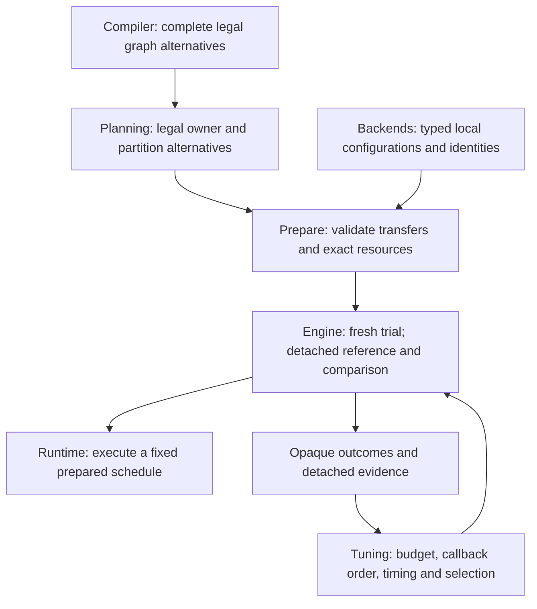

# Autotuning coverage and correctness audit

Status: Bounded repairs behavior-verified; architecture-changing extensions remain proposals, not implemented features.

## Question and evidence boundary

The user asked whether [autotuning](../glossary.md#autotuning--model-autotuning) works correctly and tries all supported variants and backend combinations. **The baseline does not search every available execution route or every CPU/Metal combination.** A backend's ability to execute an operation is not evidence that its tuning producer offers that operation as a candidate.

This report belongs to [Tuning task 0006](tools/tuning/tasks/0006-candidate-coverage-and-correctness-audit.md). It separates the unchanged baseline, verified repairs, observed limits and architecture proposals. The baseline is `7ec6de7865ac456ac52108e84165286ac375a146`; baseline programs used the unchanged eighteen-JAR private `0.1.0-public-audit.20261104` closure. Passing-after CPU programs replace only CPU, Engine and Tuning with the reviewed builds. This does not reissue that sealed release or authorize public publication.

A **candidate** is one complete legal alternative supplied by its responsible backend. **Local tuning** compares implementations of one workload; **complete-plan tuning** compares supplied plans for the whole admitted partition. **Admission** means accepting a request after checking its supported domain. See the [two-phase explanation](../architecture/performance-evidence-and-tuning.md#one-model-autotuning-workflow) before interpreting candidate counts.

### Reading key: implementations, storage and APIs

- [CPU](../glossary.md#term-cpu) is the host processor; [Metal](../glossary.md#term-metal) is Apple's GPU framework.
  [F32](../glossary.md#term-float32) and [F64](../glossary.md#term-float64) name 32- and 64-bit floating formats.
  [MATMUL](../glossary.md#matrix-multiplication--matmul) is matrix multiplication.
- [OpenBLAS](../glossary.md#term-openblas) and [oneDNN](../glossary.md#term-onednn) are external native numerical
  libraries. oneDNN's [Primitive and Graph APIs](../glossary.md#onednn-primitive-and-graph-apis) are CPU
  interfaces; [MPSGraph](../glossary.md#term-mpsgraph) is a different Apple GPU framework.
- A **copy mask** says which input/output representations are copied. A
  [materialization](../glossary.md#materialization) creates a stored representation, and
  [workspace](../glossary.md#workspace-slot--workspaceslot) is temporary execution storage, not another model.
  **Topology** here means which operations share a physical execution unit and their dependency order.
- [Opaque](../glossary.md#term-opaque) means the tool carries a backend value without reading its private
  settings. Engine is the caller of the generic tuning transaction; the tool calls Engine's supplied
  execution actions. That authority does not transfer ownership of the application's input storage.

## Baseline coverage: available is not tunable

| Domain at the baseline | Actual tuning coverage | Boundary or omission |
|---|---|---|
| Ordinary public CPU MATMUL with bindable inputs | Strict request rejected in an actual public run | Projected caller-input storage facts and disabled copy policy produce no local handoff, even with native-backed input Tensors. |
| Otherwise eligible CPU local MATMUL batch | One already-selected portable implementation plus legal OpenBLAS configurations | F32/F64, bounded rank-two geometry, positive M/N and K>1. Public composition supplies scalar/single-range/capacity-one settings, thread list `[1]` and no copy budget. This is not a vector/tile/thread sweep. |
| CPU internal OpenBLAS generator | Portable plus copy-mask × allowed-thread configurations | Eight possible direct/copy masks and at most 32 configured thread counts; geometry, alignment, capacity and workspace legality prune configurations. These are source-derived possibilities, not all observed public runs. |
| CPU complete-plan producer | Bounded topology and representation alternatives | At most eight compiled nodes, 64 topologies and 256 pair attempts. Direct/single-copy/pair-copy representations are bounded separately. Incomplete discovery does not become a silently tuned prefix. |
| CPU pointwise plans with no local workload | Existing complete producer can represent them; baseline Engine does not reach it | Engine requires a local handoff before entering Phase 2. |
| CPU oneDNN | Zero local tuning candidates | AUTO/PRIMITIVES/GRAPH are explicit integration preferences and deterministic native selection, not measured tuning dimensions. A frozen OpenBLAS decision prevents later oneDNN substitution. |
| Metal public local | Exactly custom singleton NEG and MPSGraph NEG | Nonempty packed canonical F32 singleton NEG only; no launch-size, tile or precision sweep. |
| Metal complete plan | One plan fixed to the selected local NEG route | It still receives reference capture and measurements; it is not a second route search. |
| Other Metal private route pairs | Not public tuning domains | Private FLOOR/CEIL/SIGN/RELU pairs do not override Engine's normative singleton-NEG gate. |
| Mixed CPU/Metal, multiple partitions or owner alternatives | Rejected | The current [Engine contract](../architecture/contracts/runtime-prepare-engine.md#compile-ownership-and-mixed-owner-prepare-routing) explicitly forbids these tuning trials. Ordinary mixed execution does not grant tuning authority. |

The complete source audit records exact producers, order, pruning, identities and limitations in the local evidence directory `build/tuning-cli-performance/`. No table row asserts that every mathematically possible optimization has an implementation.

### Finite execution counts

Let $\mathcal G_{\mathrm{miss}}$ be the groups with no compatible cached local decision. For each group $g$, let $n_g$ be the number of complete supplied candidates. Let $w\ge0$ be the warmup count and $s\ge1$ an odd timed-sample count. A successful local transaction performs

$$
E_{\mathrm{local}}=\sum_{g\in\mathcal G_{\mathrm{miss}}}n_g(w+s).
$$

An occurrence weight records how often a workload appears; it does **not** multiply these trials. Compatible hits perform no enumeration or trial execution. A session-only request can deduplicate within that request but does not create a hidden cross-request cache.

For $n\ge1$ complete-plan candidates, the corresponding count is

$$
E_{\mathrm{plan}}=n(1+w+s).
$$

The extra execution per candidate captures the first reference or compares a later result. Every comparison and cleanup must finish before any timed candidate runs. Caller-owned Engine collaboration compares detached publication bytes; generic tooling receives only the typed match/mismatch result. A mismatch stops the transaction without timing later candidates.

These formulas describe successful transactions over the **supplied finite lists**. They cannot prove that a producer included every legal variant.

## Actually exercised baseline scenarios

### Metal: all declared candidates, not all Metal operations

`AutotuneMetalAudit.java` used public `Engine.compile`, `prepareTuned`, `run` and result materialization with the actual Metal native library. It used canonical F32 vectors of lengths 2, 17 and 257, repeating each request in the same session.

| Observed property | Result |
|---|---|
| Successful tuning requests | 6 |
| Local workloads per request | 1 |
| Measured local candidates per request | 2 |
| Timed samples per local candidate | 3 |
| Complete-plan candidates per request | 1 |
| Timed samples per complete candidate | 3 |
| Numerical comparison | Every output's raw F32 bits matched NEG, including both signed-zero inputs. |
| Repeated-request reuse | All evidence remained `MEASURED`, not a fabricated cache hit. |
| Cache-path access | Neither cache path was read or written; both deliberately named directories rather than valid cache files. |

This proves the exercised singleton-NEG cases. It does not qualify another Metal operation, mixed execution, arbitrary shapes or persistent complete-plan reuse.

### CPU: a supported computation does not imply a tuned result

The ordinary public CPU program compiled `a.matmul(b)` with canonical native-backed F32 `[2,2]` operands containing `[1,2,3,4]` and `[5,6,7,8]`. It used no reflected artifacts, fake capability provider or conditional skip.

- `REQUIRE_TUNED_RESULT` failed with `IllegalStateException: no eligible local-workload tuning handoff`.
- `ALLOW_SAFE_HEURISTIC` returned `SAFE_HEURISTIC_FALLBACK`, no tuning evidence, and the actual values `[19,22,43,50]`.

The latter values are observed execution output, not a prediction from a publication-count assertion. The existing positive integration test manufactured resolved artifacts and could skip when no batch existed; it did not establish this ordinary public path.

### Native execution and forbidden composition checks

`AutotuneDomainAudit.java` also loaded the exact external oneDNN library and checked actual typed
`SELECTED` diagnostics rather than treating configuration as proof of route selection. Ordinary
F32 `[32,64] @ [64,48]` execution returned 64 in every one of its 1,536 output cells.

| Configured oneDNN preference | Observed selected unit API | Baseline strict tuning |
|---|---|---|
| AUTO | PRIMITIVES | Rejected: no eligible local-workload tuning handoff |
| PRIMITIVES | PRIMITIVES | Rejected: no eligible local-workload tuning handoff |
| GRAPH | GRAPH | Rejected: no eligible local-workload tuning handoff |

The same program registered Metal before CPU and actually executed
`exp(F64 input) → cast(F32) → NEG → cast(F64)` with the expected represented values.
Tuning that graph then failed with `preparation requires exactly one backend owner`; no new CPU
preparation diagnostic appeared. This corroborates the source's fail-before-trial guard, not a
claim that the public request has a representative-supplier callback—it has none. Input Tensors
remain caller-owned and borrowed according to the existing synchronous/result lifetimes.

`AutotuneAdmissionAudit.java` independently executed ordinary F32 RELU and BFLOAT16 NEG, checked
their represented outputs, and then confirmed strict tuning rejects both as outside the public
NEG-pair domain. A source-only graph with no partitions was rejected as an empty tuning plan.
All rejected requests left deliberately invalid directory-shaped cache paths unchanged.

## Reproduced and verified transaction repairs

| Finding | Failing-before observation | Verified repair and passing-after observation |
|---|---|---|
| Clock origin rollover | A valid `Long.MAX_VALUE` → `Long.MIN_VALUE` interval was rejected by WorkloadTuning as a backward clock and by CompletePlanTuning as arithmetic overflow. | Wrapping subtraction accepts the interval; both actual transactions record a 1 ns sample. Negative differences still fail; size/weight/budget arithmetic remains checked. |
| Incoherent cache pathname snapshot | While one writer atomically replaced independently valid cache versions, 596 of 10,000 reads falsely reported growth or truncation; 9,404 reads succeeded. | Both loaders size/read/probe the opened channel. The actual repeated workload-cache smoke accepted all 10,000 snapshots with zero false size failures. No retry or concurrent merge protocol was added. |
| Lost primary publication error | Both real POSIX permission-failure cases replaced the original before-move IOException with cleanup AccessDeniedException; the original was not suppressed. | Both actual publisher runs preserve the original IOException object and attach the cleanup AccessDeniedException as suppressed. Separate regressions cover unchecked and standalone cleanup errors. |

The deterministic clock program invokes the actual package-private transaction seam, not a copied subtraction helper. The filesystem programs use only owned temporary directories, restore permissions and join the atomic writer before cleanup. Baseline commands and full outputs are recorded beside their sources in `build/tuning-cli-performance/`.

Independent clock review found no issue. Independent persistence review caught two new test calls
to a nonexistent complete-plan entry accessor; both now use the existing `decision()` accessor,
without a production alias. After that repair, `:tools:tuning:test :tools:tuning:jar` passed:
85 tests, zero failures, zero errors and zero skips. The passing-after programs used the newly
built tuning JAR plus the same seventeen other sealed reference JARs, with the old tuning JAR
removed from the classpath. The operational atomic-replacement smoke covers the workload loader;
the complete-plan loader uses the same reviewed fix and affected tests, not a claimed second
native or concurrent-filesystem run.

### Why clock subtraction must wrap

`System.nanoTime()` has an arbitrary origin; its signed absolute value is not a timestamp to order directly. For an elapsed interval shorter than $2^{63}$ nanoseconds, compute the 64-bit modular difference and interpret the result as a signed `long`. Thus the adjacent readings `Long.MAX_VALUE` and `Long.MIN_VALUE` represent **one** elapsed nanosecond, not a negative duration.

```java
// Intentional wrapping subtraction: the origin may cross the signed-long boundary.
long elapsed = end - start;
// A negative difference is outside the supported short monotonic-interval domain.
if (elapsed < 0) throw new IllegalStateException("monotonic clock moved backwards");
```

This permission applies to the elapsed clock difference only. Candidate counts, execution budgets, aggregate weights and encoded sizes still require checked arithmetic. See the [JDK nanoTime contract](https://docs.oracle.com/en/java/javase/26/docs/api/java.base/java/lang/System.html#nanoTime()).

<a id="cpu-integration-findings-requiring-full-path-proof"></a>
## Verified CPU coverage and fixes

### Current finite domain

The [CPU producer contract](../guides/cpu-backend.md#cold-local-workload-tuning-collaboration)
and [Engine lifecycle example](../reference/engine/lifecycle.md) explain the current behavior:

- **Phase 1:** an eligible bare singleton MATMUL, including its absorbed PERMUTE views, supplies
  every legal existing scalar direct/fixed-2×2 form for the 40 promoted numeric dtype tuples.
  Homogeneous F32/F64/I32/I64 additionally supply supported vector direct/fixed-2×2 forms.
  Each portable form supplies all legal configured range counts. This is not a topology sweep.
- Qualified OpenBLAS choices cover every admitted copy mask × configured native thread count
  within the existing resource limits. Their domain remains positive rank-2 F32/F64 MATMUL
  with $K>1$, not arbitrary native placement in a multi-operation partition.
- Qualified [oneDNN API](../glossary.md#onednn-primitive-and-graph-apis) alternatives are distinct
  candidates: AUTO can supply Primitive and Graph choices; a forced policy supplies at most
  its own API. Existing dtype/layout/epilogue qualification still applies; native F64 is excluded.
- **No local workload:** Engine skips Phase 1 and its cache entirely. Local evidence is empty.
  Phase 2 retains the existing finite topology/representation alternatives and legal portable
  or native realizations. It actually captures, compares, warms, measures and selects them.
- **One complete candidate:** valid, but its correctness status is only `REFERENCE_CAPTURED`.
  There is no second candidate to produce `MATCH` and no independent numerical oracle.

For portable form $f$ with positive work iterations $I_f$, let $O_f$ be output elements,
$E$ configured minimum work per chunk, $P$ configured parallelism and $A$ available parallelism.
Legal range counts are $1,\ldots,R_f$; the separate zero-work case has $R_f=1$:

$$
C_f=\max\!\left(1,\left\lfloor O_f/I_f\right\rfloor\right),\qquad
q_f=\max\!\left(1,\left\lceil E/C_f\right\rceil\right),\qquad
R_f=\min\!\left(P,A,\left\lceil I_f/q_f\right\rceil\right).
$$

If $p_i$ is the sum of legal range counts over a unit's portable forms, $a_i$ its qualified
oneDNN alternatives, and $B$ the admitted whole-unit OpenBLAS choices:

$$
N_{\mathrm{local}}=p+B+a,\qquad
N_{\mathrm{complete}}=\sum_v\left[\prod_i(p_{v,i}+a_{v,i})+B_v\right].
$$

Here $v$ indexes admitted topology/representation variants; a native replacement does not
multiply the portable implementations it replaces. The pre-existing 8-node/64-topology/256-attempt
bounds remain. New aggregate preflight rejects more than 8,192 local or complete candidates;
native-assignment enumeration has its own 6,560 bound and canonical identity bytes a 1 MiB bound.
These are all-or-nothing bounds, not silent prefix sampling or a global optimum claim.
CPU local schema **4**, route policy **3** and complete schema **5** reject obsolete identities.

### Actual failing-before / passing-after observations

| Reached defect | Before evidence boundary | Verified current behavior |
|---|---|---|
| Ordinary caller-input MATMUL excluded | Unchanged sealed closure rejected strict tuning of the public `[2,2]` example. | Both public fallback policies return `TUNED`, then exactly `[19,22,43,50]`. Actual local reuse is `MEASURED` → `CACHE_HIT`; a fresh closed/reopened CPU integration also hits the persistent local entry. Complete-plan evidence stays session-scoped. |
| Wrong geometry after a native input copy | Unchanged sealed closure produced `[17,23,39,53]` for one copied realization instead of `[19,22,43,50]`. | All eight offered realizations produce the expected values. Finalization uses the represented copy's geometry, not the original view's strides. |
| Unsafe vector bias layouts exposed by expanded enumeration | An intermediate expanded build offered 56 choices: eight either read a poison cell or failed on stride-zero/stride-two bias. | The same program executes all 48 retained F32/F64 choices correctly. Legality requires unit bias stride for every vector form, not only TANH. Unsupported forms are not offered. |
| Copied heap inputs rejected by the binding guard | An intermediate expanded build accepted six portable choices but rejected two declared-copy OpenBLAS choices for matching heap carriers. | The copy boundary accepts exact matching F32/F64 array carriers; only an uncopied native route still requires native storage. Span, alias and writability guards remain. Public numerical regressions execute the resulting choices. |
| Stale execution/resource policy transported with a frozen decision | Intermediate builds retained two ranges under current capacity one, accepted a changed minimum chunk policy, or admitted a 224-byte copy under disabled/zero/223-byte budgets. | Actual probes reject all those cases. Exactly five non-cost materialization-policy fields must agree; only the four scoring costs may be transported. Valid scoring-only transport still retains the selected 224-byte realization. |
| Zero-$K$ representation rejected as a failed copy benefit calculation | Intermediate producer probe supplied neither local nor complete candidates. | A compile-without-optimization probe supplies four local forms for $K=0$, four for $K=1$, six for $K=2$. Numerical tests execute all admitted forms; empty read domains require no ingress copy and zero direct cost does not divide by zero. |
| Complete-only Engine path unreachable | The source producer accepted an absent local decision, but Engine required Phase 1. | Public `NEG(x)+x` actually returns `TUNED`, empty local evidence and four positive-zero outputs. Both deliberately invalid directory-shaped cache paths remain untouched; its two complete candidates report reference then match. |

The original final heuristic substitution was a source-traced risk, not a captured baseline
execution; this report does not relabel it as one. Reviewed frozen-decision regressions now
authenticate the exact selected configuration and current legality without another local search.

### Verification scope and independent review

- **412 tests in 52 suites:** zero failures, errors or skips. Scope: fourteen affected CPU classes
  plus representation planning, three Engine classes, two integration classes, and the complete
  backend-conformance and architecture tasks. This is not a claim that the unfiltered whole
  repository suite passed; an earlier unfiltered CPU invocation timed out and is recorded as such.
- **85 Tuning tests:** zero failures, errors or skips, plus the actual clock/filesystem scenarios
  above. Independent reviewers' production and test findings were repaired before the final gates.
  Final follow-up reviews found no remaining source defect; reviewers did not run the checks.
- **Optional Vector API:** a separate actual JVM leaves `jdk.incubator.vector` unresolved.
  Both public tuning policies still return `TUNED` and the exact MATMUL result. Scalar and
  qualified native alternatives do not depend on the optional vector module.
- **Actual native APIs:** oneDNN 3.14.0 LP64 SEQ at the recorded external path executes all
  1,536 cells of `[32,64] @ [64,48]` as 64 under AUTO, PRIMITIVES and GRAPH.
  All three strict tuning requests now return `TUNED`; typed diagnostics prove the selected APIs.
- **Actual documentation consumer:** the current `BoundedCpuMatmul` Java fence compiles and runs
  outside the checkout, without the Vector module, printing `19.0`, `22.0`, `43.0`, `50.0`.
- **Preserved exclusions:** actual mixed CPU/Metal execution still works, but tuning rejects it
  before a CPU preparation trial. Metal's six declared singleton-NEG requests above remain the
  exercised public domain; RELU/BF16/source-only rejection is not silently broadened.

Commands, full outputs, source/classpath hashes, independent reviews and before binaries are
preserved in the owned `build/tuning-cli-performance/` evidence. Hardware is Apple M3 Max,
macOS arm64, JDK 26; native Metal uses ABI 7/identity 45. Native libraries remain external, not bundled.

### Important negative case: exact floating agreement

The existing complete-plan guard compares canonical bytes exactly. It is intentionally **not**
a floating-point tolerance, and this audit does not weaken it.

An actual strict request for F32 `[32,64] @ [64,48] + bias`, using finite non-integer values
and oneDNN AUTO, fails with `complete-plan candidate correctness mismatch`. Ordinary execution
is finite and diagnostics select oneDNN MATMUL plus portable ADD. This is an observed limit,
not a successful tuning qualification.

A separate diagnostic executes **all 26 complete candidates**, then reuses each prepared plan
with fresh exactly representable integer inputs. All integer outputs equal the independent
expected computation. For the non-integer pass:

| Complete-candidate group | Candidates | Largest absolute difference from a double-precision dot/bias reference | Largest ULP distance from sequential F32 |
|---|---:|---:|---:|
| Byte-equal to sequential F32 | 20 | $7.12275509684\times10^{-8}$ | 0 |
| Different from sequential F32 | 6 | $1.23381614259\times10^{-7}$ | 32 |

[ULP](../glossary.md#floating-point-precision-and-rounding) distance alone is misleading near
cancellation; absolute error and the operands' magnitude also matter. Every observed finite
error fits the diagnostic dot-product roundoff bound below, with unit roundoff $u=2^{-24}$,
$\gamma_p=pu/(1-pu)$, matrix operands $a,b$, and bias $\beta$:

$$
2\gamma_{2K+1}\sum_k|a_{rk}b_{kc}|+2u|\beta_c|.
$$

This supports a rounding-related explanation for **these inputs**, not a proof for every input,
dtype or native implementation. The diagnostic bound is never passed to Engine or used to
accept production candidates. Defining Model-qualified comparison instead requires the
[architecture-only proposal below](#model-qualified-floating-comparison); until then, exact
disagreement remains a failed strict transaction.

## Lessons from primary framework materials

| Framework | What its primary documentation establishes | Applicable lesson, not a contract import |
|---|---|---|
| [Triton autotune](https://triton-lang.org/main/python-api/generated/triton.autotune.html) | Explicit configuration list, key-triggered evaluation, optional pruning/top-k, reset/restore hooks for repeated mutation, optional timing cache. | State the finite candidate list and pruning. Repeat-safe inputs and completed cleanup matter. “Autotune” does not imply universal search. |
| [PyTorch TorchInductor CPU](https://docs.pytorch.org/tutorials/unstable/max_autotune_on_CPU_tutorial.html) | Compile-time comparison of eligible GEMM implementations, explicit backend filtering and a longer-compile/faster-run tradeoff; tutorial CPU templates require frozen/no-grad inference. | Enumerate actual eligible implementations and disclose restrictions and preparation cost. Do not transfer an x86/frozen-inference promise to this host or training workflow. |
| [TVM MetaSchedule](https://tvm.apache.org/docs/deep_dive/tensor_ir/tutorials/meta_schedule.html) | Design-space generation, budgeted evolutionary search, hardware measurements, workload weights and persistent schedule records; retuning warm-starts rather than skipping every known task. | Separate legal space, search budget, measurement and reuse. A budgeted search is not an exhaustive proof over every schedule. |

Synaptik retains its own Model arithmetic, exact-byte complete-plan agreement, typed opaque candidates and lifecycle owners. Framework inspiration does not authorize a production tolerance selector or Runtime search.

## Architecture-only expansion proposal

**Not implemented.** Mixed-owner/multipartition tuning and a broader public Metal domain require changing the current authority. The user explicitly requested analysis rather than such an architectural repair.



Before implementation, the proposal needs:

- A complete-candidate identity binding ordered owners, partition dependencies, transfers, representation choices and every local decision. A Metal session nonce makes the composite session-scoped unless a separate reuse design changes that fact.
- Fail-before-trial proof for unavailable owners, unsupported transfer direction/layout/dtype/size, incompatible decisions and total resource/execution limits.
- One existing Engine-owned representative transaction over the complete composed plan, preserving reverse rollback, per-run resources and caller-input/result borrowing. No trial result becomes production state.
- Model-semantic qualification of every newly admitted Metal occurrence and separate exact/special-value/finite arithmetic evidence. The existence of a private route pair is insufficient.
- Explicit finite search/pruning rules and evidence for omitted alternatives. Exhaustive ownership combinations can grow exponentially; a bounded search must report that it was bounded rather than claiming a global optimum.

The tradeoff is longer preparation and more candidate/resource validation in exchange for a wider measured space. A generic knob registry, backend policy in Planning, or runtime fallback would weaken existing boundaries and is not proposed.

### Local decisions across changing topology

A separate proposed extension is explicit mapping of authenticated local decisions onto every
complete topology that needs them. A fused unit and two separate units do not automatically share
one interchangeable configuration: their boundaries, representations and arithmetic obligations
can differ.

The safe design would first extract and deduplicate the canonical local workloads required by
the offered complete candidates, measure/cache their configurations in Phase 1, then let each
Phase-2 candidate authenticate the applicable decisions without repeating that search. The
mapping, incompatible-case handling, identity/version rules and aggregate work/resource limits
need an explicit backend/Prepare/Engine orchestration contract.

Enumerating all topologies in Phase 1 and then freezing away Phase-2 alternatives would change
the existing phase contract. That design was stopped, not shipped. The bounded repair keeps
local configuration search on the intrinsic singleton MATMUL topology; no-local complete plans
retain their topology/representation comparison in Phase 2. Broader cross-topology decision
mapping remains analysis/proposal work under the user's architecture restriction.

### Model-qualified floating comparison

**Proposal only; not implemented.** A comparison contract must belong to Model/Engine, not a
backend-specific epsilon hidden inside the generic timer. It would need:

1. A per-output qualification identifying the exact arithmetic sites, dtype, permitted
   reassociation/contraction and a justified finite-error relation. Integer and exact outputs
   must retain exact comparison.
2. Separate specified handling for NaN payloads, infinities, signed zero, overflow, underflow
   and cancellation. A single relative epsilon does not define these cases.
3. An authenticated comparison identity in complete-plan requests, evidence and cache keys;
   old exact-byte records cannot silently mean a newly tolerant contract.
4. Independent numerical oracles and adversarial boundary cases, not merely agreement with
   the first candidate. Fresh inputs, no result escape and current cleanup obligations remain.

The tradeoff is wider useful floating-point tuning versus a new numerical qualification and
cache-compatibility surface. Keep today's exact guard until that authority is explicitly designed
and approved; do not “fix” the observed failure by filtering values, suppressing the mismatch,
returning an unmeasured winner or adding a tool-owned tolerance knob.

<a id="remaining-evidence-before-closure"></a>
## Completion boundary

The reached architecture-neutral defects have actual before/after evidence and focused regression
coverage. Current readable contracts, lifecycle instructions and candidate bounds are updated;
historical sealed qualification remains pinned to its original source and artifacts.

Mixed-owner/multipartition tuning, broader Metal qualification, cross-topology Phase-1 decision
mapping and a new floating comparison contract remain the explicit proposals above. No ownership,
Model arithmetic, Runtime search, module-edge or native ABI change was implemented by this repair.

The requested [live CLI successor](tools/cli/tasks/0001-live-model-training-and-terminal.md) and
matched PyTorch measurements follow this audit; their results are not claimed here.
