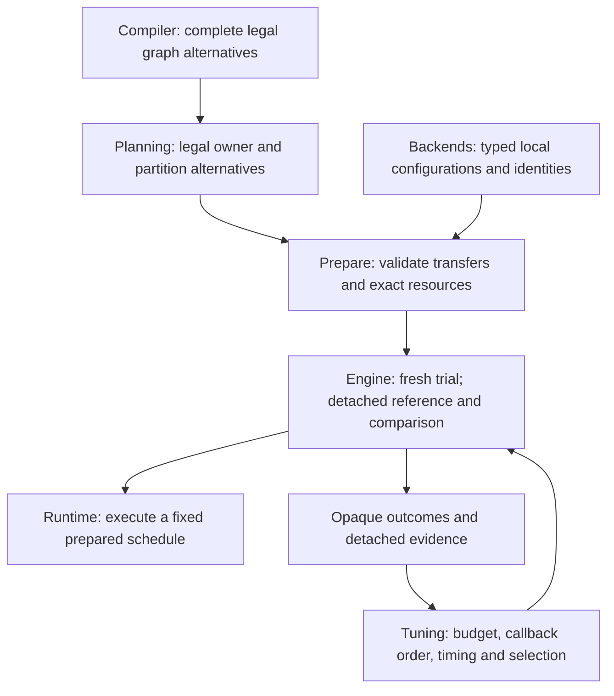

# Autotuning coverage and correctness audit

Status: In progress — transaction repairs passed actual smoke and affected tests; CPU coverage repair and full-path verification continue.

## Question and evidence boundary

The user asked whether [autotuning](../glossary.md#autotuning--model-autotuning) works correctly and tries all supported variants and backend combinations. **The baseline does not search every available execution route or every CPU/Metal combination.** A backend's ability to execute an operation is not evidence that its tuning producer offers that operation as a candidate.

This report belongs to [Tuning task 0006](tools/tuning/tasks/0006-candidate-coverage-and-correctness-audit.md). It distinguishes source inspection, actual public-consumer execution, repairs awaiting verification and architecture proposals. The baseline is `7ec6de7865ac456ac52108e84165286ac375a146`; actual baseline programs used the unchanged eighteen-JAR private `0.1.0-public-audit.20261104` closure. This does not reissue that sealed release or authorize public publication.

A **candidate** is one complete legal alternative supplied by its responsible backend. **Local tuning** compares implementations of one workload; **complete-plan tuning** compares supplied plans for the whole admitted partition. **Admission** means accepting a request after checking its supported domain. See the [two-phase explanation](../architecture/performance-evidence-and-tuning.md#one-model-autotuning-workflow) before interpreting candidate counts.

## Baseline coverage: available is not tunable

| Domain at the baseline | Actual tuning coverage | Boundary or omission |
|---|---|---|
| Ordinary public CPU MATMUL with bindable inputs | Strict request rejected in an actual public run | Projected caller-input storage facts and disabled copy policy produce no local handoff, even with native-backed input Tensors. |
| Otherwise eligible CPU local MATMUL batch | One already-selected portable implementation plus legal OpenBLAS configurations | F32/F64, bounded rank-two geometry, positive M/N and K>1. Public composition supplies scalar/single-range/capacity-one settings, thread list `[1]` and no copy budget. This is not a vector/tile/thread sweep. |
| CPU internal OpenBLAS generator | Portable plus copy-mask × allowed-thread configurations | Eight possible direct/copy masks and at most 32 configured thread counts; geometry, alignment, capacity and workspace legality prune configurations. These are source-derived possibilities, not all observed public runs. |
| CPU complete-plan producer | Bounded topology and representation alternatives | At most eight compiled nodes, 64 topologies and 256 pair attempts. Direct/single-copy/pair-copy representations are bounded separately. Incomplete discovery does not become a silently tuned prefix. |
| CPU pointwise plans with no local workload | Existing complete producer can represent them; baseline Engine does not reach it | Engine requires a local handoff before entering Phase 2. |
| CPU oneDNN | Zero local tuning candidates | AUTO/PRIMITIVES/GRAPH are explicit integration preferences and deterministic native selection, not measured tuning dimensions. A frozen OpenBLAS decision prevents later oneDNN substitution. |
| Metal public local | Exactly custom singleton NEG and MPSGraph NEG | Nonempty packed canonical F32 singleton NEG only; no launch-size, tile or precision sweep. |
| Metal complete plan | One plan fixed to the selected local NEG route | It still receives reference capture and measurements; it is not a second route search. |
| Other Metal private route pairs | Not public tuning domains | Private FLOOR/CEIL/SIGN/RELU pairs do not override Engine's normative singleton-NEG gate. |
| Mixed CPU/Metal, multiple partitions or owner alternatives | Rejected | The current [Engine contract](../architecture/contracts/runtime-prepare-engine.md#compile-ownership-and-mixed-owner-prepare-routing) explicitly forbids these tuning trials. Ordinary mixed execution does not grant tuning authority. |

The complete source audit records exact producers, order, pruning, identities and limitations in the local evidence directory `build/tuning-cli-performance/`. No table row asserts that every mathematically possible optimization has an implementation.

### Finite execution counts

Let $\mathcal G_{\mathrm{miss}}$ be the groups with no compatible cached local decision. For each group $g$, let $n_g$ be the number of complete supplied candidates. Let $w\ge0$ be the warmup count and $s\ge1$ an odd timed-sample count. A successful local transaction performs

$$
E_{\mathrm{local}}=\sum_{g\in\mathcal G_{\mathrm{miss}}}n_g(w+s).
$$

An occurrence weight records how often a workload appears; it does **not** multiply these trials. Compatible hits perform no enumeration or trial execution. A session-only request can deduplicate within that request but does not create a hidden cross-request cache.

For $n\ge1$ complete-plan candidates, the corresponding count is

$$
E_{\mathrm{plan}}=n(1+w+s).
$$

The extra execution per candidate captures the first reference or compares a later result. Every comparison and cleanup must finish before any timed candidate runs. Caller-owned Engine collaboration compares detached publication bytes; generic tooling receives only the typed match/mismatch result. A mismatch stops the transaction without timing later candidates.

These formulas describe successful transactions over the **supplied finite lists**. They cannot prove that a producer included every legal variant.

## Actually exercised baseline scenarios

### Metal: all declared candidates, not all Metal operations

`AutotuneMetalAudit.java` used public `Engine.compile`, `prepareTuned`, `run` and result materialization with the actual Metal native library. It used canonical F32 vectors of lengths 2, 17 and 257, repeating each request in the same session.

| Observed property | Result |
|---|---|
| Successful tuning requests | 6 |
| Local workloads per request | 1 |
| Measured local candidates per request | 2 |
| Timed samples per local candidate | 3 |
| Complete-plan candidates per request | 1 |
| Timed samples per complete candidate | 3 |
| Numerical comparison | Every output's raw F32 bits matched NEG, including both signed-zero inputs. |
| Repeated-request reuse | All evidence remained `MEASURED`, not a fabricated cache hit. |
| Cache-path access | Neither cache path was read or written; both deliberately named directories rather than valid cache files. |

This proves the exercised singleton-NEG cases. It does not qualify another Metal operation, mixed execution, arbitrary shapes or persistent complete-plan reuse.

### CPU: a supported computation does not imply a tuned result

The ordinary public CPU program compiled `a.matmul(b)` with canonical native-backed F32 `[2,2]` operands containing `[1,2,3,4]` and `[5,6,7,8]`. It used no reflected artifacts, fake capability provider or conditional skip.

- `REQUIRE_TUNED_RESULT` failed with `IllegalStateException: no eligible local-workload tuning handoff`.
- `ALLOW_SAFE_HEURISTIC` returned `SAFE_HEURISTIC_FALLBACK`, no tuning evidence, and the actual values `[19,22,43,50]`.

The latter values are observed execution output, not a prediction from a publication-count assertion. The existing positive integration test manufactured resolved artifacts and could skip when no batch existed; it did not establish this ordinary public path.

## Reproduced and verified transaction repairs

| Finding | Failing-before observation | Verified repair and passing-after observation |
|---|---|---|
| Clock origin rollover | A valid `Long.MAX_VALUE` → `Long.MIN_VALUE` interval was rejected by WorkloadTuning as a backward clock and by CompletePlanTuning as arithmetic overflow. | Wrapping subtraction accepts the interval; both actual transactions record a 1 ns sample. Negative differences still fail; size/weight/budget arithmetic remains checked. |
| Incoherent cache pathname snapshot | While one writer atomically replaced independently valid cache versions, 596 of 10,000 reads falsely reported growth or truncation; 9,404 reads succeeded. | Both loaders size/read/probe the opened channel. The actual repeated workload-cache smoke accepted all 10,000 snapshots with zero false size failures. No retry or concurrent merge protocol was added. |
| Lost primary publication error | Both real POSIX permission-failure cases replaced the original before-move IOException with cleanup AccessDeniedException; the original was not suppressed. | Both actual publisher runs preserve the original IOException object and attach the cleanup AccessDeniedException as suppressed. Separate regressions cover unchecked and standalone cleanup errors. |

The deterministic clock program invokes the actual package-private transaction seam, not a copied subtraction helper. The filesystem programs use only owned temporary directories, restore permissions and join the atomic writer before cleanup. Baseline commands and full outputs are recorded beside their sources in `build/tuning-cli-performance/`.

Independent clock review found no issue. Independent persistence review caught two new test calls
to a nonexistent complete-plan entry accessor; both now use the existing `decision()` accessor,
without a production alias. After that repair, `:tools:tuning:test :tools:tuning:jar` passed:
85 tests, zero failures, zero errors and zero skips. The passing-after programs used the newly
built tuning JAR plus the same seventeen other sealed reference JARs, with the old tuning JAR
removed from the classpath. The operational atomic-replacement smoke covers the workload loader;
the complete-plan loader uses the same reviewed fix and affected tests, not a claimed second
native or concurrent-filesystem run.

### Why clock subtraction must wrap

`System.nanoTime()` has an arbitrary origin; its signed absolute value is not a timestamp to order directly. For an elapsed interval shorter than $2^{63}$ nanoseconds, compute the 64-bit modular difference and interpret the result as a signed `long`. Thus the adjacent readings `Long.MAX_VALUE` and `Long.MIN_VALUE` represent **one** elapsed nanosecond, not a negative duration.

```java
// Intentional wrapping subtraction: the origin may cross the signed-long boundary.
long elapsed = end - start;
// A negative difference is outside the supported short monotonic-interval domain.
if (elapsed < 0) throw new IllegalStateException("monotonic clock moved backwards");
```

This permission applies to the elapsed clock difference only. Candidate counts, execution budgets, aggregate weights and encoded sizes still require checked arithmetic. See the [JDK nanoTime contract](https://docs.oracle.com/en/java/javase/26/docs/api/java.base/java/lang/System.html#nanoTime()).

## CPU integration findings requiring full-path proof

The independent producer audit also traced these source-level gaps:

1. Caller-input representation facts plus disabled local copies exclude otherwise executable MATMUL inputs. Repair must use declared legal ingress/copy resources, not relabel unknown caller storage as native.
2. The complete producer accepts absent Phase 1, but Engine does not. Empty local evidence must mean no local workloads, not invented candidate rows.
3. Phase 2 changes a materialization policy included in the Phase-1 workload signature. Exact matching then fails and can fall through to a heuristic. Repair must carry and authenticate the original selected configuration across that boundary, not weaken compatibility equality.
4. A singleton complete CPU plan is rejected despite being a complete legal plan. A reference-only singleton check is not an independent numerical oracle; public expected-value execution remains necessary.
5. Existing portable direct/tiled/vector and qualified native implementations must be distinguished from the producer's actual candidate list. New CPU-owned choices need matching legality, resource, identity, codec and frozen-decision evidence.

The first public failure above is reproduced. A final observable route substitution for the policy mismatch has not yet been demonstrated. Implementation and passing-after evidence must not be inferred from this source trace.

## Lessons from primary framework materials

| Framework | What its primary documentation establishes | Applicable lesson, not a contract import |
|---|---|---|
| [Triton autotune](https://triton-lang.org/main/python-api/generated/triton.autotune.html) | Explicit configuration list, key-triggered evaluation, optional pruning/top-k, reset/restore hooks for repeated mutation, optional timing cache. | State the finite candidate list and pruning. Repeat-safe inputs and completed cleanup matter. “Autotune” does not imply universal search. |
| [PyTorch TorchInductor CPU](https://docs.pytorch.org/tutorials/unstable/max_autotune_on_CPU_tutorial.html) | Compile-time comparison of eligible GEMM implementations, explicit backend filtering and a longer-compile/faster-run tradeoff; tutorial CPU templates require frozen/no-grad inference. | Enumerate actual eligible implementations and disclose restrictions and preparation cost. Do not transfer an x86/frozen-inference promise to this host or training workflow. |
| [TVM MetaSchedule](https://tvm.apache.org/docs/deep_dive/tensor_ir/tutorials/meta_schedule.html) | Design-space generation, budgeted evolutionary search, hardware measurements, workload weights and persistent schedule records; retuning warm-starts rather than skipping every known task. | Separate legal space, search budget, measurement and reuse. A budgeted search is not an exhaustive proof over every schedule. |

Synaptik retains its own Model arithmetic, exact-byte complete-plan agreement, typed opaque candidates and lifecycle owners. Framework inspiration does not authorize a production tolerance selector or Runtime search.

## Architecture-only expansion proposal

**Not implemented.** Mixed-owner/multipartition tuning and a broader public Metal domain require changing the current authority. The user explicitly requested analysis rather than such an architectural repair.



Before implementation, the proposal needs:

- A complete-candidate identity binding ordered owners, partition dependencies, transfers, representation choices and every local decision. A Metal session nonce makes the composite session-scoped unless a separate reuse design changes that fact.
- Fail-before-trial proof for unavailable owners, unsupported transfer direction/layout/dtype/size, incompatible decisions and total resource/execution limits.
- One existing Engine-owned representative transaction over the complete composed plan, preserving reverse rollback, per-run resources and caller-input/result borrowing. No trial result becomes production state.
- Model-semantic qualification of every newly admitted Metal occurrence and separate exact/special-value/finite arithmetic evidence. The existence of a private route pair is insufficient.
- Explicit finite search/pruning rules and evidence for omitted alternatives. Exhaustive ownership combinations can grow exponentially; a bounded search must report that it was bounded rather than claiming a global optimum.

The tradeoff is longer preparation and more candidate/resource validation in exchange for a wider measured space. A generic knob registry, backend policy in Planning, or runtime fallback would weaken existing boundaries and is not proposed.

## Remaining evidence before closure

- Passing-after runs for all reached CPU producer/Engine repairs; transaction repairs are verified above.
- Independent targeted review, affected tests and meaningful actual native route observations.
- Final finite coverage matrix, explicit unsupported/architecture-only domains, affected Javadoc and explanatory links.

The requested live CLI and matched PyTorch performance work follow this audit; their results are not claimed here.
