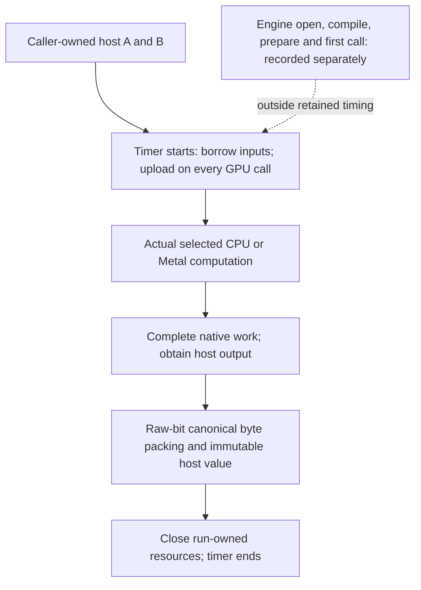

# Metal and oneDNN comparison with PyTorch

## Result and scope

The [ownership-preserving publication repair](../../modules/backend/cpu/src/main/java/io/github/pho001/synaptik/backend/cpu/internal/memory/CpuHostSnapshotExporter.java)
and an explicit [oneDNN/Accelerate build](../how-to/build-onednn-with-accelerate.md) improve the
measured paths, but **do not establish universal parity with PyTorch**. The largest Metal case
still loses; oneDNN still has substantial small-call overhead. Further ownership/completion
changes are proposals below, not implemented work.

Runtime source: `780aac323724fe3093ef6c3b009f6c45cdabc09b`; original runtime image:
`575c0e9ef95efb5f3eed24b6bf1911cfdbdd5d75`. Exact JAR/library/harness hashes and every raw
measurement are retained. The [autotuning audit](autotuning-audit.md) and
[CLI/TUI qualification](terminal-interface-validation.md) are related, separate evidence.

This is a fixed **dense FLOAT32 operator-lifecycle** comparison on Apple M3 Max,
macOS 26.7.1 arm64, JDK 26.0.1. It is not a complete model, training-step, dataset, all-precision,
all-operation or other-machine benchmark. No benchmark installs a production winner.

## What the caller supplies and what is timed

Here the **caller** is the Java/Python benchmark application, not Model. It supplies two
native-endian [host](../glossary.md#term-host) buffers that remain live and unchanged during each
call. The Java application invokes public `Engine.run`; Python invokes `torch.mm`. Input values
are not made into compile-time constants. Both return completed immutable host bytes in the same
[big-endian encoding](../glossary.md#term-endianness).

For $A\in\mathbb{R}^{M\times K}$ and $B\in\mathbb{R}^{K\times N}$, the operation is

$$C_{ij}=\sum_{q=0}^{K-1} A_{iq}B_{qj},\qquad 0\le i<M,\quad0\le j<N.$$

A shape written **M×K×N** below means these three dimensions, not a rank-three input.
Each output contains $4MN$ bytes because [FLOAT32](../glossary.md#term-float32) uses four bytes
per element. [GEMM](../glossary.md#general-matrix-multiplication--gemm) here is the unscaled
matrix product, without bias or an existing output term.

- **GPU boundary:** Synaptik uploads host inputs on every run. PyTorch calls `.to('mps')` on both
  host tensors on every invocation. Neither side receives a device-resident input shortcut.
- **Output boundary:** Synaptik materializes `HostTensorValue` and closes its `RunResult` inside
  timing. PyTorch completes `.cpu()`, converts to big-endian F32 and creates immutable `bytes`.
  The `.cpu()` access is a completion boundary; no redundant per-call global MPS synchronization
  is added to disadvantage PyTorch.
- **CPU boundary:** inputs are reusable borrowed host buffers on both sides. Output conversion,
  detached bytes, native cleanup and ordinary allocation/GC costs are included.
- Engine creation, compilation/preparation, first call, independent-oracle calculation and
  correctness comparisons are recorded or performed outside retained timing. Cold values have
  different framework meanings and are not presented as directly comparable compilation costs.

## Correctness before speed

Each F32 operand is a deterministic, nonconstant integer-valued matrix with values in $[-3,3]$.
The independent oracle uses NumPy **INT64** accumulation, then encodes F32 big-endian bytes.
For any partial sum of $r\le K$ products,

$$\left|\sum_{q=0}^{r-1} A_{iq}B_{qj}\right|\le9r\le9K<2^{24}.$$

Those integer values fit binary32 exactly; this avoids confusing legal arbitrary-floating-point
reduction differences with a benchmark error. The runner additionally checks **every output
byte**, including actual zero bits, before and after sampling. No `allclose` threshold, omitted
row, reduced precision, skipped candidate or fake output substitutes for those checks.
This input design is not broad arbitrary-data numerical qualification. The audit's separate
[noninteger complete-plan mismatch](autotuning-audit.md#important-negative-case-exact-floating-agreement)
was not hidden or “repaired” by a tolerance change.

## Actual configurations and protocol

- PyTorch **2.15.0**, commit `d0f2af8b66b20da4baa50644c0cd3f887a2eae2e`; Python 3.15.2,
  NumPy 2.5.4. Real MPS is built and available; CPU fallback and MPS fast math are disabled.
- This arm64 PyTorch wheel has **no oneDNN** (`mkldnn.is_available() == false`). Its CPU path
  actually calls Apple's Accelerate `SGEMM`. This is not mislabeled “oneDNN versus oneDNN”.
- Synaptik Metal uses only the explicit Metal integration and ABI-7/identity-45 native library.
  No registered CPU integration can satisfy a missing GPU operation.
- Synaptik CPU explicitly loads oneDNN **3.14.0 LP64 SEQ**, with `AUTO`, `PRIMITIVES` and `GRAPH`
  tested separately. Every measured CPU preparation's FINALIZED diagnostics attest one actual
  ONEDNN contraction and its native API. Merely configuring a native path would not suffice.
- Original external library: Homebrew oneDNN with the observed `kai` implementation. The optional
  separate build retains the exact ABI/runtime/Graph requirements and uses upstream's existing
  Accelerate option. Neither the system package nor runtime backend policy was overwritten.
- Requested CPU compute demand is one thread: oneDNN reports sequential `nthr:1`; PyTorch sets
  intra/inter-op threads to one; OMP/VECLIB/OPENBLAS/MKL thread environment is one. Java uses
  `ActiveProcessorCount=1`, G1, 512 MiB initial/2 GiB maximum heap. These controls are recorded,
  not a claim that all JVM/OS background threads disappear or that affinity was enforced.
- Each independent process warms for **at least 20 invocations and one second**. It then retains
  **31 blocks**, each lasting at least 30 ms, recording both elapsed nanoseconds and invocation
  count. The per-block value is elapsed/count; each process reports its median. Headline values
  are medians of **three independent process medians**, not pooled correlated samples.
- Shape order rotates by process; framework/API/vendor order reverses on alternate processes.
  All samples, including allocation/GC variation, remain in the evidence.

### Power correction and limits

The first exploratory run used battery power. The host later switched to AC. Those exploratory
records are preserved but **excluded from before/after headline ratios**. The original pre-repair
application was extracted from its preserved image, and every JAR was byte-checked against the
initial baseline manifest. Original and repaired paths were then both rerun with AC observed at
each stage's start/end. Unchanged PyTorch counterpart medians drifted by at most 4.54%.

There is no continuous power trace, exclusive GPU reservation, affinity guarantee or temperature
sensor claim. `pmset` reported no recorded thermal/performance warning. Process ranges remain
in the raw summary; close or overlapping ranges do not establish a meaningful win.

## Matched results

All times are **microseconds per completed host-to-host call**, not device-kernel-only time.
Lower is better. The measured numerator/denominator is explicit, so a ratio greater than one
means Synaptik was slower in that case.

### Metal

| M×K×N | Original Synaptik | Repaired Synaptik | PyTorch MPS, repaired-stage control | Repaired / PyTorch |
|---|---:|---:|---:|---:|
| 32×64×48 | 203.355 | 192.882 | 491.243 | 0.393 |
| 128×128×128 | 313.700 | 246.850 | 490.941 | 0.503 |
| 64×1024×256 | 463.810 | 352.764 | 542.209 | 0.651 |
| 512×512×512 | 1708.368 | 612.183 | 602.213 | 1.017 |
| 1024×1024×1024 | 6672.617 | 2039.964 | 1095.696 | 1.862 |

The 512 case's independent-process ranges overlap, so it is **near parity**, not a demonstrated
loss requiring an invented fix. The largest case retains a clear gap. A faster small case is not
a claim that Model training, resident GPU workloads or every Metal operation beats PyTorch.

### oneDNN CPU

The middle control keeps the **original native library** while changing only Synaptik's packing.
The next column additionally changes the explicitly selected external library build; it is not
silently attributed to a Java-only repair. `AUTO` selected the Primitive API in these cases.

| M×K×N | Original KAI | Repaired packing, same KAI | Repaired + optional Accelerate | PyTorch CPU/Accelerate control | Optional build / PyTorch |
|---|---:|---:|---:|---:|---:|
| 32×64×48 | 56.502 | 48.283 | 52.599 | 2.697 | 19.500 |
| 128×128×128 | 165.768 | 96.590 | 57.894 | 10.307 | 5.617 |
| 64×1024×256 | 507.992 | 432.510 | 118.149 | 31.452 | 3.756 |
| 512×512×512 | 3927.021 | 2735.432 | 348.995 | 201.193 | 1.735 |
| 1024×1024×1024 | 25394.834 | 20858.105 | 2092.219 | 1539.062 | 1.359 |

The optional build is **not universally faster**, including the smallest case versus the
same-library control. Both forced native APIs were also actually measured; none was omitted
because it lost. Their full medians/ranges are in `power-matched-comparison-summary.json`.
This is not a recommendation to force a native provider for tiny work.

## Profiled causes and implemented repairs

[JFR](../glossary.md#term-java-flight-recorder-jfr) and macOS native `sample` runs are separate
from the timing runs. Every losing original CPU shape and both large Metal shapes were profiled;
the corresponding repaired paths and both actual PyTorch native paths were profiled too.
Sampling is evidence of where execution spent time, not exact GPU substage timestamps.

### Canonical host packing

CPU's `CpuHostSnapshotExporter.encode` repeatedly checked/read an element and emitted its bytes.
Metal performed scalar physical-index/byte addressing and endian reversal. Actual sampled stacks
place these operations under `RunResult.materialize`, not solely in the numerical kernel.

The repair uses JDK `MemorySegment.copy` with cached **integer** element layouts to copy/swap
raw 1/2/4/8-byte patterns in bulk. Floating NaN payloads and signed zeros are not converted.
CPU applies this only to the existing dense-zero-offset non-BOOL case, honoring selected heap
region offsets and exact read-only/unaligned segments. Metal additionally proves that its actual
physical publication layout equals its canonical logical layout. Empty, BOOL, affine/strided,
broadcast and other fallback behavior retains the old validation and traversal. Native download,
size/context/access/lifetime checks, fresh result bytes and `HostTensorValue`'s defensive clone
remain. No owner, native ABI, public symbol or arithmetic floor changed.

After repair, scalar packing no longer dominates those sampled Java paths. Actual public
storage-only consumers also preserved raw bits for all nine CPU types and all seven Metal
storage types; storage transfer is not an F64/FP8 arithmetic-support promise.

### Native CPU implementation

The original actual native stack includes
`kai::ops::a64_sgemm_asimd_8x12`, not Apple's BLAS. The configured optional build's actual stack
includes oneDNN `extended_sgemm` → `cblas_sgemm` → Apple's `libBLAS.dylib`; PyTorch's CPU stack
uses `SGEMM` in that same framework. No undocumented Apple instruction-set claim is inferred
from its unsymbolicated private frames. The verbose label `gemm:jit:f32` alone would not prove
which BLAS implementation ran.

The [recipe and compatibility patch](../how-to/build-onednn-with-accelerate.md) are opt-in.
The SDK name-collision repair qualifies oneDNN's intended `bfloat16_t`; it adds no new API or
ownership protocol. Native BF16 contraction availability differs in this build, so it is not a
blanket replacement for the original library. Required-library BF16 computations remain valid
through ordinary CPU selection and were exercised under all three API preferences.

### Remaining CPU and Metal costs

Repaired CPU profiles retain native dispatch/control binding, fresh run-owned allocations and
zero-initialization, immutable publication copies and actual BLAS work. Native call setup matters
particularly when the product itself takes only a few microseconds; skipping admissions or
returning a cached numerical answer would change the work, not fix it.

Both measured GPU frameworks actually use **MPSGraph**. Synaptik's native run synchronously waits
for completion and its host download copies through native staging. PyTorch encodes MPSGraph
onto its stream's command buffer and uses its copy/synchronization path at host materialization.
The actual stacks show these different boundaries; they do **not** prove a slower Metal multiply
instruction or justify replacing MPSGraph with an assumed PyTorch custom kernel.

## Architecture boundary of implemented work

| Delivered work | Preserved authority and scope |
|---|---|
| [Generic autotune repairs](autotuning-audit.md#reproduced-and-verified-transaction-repairs) | Existing finite transaction, strict oracle, complete-decision/cache authentication and no-search Runtime boundary; wrapping-clock arithmetic and truthful candidate state do not create a new numerical owner. |
| [CPU candidate and transport repairs](autotuning-audit.md#verified-cpu-coverage-and-fixes) | Existing qualified scalar/vector/OpenBLAS/oneDNN realizations, explicit resource admission and frozen decisions. Schema changes migrate their actual consumers; no compatibility shim or new heterogeneous owner is introduced. |
| [CLI/TUI application](terminal-interface-validation.md) | The requested outward tool/UI layer is new, but both surfaces call the same Model/Training/Engine workflows. Views do not own a second numerical engine, parse subprocess output, extend core native ABI or move tool dependencies inward. |
| Canonical packing | Private copy implementation only; exact source geometry, validation, allocation, input borrowing, result closure and detached-value defensive copy remain. |
| [Optional native-library build](../how-to/build-onednn-with-accelerate.md) | Existing explicit oneDNN loading/version/LP64/SEQ/Graph contract and selected CPU ownership; different internal vendor availability is disclosed and is not silently promoted to universal qualification. |

## Architecture-changing solutions: proposed, not implemented

The user forbids implementing architectural changes as performance fixes. The following designs
require explicit contract work; none is hidden behind the observed improvements.

| Proposed change | Why it may help | Required contract and risks |
|---|---|---|
| Lease/reset pool for oneDNN invocation controls and workspace | Amortize fresh native controls/zeroing, especially for small products. | Current invocation state belongs to each RunState. Define exclusive checkout, reset, capacity/typing, rollback, concurrency, poison-after-failure and closure behavior before moving lifetime across runs. Do not cache mutable current inputs in a prepared executable. |
| Explicit GPU completion token and command-buffer transfer pipeline | Permit encoding computation/readback together instead of an intermediate synchronous native-run boundary. | Native ABI, completion/error admission, result leases, owner close and cooperative cancellation must cover pending GPU work. Simply removing the wait risks freeing live inputs/results and moving failures after a claimed successful call. |
| Model-owned resident parameters / explicit device input values | Avoid repeated upload for eligible repeated model inputs/weights. | Define who owns device storage, parameter-version invalidation, borrowing, context closure, memory pressure and CPU/Metal crossings. It is a different residency boundary and must not replace the host-input benchmark without a separate comparison. |
| Explicit trusted byte-array ownership handoff or leased host view | Avoid an extra staging/immutable-value copy when safe. | Existing detached values defensively copy and outlive result/Engine closure. New producer-to-value transfer or view leases need explicit non-aliasing, retention and closure rules; deleting the clone or exposing mutable storage is not an optimization preserving that contract. |

These are [INFERENCE] design avenues, not measured promises that every remaining gap disappears.
Existing authority remains the [backend execution contract](../architecture/contracts/backend-execution.md),
[Runtime/Prepare boundary](../architecture/runtime-prepare-backend-boundary.md) and
[detached-value lifetime](../user-guide/running-models.md#run-and-materialize).
Broader heterogeneous autotuning and floating-oracle policy changes remain the separate
[audit proposals](autotuning-audit.md#architecture-only-expansion-proposal).

## Exercised correctness and evidence

| Latest affected scope, separate recorded commands | Tests | Failures/errors | Skipped |
|---|---:|---:|---:|
| CPU snapshot plus oneDNN native/identity/selection/lifecycle | 61 | 0 | 8 |
| Public oneDNN Engine integrations, including BF16 ordinary computation | 57 | 0 | 0 |
| Metal snapshot, affine, boundary and lifetime cases | 49 | 0 | 0 |
| CLI/TUI workflows, data, editor, geometry and lifecycle | 89 | 0 | 0 |
| Architecture, explicitly forced fresh | 25 | 0 | 0 |

The eight native skips are preexisting conditional BF16 Primitive/Graph and FP8 Primitive cases
whose native implementations are unavailable in this arm64 build. No new skip or narrowed
consumer was added to conceal a failure. An incidental selector/staging-field echo assumed
native BF16 availability merely from a loaded library; it was deleted rather than re-pinned.
Real public BF16 numerical consumers replace that assumption. Earlier exact exception-wording
fixtures were also removed in favor of actual error/geometry behavior. A new Metal test's first
heap upload was correctly rejected by the existing native-transfer contract; the fixture was
changed to owned native arena storage, not the production contract.

The matched comparison retained **45 actual processes, 225 shape/configuration/fork cases and
6,975 raw timing blocks**, all with complete canonical-byte oracle agreement. Broad tests do
not substitute for the actual native, CLI/TUI or benchmark consumers. No whole unfiltered
repository-test pass or universal numerical/performance qualification is claimed.

Raw commands/configurations, source and library hashes, before/after JFR recordings, native
stack samples, complete per-process measurements, oracles and independent source reviews are
under `build/tuning-cli-performance/`. Key receipts:

- `benchmark-protocol.json` and `power-matched-comparison-summary.json`;
- `comparison-baseline-ac/manifest.json` and `comparison-after-ac/manifest.json`;
- `baseline-ac-original-image-identity.json` and the preserved original application image;
- `canonical-packing-test-results.json`, `accelerate-broad-qualification-final-results.json`;
- `canonical-packing-independent-reviews.json` and `onednn-accelerate-patch-qualification.json`.

The independent reviewers performed source review only, with no builds/tests/native runs.
All run-owned resources, temporary consumer inputs and diagnostic scaffolds are kept separate
from the sealed eighteen-product release. No public upload, new product publication or project
redistribution grant is authorized by this work.

## Final documentation review

The final selected corpus contains **985 Markdown documents**. The 29 changed/new pages were
rendered from their current source in Chromium; the remaining 956 match the sealed full-corpus
inventory byte-for-byte. The check covers **275,370 local link targets**, with no new missing
target, lost historical anchor, uncovered source, equation-rendering error or page-body overflow.
The 49 previously disclosed historical links to unavailable execution evidence remain explicitly
classified, not silently counted as healthy or rewritten into new qualification. Source selection
contains 2,834 exact existing paths and retains the separate sealed-release boundary.
