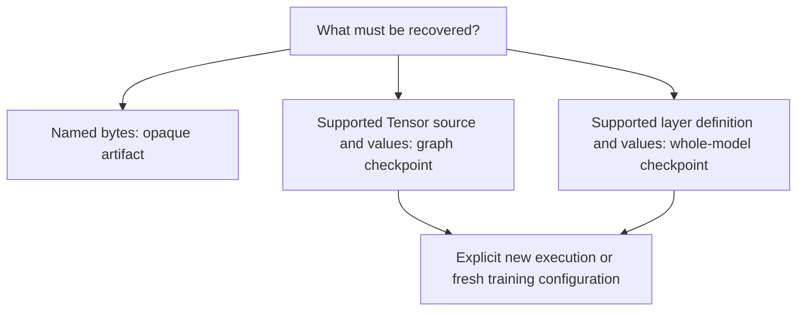

# Checkpoint: choose what to recover

Choose by what the file means, not by its extension. Opaque artifacts carry named bytes; GraphCheckpoint carries a bounded cold Tensor source and host leaves; ModelCheckpoint handles supported whole models or values-only recovery. None implicitly resumes an optimizer.

[Reference goals](../index.md) · [Javadoc access](../javadoc.md)

A checkpoint is saved information intended for later recovery; its contents determine what can
be recovered. Recovering model values is different from continuing training at the next input,
which also needs optimizer history and caller-owned progress. Read the choices below as separate
boundaries, not successive completeness levels of one universal save operation.

Follow the branches by the information you need, not by filename. The final box is a new caller
workflow; it does not mean the file restores an optimizer or a training session.

## Choose a topic

- [Opaque checkpoint artifact files](artifacts.md)
- [Graph checkpoint sources, copy and rebind](graph.md)
- [Selective graph format versions](graph-formats.md)
- [Cold graph persistence example and failures](graph-example.md)
- [Whole-model checkpoint save and load](models.md)
- [Values-only checkpoint contracts](values.md)
- [File-free and file-backed recovery examples](values-examples.md)
