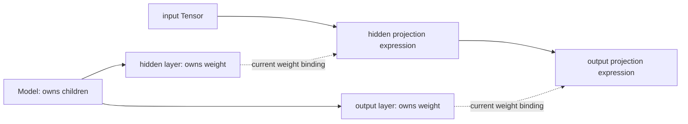

# Typed Model composition and parameter initialization

[Reference goals](../index.md) · [Javadoc and exact signatures](../javadoc.md) · [Source entry point](../../../extensions/nn/src/main/java/io/github/pho001/synaptik/nn/module/Model.java)

A neural-network (**NN**) module owns named state and child modules. Its **topology** is that
ownership tree, whereas the Tensor expression graph records the computation built by a forward
call. Initialization supplies starting parameter values; **forward** then describes operations
using those values without numerically evaluating them.



Solid arrows at the top identify module ownership; the input-to-output arrows identify computation
flow. Dotted arrows connect the two structures through current state bindings. This is a conceptual
relationship, not a claim that a forward call executes either projection.

<a id="current-nn-typed-model-composition-contract"></a>
## Current NN typed Model composition contract

`Model<I,O>` is an NN `Module` whose generic parameters describe only its caller-visible Java
forward boundary. Tensor-only callers normally let Java infer `Model<Tensor,Tensor>` through
`var`; structured callers may use their own records for several inputs or outputs. NN introduces
no tuple, tokenizer, batch, or text-specific type, and the caller does not define backward code.

`Model.define(definition)` invokes one definition callback with a short-lived `Topology`. During
that callback, `topology.addModule(name, module)` records the exact module candidate under a
descriptive local name and returns that exact concrete type for local use. Collection changes no
parent link. The topology is sealed after every success or failure path, and a captured reference
cannot add a late child. Only after the callback returns a non-null forward body does the Model
preflight the complete ordered snapshot and permanently attach every child. A callback, null
result, name, repeated-identity, cycle, or ownership failure publishes no partial model and leaves
every previously unowned candidate unattached.

For example, the shared stateless `ModuleFactory.standard()` facade constructs two fresh
input-width-inferring `Linear` layers. `Topology.addModule` then gives those exact modules stable
descriptive names and permanent Model ownership:

```java
ModuleFactory modules = ModuleFactory.standard();

var model = Model.define(topology -> {
    Linear hidden = topology.addModule(
            "hidden",
            modules.linear(
                    64,
                    true,
                    DataType.FLOAT32,
                    ParameterInitialization.glorotUniform(),
                    41L));
    Linear output = topology.addModule(
            "output",
            modules.linear(
                    10,
                    true,
                    DataType.FLOAT32,
                    ParameterInitialization.glorotUniform(),
                    42L));

    return (Tensor input) -> output.forward(hidden.forward(input).relu());
});
```

The factory call is construction, not ownership or registration. Every recipe call returns a
fresh existing concrete type and keeps the architectural width, bias, data type, initialization
policy, and seed explicit. The factory retains none of those choices and owns no random source or
module. Its Linear recipe selects the exact deterministic JDK `L64X128MixRandom` factory; direct
constructors remain available when a caller needs a different deterministic factory, supplied
state, supplied cells, or explicit recurrent state and lengths. Constructor validation, effects,
state paths, and forward behavior remain owned by each concrete layer or sequence.

Suppose the input has Shape `[batch, 32]`. The first call initializes `hidden.weight` as `[64, 32]`
before constructing the hidden linear expression. That expression has final extent 64, so the
same Java traversal initializes `output.weight` as `[10, 64]` before constructing the returned
output expression. The hidden width 64 and output width 10 are architecture choices; only each
incoming final feature extent is inferred. Later inputs may change compatible leading batch or
time Dimensions, but the exact data type and final feature extent must continue to match each
initialized layer.

Calling `model.forward(input)` passes the exact non-null input to the retained body once and
returns its exact non-null result. If the body throws or returns null, already constructed prefix
expressions or module-local initialization effects remain and no rollback occurs. State discovery
and state dictionaries use paths such as `hidden.weight` and `output.bias`; `train()` and
`eval()` propagate through the same owned tree.

This **Model topology** is the permanent NN module-ownership tree and its state-path namespace. It
is not the Tensor producer graph, a modules/model `CompiledGraphModel`, or a compiled/runtime
schedule. Forward constructs ordinary Java and Tensor expressions only. It does not capture,
differentiate, compile, prepare, execute, update parameters, persist checkpoints, tokenize input,
or pad a batch. `Model.define` itself performs no parameter initialization. The existing final
`Linear` has one constructor that automatically initializes input-dependent state while that
layer is first reached by forward traversal; this is not a general Model build, bind, initialize,
or status lifecycle. Generic Models inherit Module's mutable state/mode lifecycle and are not thread-safe;
callers coordinate forward construction with replacement, loading, and mode changes when one
consistent view matters. The separate owned capability described above acquires a static source
after one eval prototype forward and serializes high-level operations; it does not synchronize
inherited Module mutators or change Model.define semantics.

<a id="current-nn-automatic-parameter-initialization-contract"></a>
## Current NN automatic parameter initialization contract

`ParameterInitialization` is the common closed initialization-policy value used by eager
initialized `Embedding` and automatic `Linear`, RNN, GRU, and LSTM layers. Its exact eight
factories are `glorotNormal()`,
`glorotUniform()`, `kaimingReluNormal()`, `kaimingReluUniform()`, `normal(mean,
standardDeviation)`, `uniform(lowerBoundInclusive, upperBoundExclusive)`, `zeros()`, and `ones()`.
Configured arguments must be finite; a normal standard deviation is non-negative and uniform
bounds are strictly increasing. The value owns only that algorithm selection and arguments. It
does not own a Shape, data type, Tensor, Parameter, random generator, seed, parameter order, gate
order, fan value, or bias policy. Fan presets derive fan-in and fan-out independently from each
complete rank-two Shape when applied.

`ParameterInitializers.initialize(shape, type, policy)` accepts exactly zero/one and creates no
random generator. Its overload with a `RandomGenerator` accepts exactly the other six policies
and forwards that exact caller-owned source to the corresponding eager initializer. There is no
public kind, callback, registry, stateful initializer, or default random source.

`Linear` remains one final type. Its supplied-state constructors and explicit
`inFeatures`/`outFeatures` constructor remain immediately initialized. The automatic constructor
accepts only architectural `outFeatures`, bias presence, exact floating data type, one
`ParameterInitialization`, a deterministic `RandomGeneratorFactory`, and a seed. Construction
creates no generator, Tensor, Tensor identifier, or `Parameter` and exposes no
`LazyLinear`, `Linear.lazy`, public `bind`, `build`, `initialize`, or initialization-status API.

The first compatible `forward(input)` on that layer has two phases:

```text
validate input and parameter Shapes/counts
  -> for a sampling policy, create one generator from the retained factory and seed
  -> create weight, then optional exact-zero bias; zero/one never invoke the factory
  -> validate and publish the complete direct Parameter group
  -> construct and return this call's ordinary Tensor.linear expression
```

The first phase creates eager host-backed parameter leaves; it does not numerically run the layer.
The second phase creates the same visible PERMUTE/MATMUL/optional-ADD expression used by the eager
constructors. Parameter Tensor identifiers therefore precede the identifiers of the first returned
linear expression. Later compatible calls create no generator or parameter Tensor and construct
only their ordinary expressions.

The automatic path infers one positive static final input extent as `inFeatures`. Weight Shape and
therefore fan values remain layer-owned. Bias is always exact typed zero regardless of weight
policy. The path does not infer output width, class count, vocabulary size, embedding width,
recurrent hidden width, bias, data type, policy, random algorithm, or seed. Prevalidation failures
happen before sampling or Tensor creation. A later initializer or allocation failure can consume
random draws, memory, or opaque Tensor identifiers, but it publishes no wrapper; a retry starts
with a fresh generator from the same factory and seed. Zero/one attempts create no generator and
never invoke the factory. Once a complete group is published, an expression-construction failure
does not undo it.

Initialization is synchronized only for concurrent first calls on the same `Linear`. Its direct
reservation completion uses a release/acquire publication gate so an accessor or discovery race
observes either an unbound failure or the complete direct group. Parameter replacement, strict
load, tree traversal, mode changes, and arbitrary functional Model bodies retain their external-
coordination requirements. A Model body is not one transaction: if an earlier layer initializes
and later body work fails, the earlier layer remains initialized. A registered but unvisited
automatic layer remains uninitialized and makes complete recursive parameter discovery and state
export fail closed.

The automatic recurrent-cell constructors similarly retain explicit hidden width, bias choice,
floating parameter type, policy, and seed while reserving `inputWeight`, `hiddenWeight`, and
optional `bias`. The first compatible represented cell call, descriptor-valid `forwardScan`, or
RNN `forwardGeneralScan` infers only a positive static input width. A scan binds even when time
or batch is zero; static unrolling with no represented step still leaves the cell unbound.
Sampling policies create one fresh standard `L64X128MixRandom` stream per attempt and draw
the complete packed input matrix before the complete packed hidden matrix; each Shape derives its
own fan values. Zero/one policies create no generator. Optional bias is layer-owned typed zero and
never draws. RNN uses unpacked matrices, GRU owns reset/update/candidate packing, and LSTM owns
input/forget/candidate/output packing. Strict state loading may bind the complete reserved group
without initialization. Failure before publication binds nothing and is retryable from the seed;
successful publication precedes cell-expression construction and is cell-locally synchronized.

`Embedding` instead has no input-dependent parameter dimension, so its initialized constructor is
eager. It accepts explicit positive vocabulary size and embedding size, exact floating type, one
common policy, and a seed, then initializes the complete `[vocabularySize, embeddingSize]` table
before declaring its sole permanent `weight` parameter. The six random policies each use one
fresh seeded standard `L64X128MixRandom` source and the four-argument dispatcher once. Zero and
one use the three-argument dispatcher once and never create an RNG. Fan policies use the whole
rank-two Shape with vocabulary size as fan-out and embedding size as fan-in. Successful
construction consumes the initializer's one Tensor identifier; a later sampling, allocation, or
identifier failure does not roll back completed effects but publishes no parameter wrapper or
layer.

Neither size is inferred from token IDs or a batch. Embedding width remains an architecture
choice, while a future Text vocabulary supplies vocabulary identity and size explicitly. Every
table row, including row zero, is ordinary gradient-eligible trainable state. `Embedding` exposes
no padding index, special or frozen row, automatic row rewrite, optimizer/gradient masking, or
runtime skipping. Future Text input preparation owns padding-token identity, and future Data input
preparation owns canonical valid lengths; neither proposed boundary is current tokenizer/Data API
or changes the NN parameter schema.


---

[Previous topic](../training/recovery.md) · [Next topic](convolution.md)
