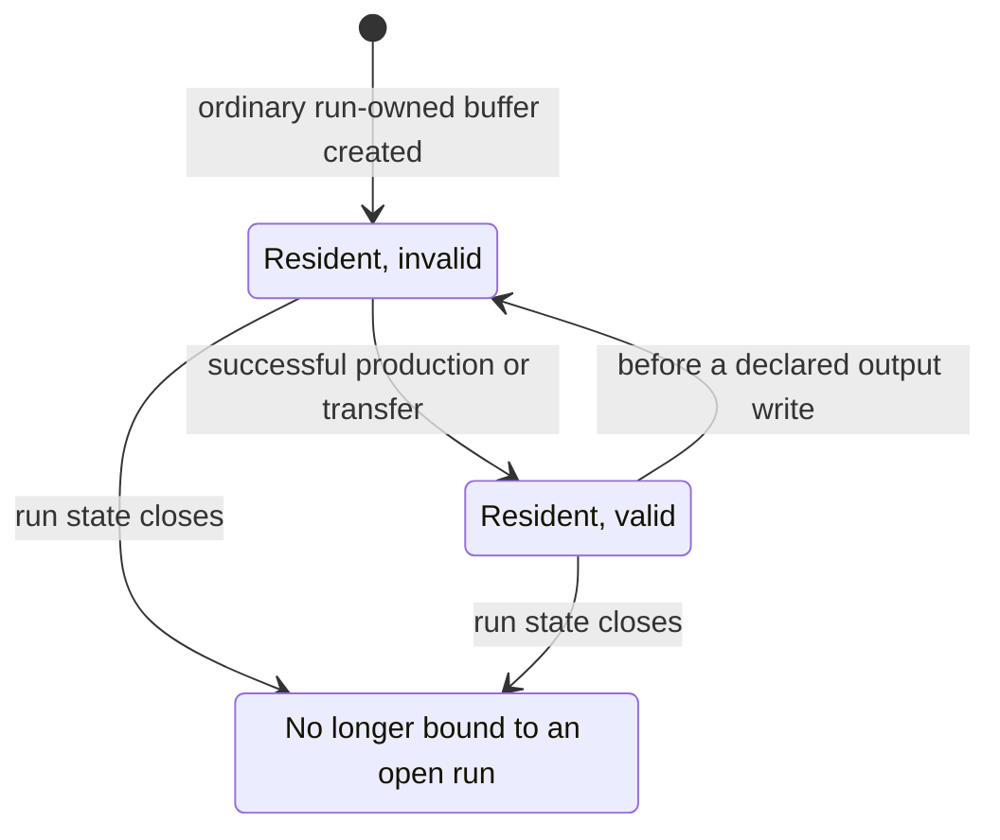

# Per-[run](../../glossary.md#term-run) representations and validity

[Reference goals](../index.md) · [Javadoc and exact signatures](../javadoc.md)<span data-glossary-navigation="true"> ([Javadoc glossary](../../glossary.md#term-javadoc); [signatures glossary](../../glossary.md#term-signature))</span> · [Source entry point](../../../modules/runtime/src/main/java/io/github/pho001/synaptik/runtime/execution/PreparedExecution.java)

**[Residency](../../glossary.md#residency)** means that a representation object is present and bound to the open run.
**Validity** means that this copy contains the logical value the schedule may read. These are
independent: newly allocated storage can be resident but invalid. A validity bit records a fact;
setting it does not initialize bytes or make a physical copy.



Read the arrows as [Runtime](../../glossary.md#term-runtime) bookkeeping around physical actions, not as actions that copy bytes.
[Borrowed](../../glossary.md#ownership-borrowing-and-lease) inputs and initialized [buffers](../../glossary.md#term-buffer) start in the valid state; scratch workspaces have no
logical validity bit. Ending a borrowed [binding](../../glossary.md#term-binding) does not free caller-owned storage.

<a id="current-per-run-representation-foundation"></a>
## Current per-[run](../../glossary.md#term-run) representation foundation

`BufferRepresentation` and `WorkspaceRepresentation` are deliberately distinct [nominal](../../glossary.md#term-nominal)
`AutoCloseable` roles. Each exposes only `close()` without a checked exception. A [concrete backend](../../glossary.md#concrete-backend)
implements physical allocation, storage access, transfer, and cleanup mechanics; the shared
[Runtime](../../glossary.md#term-runtime) [API](../../glossary.md#term-application-programming-interface-api) never exposes concrete storage, [backend](../../glossary.md#backend), or [device](../../glossary.md#term-device) access.

`BufferRepresentationBinding` retains one exact [buffer](../../glossary.md#term-buffer) representation and one [ownership](../../glossary.md#term-ownership-meanings) value:

- [`BORROWED`](../../glossary.md#ownership-borrowing-and-lease) keeps cleanup responsibility with the caller for the complete run; and
- `RUN_OWNED` transfers cleanup responsibility only after [`RunState`](../../glossary.md#run-state--runstate) construction succeeds.

Every workspace supplied to a successfully constructed state is run-owned. Construction failure
transfers no ownership and closes nothing.

One `RunState` covers one complete logical run, including all backend partitions. It retains the
exact [`PreparedMemoryPlan`](../../glossary.md#prepared-memory-plan--preparedmemoryplan), snapshots only the supplied list structure into private arrays, and
retains every exact [binding](../../glossary.md#term-binding) and representation reference. Buffer and workspace indices are dense
zero-based positions in `plan.buffers()` and `plan.workspaces()` encounter order; they are not the
numeric values inside [`BufferSlot`](../../glossary.md#buffer-slot--bufferslot) or [`WorkspaceSlot`](../../glossary.md#workspace-slot--workspaceslot). A buffer position has one or more ordered
representations, while a workspace position has exactly one representation.

Every bound representation is structurally resident until the state closes: the exact nominal
object exists and remains bound to that run. A run-owned read-only binding may keep [immutable](../../glossary.md#term-immutable)
prepared physical storage resident under a backend child [lease](../../glossary.md#term-lease); it remains a fresh representation
object and its close [releases](../../glossary.md#commit-release-distribution-log-and-seed-meanings) only that lease. Each buffer representation also has one independent
validity bit. A borrowed buffer starts valid because it is a caller input containing the logical
slot value. An ordinary created buffer starts invalid; an initialized buffer starts valid because
its backend creator has already materialized the correct logical value. Zero, one, or multiple
copies may be valid. Workspaces are resident run-owned scratch and have no logical validity. The
same representation object cannot occur twice anywhere in one state, including across buffer and
workspace domains.

`isBufferRepresentationValid(bufferIndex, representationIndex)` reads one bit in [constant](../../glossary.md#term-constant) time.
`setBufferRepresentationValid(bufferIndex, representationIndex, valid)` writes exactly one bit in
constant time. The setter performs no storage access, copy, backend call, ownership transition,
implicit invalidation, or coherence. A later transfer or execution runner must change validity
explicitly only after its physical action succeeds.

<a id="focused-creation-and-validity-example"></a>
## Focused creation and validity example

<a id="creation-and-validity-goal-and-inputs"></a>
### Creation-and-validity goal and inputs

Describe one [borrowed](../../glossary.md#ownership-borrowing-and-lease) caller [buffer](../../glossary.md#term-buffer), one [backend](../../glossary.md#backend)-created internal buffer, and one backend-created
workspace for the single buffer and workspace positions from the preceding plan. Then construct
the public per-[run state](../../glossary.md#run-state--runstate), observe its initial validity, mark the internal copy valid explicitly,
and close the state. The local representation classes make cleanup observable without claiming a
production backend.

```java
import io.github.pho001.synaptik.runtime.resource.BufferRepresentation;
import io.github.pho001.synaptik.runtime.resource.PreparedRepresentationPlan;
import io.github.pho001.synaptik.runtime.resource.WorkspaceRepresentation;
import io.github.pho001.synaptik.runtime.run.BufferRepresentationBinding;
import io.github.pho001.synaptik.runtime.run.RunResourceOwnership;
import io.github.pho001.synaptik.runtime.run.RunState;
import java.util.List;
import java.util.concurrent.atomic.AtomicInteger;

final class CreationBuffer implements BufferRepresentation {
    private final AtomicInteger closes;
    CreationBuffer(AtomicInteger closes) { this.closes = closes; }
    @Override public void close() { closes.incrementAndGet(); }
}

final class CreationWorkspace implements WorkspaceRepresentation {
    private final AtomicInteger closes;
    CreationWorkspace(AtomicInteger closes) { this.closes = closes; }
    @Override public void close() { closes.incrementAndGet(); }
}

AtomicInteger borrowedCloses = new AtomicInteger();
AtomicInteger ownedCloses = new AtomicInteger();
AtomicInteger workspaceCloses = new AtomicInteger();

BufferRepresentation borrowed = new CreationBuffer(borrowedCloses);
PreparedRepresentationPlan.BufferCreator bufferCreator =
        () -> new CreationBuffer(ownedCloses);
PreparedRepresentationPlan.WorkspaceCreator workspaceCreator =
        () -> new CreationWorkspace(workspaceCloses);

PreparedRepresentationPlan representationPlan =
        new PreparedRepresentationPlan(
                plan,
                List.of(
                        List.of(
                                new PreparedRepresentationPlan.CallerInput(),
                                new PreparedRepresentationPlan.CreatedBuffer(bufferCreator))),
                List.of(workspaceCreator));

BufferRepresentation owned = bufferCreator.create();
WorkspaceRepresentation workspace = workspaceCreator.create();

RunState state =
        new RunState(
                plan,
                List.of(
                        List.of(
                                new BufferRepresentationBinding(
                                        borrowed, RunResourceOwnership.BORROWED),
                                new BufferRepresentationBinding(
                                        owned, RunResourceOwnership.RUN_OWNED))),
                List.of(workspace));

boolean borrowedInitiallyValid = state.isBufferRepresentationValid(0, 0);
boolean ownedInitiallyValid = state.isBufferRepresentationValid(0, 1);
state.setBufferRepresentationValid(0, 1, true);
boolean ownedAfterProduction = state.isBufferRepresentationValid(0, 1);
state.close();
state.close();
```

<a id="creation-and-validity-result-and-interpretation"></a>
### Creation-and-validity result and interpretation

`borrowedInitiallyValid` is `true`, `ownedInitiallyValid` is `false`, and
`ownedAfterProduction` is `true`. The state reports one [buffer](../../glossary.md#term-buffer) position, two structurally
resident buffer representations, and one resident workspace. Setting the internal bit performs
no physical work; the example treats a successful production action as already completed before
that line. After both `close()` calls, `borrowedCloses.get()` is `0`, while
`ownedCloses.get()` and `workspaceCloses.get()` are each `1`.

The package-private cold setup used by [`PreparedExecutionRunner`](../../glossary.md#prepared-execution-runner--preparedexecutionrunner) invokes the same [immutable](../../glossary.md#term-immutable) creator
references and constructs this state with [rollback](../../glossary.md#term-rollback). Because that [operation](../../glossary.md#operation) is intentionally not a
public [facade](../../glossary.md#term-facade), this current public example stages the successful [callback](../../glossary.md#term-callback) results directly before
calling the public constructor. It demonstrates prepared origins, initial validity, explicit
mutation, workspace exclusion, and [ownership](../../glossary.md#term-ownership-meanings)-sensitive [idempotent](../../glossary.md#term-idempotent) cleanup. It does not implement
a runner, physical copy, [kernel](../../glossary.md#kernel), or automatic validity transition.


---

[Previous topic](memory.md) · [Next topic](creation.md)
