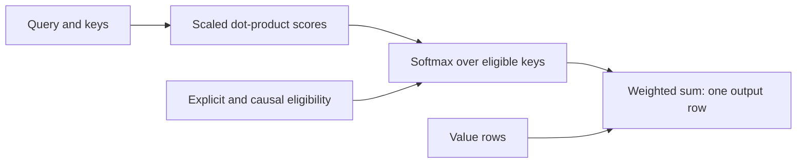

# [Scaled dot-product attention](../../glossary.md#scaled-dot-product-attention)

[Reference goals](../index.md) · [Javadoc and exact signatures](../javadoc.md)<span data-glossary-navigation="true"> ([Javadoc glossary](../../glossary.md#term-javadoc); [signatures glossary](../../glossary.md#term-signature))</span> · [Source entry point](../../../modules/model/src/main/java/io/github/pho001/synaptik/model/tensor/Tensor.java)

## What the query call describes

Application or layer-building code calls `query.scaledDotProductAttention(key, value, ...)`.
The receiver and arguments are Tensor descriptions, not arrays being numerically inspected.
The method retains the exact input Tensor references in a producing operation and returns fresh
result descriptions; it neither copies their values nor allocates attention-output storage.
The [matrix-product reference](matmul-linear.md) explains the underlying sum of matching coordinates;
[normalization](normalization.md) explains why softmax mixes scores within a row.

### Reading one finite row mathematically

Suppress the independent batch/head coordinates. Let $L$ be the number of queries, $S$ the
number of keys, $E>0$ the query/key feature width, and $E_v$ the value feature width.
For query index $0 \leq i<L$, key index $0 \leq j<S$, query/key coordinate
$0 \leq e<E$, and value coordinate $0 \leq v<E_v$, write the input values as
$q_{i,e}$, $k_{j,e}$, and $V_{j,v}$. With positive scale $\alpha$ and eligible key set
$J_i$, the ideal finite-score calculation for nonempty $J_i$ is

$$
s_{i,j}=\alpha\sum_{e=0}^{E-1}q_{i,e}k_{j,e},\qquad
w_{i,j}=\frac{\exp(s_{i,j})}{\sum_{t\in J_i}\exp(s_{i,t})},\qquad
O_{i,v}=\sum_{j\in J_i}w_{i,j}V_{j,v}.
$$

The default is $\alpha=1/\sqrt{E}$; excluded keys have zero weight. With two eligible
equal finite scores, each ideal weight is $1/2$. Value components $2$ and $6$ then
give the ideal output $(1/2)2+(1/2)6=4$: a mixture, not a selected winner.
These are real-number explanations, not permission to reorder rounded operations.
The accumulation rules, literal `EXP`/sum/division sites, exceptional scores, and empty-row
rules below govern actual evaluation.

**[Reader model](../../glossary.md#term-reader-model).** Attention is a content-based weighted [lookup](../../glossary.md#term-lookup). A **query** describes what is
being sought; each **key** describes an available item, and its **value** carries the information
to combine. A **[dot product](../../glossary.md#term-dot-product)** multiplies matching components and adds the products into one
score. **[Softmax](../../glossary.md#softmax--log-softmax)** converts eligible scores into non-negative relative [weights](../../glossary.md#term-weight); it is not a
hard selection of one winner. A **[mask](../../glossary.md#term-boolean-mask)** marks eligible positions, and **causal** attention
excludes later key positions according to the exact positional rule below.
[Batch](../../glossary.md#term-batch-machine-learning-and-hyperparameters) [axes](../../glossary.md#term-axis) repeat this calculation independently; a head axis groups separate attention
calculations rather than adding another sequence [coordinate](../../glossary.md#axis-rank-scalar-vector-and-matrix).

Read the flow as the mathematical [dependency](../../glossary.md#term-dependency) of one query row, not an implementation schedule.
The special-value and all-excluded-row rules below take precedence over the [finite](../../glossary.md#term-finite)-row picture.



<a id="scaled-dot-product-attention-expressions"></a>
### [Scaled dot-product attention](../../glossary.md#scaled-dot-product-attention) expressions

Scaled dot-product attention maps a query sequence to weighted value rows by comparing each query
with every key. The receiver is the query. For right-broadcastable [batch](../../glossary.md#term-batch-machine-learning-and-hyperparameters) or head prefixes, the
[Shapes](../../glossary.md#shape) are:

```text
query  [..., L, E]
key    [..., S, E]  -> attention scores [..., L, S]
value  [..., S, Ev] -> output           [..., L, Ev]
```

An **[attention score](../../glossary.md#attention-score)** is one scaled query/key [dot product](../../glossary.md#term-dot-product). Eligible scores in each query row are
[softmax](../../glossary.md#softmax--log-softmax)-normalized over the final key-sequence [axis](../../glossary.md#term-axis) `S`; the resulting [weights](../../glossary.md#term-weight) select a weighted
sum of value rows. An absent scale means `1 / sqrt(E)` after the positive [embedding](../../glossary.md#embedding) [extent](../../glossary.md#term-extent) is
bound. A present [`ScalarValue`](../../glossary.md#typed-scalar-value--scalarvalue) scale must be [finite](../../glossary.md#term-finite), strictly positive, floating, and exactly the
promoted query/key/value type.

Two parallel four-overload families keep result selection and optional semantics explicit:

| Call family | Result | Explicit [mask](../../glossary.md#term-boolean-mask) | Scale and causal mode |
|---|---|---|---|
| `query.scaledDotProductAttention(key, value)` | output [Tensor](../../glossary.md#tensor) only | none | default scale, non-causal |
| `query.scaledDotProductAttention(key, value, attrs)` | output Tensor only | none | from `attrs` |
| `query.scaledDotProductAttention(key, value, mask)` | output Tensor only | exact [BOOL](../../glossary.md#data-type--datatype) mask | default scale, non-causal |
| `query.scaledDotProductAttention(key, value, mask, attrs)` | output Tensor only | exact BOOL mask | from `attrs` |
| `query.scaledDotProductAttentionWithWeights(key, value)` | output and weights | none | default scale, non-causal |
| `query.scaledDotProductAttentionWithWeights(key, value, attrs)` | output and weights | none | from `attrs` |
| `query.scaledDotProductAttentionWithWeights(key, value, mask)` | output and weights | exact BOOL mask | default scale, non-causal |
| `query.scaledDotProductAttentionWithWeights(key, value, mask, attrs)` | output and weights | exact BOOL mask | from `attrs` |

The original `scaledDotProductAttention` methods remain exact one-output occurrences. They create
only output slot zero: there is no hidden weights [descriptor](../../glossary.md#term-descriptor), weights wrapper, or second Tensor
identifier. The `WithWeights` methods return
`ScaledDotProductAttentionResult(output, weights)` from one exact two-output [occurrence](../../glossary.md#term-occurrence). They do
not reconstruct weights with a second [operation](../../glossary.md#operation).

`ScaledDotProductAttentionAttrs(Optional<ScalarValue> scale, boolean causal)` is [immutable](../../glossary.md#term-immutable)
operation-specific semantic state. It is not a general options container. Causal mode uses a
top-left-aligned **[causal mask](../../glossary.md#causal-mask)**: zero-based key position `j` is eligible for query position `i`
exactly when `j <= i`, including when `L` and `S` differ. An explicit BOOL mask uses `true` for an
eligible position and `false` for an excluded one. It must right-broadcast exactly to score Shape
`[..., L, S]`; [scalar](../../glossary.md#term-scalar) masks are valid. Explicit and causal eligibility combine with logical AND.

<a id="output-slots-and-shared-occurrence"></a>
#### Output slots and shared [occurrence](../../glossary.md#term-occurrence)

Both occurrence forms use the same sole `SCALED_DOT_PRODUCT_ATTENTION` kind and exact
`ScaledDotProductAttentionAttrs` instance. Its single structural [signature](../../glossary.md#term-signature) accepts three or four
ordered inputs and one or two outputs. [Producer](../../glossary.md#term-producer) [descriptor](../../glossary.md#term-descriptor) count distinguishes the requested
occurrence form; the [operation](../../glossary.md#operation) kind and mathematical meaning do not change.

| Slot | Public accessor | [Shape](../../glossary.md#shape) | [Data type](../../glossary.md#data-type--datatype) | [Gradient](../../glossary.md#term-gradient) eligibility [metadata](../../glossary.md#term-metadata) |
|---:|---|---|---|---|
| 0 | one-output return or `result.output()` | `[..., L, Ev]` | promoted query/key/value type | query OR key OR value |
| 1 | `result.weights()` | `[..., L, S]` | promoted query/key/value type | query OR key |

Both two-output descriptors have unresolved [layout](../../glossary.md#layout), and both wrappers are fresh, unlabeled, and
storage-free. They retain one exact shared [`TensorProducer`](../../glossary.md#producer--tensorproducer), `Operation`, attributes reference,
ordered input [snapshot](../../glossary.md#term-snapshot), and corresponding descriptor references. Their [provenance](../../glossary.md#provenance) output indices
are zero and one. The [BOOL](../../glossary.md#data-type--datatype) [mask](../../glossary.md#term-boolean-mask) and value [Tensor](../../glossary.md#tensor) do not contribute to [weights](../../glossary.md#term-weight) gradient
eligibility; this metadata is only an eligibility request and does not define a gradient rule.

`ScaledDotProductAttentionResult` is a shallowly [immutable](../../glossary.md#term-immutable) record that retains its two exact
Tensor references. Its constructor checks only that neither component is null. Directly
constructing the record does not validate descriptor or producer agreement; the four
`WithWeights` methods supply the documented same-occurrence relationship.

<a id="shape-type-and-deferred-checks"></a>
#### [Shape](../../glossary.md#shape), type, and deferred checks

Query, key, and value must be floating and [rank](../../glossary.md#term-rank) two or greater. Their leading prefixes broadcast
right-aligned together. Construction retains exact selected input [Dimension](../../glossary.md#dimension) references. A static
non-[singleton](../../glossary.md#term-singleton) can select an exact [batch](../../glossary.md#term-batch-machine-learning-and-hyperparameters) result while an unresolved participant leaves a future
singleton-or-equal obligation; unequal unresolved candidates fail when no exact output Dimension
can be derived. These rules are attention-specific and do not change general `ShapeBroadcast`.

Static unequal query/key [embedding](../../glossary.md#embedding) extents or key/value sequence extents fail locally, as does a
static-zero query embedding [extent](../../glossary.md#term-extent). When those extents are unresolved, equality or positivity is
handled by current package-private [compiler](../../glossary.md#term-compiler) verification and may remain for concrete [binding](../../glossary.md#term-binding). A
[mask](../../glossary.md#term-boolean-mask) with an unresolved Dimension
against a static non-singleton score Dimension is accepted with the corresponding deferred
singleton-or-equal obligation; combinations that cannot preserve the already selected exact score
Shape fail locally.

Floating promotion occurs in query/key/value order. [FLOAT64](../../glossary.md#term-float64) scores and output sums accumulate in
FLOAT64. All four low types and [FLOAT32](../../glossary.md#term-float32) use FLOAT32 accumulation, with one final conversion for a
low output. [Reassociation and fused multiply-add](../../glossary.md#rounding-sites-fma-and-aggregate-floor) remain subject to attention's exact guards and
literal eligible-score [EXP](../../glossary.md#term-expx)/sum/division sites. The distinct first-class [finite](../../glossary.md#term-finite)-[softmax](../../glossary.md#softmax--log-softmax) shift does
not replace them; this contract gives no bitwise or cross-[backend](../../glossary.md#backend) identical-[rounding](../../glossary.md#term-rounding) promise.

<a id="eligibility-and-special-values"></a>
#### Eligibility and special values

[Mask](../../glossary.md#term-boolean-mask) and causal exclusion happen before score or value arithmetic. [NaN](../../glossary.md#term-nan) or [infinity](../../glossary.md#term-infinity) in an excluded
key/value position therefore cannot contaminate a row. For each query row:

- no eligible positions, including an all-masked row, produce positive-zero weights and
  positive-zero output components;<span data-glossary-navigation="true"> ([all-masked row glossary](../../glossary.md#all-masked-row))</span>
- an eligible NaN score makes eligible [weights](../../glossary.md#term-weight) and non-empty output components NaN;
- eligible positive-infinity scores split unit weight equally, while other eligible positions get
  positive-zero weight;
- all eligible scores at [negative infinity](../../glossary.md#nan-infinity-and-signed-zero) produce positive-zero weights and output; and
- otherwise finite scores use ideal exponential ratios whose eligible weights total one ideally;
  eligible negative infinities and every excluded position get positive zero.<span data-glossary-navigation="true"> ([finite glossary](../../glossary.md#term-finite); [infinities glossary](../../glossary.md#nan-infinity-and-signed-zero); [positive zero glossary](../../glossary.md#nan-infinity-and-signed-zero))</span>

Eligible value NaN still follows ordinary floating multiply/add even when its eligible weight is
zero; only eligibility exclusion guarantees that a value is ignored. An empty key sequence is an
all-masked-row case for every existing query row. Empty query,
value-[feature](../../glossary.md#term-feature), and batch axes retain their ordinary Shape meanings.

<a id="runnable-output-and-weights-metadata-example"></a>
#### Runnable output-and-[weights](../../glossary.md#term-weight) [metadata](../../glossary.md#term-metadata) example

This Java 26 program constructs only [Tensor](../../glossary.md#tensor) metadata, retrieves `output()` and `weights()` from
one result, and verifies their shared [occurrence](../../glossary.md#term-occurrence). Its concrete query, key, and value [Shapes](../../glossary.md#shape) are
`[2, 4, 8]`, `[1, 6, 8]`, and `[2, 6, 10]`. Only value requests [gradients](../../glossary.md#term-gradient), which makes the output
eligible while leaving weights ineligible.

```java
import io.github.pho001.synaptik.model.datatype.DataType;
import io.github.pho001.synaptik.model.operation.attention.ScaledDotProductAttentionAttrs;
import io.github.pho001.synaptik.model.shape.Shape;
import io.github.pho001.synaptik.model.tensor.ScaledDotProductAttentionResult;
import io.github.pho001.synaptik.model.tensor.Tensor;
import io.github.pho001.synaptik.model.tensor.TensorDescriptor;
import io.github.pho001.synaptik.model.tensor.TensorFactory;
import io.github.pho001.synaptik.model.tensor.TensorProvenance;
import java.util.Optional;

public final class AttentionWeightsMetadataExample {
    public static void main(String[] args) {
        // Storage-free inputs let this example inspect geometry without evaluating scores.
        Tensor query = TensorFactory.create(new TensorDescriptor(
                DataType.FLOAT32, Shape.of(2, 4, 8), Optional.empty(), false));
        Tensor key = TensorFactory.create(new TensorDescriptor(
                DataType.FLOAT32, Shape.of(1, 6, 8), Optional.empty(), false));
        Tensor value = TensorFactory.create(new TensorDescriptor(
                DataType.FLOAT32, Shape.of(2, 6, 10), Optional.empty(), true));
        var attrs = new ScaledDotProductAttentionAttrs(Optional.empty(), false);

        // Request both ports of one operation, rather than recomputing weights separately.
        ScaledDotProductAttentionResult result =
                query.scaledDotProductAttentionWithWeights(key, value, attrs);
        Tensor output = result.output();
        Tensor weights = result.weights();
        TensorProvenance outputOrigin = output.provenance().orElseThrow();
        TensorProvenance weightsOrigin = weights.provenance().orElseThrow();

        System.out.println(output.descriptor().shape());
        System.out.println(weights.descriptor().shape());
        System.out.println(output.descriptor().dataType() + ","
                + weights.descriptor().dataType());
        System.out.println(output.descriptor().requiresGrad() + ","
                + weights.descriptor().requiresGrad());
        System.out.println(outputOrigin.producer() == weightsOrigin.producer());
        System.out.println(outputOrigin.outputIndex() + "," + weightsOrigin.outputIndex());
        System.out.println(outputOrigin.operation().attrs() == attrs);
        System.out.println(outputOrigin.inputs().size());
    }
}
```

It prints:

```text
Shape[2, 4, 10]
Shape[2, 4, 6]
FLOAT32,FLOAT32
true,false
true
0,1
true
3
```

The [batch](../../glossary.md#term-batch-machine-learning-and-hyperparameters) prefixes broadcast to `[2]`, giving output Shape `[2, 4, 10]` and weights Shape
`[2, 4, 6]`. The final four lines show one exact [producer](../../glossary.md#term-producer), slot order zero then one, the exact
attributes reference, and ordered inputs `[query, key, value]`. This proves current [descriptors](../../glossary.md#term-descriptor)
and [provenance](../../glossary.md#provenance) only. It does not calculate attention values, [capture](../../glossary.md#term-capture-meanings) a [compiled graph](../../glossary.md#compiled-graph--compiledgraphmodel), choose an
algorithm or [backend](../../glossary.md#backend), allocate result storage, or execute attention. Package-private [compiler](../../glossary.md#term-compiler)
first-order [autograd](../../glossary.md#autograd) can now construct query, key, and value cotangents from output slot zero and
query and key cotangents from [canonical](../../glossary.md#term-canonical-form) weights slot one for this exact two-output occurrence.
The one-output overload fails closed because it has no canonical same-occurrence weights output;
a [BOOL](../../glossary.md#data-type--datatype) [mask](../../glossary.md#term-boolean-mask) remains non-[differentiable](../../glossary.md#derivative-and-chain-rule).


---

[Previous topic](matmul-linear.md) · [Next topic](convolution.md)
