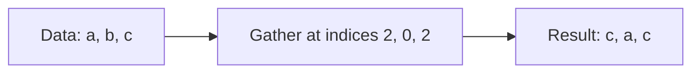

# [Scalar](../../glossary.md#term-scalar) selection, [axis](../../glossary.md#term-axis) [gather](../../glossary.md#gather) and [one-hot encoding](../../glossary.md#one-hot-encoding)

[Reference goals](../index.md) · [Javadoc and exact signatures](../javadoc.md)<span data-glossary-navigation="true"> ([Javadoc glossary](../../glossary.md#term-javadoc); [signatures glossary](../../glossary.md#term-signature))</span> · [Source entry point](../../../modules/model/src/main/java/io/github/pho001/synaptik/model/tensor/Tensor.java)

## A scalar argument and an index Tensor are different inputs

Application or layer code calls `data.select(axis, index)` with one Java coordinate, or
`data.gather(indices, axis)` with a Tensor describing many future coordinates. The methods
retain the exact source Tensor (and index Tensor for gather); they do not copy stored data.
Select can check a Java index against a static extent immediately. Gather construction checks
the indices' type and shape, not their stored values, so bounds remain for a value-aware stage.
Use [slicing](slicing.md#length-defined-extraction) for a regular coordinate sequence and
[functional scatter](scatter.md) when coordinates name update destinations.

For a conceptual rank-one source $x$ of extent $D$ and integer index vector $I$ of length $Q$,
valid indices satisfy $0\leq I_j<D$ and gather means $y_j=x_{I_j}$ for $0\leq j<Q$.
With $x=[10,20,30]$ and $I=[2,0,2]$, the requested result is $[30,10,30]$:
repeated coordinates reuse a source position without implying shared result memory.

**[Reader model](../../glossary.md#term-reader-model).** **Select** fixes one [coordinate](../../glossary.md#axis-rank-scalar-vector-and-matrix) and removes that axis. **Gather** lets an
integer [tensor](../../glossary.md#tensor) supply many coordinates, potentially reusing the same source position.
[Gather Elements](../../glossary.md#gather-elements) uses aligned per-position indices instead of inserting the full index [shape](../../glossary.md#shape).
An **[embedding](../../glossary.md#embedding)** is the [lookup](../../glossary.md#term-lookup)-table case: each integer chooses a row of [feature](../../glossary.md#term-feature) values.
**One-hot encoding** turns each integer into a true/false row with one selected class position.
These operations use integer positions, not [Boolean](../../glossary.md#data-type--datatype) [masks](../../glossary.md#term-boolean-mask); a mask expresses eligibility or choice
rather than a coordinate. See [scatter](scatter.md) for the opposite direction, from updates
toward indexed destinations.

Read this conceptual gather from left to right: indices choose sources, and their order becomes
result order. The arrows describe value meaning, not values computed during construction.



<a id="scalar-select-expressions"></a>
### [Scalar select](../../glossary.md#scalar-select) expressions

`Tensor.select(int axis, long index)` fixes one [scalar](../../glossary.md#term-scalar) [coordinate](../../glossary.md#axis-rank-scalar-vector-and-matrix) on an existing source [axis](../../glossary.md#term-axis) and
removes that axis from a fresh result. The [operation](../../glossary.md#operation) is a single-result scalar selection, not
[elementwise](../../glossary.md#term-elementwise) conditional `WHERE`, repeated-select unstack, [half-open interval](../../glossary.md#term-half-open-interval) [`SLICE`](../../glossary.md#slice),
or a [gather](../../glossary.md#gather) whose indices come from a [Tensor](../../glossary.md#tensor).

The caller may address an input axis from the front with a non-negative value or from the end with
a negative value in `[-rank, rank - 1]`. Construction normalizes that axis exactly once. When the
selected [Dimension](../../glossary.md#dimension) is static, one negative index adds the selected [extent](../../glossary.md#term-extent) once, and every
normalized index must be in `[0, extent)`. A selected zero extent therefore rejects every index.
When the selected Dimension is dynamic, a non-negative index is retained unchanged and its upper-
bound check is deferred; a negative index is rejected because no numeric extent exists for local
[normalization](../../glossary.md#term-normalization).

The result [Shape](../../glossary.md#shape) omits exactly the selected Dimension. Every unaffected static or dynamic
Dimension remains the exact input reference in its original order. Selecting the only axis of a
[rank-one](../../glossary.md#axis-rank-scalar-vector-and-matrix) Tensor produces the [canonical](../../glossary.md#term-canonical-form) scalar Shape `[]`.

Unresolved input [layout](../../glossary.md#layout) produces unresolved result layout. An empty result also stays unresolved
because it references no storage [element](../../glossary.md#term-element) and needs no arbitrary offset geometry. Otherwise,
resolved dense, offset, strided, or zero-[stride](../../glossary.md#term-stride) input geometry produces one new [view](../../glossary.md#term-view-meanings)-marked
logical `LayoutDescriptor`: the selected stride is removed, and checked arithmetic advances the
element offset by `normalizedIndex * selectedStride`. This [metadata](../../glossary.md#term-metadata) describes a logical view; the
result has no [host storage](../../glossary.md#host-storage) and does not promise a physical [alias](../../glossary.md#aliasing-and-arena) or zero-copy execution.

Every successful result preserves the exact input [data type](../../glossary.md#data-type--datatype) and [gradient](../../glossary.md#term-gradient) eligibility, has no
label or host storage, and records `SelectKind.SELECT`, one normalized
`SelectAttrs(normalizedAxis, normalizedIndex)`, and [provenance](../../glossary.md#provenance) `[input]`. Repeated, nested, and
same-coordinate requests remain distinct fresh expressions.

<a id="complete-scalar-select-expression-example"></a>
#### Complete [scalar](../../glossary.md#term-scalar)-select expression example

<a id="goal-and-inputs-32"></a>
##### Goal and inputs

Select the final [coordinate](../../glossary.md#axis-rank-scalar-vector-and-matrix) of [axis](../../glossary.md#term-axis) one from a resolved [`FLOAT32`](../../glossary.md#term-float32) [Tensor](../../glossary.md#tensor) with [Shape](../../glossary.md#shape) `[2, 3, 4]`,
then inspect the normalized semantics and logical [view](../../glossary.md#term-view-meanings) geometry. The input has [canonical](../../glossary.md#term-canonical-form) [strides](../../glossary.md#term-stride)
`[12, 4, 1]` and offset zero.

```java
import io.github.pho001.synaptik.model.datatype.DataType;
import io.github.pho001.synaptik.model.layout.LayoutDescriptor;
import io.github.pho001.synaptik.model.operation.index.SelectAttrs;
import io.github.pho001.synaptik.model.shape.Shape;
import io.github.pho001.synaptik.model.tensor.Tensor;
import io.github.pho001.synaptik.model.tensor.TensorDescriptor;
import io.github.pho001.synaptik.model.tensor.TensorFactory;
import java.util.Arrays;
import java.util.Optional;

public final class ScalarSelectExpressionExample {
    public static void main(String[] args) {
        Shape shape = Shape.of(2, 3, 4);
        Tensor input = TensorFactory.create(new TensorDescriptor(
                DataType.FLOAT32,
                shape,
                Optional.of(LayoutDescriptor.contiguous(shape)),
                true));

        // Negative axis and coordinate normalize against different quantities.
        Tensor selected = input.select(-2, -1);
        SelectAttrs attrs = (SelectAttrs) selected.provenance().orElseThrow()
                .operation().attrs();
        LayoutDescriptor layout = selected.descriptor().layout().orElseThrow();

        System.out.println(selected.descriptor().shape());
        System.out.println(attrs);
        System.out.println(Arrays.toString(layout.strides()));
        System.out.println(layout.storageOffset());
        System.out.println(layout.isView());
        System.out.println(selected.provenance().orElseThrow().inputs().getFirst() == input);
        System.out.println(selected.descriptor().requiresGrad());
        System.out.println(selected.label().isEmpty() && selected.hostStorage().isEmpty());
    }
}
```

<a id="meaningful-lines-and-intermediate-results-17"></a>
##### Meaningful lines and intermediate results

- Raw [axis](../../glossary.md#term-axis) `-2` adds [rank](../../glossary.md#term-rank) three once and becomes axis `1`. Its static [extent](../../glossary.md#term-extent) is three, so raw index
  `-1` adds three once and becomes index `2`. The equivalent positive request is
  `select(1, 2)`.
- Removing axis one from [Shape](../../glossary.md#shape) `[2, 3, 4]` leaves Shape `[2, 4]`. The input [strides](../../glossary.md#term-stride)
  `[12, 4, 1]` lose selected stride `4`, producing `[12, 1]`.
- The checked result offset is `0 + 2 * 4 = 8`. The result retains [`FLOAT32`](../../glossary.md#term-float32) and true gradient
  eligibility, records exact one-input provenance, and remains unlabeled and storage-free.<span data-glossary-navigation="true"> ([gradient glossary](../../glossary.md#term-gradient); [provenance glossary](../../glossary.md#provenance))</span>

<a id="result-and-interpretation-32"></a>
##### Result and interpretation

The program prints:

```text
Shape[2, 4]
SelectAttrs[axis=1, index=2]
[12, 1]
8
true
true
true
true
```

The output demonstrates raw [axis](../../glossary.md#term-axis)/index [normalization](../../glossary.md#term-normalization), axis removal, checked logical [view](../../glossary.md#term-view-meanings) geometry,
exact semantics, and fresh [provenance](../../glossary.md#provenance). It does not demonstrate selected values, a physical storage
[alias](../../glossary.md#aliasing-and-arena), a [gradient](../../glossary.md#term-gradient) rule, [compiler](../../glossary.md#term-compiler) [capture](../../glossary.md#term-capture-meanings), [materialization](../../glossary.md#materialization), [backend](../../glossary.md#backend) [lowering](../../glossary.md#lowering), or execution.

<a id="failures-and-useful-variations-29"></a>
##### Failures and useful variations

- Every [axis](../../glossary.md#term-axis) is invalid for a [scalar](../../glossary.md#term-scalar) input. Other axes outside `[-rank, rank - 1]` fail through
  Shape normalization before result identity allocation.<span data-glossary-navigation="true"> ([normalization glossary](../../glossary.md#term-normalization); [identity glossary](../../glossary.md#term-identity-meanings))</span>
- A static selected [extent](../../glossary.md#term-extent) rejects an index below `-extent` or at least `extent` after one
  normalization. A dynamic selected extent accepts every non-negative `long` unchanged with its
  upper bound deferred, but rejects a negative value because it cannot normalize it locally.
- Selecting the only axis of [Shape](../../glossary.md#shape) `[5]` produces scalar Shape `[]`. Selecting a dynamic axis
  removes it while preserving exact unaffected Dimension references, but current dynamic input
  descriptors cannot provide resolved numeric layout geometry.<span data-glossary-navigation="true"> ([Dimension glossary](../../glossary.md#dimension); [descriptors glossary](../../glossary.md#term-descriptor))</span>
- Result-[element](../../glossary.md#term-element)-count, offset, [layout](../../glossary.md#layout)-classification, or referenced-span [overflow](../../glossary.md#term-overflow) propagates as
  `ArithmeticException` before Tensor identity allocation. Identifier exhaustion can occur only
  during final derived construction.<span data-glossary-navigation="true"> ([Tensor glossary](../../glossary.md#tensor))</span>

<a id="axis-gather-expressions"></a>
### [Axis](../../glossary.md#term-axis)-[gather](../../glossary.md#gather) expressions

The public axis-gather methods produce expressions with ordered logical inputs
`[data, indices]`. `data` is the receiver and supplies the result [data type](../../glossary.md#data-type--datatype) and [gradient](../../glossary.md#term-gradient)
eligibility. Both require exact [`INT32`](../../glossary.md#data-type--datatype) or [`INT64`](../../glossary.md#data-type--datatype) indices; no floating or [BOOL](../../glossary.md#data-type--datatype) index [tensor](../../glossary.md#tensor) is
accepted or implicitly cast. `gather` and `gatherElements` normalize one positive or negative axis
exactly once against the data [Shape](../../glossary.md#shape) after their null and index-type checks; [`embedding`](../../glossary.md#embedding) fixes that
axis at zero after validating its [rank-two](../../glossary.md#axis-rank-scalar-vector-and-matrix) floating receiver.

The methods differ in how they relate the two input Shapes to the result:

| Public method | Semantic kind | Shape rule |
|---|---|---|
| `gather(indices, axis)` | `GATHER` | Replace the selected data [Dimension](../../glossary.md#dimension) with every indices Dimension in order. |
| `embedding(indices)` | `GATHER` at axis zero | Require rank-two floating [weights](../../glossary.md#term-weight) and append their exact axis-one embedding Dimension to the complete indices Shape. |
| `gatherElements(indices, axis)` | `GATHER_ELEMENTS` | Require equal ranks and equal Dimensions on every non-selected axis, then retain the exact indices Shape as the result. |

[Structural equality](../../glossary.md#term-structural-equality) is conservative for dynamic Dimensions. The same dynamic [symbol](../../glossary.md#dimension) passes where
equality is required; different symbols fail rather than creating a new symbolic constraint.
`gather` needs no compatibility check between the inserted indices Shape and the omitted data
Dimension, and [scalar](../../glossary.md#term-scalar) indices remove that axis without inserting another. `gatherElements`
permits the selected indices [extent](../../glossary.md#term-extent) to differ from the data extent.

Every successful request returns a fresh unlabeled, storage-free result Tensor with unresolved
[layout](../../glossary.md#layout), even when both [provenance](../../glossary.md#provenance) inputs have resolved geometry. Its provenance contains the exact
semantic kind, one `IndexAxisAttrs` with the [normalized axis](../../glossary.md#normalized-axis), and exact input references in
`[data, indices]` order.
Expression construction never interprets, normalizes, clamps, or bounds-checks index values. It
defines no gradient or repeated-index rule, [compiler](../../glossary.md#term-compiler) [capture](../../glossary.md#term-capture-meanings) or [canonicalization](../../glossary.md#occurrence-identity-and-canonical-form), [materialization](../../glossary.md#materialization),
[backend](../../glossary.md#backend) [lowering](../../glossary.md#lowering), or execution behavior.

<a id="embedding-convenience"></a>
#### [Embedding](../../glossary.md#embedding) convenience

`weights.embedding(indices)` gives the common [lookup](../../glossary.md#term-lookup)-table use of [Gather](../../glossary.md#gather) a direct public spelling.
The receiver is a [rank-two](../../glossary.md#axis-rank-scalar-vector-and-matrix) floating table shaped `[vocabulary, embeddingSize]`; indices may have
any [rank](../../glossary.md#term-rank) but must use exact [`INT32`](../../glossary.md#data-type--datatype) or [`INT64`](../../glossary.md#data-type--datatype). The result [Shape](../../glossary.md#shape) is:

```text
indices.shape + [weights.shape[1]]
```

Every indices [Dimension](../../glossary.md#dimension) is retained by exact reference and in its original order, followed by the
exact [weight](../../glossary.md#term-weight) [axis](../../glossary.md#term-axis)-one Dimension. [Scalar](../../glossary.md#term-scalar) indices therefore produce `[embeddingSize]`. Result type
and [gradient](../../glossary.md#term-gradient) eligibility come only from weights. [Layout](../../glossary.md#layout) remains unresolved, and the result has no
label or storage.

<a id="complete-embedding-metadata-example"></a>
##### Complete [embedding](../../glossary.md#embedding) [metadata](../../glossary.md#term-metadata) example

The goal is to construct [lookup](../../glossary.md#term-lookup) metadata for [weights](../../glossary.md#term-weight) shaped `[10, 4]` and indices shaped `[2, 3]`
and inspect the ordinary [Gather](../../glossary.md#gather) [occurrence](../../glossary.md#term-occurrence). Both inputs are storage-free because construction
uses [descriptors](../../glossary.md#term-descriptor), not [element](../../glossary.md#term-element) values.

```java
import io.github.pho001.synaptik.model.datatype.DataType;
import io.github.pho001.synaptik.model.operation.index.IndexAxisAttrs;
import io.github.pho001.synaptik.model.shape.Shape;
import io.github.pho001.synaptik.model.tensor.Tensor;
import io.github.pho001.synaptik.model.tensor.TensorDescriptor;
import io.github.pho001.synaptik.model.tensor.TensorFactory;
import java.util.Optional;

public final class EmbeddingExpressionExample {
    private static Tensor tensor(DataType type, Shape shape, boolean requiresGrad) {
        return TensorFactory.create(
                new TensorDescriptor(type, shape, Optional.empty(), requiresGrad));
    }

    public static void main(String[] args) {
        Tensor weights = tensor(DataType.FLOAT32, Shape.of(10, 4), true);
        Tensor indices = tensor(DataType.INT64, Shape.of(2, 3), false);

        // Keep the entire index shape, then append the table's feature width.
        Tensor embedded = weights.embedding(indices);
        var provenance = embedded.provenance().orElseThrow();

        System.out.println(embedded.descriptor().shape());
        System.out.println(provenance.operation().kind());
        System.out.println(provenance.operation().attrs());
        System.out.println(provenance.inputs().get(0) == weights);
        System.out.println(provenance.inputs().get(1) == indices);
        System.out.println(provenance.outputIndex());
        System.out.println(embedded.descriptor().requiresGrad());
        System.out.println(embedded.descriptor().layout().isEmpty()
                && embedded.label().isEmpty()
                && embedded.hostStorage().isEmpty());
    }
}
```

The indices [axes](../../glossary.md#term-axis) `2` and `3` are retained first, and the weight embedding [extent](../../glossary.md#term-extent) `4` is appended.
The program prints:

```text
Shape[2, 3, 4]
GATHER
IndexAxisAttrs[axis=0]
true
true
0
true
true
```

This proves the derived [Shape](../../glossary.md#shape), direct axis-zero Gather semantics, ordered `[weights, indices]`
[provenance](../../glossary.md#provenance), single output at index zero, weight-only [gradient](../../glossary.md#term-gradient) eligibility, and storage-free result
metadata. Each valid call creates one [producer](../../glossary.md#term-producer) and one fresh [Tensor](../../glossary.md#tensor) ID. It does not read the six
index values, select weight rows, construct a gradient, [compile](../../glossary.md#compile) a [graph](../../glossary.md#graph), or execute work.

Negative and out-of-range stored index values remain accepted at construction because [model](../../glossary.md#term-model) code
does not inspect values. They are invalid for later ordinary Gather execution and must not wrap,
clamp, select [padding](../../glossary.md#padding), or select a default row. [Compiler](../../glossary.md#term-compiler) [constant](../../glossary.md#term-constant) analysis may reject values it can
prove invalid; after dynamic extents are bound, preparation or [prepared execution](../../glossary.md#prepared-execution--preparedexecution) must enforce the
ordinary Gather bounds contract safely. This convenience adds no `EMBEDDING` kind and no
padding-index, sparse-gradient, maximum-[norm](../../glossary.md#term-norm), or frequency-scaling option.

<a id="complete-axis-gather-expression-example"></a>
#### Complete [axis](../../glossary.md#term-axis)-[gather](../../glossary.md#gather) expression example

<a id="goal-and-inputs-33"></a>
##### Goal and inputs

Compare both [Shape](../../glossary.md#shape) relationships for [`FLOAT32`](../../glossary.md#term-float32) data with Shape `[2, 3, 4]`. The example uses
storage-free index [tensors](../../glossary.md#tensor) because current expression construction needs only their [immutable](../../glossary.md#term-immutable)
[descriptors](../../glossary.md#term-descriptor).

```java
import io.github.pho001.synaptik.model.datatype.DataType;
import io.github.pho001.synaptik.model.operation.index.IndexAxisAttrs;
import io.github.pho001.synaptik.model.shape.Shape;
import io.github.pho001.synaptik.model.tensor.Tensor;
import io.github.pho001.synaptik.model.tensor.TensorDescriptor;
import io.github.pho001.synaptik.model.tensor.TensorFactory;
import java.util.Optional;

public final class AxisGatherExpressionExample {
    private static Tensor tensor(DataType type, Shape shape, boolean requiresGrad) {
        return TensorFactory.create(
                new TensorDescriptor(type, shape, Optional.empty(), requiresGrad));
    }

    public static void main(String[] args) {
        Tensor data = tensor(DataType.FLOAT32, Shape.of(2, 3, 4), true);
        Tensor insertedIndices = tensor(DataType.INT64, Shape.of(5, 6), false);
        Tensor alignedIndices = tensor(DataType.INT32, Shape.of(2, 7, 4), false);

        // Gather inserts the whole index shape; gatherElements keeps aligned positions.
        Tensor gathered = data.gather(insertedIndices, -2);
        Tensor elements = data.gatherElements(alignedIndices, 1);

        IndexAxisAttrs attrs = (IndexAxisAttrs) gathered.provenance().orElseThrow()
                .operation().attrs();
        System.out.println(gathered.descriptor().shape());
        System.out.println(gathered.provenance().orElseThrow().operation().kind());
        System.out.println(elements.descriptor().shape());
        System.out.println(elements.provenance().orElseThrow().operation().kind());
        System.out.println(attrs);
        System.out.println(gathered.provenance().orElseThrow().inputs().get(0) == data);
        System.out.println(gathered.provenance().orElseThrow().inputs().get(1) == insertedIndices);
        System.out.println(gathered.descriptor().requiresGrad());
        System.out.println(gathered.descriptor().layout().isEmpty()
                && gathered.label().isEmpty()
                && gathered.hostStorage().isEmpty());
    }
}
```

<a id="meaningful-lines-and-intermediate-results-18"></a>
##### Meaningful lines and intermediate results

- Raw [axis](../../glossary.md#term-axis) `-2` normalizes once against [rank](../../glossary.md#term-rank) three to axis `1`.
- [`gather`](../../glossary.md#gather) inserts complete [Shape](../../glossary.md#shape) `[5, 6]` where [extent](../../glossary.md#term-extent) `3` was, producing `[2, 5, 6, 4]`.
- `gatherElements` verifies the aligned extents `2` and `4`, ignores the selected extents `3` and
  `7`, and retains exact indices Shape `[2, 7, 4]`.
- All results retain [`FLOAT32`](../../glossary.md#term-float32) and true [gradient](../../glossary.md#term-gradient) eligibility from `data`; the index tensors do not
  contribute either fact.<span data-glossary-navigation="true"> ([tensors glossary](../../glossary.md#tensor))</span>

<a id="result-and-interpretation-33"></a>
##### Result and interpretation

The program prints:

```text
Shape[2, 5, 6, 4]
GATHER
Shape[2, 7, 4]
GATHER_ELEMENTS
IndexAxisAttrs[axis=1]
true
true
true
true
```

The output demonstrates [axis](../../glossary.md#term-axis) [normalization](../../glossary.md#term-normalization), both [Shape](../../glossary.md#shape) rules, [metadata](../../glossary.md#term-metadata) retention, unresolved
[layout](../../glossary.md#layout), and ordered [provenance](../../glossary.md#provenance). It does not demonstrate
gathered values, valid index-value bounds, [gradient](../../glossary.md#term-gradient) behavior, [compiler](../../glossary.md#term-compiler) [capture](../../glossary.md#term-capture-meanings), [backend](../../glossary.md#backend) [lowering](../../glossary.md#lowering),
or execution.

<a id="failures-and-useful-variations-30"></a>
##### Failures and useful variations

- Null data and indices fail in that order. An unsupported indices data type fails before axis
  normalization. An invalid axis then fails through <span data-glossary-navigation="true"> ([data type glossary](../../glossary.md#data-type--datatype); [axis glossary](../../glossary.md#term-axis); [normalization glossary](../../glossary.md#term-normalization))</span>`Shape.normalizeAxis`.
- `gatherElements` checks rank first, then non-axis Dimensions in increasing axis order and reports
  the first mismatch. Its selected-axis extents may differ.<span data-glossary-navigation="true"> ([rank glossary](../../glossary.md#term-rank); [Dimensions glossary](../../glossary.md#dimension))</span>
- [Scalar](../../glossary.md#term-scalar) indices passed to [`gather`](../../glossary.md#gather) remove the selected data axis without inserting another one.
  Rank-one <span data-glossary-navigation="true"> ([Rank-one glossary](../../glossary.md#axis-rank-scalar-vector-and-matrix))</span>`gather` with scalar indices produces scalar [Shape](../../glossary.md#shape) `[]`.
- For both signatures, local validation completes before result identity
  allocation. Identifier exhaustion can occur only during final derived construction.<span data-glossary-navigation="true"> ([signatures glossary](../../glossary.md#term-signature); [validation glossary](../../glossary.md#term-validation); [identity glossary](../../glossary.md#term-identity-meanings))</span>

<a id="one-hot-encoding-expressions"></a>
### [One-hot encoding](../../glossary.md#one-hot-encoding) expressions

`indices.oneHot(depth)` creates [metadata](../../glossary.md#term-metadata) for one dense trailing-[axis](../../glossary.md#term-axis) indicator encoding. The
receiver must have exact [INT32](../../glossary.md#data-type--datatype) or [INT64](../../glossary.md#data-type--datatype) type, and `depth` must be a positive `long`. For receiver
[Shape](../../glossary.md#shape) `[d0, ..., dn]`, the result Shape is:

```text
[exact d0 reference, ..., exact dn reference, new StaticDimension(depth)]
```

Every existing [Dimension](../../glossary.md#dimension) object is retained by reference and in order. The appended Dimension is
fresh. A [scalar](../../glossary.md#term-scalar) receiver therefore produces Shape `[depth]`; a receiver containing a zero [extent](../../glossary.md#term-extent)
remains valid and has zero logical rows. `Long.MAX_VALUE` depth is structurally accepted because
construction does not calculate a result [element](../../glossary.md#term-element) count or materialize storage.

For an input [coordinate](../../glossary.md#axis-rank-scalar-vector-and-matrix) `p` with eventual index value `i`, the exact logical meaning is:

```text
result[p..., j] = (i == j), for 0 <= j < depth
```

The result has exact [BOOL](../../glossary.md#data-type--datatype) type, `requiresGrad=false`, unresolved [layout](../../glossary.md#layout), no label, and no [host
storage](../../glossary.md#host-storage). Each successful call creates one `ONE_HOT` [operation](../../glossary.md#operation) with `OneHotAttrs(depth)`, one fresh
single-output [producer](../../glossary.md#term-producer) retaining exact input `[indices]`, [provenance](../../glossary.md#provenance) output index zero, and one
fresh [Tensor](../../glossary.md#tensor) [identity](../../glossary.md#term-identity-meanings).

<a id="conceptual-vector-and-scalar-examples"></a>
#### Conceptual [vector](../../glossary.md#term-vector) and [scalar](../../glossary.md#term-scalar) examples

The goal is to connect index values to the requested logical result while keeping the current
[metadata](../../glossary.md#term-metadata)-only boundary explicit. For conceptual [INT64](../../glossary.md#data-type--datatype) values `[2, 0, 1]` with [Shape](../../glossary.md#shape) `[3]` and
depth `3`, the requested values are:

```text
input:  [2, 0, 1]
result: [[false, false, true],
         [true,  false, false],
         [false, true,  false]]
```

Each input position becomes one row on the new trailing [class axis](../../glossary.md#class-axis). Index `2` selects trailing
position `2`, index `0` selects position `0`, and index `1` selects position `1`. The result Shape
is `[3, 3]`. A conceptual scalar [INT32](../../glossary.md#data-type--datatype) index `2` with depth `4` instead requests [rank-one](../../glossary.md#axis-rank-scalar-vector-and-matrix) Shape
`[4]` and values `[false, false, true, false]`.

These value arrays are conceptual expected results, not output produced by current code.
`oneHot` inspects only receiver metadata, so it does not read the example values, allocate the
[BOOL](../../glossary.md#data-type--datatype) result, [compile](../../glossary.md#compile) an [operation](../../glossary.md#operation), or execute encoding. A caller can inspect the current
construction contract with storage-free metadata:

```java
// Index values are not present here; this example demonstrates only the appended class axis.
Tensor indices = TensorFactory.create(new TensorDescriptor(
        DataType.INT64, Shape.of(3), Optional.empty(), false));
Tensor encoded = indices.oneHot(3);

System.out.println(encoded.descriptor().shape());
System.out.println(encoded.descriptor().dataType());
System.out.println(encoded.provenance().orElseThrow().operation());
```

The observable metadata is Shape `[3, 3]`, BOOL, and an operation whose kind is `ONE_HOT` and
whose attributes are `OneHotAttrs[depth=3]`. This proves Shape, type, and semantic [provenance](../../glossary.md#provenance); it
does not prove or calculate the conceptual BOOL values.

<a id="failures-and-execution-boundary"></a>
#### Failures and execution boundary

- A receiver whose type is not [INT32](../../glossary.md#data-type--datatype) or [INT64](../../glossary.md#data-type--datatype) fails before depth [validation](../../glossary.md#term-validation) with
  `oneHot indices data type must be INT32 or INT64: <type>`.
- Depth zero or a negative depth fails with `depth must be positive: <depth>`. Null helper input,
  type failure, and depth failure occur before Tensor identity allocation.<span data-glossary-navigation="true"> ([Tensor glossary](../../glossary.md#tensor); [identity glossary](../../glossary.md#term-identity-meanings))</span>
- Valid eventual execution requires `0 <= i < depth` for every index value. Negative and
  out-of-range values are invalid; they do not wrap, clamp, select a default, or produce an
  all-false row. Model construction deliberately accepts stored invalid values because it never
  reads storage. Prepared execution validates accepted runtime index values against the depth
  and rejects invalid values rather than wrapping, clamping or selecting an all-false row.<span data-glossary-navigation="true"> ([Model glossary](../../glossary.md#term-model); [Prepared execution glossary](../../glossary.md#prepared-execution--preparedexecution); [runtime glossary](../../glossary.md#term-runtime))</span>
- Compiler capture/inference and qualified CPU/Metal execution are implemented independently
  of this metadata constructor. The BOOL result and index input remain non-differentiable.
  There is no configurable axis, Tensor-valued depth, on/off value, output type, ignore index
  or sparse form; backend admission retains its exact type/shape/layout bounds.


---

[Previous topic](slicing.md) · [Next topic](scatter.md)
