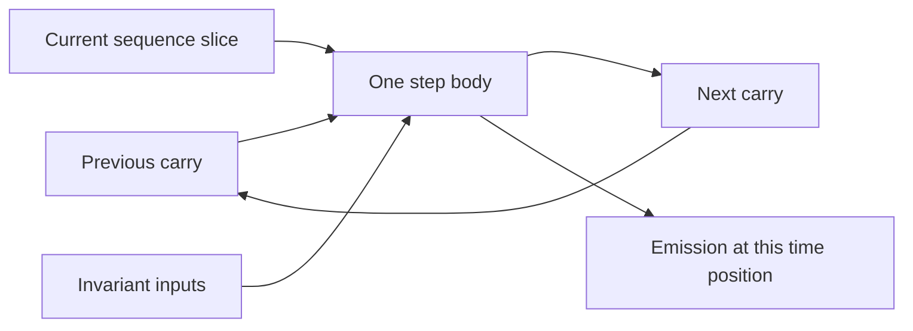

# General Scan source construction

[Reference goals](../index.md) · [Javadoc and exact signatures](../javadoc.md) · [Source entry point](../../../modules/model/src/main/java/io/github/pho001/synaptik/model/tensor/Tensor.java)

**Reader model.** General Scan describes a repeated calculation with a fixed number of steps.
The **body** is the expression template for one step. **Carry** is state passed to the next
step; a **sequence** supplies the current time slice; an **invariant** supplies the same input
at every step. An **emission** is a requested per-step output, stacked along a time axis.
A **formal** is a declared placeholder; an **actual** is the Tensor supplied for that position.
Declaring these roles does not execute a loop.

A **residual** names an internal value that can be retained for later use, such as computing
gradients. **Demand** describes which histories a downstream consumer actually needs, rather
than requiring all internal values to be stored. ROW(axis) identifies a proved independent
batch-row coordinate; SHARED has no such per-row coordinate. Equal axis sizes alone do not prove
either role. The detailed source, compiler, and backend restrictions below remain separate.

Read the cycle as the meaning of a step, not a callback API or a runtime schedule.



<a id="general-scan-source-construction"></a>
### General-scan source construction

`ScanBody`, `Scan` and `ScanResult` in `model.tensor` describe a fixed-count recurrence over
ordinary Tensor expressions. `ScanKind.SCAN` and scalar-only `ScanAttrs` in `model.operation.scan`
describe its meaning; `CompiledScanBody` in `model.graph` is the separately scoped compiled
attachment. These Model types provide source/intermediate-representation (IR) contracts only;
they do not perform capture, automatic differentiation (AD), demand analysis or execution.
Compiler now owns scoped capture, first-order AD and demand emission; Prepare validates scoped
bindings and demand. CPU0030 implements qualified FLOAT32 pointwise execution, extended by CPU0031
with qualified broadcast, SUM/sumToShape and bounded shape/layout closure, including independently
qualified actual reverse bodies. CPU0032 adds static homogeneous FLOAT32 rank-two MATMUL and
independently qualified actual Compiler reverse bodies. CPU0033 implements homogeneous FLOAT64
across the complete bounded declared algebra and actual first-order reverse closure. These are
historical layers: current general Scan composes every ordinary CPU-supported PURE unit with
the same ordinary dtype/layout/attribute guards and independently qualifies the complete forward
and selected ordinary-VJP reverse bodies. ND cuts and finite-path derivative guards remain exact.
All-valid WholeTensor differs from proved length-aware ROW(axis) and SHARED roles; SHARED
tensors may have arbitrary Shape under ordinary guards. Original length-AD carries/sequences
and emissions stay ROW(0); intermediate ROW axes follow the proved coordinate. Row-mixing
requires materialized same-length support, not Tensor identity. Structural absence differs from a present
all-zero seed. CPU low types use the same ordinary/shared-AD owners. Cold/wire and NN admission stay
separately bounded; no Metal general Scan grant follows.
Fixed `RecurrentScan` APIs and routes are unchanged.

```text
declared Tensor formals + ordinary expression roots -> reusable ScanBody
actual carry / sequences / invariants + Scan.apply -> one producer and all canonical ports
independently supplied CompiledGraphModel + role/demand lists -> CompiledScanBody
```

Read the first two lines as source construction and the last as a separate structural IR
container. Model does not perform the capture between them. The
[scan semantic owner](../../architecture/contracts/recurrent-scan.md#general-differentiable-scan)
defines the complete protocol; the [focused explanation](../../architecture/general-differentiable-scan.md)
distinguishes this foundation from downstream work.

<a id="formals-actual-positions-and-source-closure"></a>
#### Formals, actual positions and source closure

Construct `new ScanBody(carry, step, invariants, nextCarry, emissions)` from immutable-identity
Tensor references. Every argument list is defensively snapshotted. A formal is an explicitly
declared leaf standing for one input position, not a graph `ValueId`. All formals are
identity-distinct across groups and storage/provenance-free. Fully static formals have canonical
row-major geometry. All-valid source also admits one occurrence of the same named batch dimension
per value, with unresolved numeric layouts. At least one step formal is required. Carry and
next-carry lists may both be empty; at least one next carry or emission must remain a semantic
root. Unused declarations are allowed. Next-carry roots match carry arity, shape and dtype.
Emissions may repeat any valid body value, including a next carry.

The all-valid `Scan.apply(initialCarry, sequences, invariants, body, reverse)` binds each role by position.
Actual inputs have the exact static or named-symbol shape of their formals and are disjoint from the declared formal identities. Actual identities
may repeat within or across roles: input order is all carries, then sequences, then invariants,
without deduplication. Carry/invariant shape, dtype and `requiresGrad` match their formals.
Each sequence has rank at least one and the same static axis-zero extent `T >= 0`; removing that
axis gives its step formal's shape, dtype and eligibility. Static step geometry is canonical, not a
borrowed sequence-stride view. Construction does not read actual input storage.

Only declared formals may be body leaves. Pass a weight or Tensor constant explicitly as an
invariant rather than capturing an undeclared outer leaf. Scalar operation attributes remain
valid ordinary algebra. Validation covers the whole contained producer, including unused
canonical siblings, using existing known pure Model semantics and their ordinary guards.
Valid FLOAT16 TANH and FLOAT32 RELU bodies can construct independently of the initial CPU domain;
this is not an AD or provider support answer. Unknown/custom semantics, effects, random-number
operations, mutation, host-backed body values and nested scans reject. A template and its producers
may be reused across occurrences. Collective outer escape/cross-template sharing checks and
scoped capture remain Compiler work, with no Model ownership registry.

<a id="descriptor-only-ordinary-checks"></a>
#### Descriptor-only ordinary checks

`ScanBody.describeOrdinary(operation, inputs, outputCount)` checks an already canonical ordinary
operation using ordered `TensorDescriptor` inputs. It returns an immutable list of every
canonical output descriptor, including unused batch-normalization, attention and Top-K siblings.
It uses the same family-owned guards and descriptor construction as real Tensor expressions,
without creating a Tensor, producer, storage or identifier. Invalid signatures, shapes, types
and noncanonical operations reject before any Tensor identity allocation.

The scoped overload `ScanBody.describeOrdinary(operation, inputs, outputCount, batch)` additionally
accepts `Optional<DynamicDimension>` naming the exact sole declared batch symbol, or empty for a
static template. It reuses the same ordinary family guards and factored source/deferred symbolic
proof; the three-argument ordinary API retains its deferred-inference semantics. The scoped
check validates every operand, canonical output and shape-bearing attribute against that
declared vocabulary, including unused siblings and zero-count shapes. It cannot authorize a
symbol merely because the local output mentions it.

All-valid reshape uses canonical element-count proof across the declared template, so
`[2, B] -> [B, 2]` is valid without inventing a ROW axis. A length-aware ROW reshape additionally
requires its independent coordinate-mapping proof. This descriptor check grants neither ROW
provenance nor differentiation, backend admission or runtime execution.

This is metadata checking, not capture, differentiation or execution. Unknown/custom operations,
randomness, dropout, fixed recurrent scans and nested general scans remain excluded. A successful
ordinary check establishes neither a length-aware row role nor backend support.

<a id="computed-logical-layout-completion"></a>
#### Computed logical-layout completion

`ScanBody.closeOrdinaryLayouts(operation, inputs, outputs)` completes eligible unresolved
fully static computed result layouts after the caller independently validates canonical
semantics. Supply current topologically resolved operands and every canonical output descriptor.
Completion preserves data types, Shapes, gradient flags, output order and already resolved
layouts. It reuses exact ordinary views, the existing positive-static crop geometry and the
existing noncontiguous-RESHAPE materialization decision. Negative-step, empty, named and
otherwise unproved extraction layouts remain unresolved; unknown layouts are not automatically
made contiguous.

`ScanBody.hasCanonicalContiguousResults(operation)` exposes the separate geometry-independent
generic materialization fact used by flat Compiler closure and symbolic batch binding. Its
existing generic family set is unchanged; specialized static convolution completion does not
widen that classifier or symbolic eligibility. A positive fact does not establish PURE Scan
membership, valid descriptors, backend support or execution.

These are shared cold metadata operations, not another constructor, type/Shape inference
engine or allocator. Ordinary Tensor construction and both `describeOrdinary` forms retain
their existing behavior. CPU Scan preparation overlays only computed projection descriptors
and matching memory requirements, leaving actual/formal guards and the captured body/activity
graph associations unchanged.

<a id="per-output-ordinary-coordinate-facts"></a>
#### Per-output ordinary coordinate facts

`Scan.declaredSemantics(descriptor, rowAxis, batch)` checks an explicit SHARED or ROW(axis)
declaration without a Tensor or identifier. `Scan.ordinarySemantics(operation, inputs,
inputSemantics, outputs, batch)` derives an immutable `List<Scan.ValueSemantics>` in canonical
output order after the caller independently checks the ordinary descriptors.
`ValueSemantics` contains an optional identified row axis, terminal active-aggregation taint,
and immutable increasing direct value/control input positions. It is metadata, not a persisted
certificate, numerical value or derivative eligibility.

All known entirely SHARED PURE families use the same ordinary semantics; no separate row-kind
whitelist is needed. ROW intermediates may have any completely proved axis/rank. Canonical
batch-normalization outputs have separate routes; attention weights exclude V numerically even
when V supplies a broadcast batch domain. Exact coordinate mappings, not equal extents or B=0/1,
justify reshape/window/indexing rules. A changed reshape may select the lowest of several fully
proved boundary witnesses; exact-shape reshape keeps its original axis.

This source/forward-coordinate qualification does not widen the independent typed AD, sequence
header, Prepare/CPU, cold or wire domains. In particular retained sequence declarations allow
only axes 0/1 and rank-two ROW(1), even though intermediate facts can represent more. AD rejects
unrepresentable retained histories before derivative identities. See the
[coordinate contract](../../architecture/contracts/recurrent-scan.md#bounded-row-role-analysis).


<a id="static-and-symbolic-construction-through-the-same-api"></a>
#### Static and symbolic construction through the same API

Model0042 adds construction-only symbolic source, independently reviewed and MAIN accepted 2026-10-25.
The named dimension is compared by canonical name, not object identity or a hard-coded `B` spelling.
All declarations, including unused ones, determine that one symbol. Independent symbols,
anonymous/derived dimensions, multiple batch axes in one value and output-only symbols reject.
Reshape must preserve the fixed coordinate products on each side of the named axis; for example,
`[B,6] → [B,2,3]` is proved, but `[B,6] → [B,3]` and `[B,6] → [6,B]` reject.
Expand cannot equate B with a concrete non-singleton batch size; MATMUL contraction dimensions
must match exactly. Source proof also covers shape-bearing attributes and deferred family
equalities/broadcasts: attention cannot specialize B through a fixed non-singleton batch or mask;
normalization's declared shape must exactly match the input suffix; convolution/BatchNorm channels
and loss targets must satisfy their exact named-coordinate relations. For example, a hidden
`Other` in `layerNorm([Other,6], epsilon)` is not admitted merely because the result stays `[B,6]`.
Ordinary family guards still own operation semantics, dtypes and numerical-domain obligations;
source-shape proof does not inspect runtime index values or prove every reduction count.

Goal: construct the same fixed-ten-step recurrence for static batch 32 and symbolic batch `Rows`.
The complete program uses only storage-free FLOAT32 metadata, no Engine, values or backend:
carry is `[batch,64]`, each step is `[batch,16]`, sequence is `[10,batch,16]`, and the shared
projection weight is `[16,64]`.

```java
import io.github.pho001.synaptik.model.datatype.DataType;
import io.github.pho001.synaptik.model.layout.LayoutDescriptor;
import io.github.pho001.synaptik.model.shape.*;
import io.github.pho001.synaptik.model.tensor.*;
import java.util.List;
import java.util.Optional;

public final class StaticAndSymbolicScanSourceExample {
    private static Tensor leaf(Shape shape) {
        return TensorFactory.create(new TensorDescriptor(DataType.FLOAT32, shape,
                shape.isFullyStatic() ? Optional.of(LayoutDescriptor.contiguous(shape))
                        : Optional.empty(), false));
    }

    private static ScanResult describe(Dimension batch) {
        Shape carryShape = Shape.ofDimensions(batch, new StaticDimension(64));
        Shape stepShape = Shape.ofDimensions(batch, new StaticDimension(16));
        Tensor h = leaf(carryShape), step = leaf(stepShape), weight = leaf(Shape.of(16, 64));
        Tensor next = step.matmul(weight).add(h).tanh();
        ScanBody body = new ScanBody(List.of(h), List.of(step), List.of(weight),
                List.of(next), List.of(h, weight));
        Shape sequenceShape = Shape.ofDimensions(new StaticDimension(10), batch, new StaticDimension(16));
        return Scan.apply(List.of(leaf(carryShape)), List.of(leaf(sequenceShape)),
                List.of(leaf(Shape.of(16, 64))), body, false);
    }

    public static void main(String[] args) {
        for (Dimension batch : List.of(new StaticDimension(32), new DynamicDimension("Rows"))) {
            ScanResult result = describe(batch);
            System.out.println(result.finalCarry().getFirst().descriptor().shape());
            System.out.println(result.outputs().getFirst().descriptor().layout().isPresent());
            System.out.println(result.outputs().get(1).descriptor().shape());
        }
    }
}
```

The static form prints `Shape[32, 64]`, `true`, `Shape[10, 16, 64]`; the symbolic form prints
`Shape[Rows, 64]`, `false`, `Shape[10, 16, 64]`. MATMUL preserves the named row coordinate,
while the shared weight history stays `[10,16,64]` with a canonical static layout. No numeric
batch is bound, and neither form is silently converted into the other. Replacing the symbolic
actual carry with `[32,64]` fails exact source matching rather than binding `Rows=32`.

This example constructs source only. Compiler separately implements symbolic inference,
FLOAT32/FLOAT64 first-order AD and fresh all-port metadata binding. Prepare/CPU/Engine implement
the independently qualified ordinary CPU PURE composition and selected ordinary-VJP reverse closure,
with fixed time/features and the same ordinary dtype/layout guards; see the
[public execution example](../../user-guide/running-models.md#symbolic-scan-with-changing-batch-size).
Final qualification is tracked in [Prepare0014](../../planning/modules/prepare/tasks/0014-symbolic-scan-cpu-vertical.md).
Symbolic cold capture/reconstruction still rejects, even if B occurs only in an unused formal
and all public ports are static. Symbolic persistence and NN/training remain unsupported.
Model0044 also implements static-or-one-B length-aware source construction below; Compiler0015
adds independent inference, actual first-order AD and fresh all-port binding for that combination.
Prepare0015 separately implements bounded combined FLOAT32/FLOAT64 length-aware execution below.
Engine geometry memoization remains future work.

<a id="canonical-results-residual-metadata-and-eligibility"></a>
#### Canonical results, residual metadata and eligibility

One occurrence owns every distinct canonical wrapper before returning. `ScanResult` exposes
immutable lists in producer order: `finalCarry()`, `outputs()` (stacked emissions), then
`residuals()`. Repeated body-role bindings do not merge outer wrappers. Final-carry shapes match
their carry roles; each emission/residual prepends `T` to the body value's shape. Outer layouts
are canonical for static shapes and absent for symbolic shapes; wrappers are unlabeled and storage-free. Standalone `new ScanResult(...)` only
snapshots non-null groups/elements: it permits empty groups and repeated references and does not
prove common provenance. Record equality includes ordered group contents.

`body.retainedValues()` is the deterministic identity-unique residual inventory: visit next-carry
roots then emissions, use producer postorder and ascending canonical sibling slots, include every
carry formal (also unused ones), and exclude step/invariant leaves. A previous-carry residual
denotes state before its step. Emissions and residuals describe original-time indices, even for
reverse traversal. These ports allocate no history storage and choose no derivative recipe.
Compiler/Planning/Prepare propagate demand, and the qualified backend declares and allocates
the required histories through the existing run lifecycle. Merely using a value internally is
not a history demand; Model construction itself allocates none.

Let `G` be the OR of `requiresGrad` over all actual carry, sequence and invariant positions,
including unused inputs. Every differentiable outer port in all three groups receives `G`;
nondifferentiable dtypes receive false. Formal and ordinary body-value flags are not rewritten.
This conservative flag is neither a nonzero-dependency promise nor an available derivative rule.
For `T=0`, construction still reserves distinct ports with the same flags: emission/residual
shapes have a zero time axis, and final carry semantically preserves initial values/raw bits,
not the input wrapper identity. No body executes during construction for any `T`.

Whole-body validation creates no Tensor identities. Binding, header, descriptor and checked
shape/count failures precede outer output-ID allocation, including direct attachment seams.
Mutable host-storage associations on formals and all retained values are rechecked when binding
each occurrence. This is a point-in-time check, not a freeze of Tensor storage or a concurrent
multi-Tensor transaction. Later ID exhaustion consumes any earlier output IDs but exposes no
partial occurrence. Internal descriptor-check callbacks run synchronously, are not retained and
only validate metadata; they are not user bodies, runtime callbacks or an execution abstraction.

<a id="length-aware-source-only-construction"></a>
<a id="length-aware-source-construction-and-compiler-support"></a>

<a id="length-aware-source-construction-and-qualified-execution"></a>
#### Length-aware source construction and qualified execution

The additional implemented overload is:

```java
ScanResult Scan.apply(List<Tensor> initialCarry, List<Tensor> sequences,
        List<Tensor> invariants, Tensor validLengths, int rowCarryCount,
        List<OptionalInt> sequenceRowAxes, ScanBody body, boolean reverse);
```

The overload constructs source metadata only. Compiler0013 separately implements independent
inference, bounded first-order reverse construction and complete role/demand query emission.
Original-source automatic differentiation (AD) requires all carries and **every original sequence**
to be ROW(0), even unused/non-gradient positions. Generated reverse histories/seeds may instead
mix ROW(0), rank-two ROW(1) and SHARED roles derived from checked bindings/dataflow.
Prepare0011 separately projects these static bindings, explicit roles and complete-graph demand
through the existing resource handoff, without reading lengths or re-proving body algebra.
CPU0042 separately qualifies fixed T/B/features FLOAT32/FLOAT64 forward and actual first-order
reverse through the existing Engine/Prepare/generated CPU path. It validates every produced
length in `[0,T]` before any scan-local write, then skips inactive loads and arithmetic. See the
[CPU execution scope and example](../../backend-guide/cpu-backend.md#length-aware-fixed-batch-execution).
Static floating length mode has bounded cold reconstruction, including per-role floating
intermediates and explicit casts, and selective graph persistence (FP8 v7, otherwise v5/v6 as
needed). [The cold contract](../../architecture/contracts/compiler-autograd.md#bounded-general-scan-cold-reconstruction) remains narrower
than Model source expressibility. Prepare0015 implements the bounded symbolic-length CPU/Engine path
below; symbolic cold/wire remains unavailable. NN's qualified static runtime-length RNN workflow
supports owned training, save/load and fresh training-session reuse.
The old overload keeps its broader known-PURE operation/type inventory and all-valid behavior.
The user-approved [Model0044 source foundation](../../planning/modules/model/tasks/0044-symbolic-length-scan-source-foundation.md)
extends this same overload and direct attachment to fully static shapes **or** one named batch B,
with fixed T/features. Source construction is Complete under the authority accepted on 2026-10-26;
independent source/docs review and MAIN's root test/Javadoc checkpoint passed, with MAIN acceptance on 2026-10-26.
Compiler0015 implements independent symbolic-length FLOAT32/FLOAT64 inference, actual first-order
sibling AD and complete fresh scoped all-port binding; the Compiler-only task is Complete.
Compile/bind reads descriptors only, never input or length values. Prepare0015 separately implements
static-or-one-B projection and homogeneous FLOAT32/FLOAT64 generated scalar, single-range forward
and actual Compiler reverse through the ordinary Engine lifecycle. Its necessary typed outer/control/
ROW(1) closure uses explicit occurrence predicates, not an AD-origin tag. Owning validation and
independent code/structural review passed; root validation and the sole bounded probe completed;
[Prepare0015 Result](../../planning/modules/prepare/tasks/0015-symbolic-length-scan-cpu-vertical.md#result) records
evidence and limits; final MAIN acceptance remains pending. See the
[runnable changing-B example](../../user-guide/running-models.md#symbolic-length-scan-with-changing-batch-size)
and [bounded CPU scope](../../backend-guide/cpu-backend.md#symbolic-length-scan-cpu-execution).
The named Dimension must occur only at each identified row axis and in INT64 `[B]` lengths;
SHARED shapes/features stay static, including unused declarations. Equal sizes never prove a role.
Static formals/ports keep canonical layouts; symbolic formals/actuals/ports stay unresolved.
For example, h/step `[Rows,2]`, sequence `[0,Rows,2]`, fixed bias `[2]` and INT64 lengths `[Rows]`
describe final `[Rows,2]` and row-history `[0,Rows,2]` ports with unresolved layouts. A retained
shared value such as `bias.neg()` instead has a static canonical history `[0,2]`; the invariant
bias leaf itself gains no residual port. These source descriptors allocate no histories or execute
a body; downstream qualification is separate. A bias containing `Rows` or a different lengths symbol rejects.

At execution, bind fully static actual inputs/seeds in compiled order and preserve all fixed extents,
types and gradient flags. Direct non-gradient INT64 `[B]` lengths need no producer; the bounded
ordinary control producer is only non-gradient FLOAT32/FLOAT64 `[B]` `.cast(DataType.INT64)`.
Each call performs fresh complete binding and actual-sized resource admission, even for repeated B.
After producers, every length must lie in `[0,T]` before the Scan writes output, padding, history
or scratch; T=0 requires all zero lengths and `[B,0]` does not hide a nonzero B. B=0 permits empty
row outputs but does not skip other required outputs or checks. Inactive carry/dInitial preserves
raw initial/final-seed values; inactive emissions/dX are +0. Lengths do not change an outer mean's
dense denominator. The initial Prepare0015 layer excluded all-valid symbolic FLOAT64 and ordinary
symbolic FLOAT64 MATMUL; that historical exclusion does not limit current ordinary CPU Scan
composition under the same ordinary guards. Its native/mixed and vector/parallel exclusions
record that layer's historical execution scope. CPU low parity uses these same owners;
higher-order and symbolic cold/copy/wire admission are not widened.

The first `rowCarryCount` carries identify a leading batch coordinate B (ROW(0)); the source count
is in `[0, carryCount]`. B comes from the INT64 lengths descriptor, not the first carry.
Remaining carries are terminal SHARED additive accumulators. A length-aware source may have no
ROW carry, no ROW formal, or no carry at all. These newly representable Model0046 topologies
remain independently rejected by current Compiler/Prepare/CPU/cold/wire consumers. Each sequence
has one non-null `OptionalInt`: absent means SHARED, zero means ROW(0), and one means ROW(1) in
a rank-two step shape. Axes address the step after time is removed, not the outer sequence.
Roles are declarations, never guesses from equal extents, flags or rank. Tied actual identities
must identify the same outer batch axis, or both be SHARED: step axis r maps to actual axis r+1.
This also applies to unused positions and B=0/1.

Model0045 source retains each value's own type and gradient eligibility under ordinary family
guards and the separately bounded length-source row proof. Descriptor checking does not bypass
that proof. CPU composition and selected ordinary-VJP AD remain independent admissions under
ordinary guards, narrower than source expressibility; consult the linked CPU and Compiler scopes.
Row carries/emissions remain ROW(0). SHARED broadcast operands omit the
row axis or have extent one there; `[1,H]` SHARED bias may accompany ROW(0) `[1,H]` at B=1.
Equal aligned sumToShape extents preserve a row role, including `[1,H] → [1,H]` and
ROW(1) `[F,1] → [F,1]`. An explicit SUM over the row axis is terminal even at extent one.
Row-reduced dependencies cannot flow through shared algebra back into row feedback or emissions.
Each shared carry uses exactly its own tensor `old.add(contribution)` root; contribution shape
and dtype must match, without implicit broadcasting or dependence on any shared carry. Its
updated value cannot feed another contribution or row feedback. See the
[bounded row rules](../../architecture/contracts/recurrent-scan.md#bounded-row-role-analysis) for exact mappings.

Actual order is carry, sequence, invariant, then non-gradient INT64 `[B]` lengths. All sequences
share static T; declared row axes share B. Lengths has no body formal, contributes nothing to
gradient eligibility, and its values/storage are not read. Header/roles are immutable snapshots.
All bindings, body storage, siblings, roles and checked geometry are validated before output IDs,
including at T=0/B=0. Ports retain their canonical order and conservative flags. Residual shapes
remain `[T] + localShape`; a SHARED `[F,H]` history is `[T,F,H]`, never `[T,B,F,H]`.

The reverse sibling retains the exact lengths actual and opposite traversal. Exact saved
activation/previous-state primals are bound, not replayed. Each incoming cotangent for a SHARED
value is normalized before accumulation, even when B=1; disconnected ROW cotangents and shaped
literal seeds have explicit sequence roles. This describes construction and query metadata,
not validation of runtime lengths or physical history storage by this constructor. Execution
requires independent backend qualification and value preflight. See the
[Compiler boundary](../compiler/verification-scan.md#current-scoped-scan-capture-and-first-order-ad).

Goal: construct and inspect a zero-time, singleton-batch recurrence. Only canonical storage-free
metadata exists: FLOAT32 h/step/bias have shape `[1,2]`, sequence has shape `[0,1,2]`, and lengths
has INT64 shape `[1]`. No length values or backend are needed.

```java
import io.github.pho001.synaptik.model.datatype.DataType;
import io.github.pho001.synaptik.model.layout.LayoutDescriptor;
import io.github.pho001.synaptik.model.shape.Shape;
import io.github.pho001.synaptik.model.tensor.Scan;
import io.github.pho001.synaptik.model.tensor.ScanBody;
import io.github.pho001.synaptik.model.tensor.Tensor;
import io.github.pho001.synaptik.model.tensor.TensorDescriptor;
import io.github.pho001.synaptik.model.tensor.TensorFactory;
import java.util.List;
import java.util.Optional;
import java.util.OptionalInt;

public final class LengthScanMetadataExample {
    private static Tensor leaf(DataType type, boolean grad, long... dimensions) {
        Shape shape = Shape.of(dimensions);
        return TensorFactory.create(new TensorDescriptor(type, shape,
                Optional.of(LayoutDescriptor.contiguous(shape)), grad));
    }

    public static void main(String[] args) {
        Tensor h = leaf(DataType.FLOAT32, false, 1, 2);
        Tensor step = leaf(DataType.FLOAT32, true, 1, 2);
        Tensor bias = leaf(DataType.FLOAT32, false, 1, 2);
        Tensor next = h.sumToShape(Shape.of(1, 2)).add(step).add(bias);
        ScanBody body = new ScanBody(List.of(h), List.of(step), List.of(bias),
                List.of(next), List.of(h));
        Tensor initial = leaf(DataType.FLOAT32, false, 1, 2);
        Tensor sequence = leaf(DataType.FLOAT32, true, 0, 1, 2);
        Tensor actualBias = leaf(DataType.FLOAT32, false, 1, 2);
        Tensor lengths = leaf(DataType.INT64, false, 1);
        var result = Scan.apply(List.of(initial), List.of(sequence), List.of(actualBias),
                lengths, 1, List.of(OptionalInt.of(0)), body, false);
        var producer = result.finalCarry().getFirst().provenance().orElseThrow().producer();
        System.out.println(producer.inputs().size());
        System.out.println(result.outputs().getFirst().descriptor().shape().equals(Shape.of(0, 1, 2)));
        System.out.println(result.outputs().getFirst().descriptor().requiresGrad());
    }
}
```

Output is `4`, `true`, `true`, on separate lines. Binding adds one lengths actual to the three
formal positions; no lengths formal is created. The identity sumToShape preserves ROW(0), the
singleton shared bias broadcasts legally, and the unused time domain still propagates the
sequence's gradient flag to the emission. These are metadata checks, not numerical execution.
Replacing next by `h.sum(0, true)` rejects as row-reduced feedback even though B=1 leaves its
shape unchanged. Passing this source to compile/run or cold save/copy is unsupported.

<a id="complete-metadata-construction-example"></a>
#### Complete metadata-construction example

Goal: describe `next = h + step`, emit previous `h`, and inspect temporal eligibility and port
ownership. The initial state is only storage-free metadata: scalar FLOAT32 carry with a false
flag and FLOAT32 sequence shape `[2]` with a true flag. No values are supplied or evaluated.

```java
import io.github.pho001.synaptik.model.datatype.DataType;
import io.github.pho001.synaptik.model.layout.LayoutDescriptor;
import io.github.pho001.synaptik.model.shape.Shape;
import io.github.pho001.synaptik.model.tensor.Scan;
import io.github.pho001.synaptik.model.tensor.ScanBody;
import io.github.pho001.synaptik.model.tensor.ScanResult;
import io.github.pho001.synaptik.model.tensor.Tensor;
import io.github.pho001.synaptik.model.tensor.TensorDescriptor;
import io.github.pho001.synaptik.model.tensor.TensorFactory;
import java.util.List;
import java.util.Optional;

public final class ScanMetadataExample {
    private static Tensor leaf(Shape shape, boolean grad) {
        return TensorFactory.create(new TensorDescriptor(DataType.FLOAT32, shape,
                Optional.of(LayoutDescriptor.contiguous(shape)), grad));
    }

    public static void main(String[] args) {
        Tensor h = leaf(Shape.scalar(), false);
        Tensor step = leaf(Shape.scalar(), true);
        Tensor next = h.add(step);
        ScanBody body = new ScanBody(List.of(h), List.of(step), List.of(),
                List.of(next), List.of(h));
        Tensor initial = leaf(Shape.scalar(), false);
        Tensor sequence = leaf(Shape.of(2), true);
        ScanResult result = Scan.apply(List.of(initial), List.of(sequence), List.of(), body, false);

        System.out.println(result.outputs().getFirst().descriptor().shape().equals(Shape.of(2)));
        System.out.println(result.outputs().getFirst().descriptor().requiresGrad());
        System.out.println(result.residuals().size());
        var producer = result.finalCarry().getFirst().provenance().orElseThrow().producer();
        System.out.println(producer.output(1) == result.outputs().getFirst());
    }
}
```

The output is `true`, `true`, `2`, `true`, on separate lines. `h` and `step` declare distinct
positions; `next` is one ordinary ADD expression. Binding separate actual leaves infers `T=2`.
The retained inventory is `[h, next]`, so the occurrence owns four ports: final carry, emission
and two residuals. Although the source emission `h` has a false flag, its outer stacked port gets
true from `G`: later emissions may depend on earlier steps. The final identity check proves
canonical ownership, not computation. These metadata outcomes match the focused scan tests;
this example needs no backend. Replacing the sequence with shape `[0]` keeps the flags and gives
empty stacked descriptors; binding `h` itself as the actual initial carry instead rejects because
actuals must be disjoint from formals.


---

[Previous topic](normalization.md) · [Next topic](statistics-losses.md)
