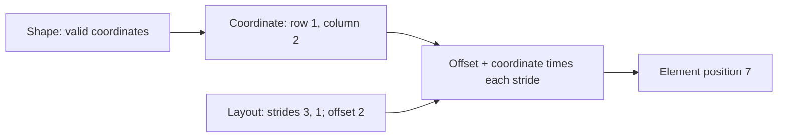

# Resolved logical [layouts](../../glossary.md#layout)

[Reference goals](../index.md) · [Javadoc and exact signatures](../javadoc.md)<span data-glossary-navigation="true"> ([Javadoc glossary](../../glossary.md#term-javadoc); [signatures glossary](../../glossary.md#term-signature))</span> · [Source entry point](../../../modules/model/src/main/java/io/github/pho001/synaptik/model/tensor/Tensor.java)

## Calculate a position, not an allocation

Application code or an expression constructor calls `LayoutDescriptor.of` with a static shape,
strides and an offset. It receives immutable geometry; mutable stride arrays are copied.
No storage is supplied or allocated. For rank $r$, coordinate $i_a$ on axis $a$,
extent $d_a$, stride $s_a\geq0$ and offset $o\geq0$, the element position is

$$
p=o+\sum_{a=0}^{r-1}i_a s_a,\qquad 0\leq i_a<d_a.
$$

All coordinates, strides, offsets and positions are integers; strides and offset are in elements,
not bytes. With `[2, 3]`, strides `[3, 1]` and offset $2$, coordinate $(1,2)$ gives
$p=2+1(3)+2(1)=7$. For a nonempty domain, required span is
$o+\sum_{a=0}^{r-1}(d_a-1)s_a+1$: capacity must include preceding offset positions and gaps.
An empty domain has span zero instead. These checked integer calculations are not floating
tensor arithmetic. Continue with [descriptor compatibility](descriptors.md) and
[storage capacity/lifetimes](host-storage.md) before interpreting geometry as usable memory.

**[Reader model](../../glossary.md#term-reader-model).** [Shape](../../glossary.md#shape) tells you which [coordinates](../../glossary.md#axis-rank-scalar-vector-and-matrix) exist; layout tells you how those coordinates
map to storage-[element](../../glossary.md#term-element) positions. A **[stride](../../glossary.md#term-stride)** is the change in element position when one [axis](../../glossary.md#term-axis)
coordinate increases by one. The **offset** is the element position for the all-zero coordinate.
For shape `[2, 3]`, strides `[3, 1]`, and offset `2`, coordinate `[1, 2]` maps to
$2+1\times3+2\times1=7$. These are element positions, not byte addresses.

**[Contiguous](../../glossary.md#term-contiguous) [row-major](../../glossary.md#term-row-major)** geometry places successive last-axis elements next to one another,
then continues with the next row without gaps. **[Aliasing](../../glossary.md#term-aliasing)** means different logical references
can name the same storage position; a zero stride can describe repetition this way.
The [view](../../glossary.md#term-view-meanings) flag describes the logical relationship, not proof that an executable result shares
physical memory. **[Materialization](../../glossary.md#materialization)** means actually producing stored values, a separate decision.

Read this diagram from coordinates toward the referenced position; it describes geometry only.



<a id="resolved-layouts"></a>
## Resolved [layouts](../../glossary.md#layout)

The public layout contracts live in `io.github.pho001.synaptik.model.layout`. `LayoutDescriptor` is an [immutable](../../glossary.md#term-immutable) description of resolved logical [element](../../glossary.md#term-element) geometry for a fully static [shape](../../glossary.md#shape). The [descriptor](../../glossary.md#term-descriptor) records [rank](../../glossary.md#term-rank), non-negative `long` element [strides](../../glossary.md#term-stride), a non-negative [storage offset](../../glossary.md#term-storage-offset) measured in elements, explicit [view](../../glossary.md#term-view-meanings)/[alias](../../glossary.md#aliasing-and-arena) [metadata](../../glossary.md#term-metadata), and the checked element span needed to contain every referenced index. It does not retain the `Shape` used to construct it.

Resolved layouts have four geometric kinds:

- `DENSE_CONTIGUOUS` uses [canonical](../../glossary.md#term-canonical-form) [row-major](../../glossary.md#term-row-major) strides and offset zero;
- `DENSE_WITH_OFFSET` uses canonical row-major strides and a non-zero element offset;
- `STRIDED` uses non-canonical strides without non-[singleton](../../glossary.md#term-singleton) broadcast repetition; and
- `BROADCAST_ZERO_STRIDE` repeats at least one static [dimension](../../glossary.md#dimension) larger than one through stride zero.

`LayoutDescriptor.contiguous(shape)` derives canonical row-major strides. `LayoutDescriptor.of(shape, strides, storageOffset, view)` validates and classifies explicit geometry. Caller-owned stride arrays are defensively copied, and `strides()` returns a new copy. Individual strides support positive and negative [axis](../../glossary.md#term-axis) [lookup](../../glossary.md#term-lookup).

Layout classification is independent of the explicit view flag except that broadcast zero-stride repetition must be marked as a view. A raw zero stride on a singleton or empty dimension is not itself broadcast geometry. Canonical empty layouts are classified as dense even when their canonical stride sequence contains zero.

The [referenced element span](../../glossary.md#referenced-element-span) is zero for any shape containing a zero-sized dimension. A rank-0 [scalar](../../glossary.md#term-scalar) references one element at its offset. All stride and span arithmetic is checked for `long` [overflow](../../glossary.md#term-overflow).

Unbound dynamic shapes do not have numeric layout descriptors because their concrete strides and span are unresolved. Implemented [Compiler](../../glossary.md#term-compiler) [batch](../../glossary.md#term-batch-machine-learning-and-hyperparameters) [binding](../../glossary.md#term-binding) and preparation resolve qualified symbolic geometry at the execution boundary; this does not admit arbitrary symbols or dynamic layouts. The [model](../../glossary.md#term-model) descriptor exposes geometry only: it does not own storage, byte addresses, [device](../../glossary.md#term-device) state, [backend](../../glossary.md#backend) information, or a decision about whether [materialization](../../glossary.md#materialization) is required.

<a id="layout-example"></a>
### [Layout](../../glossary.md#layout) example

```java
// Zero row stride describes reuse of positions; it does not allocate or attach a buffer.
Shape shape = Shape.of(2, 3);
LayoutDescriptor layout = LayoutDescriptor.of(
        shape, new long[] {0, 1}, 0, true);
```

The logical shape has six positions, but axis zero has stride zero: both rows reuse the same
three storage-element positions. Required span is $(2-1)0+(3-1)1+1=3$ elements.
The descriptor is a `BROADCAST_ZERO_STRIDE` view. This describes aliasing geometry; it does not
authorize in-place writes or decide whether a backend must materialize a copy.


---

[Previous topic](shapes.md) · [Next topic](descriptors.md)
