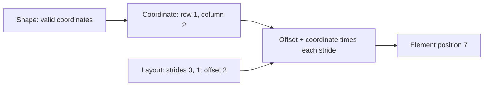

# Resolved logical layouts

[Reference goals](../index.md) · [Javadoc and exact signatures](../javadoc.md) · [Source entry point](../../../modules/model/src/main/java/io/github/pho001/synaptik/model/tensor/Tensor.java)

**Reader model.** Shape tells you which coordinates exist; layout tells you how those coordinates
map to storage-element positions. A **stride** is the change in element position when one axis
coordinate increases by one. The **offset** is the element position for the all-zero coordinate.
For shape `[2, 3]`, strides `[3, 1]`, and offset `2`, coordinate `[1, 2]` maps to
`2 + 1 × 3 + 2 × 1 = 7`. These are element positions, not byte addresses.

**Contiguous row-major** geometry places successive last-axis elements next to one another,
then continues with the next row without gaps. **Aliasing** means different logical references
can name the same storage position; a zero stride can describe repetition this way.
The view flag describes the logical relationship, not proof that an executable result shares
physical memory. **Materialization** means actually producing stored values, a separate decision.

Read this diagram from coordinates toward the referenced position; it describes geometry only.



<a id="resolved-layouts"></a>
## Resolved layouts

The public layout contracts live in `io.github.pho001.synaptik.model.layout`. `LayoutDescriptor` is an immutable description of resolved logical element geometry for a fully static shape. The descriptor records rank, non-negative `long` element strides, a non-negative storage offset measured in elements, explicit view/alias metadata, and the checked element span needed to contain every referenced index. It does not retain the `Shape` used to construct it.

Resolved layouts have four geometric kinds:

- `DENSE_CONTIGUOUS` uses canonical row-major strides and offset zero;
- `DENSE_WITH_OFFSET` uses canonical row-major strides and a non-zero element offset;
- `STRIDED` uses non-canonical strides without non-singleton broadcast repetition; and
- `BROADCAST_ZERO_STRIDE` repeats at least one static dimension larger than one through stride zero.

`LayoutDescriptor.contiguous(shape)` derives canonical row-major strides. `LayoutDescriptor.of(shape, strides, storageOffset, view)` validates and classifies explicit geometry. Caller-owned stride arrays are defensively copied, and `strides()` returns a new copy. Individual strides support positive and negative axis lookup.

Layout classification is independent of the explicit view flag except that broadcast zero-stride repetition must be marked as a view. A raw zero stride on a singleton or empty dimension is not itself broadcast geometry. Canonical empty layouts are classified as dense even when their canonical stride sequence contains zero.

The referenced element span is zero for any shape containing a zero-sized dimension. A rank-0 scalar references one element at its offset. All stride and span arithmetic is checked for `long` overflow.

Unbound dynamic shapes do not have numeric layout descriptors because their concrete strides and span are unresolved. Implemented Compiler batch binding and preparation resolve qualified symbolic geometry at the execution boundary; this does not admit arbitrary symbols or dynamic layouts. The model descriptor exposes geometry only: it does not own storage, byte addresses, device state, backend information, or a decision about whether materialization is required.

<a id="layout-example"></a>
### Layout example

```java
Shape shape = Shape.of(2, 3);
LayoutDescriptor layout = LayoutDescriptor.of(
        shape, new long[] {0, 1}, 0, true);
```

The logical shape has six positions, but axis 0 has stride zero: both rows reuse the same three storage elements. The referenced span is therefore `3`, computed as `(2 - 1) × 0 + (3 - 1) × 1 + 1`. The descriptor is a `BROADCAST_ZERO_STRIDE` view. This calculation describes aliasing geometry; it does not authorize in-place writes or decide whether a backend must materialize a copy.


---

[Previous topic](shapes.md) · [Next topic](descriptors.md)
