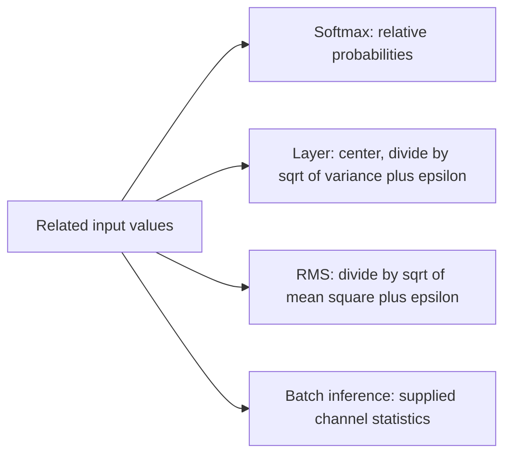

# [Softmax](../../glossary.md#softmax--log-softmax), layer, RMS and [inference](../../glossary.md#term-inference) [normalization](../../glossary.md#term-normalization)

[Reference goals](../index.md) · [Javadoc and exact signatures](../javadoc.md)<span data-glossary-navigation="true"> ([Javadoc glossary](../../glossary.md#term-javadoc); [signatures glossary](../../glossary.md#term-signature))</span> · [Source entry point](../../../modules/model/src/main/java/io/github/pho001/synaptik/model/tensor/Tensor.java)

## Who supplies the statistics and affine parameters?

Application or NN layer-building code calls the receiver methods with an input Tensor and any
explicit scale, bias or running-statistic Tensors. The method retains their exact references;
it does not copy their values, acquire ownership of layer state, or update running statistics.
Layer/RMS normalization describe reductions over the selected trailing axes; batch inference
instead uses supplied statistics. For explicit next running values, read
[batch-normalization training](statistics-losses.md#batch-normalization-training-and-statistic-transition-expressions).
Use [reduction domains](reductions.md) to understand which coordinates share a statistic.

### A finite softmax slice

Let $x_0,\ldots,x_{N-1}$ be finite real scores in one nonempty slice, with $N>0$.
Set $m=\max_{0\leq j<N}x_j$ and $s=\sum_{j=0}^{N-1}\exp(x_j-m)$.
At index $0\leq i<N$, ideal softmax is $\exp(x_i-m)/s$ and log-softmax is
$(x_i-m)-\log(s)$. Equal scores `[1000, 1000]` have $m=1000$, $s=2$ and
probabilities $1/2$ each. Subtracting the maximum keeps these exponent inputs zero rather
than requiring $\exp(1000)$. Floating evaluation still rounds at the named sites; special
values, empty slices and admitted backend value domains are separate below.

**[Reader model](../../glossary.md#term-reader-model).** Normalization rescales related values using a shared quantity.
Softmax turns scores, often called **logits**, into relative probabilities along one [axis](../../glossary.md#term-axis).
[Layer normalization](../../glossary.md#layer-normalization) subtracts a [slice](../../glossary.md#slice)'s [mean](../../glossary.md#term-mean) and divides by the [square root](../../glossary.md#norms-elementary-functions-and-probability-distributions) of its [variance](../../glossary.md#term-variance)
plus a stabilizing **[epsilon](../../glossary.md#epsilon)** inside that square root. Root-mean-square (**RMS**) normalization
uses the average of squares without subtracting the mean. [Batch](../../glossary.md#term-batch-machine-learning-and-hyperparameters)-normalization inference uses
supplied per-[channel](../../glossary.md#term-channel) mean and variance instead of calculating new statistics.
These are distinct formulas, not different names for the same [operation](../../glossary.md#operation).
**Affine** scale and [bias](../../glossary.md#term-bias) mean multiplying by a [parameter](../../glossary.md#term-parameter) and then adding another.

Read the paths below by first choosing which relationship you need. The picture compares
mathematical roles; it does not claim identical supported types or execution routes.



<a id="softmax-expressions"></a>
### [Softmax](../../glossary.md#softmax--log-softmax) expressions

The two current softmax methods build [shape](../../glossary.md#shape)-preserving [normalization](../../glossary.md#term-normalization) [metadata](../../glossary.md#term-metadata) along exactly one
input [axis](../../glossary.md#term-axis):

| Public form | [Operation](../../glossary.md#operation) kind | Ideal [slice](../../glossary.md#slice) meaning |
|---|---|---|
| `softmax(axis)` | `SoftmaxKind.SOFTMAX` | Maximum-shifted probabilities; a rounded small probability may be zero |
| `logSoftmax(axis)` | `SoftmaxKind.LOG_SOFTMAX` | Maximum-shifted [log](../../glossary.md#term-log)-probabilities, not logarithms of rounded softmax outputs |

A normalization slice fixes every [coordinate](../../glossary.md#axis-rank-scalar-vector-and-matrix) except the selected axis. For a [rank-two](../../glossary.md#axis-rank-scalar-vector-and-matrix) [tensor](../../glossary.md#tensor) and
axis `1`, each row is therefore normalized independently. The input must be floating, including
either [FP8](../../glossary.md#term-fp8) type; integral and [BOOL](../../glossary.md#data-type--datatype) inputs are rejected before axis [validation](../../glossary.md#term-validation). A positive
or negative caller axis is normalized exactly once against the input Shape.

Every valid result is a fresh unlabeled, storage-free Tensor. Its [descriptor](../../glossary.md#term-descriptor) retains the exact
input Shape reference, [data type](../../glossary.md#data-type--datatype), and `requiresGrad` value, but its [layout](../../glossary.md#layout) is unresolved even when
the input layout is resolved. [Provenance](../../glossary.md#provenance) records the exact requested kind, one
`SoftmaxAttrs(normalizedAxis)`, and exact ordered inputs `[input]`. Construction does not inspect
input values or storage, calculate exponentials, logarithms, sums, or probabilities, select a
finite-[precision](../../glossary.md#term-precision) algorithm, define a [gradient](../../glossary.md#term-gradient) rule, [capture](../../glossary.md#term-capture-meanings) a [graph](../../glossary.md#graph), decompose the operation, or
execute [backend](../../glossary.md#backend) work.

For one ideal slice `[1, 2, 3]`, the requested mathematical values are:

| Method | Approximate result | Relationship |
|---|---|---|
| `softmax(axis)` | `[0.09003057, 0.24472847, 0.66524096]` | The probabilities sum to approximately one. |
| `logSoftmax(axis)` | `[-2.40760596, -1.40760596, -0.40760596]` | Exponentiating each value recovers the corresponding softmax probability. |

These numbers explain the expression's meaning; the current [API](../../glossary.md#term-application-programming-interface-api) constructs only metadata for the
request.

For an all-finite slice `[1000, 1000]`, the requested SOFTMAX values are `[0.5, 0.5]` and
LOG_SOFTMAX values are approximately `[-0.69314718, -0.69314718]`: the implementation does not
have to [overflow](../../glossary.md#term-overflow) unshifted `exp(1000)`. With `[0, -1000]`, a rounded SOFTMAX output can be
`[1, 0]` while LOG_SOFTMAX remains `[0, -1000]`. Input [NaN](../../glossary.md#term-nan)/[infinity](../../glossary.md#term-infinity) and empty-slice rules are
separate; the [Model numerical contract](../../architecture/contracts/foundational-modules.md#composite-inheritance)<span data-glossary-navigation="true"> ([Model glossary](../../glossary.md#term-model))</span>
defines them, and a backend may admit a narrower [runtime](../../glossary.md#term-runtime) value domain.

<a id="complete-expression-construction-example"></a>
#### Complete expression-construction example

<a id="goal-and-inputs-23"></a>
##### Goal and inputs

Construct [softmax](../../glossary.md#softmax--log-softmax) and [log-softmax](../../glossary.md#softmax--log-softmax) expressions for a storage-free [`FLOAT32`](../../glossary.md#term-float32) [tensor](../../glossary.md#tensor) with [Shape](../../glossary.md#shape)
`[2, 3]`. [Axis](../../glossary.md#term-axis) `-1` and axis `1` both select the final [dimension](../../glossary.md#dimension), so each logical row is one
[normalization](../../glossary.md#term-normalization) [slice](../../glossary.md#slice).

```java
import io.github.pho001.synaptik.model.datatype.DataType;
import io.github.pho001.synaptik.model.operation.normalization.SoftmaxAttrs;
import io.github.pho001.synaptik.model.operation.normalization.SoftmaxKind;
import io.github.pho001.synaptik.model.shape.Shape;
import io.github.pho001.synaptik.model.tensor.Tensor;
import io.github.pho001.synaptik.model.tensor.TensorDescriptor;
import io.github.pho001.synaptik.model.tensor.TensorFactory;
import java.util.Optional;

public final class SoftmaxExpressionExample {
    public static void main(String[] args) {
        Shape shape = Shape.of(2, 3);
        Tensor input = TensorFactory.create(new TensorDescriptor(
                DataType.FLOAT32, shape, Optional.empty(), true));

        // Both axes name each row; logSoftmax is not log() of a rounded probability tensor.
        Tensor probabilities = input.softmax(-1);
        Tensor logProbabilities = input.logSoftmax(1);
        SoftmaxAttrs probabilitiesAttrs = (SoftmaxAttrs) probabilities
                .provenance().orElseThrow().operation().attrs();

        System.out.println(probabilities.descriptor().shape() == shape);
        System.out.println(probabilities.descriptor().dataType());
        System.out.println(probabilities.descriptor().requiresGrad());
        System.out.println(probabilities.descriptor().layout().isEmpty());
        System.out.println(probabilities.provenance().orElseThrow().operation().kind());
        System.out.println(logProbabilities.provenance().orElseThrow().operation().kind());
        System.out.println(probabilitiesAttrs.axis());
        System.out.println(probabilities.provenance().orElseThrow().inputs().getFirst() == input);
    }
}
```

<a id="meaningful-lines-and-intermediate-results-8"></a>
##### Meaningful lines and intermediate results

- `input.softmax(-1)` normalizes `-1` to [axis](../../glossary.md#term-axis) `1` and records [`SOFTMAX`](../../glossary.md#softmax--log-softmax).
- `input.logSoftmax(1)` stores the same [normalized axis](../../glossary.md#normalized-axis) but records the distinct
  `LOG_SOFTMAX` kind.
- Both [descriptors](../../glossary.md#term-descriptor) retain the exact [`shape`](../../glossary.md#shape), [`FLOAT32`](../../glossary.md#term-float32), and the true gradient-eligibility
  metadata while leaving layout unresolved.<span data-glossary-navigation="true"> ([gradient glossary](../../glossary.md#term-gradient); [metadata glossary](../../glossary.md#term-metadata); [layout glossary](../../glossary.md#layout))</span>
- Each [provenance](../../glossary.md#provenance) value contains exactly `input`; neither expression receives label or storage.

<a id="result-and-interpretation-23"></a>
##### Result and interpretation

The program prints:

```text
true
FLOAT32
true
true
SOFTMAX
LOG_SOFTMAX
1
true
```

The result proves [axis](../../glossary.md#term-axis) [normalization](../../glossary.md#term-normalization), kind selection, [descriptor](../../glossary.md#term-descriptor) retention, unresolved [layout](../../glossary.md#layout),
and one-input [provenance](../../glossary.md#provenance). It does not prove the ideal numerical values above, [gradient](../../glossary.md#term-gradient) support,
[compiler](../../glossary.md#term-compiler) [capture](../../glossary.md#term-capture-meanings) or [decomposition](../../glossary.md#term-decomposition), [backend](../../glossary.md#backend) support, or execution.

<a id="failures-and-useful-variations-20"></a>
##### Failures and useful variations

- [`INT32`](../../glossary.md#data-type--datatype), [`INT64`](../../glossary.md#data-type--datatype), and [`BOOL`](../../glossary.md#data-type--datatype) input fails with `IllegalArgumentException`; no conversion or
  promotion is inserted. This type check occurs before axis validation.<span data-glossary-navigation="true"> ([validation glossary](../../glossary.md#term-validation))</span>
- An [axis](../../glossary.md#term-axis) outside `[-rank, rank - 1]` fails with `IndexOutOfBoundsException`. Every axis is invalid
  for a scalar input.<span data-glossary-navigation="true"> ([scalar glossary](../../glossary.md#term-scalar))</span>
- Dynamic and zero extents are accepted structurally when the selected axis exists. Repeated
  equivalent requests still return fresh expression identities.<span data-glossary-navigation="true"> ([identities glossary](../../glossary.md#term-identity-meanings))</span>

<a id="layer-normalization-expressions"></a>
### Layer-[normalization](../../glossary.md#term-normalization) expressions

[Layer normalization](../../glossary.md#layer-normalization) standardizes each trailing logical [slice](../../glossary.md#slice) selected by an exact non-empty
[normalized Shape](../../glossary.md#normalized-shape). It is distinct from [softmax](../../glossary.md#softmax--log-softmax): layer normalization centers values and divides by
population [standard deviation](../../glossary.md#term-standard-deviation), while softmax converts one [axis](../../glossary.md#term-axis) to probabilities. The two current
receiver [signatures](../../glossary.md#term-signature) are exactly:

```java
public Tensor layerNorm(Shape normalizedShape, ScalarValue epsilon)
public Tensor layerNorm(
        Shape normalizedShape, Tensor scale, Tensor bias, ScalarValue epsilon)
```

For input [Shape](../../glossary.md#shape) `[D0, ..., D(R-1)]` and normalized Shape `[N0, ..., N(K-1)]`, [normalized axis](../../glossary.md#normalized-axis) `j`
corresponds to input axis `R - K + j`. This table shows the two supported forms.

| Form | Ordered [producer](../../glossary.md#term-producer) inputs | Shape requirements | Result type |
|---|---|---|---|
| No affine | `[input]` | `normalizedShape` exactly describes trailing input axes | Exact input type |
| Affine | `[input, scale, bias]` | Same trailing rule; scale and [bias](../../glossary.md#term-bias) Shapes each equal `normalizedShape` exactly | Floating promotion in input, scale, bias order |

Every operand must be floating, including either [FP8](../../glossary.md#term-fp8) type. [Epsilon](../../glossary.md#epsilon) must be [finite](../../glossary.md#term-finite) and strictly
positive. It has the exact result type except that [FLOAT16](../../glossary.md#term-float16) and FP8 results use exact [FLOAT32](../../glossary.md#term-float32) epsilon
[metadata](../../glossary.md#term-metadata) for its FLOAT32 arithmetic domain. There is no default epsilon, `double` convenience,
axis-array overload, scale-only form, affine [broadcasting](../../glossary.md#broadcasting), or implicit scale or bias [Tensor](../../glossary.md#tensor).

For finite real values $x_i$ in a slice of integer count $N>0$, with $0\leq i<N$,
define mean $\mu$, population variance $v$ and standardized value $z_i$ by

$$
\mu=\frac1N\sum_{j=0}^{N-1}x_j,\qquad
v=\frac1N\sum_{j=0}^{N-1}(x_j-\mu)^2,\qquad
z_i=\frac{x_i-\mu}{\sqrt{v+\varepsilon}}.
$$

The positive finite stabilizer is $\varepsilon$ (epsilon). Without affine parameters,
$y_i=z_i$; with scale $\gamma_i$ and bias $\beta_i$, $y_i=z_i\gamma_i+\beta_i$.
If values have units, $v$ and epsilon have their squared units and $z_i$ is dimensionless.
These ideal formulas do not relax the arithmetic-site, empty or special-value rules below.

This is [population variance](../../glossary.md#population-variance), so correction is zero. Epsilon is inside the [square root](../../glossary.md#norms-elementary-functions-and-probability-distributions). Scale and
bias [coordinates](../../glossary.md#axis-rank-scalar-vector-and-matrix) span the normalized Shape and are reused for every leading slice.

<a id="finite-numerical-example"></a>
#### [Finite](../../glossary.md#term-finite) numerical example

The goal is to illustrate the selected formula, not current execution. For one [FLOAT64](../../glossary.md#term-float64) [slice](../../glossary.md#slice)
`[1, 2, 3]`, normalized Shape `[3]`, and $\varepsilon=0.00001$, the mean is $\mu=2$,
population variance is $v=2/3$, and the denominator is $\sqrt{2/3+0.00001}$.

```text
no-affine result  ~= [-1.2247356859, 0.0, 1.2247356859]
scale = 2.0
bias  = 0.5
affine result     ~= [-1.9494713718, 0.5, 2.9494713718]
```

This establishes centering, population correction, epsilon placement, and affine order. It does
not promise bitwise [rounding](../../glossary.md#term-rounding) or a reduction traversal. Conforming execution may reassociate finite
arithmetic under the [Model](../../glossary.md#term-model) contract. All four low types and [FLOAT32](../../glossary.md#term-float32)
results accumulate mean and [variance](../../glossary.md#term-variance) in FLOAT32; FLOAT64 results use FLOAT64. Affine multiply and
add occur in the result arithmetic domain with one final low-type [narrowing](../../glossary.md#term-narrowing).

<a id="static-checks-and-symbolic-deferral"></a>
#### Static checks and symbolic deferral

For input [Shape](../../glossary.md#shape) `[2, 3, 4]`, [normalized Shape](../../glossary.md#normalized-shape) `[3, 4]` is valid. Normalized Shape `[5, 4]` fails
locally because its first [extent](../../glossary.md#term-extent) conflicts with the known trailing input extent:

```text
layerNorm normalized dimension mismatch at normalized axis 0: input=StaticDimension[size=3], normalized=StaticDimension[size=5]
```

Structurally equal symbolic [dimensions](../../glossary.md#dimension) pass immediately. If a trailing input dimension is `N`
and its normalized dimension is a different unresolved [symbol](../../glossary.md#dimension) `M`, construction also succeeds
because the exact result Shape is still the input Shape. [Compiler](../../glossary.md#term-compiler) verification or concrete
[binding](../../glossary.md#term-binding) must prove `N == M`; [model](../../glossary.md#term-model) construction does not invent a replacement extent. Scale and
[bias](../../glossary.md#term-bias) are stricter: each complete Shape must structurally equal the normalized Shape, so ordinary
[broadcasting](../../glossary.md#broadcasting) is insufficient.

<a id="empty-and-special-value-policy"></a>
#### Empty and special-value policy

A static zero normalized [extent](../../glossary.md#term-extent) is valid when the corresponding input extent is zero. A zero
leading extent is also valid. The result is then empty, contains no normalized values, and exposes
no [mean](../../glossary.md#term-mean), [variance](../../glossary.md#term-variance), [NaN](../../glossary.md#term-nan), [infinity](../../glossary.md#term-infinity), or [signed-zero](../../glossary.md#nan-infinity-and-signed-zero) result.

Within a non-empty [slice](../../glossary.md#slice), any NaN or either infinity makes every standardized value in that slice
NaN. A [finite](../../glossary.md#term-finite) [constant](../../glossary.md#term-constant) slice, including mixed positive and [negative zero](../../glossary.md#nan-infinity-and-signed-zero), has positive-zero
variance and exact positive-zero standardized values. The affine form then applies ordinary
floating multiply/add class behavior: infinite scale times standardized zero is NaN, while a
finite product plus one infinite [bias](../../glossary.md#term-bias) retains that bias infinity. [Overflow](../../glossary.md#term-overflow), [underflow](../../glossary.md#term-underflow), and finite
non-zero [rounding](../../glossary.md#term-rounding) follow the selected [accumulator](../../glossary.md#accumulator-type) and result formats; NaN payloads and
cross-[backend](../../glossary.md#backend) bitwise [identity](../../glossary.md#term-identity-meanings) are not promised.

<a id="result-identity-and-lifecycle-boundary"></a>
#### Result [identity](../../glossary.md#term-identity-meanings) and [lifecycle](../../glossary.md#lifecycle) boundary

Every valid call creates one fresh, unlabeled, storage-free, [layout](../../glossary.md#layout)-unresolved result and retains
the exact input [Shape](../../glossary.md#shape) reference. [Gradient](../../glossary.md#term-gradient) eligibility is the input flag for no-affine construction
and the logical OR of input, scale, and [bias](../../glossary.md#term-bias) flags for affine construction. One [producer](../../glossary.md#term-producer) has one
output at index zero and exact inputs `[input]` or `[input, scale, bias]`; no saved [mean](../../glossary.md#term-mean), [variance](../../glossary.md#term-variance),
inverse [standard deviation](../../glossary.md#term-standard-deviation), sibling result, hidden affine [constant](../../glossary.md#term-constant), or extra output is created.

These facts describe what the [Model](../../glossary.md#term-model) constructor does, not the availability of downstream stages.
[Compiler](../../glossary.md#term-compiler) [capture](../../glossary.md#term-capture-meanings) and revalidation are implemented, as are selected first-order input/scale/bias
cotangents through [NormalizationGradientRules](../../../modules/compiler/src/main/java/io/github/pho001/synaptik/compiler/NormalizationGradientRules.java).
That [owner](../../glossary.md#term-owner) constructs ordinary expressions; LayerNorm has no hidden saved outputs to retrieve.
Qualified occurrences lower, [prepare](../../glossary.md#prepare) and execute through the current [backend](../../glossary.md#backend) owners.
Calling `layerNorm` itself performs none of those steps and does not read stored values.

<a id="rms-normalization-expressions"></a>
### RMS-[normalization](../../glossary.md#term-normalization) expressions

Root-[mean](../../glossary.md#term-mean)-square (RMS) normalization divides each value in an exact non-empty trailing [slice](../../glossary.md#slice) by
the [square root](../../glossary.md#norms-elementary-functions-and-probability-distributions) of that slice's [uncentered mean square](../../glossary.md#uncentered-mean-square) plus [epsilon](../../glossary.md#epsilon). Unlike [layer normalization](../../glossary.md#layer-normalization),
it does not subtract a mean, calculate [variance](../../glossary.md#term-variance), or accept [bias](../../glossary.md#term-bias). The two current receiver methods
are exactly:

```java
public Tensor rmsNorm(Shape normalizedShape, ScalarValue epsilon)
public Tensor rmsNorm(Shape normalizedShape, Tensor scale, ScalarValue epsilon)
```

The operands and [Shape](../../glossary.md#shape) relationships are:

| Form | Ordered inputs | Required Shapes | Result type |
|---|---|---|---|
| No scale | `[input]` | `normalizedShape` exactly describes a non-empty trailing input Shape | Exact input type |
| Scaled | `[input, scale]` | Same trailing rule; scale Shape exactly equals `normalizedShape` and is not broadcast | Ordered floating promotion of input then scale |

Both forms accept every floating type, including [FP8](../../glossary.md#term-fp8). Epsilon must be [finite](../../glossary.md#term-finite) and
strictly positive. It has the exact result type except that [FLOAT16](../../glossary.md#term-float16) and FP8 results use [FLOAT32](../../glossary.md#term-float32)
epsilon [metadata](../../glossary.md#term-metadata). There is no default epsilon. All four low types and FLOAT32 results accumulate
squares and sums in FLOAT32; [FLOAT64](../../glossary.md#term-float64) results accumulate them in FLOAT64.

For finite real $x_i$, $0\leq i<N$, with integer $N>0$, define mean square $q$ and
stabilized root $r$:

$$
q=\frac1N\sum_{j=0}^{N-1}x_j^2,\qquad r=\sqrt{q+\varepsilon},\qquad z_i=x_i/r.
$$

Here $\varepsilon>0$ is finite epsilon, in the same squared units as $q$.
Without scale, output $y_i=z_i$; with scale $\gamma_i$, $y_i=z_i\gamma_i$.
Unlike variance, $q$ does not subtract a mean. Actual overflow and exceptional inputs follow
the rules below, not an alternative algebraically rearranged formula.

For FLOAT64 input `[1, 2, 3]`, [normalized Shape](../../glossary.md#normalized-shape) `[3]`, and epsilon `1e-5`, `meanSquare` is
`14 / 3`, `rms` is approximately `2.1602492140182963`, and the no-scale result is approximately
`[0.4629095539120194, 0.9258191078240388, 1.3887286617360581]`. A scale value `2` at the final
[coordinate](../../glossary.md#axis-rank-scalar-vector-and-matrix) makes that coordinate approximately `2.7774573234721163`. This example states the
mathematical contract; constructing the [Tensor](../../glossary.md#tensor) does not calculate these values.

The normalized Shape must have positive [rank](../../glossary.md#term-rank) no greater than input rank. Known static trailing
extents must match. For input Shape `[2, 3, 4]`, normalized Shape `[5, 4]` fails during local
construction:

```text
rmsNorm normalized dimension mismatch at normalized axis 0: input=StaticDimension[size=3], normalized=StaticDimension[size=5]
```

When corresponding unequal [Dimensions](../../glossary.md#dimension) are unresolved, local construction defers their equality
proof because the result Shape remains the exact input Shape. Current package-private [compiler](../../glossary.md#term-compiler)
verification represents the equality and proves, rejects, or retains it without [binding](../../glossary.md#term-binding) either
Dimension. Scale is stricter at construction: its complete Shape must be structurally equal to
`normalizedShape`, including dynamic or expression structure.

A corresponding zero normalized [extent](../../glossary.md#term-extent) or any zero leading extent makes the entire result empty;
no divisor or [root mean square](../../glossary.md#root-mean-square) is evaluated. In a non-empty slice, any [NaN](../../glossary.md#term-nan) makes all normalized
values NaN. Without NaN, an infinite input makes the root mean square [positive infinity](../../glossary.md#nan-infinity-and-signed-zero): finite
inputs then produce same-[signed zero](../../glossary.md#term-signed-zero) and infinite inputs produce NaN. Positive epsilon preserves
the sign of finite positive or [negative zero](../../glossary.md#nan-infinity-and-signed-zero) before scale. Finite square or sum [overflow](../../glossary.md#term-overflow) may also
produce an infinite denominator and same-signed zero for finite numerators. In the scaled form,
ordinary floating multiplication then applies, including NaN scale and [infinity](../../glossary.md#term-infinity)-times-zero
behavior. Arithmetic follows the [profile-free primitive-site contract](../../architecture/contracts/foundational-modules.md#profile-free-numerical-semantics),
not a blanket equal-or-wider-intermediate permission. Low arithmetic uses FLOAT32 working and
[accumulator](../../glossary.md#accumulator-type) values with one final [ties-to-even](../../glossary.md#term-ties-to-even) [narrowing](../../glossary.md#term-narrowing) at each declared low output; exact
guards, public/saved boundaries, and special-value classes remain intact. Finite tolerances are
test-only [qualification](../../glossary.md#term-qualification), not production permissions or a whole-output [error envelope](../../glossary.md#term-error-envelope).

Every successful call produces one fresh, unlabeled, storage-free Tensor with unresolved [layout](../../glossary.md#layout),
the exact input Shape reference, combined operand [gradient](../../glossary.md#term-gradient) eligibility, one [producer](../../glossary.md#term-producer), output index
zero, and ordered [provenance](../../glossary.md#provenance) `[input]` or `[input, scale]`. Construction allocates exactly one
result [identity](../../glossary.md#term-identity-meanings) and does not mutate inputs or create a hidden scale, bias, [parameter](../../glossary.md#term-parameter), [saved
statistic](../../glossary.md#saved-statistic), sibling output, or gradient rule.

The call constructs metadata only. Compiler [capture](../../glossary.md#term-capture-meanings), revalidation, deferred-constraint proof
and selected first-order input/scale cotangents are implemented; the shared normalization
formula [owner](../../glossary.md#term-owner) constructs ordinary Tensor expressions. Qualified occurrences have [backend](../../glossary.md#backend)
[lowering](../../glossary.md#lowering), preparation and [runtime](../../glossary.md#term-runtime) execution. [Compiler boundaries](../compiler/index.md)
and the [backend matrix](../../backend-guide/production-support.md)<span data-glossary-navigation="true"> ([matrix glossary](../../glossary.md#term-matrix-meanings))</span> describe those separate gates.

<a id="batch-normalization-inference-expressions"></a>
### [Batch](../../glossary.md#term-batch-machine-learning-and-hyperparameters)-[normalization](../../glossary.md#term-normalization) [inference](../../glossary.md#term-inference) expressions

Batch-normalization inference applies explicit estimated per-[channel](../../glossary.md#term-channel) statistics without
calculating or updating them. The sole receiver form is:

```java
public Tensor batchNormInference(
        int channelAxis,
        Tensor scale,
        Tensor bias,
        Tensor runningMean,
        Tensor runningVariance,
        ScalarValue epsilon)
```

This is an explicit stateless five-input [occurrence](../../glossary.md#term-occurrence). Its ordered [producer](../../glossary.md#term-producer) roles and [Shape](../../glossary.md#shape) rules
are:

| Position | Role | Required Shape |
|---|---|---|
| 0 | receiver input | [Rank](../../glossary.md#term-rank) at least two; exact result Shape |
| 1 | scale | Exact [rank-one](../../glossary.md#axis-rank-scalar-vector-and-matrix) `[C]` [vector](../../glossary.md#term-vector) |
| 2 | [bias](../../glossary.md#term-bias) | Exact rank-one `[C]` vector |
| 3 | running [mean](../../glossary.md#term-mean) | Exact rank-one `[C]` vector |
| 4 | running [variance](../../glossary.md#term-variance) | Exact rank-one `[C]` vector |

`C` is the input [extent](../../glossary.md#term-extent) at `channelAxis`. The caller [axis](../../glossary.md#term-axis) may be positive or negative and is
normalized against the input rank. It may identify any logical input axis: neither a resolved
[layout](../../glossary.md#layout) nor an [NCHW](../../glossary.md#term-nchw) or [NHWC](../../glossary.md#term-nhwc) convention changes its meaning. Each [coordinate](../../glossary.md#axis-rank-scalar-vector-and-matrix) that shares channel
coordinate `c` uses the same four vector entries.

All five [Tensors](../../glossary.md#tensor) must be floating, including either [FP8](../../glossary.md#term-fp8) type. Their result type is derived by
floating promotion in exact producer order: input with scale, then bias, running mean, and running
variance. [Epsilon](../../glossary.md#epsilon) must be [finite](../../glossary.md#term-finite) and strictly positive. It has the exact result type except that a
[FLOAT16](../../glossary.md#term-float16) or FP8 result uses exact [FLOAT32](../../glossary.md#term-float32) epsilon [metadata](../../glossary.md#term-metadata). No cast producer or hidden default is inserted.

For one finite real input value $x$ at channel coordinate $c$, let $\mu_c$ and $v_c$ be
the supplied running mean and variance, $\gamma_c$ scale and $\beta_c$ bias. When
$v_c+\varepsilon>0$, the ideal output is

$$
y=\left(\frac{x-\mu_c}{\sqrt{v_c+\varepsilon}}\right)\gamma_c+\beta_c.
$$

The index satisfies $0\leq c<C$, where $C$ is the channel extent.
Epsilon $\varepsilon>0$ is finite and shares variance's squared units.
The exceptional-radicand rules below apply outside this real finite domain.

Epsilon is inside the [square root](../../glossary.md#norms-elementary-functions-and-probability-distributions). The running variance is used directly as the estimated
variance supplied by the caller; inference applies no [sample](../../glossary.md#term-sample-machine-learning-and-hyperparameters)/population correction conversion,
recomputation, clamp, [momentum](../../glossary.md#batch-normalization--batch-normalization-inference-and-training), or mutation. All four low types and FLOAT32 results perform formula
arithmetic in FLOAT32 and round the final low value once to the result format. [FLOAT64](../../glossary.md#term-float64) results use
FLOAT64. There is no reduction [accumulator](../../glossary.md#accumulator-type) or configurable computation format.

<a id="finite-numerical-example-1"></a>
#### [Finite](../../glossary.md#term-finite) numerical example

The goal is to show the formula and affine order. For [FLOAT64](../../glossary.md#term-float64) input `[1, 2]` in one [channel](../../glossary.md#term-channel),
scale `2`, [bias](../../glossary.md#term-bias) `0.5`, running [mean](../../glossary.md#term-mean) `1`, running [variance](../../glossary.md#term-variance) `4`, and [epsilon](../../glossary.md#epsilon) `1e-5`:

For those values, input $x=1$ gives
$((1-1)/\sqrt{4+10^{-5}})2+0.5=0.5$; input $x=2$ gives
$((2-1)/\sqrt{4+10^{-5}})2+0.5\approx1.4999987500023437$.
The mean shifts the first input to zero before scale and bias are applied.

This establishes direct variance use, epsilon placement, and scale-then-bias order. It does not
show current numerical execution: constructing the expression reads no [Tensor](../../glossary.md#tensor) values.

<a id="static-checks-symbolic-deferral-and-empty-results"></a>
#### Static checks, symbolic deferral, and empty results

Input [rank](../../glossary.md#term-rank) below two and an out-of-range [channel](../../glossary.md#term-channel) [axis](../../glossary.md#term-axis) fail locally. Each of the four other inputs
must have rank exactly one. For input [Shape](../../glossary.md#shape) `[2, 3, 4]` and channel axis `1`, each [vector](../../glossary.md#term-vector) must
describe `[3]`; a static `[4]` scale, for example, fails with:

```text
batchNormInference scale channel dimension mismatch: input=StaticDimension[size=3], scale=StaticDimension[size=4]
```

Structurally equal static, dynamic, or symbolic-expression [Dimensions](../../glossary.md#dimension) pass. Unequal static
Dimensions fail. If either unequal Dimension is unresolved, construction defers the equality
obligation because the result Shape remains exactly the input Shape. Current package-private
[compiler](../../glossary.md#term-compiler) [capture](../../glossary.md#term-capture-meanings) and verification represent and prove, reject, or retain that obligation without
[binding](../../glossary.md#term-binding) it; concrete binding remains required before execution.

A static channel [extent](../../glossary.md#term-extent) zero is valid with four `[0]` vectors. A zero on another input axis is
also valid while the vectors continue to describe `C`. Either case produces an empty result, so
no subtraction, [square root](../../glossary.md#norms-elementary-functions-and-probability-distributions), division, or affine step is evaluated.

<a id="negative-variance-and-special-values"></a>
#### Negative [variance](../../glossary.md#term-variance) and special values

Construction does not read running-variance values and therefore does not reject a [Tensor](../../glossary.md#tensor) that
may later contain a negative value. Ordinary floating formula behavior applies:

- a negative radicand produces [NaN](../../glossary.md#term-nan);
- a zero radicand produces a zero denominator, so zero divided by zero is NaN and a non-zero
  numerator divided by zero is signed infinity;
- positive-infinite variance produces an infinite denominator, so a finite numerator produces
  signed zero and an infinite numerator produces NaN; and<span data-glossary-navigation="true"> ([signed zero glossary](../../glossary.md#term-signed-zero))</span>
- negative-infinite variance produces NaN.

NaN in any participating value propagates through the [coordinate](../../glossary.md#axis-rank-scalar-vector-and-matrix). Infinite subtraction,
division, multiplication, and addition follow ordinary floating value classes, including
[infinity](../../glossary.md#term-infinity) divided by infinity and infinity multiplied by zero producing NaN. Arithmetic uses
the declared primitive sites and their family-specific [DAZ](../../glossary.md#term-daz)/[FTZ](../../glossary.md#term-ftz), [rounding](../../glossary.md#term-rounding) and [fusion](../../glossary.md#term-fusion) permissions;
[FLOAT64](../../glossary.md#term-float64) forbids arithmetic-site DAZ/FTZ. Low arithmetic uses [FLOAT32](../../glossary.md#term-float32) working/[accumulator](../../glossary.md#accumulator-type) values
and final declared-output [narrowing](../../glossary.md#term-narrowing), without crossing public or saved boundaries. [Finite](../../glossary.md#term-finite)
test tolerances do not authorize wider intermediates, arbitrary [FMA](../../glossary.md#term-fused-multiply-add-fma), or whole-result errors.
[NaN payload](../../glossary.md#nan-infinity-and-signed-zero)/sign preservation and bitwise cross-[backend](../../glossary.md#backend) equality are not promised.

<a id="metadata-provenance-and-lifecycle-boundary"></a>
#### [Metadata](../../glossary.md#term-metadata), [provenance](../../glossary.md#provenance), and [lifecycle](../../glossary.md#lifecycle) boundary

Every success creates a fresh unlabeled, storage-free [Tensor](../../glossary.md#tensor) with the exact input [Shape](../../glossary.md#shape) reference,
ordered-promoted result type, unresolved [layout](../../glossary.md#layout), and [gradient](../../glossary.md#term-gradient) eligibility equal to the logical OR
of all five inputs. One [identity](../../glossary.md#term-identity-meanings)-distinct [producer](../../glossary.md#term-producer) has exact ordered inputs
`[input, scale, bias, runningMean, runningVariance]`, one [descriptor](../../glossary.md#term-descriptor), and provenance output index
zero. Repeated equal requests remain distinct. No input, [statistic](../../glossary.md#term-statistic), [parameter](../../glossary.md#term-parameter), descriptor, label,
storage, or provenance is mutated.

These facts describe the [inference](../../glossary.md#term-inference) constructor: it has no training/[evaluation](../../glossary.md#term-evaluation) flag, current-[batch](../../glossary.md#term-batch-machine-learning-and-hyperparameters)
statistic calculation, running-statistic transition, [momentum](../../glossary.md#batch-normalization--batch-normalization-inference-and-training), [saved statistic](../../glossary.md#saved-statistic), auxiliary output,
or hidden state. [Compiler](../../glossary.md#term-compiler) [capture](../../glossary.md#term-capture-meanings), operand revalidation and deferred-constraint proof are
implemented. Its [normalization](../../glossary.md#term-normalization) [derivative](../../glossary.md#term-derivative) [owner](../../glossary.md#term-owner) can select contributions for all five floating
inputs and casts completed Shape-correct contributions back to the selected input types.
Qualified occurrences lower, [prepare](../../glossary.md#prepare) and execute through their [backend](../../glossary.md#backend) owners. Construction
itself does not invoke those stages. [Compiler boundaries](../compiler/index.md) explain the [handoff](../../glossary.md#term-handoff); the
formula corresponds to official [ONNX
BatchNormalization](https://onnx.ai/onnx/operators/onnx__BatchNormalization.html)<span data-glossary-navigation="true"> ([ONNX glossary](../../glossary.md#term-onnx))</span> while retaining
Synaptik's explicit [channel](../../glossary.md#term-channel) [axis](../../glossary.md#term-axis) and exact typed contracts.


---

[Previous topic](fixed-scans.md) · [Next topic](general-scan.md)
