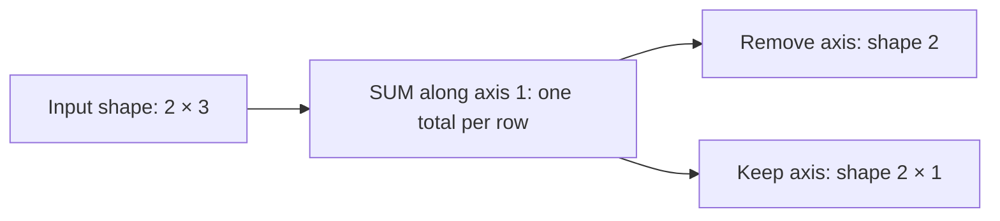

# Numeric, multi-axis and statistical reductions

[Reference goals](../index.md) · [Javadoc and exact signatures](../javadoc.md) · [Source entry point](../../../modules/model/src/main/java/io/github/pho001/synaptik/model/tensor/Tensor.java)

**Reader model.** A **reduction** combines a group of input positions into one result.
Reducing axis one of shape `[2, 3]` combines each row's three values independently.
Removing that axis gives `[2]`; keeping it gives `[2, 1]`, which helps align the result for
later broadcasting. A full reduction combines all axes into a scalar.
This differs from elementwise arithmetic, which preserves a result at each corresponding position.
**Reassociation** changes the grouping of additions or multiplications; floating-point rounding
can make different groupings differ even when exact arithmetic would agree.

Read these conceptual shape paths as two representations of the same two row totals, not an
execution trace.



<a id="numeric-aggregate-expressions"></a>
### Numeric aggregate expressions

The fifteen ordinary full/single-axis numeric aggregate methods build sum, arithmetic-mean,
product, minimum, and maximum expression metadata without reading or combining element values:

| Family | Full form | Axis removed | Axis optionally retained |
|---|---|---|---|
| Sum | `sum()` | `sum(axis)` | `sum(axis, keepDimensions)` |
| Arithmetic mean | `mean()` | `mean(axis)` | `mean(axis, keepDimensions)` |
| Product | `prod()` | `prod(axis)` | `prod(axis, keepDimensions)` |
| Minimum | `min()` | `min(axis)` | `min(axis, keepDimensions)` |
| Maximum | `max()` | `max(axis)` | `max(axis, keepDimensions)` |

All five families accept every floating type, including both FP8 types. Sum, product, minimum, and
maximum also accept `INT32` and `INT64`; mean remains floating-only. Every family preserves the exact input
data type without promotion or widening. A full form reduces every input axis to the canonical
rank-zero `Shape.scalar()` and records
`NoOperationAttrs.INSTANCE`. An axis form accepts a positive or negative axis, normalizes it
against the input `Shape`, and records `AxisReductionAttrs(normalizedAxis, keepDimensions)`. A
false `keepDimensions` removes the selected axis; true replaces only that axis with a new static
extent of one. Every unaffected static or dynamic `Dimension` object is retained by exact
reference. Removing the only axis of a rank-one tensor also produces the canonical scalar shape.

Every valid call returns a fresh Tensor with unchanged gradient eligibility, unresolved layout,
no label, and no host storage. Its provenance contains the matching `SUM`, `MEAN`, `PROD`, `MIN`,
or `MAX` aggregate operation and exactly the receiver reference. The eligibility flag remains a
request in model metadata; preserving it for product or an extrema reduction does not install or
promise a gradient rule or a policy for distributing gradients across tied extrema.

Floating result rules are family- and dtype-specific under one Model contract. A FLOAT32 SUM cell with at least two
declared terms may publish either zero sign only when its selected binary tree's root addition is
exact zero. A FLOAT32 MEAN still divides a permitted sum by the declared positive selected count
and gains that choice only when the quotient is exact zero. The rule grants no intermediate
exact-zero choice, tolerance, term change, reciprocal multiply, reduced precision, or
classification change. Empty-axis point SUM copies preserve input bits, empty SUM remains positive
zero, and zero-count MEAN remains NaN. Expression construction neither selects a numerical mode nor
evaluates these results.

Current package-private compiler autograd supports ordinary floating full and single-axis
`SUM`, including retained dimensions. It restores removed axes and expands the cotangent to the
exact input Shape. `MEAN`, `PROD`, extrema, masked SUM, and binding-aware `sumToShape` when it
appears as a forward operation remain outside the closed matrix.

The aggregate `min()` and `max()` families are distinct from pairwise elementwise
`minimum(Tensor)` and `maximum(Tensor)`. An aggregate form has one provenance input, uses
`AggregateReductionKind.MIN` or `AggregateReductionKind.MAX`, and reduces every axis or one
selected axis. A binary form has two
ordered provenance inputs, uses `BinaryArithmeticKind.MIN` or `BinaryArithmeticKind.MAX`, and
broadcasts corresponding elements without reducing rank. The distinct method names make pairwise
selection and aggregation visible at the call site; equal enum constant names do not make the
typed operation kinds equal.

For integral input, sum and product use fixed-width arithmetic modulo `2^32` or `2^64` in the exact
result type. Reassociation is permitted, so later execution may regroup operations but must include
every selected value exactly once. Integral minimum and maximum use signed order. Empty integral
domains have bounded identities:

| Kind | Empty INT32 result | Empty INT64 result |
|---|---:|---:|
| `SUM` | `0` | `0L` |
| `PROD` | `1` | `1L` |
| `MIN` | `Integer.MAX_VALUE` | `Long.MAX_VALUE` |
| `MAX` | `Integer.MIN_VALUE` | `Long.MIN_VALUE` |

The identity applies to a full empty input and independently to every empty selected-axis slice.
Retaining the axis does not change it. A different zero output axis may make the result itself
empty, leaving no output position at which to materialize an identity. Dynamic selected extents
use the same rule when later bound to zero. Floating behavior, masked reduction behavior, and BOOL
aggregate behavior remain unchanged. Expression construction records these meanings without
inspecting counts or values, implementing accumulation or comparison, creating gradient rules,
capturing a graph, lowering, reporting backend support, or executing.

<a id="complete-numeric-aggregate-example"></a>
#### Complete numeric-aggregate example

<a id="goal-and-inputs-20"></a>
##### Goal and inputs

Build full, axis-removing, and retained-axis expressions from a storage-free `FLOAT32` tensor of
shape `[batch, 3, 4]`, where `batch` is a symbolic dynamic dimension. The example observes
result-shape and provenance metadata rather than aggregate values.

```java
import io.github.pho001.synaptik.model.datatype.DataType;
import io.github.pho001.synaptik.model.operation.NoOperationAttrs;
import io.github.pho001.synaptik.model.shape.DynamicDimension;
import io.github.pho001.synaptik.model.shape.Shape;
import io.github.pho001.synaptik.model.shape.StaticDimension;
import io.github.pho001.synaptik.model.tensor.Tensor;
import io.github.pho001.synaptik.model.tensor.TensorDescriptor;
import io.github.pho001.synaptik.model.tensor.TensorFactory;
import io.github.pho001.synaptik.model.tensor.TensorProvenance;
import java.util.Optional;

public final class NumericAggregateExpressionExample {
    public static void main(String[] args) {
        DynamicDimension batch = new DynamicDimension("batch");
        Shape inputShape = Shape.ofDimensions(
                batch, new StaticDimension(3), new StaticDimension(4));
        Tensor input = TensorFactory.create(new TensorDescriptor(
                DataType.FLOAT32, inputShape, Optional.empty(), true));

        Tensor full = input.sum();
        Tensor removed = input.mean(-1);
        Tensor retained = input.prod(1, true);
        TensorProvenance fullFrom = full.provenance().orElseThrow();
        TensorProvenance removedFrom = removed.provenance().orElseThrow();
        TensorProvenance retainedFrom = retained.provenance().orElseThrow();

        System.out.println("full=" + full.descriptor().shape());
        System.out.println("fullKind=" + fullFrom.operation().kind());
        System.out.println("fullParameterless="
                + (fullFrom.operation().attrs() == NoOperationAttrs.INSTANCE));
        System.out.println("removed=" + removed.descriptor().shape());
        System.out.println("removedAttrs=" + removedFrom.operation().attrs());
        System.out.println("retained=" + retained.descriptor().shape());
        System.out.println("retainedAttrs=" + retainedFrom.operation().attrs());
        System.out.println("sameBatch="
                + (removed.descriptor().shape().dimensions().getFirst() == batch
                && retained.descriptor().shape().dimensions().getFirst() == batch));
        System.out.println("metadata="
                + (retained.descriptor().dataType() == DataType.FLOAT32
                && retained.descriptor().requiresGrad()
                && retained.descriptor().layout().isEmpty()
                && retained.label().isEmpty()
                && retained.hostStorage().isEmpty()));
        System.out.println("exactInputs="
                + (fullFrom.inputs().getFirst() == input
                && removedFrom.inputs().getFirst() == input
                && retainedFrom.inputs().getFirst() == input));
    }
}
```

<a id="meaningful-lines-and-intermediate-results-6"></a>
##### Meaningful lines and intermediate results

- `input.sum()` selects every axis. Its complete parameter value is the canonical no-attributes
  singleton, and its result shape is the canonical scalar.
- `input.mean(-1)` normalizes `-1` to axis `2` and removes the final extent `4`, producing
  `[batch, 3]` with `AxisReductionAttrs[axis=2, keepDimensions=false]`.
- `input.prod(1, true)` retains normalized axis `1` with extent one, producing
  `[batch, 1, 4]` with `AxisReductionAttrs[axis=1, keepDimensions=true]`.
- Both axis results retain the exact `batch` object. All results preserve `FLOAT32` and the true
  gradient request while remaining unresolved, unlabeled, storage-free expressions.

<a id="result-and-interpretation-20"></a>
##### Result and interpretation

The program prints:

```text
full=Shape[]
fullKind=SUM
fullParameterless=true
removed=Shape[batch, 3]
removedAttrs=AxisReductionAttrs[axis=2, keepDimensions=false]
retained=Shape[batch, 1, 4]
retainedAttrs=AxisReductionAttrs[axis=1, keepDimensions=true]
sameBatch=true
metadata=true
exactInputs=true
```

The output proves the local axis normalization, structural result-shape derivation, attribute
choice, metadata retention, and one-input provenance shared by all five numeric aggregate
families. It does not prove a sum, mean, product, extrema comparison, gradient formula, graph
capture, backend implementation, or execution.

<a id="failures-and-useful-variations-18"></a>
##### Failures and useful variations

- Sum, product, minimum, and maximum accept `INT32` and `INT64` without promotion. Mean rejects
  integral and BOOL input, while every numeric family rejects BOOL. No cast is inserted, and type
  validation precedes axis validation.
- An axis outside `[-rank, rank - 1]` fails with `IndexOutOfBoundsException`. Every axis is invalid
  for a scalar input, while a scalar full reduction is valid and still returns a fresh scalar.
- A rank-one axis removal returns `Shape.scalar()`. A zero extent or dynamic dimension does not
  trigger numerical inspection at this boundary.
- Repeated and nested calls always create fresh expression tensors; this API performs no
  canonicalization or common-subexpression elimination.

<a id="binding-aware-sum-to-shape-expressions"></a>
### Binding-aware sum-to-Shape expressions

The current target-Shape SUM surface has exactly one public form:

```java
public Tensor sumToShape(Shape targetShape)
```

The target is the exact result Shape, not an axis list. It is right-aligned with the input Shape.
Every unmatched leading input axis is reduced and removed. For each aligned concrete pair, an
equal target extent preserves the axis, while target extent one reduces the input axis and retains
one position. Any other concrete pair is invalid. Target rank may not exceed input rank.

For example, input `[2, 3, 4]` and target `[3, 1]` mean:

```text
input axis 0: leading 2  -> reduce and remove
input axis 1: 3 with 3  -> preserve
input axis 2: 4 with 1  -> reduce and retain extent one
result                  -> [3, 1]
```

Construction rejects only incompatibility that current static Shapes prove. If either member of
an aligned pair is unresolved, the expression retains the target-one-or-input-equal obligation for
later binding validation. Thus `[8, 4] -> [X, 4]` is constructible: a later binding of `X` to `1`
means reduction of the first aligned axis, binding it to `8` means preservation, and any other
concrete value is invalid. Construction does not bind `X` or choose an axis set.

The method accepts floating and signed-integral inputs, including FP8; it rejects BOOL.
The fresh result preserves exact input type and gradient eligibility, retains the exact target
`Shape` reference in both descriptor and `SumToShapeAttrs`, leaves layout unresolved, and has no
label or storage. Provenance records one `AggregateReductionKind.SUM` occurrence, ordered inputs
`[input]`, and output index zero. Even an equal-Shape request creates a fresh Tensor identity.
Scalar targets reduce all input axes; a scalar input accepts only a scalar target. Zero extents
follow ordinary SUM semantics: an actually reduced empty domain yields numeric positive zero.
Equal-Shape and other coordinates with no reduced axis preserve the corresponding input bits and
perform no addition; an implementation may not insert a positive-zero identity. Under
the current FLOAT32 contract, exact target mapping and contributor membership remain mandatory while each
actually reduced cell uses the all-contributors-once aggregate floor. Existing qualifying final
exact-zero publication freedom remains local to the final cell; intermediate arithmetic gains no
such publication rule.

This operation is not arbitrary reshape: reshape changes coordinate interpretation while
preserving element count. It is not ordinary fixed-axis `sum`, whose axes are known when the
expression is built. It is also not broadcasting, which repeats values toward a larger compatible
Shape. The name is comparable to PyTorch
[`sum_to_size`](https://docs.pytorch.org/docs/stable/generated/torch.Tensor.sum_to_size.html),
whose requested size must be broadcast-compatible with its source; Synaptik's authoritative
contract is the exact Shape-aware and binding-aware contract above, not PyTorch implementation
behavior or defaults.

<a id="complete-sum-to-shape-metadata-example"></a>
#### Complete sum-to-Shape metadata example

<a id="goal-and-inputs-21"></a>
##### Goal and inputs

Build one fully static request and one request with an unresolved target dimension, then inspect
only result and provenance metadata.

```java
import io.github.pho001.synaptik.model.datatype.DataType;
import io.github.pho001.synaptik.model.operation.reduction.SumToShapeAttrs;
import io.github.pho001.synaptik.model.shape.DynamicDimension;
import io.github.pho001.synaptik.model.shape.Shape;
import io.github.pho001.synaptik.model.shape.StaticDimension;
import io.github.pho001.synaptik.model.tensor.Tensor;
import io.github.pho001.synaptik.model.tensor.TensorDescriptor;
import io.github.pho001.synaptik.model.tensor.TensorFactory;
import java.util.Optional;

public final class SumToShapeExpressionExample {
    public static void main(String[] args) {
        Tensor staticInput = tensor(Shape.ofDimensions(
                new StaticDimension(2),
                new StaticDimension(3),
                new StaticDimension(4)));
        Shape staticTarget = Shape.ofDimensions(
                new StaticDimension(3), new StaticDimension(1));
        Tensor reduced = staticInput.sumToShape(staticTarget);
        SumToShapeAttrs attrs = (SumToShapeAttrs)
                reduced.provenance().orElseThrow().operation().attrs();

        DynamicDimension x = new DynamicDimension("X");
        Tensor dynamicInput = tensor(Shape.ofDimensions(
                new StaticDimension(8), new StaticDimension(4)));
        Shape dynamicTarget = Shape.ofDimensions(x, new StaticDimension(4));
        Tensor deferred = dynamicInput.sumToShape(dynamicTarget);

        System.out.println(reduced.descriptor().shape());
        System.out.println(attrs.targetShape() == staticTarget);
        System.out.println(reduced.provenance().orElseThrow().inputs().getFirst() == staticInput);
        System.out.println(reduced.provenance().orElseThrow().outputIndex());
        System.out.println(deferred.descriptor().shape());
        System.out.println(deferred.descriptor().layout().isEmpty());
    }

    private static Tensor tensor(Shape shape) {
        return TensorFactory.create(new TensorDescriptor(
                DataType.FLOAT32, shape, Optional.empty(), true));
    }
}
```

<a id="result-and-interpretation-21"></a>
##### Result and interpretation

The program prints:

```text
Shape[3, 1]
true
true
0
Shape[X, 4]
true
```

The static call records leading-axis removal and retained last-axis reduction. The dynamic call
records an unresolved obligation without proving whether `X` reduces or preserves its aligned
axis. Neither call reads values or storage, resolves dimensions, constructs a gradient, captures a
graph, lowers an operation, chooses a backend, or executes a reduction. Null, BOOL, excessive-rank,
and first provable aligned-mismatch failures occur before a Tensor identity is consumed.

<a id="multi-axis-and-statistical-reduction-expressions"></a>
### Multi-axis and statistical reduction expressions

Here **mean** is the arithmetic average. **Variance** measures squared distance from that mean;
**standard deviation** takes the square root, returning to the original units.
**Correction** subtracts a specified count from the variance denominator; it is not an error
repair or a rounding tolerance. L1 and L2 **norms** summarize magnitude by absolute values and
squared values respectively. **Log-sum-exp** means the logarithm of a sum of exponentials.
These names describe different aggregates, not interchangeable ways of reducing the same values.

Twenty-six methods extend aggregate construction without changing full or single-axis overloads:

| Family | Axes removed | Axes optionally retained | Default correction |
|---|---|---|---:|
| `sum`, `mean`, `prod`, `min`, `max`, `all`, `any` | `family(int... axes)` | `family(int[] axes, boolean keepDimensions)` | — |
| `logSumExp`, `l1Norm`, `l2Norm` | `family(int... axes)` | `family(int[] axes, boolean keepDimensions)` | — |
| `variance`, `standardDeviation` | `family(int... axes)` | `family(int[] axes, boolean keepDimensions)` | `0` |
| Corrected variance/standard deviation | — | `family(int[] axes, boolean keepDimensions, long correction)` | Caller value |

Each positive or negative caller axis is normalized exactly once in caller order. The normalized
axes must be distinct. Order is retained in immutable attributes for equality, diagnostics,
transformation, and interchange, but Shape derivation uses axis membership and the numerical target
does not define a sequential fold. Reversing `[2, 0]` to `[0, 2]` therefore preserves the same
domain and Shape while producing a distinct attributes value. Caller arrays are cloned.

With `keepDimensions=false`, every selected axis is removed and each unselected immutable
`Dimension` reference is preserved in input order. With `true`, selected positions become new
static extent-one Dimensions. Removing every axis produces canonical `Shape.scalar()`. An empty
axis list is not full reduction: it selects a one-value point domain at every input position,
leaves Shape unchanged, and creates a fresh occurrence. Ordinary families and log-sum-exp return
the point value, norms return absolute value, and population variance/standard deviation return
positive zero. Correction at least one is invalid because point-domain count is one.

Ordinary input domains remain unchanged: SUM/PROD/MIN/MAX accept floating or signed integral,
MEAN is floating-only, and ALL/ANY are BOOL-only. Log-sum-exp, variance, standard deviation, and
both norms accept only floating input. Every result preserves exact input data type and gradient
eligibility, leaves layout unresolved, has no label/storage, and records a fresh one-output
producer with exact input `[input]` and provenance index zero. Construction does not read values,
create a gradient, capture a graph, lower, report backend support, or execute.

Current package-private compiler autograd supports only ordinary floating multi-axis `SUM` here.
It restores removed axes in ascending axis order before expanding to the input Shape; an empty
axis list passes the cotangent through. Statistical, norm, log-sum-exp, product, extrema, mean, and
BOOL families remain excluded from the closed first matrix.

Under the current Model contract, exact mappings and contributor sets combine with the family
rules below. Floating arithmetic may use a rounded all-contributors-once tree and the named-site
DAZ/FTZ permissions; qualified low arithmetic uses FLOAT32 working/accumulator values and one
final ties-to-even narrowing. Finite tolerance is test-only. NaN payload/sign and signaling
preservation are unspecified unless an exact stored-value family rule says otherwise.

- SUM propagates NaN; opposite infinities produce NaN; empty is positive zero. Exact non-empty
  zero is negative only when every selected value is negative zero.
- MEAN is exact sum divided by positive count; empty and opposite infinities produce NaN; zero sign
  follows SUM.
- PROD propagates NaN; zero times infinity produces NaN; empty is positive one; zero/infinity sign
  follows multiplication parity.
- MIN/MAX propagate NaN, order infinities normally, select negative/positive zero respectively,
  and use positive/negative infinity for empty floating domains.
- Empty ALL is true and empty ANY is false.
- LOG_SUM_EXP means `log(sum(exp(x_i)))`: empty and all-negative-infinity domains produce negative
  infinity; NaN produces NaN; positive infinity wins unless NaN exists; a finite point preserves
  its value and signed zero.
- VARIANCE means `sum((x_i - mean)^2) / (N - correction)` and STANDARD_DEVIATION its non-negative
  principal square root. `N` must exceed correction. NaN or infinity produces NaN; a valid constant
  finite domain produces positive zero.
- L1 norm is `sum(abs(x_i))`; L2 norm is `sqrt(sum(x_i*x_i))`. Empty is positive zero, point is
  absolute value, NaN produces NaN, and infinity produces positive infinity unless NaN exists.

Every arithmetic aggregate inherits only its named primitive sites. Exact axes, mappings,
contributor sets, identities, counts, correction, and divisors remain mandatory. Every selected
contributor participates exactly once under a rounded tree with permitted site-local DAZ/FTZ and
only corresponding multiply/add fusion. Extrema, arg-extrema, and Boolean reductions preserve
their exact stored-value selection, index, and truth rules. No reciprocal substitution, term loss,
invented identity, or classification change is allowed; FLOAT64 has no DAZ/FTZ permission.

Integral ordinary reductions retain task 0018U1's exact-width modular sum/product, signed extrema,
and bounded empty identities. No algorithm, pass count, compensation scheme, traversal, vector
route, or kernel is part of these semantic contracts.

For corrected statistics, construction rejects negative correction and rejects a statically known
selected-domain count `N <= correction` before Tensor identity allocation. Static zero proves
`N=0`; checked non-zero multiplication overflow proves `N` exceeds every non-negative `long`
correction. Dynamic/expression counts are accepted structurally and must be proven valid by a later
owning compiler or binding path before execution.

<a id="complete-multi-axis-metadata-example"></a>
#### Complete multi-axis metadata example

The following Java 26 example constructs metadata only:

```java
import io.github.pho001.synaptik.model.datatype.DataType;
import io.github.pho001.synaptik.model.operation.reduction.MultiAxisReductionAttrs;
import io.github.pho001.synaptik.model.operation.reduction.StatisticalReductionAttrs;
import io.github.pho001.synaptik.model.shape.Shape;
import io.github.pho001.synaptik.model.tensor.Tensor;
import io.github.pho001.synaptik.model.tensor.TensorDescriptor;
import io.github.pho001.synaptik.model.tensor.TensorFactory;
import java.util.Optional;

Tensor input = TensorFactory.create(new TensorDescriptor(
        DataType.FLOAT32, Shape.of(2, 3, 4), Optional.empty(), true));

int[] axes = {2, 0};
Tensor totals = input.sum(axes, false);
Tensor retained = input.mean(new int[] {-1, 0}, true);
Tensor sampleVariance = input.variance(new int[] {2, 0}, false, 1);

axes[0] = 1; // does not change already constructed attributes

MultiAxisReductionAttrs totalAttrs = (MultiAxisReductionAttrs)
        totals.provenance().orElseThrow().operation().attrs();
StatisticalReductionAttrs varianceAttrs = (StatisticalReductionAttrs)
        sampleVariance.provenance().orElseThrow().operation().attrs();

System.out.println(totals.descriptor().shape());
System.out.println(retained.descriptor().shape());
System.out.println(totalAttrs.axes());
System.out.println(varianceAttrs.correction());
System.out.println(sampleVariance.provenance().orElseThrow().outputIndex());
```

Output:

```text
Shape[3]
Shape[1, 3, 1]
[2, 0]
1
0
```

This proves ordered normalization, caller-array isolation, structural Shape derivation, correction
retention, and index-zero provenance. It does not evaluate a sum, mean, or variance and does not
prove a numerical algorithm, gradient, compiler capture, backend route, or execution.


---

[Previous topic](elementwise.md) · [Next topic](masked-index-reductions.md)
