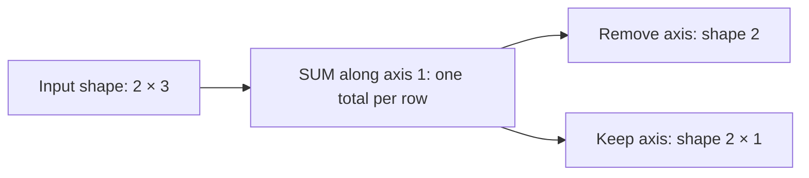

# Numeric, multi-[axis](../../glossary.md#term-axis) and statistical reductions

[Reference goals](../index.md) · [Javadoc and exact signatures](../javadoc.md)<span data-glossary-navigation="true"> ([Javadoc glossary](../../glossary.md#term-javadoc); [signatures glossary](../../glossary.md#term-signature))</span> · [Source entry point](../../../modules/model/src/main/java/io/github/pho001/synaptik/model/tensor/Tensor.java)

## Identify the contributor set before the formula

Application or layer-building code calls `input.sum(...)`, `mean(...)` or a related method.
The input Tensor is retained as the source description; request arrays are cloned where
specified, but numeric values are not copied or reduced. For a finite real row $x_{i,j}$
with $0\leq i<M$ and $0\leq j<N$, reducing axis one describes
$s_i=\sum_{j=0}^{N-1}x_{i,j}$ and, when $N>0$, $\mu_i=s_i/N$.
Rows `[1, 2, 3]` and `[4, 5, 6]` therefore request totals $6$ and $15$, not one total.
These ideal formulas fix contributors, not a floating traversal or reciprocal substitution.
Use [masked reductions](masked-index-reductions.md) to exclude positions and
[expand](reshape-expand.md#expand-expressions) to understand why repeated uses need summing back.

**[Reader model](../../glossary.md#term-reader-model).** A **reduction** combines a group of input positions into one result.
Reducing axis one of [shape](../../glossary.md#shape) `[2, 3]` combines each row's three values independently.
Removing that axis gives `[2]`; keeping it gives `[2, 1]`, which helps align the result for
later [broadcasting](../../glossary.md#broadcasting). A full reduction combines all axes into a [scalar](../../glossary.md#term-scalar).
This differs from [elementwise](../../glossary.md#term-elementwise) arithmetic, which preserves a result at each corresponding position.
**[Reassociation](../../glossary.md#term-reassociation)** changes the grouping of additions or multiplications; [floating-point](../../glossary.md#term-floating-point) [rounding](../../glossary.md#term-rounding)
can make different groupings differ even when exact arithmetic would agree.

Read these conceptual shape paths as two representations of the same two row totals, not an
execution [trace](../../glossary.md#trace).



<a id="numeric-aggregate-expressions"></a>
### Numeric aggregate expressions

The fifteen ordinary full/single-[axis](../../glossary.md#term-axis) numeric aggregate methods build sum, arithmetic-[mean](../../glossary.md#term-mean),
product, minimum, and maximum expression [metadata](../../glossary.md#term-metadata) without reading or combining [element](../../glossary.md#term-element) values:

| Family | Full form | Axis removed | Axis optionally retained |
|---|---|---|---|
| Sum | `sum()` | `sum(axis)` | `sum(axis, keepDimensions)` |
| Arithmetic mean | `mean()` | `mean(axis)` | `mean(axis, keepDimensions)` |
| Product | `prod()` | `prod(axis)` | `prod(axis, keepDimensions)` |
| Minimum | `min()` | `min(axis)` | `min(axis, keepDimensions)` |
| Maximum | `max()` | `max(axis)` | `max(axis, keepDimensions)` |

All five families accept every floating type, including both [FP8](../../glossary.md#term-fp8) types. Sum, product, minimum, and
maximum also accept [`INT32`](../../glossary.md#data-type--datatype) and [`INT64`](../../glossary.md#data-type--datatype); mean remains floating-only. Every family preserves the exact input
[data type](../../glossary.md#data-type--datatype) without promotion or [widening](../../glossary.md#term-widening). A full form reduces every input axis to the [canonical](../../glossary.md#term-canonical-form)
[rank-zero](../../glossary.md#axis-rank-scalar-vector-and-matrix) `Shape.scalar()` and records
`NoOperationAttrs.INSTANCE`. An axis form accepts a positive or negative axis, normalizes it
against the input [`Shape`](../../glossary.md#shape), and records `AxisReductionAttrs(normalizedAxis, keepDimensions)`. A
false `keepDimensions` removes the selected axis; true replaces only that axis with a new static
[extent](../../glossary.md#term-extent) of one. Every unaffected static or dynamic [`Dimension`](../../glossary.md#dimension) object is retained by exact
reference. Removing the only axis of a [rank-one](../../glossary.md#axis-rank-scalar-vector-and-matrix) [tensor](../../glossary.md#tensor) also produces the canonical [scalar](../../glossary.md#term-scalar) shape.

Every valid call returns a fresh Tensor with unchanged [gradient](../../glossary.md#term-gradient) eligibility, unresolved [layout](../../glossary.md#layout),
no label, and no [host storage](../../glossary.md#host-storage). Its [provenance](../../glossary.md#provenance) contains the matching `SUM`, `MEAN`, `PROD`, `MIN`,
or `MAX` aggregate [operation](../../glossary.md#operation) and exactly the receiver reference. The eligibility flag remains a
request in [model](../../glossary.md#term-model) metadata; preserving it for product or an [extrema](../../glossary.md#saturation-pole-and-extremum) reduction does not install or
promise a gradient rule or a policy for distributing gradients across tied extrema.

Floating result rules are family- and [dtype](../../glossary.md#data-type--datatype)-specific under one Model contract. A [FLOAT32](../../glossary.md#term-float32) SUM cell with at least two
declared terms may publish either zero sign only when its selected [binary](../../glossary.md#term-binary-descriptor-and-metadata) tree's root addition is
exact zero. A FLOAT32 MEAN still divides a permitted sum by the declared positive selected count
and gains that choice only when the quotient is exact zero. The rule grants no intermediate
exact-zero choice, [tolerance](../../glossary.md#term-tolerance), term change, reciprocal multiply, reduced [precision](../../glossary.md#term-precision), or
classification change. Empty-axis point SUM copies preserve input bits, empty SUM remains [positive
zero](../../glossary.md#nan-infinity-and-signed-zero), and zero-count MEAN remains [NaN](../../glossary.md#term-nan). Expression construction neither selects a numerical mode nor
evaluates these results.

Current package-private [compiler](../../glossary.md#term-compiler) [autograd](../../glossary.md#autograd) supports ordinary floating full and single-axis
`SUM`, including retained dimensions. It restores removed axes and expands the [cotangent](../../glossary.md#cotangent) to the
exact input Shape. `MEAN`, `PROD`, extrema, masked SUM, and [binding](../../glossary.md#term-binding)-aware `sumToShape` when it
appears as a forward operation remain outside the closed [matrix](../../glossary.md#term-matrix-meanings).

The aggregate `min()` and `max()` families are distinct from pairwise [elementwise](../../glossary.md#term-elementwise)
`minimum(Tensor)` and `maximum(Tensor)`. An aggregate form has one provenance input, uses
`AggregateReductionKind.MIN` or `AggregateReductionKind.MAX`, and reduces every axis or one
selected axis. A binary form has two
ordered provenance inputs, uses `BinaryArithmeticKind.MIN` or `BinaryArithmeticKind.MAX`, and
broadcasts corresponding elements without reducing [rank](../../glossary.md#term-rank). The distinct method names make pairwise
selection and aggregation visible at the call site; equal enum [constant](../../glossary.md#term-constant) names do not make the
typed operation kinds equal.

For integral input, sum and product use fixed-width arithmetic modulo `2^32` or `2^64` in the exact
result type. [Reassociation](../../glossary.md#term-reassociation) is permitted, so later execution may regroup operations but must include
every selected value exactly once. Integral minimum and maximum use signed order. Empty integral
domains have bounded [identities](../../glossary.md#term-identity-meanings):

| Kind | Empty INT32 result | Empty INT64 result |
|---|---:|---:|
| `SUM` | `0` | `0L` |
| `PROD` | `1` | `1L` |
| `MIN` | `Integer.MAX_VALUE` | `Long.MAX_VALUE` |
| `MAX` | `Integer.MIN_VALUE` | `Long.MIN_VALUE` |

The [identity](../../glossary.md#term-identity-meanings) applies to a full empty input and independently to every empty selected-axis [slice](../../glossary.md#slice).
Retaining the axis does not change it. A different zero output axis may make the result itself
empty, leaving no output position at which to materialize an identity. Dynamic selected extents
use the same rule when later bound to zero. Floating behavior, [masked reduction](../../glossary.md#masked-reduction) behavior, and [BOOL](../../glossary.md#data-type--datatype)
aggregate behavior remain unchanged. Expression construction records these meanings without
inspecting counts or values, implementing accumulation or comparison, creating gradient rules,
capturing a [graph](../../glossary.md#graph), [lowering](../../glossary.md#lowering), reporting [backend](../../glossary.md#backend) support, or executing.

<a id="complete-numeric-aggregate-example"></a>
#### Complete numeric-aggregate example

<a id="goal-and-inputs-20"></a>
##### Goal and inputs

Build full, [axis](../../glossary.md#term-axis)-removing, and retained-axis expressions from a storage-free [`FLOAT32`](../../glossary.md#term-float32) [tensor](../../glossary.md#tensor) of
[shape](../../glossary.md#shape) `[batch, 3, 4]`, where [`batch`](../../glossary.md#term-batch-machine-learning-and-hyperparameters) is a symbolic dynamic [dimension](../../glossary.md#dimension). The example observes
result-shape and [provenance](../../glossary.md#provenance) [metadata](../../glossary.md#term-metadata) rather than aggregate values.

```java
import io.github.pho001.synaptik.model.datatype.DataType;
import io.github.pho001.synaptik.model.operation.NoOperationAttrs;
import io.github.pho001.synaptik.model.shape.DynamicDimension;
import io.github.pho001.synaptik.model.shape.Shape;
import io.github.pho001.synaptik.model.shape.StaticDimension;
import io.github.pho001.synaptik.model.tensor.Tensor;
import io.github.pho001.synaptik.model.tensor.TensorDescriptor;
import io.github.pho001.synaptik.model.tensor.TensorFactory;
import io.github.pho001.synaptik.model.tensor.TensorProvenance;
import java.util.Optional;

public final class NumericAggregateExpressionExample {
    public static void main(String[] args) {
        DynamicDimension batch = new DynamicDimension("batch");
        Shape inputShape = Shape.ofDimensions(
                batch, new StaticDimension(3), new StaticDimension(4));
        Tensor input = TensorFactory.create(new TensorDescriptor(
                DataType.FLOAT32, inputShape, Optional.empty(), true));

        // Full, removed-axis and retained-axis calls describe different result geometries.
        Tensor full = input.sum();
        Tensor removed = input.mean(-1);
        Tensor retained = input.prod(1, true);
        TensorProvenance fullFrom = full.provenance().orElseThrow();
        TensorProvenance removedFrom = removed.provenance().orElseThrow();
        TensorProvenance retainedFrom = retained.provenance().orElseThrow();

        System.out.println("full=" + full.descriptor().shape());
        System.out.println("fullKind=" + fullFrom.operation().kind());
        System.out.println("fullParameterless="
                + (fullFrom.operation().attrs() == NoOperationAttrs.INSTANCE));
        System.out.println("removed=" + removed.descriptor().shape());
        System.out.println("removedAttrs=" + removedFrom.operation().attrs());
        System.out.println("retained=" + retained.descriptor().shape());
        System.out.println("retainedAttrs=" + retainedFrom.operation().attrs());
        System.out.println("sameBatch="
                + (removed.descriptor().shape().dimensions().getFirst() == batch
                && retained.descriptor().shape().dimensions().getFirst() == batch));
        System.out.println("metadata="
                + (retained.descriptor().dataType() == DataType.FLOAT32
                && retained.descriptor().requiresGrad()
                && retained.descriptor().layout().isEmpty()
                && retained.label().isEmpty()
                && retained.hostStorage().isEmpty()));
        System.out.println("exactInputs="
                + (fullFrom.inputs().getFirst() == input
                && removedFrom.inputs().getFirst() == input
                && retainedFrom.inputs().getFirst() == input));
    }
}
```

<a id="meaningful-lines-and-intermediate-results-6"></a>
##### Meaningful lines and intermediate results

- `input.sum()` selects every axis. Its complete parameter value is the canonical no-attributes
  singleton, and its result shape is the canonical scalar.<span data-glossary-navigation="true"> ([parameter glossary](../../glossary.md#term-parameter); [canonical glossary](../../glossary.md#term-canonical-form); [singleton glossary](../../glossary.md#term-singleton); [shape glossary](../../glossary.md#shape); [scalar glossary](../../glossary.md#term-scalar))</span>
- `input.mean(-1)` normalizes `-1` to [axis](../../glossary.md#term-axis) `2` and removes the final [extent](../../glossary.md#term-extent) `4`, producing
  `[batch, 3]` with `AxisReductionAttrs[axis=2, keepDimensions=false]`.
- `input.prod(1, true)` retains [normalized axis](../../glossary.md#normalized-axis) `1` with extent one, producing
  `[batch, 1, 4]` with `AxisReductionAttrs[axis=1, keepDimensions=true]`.
- Both axis results retain the exact [`batch`](../../glossary.md#term-batch-machine-learning-and-hyperparameters) object. All results preserve [`FLOAT32`](../../glossary.md#term-float32) and the true
  gradient request while remaining unresolved, unlabeled, storage-free expressions.<span data-glossary-navigation="true"> ([gradient glossary](../../glossary.md#term-gradient))</span>

<a id="result-and-interpretation-20"></a>
##### Result and interpretation

The program prints:

```text
full=Shape[]
fullKind=SUM
fullParameterless=true
removed=Shape[batch, 3]
removedAttrs=AxisReductionAttrs[axis=2, keepDimensions=false]
retained=Shape[batch, 1, 4]
retainedAttrs=AxisReductionAttrs[axis=1, keepDimensions=true]
sameBatch=true
metadata=true
exactInputs=true
```

The output proves the local [axis](../../glossary.md#term-axis) [normalization](../../glossary.md#term-normalization), structural result-[shape](../../glossary.md#shape) derivation, attribute
choice, [metadata](../../glossary.md#term-metadata) retention, and one-input [provenance](../../glossary.md#provenance) shared by all five numeric aggregate
families. It does not prove a sum, [mean](../../glossary.md#term-mean), product, [extrema](../../glossary.md#saturation-pole-and-extremum) comparison, [gradient](../../glossary.md#term-gradient) formula, [graph
capture](../../glossary.md#capture-graph-ports-and-reconstruction), [backend](../../glossary.md#backend) implementation, or execution.

<a id="failures-and-useful-variations-18"></a>
##### Failures and useful variations

- Sum, product, minimum, and maximum accept [`INT32`](../../glossary.md#data-type--datatype) and [`INT64`](../../glossary.md#data-type--datatype) without promotion. Mean rejects
  integral and BOOL input, while every numeric family rejects BOOL. No cast is inserted, and type
  validation precedes axis validation.<span data-glossary-navigation="true"> ([Mean glossary](../../glossary.md#term-mean); [BOOL glossary](../../glossary.md#data-type--datatype); [validation glossary](../../glossary.md#term-validation))</span>
- An [axis](../../glossary.md#term-axis) outside `[-rank, rank - 1]` fails with `IndexOutOfBoundsException`. Every axis is invalid
  for a scalar input, while a scalar full reduction is valid and still returns a fresh scalar.<span data-glossary-navigation="true"> ([scalar glossary](../../glossary.md#term-scalar))</span>
- A [rank-one](../../glossary.md#axis-rank-scalar-vector-and-matrix) axis removal returns `Shape.scalar()`. A zero extent or dynamic dimension does not
  trigger numerical inspection at this boundary.<span data-glossary-navigation="true"> ([extent glossary](../../glossary.md#term-extent); [dimension glossary](../../glossary.md#dimension))</span>
- Repeated and nested calls always create fresh expression tensors; this API performs no
  canonicalization or common-subexpression elimination.<span data-glossary-navigation="true"> ([tensors glossary](../../glossary.md#tensor); [API glossary](../../glossary.md#term-application-programming-interface-api); [canonicalization glossary](../../glossary.md#occurrence-identity-and-canonical-form); [common-subexpression elimination glossary](../../glossary.md#term-common-subexpression-elimination-cse))</span>

<a id="binding-aware-sum-to-shape-expressions"></a>
### [Binding](../../glossary.md#term-binding)-aware [sum-to-Shape](../../glossary.md#sum-to-shape) expressions

The current [target](../../glossary.md#term-target)-[Shape](../../glossary.md#shape) SUM surface has exactly one public form:

```java
public Tensor sumToShape(Shape targetShape)
```

The target is the exact result Shape, not an [axis](../../glossary.md#term-axis) list. It is right-aligned with the input Shape.
Every unmatched leading input axis is reduced and removed. For each aligned concrete pair, an
equal target [extent](../../glossary.md#term-extent) preserves the axis, while target extent one reduces the input axis and retains
one position. Any other concrete pair is invalid. Target [rank](../../glossary.md#term-rank) may not exceed input rank.

For example, input `[2, 3, 4]` and target `[3, 1]` [mean](../../glossary.md#term-mean):

```text
input axis 0: leading 2  -> reduce and remove
input axis 1: 3 with 3  -> preserve
input axis 2: 4 with 1  -> reduce and retain extent one
result                  -> [3, 1]
```

Construction rejects only incompatibility that current static Shapes prove. If either member of
an aligned pair is unresolved, the expression retains the target-one-or-input-equal obligation for
later binding [validation](../../glossary.md#term-validation). Thus `[8, 4] -> [X, 4]` is constructible: a later binding of `X` to `1`
means reduction of the first aligned axis, binding it to `8` means preservation, and any other
concrete value is invalid. Construction does not bind `X` or choose an axis set.

The method accepts floating and signed-integral inputs, including [FP8](../../glossary.md#term-fp8); it rejects [BOOL](../../glossary.md#data-type--datatype).
The fresh result preserves exact input type and [gradient](../../glossary.md#term-gradient) eligibility, retains the exact target
`Shape` reference in both [descriptor](../../glossary.md#term-descriptor) and `SumToShapeAttrs`, leaves [layout](../../glossary.md#layout) unresolved, and has no
label or storage. [Provenance](../../glossary.md#provenance) records one `AggregateReductionKind.SUM` [occurrence](../../glossary.md#term-occurrence), ordered inputs
`[input]`, and output index zero. Even an equal-Shape request creates a fresh [Tensor](../../glossary.md#tensor) [identity](../../glossary.md#term-identity-meanings).
[Scalar](../../glossary.md#term-scalar) targets reduce all input axes; a scalar input accepts only a scalar target. Zero extents
follow ordinary SUM semantics: an actually reduced empty domain yields numeric [positive zero](../../glossary.md#nan-infinity-and-signed-zero).
Equal-Shape and other [coordinates](../../glossary.md#axis-rank-scalar-vector-and-matrix) with no reduced axis preserve the corresponding input bits and
perform no addition; an implementation may not insert a positive-zero identity. Under
the current [FLOAT32](../../glossary.md#term-float32) contract, exact target mapping and contributor membership remain mandatory while each
actually reduced cell uses the [all-contributors-once](../../glossary.md#rounding-sites-fma-and-aggregate-floor) [aggregate floor](../../glossary.md#term-aggregate-floor). Existing qualifying final
exact-zero [publication](../../glossary.md#term-publication) freedom remains local to the final cell; intermediate arithmetic gains no
such publication rule.

This [operation](../../glossary.md#operation) is not arbitrary reshape: reshape changes coordinate interpretation while
preserving [element](../../glossary.md#term-element) count. It is not ordinary fixed-axis `sum`, whose axes are known when the
expression is built. It is also not [broadcasting](../../glossary.md#broadcasting), which repeats values toward a larger compatible
Shape. The name is comparable to PyTorch
[`sum_to_size`](https://docs.pytorch.org/docs/stable/generated/torch.Tensor.sum_to_size.html),
whose requested size must be broadcast-compatible with its source; Synaptik's authoritative
contract is the exact Shape-aware and binding-aware contract above, not PyTorch implementation
behavior or defaults.

<a id="complete-sum-to-shape-metadata-example"></a>
#### Complete [sum-to-Shape](../../glossary.md#sum-to-shape) [metadata](../../glossary.md#term-metadata) example

<a id="goal-and-inputs-21"></a>
##### Goal and inputs

Build one fully static request and one request with an unresolved [target](../../glossary.md#term-target) [dimension](../../glossary.md#dimension), then inspect
only result and [provenance](../../glossary.md#provenance) [metadata](../../glossary.md#term-metadata).

```java
import io.github.pho001.synaptik.model.datatype.DataType;
import io.github.pho001.synaptik.model.operation.reduction.SumToShapeAttrs;
import io.github.pho001.synaptik.model.shape.DynamicDimension;
import io.github.pho001.synaptik.model.shape.Shape;
import io.github.pho001.synaptik.model.shape.StaticDimension;
import io.github.pho001.synaptik.model.tensor.Tensor;
import io.github.pho001.synaptik.model.tensor.TensorDescriptor;
import io.github.pho001.synaptik.model.tensor.TensorFactory;
import java.util.Optional;

public final class SumToShapeExpressionExample {
    public static void main(String[] args) {
        Tensor staticInput = tensor(Shape.ofDimensions(
                new StaticDimension(2),
                new StaticDimension(3),
                new StaticDimension(4)));
        Shape staticTarget = Shape.ofDimensions(
                new StaticDimension(3), new StaticDimension(1));
        // The target states the result geometry; sumToShape is not an arbitrary reshape.
        Tensor reduced = staticInput.sumToShape(staticTarget);
        SumToShapeAttrs attrs = (SumToShapeAttrs)
                reduced.provenance().orElseThrow().operation().attrs();

        DynamicDimension x = new DynamicDimension("X");
        Tensor dynamicInput = tensor(Shape.ofDimensions(
                new StaticDimension(8), new StaticDimension(4)));
        Shape dynamicTarget = Shape.ofDimensions(x, new StaticDimension(4));
        Tensor deferred = dynamicInput.sumToShape(dynamicTarget);

        System.out.println(reduced.descriptor().shape());
        System.out.println(attrs.targetShape() == staticTarget);
        System.out.println(reduced.provenance().orElseThrow().inputs().getFirst() == staticInput);
        System.out.println(reduced.provenance().orElseThrow().outputIndex());
        System.out.println(deferred.descriptor().shape());
        System.out.println(deferred.descriptor().layout().isEmpty());
    }

    private static Tensor tensor(Shape shape) {
        return TensorFactory.create(new TensorDescriptor(
                DataType.FLOAT32, shape, Optional.empty(), true));
    }
}
```

<a id="result-and-interpretation-21"></a>
##### Result and interpretation

The program prints:

```text
Shape[3, 1]
true
true
0
Shape[X, 4]
true
```

The static call records leading-[axis](../../glossary.md#term-axis) removal and retained last-axis reduction. The dynamic call
records an unresolved obligation without proving whether `X` reduces or preserves its aligned
axis. Neither call reads values or storage, resolves [dimensions](../../glossary.md#dimension), constructs a [gradient](../../glossary.md#term-gradient), [captures](../../glossary.md#term-capture-meanings) a
[graph](../../glossary.md#graph), lowers an [operation](../../glossary.md#operation), chooses a [backend](../../glossary.md#backend), or executes a reduction. Null, [BOOL](../../glossary.md#data-type--datatype), excessive-[rank](../../glossary.md#term-rank),
and first provable aligned-mismatch failures occur before a [Tensor](../../glossary.md#tensor) [identity](../../glossary.md#term-identity-meanings) is consumed.

<a id="multi-axis-and-statistical-reduction-expressions"></a>
### Multi-[axis](../../glossary.md#term-axis) and statistical reduction expressions

Here **[mean](../../glossary.md#term-mean)** is the arithmetic average. **[Variance](../../glossary.md#term-variance)** measures squared distance from that mean;
**[standard deviation](../../glossary.md#term-standard-deviation)** takes the [square root](../../glossary.md#norms-elementary-functions-and-probability-distributions), returning to the original units.
**Correction** subtracts a specified count from the variance denominator; it is not an error
repair or a [rounding](../../glossary.md#term-rounding) [tolerance](../../glossary.md#term-tolerance). [L1](../../glossary.md#term-l1) and [L2](../../glossary.md#term-l2) **norms** summarize magnitude by absolute values and
squared values respectively. **[Log-sum-exp](../../glossary.md#log-sum-exp)** means the logarithm of a sum of exponentials.
These names describe different aggregates, not interchangeable ways of reducing the same values.

Twenty-six methods extend aggregate construction without changing full or single-axis overloads:

| Family | Axes removed | Axes optionally retained | Default correction |
|---|---|---|---:|
| `sum`, `mean`, `prod`, `min`, `max`, `all`, `any` | `family(int... axes)` | `family(int[] axes, boolean keepDimensions)` | — |
| `logSumExp`, `l1Norm`, `l2Norm` | `family(int... axes)` | `family(int[] axes, boolean keepDimensions)` | — |
| `variance`, `standardDeviation` | `family(int... axes)` | `family(int[] axes, boolean keepDimensions)` | `0` |
| Corrected variance/standard deviation | — | `family(int[] axes, boolean keepDimensions, long correction)` | Caller value |

Each positive or negative caller axis is normalized exactly once in caller order. The normalized
axes must be distinct. Order is retained in [immutable](../../glossary.md#term-immutable) attributes for equality, diagnostics,
transformation, and interchange, but [Shape](../../glossary.md#shape) derivation uses axis membership and the numerical [target](../../glossary.md#term-target)
does not define a sequential fold. Reversing `[2, 0]` to `[0, 2]` therefore preserves the same
domain and Shape while producing a distinct attributes value. Caller arrays are cloned.

With `keepDimensions=false`, every selected axis is removed and each unselected immutable
[`Dimension`](../../glossary.md#dimension) reference is preserved in input order. With `true`, selected positions become new
static [extent](../../glossary.md#term-extent)-one Dimensions. Removing every axis produces [canonical](../../glossary.md#term-canonical-form) `Shape.scalar()`. An empty
axis list is not full reduction: it selects a one-value point domain at every input position,
leaves Shape unchanged, and creates a fresh [occurrence](../../glossary.md#term-occurrence). Ordinary families and log-sum-exp return
the point value, norms return [absolute value](../../glossary.md#norms-elementary-functions-and-probability-distributions), and [population variance](../../glossary.md#population-variance)/standard deviation return
[positive zero](../../glossary.md#nan-infinity-and-signed-zero). Correction at least one is invalid because point-domain count is one.

Ordinary input domains remain unchanged: SUM/PROD/MIN/MAX accept floating or signed integral,
MEAN is floating-only, and ALL/ANY are [BOOL](../../glossary.md#data-type--datatype)-only. Log-sum-exp, variance, standard deviation, and
both norms accept only floating input. Every result preserves exact input [data type](../../glossary.md#data-type--datatype) and [gradient](../../glossary.md#term-gradient)
eligibility, leaves [layout](../../glossary.md#layout) unresolved, has no label/storage, and records a fresh one-output
[producer](../../glossary.md#term-producer) with exact input `[input]` and [provenance](../../glossary.md#provenance) index zero. Construction does not read values,
create a gradient, [capture](../../glossary.md#term-capture-meanings) a [graph](../../glossary.md#graph), lower, report [backend](../../glossary.md#backend) support, or execute.

Current package-private [compiler](../../glossary.md#term-compiler) [autograd](../../glossary.md#autograd) supports only ordinary floating multi-axis `SUM` here.
It restores removed axes in ascending axis order before expanding to the input Shape; an empty
axis list passes the [cotangent](../../glossary.md#cotangent) through. Statistical, [norm](../../glossary.md#term-norm), log-sum-exp, product, [extrema](../../glossary.md#saturation-pole-and-extremum), mean, and
BOOL families remain excluded from the closed first [matrix](../../glossary.md#term-matrix-meanings).

Under the current [Model](../../glossary.md#term-model) contract, exact mappings and contributor sets combine with the family
rules below. Floating arithmetic may use a rounded [all-contributors-once](../../glossary.md#rounding-sites-fma-and-aggregate-floor) tree and the named-site
[DAZ](../../glossary.md#term-daz)/[FTZ](../../glossary.md#term-ftz) permissions; qualified low arithmetic uses [FLOAT32](../../glossary.md#term-float32) working/[accumulator](../../glossary.md#accumulator-type) values and one
final [ties-to-even](../../glossary.md#term-ties-to-even) [narrowing](../../glossary.md#term-narrowing). [Finite](../../glossary.md#term-finite) tolerance is test-only. [NaN payload](../../glossary.md#nan-infinity-and-signed-zero)/sign and signaling
preservation are unspecified unless an exact stored-value family rule says otherwise.

- SUM propagates NaN; opposite infinities produce NaN; empty is positive zero. Exact non-empty
  zero is negative only when every selected value is negative zero.<span data-glossary-navigation="true"> ([NaN glossary](../../glossary.md#term-nan); [infinities glossary](../../glossary.md#nan-infinity-and-signed-zero); [negative zero glossary](../../glossary.md#nan-infinity-and-signed-zero))</span>
- MEAN is exact sum divided by positive count; empty and opposite infinities produce NaN; zero sign
  follows SUM.
- PROD propagates NaN; zero times infinity produces NaN; empty is positive one; zero/infinity sign
  follows multiplication parity.<span data-glossary-navigation="true"> ([infinity glossary](../../glossary.md#term-infinity))</span>
- MIN/MAX propagate NaN, order infinities normally, select negative/positive zero respectively,
  and use positive/negative infinity for empty floating domains.<span data-glossary-navigation="true"> ([negative infinity glossary](../../glossary.md#nan-infinity-and-signed-zero))</span>
- Empty ALL is true and empty ANY is false.
- LOG_SUM_EXP ideally means $\log(\sum_{i=0}^{N-1}\exp(x_i))$ for $N>0$ finite real values.
  Empty and all-negative-infinity domains produce negative infinity; NaN produces NaN;
  positive infinity wins unless NaN exists; a finite point preserves its value and signed zero.
- For integer correction $c\geq0$, corrected variance is
  $v=\sum_{i=0}^{N-1}(x_i-\mu)^2/(N-c)$, with
  $\mu=\sum_{i=0}^{N-1}x_i/N$ and required $N>c$. Standard deviation is $\sqrt v$.
  Here $i$ enumerates selected positions, not necessarily one original axis.
  NaN or infinity produces NaN; a valid constant finite domain produces positive zero.
- L1 norm is $\sum_{i=0}^{N-1}|x_i|$; L2 norm is
  $\sqrt{\sum_{i=0}^{N-1}x_i^2}$. For `[3, 4]`, these ideal magnitudes are $7$ and $5$.
  Empty is positive zero, point is absolute value, NaN produces NaN, and infinity produces
  positive infinity unless NaN exists. Variance has squared input units; standard deviation
  and both norms retain input units. Actual rounded sites and exceptional domains still apply.

Every arithmetic aggregate inherits only its named primitive sites. Exact axes, mappings,
contributor sets, [identities](../../glossary.md#term-identity-meanings), counts, correction, and divisors remain mandatory. Every selected
contributor participates exactly once under a rounded tree with permitted site-local DAZ/FTZ and
only corresponding multiply/add [fusion](../../glossary.md#term-fusion). Extrema, arg-extrema, and [Boolean](../../glossary.md#data-type--datatype) reductions preserve
their exact stored-value selection, index, and truth rules. No reciprocal substitution, term [loss](../../glossary.md#loss),
invented [identity](../../glossary.md#term-identity-meanings), or classification change is allowed; [FLOAT64](../../glossary.md#term-float64) has no DAZ/FTZ permission.

Integral ordinary reductions retain task 0018U1's exact-width modular sum/product, signed extrema,
and bounded empty identities. No algorithm, pass count, compensation scheme, traversal, [vector](../../glossary.md#term-vector)
route, or [kernel](../../glossary.md#kernel) is part of these semantic contracts.

For corrected statistics, construction rejects negative correction and rejects a statically known
selected-domain count `N <= correction` before [Tensor](../../glossary.md#tensor) identity allocation. Static zero proves
`N=0`; checked non-zero multiplication [overflow](../../glossary.md#term-overflow) proves `N` exceeds every non-negative `long`
correction. Dynamic/expression counts are accepted structurally and must be proven valid by a later
owning compiler or [binding](../../glossary.md#term-binding) path before execution.

<a id="complete-multi-axis-metadata-example"></a>
#### Complete multi-[axis](../../glossary.md#term-axis) [metadata](../../glossary.md#term-metadata) example

The following Java 26 example constructs metadata only:

```java
import io.github.pho001.synaptik.model.datatype.DataType;
import io.github.pho001.synaptik.model.operation.reduction.MultiAxisReductionAttrs;
import io.github.pho001.synaptik.model.operation.reduction.StatisticalReductionAttrs;
import io.github.pho001.synaptik.model.shape.Shape;
import io.github.pho001.synaptik.model.tensor.Tensor;
import io.github.pho001.synaptik.model.tensor.TensorDescriptor;
import io.github.pho001.synaptik.model.tensor.TensorFactory;
import java.util.Optional;

Tensor input = TensorFactory.create(new TensorDescriptor(
        DataType.FLOAT32, Shape.of(2, 3, 4), Optional.empty(), true));

int[] axes = {2, 0};
// Axis order is retained as configuration, while membership determines the reduction domain.
Tensor totals = input.sum(axes, false);
Tensor retained = input.mean(new int[] {-1, 0}, true);
Tensor sampleVariance = input.variance(new int[] {2, 0}, false, 1);

axes[0] = 1; // does not change already constructed attributes

MultiAxisReductionAttrs totalAttrs = (MultiAxisReductionAttrs)
        totals.provenance().orElseThrow().operation().attrs();
StatisticalReductionAttrs varianceAttrs = (StatisticalReductionAttrs)
        sampleVariance.provenance().orElseThrow().operation().attrs();

System.out.println(totals.descriptor().shape());
System.out.println(retained.descriptor().shape());
System.out.println(totalAttrs.axes());
System.out.println(varianceAttrs.correction());
System.out.println(sampleVariance.provenance().orElseThrow().outputIndex());
```

Output:

```text
Shape[3]
Shape[1, 3, 1]
[2, 0]
1
0
```

This proves ordered [normalization](../../glossary.md#term-normalization), caller-array isolation, structural [Shape](../../glossary.md#shape) derivation, correction
retention, and index-zero [provenance](../../glossary.md#provenance). It does not evaluate a sum, [mean](../../glossary.md#term-mean), or [variance](../../glossary.md#term-variance) and does not
prove a numerical algorithm, [gradient](../../glossary.md#term-gradient), [compiler](../../glossary.md#term-compiler) [capture](../../glossary.md#term-capture-meanings), [backend route](../../glossary.md#backend-route), or execution.


---

[Previous topic](elementwise.md) · [Next topic](masked-index-reductions.md)
