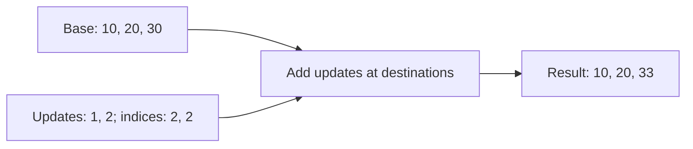

# [Gather-ND](../../glossary.md#gather-nd) and scatter expressions

[Reference goals](../index.md) · [Javadoc and exact signatures](../javadoc.md)<span data-glossary-navigation="true"> ([Javadoc glossary](../../glossary.md#term-javadoc); [signatures glossary](../../glossary.md#term-signature))</span> · [Source entry point](../../../modules/model/src/main/java/io/github/pho001/synaptik/model/tensor/Tensor.java)

## Read indices as destinations, not mutation commands

Application or layer code calls `data.scatterAdd(indices, updates, axis)` (or another scatter
form). The method retains the three exact Tensor references and derives a new result description.
It neither copies their stored values nor writes into `data`. Index bounds and duplicate
replacement destinations need stored values and are not checked by this constructor.
Compare [gather](gather.md), where the same coordinate mapping selects sources instead.

For a rank-one finite-real example, let base $b_c$ have extent $D$, updates $u_j$ have
length $Q$, and integer destinations $I_j$ satisfy $0\leq I_j<D$ for $0\leq j<Q$.
Scatter Add describes $y_c=b_c+\sum_{j:I_j=c}u_j$ for $0\leq c<D$.
With base `[10, 20, 30]`, destinations `[2, 2]` and updates `[1, 2]`, position two
receives $30+1+2=33$. Both updates count; they do not overwrite one another.
An untouched coordinate preserves its exact base representation, rather than evaluating an
invented zero addition. Floating accumulation and exceptional classes retain the rules below.

**[Reader model](../../glossary.md#term-reader-model).** [Gather](../../glossary.md#gather) reads from indexed sources; **scatter** sends updates to indexed
destinations. Scatter is **functional** here: it describes a new result, not mutation of the
base [Tensor](../../glossary.md#tensor). **[ND](../../glossary.md#term-nd)** means indexing across multiple [dimensions](../../glossary.md#dimension): one [coordinate](../../glossary.md#axis-rank-scalar-vector-and-matrix) **tuple**, such
as `[row, column]`, can choose an [element](../../glossary.md#term-element) or the start of an untouched suffix [slice](../../glossary.md#slice).
**[Tuple depth](../../glossary.md#term-tuple-depth)** counts how many [axes](../../glossary.md#term-axis) the tuple addresses. **Duplicate [targets](../../glossary.md#term-target)** occur when
different updates address the same destination. Replacement requires uniqueness where specified;
additive scatter instead combines every addressed update with the base.
The exact [shape](../../glossary.md#shape) and duplicate policies differ among Gather-ND, [Scatter Add](../../glossary.md#scatter-add), [Scatter Elements](../../glossary.md#scatter-elements),
and [Scatter-ND](../../glossary.md#scatter-nd), as detailed below.

Read this conceptual Scatter Add as many updates flowing to destinations. It illustrates
addition, not the replacement policy or a prescribed [floating-point](../../glossary.md#term-floating-point) accumulation order.



<a id="gather-nd-expressions"></a>
### [Gather-ND](../../glossary.md#gather-nd) expressions

The two public Gather-ND methods consume ordered logical inputs `[data, indices]`. The receiver is
`data`; `indices` must use exact [`INT32`](../../glossary.md#data-type--datatype) or [`INT64`](../../glossary.md#data-type--datatype) [elements](../../glossary.md#term-element) and have [rank](../../glossary.md#term-rank) at least one. The
one-[argument](../../glossary.md#term-argument) method is exactly the zero-[batch](../../glossary.md#term-batch-machine-learning-and-hyperparameters) form of `gatherNd(indices, batchDimensions)`.

The explicit non-negative batch count `B` must be smaller than both input ranks. Data and indices
[Dimensions](../../glossary.md#dimension) on [axes](../../glossary.md#term-axis) `[0, B)` must be structurally equal: equal static sizes and equal dynamic
symbols pass, while [broadcasting](../../glossary.md#broadcasting) and new symbolic constraints are not introduced. The final
indices Dimension must have a statically known positive [extent](../../glossary.md#term-extent) `K`, the [tuple depth](../../glossary.md#term-tuple-depth), no greater
than `dataRank - B`. Each tuple indexes data axes `[B, B + K)`.

For data rank `R` and indices rank `Q`, expression construction creates the result [Shape](../../glossary.md#shape) once as:

```text
indices.shape[0:Q-1] + data.shape[B+K:R]
```

The result retains the exact Dimension references from the indices prefix and untouched data
suffix. If both parts are empty, `Shape.ofDimensions` returns the [canonical](../../glossary.md#term-canonical-form) [rank-zero](../../glossary.md#axis-rank-scalar-vector-and-matrix) [scalar](../../glossary.md#term-scalar)
Shape. Every valid request creates a fresh, unlabeled, storage-free [Tensor](../../glossary.md#tensor) with the data Tensor's
exact type and [gradient](../../glossary.md#term-gradient) eligibility, unresolved [layout](../../glossary.md#layout), `GatherNdKind.GATHER_ND`, one exact
`GatherNdAttrs(B)`, and [provenance](../../glossary.md#provenance) containing exact references in `[data, indices]` order.

<a id="complete-gather-nd-expression-example"></a>
#### Complete [Gather-ND](../../glossary.md#gather-nd) expression example

<a id="goal-and-inputs-34"></a>
##### Goal and inputs

Construct zero-[batch](../../glossary.md#term-batch-machine-learning-and-hyperparameters), batched, [scalar](../../glossary.md#term-scalar)-result, and dynamic-[Dimension](../../glossary.md#dimension) [Gather-ND](../../glossary.md#gather-nd) expressions. The
index [tensors](../../glossary.md#tensor) are storage-free because [metadata](../../glossary.md#term-metadata) construction needs their [descriptors](../../glossary.md#term-descriptor), not their
values.

```java
import io.github.pho001.synaptik.model.datatype.DataType;
import io.github.pho001.synaptik.model.operation.index.GatherNdAttrs;
import io.github.pho001.synaptik.model.shape.DynamicDimension;
import io.github.pho001.synaptik.model.shape.Shape;
import io.github.pho001.synaptik.model.shape.StaticDimension;
import io.github.pho001.synaptik.model.tensor.Tensor;
import io.github.pho001.synaptik.model.tensor.TensorDescriptor;
import io.github.pho001.synaptik.model.tensor.TensorFactory;
import java.util.Optional;

public final class GatherNdExpressionExample {
    private static Tensor tensor(DataType type, Shape shape, boolean requiresGrad) {
        return TensorFactory.create(
                new TensorDescriptor(type, shape, Optional.empty(), requiresGrad));
    }

    public static void main(String[] args) {
        Tensor data = tensor(DataType.FLOAT32, Shape.of(2, 3, 4), true);
        Tensor zeroBatchIndices = tensor(DataType.INT32, Shape.of(5, 2), false);
        Tensor batchedIndices = tensor(DataType.INT64, Shape.of(2, 5, 1), false);
        // Tuple depth chooses addressed axes; no tuple values are read by these calls.
        Tensor zeroBatch = data.gatherNd(zeroBatchIndices);
        Tensor batched = data.gatherNd(batchedIndices, 1);

        Tensor scalar = tensor(DataType.BOOL, Shape.of(2, 3), false)
                .gatherNd(tensor(DataType.INT32, Shape.of(2), false));

        DynamicDimension batch = new DynamicDimension("N");
        DynamicDimension queries = new DynamicDimension("M");
        StaticDimension suffix = new StaticDimension(4);
        Tensor dynamicData = tensor(DataType.BFLOAT16,
                Shape.ofDimensions(batch, new StaticDimension(3), suffix), true);
        Tensor dynamicIndices = tensor(DataType.INT64,
                Shape.ofDimensions(new DynamicDimension("N"), queries,
                        new StaticDimension(1)), false);
        Tensor dynamic = dynamicData.gatherNd(dynamicIndices, 1);

        GatherNdAttrs attrs = (GatherNdAttrs) batched.provenance().orElseThrow()
                .operation().attrs();
        System.out.println(zeroBatch.descriptor().shape());
        System.out.println(batched.descriptor().shape());
        System.out.println(scalar.descriptor().shape() == Shape.scalar());
        System.out.println(dynamic.descriptor().shape());
        System.out.println(attrs);
        System.out.println(dynamic.descriptor().shape().dimensions().get(1) == queries);
        System.out.println(dynamic.descriptor().shape().dimensions().get(2) == suffix);
        System.out.println(batched.provenance().orElseThrow().inputs().get(0) == data);
        System.out.println(batched.provenance().orElseThrow().inputs().get(1)
                == batchedIndices);
        System.out.println(batched.descriptor().requiresGrad()
                && batched.descriptor().layout().isEmpty()
                && batched.label().isEmpty()
                && batched.hostStorage().isEmpty());
    }
}
```

<a id="meaningful-lines-and-intermediate-results-19"></a>
##### Meaningful lines and intermediate results

- Zero-[batch](../../glossary.md#term-batch-machine-learning-and-hyperparameters) indices `[5, 2]` have [tuple depth](../../glossary.md#term-tuple-depth) `2`. They retain prefix `[5]`, index data [axes](../../glossary.md#term-axis) `0`
  and `1`, and leave data suffix `[4]`, producing `[5, 4]`.
- Batched indices `[2, 5, 1]` share [leading Dimension](../../glossary.md#term-leading-dimension) `2`, retain indices prefix `[2, 5]`, index
  data axis `1`, and leave suffix `[4]`, producing `[2, 5, 4]`.
- Indices [Shape](../../glossary.md#shape) `[2]` over data Shape `[2, 3]` has no retained indices prefix or data suffix, so
  the result is the canonical scalar <span data-glossary-navigation="true"> ([canonical glossary](../../glossary.md#term-canonical-form); [scalar glossary](../../glossary.md#term-scalar))</span>`Shape.scalar()`.
- The dynamic case accepts independently constructed but structurally equal `N` batch Dimensions.
  Its result <span data-glossary-navigation="true"> ([Dimensions glossary](../../glossary.md#dimension))</span>`[N, M, 4]` retains the exact `M` reference from indices and exact suffix Dimension
  reference from data.

<a id="result-and-interpretation-34"></a>
##### Result and interpretation

The program prints:

```text
Shape[5, 4]
Shape[2, 5, 4]
true
Shape[N, M, 4]
GatherNdAttrs[batchDimensions=1]
true
true
true
true
true
```

The output demonstrates both overloads, all four [Shape](../../glossary.md#shape) cases, exact retained [metadata](../../glossary.md#term-metadata) and
[Dimension](../../glossary.md#dimension) [identities](../../glossary.md#term-identity-meanings), normalized attributes, and ordered [provenance](../../glossary.md#provenance). It does not demonstrate
index-value validity, gathered values, [gradient](../../glossary.md#term-gradient) behavior, [compiler](../../glossary.md#term-compiler) [capture](../../glossary.md#term-capture-meanings), [materialization](../../glossary.md#materialization),
[backend](../../glossary.md#backend) [lowering](../../glossary.md#lowering), or execution.

<a id="failures-and-useful-variations-31"></a>
##### Failures and useful variations

- Validation checks null data and indices, index type, indices rank, non-negative batch count,
  indices-rank fit, data-rank fit, batch-prefix equality, and tuple depth in that order. Every
  local failure occurs before result identifier allocation.<span data-glossary-navigation="true"> ([Validation glossary](../../glossary.md#term-validation); [batch glossary](../../glossary.md#term-batch-machine-learning-and-hyperparameters); [tuple depth glossary](../../glossary.md#term-tuple-depth))</span>
- A dynamic final indices Dimension fails because tuple depth controls which data axes remain in
  the result. Static depth zero or a depth greater than <span data-glossary-navigation="true"> ([Dimension glossary](../../glossary.md#dimension); [axes glossary](../../glossary.md#term-axis))</span>`dataRank - B` also fails.
- Different dynamic batch symbols fail structural equality; no broadcast or equality constraint
  is recorded.<span data-glossary-navigation="true"> ([structural equality glossary](../../glossary.md#term-structural-equality))</span>
- Construction never reads, normalizes, clamps, or bounds-checks an index value. Negative and
  out-of-range coordinate policy remains outside this model metadata boundary.<span data-glossary-navigation="true"> ([coordinate glossary](../../glossary.md#axis-rank-scalar-vector-and-matrix); [model glossary](../../glossary.md#term-model); [metadata glossary](../../glossary.md#term-metadata))</span>
- Checked result-[rank](../../glossary.md#term-rank) [overflow](../../glossary.md#term-overflow) propagates as `ArithmeticException`; identifier exhaustion can
  occur only during final derived Tensor construction.<span data-glossary-navigation="true"> ([Tensor glossary](../../glossary.md#tensor))</span>

<a id="gather-compatible-scatter-add-expressions"></a>
### [Gather](../../glossary.md#gather)-compatible [Scatter Add](../../glossary.md#scatter-add) expressions

`data.scatterAdd(indices, updates, axis)` constructs one functional fixed-add expression with
ordered logical inputs `[data, indices, updates]`. It requires exact [`INT32`](../../glossary.md#data-type--datatype) or [`INT64`](../../glossary.md#data-type--datatype) indices,
exact matching data/update types, and floating or signed-integral data. [BOOL](../../glossary.md#data-type--datatype) is rejected. The raw
[axis](../../glossary.md#term-axis) is normalized once against the data [Shape](../../glossary.md#shape). If [normalized axis](../../glossary.md#normalized-axis) `a` selects data Shape
`[d0, ..., da, ..., dR-1]`, the exact updates Shape is:

```text
[d0, ..., d(a-1)] + indices.shape + [d(a+1), ..., d(R-1)]
```

This is exactly the Shape produced by `data.gather(indices, axis)`, including every static,
dynamic, or expression [Dimension](../../glossary.md#dimension) reference. There is no broadcast, symbolic [binding](../../glossary.md#term-binding), or selected-
[extent](../../glossary.md#term-extent) compatibility rule. [Scalar](../../glossary.md#term-scalar) indices insert no Dimensions; an indices Shape containing a
zero extent produces a zero-[element](../../glossary.md#term-element) updates domain and remains structurally valid.

For an updates [coordinate](../../glossary.md#axis-rank-scalar-vector-and-matrix) `[before..., i..., after...]`, where `i...` spans the complete indices
coordinate, the [target](../../glossary.md#term-target) is `[before..., indices[i...], after...]`. The conceptual target value
starts with the corresponding data value and adds every addressed update. Duplicate indices
therefore accumulate. Signed-integral addition is fixed-width modular; floating addition may be
reassociated and has no bitwise-order guarantee.

Every success returns a fresh, unlabeled, storage-free [Tensor](../../glossary.md#tensor) with the exact data Shape/type,
data/update [gradient](../../glossary.md#term-gradient)-eligibility OR, unresolved [layout](../../glossary.md#layout), `AxisScatterKind.SCATTER_ADD`, normalized
`IndexAxisAttrs`, exact [provenance](../../glossary.md#provenance) `[data, indices, updates]`, and output index zero. Construction
does not read index or update values, check index bounds, add values, mutate inputs, construct a
gradient, [capture](../../glossary.md#term-capture-meanings) a [graph](../../glossary.md#graph), lower to a [backend](../../glossary.md#backend), or execute work. Failed local [validation](../../glossary.md#term-validation) consumes
no Tensor [identity](../../glossary.md#term-identity-meanings); identifier exhaustion remains possible only during final derived creation.

<a id="complete-scatter-add-metadata-example"></a>
#### Complete [Scatter Add](../../glossary.md#scatter-add) [metadata](../../glossary.md#term-metadata) example

The following program exercises static [rank](../../glossary.md#term-rank)-changing, symbolic, [scalar](../../glossary.md#term-scalar)-index, and empty-index
[Shapes](../../glossary.md#shape). All [tensors](../../glossary.md#tensor) are storage-free [descriptor](../../glossary.md#term-descriptor) metadata.

```java
import io.github.pho001.synaptik.model.datatype.DataType;
import io.github.pho001.synaptik.model.shape.DynamicDimension;
import io.github.pho001.synaptik.model.shape.Shape;
import io.github.pho001.synaptik.model.shape.StaticDimension;
import io.github.pho001.synaptik.model.tensor.Tensor;
import io.github.pho001.synaptik.model.tensor.TensorDescriptor;
import io.github.pho001.synaptik.model.tensor.TensorFactory;
import java.util.Optional;

public final class ScatterAddExpressionExample {
    private static Tensor tensor(DataType type, Shape shape, boolean requiresGrad) {
        return TensorFactory.create(
                new TensorDescriptor(type, shape, Optional.empty(), requiresGrad));
    }

    public static void main(String[] args) {
        Tensor data = tensor(DataType.FLOAT32, Shape.of(2, 3, 4), true);
        Tensor indices = tensor(DataType.INT64, Shape.of(5, 6), false);
        Tensor updates = tensor(DataType.FLOAT32, Shape.of(2, 5, 6, 4), false);
        // Shape agrees with gather's result, but the new result remains base-shaped.
        Tensor fixed = data.scatterAdd(indices, updates, -2);

        DynamicDimension batch = new DynamicDimension("batch");
        DynamicDimension features = new DynamicDimension("features");
        DynamicDimension queries = new DynamicDimension("queries");
        Tensor symbolicData = tensor(DataType.INT32,
                Shape.ofDimensions(batch, new StaticDimension(3), features), false);
        Tensor symbolicIndices = tensor(
                DataType.INT32, Shape.ofDimensions(queries), false);
        Tensor symbolicUpdates = tensor(DataType.INT32,
                Shape.ofDimensions(batch, queries, features), false);

        Tensor scalarIndices = tensor(DataType.INT32, Shape.scalar(), false);
        Tensor scalarUpdates = tensor(DataType.FLOAT32, Shape.of(2, 4), false);
        Tensor emptyIndices = tensor(DataType.INT32, Shape.of(0, 6), false);
        Tensor emptyUpdates = tensor(DataType.FLOAT32, Shape.of(2, 0, 6, 4), false);

        System.out.println(fixed.descriptor().shape());
        System.out.println(fixed.provenance().orElseThrow().operation());
        System.out.println(symbolicData.scatterAdd(
                symbolicIndices, symbolicUpdates, 1).descriptor().shape());
        System.out.println(data.scatterAdd(
                scalarIndices, scalarUpdates, 1).descriptor().shape());
        System.out.println(data.scatterAdd(
                emptyIndices, emptyUpdates, 1).descriptor().shape());
        System.out.println(fixed.descriptor().requiresGrad());
        System.out.println(fixed.provenance().orElseThrow().inputs().get(0) == data);
        System.out.println(fixed.provenance().orElseThrow().inputs().get(1) == indices);
        System.out.println(fixed.provenance().orElseThrow().inputs().get(2) == updates);
    }
}
```

The first result Shape is `[2, 3, 4]`, while its [operation](../../glossary.md#operation) is
`SCATTER_ADD` with `IndexAxisAttrs[axis=1]`. The symbolic call retains exact
`[batch, 3, features]` result Shape after requiring updates `[batch, queries, features]`.
The scalar and empty calls both retain result `[2, 3, 4]`; their required updates Shapes are
`[2, 4]` and `[2, 0, 6, 4]`. The final four lines are `true`, confirming data-derived [gradient](../../glossary.md#term-gradient)
eligibility and exact ordered [provenance](../../glossary.md#provenance).

Null indices and updates fail in that order. Index type then fails before update type, numeric
[data type](../../glossary.md#data-type--datatype), [axis](../../glossary.md#term-axis) [normalization](../../glossary.md#term-normalization), and exact updates-Shape equality. A Shape mismatch reports the
complete expected and actual Shapes. Bounds are value-aware: negative and out-of-range stored
indices are not normalized, wrapped, or clamped by [model](../../glossary.md#term-model) construction and remain obligations for
later [compilation](../../glossary.md#compiler-engine-and-execution-stage-names)/preparation or execution.

The Shape replacement follows the terminology of official
[ONNX Gather](https://onnx.ai/onnx/operators/onnx__Gather.html)<span data-glossary-navigation="true"> ([ONNX glossary](../../glossary.md#term-onnx); [Gather glossary](../../glossary.md#gather))</span>. It intentionally differs from the
same-rank aligned contracts of [ONNX Scatter Elements](https://onnx.ai/onnx/operators/onnx__ScatterElements.html)<span data-glossary-navigation="true"> ([Scatter Elements glossary](../../glossary.md#scatter-elements))</span>
and [PyTorch `scatter_add`](https://docs.pytorch.org/docs/stable/generated/torch.scatter_add.html).
[JAX `lax.scatter_add`](https://docs.jax.dev/en/latest/_autosummary/jax.lax.scatter_add.html)
exposes general [dimension](../../glossary.md#dimension)-number mappings; this focused [API](../../glossary.md#term-application-programming-interface-api) does not adopt that broader language.

<a id="scatter-elements-expressions"></a>
### [Scatter Elements](../../glossary.md#scatter-elements) expressions

The two public `scatterElements` overloads construct a functional same-[rank](../../glossary.md#term-rank) update from ordered
logical inputs `[data, indices, updates]`. The receiver is unchanged base `data`; `indices`
selects one [target](../../glossary.md#term-target) [coordinate](../../glossary.md#axis-rank-scalar-vector-and-matrix) along the [normalized axis](../../glossary.md#normalized-axis), and `updates` supplies the corresponding
value. The short overload selects `ScatterReduction.NONE`; the complete overload retains the
caller's exact non-null reduction.

Indices must use exact [`INT32`](../../glossary.md#data-type--datatype) or [`INT64`](../../glossary.md#data-type--datatype), and updates must use the data [tensor](../../glossary.md#tensor)'s exact type.
Indices and updates must have equal rank and structurally equal [Shapes](../../glossary.md#shape), that rank must equal the
data rank, and every non-selected indices [Dimension](../../glossary.md#dimension) must equal the corresponding data Dimension.
The selected [extent](../../glossary.md#term-extent) may differ. For data Shape `[2, 3, 4]`, [axis](../../glossary.md#term-axis) `1`, and indices/updates Shape
`[2, 5, 4]`, the result has exact data Shape `[2, 3, 4]`. At update coordinate `[0, 4, 2]`,
the corresponding index conceptually selects target `[0, index, 2]`.

`NONE` permits every current [data type](../../glossary.md#data-type--datatype) and requires unique targets. `ADD`, `MUL`, `MAX`,
and `MIN` permit floating and integral data and reject [`BOOL`](../../glossary.md#data-type--datatype). Duplicate detection needs index
values and remains outside this [metadata](../../glossary.md#term-metadata)-only boundary.

For one concrete result coordinate `c`, let `U(c)` be the logical multiset of update [scalar](../../glossary.md#term-scalar) values
whose index positions select `c`. Every updates position contributes exactly one member; duplicate
targets remain distinct members even when their values are equal. A non-replacement reduction
combines exactly one [occurrence](../../glossary.md#term-occurrence) of `data[c]` with exactly one occurrence of every member of
`U(c)`. If `U(c)` is empty, the result is the exact unchanged representation of `data[c]`; no
[identity](../../glossary.md#term-identity-meanings) [operation](../../glossary.md#operation) or [canonicalization](../../glossary.md#occurrence-identity-and-canonical-form) is permitted. Target membership, duplicate multiplicity
and untouched representations are exact regardless of traversal or scheduling.

Data and updates have the same declared type; no promotion or [saturation](../../glossary.md#term-saturation) changes that contract.
Low arithmetic nevertheless uses the specified [FLOAT32](../../glossary.md#term-float32) working/[accumulator](../../glossary.md#accumulator-type) domain, with one
final [narrowing](../../glossary.md#term-narrowing) at the declared low result. Its represented-value rules are:

- When `U(c)` is non-empty, floating `MUL` includes the base and every addressed update exactly
  once in a permitted rounded multiplication tree. It is **not** a once-rounded exact abstract
  product: an overflow-first <span data-glossary-navigation="true"> ([overflow glossary](../../glossary.md#term-overflow))</span>`maxFinite * 2 * +0` may produce NaN. A NaN factor or a zero/infinity
  pair requires NaN. Named arithmetic sites obey their dtype's DAZ/FTZ and rounding rules;
  no public or saved boundary may be crossed by fusion. Finite tolerances are test-only, not a
  license to drop factors, widen arbitrary intermediates or change guards and value classes.
  See the <span data-glossary-navigation="true"> ([NaN glossary](../../glossary.md#term-nan); [infinity glossary](../../glossary.md#term-infinity); [dtype glossary](../../glossary.md#data-type--datatype); [DAZ glossary](../../glossary.md#term-daz); [FTZ glossary](../../glossary.md#term-ftz); [rounding glossary](../../glossary.md#term-rounding); [fusion glossary](../../glossary.md#term-fusion); [Finite glossary](../../glossary.md#term-finite))</span>[current aggregate floor](../../architecture/contracts/foundational-modules.md#aggregate-floor)<span data-glossary-navigation="true"> ([aggregate floor glossary](../../glossary.md#term-aggregate-floor))</span>.
- When `U(c)` is non-empty, floating `MIN` and `MAX` propagate NaN without a payload, sign,
  signaling, source, or bitwise promise. Otherwise they use ordinary numeric order including
  infinities. If both zero signs occur, `MIN` produces negative zero and `MAX` positive zero,
  independent of encounter order. Equal non-zero candidates identify the represented numeric
  result, not a source occurrence.<span data-glossary-navigation="true"> ([positive zero glossary](../../glossary.md#nan-infinity-and-signed-zero))</span>
- Integral `MUL` is exact-width [two's-complement](../../glossary.md#arithmetic-rearrangement-and-finite-difference-checks) modular multiplication, modulo `2^32` for INT32
  and `2^64` for INT64. Integral `MIN` and `MAX` use ordinary signed order.

`NONE`, `ADD`, and the separate fixed `SCATTER_ADD` primitive retain their existing meanings.
`NONE` still requires one unique update for an addressed target. Configurable `ADD` still includes
the base and every addressed update, including duplicates, using fixed-width modular integral
addition or reassociable floating addition without a bitwise-order guarantee. These forward
semantics select no [derivative](../../glossary.md#term-derivative) or subgradient policy.

Every valid call returns a fresh, unlabeled, storage-free Tensor with exact data Shape/type,
data/update [gradient](../../glossary.md#term-gradient)-eligibility OR, unresolved [layout](../../glossary.md#layout), `AxisScatterKind.SCATTER_ELEMENTS`,
`ScatterElementsAttrs(normalizedAxis, reduction)`, and exact ordered [provenance](../../glossary.md#provenance). Construction
reads no values, checks no index bound or duplicate target, applies no write or reduction, mutates
no input, and defines no derivative, [compiler](../../glossary.md#term-compiler), [materialization](../../glossary.md#materialization), [backend](../../glossary.md#backend), or execution behavior.

<a id="complete-scatter-elements-expression-example"></a>
#### Complete [Scatter Elements](../../glossary.md#scatter-elements) expression example

<a id="goal-and-inputs-35"></a>
##### Goal and inputs

Construct replacement and maximum-reduction expressions for [`FLOAT32`](../../glossary.md#term-float32) data [Shape](../../glossary.md#shape) `[2, 3, 4]`
using aligned indices and updates Shape `[2, 5, 4]`.

```java
Tensor data = tensor(DataType.FLOAT32, Shape.of(2, 3, 4), true);
Tensor indices = tensor(DataType.INT32, Shape.of(2, 5, 4), false);
Tensor updates = tensor(DataType.FLOAT32, Shape.of(2, 5, 4), false);

// Replacement requires unique destinations at execution; MAX can combine duplicates.
Tensor replacement = data.scatterElements(indices, updates, -2);
Tensor maximum = data.scatterElements(indices, updates, 1, ScatterReduction.MAX);
```

<a id="result-and-interpretation-35"></a>
##### Result and interpretation

Both results have [Shape](../../glossary.md#shape) `[2, 3, 4]`. The negative [axis](../../glossary.md#term-axis) normalizes to `1`; replacement records
`ScatterElementsAttrs[axis=1, reduction=NONE]`, while maximum records `MAX`. This proves
structural expression construction and reduction retention, not indexed writes or execution.

The current [Metal](../../glossary.md#term-metal) [backend](../../glossary.md#backend) executes only the [canonical](../../glossary.md#term-canonical-form) positive-[rank](../../glossary.md#term-rank) [`FLOAT32`](../../glossary.md#term-float32)/[`INT32`](../../glossary.md#data-type--datatype)/`FLOAT32`
replacement form above. It requires unique complete [targets](../../glossary.md#term-target), validates every
bound before uniqueness and any selector [dispatch](../../glossary.md#term-dispatch) or output write, copies addressed update and
unaddressed base bits exactly, and leaves all inputs unchanged. `MAX` and every other arithmetic
scatter, [INT64](../../glossary.md#data-type--datatype), [views](../../glossary.md#term-view-meanings), dynamic Shapes, [Scatter-ND](../../glossary.md#scatter-nd), output [aliasing](../../glossary.md#term-aliasing), and complete Metal backward
execution remain unsupported.

<a id="failures-and-useful-variations-32"></a>
##### Failures and useful variations

Null data, indices, updates, and explicit reduction fail in that order. Index type fails before
data/update type equality, reduction eligibility, [axis](../../glossary.md#term-axis) [normalization](../../glossary.md#term-normalization), and [Shape](../../glossary.md#shape) checks. Shape
[validation](../../glossary.md#term-validation) checks indices [rank](../../glossary.md#term-rank), updates rank, every updates/indices [Dimension](../../glossary.md#dimension), then every
non-selected indices/data Dimension, all in increasing-axis order. Local failures occur before
result [identity](../../glossary.md#term-identity-meanings) allocation.
<a id="scatter-nd-expressions"></a>
### [Scatter-ND](../../glossary.md#scatter-nd) expressions

The three public Scatter-ND overloads construct functional tuple-index updates from ordered
logical inputs `[data, indices, updates]`. `data` is the receiver and unchanged base value.
`indices` supplies [coordinate](../../glossary.md#axis-rank-scalar-vector-and-matrix) tuples, and `updates` supplies one value or suffix [slice](../../glossary.md#slice) for each
tuple position. A [target](../../glossary.md#term-target) is the result coordinate or suffix slice addressed by one tuple; a
duplicate target occurs when multiple tuples address that same target.

The overloads delegate to one [validation](../../glossary.md#term-validation) path:

| Public method | Reduction | Shared [batch](../../glossary.md#term-batch-machine-learning-and-hyperparameters) count |
|---|---|---|
| `scatterNd(indices, updates)` | `NONE` | `0` |
| `scatterNd(indices, updates, reduction)` | Exact supplied reduction | `0` |
| `scatterNd(indices, updates, reduction, batchDimensions)` | Exact supplied reduction | Exact supplied non-negative count |

All paths require exact [`INT32`](../../glossary.md#data-type--datatype) or [`INT64`](../../glossary.md#data-type--datatype) indices and exact matching data/update types.
`ScatterReduction.NONE` accepts every current [data type](../../glossary.md#data-type--datatype). `ADD`, `MUL`, `MAX`, and `MIN` accept
floating or integral data and reject [`BOOL`](../../glossary.md#data-type--datatype); no input is converted or promoted.

For data [rank](../../glossary.md#term-rank) `R`, indices rank `Q`, shared-batch count `B`, and [tuple depth](../../glossary.md#term-tuple-depth) `K` from the final
indices [Dimension](../../glossary.md#dimension), construction requires `0 <= B < Q`, `B < R`, structurally equal data and
indices Dimensions on [axes](../../glossary.md#term-axis) `[0, B)`, and `1 <= K <= R - B`. Tuple depth must be statically known.
The exact updates [Shape](../../glossary.md#shape) is:

```text
indices.shape[0:Q-1] + data.shape[B+K:R]
```

The result retains the exact data Shape and type, combines data/update [gradient](../../glossary.md#term-gradient) eligibility by
logical OR, and has unresolved [layout](../../glossary.md#layout), no label, and no storage. [Provenance](../../glossary.md#provenance) records
`ScatterNdKind.SCATTER_ND`, one exact `ScatterNdAttrs(B, reduction)`, and the exact ordered
references `[data, indices, updates]`. Every valid request is fresh, including repeated requests
with identical operands and attributes.

<a id="complete-scatter-nd-expression-example"></a>
#### Complete [Scatter-ND](../../glossary.md#scatter-nd) expression example

<a id="goal-and-inputs-36"></a>
##### Goal and inputs

Construct zero-[batch](../../glossary.md#term-batch-machine-learning-and-hyperparameters) replacement, zero-batch addition, explicit batched maximum, and [scalar](../../glossary.md#term-scalar)-update
[Scatter-ND](../../glossary.md#scatter-nd) expressions. The inputs are storage-free because construction needs only [immutable](../../glossary.md#term-immutable)
[descriptor](../../glossary.md#term-descriptor) [metadata](../../glossary.md#term-metadata); it does not read any index or update value.

```java
import io.github.pho001.synaptik.model.datatype.DataType;
import io.github.pho001.synaptik.model.operation.index.ScatterNdAttrs;
import io.github.pho001.synaptik.model.operation.index.ScatterReduction;
import io.github.pho001.synaptik.model.shape.Shape;
import io.github.pho001.synaptik.model.tensor.Tensor;
import io.github.pho001.synaptik.model.tensor.TensorDescriptor;
import io.github.pho001.synaptik.model.tensor.TensorFactory;
import io.github.pho001.synaptik.model.tensor.TensorProvenance;
import java.util.Optional;

public final class ScatterNdExpressionExample {
    private static Tensor tensor(DataType type, Shape shape, boolean requiresGrad) {
        return TensorFactory.create(
                new TensorDescriptor(type, shape, Optional.empty(), requiresGrad));
    }

    public static void main(String[] args) {
        Tensor data = tensor(DataType.FLOAT32, Shape.of(2, 3, 4), false);
        Tensor zeroBatchIndices = tensor(DataType.INT32, Shape.of(5, 2), false);
        Tensor zeroBatchUpdates = tensor(DataType.FLOAT32, Shape.of(5, 4), true);
        // The short overload records replacement, not ADD, and never mutates data.
        Tensor replacement = data.scatterNd(zeroBatchIndices, zeroBatchUpdates);
        Tensor addition = data.scatterNd(
                zeroBatchIndices, zeroBatchUpdates, ScatterReduction.ADD);

        Tensor batchedIndices = tensor(DataType.INT64, Shape.of(2, 5, 1), false);
        Tensor batchedUpdates = tensor(DataType.FLOAT32, Shape.of(2, 5, 4), false);
        Tensor batched = data.scatterNd(
                batchedIndices, batchedUpdates, ScatterReduction.MAX, 1);

        Tensor boolData = tensor(DataType.BOOL, Shape.of(2, 3), false);
        Tensor scalarUpdates = tensor(DataType.BOOL, Shape.scalar(), false);
        Tensor scalar = boolData.scatterNd(
                tensor(DataType.INT32, Shape.of(2), false), scalarUpdates);

        TensorProvenance origin = replacement.provenance().orElseThrow();
        ScatterNdAttrs defaultAttrs = (ScatterNdAttrs) origin.operation().attrs();
        ScatterNdAttrs additionAttrs = (ScatterNdAttrs) addition
                .provenance().orElseThrow().operation().attrs();
        ScatterNdAttrs batchedAttrs = (ScatterNdAttrs) batched
                .provenance().orElseThrow().operation().attrs();

        System.out.println(zeroBatchUpdates.descriptor().shape());
        System.out.println(replacement.descriptor().shape());
        System.out.println(batchedUpdates.descriptor().shape());
        System.out.println(batched.descriptor().shape());
        System.out.println(scalarUpdates.descriptor().shape() == Shape.scalar());
        System.out.println(scalar.descriptor().shape());
        System.out.println(defaultAttrs);
        System.out.println(additionAttrs);
        System.out.println(batchedAttrs);
        System.out.println(origin.inputs().get(0) == data
                && origin.inputs().get(1) == zeroBatchIndices
                && origin.inputs().get(2) == zeroBatchUpdates);
        System.out.println(replacement.descriptor().dataType() == DataType.FLOAT32
                && replacement.descriptor().requiresGrad()
                && replacement.descriptor().layout().isEmpty()
                && replacement.label().isEmpty()
                && replacement.hostStorage().isEmpty());
        System.out.println(replacement != addition
                && !replacement.id().equals(addition.id()));
    }
}
```

<a id="meaningful-lines-and-intermediate-results-20"></a>
##### Meaningful lines and intermediate results

- Zero-[batch](../../glossary.md#term-batch-machine-learning-and-hyperparameters) indices `[5, 2]` have [tuple depth](../../glossary.md#term-tuple-depth) `2`. Their prefix `[5]` combines with the untouched
  data suffix `[4]`, so updates must be `[5, 4]`; the result remains data-shaped `[2, 3, 4]`.
- Batched indices `[2, 5, 1]` share [leading Dimension](../../glossary.md#term-leading-dimension) `2`, use tuple depth `1` to address data [axis](../../glossary.md#term-axis)
  `1`, and retain suffix `[4]`. Updates are `[2, 5, 4]`, and `ScatterNdAttrs` retains batch count
  `1` and `MAX`.
- Indices `[2]` over [BOOL](../../glossary.md#data-type--datatype) data `[2, 3]` have tuple depth `2` and leave no prefix or suffix, so the
  required updates Shape is the canonical scalar <span data-glossary-navigation="true"> ([Shape glossary](../../glossary.md#shape); [canonical glossary](../../glossary.md#term-canonical-form); [scalar glossary](../../glossary.md#term-scalar))</span>`Shape.scalar()`. The result remains `[2, 3]`.
- The short overload records `NONE` and batch count zero. The reduction overload records `ADD`
  and batch count zero. The true update eligibility on `zeroBatchUpdates` makes the replacement
  result eligible; indices never contribute eligibility.

<a id="result-and-interpretation-36"></a>
##### Result and interpretation

The program prints:

```text
Shape[5, 4]
Shape[2, 3, 4]
Shape[2, 5, 4]
Shape[2, 3, 4]
true
Shape[2, 3]
ScatterNdAttrs[batchDimensions=0, reduction=NONE]
ScatterNdAttrs[batchDimensions=0, reduction=ADD]
ScatterNdAttrs[batchDimensions=1, reduction=MAX]
true
true
true
```

The output proves overload defaults, both [Shape](../../glossary.md#shape) formulas, [canonical](../../glossary.md#term-canonical-form) [scalar](../../glossary.md#term-scalar) updates, exact
attributes, ordered [provenance](../../glossary.md#provenance), data/update eligibility OR, unresolved storage-free result
[metadata](../../glossary.md#term-metadata), and fresh [identity](../../glossary.md#term-identity-meanings). It does not prove that an index is in bounds, detect duplicate
[targets](../../glossary.md#term-target), apply replacement or reduction, calculate values, construct [gradients](../../glossary.md#term-gradient), [capture](../../glossary.md#term-capture-meanings) a [graph](../../glossary.md#graph),
select a [backend](../../glossary.md#backend), or execute work.

<a id="failures-and-useful-variations-33"></a>
##### Failures and useful variations

- Validation checks null data, indices, updates, and reduction; exact index type; exact
  data/update type; reduction eligibility; indices rank; non-negative batch count; indices-rank
  fit; data-rank fit; batch-prefix equality; tuple depth; and updates Shape in that order. Every
  local failure occurs before result identity allocation.<span data-glossary-navigation="true"> ([Validation glossary](../../glossary.md#term-validation); [rank glossary](../../glossary.md#term-rank); [batch glossary](../../glossary.md#term-batch-machine-learning-and-hyperparameters); [tuple depth glossary](../../glossary.md#term-tuple-depth); [Shape glossary](../../glossary.md#shape); [identity glossary](../../glossary.md#term-identity-meanings))</span>
- A dynamic final indices Dimension fails because tuple depth determines which data axes are
  indexed. Static depth zero or greater than <span data-glossary-navigation="true"> ([Dimension glossary](../../glossary.md#dimension); [axes glossary](../../glossary.md#term-axis))</span>`dataRank - batchDimensions` also fails.
- Structurally equal dynamic batch symbols pass. Different symbols fail; construction creates no
  broadcast or compiler-style equality constraint.<span data-glossary-navigation="true"> ([compiler glossary](../../glossary.md#term-compiler))</span>
- [`BOOL`](../../glossary.md#data-type--datatype) accepts `NONE` but rejects every arithmetic reduction before Shape validation. Floating
  and integral data accept all five reductions.
- Construction never reads, normalizes, clamps, or bounds-checks an index value. It does not
  detect the duplicate targets that make <span data-glossary-navigation="true"> ([targets glossary](../../glossary.md#term-target))</span>`NONE` invalid. Identifier exhaustion can occur only at
  final derived Tensor construction.<span data-glossary-navigation="true"> ([Tensor glossary](../../glossary.md#tensor))</span>

For arithmetic reduction, each tuple position contributes its complete update suffix [slice](../../glossary.md#slice)
[scalar](../../glossary.md#term-scalar) by scalar. At one concrete result [coordinate](../../glossary.md#axis-rank-scalar-vector-and-matrix) `c`, the base `data[c]` participates exactly
once and every addressed update scalar participates exactly once. Duplicate tuples contribute
distinct copies of every suffix-slice scalar, including equal values. A coordinate receiving no
update retains the exact base representation. `MUL`, `MIN`, and `MAX` use the same
order-independent floating and integral represented-value rules specified under
[Scatter Elements expressions](#scatter-elements-expressions)<span data-glossary-navigation="true"> ([Scatter Elements glossary](../../glossary.md#scatter-elements))</span>. `NONE`, configurable `ADD`, and
the separate fixed `SCATTER_ADD` primitive remain unchanged. [Scatter-ND](../../glossary.md#scatter-nd) forward semantics select
no [derivative](../../glossary.md#term-derivative) or subgradient policy.


---

[Previous topic](gather.md) · [Next topic](composition.md)
