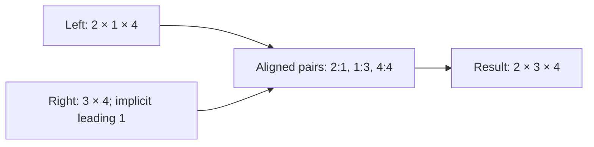

# [Shapes](../../glossary.md#shape), [dimensions](../../glossary.md#dimension) and [broadcasting](../../glossary.md#broadcasting)

[Reference goals](../index.md) · [Javadoc and exact signatures](../javadoc.md)<span data-glossary-navigation="true"> ([Javadoc glossary](../../glossary.md#term-javadoc); [signatures glossary](../../glossary.md#term-signature))</span> · [Source entry point](../../../modules/model/src/main/java/io/github/pho001/synaptik/model/tensor/Tensor.java)

**Reading a shape.** A [tensor](../../glossary.md#tensor) is an array addressed by one [coordinate](../../glossary.md#axis-rank-scalar-vector-and-matrix) per **[axis](../../glossary.md#term-axis)**.
Its **[rank](../../glossary.md#term-rank)** is the number of axes; each axis has an **[extent](../../glossary.md#term-extent)**, the number of positions on it.
Shape `[2, 3]` has rank two, with two rows and three columns. Axis numbering starts at zero;
axis `-1` addresses the last axis where an [API](../../glossary.md#term-application-programming-interface-api) accepts negative axes. A **[singleton](../../glossary.md#term-singleton)** has extent
one. A symbolic extent such as [`batch`](../../glossary.md#term-batch-machine-learning-and-hyperparameters) names a size not yet supplied, rather than a negative size.

**Broadcasting** lets compatible shapes participate in one [operation](../../glossary.md#operation) by logically repeating
singleton positions. Compare shapes from the right: each aligned pair must satisfy the applicable
equality or singleton rule. The [local broadcasting rules below](#broadcasting) explain
which symbolic relationships can be proved; broadcasting is not a promise to copy storage.

<a id="shapes-and-dimensions"></a>
## [Shapes](../../glossary.md#shape) and [dimensions](../../glossary.md#dimension)

The public shape contracts live in `io.github.pho001.synaptik.model.shape`. `Shape` is an [immutable](../../glossary.md#term-immutable) ordered collection of `Dimension` values. A dimension is one of:

- `StaticDimension`, with a known non-negative `long` size;
- `DynamicDimension`, with a [canonical](../../glossary.md#term-canonical-form) non-blank symbolic name; or
- `ExpressionDimension`, with an exact symbolic formula or an [identity](../../glossary.md#term-identity-meanings)-based constrained unknown.

Every non-static form is dynamic: `isDynamic()` is true, `staticSize()` is empty, and only the
named `DynamicDimension` has a present `dynamicSymbol()`. Dynamic dimensions are explicit values
and never use negative numeric sentinels. Shape values defensively isolate caller-owned arrays
and expose immutable dimension lists.

<a id="symbolic-extent-expressions"></a>
### Symbolic [extent](../../glossary.md#term-extent) expressions

`DimensionExpressions` is the field-free public construction boundary for derived extents. Its
seven methods create checked addition, signed [constant](../../glossary.md#term-constant) offset, multiplication by a non-negative
constant, multiplication of two [Dimensions](../../glossary.md#dimension), floor or ceiling division by a positive constant,
and a distinct constrained unknown:

```java
add(left, right)
addConstant(input, offset)
multiply(input, factor)
multiply(left, right)
floorDivide(input, divisor)
ceilingDivide(input, divisor)
unknown(minimum, maximum)
```

Construction returns the simplest truthful `Dimension`. Fully static arithmetic returns a
`StaticDimension`. Adding zero, multiplying by one, or dividing by one returns the exact input
reference; multiplying by zero returns static zero. [Linear](../../glossary.md#term-linear-meanings) sums flatten nested sums, fold static
terms into a checked signed offset, combine repeated dimensions, and ignore operand order for
equality. Thus `N + N` equals `2 * N`, and independently constructed `N + M` and `M + N` are
equal. Dimension-to-Dimension multiplication folds static factors, applies the zero and one
[identities](../../glossary.md#term-identity-meanings), flattens nested products, and combines repeated structurally equal factors as positive
exponents. Product factor order is not semantic. Multiplication does not distribute over linear
sums. Floor and ceiling division remain explicit structural [nodes](../../glossary.md#node) and are not reassociated with
addition or multiplication. All coefficient, [exponent](../../glossary.md#term-exponent), and static arithmetic is checked.

An `ExpressionDimension` exposes its read-only `DimensionExpression`. The five public forms are:

- `LinearCombination`, an [immutable](../../glossary.md#term-immutable) non-empty map of dimensions to positive `long`
  coefficients plus a signed `long` offset;
- `Product`, an immutable non-empty map of complete Dimension factors to positive `long`
  exponents plus one positive constant coefficient;
- `FloorDivision` and `CeilingDivision`, each with one dividend and a positive constant divisor;
  and
- `Unknown`, with an inclusive non-negative minimum and an optional inclusive maximum dimension.

Exact formula forms use [structural equality](../../glossary.md#term-structural-equality). `Unknown` deliberately uses object [identity](../../glossary.md#term-reference-identity), so two
separate calls with equal bounds remain different extents; reusing the same returned dimension
preserves that unknown's identity. The optional maximum retains the exact supplied dimension
reference. None of these values binds a [symbol](../../glossary.md#term-symbol), evaluates a concrete size, solves [graph](../../glossary.md#graph)-wide
equalities, or carries [compiler](../../glossary.md#term-compiler), [layout](../../glossary.md#layout), storage, [runtime](../../glossary.md#term-runtime), or [backend](../../glossary.md#backend) state.

<a id="complete-symbolic-extent-example"></a>
#### Complete symbolic-[extent](../../glossary.md#term-extent) example

<a id="goal-and-inputs"></a>
##### Goal and inputs

Represent exact formulas derived from named extents `N` and `M`, inspect one [canonical](../../glossary.md#term-canonical-form) sum, and
show that a bounded unknown remains distinct. This example constructs [model](../../glossary.md#term-model) values only.

```java
import io.github.pho001.synaptik.model.shape.Dimension;
import io.github.pho001.synaptik.model.shape.DimensionExpression;
import io.github.pho001.synaptik.model.shape.DimensionExpressions;
import io.github.pho001.synaptik.model.shape.DynamicDimension;
import io.github.pho001.synaptik.model.shape.ExpressionDimension;
import io.github.pho001.synaptik.model.shape.Shape;
import io.github.pho001.synaptik.model.shape.StaticDimension;
import java.util.Optional;

public final class SymbolicExtentExample {
    public static void main(String[] args) {
        Dimension n = new DynamicDimension("N");
        Dimension m = new DynamicDimension("M");
        Dimension nPlusTwo = DimensionExpressions.addConstant(n, 2);
        Dimension canonicalSum = DimensionExpressions.add(
                nPlusTwo, DimensionExpressions.multiply(m, 2));
        Dimension sameSum = DimensionExpressions.add(
                DimensionExpressions.multiply(m, 2),
                DimensionExpressions.add(new DynamicDimension("N"), new StaticDimension(2)));
        Dimension halfRoundedUp = DimensionExpressions.ceilingDivide(nPlusTwo, 2);
        Dimension unknown = DimensionExpressions.unknown(1, Optional.of(nPlusTwo));

        DimensionExpression.LinearCombination inspected =
                (DimensionExpression.LinearCombination)
                        ((ExpressionDimension) canonicalSum).expression();
        Shape shape = Shape.ofDimensions(canonicalSum, halfRoundedUp, unknown);

        System.out.println(canonicalSum.equals(sameSum));
        System.out.println(inspected.offset());
        System.out.println(shape);
        System.out.println(unknown.equals(
                DimensionExpressions.unknown(1, Optional.of(nPlusTwo))));
    }
}
```

<a id="result-and-interpretation"></a>
##### Result and interpretation

The example prints:

```text
true
2
Shape[2 * M + N + 2, ceilDiv((N + 2), 2), unknown(min=1, max=(N + 2))]
false
```

The first result demonstrates operand-order-independent [structural equality](../../glossary.md#term-structural-equality). The offset is `2`,
and the [shape](../../glossary.md#shape) retains exact formula and bound diagnostics. The final result demonstrates that a
new unknown-construction call is not equal to the original unknown. The text format is diagnostic,
not [serialization](../../glossary.md#term-serialization), and the example does not bind `N` or `M`, calculate a concrete [element](../../glossary.md#term-element) count,
construct a [Tensor](../../glossary.md#tensor) expression, or execute anything.

<a id="failures-and-useful-variations"></a>
##### Failures and useful variations

- A negative multiplication factor, non-positive divisor, negative unknown minimum, or static
  maximum below the minimum fails with `IllegalArgumentException`.
- Checked coefficient, offset, and fully static arithmetic [overflow](../../glossary.md#term-overflow) fails with
  `ArithmeticException`.
- A signed offset may retain a formula such as `N - 3`, but every eventual concrete binding must
  still satisfy the non-negative dimension invariant. A fully static negative result is rejected
  immediately.<span data-glossary-navigation="true"> ([binding glossary](../../glossary.md#term-binding); [dimension glossary](../../glossary.md#dimension); [invariant glossary](../../glossary.md#term-invariant))</span>

<a id="scalars-and-empty-tensors"></a>
### [Scalars](../../glossary.md#term-scalar) and empty [tensors](../../glossary.md#tensor)

`Shape.scalar()` is the [canonical](../../glossary.md#term-canonical-form) [rank](../../glossary.md#term-rank)-0 scalar [shape](../../glossary.md#shape). It has no [axes](../../glossary.md#term-axis) and its known [element](../../glossary.md#term-element) count is one.

Static size zero is valid. For example, `Shape.of(2, 0, 4)` represents an empty tensor and has a known element count of zero. Static [dimensions](../../glossary.md#dimension) use `long`; later storage implementations may impose narrower allocation limits without changing the logical shape.

<a id="static-and-dynamic-element-counts"></a>
### Static and dynamic [element](../../glossary.md#term-element) counts

`Shape.knownElementCount()` returns a present checked `long` value only when every [dimension](../../glossary.md#dimension) is static. Dynamic [shapes](../../glossary.md#shape) return an empty optional. Non-zero multiplication [overflow](../../glossary.md#term-overflow) raises `ArithmeticException`; a fully static shape containing a zero dimension has count zero even when multiplying other dimensions would overflow.

`Shape.toLongArray()` copies the ordered static sizes and rejects dynamic shapes. Positive and negative [axes](../../glossary.md#term-axis) are normalized through the shape, while every axis is invalid for a [rank](../../glossary.md#term-rank)-0 [scalar](../../glossary.md#term-scalar).

<a id="broadcasting"></a>
### [Broadcasting](../../glossary.md#broadcasting)

`ShapeBroadcast.broadcast(left, right)` applies right-aligned broadcasting. Equal [dimensions](../../glossary.md#dimension) are preserved and static size `1` expands to the opposing dimension. This includes [scalar](../../glossary.md#term-scalar) broadcasting and zero-sized dimensions such as `[0, 3]` with `[1, 3]`.

Equal named symbols and structurally equal exact expressions are compatible, and a [singleton](../../glossary.md#term-singleton) may
expand to any dynamic dimension. A constrained unknown is equal only when the exact same unknown
is reused. Different symbols, unequal expressions, distinct unknowns, or a dynamic dimension
paired with a non-singleton static size are rejected because local [model](../../glossary.md#term-model) code cannot prove their
compatibility. Current package-private [compiler](../../glossary.md#term-compiler) verification does not broaden this local
broadcasting rule: it retains a symbolic obligation only when an [operation](../../glossary.md#operation) contract can already
select one exact output [descriptor](../../glossary.md#term-descriptor).

Read this [shape](../../glossary.md#shape)-[alignment](../../glossary.md#term-alignment) diagram from left to right. The absent leading [axis](../../glossary.md#term-axis) behaves as an
[extent](../../glossary.md#term-extent)-one axis; matching does not infer names such as “[batch](../../glossary.md#term-batch-machine-learning-and-hyperparameters)” or “[feature](../../glossary.md#term-software-feature).”



Shape broadcasting does not calculate [strides](../../glossary.md#term-stride), [layouts](../../glossary.md#layout), storage, [materialization](../../glossary.md#materialization), or [backend](../../glossary.md#backend) execution information.

<a id="shape-example"></a>
### [Shape](../../glossary.md#shape) example

```java
Shape left = Shape.of(2, 1, 4);
Shape right = Shape.of(3, 4);
Shape result = ShapeBroadcast.broadcast(left, right);
long count = result.knownElementCount().orElseThrow();
```

[Broadcasting](../../glossary.md#broadcasting) aligns [axes](../../glossary.md#term-axis) from the right. The pairs are `4` with `4`, `1` with `3`, and the unmatched leading `2` with an implicit [singleton](../../glossary.md#term-singleton). The result is `Shape[2, 3, 4]`, and its [element](../../glossary.md#term-element) count is `2 × 3 × 4 = 24`. No storage is allocated.


---

[Previous topic](data-types.md) · [Next topic](layouts.md)
