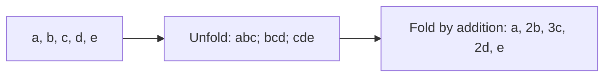

# Window transforms

[Reference goals](../index.md) · [Javadoc and exact signatures](../javadoc.md)<span data-glossary-navigation="true"> ([Javadoc glossary](../../glossary.md#term-javadoc); [signatures glossary](../../glossary.md#term-signature))</span> · [Source entry point](../../../modules/model/src/main/java/io/github/pho001/synaptik/model/tensor/Tensor.java)

## Extracting windows and adding them back are different operations

Application or layer-building code calls `input.unfold...` with window geometry, then can call
fold with explicit target geometry on the column Tensor. Each call retains exact Tensor and
immutable configuration references, derives a result description, and reads/copies no stored
values at construction. “Materialize” describes the eventual requested operation, not work done
by the constructor. Compare [pooling](pooling.md) for summaries of each window and
[convolution](convolution.md) for learned weighted sums of the same kinds of samples.

**[Reader model](../../glossary.md#term-reader-model).** A **window** is a small set of neighboring [coordinates](../../glossary.md#axis-rank-scalar-vector-and-matrix) sampled repeatedly
across an input. **Unfold** exposes those [samples](../../glossary.md#term-sample-machine-learning-and-hyperparameters) as explicit window positions.
**Fold** sends window contributions back to their source coordinates and adds overlaps;
it does not generally undo unfold or divide by the overlap count.
For images, **[im2col](../../glossary.md#term-im2col)** arranges sampled patches into columns, while **[col2im](../../glossary.md#term-col2im)** accumulates
columns into image positions. [NCHW](../../glossary.md#term-nchw) means [batch](../../glossary.md#term-batch-machine-learning-and-hyperparameters), [channel](../../glossary.md#term-channel), height, width; [NCDHW](../../glossary.md#conv3d--ncdhw) adds depth before
height. These describe logical [axes](../../glossary.md#term-axis), not a storage-allocation promise.

Read this conceptual width-three example from extraction to overlap addition. The center
[element](../../glossary.md#term-element) occurs in three windows, so folding unchanged windows counts it three times.



<a id="window-transform-expressions"></a>
### Window-transform expressions

The current public [API](../../glossary.md#term-application-programming-interface-api) constructs eight storage-free sliding-window expressions. The public
[`Tensor`](../../glossary.md#tensor) class has exactly 213 declared public methods after adding the three [rank](../../glossary.md#term-rank)-specific 3D
receivers:

```java
tensor.unfold(int axis, long size, long step)
tensor.foldAxis(int axis, long outputSize, long step)
tensor.unfold2d(Window2dAttrs window)
tensor.unfold2d(Window2dAttrs window, ScalarValue paddingValue)
tensor.fold2d(Shape outputShape, Window2dAttrs window)
tensor.unfold3d(Window3dAttrs window)
tensor.unfold3d(Window3dAttrs window, ScalarValue paddingValue)
tensor.fold3d(Shape outputShape, Window3dAttrs window)
```

`unfold` requires rank at least one and normalizes its raw [axis](../../glossary.md#term-axis) against the input rank. The selected
[dimension](../../glossary.md#dimension) must be static, `size` and `step` must be positive, and `size` must fit that dimension.
Let integers $D$, $k$ (`size`) and $s$ (`step`) denote the selected input extent, window size and
distance between window starts, with $D\ge k>0$ and $s>0$. The new extent counts window starts:

$$
Q=\left\lfloor\frac{D-k}{s}\right\rfloor+1.
$$

The operation preserves every unaffected exact Dimension reference and appends
`size` as the final axis. It accepts every current [data type](../../glossary.md#data-type--datatype). Thus input [Shape](../../glossary.md#shape) `[2, 5, 3]`, axis
`1`, size `3`, and step `1` produces `[2, 3, 3, 3]`.

`foldAxis` reverses that rank change under overlap summation. Its final input Dimension is a
positive static window size; its remaining Dimensions define the [target](../../glossary.md#term-target) rank used to normalize
the raw axis. The selected static window-count Dimension is replaced by non-negative
`outputSize`, and the final Dimension is removed. Positive output size requires
`floor((outputSize - windowSize) / step) + 1` windows; zero output size requires zero windows.
Floating and signed-integral inputs are accepted, while [BOOL](../../glossary.md#data-type--datatype) is rejected. For conceptual windows
`[[1,2,3], [4,5,6], [7,8,9]]`, axis `0`, output size `5`, and step `1`, overlap summation gives
conceptual result `[1,6,15,14,9]`.

Both `unfold2d` overloads require rank-four [NCHW](../../glossary.md#term-nchw) input and a floating data type. [Batch](../../glossary.md#term-batch-machine-learning-and-hyperparameters), [channel](../../glossary.md#term-channel),
height, and width may be static or unresolved; the exact [batch Dimension](../../glossary.md#batch-dimension) is retained. `fold2d`
requires floating rank-three [canonical](../../glossary.md#term-canonical-form) columns and an explicit rank-four NCHW output Shape.
Column and output batch Dimensions must be structurally equal. For each [spatial](../../glossary.md#term-spatial-axes) dimension, all
three 2D construction paths use checked static arithmetic or retain the corresponding canonical
symbolic expression:

For a spatial axis, let integer $D\geq0$ be input extent, $k>0$ kernel count,
$d>0$ dilation, $p\geq0$ symmetric padding and $s>0$ window stride:

$$
e=d(k-1)+1,\quad n=D+2p-e,\quad
Q_{\mathrm{floor}}=\lfloor n/s\rfloor+1,\quad
Q_{\mathrm{ceil}}=\lceil n/s\rceil+1.
$$

Here $e$ counts the effective sampled span and $Q$ the number of window starts.
Valid geometry requires $n\geq0$. For $D=3$, $k=2$, $d=s=1$, $p=0$, both modes give
$Q=2$; two positions in height and width make four image windows.

The effective [kernel](../../glossary.md#kernel) must fit the padded input when static geometry can prove otherwise. An
unresolved numerator retains its non-negativity obligation for later [binding](../../glossary.md#term-binding). Ceil mode avoids
the [overflow](../../glossary.md#term-overflow)-prone `numerator + stride - 1` [identity](../../glossary.md#term-identity-meanings). `unfold2d` produces canonical Shape
`[N, C * kernelHeight * kernelWidth, outputHeight * outputWidth]`; products of unresolved
Dimensions use the exact canonical symbolic-product form. `fold2d` requires complete [structural
equality](../../glossary.md#term-structural-equality) with those channel and window-count formulas and retains the exact supplied output Shape.
An unrelated unresolved [symbol](../../glossary.md#dimension) is rejected because [model](../../glossary.md#term-model) construction does not create an unnamed
equality constraint.

For dynamic input `[N,C,H,W]`, a 3-by-3 kernel, [stride](../../glossary.md#term-stride) two, [padding](../../glossary.md#padding) one, unit [dilation](../../glossary.md#term-dilation), and floor
mode produces channel Dimension `9 * C` and flattened window Dimension
`(floor((H - 1) / 2) + 1) * (floor((W - 1) / 2) + 1)`. Ceil mode retains the same formula with
ceiling division. This [metadata](../../glossary.md#term-metadata) is exact structurally; it does not bind `N`, `C`, `H`, or `W`.

The one-[argument](../../glossary.md#term-argument) `unfold2d` pairs `UNFOLD2D` directly with the supplied `Window2dAttrs`; every
out-of-domain [sample](../../glossary.md#term-sample-machine-learning-and-hyperparameters) is conceptual [positive zero](../../glossary.md#nan-infinity-and-signed-zero). The two-argument overload instead pairs
`UNFOLD2D` with `Unfold2dAttrs(window, paddingValue)`. The [scalar](../../glossary.md#term-scalar) must exactly match the floating
input data type and is retained by reference with its raw [NaN](../../glossary.md#term-nan), [infinity](../../glossary.md#term-infinity), or [signed-zero](../../glossary.md#nan-infinity-and-signed-zero) bits. It
supplies symmetric padding positions and terminal ceil-grid positions beyond the padded extent.
This is extraction semantics, not maximum-[pooling](../../glossary.md#term-pooling) padding or a [backend](../../glossary.md#backend) fill policy.

Conceptual `[1, 1, 3, 3]` input with a 2-by-2 kernel, unit stride and dilation, zero symmetric
padding, and floor mode unfolds to `[1, 4, 4]`. Folding compatible columns to `[1, 1, 3, 3]`
scatter-adds four contributions at the center and one at each corner, without overlap averaging.

The 3D forms extend the same algebra to rank-five [NCDHW](../../glossary.md#conv3d--ncdhw) input `[N, C, D, H, W]`. They accept
every floating type, including [FP8](../../glossary.md#term-fp8). For each depth, height, and width axis they use the same
literal floor-or-ceiling formula above, deriving depth first, then height, then width. They do not
drop a terminal literal-ceil window even when every sampled [coordinate](../../glossary.md#axis-rank-scalar-vector-and-matrix) lies outside the unpadded
input. `unfold3d` always returns the canonical rank-three Shape:

```text
[N, C * kD * kH * kW, DOut * HOut * WOut]
```

For output-grid coordinate `(od, oh, ow)` and kernel coordinate `(kd, kh, kw)`, the logical input
coordinate and two flattened column coordinates are:

For each axis $a$ in depth, height and width, let $o_a$ be its output-grid coordinate,
$r_a$ its kernel coordinate, $s_a$ stride, $p_a$ padding and $d_a$ dilation.
With integer $0\leq o_a<Q_a$ and $0\leq r_a<k_a$, its input coordinate is

$$
i_a=o_a s_a-p_a+r_a d_a.
$$

Out-of-range $i_a$ uses the selected padding rule, not an input read.
Let $c$ be channel coordinate, $0\leq c<C$, and $n$ batch coordinate, $0\leq n<N$.
The two flattened column coordinates are

$$
q=(((c k_D+r_D)k_H+r_H)k_W+r_W),\qquad
p=((o_D Q_H+o_H)Q_W+o_W).
$$

The column coordinate is $(n,q,p)$, with
$0\leq q<Ck_Dk_Hk_W$ and $0\leq p<Q_DQ_HQ_W$.
Uppercase subscripts identify axes, not powers; $p$ here is a column coordinate,
distinct from padding $p_a$. For one channel and a $2$-by-$2$-by-$2$ kernel,
kernel coordinate $(1,0,1)$ gives $q=((1)2+0)2+1=5$.

| Flattened coordinate | Outermost to fastest-changing component | Meaning |
|---|---|---|
| `q` | channel, kernel depth, kernel height, kernel width | selects one channel/kernel position |
| `p` | output depth, output height, output width | selects one spatial window position |

This ordering is structural Model metadata. It fixes the later interpretation of columns but does
not promise a physical storage traversal or backend algorithm.

For direct `unfold3d(window)`, every out-of-range `(id, ih, iw)` sample is exact represented
positive zero. The typed overload instead retains and uses the exact same-typed [`ScalarValue`](../../glossary.md#typed-scalar-value--scalarvalue), so
`ScalarValue.float32(Float.NEGATIVE_INFINITY)` can describe maximum-reconstruction padding
without adding a pooling-specific [operation](../../glossary.md#operation). The scalar's reference and [represented bits](../../glossary.md#term-represented-bits) are
retained; no conversion occurs.

`fold3d(outputShape, window)` requires rank-three columns whose batch, complete channel-kernel
Dimension, and complete flattened-grid Dimension are structurally equal to the formulas for the
explicit rank-five NCDHW target. The result retains the exact supplied `Shape` reference.
Out-of-range padded and literal-ceil-tail coordinates are excluded geometrically, regardless of
the column value. Each target starts at represented positive zero, and in-range contributions are
added in increasing `[n, q, p]` order. [FLOAT64](../../glossary.md#term-float64) and [FLOAT32](../../glossary.md#term-float32) add sequentially in their own format.
[BFLOAT16](../../glossary.md#term-bfloat16) expands the [accumulator](../../glossary.md#accumulator-type) and next operand to FLOAT32, adds once, and narrows after every
logical contribution. Fold neither averages overlaps nor compares values with a padding scalar.

As a small overlap example, a one-channel `[1, 1, 3, 3, 3]` target with a 2-by-2-by-2 kernel,
unit stride/dilation, zero padding, and floor mode has columns Shape `[1, 8, 8]`. The center target
coordinate belongs to all eight windows, while each corner belongs to one. `fold3d` therefore
adds eight distinct column contributions at the center and one at each corner. This describes the
eventual value semantics; Model construction itself performs no addition.

For unresolved input `[N, C, D, H, W]`, a 2-by-3-by-4 kernel, stride `(2, 2, 3)`, padding
`(1, 1, 2)`, unit dilation, and floor mode produces:

```text
[N,
 ((C * 2) * 3) * 4,
 ((floor(D / 2) + 1) * (floor((H - 1) / 2) + 1)) * (floor(W / 3) + 1)]
```

The exact `N` Dimension reference is retained. These canonical expressions describe unresolved
metadata; they do not bind the symbols or discharge the later non-negative-numerator obligation.

All results preserve the exact input data type and [gradient](../../glossary.md#term-gradient)-eligibility flag, use unresolved
[layout](../../glossary.md#layout), record the matching normalized attributes and exact `[input]` [provenance](../../glossary.md#provenance), and receive a
fresh unlabeled identity. They do not inspect input layout, label, provenance, storage, or values;
attach or allocate storage; materialize windows; accumulate overlaps; create a gradient rule;
[capture](../../glossary.md#term-capture-meanings) a [graph](../../glossary.md#graph); lower to a backend; or execute.

Current Model owns `UNFOLD3D`/`FOLD3D` algebra and public metadata construction. Complete [Compiler](../../glossary.md#term-compiler)
0006B1 captures both unfold variants and fold as ordinary flat [nodes](../../glossary.md#node) and independently validates
their canonical [descriptors](../../glossary.md#term-descriptor) and spatial obligations. Complete Compiler 0006B2 constructs all
three adjoints through the same public API: either unfold form maps its [cotangent](../../glossary.md#cotangent) through
`fold3d` into the exact original input Shape, and fold maps its cotangent through the direct
positive-zero `unfold3d` overload. Typed padding is [immutable](../../glossary.md#term-immutable) configuration rather than a
[differentiable](../../glossary.md#derivative-and-chain-rule) input. [CPU](../../glossary.md#term-cpu) separately executes fully static resolved-layout UNFOLD3D raw movement
for every floating type, including FP8, and FOLD3D overlap arithmetic under ordinary [dtype](../../glossary.md#data-type--datatype)/geometry
guards. [Metal](../../glossary.md#term-metal) FOLD2D/FOLD3D overlap is FLOAT32-only, while its other floating image folds retain
non-overlap. CPU floating and Metal [F32](../../glossary.md#floating-point-precision-and-rounding) [Pool3d](../../glossary.md#pool3d--ncdhw-pooling) training reuse the shared pooling adjoints and
these 3D windows; CPU parity does not widen Metal's independent domain.
These capabilities require [concrete backend](../../glossary.md#concrete-backend) [admission](../../glossary.md#term-admission); constructing metadata alone supplies no
materialized result or performance guarantee. See the
[production matrix](../../backend-guide/production-support.md#conv3d-training-and-independent-pool3d-boundary)<span data-glossary-navigation="true"> ([matrix glossary](../../glossary.md#term-matrix-meanings))</span>.

<a id="complete-window-transform-expression-example"></a>
#### Complete window-transform expression example

This runnable Java 26 example observes only [Shape](../../glossary.md#shape), [operation](../../glossary.md#operation), [provenance](../../glossary.md#provenance), and storage [metadata](../../glossary.md#term-metadata):

```java
import io.github.pho001.synaptik.model.datatype.DataType;
import io.github.pho001.synaptik.model.datatype.ScalarValue;
import io.github.pho001.synaptik.model.operation.layout.Unfold2dAttrs;
import io.github.pho001.synaptik.model.operation.layout.Window2dAttrs;
import io.github.pho001.synaptik.model.shape.Dimension;
import io.github.pho001.synaptik.model.shape.DimensionExpressions;
import io.github.pho001.synaptik.model.shape.DynamicDimension;
import io.github.pho001.synaptik.model.shape.Shape;
import io.github.pho001.synaptik.model.tensor.Tensor;
import io.github.pho001.synaptik.model.tensor.TensorDescriptor;
import io.github.pho001.synaptik.model.tensor.TensorFactory;
import java.util.Optional;

public final class TensorWindowExpressionExample {
    private static Tensor tensor(Shape shape) {
        return TensorFactory.create(new TensorDescriptor(
                DataType.FLOAT32, shape, Optional.empty(), true));
    }

    public static void main(String[] args) {
        // Construct window descriptions only; fold sums overlaps rather than averaging them.
        Tensor unfolded = tensor(Shape.of(2, 5, 3)).unfold(1, 3, 1);
        Tensor folded = tensor(Shape.of(3, 3)).foldAxis(0, 5, 1);
        Window2dAttrs window = new Window2dAttrs(
                2, 2, 1, 1, 0, 0, 1, 1, false);
        Tensor columns = tensor(Shape.of(1, 1, 3, 3)).unfold2d(window);
        Tensor image = columns.fold2d(Shape.of(1, 1, 3, 3), window);
        // Preserve this exact padding representation, including its negative-zero sign.
        ScalarValue padding = ScalarValue.float32(-0.0f);
        Tensor paddedColumns = tensor(Shape.of(1, 1, 3, 3)).unfold2d(window, padding);

        Dimension n = new DynamicDimension("N");
        Dimension c = new DynamicDimension("C");
        Dimension h = new DynamicDimension("H");
        Dimension w = new DynamicDimension("W");
        Shape dynamicImageShape = Shape.ofDimensions(n, c, h, w);
        Window2dAttrs dynamicWindow = new Window2dAttrs(
                3, 3, 2, 2, 1, 1, 1, 1, false);
        Tensor dynamicColumns = tensor(dynamicImageShape).unfold2d(dynamicWindow);
        Tensor dynamicImage = dynamicColumns.fold2d(dynamicImageShape, dynamicWindow);
        Unfold2dAttrs paddingAttrs = (Unfold2dAttrs) paddedColumns.provenance()
                .orElseThrow().operation().attrs();

        System.out.println(unfolded.descriptor().shape());
        System.out.println(folded.descriptor().shape());
        System.out.println(columns.descriptor().shape());
        System.out.println(image.descriptor().shape());
        System.out.println(paddingAttrs.paddingValue() == padding);
        System.out.println(dynamicColumns.descriptor().shape().dimensions().get(1)
                .equals(DimensionExpressions.multiply(c, 9)));
        System.out.println(dynamicImage.descriptor().shape() == dynamicImageShape);
        System.out.println(image.descriptor().layout().isEmpty()
                && image.hostStorage().isEmpty());
    }
}
```

It prints:

```text
Shape[2, 3, 3, 3]
Shape[5]
Shape[1, 4, 4]
Shape[1, 1, 3, 3]
true
true
true
true
```

Invalid [rank](../../glossary.md#term-rank), [axis](../../glossary.md#term-axis), intrinsic sign, required staticity, window fit, type, or column compatibility
fails before [identity](../../glossary.md#term-identity-meanings) allocation. Structural `fold2d` compatibility rejects unrelated unresolved
[Dimensions](../../glossary.md#dimension). Checked geometry or [canonicalization](../../glossary.md#occurrence-identity-and-canonical-form) [overflow](../../glossary.md#term-overflow) propagates as `ArithmeticException`.
Null references are rejected in [parameter](../../glossary.md#term-parameter) order. Identifier exhaustion remains possible only at
final derived-[Tensor](../../glossary.md#tensor) construction after all local [immutable](../../glossary.md#term-immutable) metadata has been prepared.


---

[Previous topic](composition.md) · [Next topic](matmul-linear.md)
