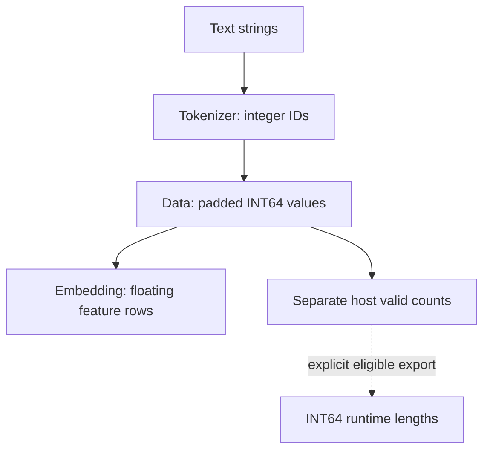

<a id="text-tokenization-and-batching-api"></a>
# Frozen [tokenization](../../glossary.md#frozen-whitespace-tokenizer) and text batching

[Reference goals](../index.md) · [Javadoc and exact signatures](../javadoc.md) · [Source entry point](../../../extensions/text/src/main/java/io/github/pho001/synaptik/text/WhitespaceTokenizer.java)

**Tokenization** divides text into units and assigns each unit an integer ID from a fixed
**vocabulary**, the known [token](../../glossary.md#term-token)-to-ID mapping. Here the units are whitespace-delimited strings,
not characters or learned subword pieces. Those IDs are labels, not floating [feature](../../glossary.md#term-feature) [vectors](../../glossary.md#term-vector);
an **[embedding](../../glossary.md#embedding)** later uses each ID to select a row of learned numeric features.



Follow the values branch for numeric features and the counts branch for sequence boundaries.
Neither branch creates a global [padding mask](../../glossary.md#masks-padding-and-eager-evaluation). This relationship is conceptual: the current fluent
builder does not provide the integer-input Embedding-to-scan chain.

## Follow one row from strings to values

The application constructs the tokenizer with an ordered vocabulary; Text copies that order and
retains immutable strings. `encode` returns a fresh integer array, not a borrowed view into the
vocabulary. For a text batch, Text calls Data's `LongSequenceBatcher` with the encoded rows;
Data allocates and fills a fresh Tensor and copies valid counts. The application then calls
Embedding with that integer Tensor, and later Engine to evaluate the resulting floating
expression. In the example the Embedding retains the exact supplied weight Tensor, so its
native Arena must remain alive through compute. Text owns no native resource or execution
session. [Data ownership](../data/sequences.md#which-participant-copies-values-and-which-only-describes-them)
and [NN binding replacement](../nn/state.md) explain those distinct storage boundaries.

<a id="purpose-and-mental-model"></a>
## Purpose and [mental model](../../glossary.md#term-mental-model)

Use Text to turn strings into frozen [token](../../glossary.md#term-token) IDs, then Data to pad those IDs into a numeric
[batch](../../glossary.md#term-batch-machine-learning-and-hyperparameters). The caller composes the batch with [NN](../../glossary.md#neural-network-module-parameter-buffer-and-forward-context) layers and [Engine](../../glossary.md#term-engine) execution; Text provides no
execution [facade](../../glossary.md#term-facade). [Gradle](../../glossary.md#term-gradle) `:extensions:text` exports Data, which exports [Model](../../glossary.md#term-model) transitively.
The two final concrete types live in `io.github.pho001.synaptik.text`.

<a id="frozen-token-ids"></a>
## Frozen [token](../../glossary.md#term-token) IDs

`WhitespaceTokenizer.of(List<String> ordinaryTokens)` copies the supplied order and never grows
its vocabulary. [Padding](../../glossary.md#padding) ([PAD](../../glossary.md#frozen-whitespace-tokenizer)) is ID `0`, unknown ([UNK](../../glossary.md#frozen-whitespace-tokenizer)) is ID `1`, and ordinary IDs start at `2`.
For `WhitespaceTokenizer.of(List.of("Hello", "world"))`, `vocabularySize()` is `4`,
`paddingId()` is `0`, and `unknownId()` is `1`.

`encode(String)` returns a fresh caller-owned `long[]`, even for empty input. It emits one ID
per maximal nonempty run separated by `Character.isWhitespace(int)` code points. With that
vocabulary, `encode(" Hello\tworld missing ")` gives `[2,3,1]`; `encode("hello Hello,")`
gives `[1,1]`. Each unknown run produces one UNK, not one ID per character.

Case, punctuation and exact [UTF-16](../../glossary.md#term-utf-16) are preserved, including supplementary characters and unpaired
surrogates. There is no [Unicode normalization](../../glossary.md#term-unicode-normalization): composed and decomposed spellings differ.
Java whitespace includes tabs and U+2003 EM SPACE, but not U+00A0 NO-BREAK SPACE,
U+2007 FIGURE SPACE, U+202F NARROW NO-BREAK SPACE or U+200B ZERO WIDTH SPACE.
Those non-separators remain part of a token. Empty or whitespace-only input encodes to `[]`.
Listed spellings such as `"PAD"` and `"UNK"` receive ordinary IDs, not reserved IDs.

An empty vocabulary is valid and has size `2`. Null lists, tokens or text throw
`NullPointerException`, identifying the [parameter](../../glossary.md#term-parameter) or token row. Empty ordinary tokens,
whitespace-containing tokens, duplicates, or a vocabulary size including reserved IDs above
`Integer.MAX_VALUE` throw `IllegalArgumentException`.

<a id="explicit-batch-configuration"></a>
## Explicit [batch](../../glossary.md#term-batch-machine-learning-and-hyperparameters) configuration

`TextSequenceBatcher.builder(tokenizer)` fixes a non-null [tokenizer](../../glossary.md#frozen-whitespace-tokenizer). Select both a [padding](../../glossary.md#padding) side
and an [axis](../../glossary.md#term-axis) order before `build()`: `leftPadded()` or `rightPadded()`, and `timeMajor()` or
`batchMajor()`. There are no defaults; missing choices throw `IllegalStateException`.
Setters return the same builder, the last selection wins, and each build freezes an independent
configuration. Builders are reusable but not [thread-safe](../../glossary.md#term-thread-safe); built configurations and tokenizers
are [immutable](../../glossary.md#term-immutable) and safely shareable.

`batch(List<String>)` encodes each row once in order and delegates once to Data's
`LongSequenceBatcher`, using `paddingId()`. Data owns padding, allocation and valid counts.
The returned `PaddedSequenceBatch` exposes `values()`, `validLengths()`, `axisOrder()` and
`paddingSide()`. Values are fresh [contiguous](../../glossary.md#term-contiguous) [heap](../../glossary.md#term-heap)-backed, non-[gradient](../../glossary.md#term-gradient) [INT64](../../glossary.md#data-type--datatype) [tensors](../../glossary.md#tensor).
Counts are immutable [host](../../glossary.md#term-host) [metadata](../../glossary.md#term-metadata), not [runtime](../../glossary.md#term-runtime) [graph](../../glossary.md#graph) inputs. Output tensor contents and storage
associations remain subject to ordinary [Model](../../glossary.md#term-model) access obligations; Text adds no close protocol.

For rows `["Hello world", "missing", ""]`, right/batch-major values are
`[[2,3],[1,0],[0,0]]`, [shape](../../glossary.md#shape) `[3,2]`, and valid counts are `[2,1,0]`.
Left padding instead gives `[[2,3],[0,1],[0,0]]` with the same counts.
Batch-major shape is `[B,T]`; [time-major](../../glossary.md#term-time-major) shape is `[T,B]`, where B is row count and T is
maximum encoded length. Empty outer input has B=T=0; all-empty rows have T=0.

Null tokenizer, list or row throws `NullPointerException` with the [parameter](../../glossary.md#term-parameter) or row identified.
Coordinate input-list mutation throughout construction/batching; no transactional [snapshot](../../glossary.md#term-snapshot) is
promised. Inputs are not retained afterward and repeated calls produce independent outputs.
Data rejects overflowing geometry or more than `Integer.MAX_VALUE` [elements](../../glossary.md#term-element) with
`IllegalArgumentException`; allocation failures and Model identifier exhaustion propagate.
There is no truncation or sequence-limit policy. See the [Data API](../data/sequences.md) for allocation
and metadata contracts.

<a id="complete-example"></a>
## Complete example

This runnable Java program gathers deterministic two-component embeddings for known, unknown
and padded positions. Use the repository [JDK](../../glossary.md#term-java-development-kit-jdk) and an application [classpath](../../glossary.md#term-classpath) containing Text, [NN](../../glossary.md#neural-network-module-parameter-buffer-and-forward-context)
and [Engine](../../glossary.md#term-engine) with its standard [backend](../../glossary.md#backend) configuration. NN and Engine dependencies belong to the
application, not Text. The [weight](../../glossary.md#term-weight) construction follows the existing numerical [integration test](../../glossary.md#term-integration-test).

```java
// PAD is an ordinary table row; the application owns the weight Arena through Engine.compute.
import io.github.pho001.synaptik.engine.Engine;
import io.github.pho001.synaptik.model.datatype.DataType;
import io.github.pho001.synaptik.model.layout.LayoutDescriptor;
import io.github.pho001.synaptik.model.shape.Shape;
import io.github.pho001.synaptik.model.storage.MemorySegmentStorage;
import io.github.pho001.synaptik.model.tensor.TensorDescriptor;
import io.github.pho001.synaptik.model.tensor.TensorFactory;
import io.github.pho001.synaptik.nn.layers.Embedding;
import io.github.pho001.synaptik.text.TextSequenceBatcher;
import io.github.pho001.synaptik.text.WhitespaceTokenizer;
import java.lang.foreign.Arena;
import java.lang.foreign.MemorySegment;
import java.util.Arrays;
import java.util.List;
import java.util.Optional;

public class TextEmbeddingExample {
    public static void main(String[] args) {
        var tokenizer = WhitespaceTokenizer.of(List.of("Hello", "world"));
        var batcher = TextSequenceBatcher.builder(tokenizer)
                .rightPadded().batchMajor().build();
        var batch = batcher.batch(List.of("Hello world", "missing", ""));
        float[] table = {11.5f, -7.25f, 21f, 22f, 31f, 32f, 41f, 42f};
        try (Arena arena = Arena.ofShared(); Engine engine = Engine.standard()) {
            Shape shape = Shape.of(tokenizer.vocabularySize(), 2);
            MemorySegment segment = arena.allocate((long) table.length * Float.BYTES, Float.BYTES);
            segment.copyFrom(MemorySegment.ofArray(table));
            var weight = TensorFactory.create(new TensorDescriptor(DataType.FLOAT32, shape,
                    Optional.of(LayoutDescriptor.contiguous(shape)), true), Optional.empty(),
                    Optional.of(new MemorySegmentStorage(DataType.FLOAT32, table.length, segment)));
            var embedding = new Embedding(weight);
            // Embedding describes a gather; compute performs it while weight storage is still live.
            var output = engine.compute(embedding.forward(batch.values()));
            float[] values = new float[12];
            output.bytes().asFloatBuffer().get(values);
            System.out.println(Arrays.toString(batch.validLengths().toLongArray()));
            System.out.println(Arrays.toString(values));
        }
    }
}
```

The table has [shape](../../glossary.md#shape) `[4,2]`, one row per ID including [PAD](../../glossary.md#padding) and [UNK](../../glossary.md#frozen-whitespace-tokenizer). Execution appends the
[embedding](../../glossary.md#embedding) [axis](../../glossary.md#term-axis) to the input, producing [FLOAT32](../../glossary.md#term-float32) shape `[3,2,2]`. The program prints:

```text
[2, 1, 0]
[31.0, 32.0, 41.0, 42.0, 21.0, 22.0, 11.5, -7.25, 11.5, -7.25, 11.5, -7.25]
```

IDs 2 and 3 select the known rows, ID 1 selects UNK, and ID 0 gathers the ordinary nonzero
PAD row. [Padding](../../glossary.md#padding) does not zero, freeze or [mask](../../glossary.md#term-boolean-mask) Embedding weights or [gradients](../../glossary.md#term-gradient). The caller keeps
weight storage alive through compute and reads the result before Engine and then [Arena](../../glossary.md#term-arena) close.

<a id="boundaries-and-related-contracts"></a>
## Boundaries and related contracts

There is no [tokenizer](../../glossary.md#frozen-whitespace-tokenizer) interface, [byte-pair encoding](../../glossary.md#term-byte-pair-encoding-bpe) ([BPE](../../glossary.md#text-formats-image-terms-and-decoding-limits)), vocabulary trainer, decode,
[persistence](../../glossary.md#term-persistence), [normalization](../../glossary.md#term-normalization) or automatic beginning/end [token](../../glossary.md#term-token) insertion. No [recurrent neural
network](../../glossary.md#term-recurrent-neural-network-rnn) ([RNN](../../glossary.md#neural-network-families)) [binding](../../glossary.md#term-binding) is added by Text. A returned RIGHT/TIME_MAJOR Data [batch](../../glossary.md#term-batch-machine-learning-and-hyperparameters) can explicitly
export a fresh [INT64](../../glossary.md#data-type--datatype) length [Tensor](../../glossary.md#tensor) through
[`toScanLengthsTensor()`](../data/sequences.md#explicit-runtime-scan-lengths); Data still does not bind it
or convert token IDs to floating [features](../../glossary.md#term-feature). The current fluent ModelBuilder accepts only floating
inputs and has no [Embedding](../../glossary.md#embedding) recipe, so this export does not enable Text IDs → Embedding → scan
in one builder chain. The [numeric inference example](../data/sequences.md#complete-numeric-inference-example)
starts with [FLOAT32](../../glossary.md#term-float32) features, not integer IDs. Left [padding](../../glossary.md#padding) still does not extend recurrent scans
beyond their right-valid-prefix contract, and no [backpropagation through time](../../glossary.md#term-backpropagation-through-time-bptt) ([BPTT](../../glossary.md#backpropagation-through-time-and-recurrent-state)) support is added.

The [owning Text contract](../../architecture/contracts/extensions-training.md#extensionstext)
and [owning Data contract](../../architecture/contracts/extensions-training.md#extensionsdata)
define the boundaries. [ADR 0043](../../design/decisions/0043-whitespace-text-and-padded-integral-batches.md)
explains the decision; the [glossary](../../glossary.md#frozen-whitespace-tokenizer) defines the terms.
