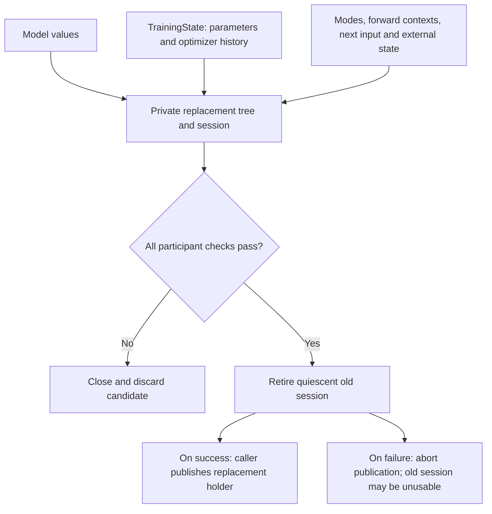

# Caller-coordinated in-memory recovery

[Reference goals](../index.md) · [Javadoc and exact signatures](../javadoc.md) ([Javadoc glossary](../../glossary.md#term-javadoc); [signatures glossary](../../glossary.md#term-signature)) · [Source entry point](../../../modules/training/src/main/java/io/github/pho001/synaptik/training/TrainingSession.java)

Exact continuation means taking the same next training input with all state that can affect the
step restored consistently. [Model](../../glossary.md#term-model) values alone omit the [optimizer](../../glossary.md#term-optimizer)'s history and the caller's
progress. An **unpublished candidate** is a private replacement assembled and validated before the
caller makes it active; discarding a failed candidate is not a built-in cross-[owner](../../glossary.md#term-owner) [rollback](../../glossary.md#term-rollback).

Read every incoming branch as required information, not fields automatically stored in a model
file. The caller supplies exclusion throughout; the diagram is not a durable [checkpoint](../../glossary.md#term-checkpoint) adapter
or a promise that a failed old-session close can be reversed.

## Caller-coordinated in-memory recovery

An exact next-input [handoff](../../glossary.md#term-handoff) is a caller-owned workflow across [NN](../../glossary.md#neural-network-module-parameter-buffer-and-forward-context) (including the relocated
`nn.checkpoint.ModelCheckpoint` [model](../../glossary.md#term-model)-only [API](../../glossary.md#term-application-programming-interface-api)),
Training, and any external input or random-state [owners](../../glossary.md#term-owner). At a [quiescent](../../glossary.md#term-quiescent) successful-[run](../../glossary.md#term-run) boundary,
the caller keeps a [detached](../../glossary.md#detached-model-results) `TrainingState`, a complete model [artifact](../../glossary.md#term-artifact) containing [parameter](../../glossary.md#term-parameter) and
persistent-[buffer](../../glossary.md#term-buffer) values, every relevant [module](../../glossary.md#term-module)'s local mode, the effective `ForwardContext`
used at each mode-sensitive [objective](../../glossary.md#term-objective)-construction site, fixed [graph](../../glossary.md#graph)-construction inputs, and a
typed next-input cursor with all affecting external state. `Module.stateDictionary()` is shallow:
its [Tensor](../../glossary.md#tensor) references are not [detached value](../../glossary.md#detached-model-results) evidence. Neither `TrainingState` counters nor
`ModelCheckpoint.inspect` can reconstruct the next input or expose model value bytes.

Ordinary `ModelCheckpoint.save` [captures](../../glossary.md#term-capture-meanings) the actual quiescent trained tree's parameter and buffer
leaves on the validated [CPU](../../glossary.md#term-cpu) route, without a caller-created expression [view](../../glossary.md#term-view-meanings). [Checkpoint](../../glossary.md#term-checkpoint) internally
selects raw-preserving movement after full [preflight](../../glossary.md#term-preflight); it neither rebinds that tree nor guarantees
generic [leaf](../../glossary.md#term-leaf)-output support in [Engine](../../glossary.md#term-engine). Keep source storage live and accessible through save.

The supported integration [fixture](../../glossary.md#term-fixture) follows this sequence under caller-owned exclusion:

1. Check participant completeness and every fact available from detached state without changing
   the published run. Create a **distinct, unpublished**, fully bound NN tree.
2. Call `ModelCheckpoint.load` on that private tree. Load rereads and validates the artifact even
   if it was previously inspected. The fixture also directly saves this loaded heap tree, compares
   complete artifact bytes, and loads it again before native copying; this is a model round-trip
   check, not a required recovery stage. Restore local modes parent first, then child overrides
   for a mixed-mode tree. ([heap glossary](../../glossary.md#term-heap); [round-trip glossary](../../glossary.md#schema-serialization-and-checkpoint))
3. Use `TrainingParameterStorage.copyToSharedNative(privateTree.trainingParameters(), privateArena)` before building
   the replacement objective or opening a session. Loaded parameters are heap-backed and
   Engine-executable, but `TrainingSession.open` requires writable, shareable native parameter
   storage. Keep the Arena alive through session close. ([Arena glossary](../../glossary.md#term-arena))
4. Build the fixed objective from the tree's **final Tensor [bindings](../../glossary.md#term-binding)** and recorded effective
   forward contexts, then call `TrainingSession.open`. Before `restore`, compare the exact stable
   path set and canonical logical `parameterBytes()` of `privateSession.state().parameters()`
   with the saved `TrainingState`. These fresh views start at position zero and contain
   big-endian represented bytes; raw native-order NN carrier bytes are not comparable. ([big-endian glossary](../../glossary.md#text-encoding-and-file-boundaries); [carrier glossary](../../glossary.md#term-storage-carrier))
5. Call `privateSession.restore(savedState)` for its own optimizer, schema, counter, slot, and
   payload validation. Validate the staged typed cursor and external-state handoff against the
   candidate, then retire the quiescent old session and publish one replacement holder under
   caller exclusion. On ordinary failure, close and discard the private session and Arena
   without publishing them. A failure while retiring the old session aborts publication, but
   cannot promise that old session is still runnable. ([optimizer glossary](../../glossary.md#term-optimizer); [payload glossary](../../glossary.md#artifact-envelope-and-atomic-publication); [validation glossary](../../glossary.md#term-validation); [publication glossary](../../glossary.md#term-publication))

For example, the [CPU private-restore fixture](../../../testing/integration-tests/src/test/java/io/github/pho001/synaptik/testing/integration/PrivateTrainingRestoreIntegrationTest.java)
captures after two successful runs with a pending [gradient](../../glossary.md#term-gradient), [optimizer momentum](../../glossary.md#optimizer-refinements-and-initialization), a [persistent
buffer](../../glossary.md#model-module-buffer-and-scan-distinctions), mixed local modes, and an [evaluation](../../glossary.md#term-evaluation) `ForwardContext` that differs from a child's training
mode. Its typed cursor names input position `2` and carries the external random state used to
derive that input. The restored candidate runs that same next input and matches an uninterrupted
CPU control in all detached Training fields, buffer value, modes, effective context, and caller
cursor. An equal-[schema](../../glossary.md#term-schema) artifact with different parameter values is rejected at the [canonical](../../glossary.md#term-canonical-form)
byte comparison; private load, copy, open, restore, and late cursor failures do not swap the
published holder. This is evidence for that bounded same-route in-memory protocol, not a
production coordinator or a general [transaction](../../glossary.md#term-transaction).

The model artifact contains no `TrainingState`, mode, cursor, or external-state [codec](../../glossary.md#term-codec). A durable
`TrainingCheckpoint` adapter is not implemented. Missing next-input or affecting external state,
training-mode BatchNorm without step-aligned running-buffer proof, and a changing per-run graph
[random stream](../../glossary.md#graph-rng-state--graphrngstate) are outside this exact-continuation claim. A fixed
`GraphRngState.initial(key, counter)` expression can be rebuilt for the new objective but is not
advanced by the current session; cross-[device](../../glossary.md#term-device) or cross-route bitwise replay is not promised.

---

[Previous topic](optimizers.md) · [Next topic](../nn/composition.md)
