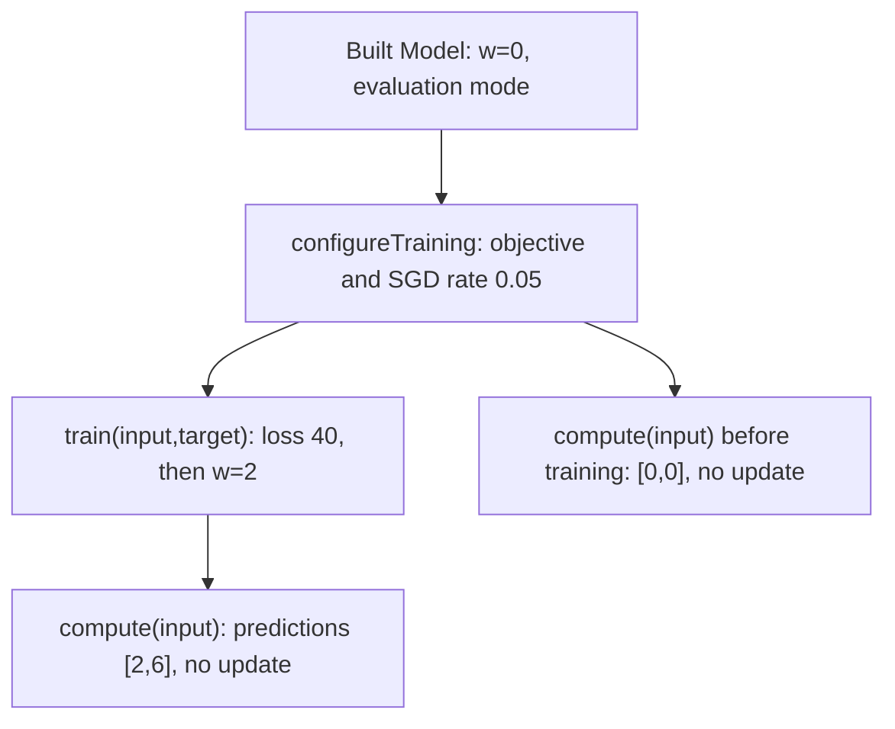

# 4. Train once, then evaluate

## Outcome and prerequisites

[Commit](../glossary.md#term-commit) one [SGD](../glossary.md#term-stochastic-gradient-descent-sgd) step that changes only the [Model](../glossary.md#term-model)'s private [weight](../glossary.md#term-weight) from `0` to `2`. Compute the
new [prediction](../glossary.md#term-prediction) `[2,6]`, and read both prediction and training [objective](../glossary.md#term-objective) after Model close.
Complete [setup](../examples/README.md#build-the-complete-project) and the
[loss/gradient walkthrough](loss-and-gradients.md)<span data-glossary-navigation="true"> ([loss glossary](../glossary.md#loss); [gradient glossary](../glossary.md#term-gradient))</span>. Commands use [JDK](../glossary.md#term-java-development-kit-jdk) 26 and `LEARNING_CP` from
the example project. No earlier process needs to be running.

## Configure what training means

An **[optimizer](../glossary.md#term-optimizer)** turns [derivatives](../glossary.md#term-derivative) into [parameter](../glossary.md#term-parameter) updates. Plain [stochastic gradient descent](../glossary.md#term-stochastic-gradient-descent-sgd)
([SGD](../glossary.md#optimizer-and-stochastic-gradient-descent)), as configured here without
momentum or decay, subtracts the learning rate times the objective's weight derivative.
The application calls `model.configureTraining(...)` with three separate choices:

- The [target](../glossary.md#term-target) [descriptor](../glossary.md#term-descriptor): [FLOAT32](../glossary.md#term-float32) `[2,1]`, [canonical](../glossary.md#term-canonical-form) [contiguous](../glossary.md#term-contiguous), `requiresGrad=false`.
- A pure objective builder. Model calls this application-supplied function during setup with
  a prediction expression built from its input prototype and a storage-free target prototype.
  These describe the comparison, not current batch values. The function returns an expression
  for the scalar sum of squared errors; it is not called per sample or per training batch.
- `new Sgd(0.05)`, the [immutable](../glossary.md#term-immutable) optimizer configuration.

The **[learning rate](../glossary.md#term-learning-rate)**, `0.05`, multiplies the [gradient](../glossary.md#term-gradient) to set the size of the update; it is a
configuration choice, not a learned [weight](../glossary.md#term-weight) or a [prediction](../glossary.md#term-prediction)-quality score. “Stochastic” refers
to estimating updates from selected data [batches](../glossary.md#term-batch-machine-learning-and-hyperparameters); this deliberately fixed two-[sample](../glossary.md#term-sample-machine-learning-and-hyperparameters) experiment
does not randomly choose a batch. An **[epoch](../glossary.md#term-epoch-meanings)** is one full pass over the chosen training [dataset](../glossary.md#term-dataset),
whereas an **[optimizer step](../glossary.md#optimizer-and-stochastic-gradient-descent)** is one committed parameter update. This mode performs one step,
not an implicit multi-epoch training loop.

Read `configure` and `train` in
[LearningJourney.java](../examples/learning-journey/src/main/java/io/github/pho001/synaptik/examples/LearningJourney.java).
The [Model](../glossary.md#term-model) owns the working weight and cached session; Training owns optimizer mathematics and
[transaction](../glossary.md#term-transaction) [admission](../glossary.md#term-admission). Configuration can copy private [heap](../glossary.md#term-heap) parameter storage into Model-owned
shared [native memory](../glossary.md#aliasing-and-arena) for the supported training path while preserving parameter [Tensor](../glossary.md#tensor) [identity](../glossary.md#term-identity-meanings).
Do not retain a storage handle before configuration and assume it is still the current [binding](../glossary.md#term-binding).
The program looks up live Model state only for inspection.

Configuration succeeds once. It neither updates the weight by itself nor changes [Module](../glossary.md#term-module) mode.
Keep the Model's acquired [evaluation](../glossary.md#term-evaluation) mode: the owned source [captures](../glossary.md#term-structural-capture) modes and other structural
bindings. Calling inherited **no-[argument](../glossary.md#term-argument)** `model.train()` to toggle mode would change a frozen
source and invalidate this owned execution capability. The overloaded
`model.train(input,target)` is the configured optimizer transaction; it is a different [operation](../glossary.md#operation).
Likewise, evaluation in this journey means `compute` without an optimizer update, not toggling
mode around each batch. Larger custom Module forward workflows have their own mode use cases.

Read the branches below as different actions available after configuration, not as mode changes.
Both paths keep evaluation mode; only the training transaction updates the private parameter.



**[Inference](../glossary.md#term-inference)** obtains a prediction without an optimizer update. **Evaluation** uses predictions
to assess the model, often against held-out targets. **[Eval mode](../glossary.md#inference-and-evaluation)** is the separate Module setting
that controls mode-dependent forward behavior. In this [bias](../glossary.md#term-bias)-free [Linear](../glossary.md#term-linear-meanings) example the multiplication
itself has no train/eval-dependent branch; the owned-source mode still must remain unchanged.

## Work through the update

The complete starting state is input `[1,3]`, [target](../glossary.md#term-target) `[2,6]`, private [weight](../glossary.md#term-weight) `0`, no [bias](../glossary.md#term-bias) and SUM
[objective](../glossary.md#term-objective). The preceding chapter gave objective `40` and weight [derivative](../glossary.md#term-derivative) `-40`.

Let $w_{\mathrm{old}}\in\mathbb{R}$ be the weight before the step,
$g=L'(w_{\mathrm{old}})$ its objective derivative, and $\eta>0$ the learning rate.
Plain SGD proposes the new weight $w_{\mathrm{new}}$:

$$
\begin{aligned}
w_{\mathrm{new}}&=w_{\mathrm{old}}-\eta g\\
               &=0-0.05(-40)=2,\\
(p_1(w_{\mathrm{new}}),p_2(w_{\mathrm{new}}))&=(1\cdot2,3\cdot2)=(2,6),\\
L(w_{\mathrm{new}})&=(2-2)^2+(6-6)^2=0.
\end{aligned}
$$

Here $p_i(w)=x_iw$, sample index $i\in\{1,2\}$, inputs $(x_1,x_2)=(1,3)$,
and desired answers $(t_1,t_2)=(2,6)$; all are dimensionless. These real-number equations
explain the step. Actual FLOAT32 evaluation rounds arithmetic; `0.05` is not an exact binary
fraction, but this example's rounded update produces the represented weight `2`. The equations
do not extend training admission to NaN, infinity or empty parameters.

The application calls `model.train(input(), target())` with current stored values. Model's
configured session borrows the input/target for that synchronous transaction and updates its
private parameter, not the original supplied weight. Its returned `TrainingStep.objective()`
contains $L(w_{\mathrm{old}})=40$, measured **before** the update. It is not a fresh evaluation
at $w_{\mathrm{new}}$. `optimizerStep()` is `1`, the first committed update.
A later `model.compute(input())` borrows a batch for a new prediction using weight $2$,
returns $[2,6]$, and makes no optimizer update. To assess the new objective, compare these
fresh predictions with the desired answers; that squared-error sum is zero.

The example keeps the original supplied [heap](../glossary.md#term-heap) [Tensor](../glossary.md#tensor) to check that its value is still `0`.
Only the [Model](../glossary.md#term-model)'s private copy becomes `2`. [Parameter](../glossary.md#term-parameter) inspection through `stateDictionary` is
[borrowed](../glossary.md#ownership-borrowing-and-lease) state, not a [detached](../glossary.md#detached-model-results) [snapshot](../glossary.md#term-snapshot); read it only while the Model is live and without
concurrent mutation. `TrainingStep` and [`HostTensorValue`](../glossary.md#host-tensor-value--hosttensorvalue), in contrast, remain readable after
all Model-owned execution/native resources close.

A **[binding](../glossary.md#term-binding)** associates a required Tensor or input position with actual stored values.
Inspection of borrowed state sees the working parameter, not a frozen copy of its bytes.
Use the [existing ownership visual](../explanation/ownership.md#a-result-is-not-always-an-independent-value)<span data-glossary-navigation="true"> ([ownership glossary](../glossary.md#term-ownership-meanings))</span>
to distinguish that borrowed state from detached training and compute results.

## Run and interpret

```bash
# The reported TrainingStep loss precedes the update; the later compute uses the new weight.
java --enable-native-access=ALL-UNNAMED -cp "$LEARNING_CP" \
  io.github.pho001.synaptik.examples.LearningJourney train
```

Expected application stdout, checked against the installed private candidate:

```text
== train ==
train.objective-before-step=[40.0]
train.private-weight=2.0
train.optimizer-step=1
train.prediction-after-step=[2.0, 6.0]
train.caller-weight=0.0
train.objective-after-model-close=[40.0]
train.prediction-after-model-close=[2.0, 6.0]
```

The old [objective](../glossary.md#term-objective) next to a new [prediction](../glossary.md#term-prediction) is intentional. The final lines check [lifetime](../glossary.md#term-lifetime),
not another execution after close. [Evaluation](../glossary.md#term-evaluation) on the training [batch](../glossary.md#term-batch-machine-learning-and-hyperparameters) checks the arithmetic;
it does not measure accuracy on independent real-world data. The later fresh `[2,4]` batch
checks the learned rule on different values while keeping the exact input [descriptor](../glossary.md#term-descriptor).

## Useful variation and relevant errors

In an independent experiment use `Sgd(0.025)` with the same SUM loss. With
$g=-40$ and $\eta=0.025$, $w_{\mathrm{new}}=0-0.025(-40)=1$.
Predictions are $[1,3]$ and the fresh squared-error sum is $(1-2)^2+(3-6)^2=10$.
Update the numerical assertions/expected output, then rebuild with the
[setup command](../examples/README.md#build-the-complete-project). Restore `0.05` before running
the [canonical](../glossary.md#term-canonical-form) full journey. [Learning rate](../glossary.md#term-learning-rate) and reduction must be considered together.

| Symptom | Meaning and correction |
|---|---|
| `IllegalStateException` before a training [transaction](../glossary.md#term-transaction) | Training was not configured, was configured twice, or the [Model](../glossary.md#term-model)/source [lifecycle](../glossary.md#lifecycle) is invalid. Configure a fresh live Model once. |
| Mode/source invalidation after no-[argument](../glossary.md#term-argument) `train()` | You changed captured [Module](../glossary.md#term-module) mode, not performed the [optimizer](../glossary.md#term-optimizer) transaction. Rebuild a fresh Model and use `train(input,target)`. |
| `IllegalArgumentException` for [batch](../glossary.md#term-batch-machine-learning-and-hyperparameters)/[target](../glossary.md#term-target) | Use exact declared [descriptors](../glossary.md#term-descriptor) and independent live stored inputs; do not [alias](../glossary.md#aliasing-and-arena) them with [parameter](../glossary.md#term-parameter) storage. |
| `ArithmeticException` for nonfinite training values | The optimizer transaction rejected invalid numerical state. Inspect data/[objective](../glossary.md#term-objective)/[gradient](../glossary.md#term-gradient); do not suppress the error or report an uncommitted update. |

## Source and next step

See [`Model.configureTraining/train`](../../extensions/nn/src/main/java/io/github/pho001/synaptik/nn/module/Model.java),
[`TrainingStep`](../../modules/training/src/main/java/io/github/pho001/synaptik/training/TrainingStep.java),
[`Sgd`](../../modules/training/src/main/java/io/github/pho001/synaptik/training/Sgd.java),
and the authoritative [owned-Model lifecycle](../architecture/contracts/extensions-training.md#owned-tensor-models)<span data-glossary-navigation="true"> ([Model glossary](../glossary.md#term-model); [lifecycle glossary](../glossary.md#lifecycle))</span>
and [Training ownership](../architecture/contracts/extensions-training.md#modulestraining)<span data-glossary-navigation="true"> ([ownership glossary](../glossary.md#term-ownership-meanings))</span>.

Next: [save current graph/weights, close, and load a new Model](save-close-load.md)<span data-glossary-navigation="true"> ([graph glossary](../glossary.md#graph); [weights glossary](../glossary.md#term-weight))</span>.
