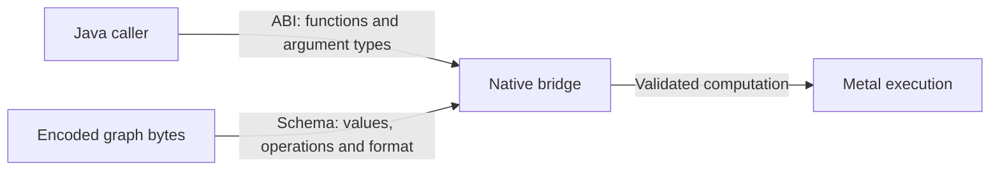

# [Metal](../../../../docs/glossary.md#term-metal) [native bridge](../../../../docs/glossary.md#term-native-bridge) for macOS [arm64](../../../../docs/glossary.md#native-packaging-and-platform-vocabulary)

## Purpose

This directory builds the native [ABI](../../../../docs/glossary.md#term-application-binary-interface-abi) used by Synaptik [Metal](../../../../docs/glossary.md#term-metal) on Apple-silicon macOS.
A **[native bridge](../../../../docs/glossary.md#term-native-bridge)** connects Java to a library compiled for a particular operating system and
processor architecture. Here it connects to Apple's Metal execution facilities. The **[application
binary interface](../../../../docs/glossary.md#application-binary-interface-and-native-bridge) (ABI)** fixes how Java and the compiled library call each other; the **[graph](../../../../docs/glossary.md#graph)
[schema](../../../../docs/glossary.md#term-schema)** separately fixes how the computation's data is encoded. Neither is the ordinary Java [API](../../../../docs/glossary.md#term-application-programming-interface-api).

### Who calls the bridge?

Java code in the Metal backend is the **caller** of the bridge's exported C functions; the
compiled native library is the **callee**. The backend uses Java's
[Foreign Function & Memory API](../../../../docs/glossary.md#term-ffm) to pass arguments and
refer to native storage. Metal then executes the validated computation on the device.
This is a different boundary from an application calling `model.compute(input)`.

### Read the version numbers as separate agreements

- **ABI version** describes exported functions and their argument/result representations.
- **Graph schema** describes encoded graph bytes. A header is metadata at the beginning;
  operation and attribute **wires** are numeric tags in that format, not physical connections.
- **Storage carrier** describes how a value's bits are represented. A type's meaning and its
  storage representation must agree at both sides of the bridge.
- Candidate/workload/policy/codec versions identify other authenticated execution inputs.
  Their numbers are not Java versions or interchangeable substitutes for the graph schema.

Use the [Metal execution guide](../../../../docs/backend-guide/metal-backend.md) for the
current route and type domains and the [ownership explanation](../../../../docs/explanation/ownership.md)
for which Java owner must remain alive. The inventory below is for bridge contributors,
not a prerequisite for the first CPU application.

Read the two incoming arrows as different compatibility checks: the function-call agreement and
the encoded graph format must both match before execution.



ABI 7 retains thirteen context, shared-storage [buffer](../../../../docs/glossary.md#term-buffer), executable and [singleton](../../../../docs/glossary.md#term-singleton)-NEG exports.
The current graph image is schema 22 (`SM22`) with a 124-byte header, [operation](../../../../docs/glossary.md#operation) wires1..116,
attribute wires0..42, [carrier](../../../../docs/glossary.md#term-storage-carrier) wires1..7 and fixed graph route2 or3.
Coordinated Java candidate/workload/policy/compatibility/[codec](../../../../docs/glossary.md#term-codec) [identities](../../../../docs/glossary.md#term-identity-meanings) are version45; stale inputs
have no compatibility reader or migration alias. [Scan](../../../../docs/glossary.md#general-differentiable-scan) attribute grammar v2 authenticates the
fifteen-word control prefix and its invocation-private forty-byte failure record; v1 rejects.

Java and [native code](../../../../docs/glossary.md#native-numerical-library-and-instruction-architecture) independently validate declared types, [shapes](../../../../docs/glossary.md#shape), attributes, [gradient](../../../../docs/glossary.md#term-gradient) bits,
[canonical](../../../../docs/glossary.md#term-canonical-form) result roles, physical [layouts](../../../../docs/glossary.md#layout)/spans and the authenticated execution plan.
The bridge consumes that fixed plan; it does not discover a [backend](../../../../docs/glossary.md#backend), choose [ownership](../../../../docs/glossary.md#term-ownership-meanings), retry
a route or fall back to [CPU](../../../../docs/glossary.md#term-cpu). Source/package [authentication](../../../../docs/glossary.md#term-authentication) remains a safety boundary.

Current capabilities and independently exercised numerical/training domains are defined in the
[Metal guide](../../../../docs/backend-guide/metal-backend.md) and
[production support ledger](../../../../docs/backend-guide/production-support.md#metal-production-target).
The ordinary inventory has 115 kinds and 137 [signatures](../../../../docs/glossary.md#term-signature); [general Scan](../../../../docs/glossary.md#general-differentiable-scan) is separate. Historical
structural-recipe counts are not current capability authority.

The shared [FLOAT32](../../../../docs/glossary.md#term-float32)/[BFLOAT16](../../../../docs/glossary.md#term-bfloat16)/[FLOAT16](../../../../docs/glossary.md#term-float16) implementation includes ordinary elementary/reduction/
statistical/masked, [normalization](../../../../docs/glossary.md#term-normalization)/[loss](../../../../docs/glossary.md#loss)/attention, [convolution](../../../../docs/glossary.md#term-channels-first-convolution-layers)/[pooling](../../../../docs/glossary.md#term-pooling), arithmetic scatter and
selected [Compiler](../../../../docs/glossary.md#term-compiler) gradients. Original storage carriers and per-role [POD](../../../../docs/glossary.md#term-pod) [metadata](../../../../docs/glossary.md#term-metadata) retain each
input/output type, gradient bit and canonical sibling role; there is no FLOAT32 [tensor](../../../../docs/glossary.md#tensor) proxy.
[Conv3d](../../../../docs/glossary.md#conv3d--ncdhw)/[Pool3d](../../../../docs/glossary.md#pool3d--ncdhw-pooling) train through shared grouped/window/fold [owners](../../../../docs/glossary.md#term-owner). Three-family FOLD_AXIS/
FOLD2D/FOLD3D overlap has one writer per output, without atomics or [host](../../../../docs/glossary.md#term-host) repair; [FLOAT64](../../../../docs/glossary.md#term-float64) remains
non-overlapping exact movement only. Maximum pooling preserves exact winner rules; average
pooling uses the full [kernel](../../../../docs/glossary.md#kernel) divisor. Geometry and contributor guards remain operation-specific.

Exact raw operations retain original FLOAT64/integral/[BOOL](../../../../docs/glossary.md#data-type--datatype)/low carriers without software [FP64](../../../../docs/glossary.md#term-fp64).
All 49 casts and qualified movement/index/ordering/selection paths preserve their [Model](../../../../docs/glossary.md#term-model) semantics.
Seven-carrier signed-step [SLICE](../../../../docs/glossary.md#slice) materializes canonical storage rather than negative physical
[strides](../../../../docs/glossary.md#term-stride). [INT32](../../../../docs/glossary.md#data-type--datatype)/[INT64](../../../../docs/glossary.md#data-type--datatype) cumulative arithmetic is exact and modular. Read-only broadcast [views](../../../../docs/glossary.md#term-view-meanings)
retain authenticated physical strides; writable outputs remain [injective](../../../../docs/glossary.md#term-injective). CONCAT/STACK use
dynamic operand references and one disjoint direct-copy child per operand in the shared ordinary/
Scan [owner](../../../../docs/glossary.md#term-owner), not N-wide [argument](../../../../docs/glossary.md#term-argument) [binding](../../../../docs/glossary.md#term-binding) or intermediate pairwise tensors. There is no
sixteen-operand cap: 17/33/257-input three-family cases exercise views and last-operand-only [AD](../../../../docs/glossary.md#autograd).
[Rank](../../../../docs/glossary.md#term-rank) zero is one stored value. Qualified empty source/EXPAND/normalization/Scan and zero-output
CONCAT/STACK [cotangent](../../../../docs/glossary.md#cotangent) paths detect zero extents without zero-grid loads or [dispatch](../../../../docs/glossary.md#term-dispatch).

General Scan uses wire116/attribute42 for an authenticated bounded body/binder plan within the
existing native executable. A true native time loop reuses once-prepared ordinary [kernels](../../../../docs/glossary.md#kernel) and
[run](../../../../docs/glossary.md#term-run)-private control/storage. Traversal, [carry](../../../../docs/glossary.md#term-carry)/history ports, original demanded output roles and
per-operand structural activity remain explicit. Inactive contributors are skipped before loads
or index [validation](../../../../docs/glossary.md#term-validation); present zero is not absence. Actual Compiler reverse bodies use the same
controlled ordinary owners. There is no Java body interpreter, T-fold [unrolling](../../../../docs/glossary.md#term-unrolling) or copied CPU
evaluator. Explicit [NN](../../../../docs/glossary.md#neural-network-module-parameter-buffer-and-forward-context) GeneralScan exercises FLOAT32/BFLOAT16/FLOAT16, both directions, optional
[bias](../../../../docs/glossary.md#term-bias), changing lengths and inactive NaNs against an independent ordinary RnnCell unroll and
[parameter](../../../../docs/glossary.md#term-parameter) AD, including save/load/fresh [SGD](../../../../docs/glossary.md#term-stochastic-gradient-descent-sgd). Fixed [RNN](../../../../docs/glossary.md#term-recurrent-neural-network-rnn)/[GRU](../../../../docs/glossary.md#term-gated-recurrent-unit-gru)/[LSTM](../../../../docs/glossary.md#term-long-short-term-memory-lstm) first AD separately exercises
every floating input/state/[weight](../../../../docs/glossary.md#term-weight)/bias role, lengths 0/1/3, both directions and optional bias
against independent FLOAT32 [finite differences](../../../../docs/glossary.md#arithmetic-rearrangement-and-finite-difference-checks) and typed [scalar](../../../../docs/glossary.md#term-scalar) adjoints. Fixed-cell working/
[publication](../../../../docs/glossary.md#term-publication) [rounding](../../../../docs/glossary.md#term-rounding) remains distinct from the explicit ordinary-cell Scan path.
Owned [MLP](../../../../docs/glossary.md#term-multilayer-perceptron-mlp) and Conv3d/overlap AvgPool3d/MaxPool3d journeys exercise three-family forward/[MSE](../../../../docs/glossary.md#mean-squared-error--mse),
input/parameter AD, SGD and save/close/load/[rebind](../../../../docs/glossary.md#capture-graph-ports-and-reconstruction)/fresh training. Cold NN decoding accepts
Model-legal per-role floating types/casts without changing public [checkpoint](../../../../docs/glossary.md#term-checkpoint) wire or loosening
strict rebind [descriptors](../../../../docs/glossary.md#term-descriptor).

Low-containing partitions have only the fixed CUSTOM_PROGRAM whole-[partition](../../../../docs/glossary.md#partition) route. Their
BFLOAT16/FLOAT16-valued steps use the same typed numerical owners as FLOAT32, never implicit
[MPSGraph](../../../../docs/glossary.md#term-mpsgraph) low execution. Approved FLOAT32-only internal boundary steps do not change that route.
The separate low-[precision](../../../../docs/glossary.md#term-precision) library is retired; `synaptik_numeric_codec.h` supplies the shared
codec. Model-legal floating promotion is validated per operation; other mixes require explicit casts.
CPU low arithmetic is unchanged; there is no CPU fallback, FP64 arithmetic or FP64 emulation.

Low inputs decode into FLOAT32 working/[accumulator](../../../../docs/glossary.md#accumulator-type) sites; each observable output publishes in
its declared carrier, with low results rounded to nearest, ties to even. Exact selection/order/
[extrema](../../../../docs/glossary.md#saturation-pole-and-extremum) preserve stored words; arithmetic special values and named [DAZ](../../../../docs/glossary.md#term-daz)/[FTZ](../../../../docs/glossary.md#term-ftz) sites follow Model.
No blanket [tolerance](../../../../docs/glossary.md#term-tolerance) or zero-sign freedom is added. Dedicated [EXP](../../../../docs/glossary.md#term-expx)/[SIGMOID](../../../../docs/glossary.md#term-sigmoid) [device](../../../../docs/glossary.md#term-device) oracles
remain separate from [Runtime](../../../../docs/glossary.md#term-runtime) policy; admitted scalar/gradient occurrences use all three families.

The fixed corpus authenticates 23 components and their ordered 188,490-byte [UTF-8](../../../../docs/glossary.md#term-utf-8) source before
safe-math Metal 3.2 [compilation](../../../../docs/glossary.md#compiler-engine-and-execution-stage-names). Its [SHA-256](../../../../docs/glossary.md#term-sha-256) is
`9d0d08724f5deac665bb4e09c08af3b0fad08efff050dad2d8ae265f39a030d4`;
the [MATMUL](../../../../docs/glossary.md#matrix-multiplication--matmul) component is 7,013 bytes with SHA-256
`cc7ba9eacdbfe9f423f704d53834e52daba018845e0b9c515ffa005c735ad607`.
The last device [compile](../../../../docs/glossary.md#compile) exposed 165 functions. Generated [pointwise](../../../../docs/glossary.md#term-pointwise)/anchor source retains exact
count, [digest](../../../../docs/glossary.md#term-digest) and cap validation. Low-containing partitions do not use those fusions.
The native body, metadata, pipelines and resources are
prepared once; invocation has no route [lookup](../../../../docs/glossary.md#term-lookup), compilation, retry or resource-plan rebuilding.

Workload signatures bind exact operation/carrier/shape/attribute/gradient, logical and physical
geometry, original boundary roles, [constants](../../../../docs/glossary.md#term-constant), body/control plans and current [identity](../../../../docs/glossary.md#term-identity-meanings) meaning.
The local native package remains deterministic and source-build/ad-hoc signed, not a trusted
public prebuilt. Final [distribution](../../../../docs/glossary.md#term-distribution) acceptance requires its separate frozen source and installed
consumer receipts; a historical task probe does not certify the current [binary](../../../../docs/glossary.md#term-binary-descriptor-and-metadata). The refreshed
operation catalogs have matched three-family coverage; final root and installed-consumer receipts
are recorded separately in the production ledger.

```text
Java analysis -> choose fixed whole-partition route -> declare every exact resource
Java prepare  -> compile one typed persistent resource -> retain opaque handle
Java run      -> pass assigned MTLBuffer handles       -> one synchronous native call
Java close    -> release persistent/run resources, context, and FFM lookup
```

The bridge is backend-private. Its handles are process-local ownership [tokens](../../../../docs/glossary.md#term-token), not caller-visible
addresses or [serialization](../../../../docs/glossary.md#term-serialization) values.

## Build prerequisites and local package

Build on an Apple-silicon macOS [host](../../../../docs/glossary.md#term-host) with full Xcode installed at `/Applications/Xcode.app`.
The build explicitly selects its `Contents/Developer` directory; standalone Command Line Tools
are not sufficient for this supported build path.

```bash
./modules/backend/metal/macos-arm64/build.sh
```

The script [targets](../../../../docs/glossary.md#term-target) exactly [arm64](../../../../docs/glossary.md#native-packaging-and-platform-vocabulary) and macOS 26.0, enables [automatic reference counting](../../../../docs/glossary.md#native-packaging-and-platform-vocabulary) ([ARC](../../../../docs/glossary.md#term-arc)), sets
the [install name](../../../../docs/glossary.md#term-install-name) to `@rpath/libsynaptik_metal_foundation.dylib`, adds no [rpath](../../../../docs/glossary.md#term-rpath), and links
Foundation, [Metal](../../../../docs/glossary.md#term-metal), and MetalPerformanceShadersGraph. It requires a real local `build/` directory,
rejects symlink or non-directory destinations and any existing non-regular output, compiles in a
private directory, and atomically replaces only
`modules/backend/metal/macos-arm64/build/libsynaptik_metal_foundation.dylib` after success.

Explicitly replace the linker's incidental [signature](../../../../docs/glossary.md#term-signature) with the fixed local ad-hoc [identity](../../../../docs/glossary.md#term-identity-meanings), then
package and independently verify the final signed bytes:

```bash
/usr/bin/codesign --force --sign - --timestamp=none \
  --identifier io.github.pho001.synaptik.metal.foundation \
  modules/backend/metal/macos-arm64/build/libsynaptik_metal_foundation.dylib
./modules/backend/metal/macos-arm64/package-local.sh \
  modules/backend/metal/macos-arm64/build/libsynaptik_metal_foundation.dylib
./modules/backend/metal/macos-arm64/verify-package.sh \
  modules/backend/metal/macos-arm64/build/package-v1/macos-arm64
```

The ignored `build/package-v1/macos-arm64/` directory contains exactly the signed [dylib](../../../../docs/glossary.md#term-dylib),
`manifest.json`, and `SHA256SUMS`. The [canonical](../../../../docs/glossary.md#term-canonical-form) [schema](../../../../docs/glossary.md#term-schema)-1 [manifest](../../../../docs/glossary.md#term-manifest) records the final dylib's
relative name, size, [SHA-256](../../../../docs/glossary.md#term-sha-256), platform, architecture, macOS 26.0 minimum, install name, empty
rpath set, ABI7, [node](../../../../docs/glossary.md#node) schema22, required frameworks and fixed ad-hoc identifier. It contains no
time, host, absolute path, [source revision](../../../../docs/glossary.md#term-source-revision), product version, [SDK](../../../../docs/glossary.md#term-sdk) version, Team ID, [notarization](../../../../docs/glossary.md#term-notarization),
[provenance](../../../../docs/glossary.md#provenance), or [release](../../../../docs/glossary.md#term-release) field. Packaging the same exact signed input produces byte-identical
manifest and [checksum](../../../../docs/glossary.md#term-checksum) files.

The packager applies the same real-directory checks to `build/` and its package staging parent.
The verifier rejects redundant terminal separators or components before checking the package root
without following a symlink. It parses every raw `otool -L` [dependency](../../../../docs/glossary.md#term-dependency) line as one complete path
plus the exact compatibility/current-version suffix and rejects malformed, control-bearing, or
ambiguous records before applying the system-dependency allowlist.

The checksums detect corruption; because they travel with the [artifact](../../../../docs/glossary.md#term-artifact), they do not authenticate a
hostile replacement. The ad-hoc signature verifies internal [Mach-O](../../../../docs/glossary.md#term-mach-o) [integrity](../../../../docs/glossary.md#term-integrity) but supplies no
publisher identity or Apple trust. This package and its optional local ZIP remain verified local
development artifacts, not Developer-ID-signed, notarized, authenticated, published, or public
release artifacts. Developer ID signing, secure credentials/keychain handling, a notarizable
[distribution](../../../../docs/glossary.md#term-distribution) container, versioning, provenance, and [publication](../../../../docs/glossary.md#term-publication) require separate release [planning](../../../../docs/glossary.md#term-planning)
and real externally supplied credentials.

## Optional verified local [Gradle](../../../../docs/glossary.md#term-gradle) archive

Supply the [canonical](../../../../docs/glossary.md#term-canonical-form) package directory explicitly as an absolute path. The property has no
default, environment fallback, or discovery:

```bash
PACKAGE="$PWD/modules/backend/metal/macos-arm64/build/package-v1/macos-arm64"
./gradlew :backends:metal:verifyMetalNativePackage \
  -PsynaptikMetalNativePackage="$PACKAGE"
./gradlew :backends:metal:metalNativeLocalZip \
  -PsynaptikMetalNativePackage="$PACKAGE"
```

Both tasks are opt-in. Ordinary `build`, `assemble`, `check`, `jar`, and `test` do not evaluate the
property or [run](../../../../docs/glossary.md#term-run) native verification. The ZIP task first runs the existing verifier every time; it
never builds, signs, repairs, installs, extracts, discovers, or caches a library. Blank, relative,
redundantly terminated, and symlink-root package paths [fail closed](../../../../docs/glossary.md#admission-preflight-and-fail-closed-validation).

The fixed output is
`modules/backend/metal/build/distributions/synaptik-metal-macos-arm64-local.zip`. It is unversioned and
contains only the exact verified package beneath `macos-arm64/`, with reproducible order and
timestamps and modes `0755` for the directory/[dylib](../../../../docs/glossary.md#term-dylib) and `0644` for the [metadata](../../../../docs/glossary.md#term-metadata). It contains no
source path, product version, [provenance](../../../../docs/glossary.md#provenance), license placeholder, or [publication](../../../../docs/glossary.md#term-publication) [coordinates](../../../../docs/glossary.md#axis-rank-scalar-vector-and-matrix).

Extraction and [lifetime](../../../../docs/glossary.md#term-lifetime) remain caller-owned. Use a permission-preserving extractor, rerun the
same verifier, and pass the extracted dylib's explicit absolute path to
`MetalBackendConfiguration`:

```bash
DEST="$(mktemp -d)"
/usr/bin/ditto -x -k \
  modules/backend/metal/build/distributions/synaptik-metal-macos-arm64-local.zip \
  "$DEST"
./modules/backend/metal/macos-arm64/verify-package.sh "$DEST/macos-arm64"
LIB="$DEST/macos-arm64/libsynaptik_metal_foundation.dylib"
```

Keep or remove `DEST` under the caller's own [lifecycle](../../../../docs/glossary.md#lifecycle); Synaptik performs no automatic install,
extraction, cleanup, [classpath](../../../../docs/glossary.md#term-classpath) [lookup](../../../../docs/glossary.md#term-lookup), or [runtime](../../../../docs/glossary.md#term-runtime) discovery. `SYNAPTIK_METAL_TEST_LIBRARY` remains
test-only. The archive does not add [authentication](../../../../docs/glossary.md#term-authentication) or redistribution rights, and it deliberately
does not copy the [CPU](../../../../docs/glossary.md#term-cpu)-only `THIRD_PARTY_NOTICES.md`.

## [ABI](../../../../docs/glossary.md#term-application-binary-interface-abi) version 7

The [dylib](../../../../docs/glossary.md#term-dylib) exports exactly these thirteen symbols:

```text
synaptik_metal_foundation_abi_version
synaptik_metal_context_create
synaptik_metal_context_release
synaptik_metal_buffer_create
synaptik_metal_buffer_release
synaptik_metal_buffer_upload
synaptik_metal_buffer_download
synaptik_metal_mpsgraph_executable_create
synaptik_metal_mpsgraph_executable_release
synaptik_metal_mpsgraph_executable_run
synaptik_metal_neg_kernel_pipeline_create
synaptik_metal_neg_kernel_pipeline_release
synaptik_metal_neg_kernel_pipeline_run
```

The version function returns unsigned value `7`. All other functions return a signed 32-bit
status. Context, [buffer](../../../../docs/glossary.md#term-buffer), program-executable, and custom-pipeline values cross the boundary as
separate [opaque](../../../../docs/glossary.md#term-opaque) `void *` handle families. Buffer sizes and offsets are unsigned 64-bit values.
Created handles use caller-supplied output cells, which remain null on failure. ABI 7 removes the
former `synaptik_metal_context_certification_environment` export.

The [graph](../../../../docs/glossary.md#graph) creator's exact [signature](../../../../docs/glossary.md#term-signature) is:

```c
int32_t synaptik_metal_mpsgraph_executable_create(
    void *context,
    const uint8_t *program,
    uint32_t program_bytes,
    void **out_executable);
```

`program` is one [canonical](../../../../docs/glossary.md#term-canonical-form) [little-endian](../../../../docs/glossary.md#text-encoding-and-file-boundaries) schema22 image of at most `INT32_MAX` bytes:

```text
124-byte header
value_count × 40-byte value descriptors
node_count × 32-byte node descriptors
dimension_count × u64 dimensions
stride_count × u64 element strides
reference_count × u32 value references (immediately followed by attributes; no padding)
attribute_word_count × u64 attribute words
CUSTOM_PROGRAM only:
  step_count × 40-byte step records
  member_count × u32 node positions
  binding_count × 24-byte binding records
  materialized_count × u32 program-value indices
  instruction_count × 64-byte typed execution instruction records
  canonical ASCII manifest
  32-byte SHA-256 manifest digest
```

The 31 header words are magic `SM22` (`0x32324d53`), [schema](../../../../docs/glossary.md#term-schema) `22`, header bytes `124`, total
bytes, fixed route, generator schema/extension flag, the eight core
counts, the five execution-record counts, [manifest](../../../../docs/glossary.md#term-manifest)/[digest](../../../../docs/glossary.md#term-digest) byte counts, generated-unit count,
generated/fixed/total source byte counts, first rejected [node](../../../../docs/glossary.md#node), cap reason, and the per-function,
generated-source, and total-source caps. Route `2=MPSGRAPH` requires generator schema, extension
flag, all extension counts, source sizes, and caps to be zero and physically omits every extension
section. Route `3=CUSTOM_PROGRAM` requires generator schema `2`, extension flag `1`, a nonempty
canonical manifest with a 32-byte digest, and parser-recomputed records, source sizes, and caps.
Older schemas fail before native resource creation or mutation.

A value [descriptor](../../../../docs/glossary.md#term-descriptor) is `{type, rank, dimension_offset, stride_offset, flags, layout_kind,
storage_offset, referenced_span}`; the final two fields are unsigned 64-bit [element](../../../../docs/glossary.md#term-element) counts. Stable
type wires are `1=FLOAT32`, `2=INT32`, `3=BOOL`, `4=FLOAT64`, `5=BFLOAT16`, `6=INT64`, and
`7=FLOAT16`; [rank](../../../../docs/glossary.md#term-rank) is `0..16`. Flag bits are `requiresGrad`, [layout](../../../../docs/glossary.md#layout)-present, [view](../../../../docs/glossary.md#term-view-meanings), and dense-physical.
A missing layout uses [stride](../../../../docs/glossary.md#term-stride) offset `UINT32_MAX`, kind/offset/span zero, and no layout flags. A present layout names
one rank-sized [contiguous](../../../../docs/glossary.md#term-contiguous) stride-pool range and kind `1=DENSE_CONTIGUOUS`,
`2=DENSE_WITH_OFFSET`, `3=STRIDED`, or `4=BROADCAST_ZERO_STRIDE`. A node descriptor is
`{operation, attribute_kind, input_offset, input_count, output_offset, output_count,
attribute_offset, attribute_word_count}`.

References are ordered feeds, [targets](../../../../docs/glossary.md#term-target), then each node's inputs and outputs. Descriptor offsets must
name exactly those contiguous subranges. [Dimensions](../../../../docs/glossary.md#dimension), strides, references, attributes, and any
extension sections are contiguous with no gaps, overlap, or trailing data. The optional [alignment](../../../../docs/glossary.md#term-alignment)
word must be zero.

Feed count may be zero only when [topology](../../../../docs/glossary.md#term-topology) produces every value, as in Task-0065 INITIAL_STATE.
The Java [FFM](../../../../docs/glossary.md#term-ffm) boundary then passes no fabricated feed pointer; target and node reference sections
remain ordinary nonempty image data. Execution binds the produced value buffer normally.
Native [validation](../../../../docs/glossary.md#term-validation) checks all arithmetic, section bounds, reserved bits, layout kind/span
reconstruction, registered [operation](../../../../docs/glossary.md#operation) [cardinality](../../../../docs/glossary.md#term-cardinality), attribute pairing and word count,
type/rank/dimension rules, [topological](../../../../docs/glossary.md#term-topological-order) availability, feed and target uniqueness, and executable
operations' exact [Shape](../../../../docs/glossary.md#shape) and state contracts before graph construction. Unknown wires, malformed
sections, unavailable values, incompatible Shapes, and wrong schema versions [fail closed](../../../../docs/glossary.md#admission-preflight-and-fail-closed-validation) as invalid
[arguments](../../../../docs/glossary.md#term-argument). Caller-feed controls/indices are validated before [dispatch](../../../../docs/glossary.md#term-dispatch); produced controls are
validated at their consuming step before that operation writes. Preceding completed [producers](../../../../docs/glossary.md#term-producer)
are not rolled back. A well-formed operation outside current execution capability returns
status13. Java independently authenticates the same current program before native creation.

Task 0066 broadens selected existing wires without changing schema, ABI, or operation counts.
All 49 ordered CAST pairs use integer-defined [Model](../../../../docs/glossary.md#term-model) conversion, including direct [ties-to-even](../../../../docs/glossary.md#term-ties-to-even)
[BFLOAT16](../../../../docs/glossary.md#term-bfloat16)/[FLOAT16](../../../../docs/glossary.md#term-float16) [rounding](../../../../docs/glossary.md#term-rounding), [signed zero](../../../../docs/glossary.md#term-signed-zero), [gradual underflow](../../../../docs/glossary.md#term-gradual-underflow), [infinity](../../../../docs/glossary.md#term-infinity) [overflow](../../../../docs/glossary.md#term-overflow), deterministic [NaN](../../../../docs/glossary.md#term-nan)
handling, [saturating](../../../../docs/glossary.md#saturation-pole-and-extremum) floating-to-signed conversion, modular [INT64](../../../../docs/glossary.md#data-type--datatype)-to-[INT32](../../../../docs/glossary.md#data-type--datatype) [narrowing](../../../../docs/glossary.md#term-narrowing), and exact [BOOL](../../../../docs/glossary.md#data-type--datatype)
mapping. Four-[carrier](../../../../docs/glossary.md#term-storage-carrier) [floating classification](../../../../docs/glossary.md#floating-classification) and the fourteen non-mixed-low promoted floating
WHERE signatures are bit-defined. [GATHER](../../../../docs/glossary.md#gather), ONE_HOT, replacement scatter, and [ND](../../../../docs/glossary.md#term-nd)/index movement
accept INT32 or INT64 indices.

All seven carriers enter exact affine movement and [canonicalization](../../../../docs/glossary.md#occurrence-identity-and-canonical-form). Logical zero-stride
descendants are admitted only from authenticated local EXPAND [provenance](../../../../docs/glossary.md#provenance), while every separately
bound physical descriptor stays safe and dense where materialized. External unsafe-stride,
overlapping, empty, dynamic, and unresolved layouts fail closed. Selected occurrences use one
deterministic custom whole-program route; bounds and destination uniqueness are proved before
mutation, and there is no retry, fallback, timing, [autotuning](../../../../docs/glossary.md#autotuning--model-autotuning), or [host](../../../../docs/glossary.md#term-host) repair. UNFOLD_AXIS accepts
every positive static window that fits the selected [extent](../../../../docs/glossary.md#term-extent).

Task 0060 custom replacement and signed [slice update](../../../../docs/glossary.md#slice-update) preserve all seven carriers. Scatter accepts
canonical INT32/INT64 indices and preflights every tuple's bounds plus global destination
uniqueness before copying or replacement. FOLD_AXIS accepts every non-BOOL carrier with
non-overlapping windows. FOLD2D/FOLD3D accept [FLOAT64](../../../../docs/glossary.md#term-float64)/[FLOAT32](../../../../docs/glossary.md#term-float32)/BFLOAT16/FLOAT16 when every
stride is at least the effective dilated [kernel](../../../../docs/glossary.md#kernel); only FLOAT32 also admits overlap. Non-overlap
copies the sole in-bounds contributor or exact carrier zero. Overlapping FLOAT32 image folds
instead give each output cell one writer, start at [positive zero](../../../../docs/glossary.md#nan-infinity-and-signed-zero) and deterministically sum its
in-range column contributors, excluding conceptual [padding](../../../../docs/glossary.md#padding). No atomics, scratch, host fallback,
repair or software FLOAT64 are introduced. INT32/INT64 PROD uses stable [row-major](../../../../docs/glossary.md#term-row-major) modular
multiplication; BOOL ALL/ANY uses exact zero/one [identities](../../../../docs/glossary.md#term-identity-meanings). Empty [axes](../../../../docs/glossary.md#term-axis) are point identities
and never imply zero-extent support.

Task 0064's six [kernels](../../../../docs/glossary.md#kernel) are output-cell-owned and require no scratch, atomics, host calculation,
repair, retry, or fallback. [Convolution](../../../../docs/glossary.md#term-channels-first-convolution-layers) iterates groups and every kernel-position/[channel](../../../../docs/glossary.md#term-channel) term in
fixed logical order, injects positive-zero padding as an ordinary multiplicand, and uses the
optional [bias](../../../../docs/glossary.md#term-bias) as the initial [accumulator](../../../../docs/glossary.md#accumulator-type). Mixed BFLOAT16/FLOAT32 inputs convert each source term
to FLOAT32 before multiplication. Maximum [pooling](../../../../docs/glossary.md#term-pooling) compares integer carrier keys, prefers every NaN
over every number, positive zero over [negative zero](../../../../docs/glossary.md#nan-infinity-and-signed-zero), and the first logical [coordinate](../../../../docs/glossary.md#axis-rank-scalar-vector-and-matrix) on ties, then
copies the selected [raw bits](../../../../docs/glossary.md#storage-mapping-contiguity-and-injectivity). Average pooling includes every padded kernel position in the fixed
divisor, uses FLOAT32 accumulation and one final division, and preserves the specified all-negative-
zero result. All writes remain one-writer and direct.

Task 0065 kernels require no scratch, host [payload](../../../../docs/glossary.md#artifact-envelope-and-atomic-publication) inspection, host output repair, retry, fallback,
or [mutable](../../../../docs/glossary.md#term-mutable) generator state. Threshold and complement words are fixed at cold [lowering](../../../../docs/glossary.md#lowering) from the raw
[binary64](../../../../docs/glossary.md#floating-point-precision-and-rounding) probability. The [mask](../../../../docs/glossary.md#term-boolean-mask) remains a live ordinary output until every generated WHERE consumer
finishes; target subsets do not elide sibling mask or next-state production. Exact BOOL WHERE
accepts authenticated local affine views. Ordinary nested [MPSGraph](../../../../docs/glossary.md#term-mpsgraph) affine steps materialize into
dense assigned buffers, so custom WHERE derives canonical physical strides and zero offset from
the representation actually bound at [runtime](../../../../docs/glossary.md#term-runtime) rather than reapplying declared logical-view
geometry. Repeated runs, sessions, and concurrent invocations therefore share only [immutable](../../../../docs/glossary.md#term-immutable)
executable [metadata](../../../../docs/glossary.md#term-metadata), never a counter.

The prior FLOAT32 [scalar](../../../../docs/glossary.md#term-scalar) `ADD/SUB/MUL/DIV` and `RECIPROCAL` domain remains canonical rank `1..16`
with equal input/output Shape and no-[gradient](../../../../docs/glossary.md#term-gradient) input and output. Each scalar arithmetic recipe
creates one exact four-byte raw FLOAT32 MPSGraph [constant](../../../../docs/glossary.md#term-constant) with Shape `[1]` and applies exactly one
corresponding [binary](../../../../docs/glossary.md#term-binary-descriptor-and-metadata) primitive with the input primary and scalar secondary. `RECIPROCAL` creates
exact raw `+1.0f` with Shape `[1]` and applies exactly one division with one primary and the input
secondary. MPSGraph [broadcasting](../../../../docs/glossary.md#broadcasting) supplies the output Shape; no full-[tensor](../../../../docs/glossary.md#tensor) constant is
materialized. The four exact raw discrete unaries require canonical FLOAT32 rank `1..16`, equal
input/output Shape and gradient eligibility, and no attributes.

Raw structural fixtures additionally create prior wires `38`, `50`, `53..54`, `56..59`, and
`65..68` and all Task-0059 wires `39` and `69..84` under the selected capability,
production-exact convolution/pooling wires `36`, `37`, and `97..100`, Task-0065 custom wires
`101..102`, aggregate wires `106..108`, and structural-only wires `111..113` and `115`. Task-0059
recipes cover direct cast/index/pad/[slice](../../../../docs/glossary.md#slice)/concat/tile/[im2col](../../../../docs/glossary.md#term-im2col)/[col2im](../../../../docs/glossary.md#term-col2im) selectors and explicit stack,
fold-axis, and 3D-window compositions. Task-0060 adds stable [log-sum-exp](../../../../docs/glossary.md#log-sum-exp), correction-aware
[variance](../../../../docs/glossary.md#term-variance)/standard-deviation, and [L2](../../../../docs/glossary.md#term-l2)-[norm](../../../../docs/glossary.md#term-norm) structural compositions. Wires `70` and `114`, plus the
exact wire-112 [singleton](../../../../docs/glossary.md#term-singleton) `[1]`/axis-`[0]`/correction-zero [occurrence](../../../../docs/glossary.md#term-occurrence), reject direct MPSGraph
creation and use their fixed Task-0069 custom kernels. Non-domain VARIANCE retains its existing
direct MPSGraph structural recipe. Task-0061 retains only all-FLOAT32 [rank-two](../../../../docs/glossary.md#axis-rank-scalar-vector-and-matrix) [MATMUL](../../../../docs/glossary.md#matrix-multiplication--matmul) in the
MPSGraph recipe; typed custom forms are rejected by that route. Task-0064 direct/composed MPSGraph
family metadata remains structural only. Its six production rows, both Task-0065 random rows, and
all three exact Task-0069 occurrences always select the custom program. Structural creation and
execution do not widen production capability.

### Status values

| Value | C name | Meaning |
|---:|---|---|
| 0 | `SYNAPTIK_METAL_STATUS_OK` | The [operation](../../../../docs/glossary.md#operation) completed successfully. |
| 1 | `SYNAPTIK_METAL_STATUS_INVALID_ARGUMENT` | A required handle, pointer, count, index, [topology](../../../../docs/glossary.md#term-topology) fact, or output cell is invalid. |
| 2 | `SYNAPTIK_METAL_STATUS_NO_DEVICE` | No default [Metal](../../../../docs/glossary.md#term-metal) [device](../../../../docs/glossary.md#term-device) is available. |
| 3 | `SYNAPTIK_METAL_STATUS_NO_COMMAND_QUEUE` | The device could not create a [command queue](../../../../docs/glossary.md#term-command-queue). |
| 4 | `SYNAPTIK_METAL_STATUS_ALLOCATION_FAILED` | Native [owner](../../../../docs/glossary.md#term-owner) or [buffer](../../../../docs/glossary.md#term-buffer) allocation failed. |
| 5 | `SYNAPTIK_METAL_STATUS_RANGE_OUT_OF_BOUNDS` | A requested buffer copy is outside its logical [extent](../../../../docs/glossary.md#term-extent), or an indexing operand fails its declared extent/depth. |
| 6 | `SYNAPTIK_METAL_STATUS_COPY_FAILED` | Shared buffer contents were unavailable for a requested copy. |
| 7 | `SYNAPTIK_METAL_STATUS_INTERNAL_ERROR` | An [Objective-C](../../../../docs/glossary.md#native-packaging-and-platform-vocabulary) exception crossed an internal implementation boundary. |
| 8 | `SYNAPTIK_METAL_STATUS_UNSUPPORTED_SHAPE` | [Rank](../../../../docs/glossary.md#term-rank), [dimensions](../../../../docs/glossary.md#dimension), checked typed byte geometry, custom [element](../../../../docs/glossary.md#term-element) count, or [dispatch](../../../../docs/glossary.md#term-dispatch)-grid representation is unsupported. |
| 9 | `SYNAPTIK_METAL_STATUS_GRAPH_COMPILATION_FAILED` | [Graph](../../../../docs/glossary.md#graph) construction or [compilation](../../../../docs/glossary.md#compiler-engine-and-execution-stage-names) produced no usable executable. |
| 10 | `SYNAPTIK_METAL_STATUS_INCOMPATIBLE_RESOURCE` | A buffer has the wrong creating context, device, or extent, an input [aliases](../../../../docs/glossary.md#aliasing-and-arena) an output, or distinct output slots alias one resource. |
| 11 | `SYNAPTIK_METAL_STATUS_EXECUTION_FAILED` | [Synchronous](../../../../docs/glossary.md#term-synchronous) execution, unusable [threadgroup](../../../../docs/glossary.md#term-threadgroup) geometry, completion reporting, or returned-result [validation](../../../../docs/glossary.md#term-validation) failed. |
| 12 | `SYNAPTIK_METAL_STATUS_KERNEL_COMPILATION_FAILED` | Fixed custom-[kernel](../../../../docs/glossary.md#kernel) compilation, function [lookup](../../../../docs/glossary.md#term-lookup), [target](../../../../docs/glossary.md#term-target) validation, or pipeline creation failed. |
| 13 | `SYNAPTIK_METAL_STATUS_UNSUPPORTED_OPERATION` | The image is structurally valid but names a registered operation outside current execution capability. |

Unknown integers remain unknown and [fail closed](../../../../docs/glossary.md#admission-preflight-and-fail-closed-validation) on the Java side with the raw status retained.
The deterministic Java fake/native seam is the accepted error-[matrix](../../../../docs/glossary.md#term-matrix-meanings) evidence; real-device tests
exercise successful execution and do not manufacture framework failures.

## Prepared whole-[partition](../../../../docs/glossary.md#partition) execution

Creation consumes a validated, topologically ordered whole-partition description. [Native code](../../../../docs/glossary.md#native-numerical-library-and-instruction-architecture)
creates fixed-[shape](../../../../docs/glossary.md#shape) typed placeholders and lowers typed [nodes](../../../../docs/glossary.md#node) to [MPSGraph](../../../../docs/glossary.md#term-mpsgraph) negation, [absolute
value](../../../../docs/glossary.md#norms-elementary-functions-and-probability-distributions), ordered addition, subtraction, multiplication, division, reduction sum, reduction [mean](../../../../docs/glossary.md#term-mean),
`reshapeTensor:withShape:name:`, `broadcastTensor:toShape:name:`,
`transposeTensor:permutation:name:`, `expandDimsOfTensor:axis:name:`,
`squeezeTensor:axis:name:`, `sliceTensor:starts:ends:strides:name:`,
`concatTensors:dimension:name:`,
`gatherWithUpdatesTensor:indicesTensor:axis:batchDimensions:name:`,
`oneHotWithIndicesTensor:depth:dataType:onValue:offValue:name:`,
`scatterAlongAxis:withDataTensor:updatesTensor:indicesTensor:mode:name:` with
`MPSGraphScatterModeSet`, `isFiniteWithTensor:name:`, `isNaNWithTensor:name:`,
`isInfiniteWithTensor:name:`, `logicalANDWithPrimaryTensor:secondaryTensor:name:`,
`logicalORWithPrimaryTensor:secondaryTensor:name:`, `logicalNOTWithTensor:name:`,
`selectWithPredicateTensor:truePredicateTensor:falsePredicateTensor:name:`, or
`matrixMultiplicationWithPrimaryTensor:secondaryTensor:name:`.
UNFOLD_AXIS creates size-many strided slices in ascending window-offset order, appends a [singleton](../../../../docs/glossary.md#term-singleton)
final [dimension](../../../../docs/glossary.md#dimension) to each, and concatenates that ordered list along the final dimension. [`GATHER`](../../../../docs/glossary.md#gather)
uses zero [batch](../../../../docs/glossary.md#term-batch-machine-learning-and-hyperparameters) dimensions; `ONE_HOT` uses exact [`BOOL`](../../../../docs/glossary.md#data-type--datatype) [scalar](../../../../docs/glossary.md#term-scalar) [constants](../../../../docs/glossary.md#term-constant) one and zero.
[`CONTIGUOUS`](../../../../docs/glossary.md#term-contiguous) and empty-[axis](../../../../docs/glossary.md#term-axis) reduction [identities](../../../../docs/glossary.md#term-identity-meanings) use same-Shape
`reshapeTensor:withShape:name:`; keep-dimensions and [sum-to-Shape](../../../../docs/glossary.md#sum-to-shape) results are reshaped to the
validated declared output. Direct all-[FLOAT32](../../../../docs/glossary.md#term-float32) [rank-two](../../../../docs/glossary.md#axis-rank-scalar-vector-and-matrix) [MATMUL](../../../../docs/glossary.md#matrix-multiplication--matmul) [compilation](../../../../docs/glossary.md#compiler-engine-and-execution-stage-names) explicitly sets and reads
back `reducedPrecisionFastMath = MPSGraphReducedPrecisionFastMathNone` and rejects native creation
unless that control is available. It verifies every result Shape and compiles one
shape-specialized executable. The executable [owner](../../../../docs/glossary.md#term-owner) retains ordered feed and [target](../../../../docs/glossary.md#term-target) Shapes, inferred
data types, byte extents, stable-to-framework permutations, ordered indexing-domain checks,
checked [coordinate](../../../../docs/glossary.md#axis-rank-scalar-vector-and-matrix) geometry and bounded primitive uniqueness scratch for scatter, and the
originating context.

Each create and [run](../../../../docs/glossary.md#term-run) call opens a local [Objective-C](../../../../docs/glossary.md#native-packaging-and-platform-vocabulary) `@autoreleasepool` inside its exception
boundary. The executable box crosses the pool only through `__bridge_retained`; every success and
early-failure return drains temporary framework objects before returning through the C [ABI](../../../../docs/glossary.md#term-application-binary-interface-abi).
Each run validates supplied input/output resources and stable node/[logical index](../../../../docs/glossary.md#axis-rank-scalar-vector-and-matrix) order.
Replacement scatter completes bounds and destination-uniqueness checks before its own copy or
write; arithmetic modes retain collisions in declared order. Produced controls/indices are
checked at their consuming step, after prior [producers](../../../../docs/glossary.md#term-producer) complete. Invalid consumption preserves
that [operation](../../../../docs/glossary.md#operation)'s targets, not all earlier requested [producer](../../../../docs/glossary.md#term-producer) outputs. Public prepared Java
execution reproduces [Model](../../../../docs/glossary.md#term-model) exception classes; the raw ABI reports typed status.
It sets `waitUntilCompleted = YES`, submits the executable
once on the context [command queue](../../../../docs/glossary.md#term-command-queue), checks the completion error and returned-result list, and
returns only after the supplied destinations are usable. Synaptik requests no
result-[synchronization](../../../../docs/glossary.md#term-synchronization) blit and performs no explicit post-execution [device](../../../../docs/glossary.md#term-device) or [host](../../../../docs/glossary.md#term-host) copy. MPSGraph
may still use internal temporary storage.

Affine-[view](../../../../docs/glossary.md#term-view-meanings) targets are supplied full positive logical byte extents and receive [canonical](../../../../docs/glossary.md#term-canonical-form) logical
coordinate order. That dense physical choice is [backend](../../../../docs/glossary.md#backend)-private: logical view [strides](../../../../docs/glossary.md#term-stride), offsets,
and `isView` [metadata](../../../../docs/glossary.md#term-metadata) remain unchanged, and it does not imply [aliasing](../../../../docs/glossary.md#term-aliasing) with the source.
`CONTIGUOUS` targets use the ordinary canonical [materialization](../../../../docs/glossary.md#materialization) path. Canonical host ingress,
download, and [CPU](../../../../docs/glossary.md#term-cpu)/[Metal](../../../../docs/glossary.md#term-metal) prepared transfer accept ranks `0..16` for all seven public data types:
`FLOAT32`, [`FLOAT64`](../../../../docs/glossary.md#term-float64), [`BFLOAT16`](../../../../docs/glossary.md#term-bfloat16), [`FLOAT16`](../../../../docs/glossary.md#term-float16), [`INT32`](../../../../docs/glossary.md#data-type--datatype), [`INT64`](../../../../docs/glossary.md#data-type--datatype), and `BOOL`. Exact [big-endian](../../../../docs/glossary.md#text-encoding-and-file-boundaries)
canonical byte widths are retained at the public boundary; native shared storage is byte-preserving.
Every BOOL upload and downloaded/publicized BOOL byte is validated as exactly `0` or `1`.

Java validates live typed handles and readable pointer arrays before native entry. The ABI cannot
prove that an arbitrary non-null raw pointer is live, type-correct, or sufficiently sized;
stale, wrong-type, or undersized raw pointers are outside its preconditions.

## Custom [singleton](../../../../docs/glossary.md#term-singleton) NEG execution

An exact one-[node](../../../../docs/glossary.md#node), one-feed, one-[target](../../../../docs/glossary.md#term-target) supported [partition](../../../../docs/glossary.md#partition) whose checked [element](../../../../docs/glossary.md#term-element) count is in
`1..UINT32_MAX` uses a distinct custom pipeline handle. Creation compiles only the fixed,
branch-free `synaptik_neg_f32` [Metal Shading Language](../../../../docs/glossary.md#term-metal-shading-language-msl) source, validates the target and pipeline
geometry for exact non-uniform [dispatch](../../../../docs/glossary.md#term-dispatch), and retains the element count and selected [threadgroup](../../../../docs/glossary.md#term-threadgroup)
width. A grid that cannot represent the element count maps to unsupported [shape](../../../../docs/glossary.md#shape); unusable
threadgroup geometry maps to execution failure. Java does not supply source text, a function
name, or a route identifier.

Each invocation binds the direct input `MTLBuffer` at index `0` and assigned output `MTLBuffer`
at index `1`, creates one [command buffer](../../../../docs/glossary.md#term-command-buffer) and one compute encoder, dispatches exactly the retained
element count with `dispatchThreads`, and waits once for successful completion. The assigned
output is written directly; the bridge performs no explicit [host](../../../../docs/glossary.md#term-host) staging or intermediate output
copy. Outside the shared custom-program domain below, ABS and other supported partitions use the
typed [MPSGraph](../../../../docs/glossary.md#term-mpsgraph) route, except an eligible singleton NEG may use its dedicated custom route. The
route is selected once during analysis and is never retried, replaced, or
repartitioned in finalization or execution. This private implementation-domain boundary is not
capability [narrowing](../../../../docs/glossary.md#term-narrowing), tuning, fallback, or a performance claim.

## Shared exact custom whole-program execution

Any schema22 program containing a custom-only [node](../../../../docs/glossary.md#node) or native [Scan](../../../../docs/glossary.md#term-cumulative-scan) uses its retained custom-
program handle. Creation authenticates 23 reviewed fixed-[kernel](../../../../docs/glossary.md#kernel) components and their ordered
188,490-byte total. The sole production [pointwise](../../../../docs/glossary.md#term-pointwise) emitter first traverses a structured
no-allocation count sink, validates unit, instruction, per-function, generated, and total caps,
allocates the exact byte count, traverses the same emitter once for [compiler](../../../../docs/glossary.md#term-compiler) input, independently
authenticates the assembled source, and only then compiles with `MTLMathModeSafe` and
`MTLLanguageVersion3_2`. It creates one [immutable](../../../../docs/glossary.md#term-immutable) pipeline and [metadata](../../../../docs/glossary.md#term-metadata) [buffer](../../../../docs/glossary.md#term-buffer) per custom step and
cold-compiles each interleaved existing node as a typed one-node [MPSGraph](../../../../docs/glossary.md#term-mpsgraph) executable. Task-0061
contributes seven typed [MATMUL](../../../../docs/glossary.md#matrix-multiplication--matmul) [kernels](../../../../docs/glossary.md#kernel): four modular [INT32](../../../../docs/glossary.md#data-type--datatype)/[INT64](../../../../docs/glossary.md#data-type--datatype) [signatures](../../../../docs/glossary.md#term-signature), [FLOAT32](../../../../docs/glossary.md#term-float32)/FLOAT32, and
both ordered [BFLOAT16](../../../../docs/glossary.md#term-bfloat16)/FLOAT32 mixed signatures.

Java declares and assigns buffers only for the sorted compact materialized-value set. Every step
[binding](../../../../docs/glossary.md#term-binding) names both its compact slot and authenticated program value; direct [targets](../../../../docs/glossary.md#term-target) resolve through
the same map. The per-[run](../../../../docs/glossary.md#term-run) native-address workspace therefore has one entry per materialized value,
not one per logical value. The fixed route, ordered steps/members/bindings, generated instructions,
materialized set, [canonical](../../../../docs/glossary.md#term-canonical-form) [manifest](../../../../docs/glossary.md#term-manifest), integer source byte counts, and manifest [SHA-256](../../../../docs/glossary.md#term-sha-256) cross in the
authenticated [schema](../../../../docs/glossary.md#term-schema) image; no source text, source [hash](../../../../docs/glossary.md#term-hash), function name, hidden intermediate, or
input-dependent choice crosses the [ABI](../../../../docs/glossary.md#term-application-binary-interface-abi). Fixed, generated, and assembled source [ownership](../../../../docs/glossary.md#term-ownership-meanings) remains
native.

An eligible maximal [linear](../../../../docs/glossary.md#term-linear-meanings) chain of canonical no-[gradient](../../../../docs/glossary.md#term-gradient) FLOAT32 `FLOOR`, `CEIL`, `SIGN`, or
`RELU` nodes has fully static positive [rank](../../../../docs/glossary.md#term-rank) `1..16` and [element](../../../../docs/glossary.md#term-element) count `1..UINT32_MAX`, and is
divided deterministically into generated units of length `2..8`; when an eight-node take would
leave one node, the preceding unit takes seven. Each generated kernel loads one raw word, applies
the frozen helpers in order, stores one raw word, and uses a 32-byte, eight-aligned `PointMeta`
`{u64 elementCount, u64 gridWidth, u64 gridHeight, u32 scalar, u32 reserved}`. Native reconstructs
exact cap precedence and first-rejected-node state. Creation uses
`MTLPipelineOptionBindingInfo | MTLPipelineOptionBufferTypeInfo` and accepts exactly named
`input`, `output`, and `meta` bindings. Xcode reflects `input` and `meta` read-only but the output
[device](../../../../docs/glossary.md#term-device) pointer read-write (compiled [AIR](../../../../docs/glossary.md#term-air) independently proves the store-only use), so [validation](../../../../docs/glossary.md#term-validation)
requires that actual strongest [runtime](../../../../docs/glossary.md#term-runtime) contract. The `PointMeta` pointer and struct are read-only,
size 32/[alignment](../../../../docs/glossary.md#term-alignment) eight, and expose exactly the five ordered members and offsets above. The plan
caps are 32 generated units, 256 instructions, 16,384 [UTF-8](../../../../docs/glossary.md#term-utf-8) bytes per function, 262,144 generated
bytes, and 1,048,576 total bytes. Barriers never fuse, and all non-generated fixed custom and
MPSGraph steps retain their established behavior.

Anchor-[epilogue](../../../../docs/glossary.md#term-epilogue) steps use generator-schema-2 typed instructions and bind suffix source order, ADD
side and external role, raw [scalar](../../../../docs/glossary.md#term-scalar)/clamp words, anchor family, types, [Shapes](../../../../docs/glossary.md#shape), [layouts](../../../../docs/glossary.md#layout), and
gradient metadata in the authenticated manifest/image [digest](../../../../docs/glossary.md#term-digest). Native independently reconstructs
the same grammar and broadcasts. The 6,096-byte/eight-aligned `AnchorEpilogueMeta` embeds the
existing `DataMeta`, right-aligned add [strides](../../../../docs/glossary.md#term-stride)/offset, raw scalar and clamp words, and flags. The
fixed source contains six MATMUL type/add variants and two [Conv2d](../../../../docs/glossary.md#convolution--conv2d) add/no-add variants. A test-only
[observer](../../../../docs/glossary.md#term-observer) immediately before `dispatchThreads` proves each [fused](../../../../docs/glossary.md#specialization-and-fusion) step issues one physical [dispatch](../../../../docs/glossary.md#term-dispatch);
no suffix logical intermediate owns a native slot or store.

One Java/native run call authenticates the complete compact materialized-slot table and exact
direct targets, rejects one physical buffer reused by distinct live slots, and preserves each
target's required output [alias](../../../../docs/glossary.md#aliasing-and-arena) to its own slot. Before any dispatch or write, it scans every caller
[BOOL](../../../../docs/glossary.md#data-type--datatype) feed
consumed by a BOOL-domain node and rejects every byte other than zero or one. SCATTER_ND likewise
preflights the complete index [tensor](../../../../docs/glossary.md#tensor) for bounds and duplicate destinations before its copy stage.
The hot native route consumes supplied handles directly without allocating a mirror collection,
executes stable program order, and submits consecutive custom nodes through one framework [command
buffer](../../../../docs/glossary.md#term-command-buffer). Interleaved existing nodes execute their already-compiled resource internally; Java
performs no per-node [downcall](../../../../docs/glossary.md#term-downcall). Classification and exact discrete [unary](../../../../docs/glossary.md#term-unary) kernels inspect raw FLOAT32
words, logic writes exact zero/one bytes, exact unary kernels preserve the [Model](../../../../docs/glossary.md#term-model)-required raw
classes, replacement and non-overlap fold kernels preserve [carrier](../../../../docs/glossary.md#term-storage-carrier) words, and WHERE copies the
selected branch word without floating arithmetic. Internal BOOL [producers](../../../../docs/glossary.md#term-producer) are closed: custom
comparison/classification/logic/reduction kernels write exact zero or one, while the owned nested
ONE_HOT selector is constructed with typed BOOL zero/one [constants](../../../../docs/glossary.md#term-constant). Arbitrary framework BOOL
producers cannot enter the recipe. Direct candidates for custom-domain nodes remain
package-private structural regressions and never replace the production custom route. There is no
[host](../../../../docs/glossary.md#term-host) staging, retry, fallback, hot [compilation](../../../../docs/glossary.md#compiler-engine-and-execution-stage-names), [atomic](../../../../docs/glossary.md#resource-transaction-and-rollback) update, or multi-writer output cell.

## Task-0053 evidence-only source

`src/task0053_candidate.metal`, `src/task0053_integer_core.h`, and the deterministic header
generator remain evidence [artifacts](../../../../docs/glossary.md#term-artifact) for the proposed raw-word integer/[fixed-point](../../../../docs/glossary.md#fixed-point-arithmetic) [`EXP`](../../../../docs/glossary.md#term-expx) and stable
[`SIGMOID`](../../../../docs/glossary.md#term-sigmoid) algorithms. Production does not import the candidate header, [carry](../../../../docs/glossary.md#term-carry) a Task-0053 gate,
append that source to the [runtime](../../../../docs/glossary.md#term-runtime) library, or expose Task-0053 function/[dispatch](../../../../docs/glossary.md#term-dispatch) [metadata](../../../../docs/glossary.md#term-metadata). Java
capability and route availability remain false, so ordinary preparation cannot [compile](../../../../docs/glossary.md#compile) or execute
the candidate. Reintroducing it requires a separately approved production cutover rather than a
runtime [boolean](../../../../docs/glossary.md#data-type--datatype) gate.

## [Ownership](../../../../docs/glossary.md#term-ownership-meanings) and [concurrency](../../../../docs/glossary.md#term-concurrency)

Native contexts and their [buffer](../../../../docs/glossary.md#term-buffer) wrappers share a retained, private [identity](../../../../docs/glossary.md#term-identity-meanings) object. Every custom
program, [MPSGraph](../../../../docs/glossary.md#term-mpsgraph), and [singleton](../../../../docs/glossary.md#term-singleton)-NEG invocation checks exact identity before encoding or [target](../../../../docs/glossary.md#term-target)
mutation, even when two contexts use the same `MTLDevice`. A buffer retains only this identity,
not the context or [command queue](../../../../docs/glossary.md#term-command-queue); therefore a surviving buffer cannot match a reused context
address, and native context [release](../../../../docs/glossary.md#term-release) [lifetime](../../../../docs/glossary.md#term-lifetime) is unchanged. Executables keep their existing strong
context reference. Upload/download and matching [releases](../../../../docs/glossary.md#commit-release-distribution-log-and-seed-meanings) remain valid for surviving buffer handles.

[Host](../../../../docs/glossary.md#term-host) upload/download own local [Objective-C](../../../../docs/glossary.md#native-packaging-and-platform-vocabulary) autorelease pools; callers do not supply a pool.
Each existing exception handler is inside its pool so mapped failures also drain temporary
Foundation objects before returning. Explicit buffer/context handle ownership is unchanged.
The source-matched [Task0082 qualification](../../../../docs/planning/backends/metal/tasks/0082-host-copy-autorelease-boundaries.md#result)<span data-glossary-navigation="true"> ([qualification glossary](../../../../docs/glossary.md#term-qualification))</span>
records unchanged public training/raw workflows and [finite](../../../../docs/glossary.md#term-finite) category-specific before/after memory
observations. It is not a universal native-allocation or public-prebuilt trust claim.

A successful create transfers one retained handle to Java, and its matching release consumes that
handle once. Malformed create results [fail closed](../../../../docs/glossary.md#admission-preflight-and-fail-closed-validation): success with a null output is rejected, while a
failure that publishes a non-null handle releases that handle once and preserves cleanup failure
as suppressed evidence. Buffer wrappers and the selected persistent resource retain context child
[leases](../../../../docs/glossary.md#term-lease), so context [owner](../../../../docs/glossary.md#term-owner) close rejects new work but defers physical context release until the
final child closes. [`PreparedExecution`](../../../../docs/glossary.md#prepared-execution--preparedexecution) owns the selected resource exactly once; each [run](../../../../docs/glossary.md#term-run)
separately owns its initialized [constant](../../../../docs/glossary.md#term-constant) buffers and outputs. MPSGraph and custom-program runs
additionally own one native-address workspace; singleton custom runs own none. Caller input buffers
are [borrowed](../../../../docs/glossary.md#ownership-borrowing-and-lease).

The prepared recipe and selected resource are reusable. Concurrent admitted logical runs have
isolated [mutable](../../../../docs/glossary.md#term-mutable) buffers and any route-specific workspace. Closing the context or prepared owner
rejects new work and defers physical release until admitted uses finish. The current persistent
resource serializes its [synchronous](../../../../docs/glossary.md#term-synchronous) invocation boundary; no [throughput](../../../../docs/glossary.md#term-throughput), [asynchronous](../../../../docs/glossary.md#term-asynchronous) overlap,
[cancellation](../../../../docs/glossary.md#term-cancellation), timeout, or event-chaining contract is claimed.

## [Validation](../../../../docs/glossary.md#term-validation)

Engine0020 relocates paths only. Historical evidence under `../evidence/` retains original-revision
manifests, [hashes](../../../../docs/glossary.md#term-hash), and outcomes; repaired tool paths do not renew those claims. In particular,
`../evidence/0053/tools/write_manifest.py --check` compares against the archived pre-relocation
[manifest](../../../../docs/glossary.md#term-manifest) and is intentionally not a current-[layout](../../../../docs/glossary.md#layout) acceptance check. Do not regenerate that
manifest or [run](../../../../docs/glossary.md#term-run) the full historical `../evidence/0053/run-proof.sh` for a layout change. The
[migration guide](../../../../docs/developer-guide/repository-layout.md#backend-path-migration-and-historical-navigation)
distinguishes historical paths from current commands. The build/package commands above and a
bounded opt-in [device](../../../../docs/glossary.md#term-device) [smoke](../../../../docs/glossary.md#term-smoke-test) below provide separate source-matched current evidence.

For a layout-only smoke, select just the existing typed execution case rather than the complete
native corpus:

```bash
SYNAPTIK_METAL_TEST_LIBRARY="$PWD/modules/backend/metal/macos-arm64/build/package-v1/macos-arm64/libsynaptik_metal_foundation.dylib" \
  ./gradlew :backends:metal:test \
  --tests '*MetalNegPreparedExecutionTest.realDeviceTypedMpsGraphInitializesLogicalSplatsPerRun' \
  --max-workers=2 --console=plain
```

This checks actual source-matched loading, preparation, and execution; it is not numerical
recertification, exhaustive proof, or performance evidence.

After the build, explicit [ad-hoc signing](../../../../docs/glossary.md#term-ad-hoc-signing), and package commands above, inspect the packaged [dylib](../../../../docs/glossary.md#term-dylib):

```bash
LIB=modules/backend/metal/macos-arm64/build/package-v1/macos-arm64/libsynaptik_metal_foundation.dylib
file "$LIB"
xcrun lipo -archs "$LIB"
xcrun vtool -show-build "$LIB"
otool -hv "$LIB"
otool -D "$LIB"
otool -l "$LIB"
otool -L "$LIB"
nm -gUj "$LIB"
/usr/bin/codesign --verify --strict --verbose=4 "$LIB"
/usr/bin/codesign --display --verbose=4 "$LIB"
(cd modules/backend/metal/macos-arm64/build/package-v1/macos-arm64 && \
  /usr/bin/shasum -a 256 -c SHA256SUMS)
```

The verifier requires exactly one [arm64](../../../../docs/glossary.md#native-packaging-and-platform-vocabulary) [Mach-O](../../../../docs/glossary.md#term-mach-o) 64-bit `DYLIB`, minimum macOS 26.0, [install name](../../../../docs/glossary.md#term-install-name)
`@rpath/libsynaptik_metal_foundation.dylib`, no `LC_RPATH`, only Apple system dependencies, all
three required framework links, and exactly the thirteen exports above. It also requires a strict
valid ad-hoc [signature](../../../../docs/glossary.md#term-signature) with identifier `io.github.pho001.synaptik.metal.foundation` and no Team ID,
plus the exact three-file [schema](../../../../docs/glossary.md#term-schema)-1 package, modes, [canonical](../../../../docs/glossary.md#term-canonical-form) manifest, and checksums. It fails
closed rather than signing, repairing, normalizing, or accepting an ambiguous package.

Run the opt-in real-device cases against the packaged dylib:

```bash
SYNAPTIK_METAL_TEST_LIBRARY="$PWD/$LIB" \
  ./gradlew :backends:metal:test --tests '*Metal*' --rerun-tasks
SYNAPTIK_METAL_TEST_LIBRARY="$PWD/$LIB" \
  ./gradlew :testing:integration-tests:test \
  --tests '*MetalIntegrationTest' --rerun-tasks
```

The environment variable is required; ordinary sandboxed runs skip native-device cases. The
foundation coverage proves context/[buffer](../../../../docs/glossary.md#term-buffer) [ownership](../../../../docs/glossary.md#term-ownership-meanings) and bounded shared-memory copies. Prepared
coverage proves custom caller and splat execution, [backend](../../../../docs/glossary.md#backend)-local typed logical splats, stable
multi-feed/multi-[target](../../../../docs/glossary.md#term-target) ordering, direct supplied outputs, and 5,000 consecutive NEG [MPSGraph](../../../../docs/glossary.md#term-mpsgraph) runs
through one retained executable. Affine coverage exercises all five selectors plus same-[Shape](../../../../docs/glossary.md#shape)
[`CONTIGUOUS`](../../../../docs/glossary.md#term-contiguous), adversarial [raw bits](../../../../docs/glossary.md#storage-mapping-contiguity-and-injectivity), Shapes through [rank](../../../../docs/glossary.md#term-rank) sixteen, chained local [views](../../../../docs/glossary.md#term-view-meanings), [fan-out](../../../../docs/glossary.md#term-fan-out),
intermediate and final direct dense targets, repeated/concurrent runs, exact [host](../../../../docs/glossary.md#term-host) [publication](../../../../docs/glossary.md#term-publication), and
unchanged canonical-only cross-[owner](../../../../docs/glossary.md#term-owner) transfer. ABS coverage executes the selected capability across signed
zeros, [subnormal](../../../../docs/glossary.md#term-subnormal) and normal boundaries, ordinary [finite](../../../../docs/glossary.md#term-finite) values, maximum finite values, [infinities](../../../../docs/glossary.md#nan-infinity-and-signed-zero),
and multiple signed quiet/signaling NaNs; it also covers custom/MPSGraph composition,
intermediate/direct targets, reuse, [concurrency](../../../../docs/glossary.md#term-concurrency), independent contexts, input preservation, and
close rejection. `FLOOR`, `CEIL`, `SIGN`, and `RELU` coverage executes the selected capability through the
production custom route across the full boundary corpus, forces each direct MPSGraph candidate
independently, mixes raw and nested MPSGraph [nodes](../../../../docs/glossary.md#node) in one recipe, and checks repeated/concurrent
public [Engine](../../../../docs/glossary.md#term-engine) sessions, direct publication, input preservation, pre-invocation recovery, and close
rejection. The retained exhaustive checker separately covers all `2^32` [binary32](../../../../docs/glossary.md#floating-point-precision-and-rounding) words with zero
transform or [partition](../../../../docs/glossary.md#partition) failures. [Binary](../../../../docs/glossary.md#term-binary-descriptor-and-metadata) coverage executes each of `ADD`, `SUB`, `MUL`, and `DIV`
separately with row, column, and [scalar](../../../../docs/glossary.md#term-scalar)-[tensor](../../../../docs/glossary.md#tensor) [broadcasting](../../../../docs/glossary.md#broadcasting), operand reversal, chains, fan-out,
repeated operands, published intermediates, repeated runs, exact input preservation, and an
independent bounded [DAZ](../../../../docs/glossary.md#term-daz)/[FTZ](../../../../docs/glossary.md#term-ftz)/[signed-zero](../../../../docs/glossary.md#nan-infinity-and-signed-zero)/[NaN](../../../../docs/glossary.md#term-nan) raw-bit [oracle](../../../../docs/glossary.md#term-test-oracle). Reduction coverage executes full,
single-[axis](../../../../docs/glossary.md#term-axis), multi-axis, empty-axis [identity](../../../../docs/glossary.md#term-identity-meanings), keep-[dimensions](../../../../docs/glossary.md#dimension), and [binding](../../../../docs/glossary.md#term-binding)-resolved [sum-to-Shape](../../../../docs/glossary.md#sum-to-shape)
forms; it checks scalar four-byte publication, direct targets, positive-rank ABS/binary
composition, repeated and concurrent sessions, and exact copy identities. [MATMUL](../../../../docs/glossary.md#matrix-multiplication--matmul) coverage executes [vector](../../../../docs/glossary.md#term-vector) dot, vector/[matrix](../../../../docs/glossary.md#term-matrix-meanings), matrix/vector, [rank-two](../../../../docs/glossary.md#axis-rank-scalar-vector-and-matrix), batched,
broadcast, rank-16, and exact local-[transpose](../../../../docs/glossary.md#term-transpose) forms. It covers all four integral promotions with
modular extremes, both ordered mixed [BFLOAT16](../../../../docs/glossary.md#term-bfloat16) signatures with exact [widening](../../../../docs/glossary.md#term-widening), [FLOAT32](../../../../docs/glossary.md#term-float32) special
classes and [FMA](../../../../docs/glossary.md#term-fused-multiply-add-fma)/zero-sign [certificate](../../../../docs/glossary.md#formal-proof-certificate-and-trusted-assumptions) cases, physical offset/[stride](../../../../docs/glossary.md#term-stride) canaries, direct targets,
[immutable](../../../../docs/glossary.md#term-immutable) inputs, reuse, independent sessions, and concurrency. Public [CPU](../../../../docs/glossary.md#term-cpu)-free [Metal](../../../../docs/glossary.md#term-metal)-only Engine
cases additionally exercise integral execution and general selected
FLOAT32 forward/generated-[gradient](../../../../docs/glossary.md#term-gradient) and mixed-[carrier](../../../../docs/glossary.md#term-storage-carrier) execution.

[MSE](../../../../docs/glossary.md#mean-squared-error--mse) coverage executes `NONE`, `SUM`, and [`MEAN`](../../../../docs/glossary.md#term-mean) through direct targets, repeated inputs, retained
executable reuse, isolated sessions, immutable [prediction](../../../../docs/glossary.md#term-prediction)/target buffers, and the same nested
MPSGraph composition inside a custom program. Its independent source-derived oracle recursively
enumerates permitted DAZ/FTZ choices at the subtraction and self-multiplication sites, every
[all-contributors-once](../../../../docs/glossary.md#rounding-sites-fma-and-aggregate-floor) binary reduction tree, final exact-count division, signed-zero freedoms, and
NaN classification over zeros, subnormal/normal boundaries, maximum finite values, infinities, and
quiet/signaling NaNs. Java/native malformed-image parity rejects wrong reductions, types, ranks,
Shapes, and gradient flags. The fixed source composition against the already qualified primitive
and full-reduction domains is the authorization proof; these executions corroborate it rather than
grant capability by [sampling](../../../../docs/glossary.md#term-sampling-machine-learning-and-hyperparameters). The packaged CPU-free Engine proof covers sole Metal ownership, all
three publications including four-byte scalars, direct and nested-custom-program execution, reused
and independent sessions, input preservation, excluded-domain and all eight neighboring
[normalization](../../../../docs/glossary.md#term-normalization)/[loss](../../../../docs/glossary.md#loss)-family rejection.

[Convolution](../../../../docs/glossary.md#term-channels-first-convolution-layers)/[pooling](../../../../docs/glossary.md#term-pooling) coverage checks grouped biased and unbiased [Conv2d](../../../../docs/glossary.md#convolution--conv2d)/[Conv3d](../../../../docs/glossary.md#conv3d--ncdhw), exact Conv1d and
Pool1d [singleton](../../../../docs/glossary.md#term-singleton)-height compositions, [dilation](../../../../docs/glossary.md#term-dilation)/stride/[padding](../../../../docs/glossary.md#padding)/ceil geometry, [homogeneous](../../../../docs/glossary.md#term-homogeneous) low and
widening execution, maximum raw NaN/signed-zero/tie/[infinity](../../../../docs/glossary.md#term-infinity) ordering, fixed average divisors, and
all-padding windows. Java/native malformed-image parity rejects bad types, ranks, attributes,
Shapes, gradient [metadata](../../../../docs/glossary.md#term-metadata), external affine layouts, and one-past unsigned-32-bit facts before resource creation. CPU-free public Engine evidence covers forward reuse,
separate and joint Conv2d cotangents, non-overlapping average-pool cotangents, and
FLOAT32/BFLOAT16/[FLOAT16](../../../../docs/glossary.md#term-float16) non-overlapping maximum-pool cotangents. The Conv3d extension
additionally passed static FLOAT32 all-role and selected [weight](../../../../docs/glossary.md#term-weight)-only [finite differences](../../../../docs/glossary.md#arithmetic-rearrangement-and-finite-difference-checks),
including grouped biased anisotropic geometry/overlap and unbiased depthwise cases, and real
[NN](../../../../docs/glossary.md#neural-network-module-parameter-buffer-and-forward-context) training/save/close/load/fresh training without any CPU backend. See the
[bounded evidence](../../../../docs/backend-guide/production-support.md#metal-production-target),
including the initial reserved-identifier [shader](../../../../docs/glossary.md#term-shader) failure and corrected source-matched rebuild.
Qualified FLOAT32/BFLOAT16/FLOAT16 attention and generated gradients are supported; convolution transpose is not.

## Boundaries

The bridge itself implements no library discovery, package selection or extraction, [Engine](../../../../docs/glossary.md#term-engine)
composition, [asynchronous](../../../../docs/glossary.md#term-asynchronous) [API](../../../../docs/glossary.md#term-application-programming-interface-api), [buffer](../../../../docs/glossary.md#term-buffer) pool, executable [serialization](../../../../docs/glossary.md#term-serialization), implicit seeding, [alias](../../../../docs/glossary.md#aliasing-and-arena)
promise, or performance claim. It executes only capability-admitted fixed routes. [Homogeneous](../../../../docs/glossary.md#term-homogeneous)
[BFLOAT16](../../../../docs/glossary.md#term-bfloat16)/[FLOAT16](../../../../docs/glossary.md#term-float16) [kernels](../../../../docs/glossary.md#kernel) decode inputs exactly, retain [FLOAT32](../../../../docs/glossary.md#term-float32) working values and accumulators, and
narrow each observable low result once. Direct BFLOAT16/FLOAT16 mixed-low operations have no
[kernel](../../../../docs/glossary.md#kernel); explicit FLOAT32 casts provide that boundary.

Selected floating [MATMUL](../../../../docs/glossary.md#matrix-multiplication--matmul) contracts each [scalar](../../../../docs/glossary.md#term-scalar) product through one increasing-order loop.
Homogeneous low output narrows once; [widening](../../../../docs/glossary.md#term-widening) rows publish FLOAT32. Authenticated affine operands
address their physical source directly. There is no [tiling](../../../../docs/glossary.md#tiling), atomics, [autotuning](../../../../docs/glossary.md#autotuning--model-autotuning), [runtime](../../../../docs/glossary.md#term-runtime) route
selection, retry, or fallback. Generated floating [gradients](../../../../docs/glossary.md#term-gradient) use the same admitted
domain without implying unrestricted training.

[FLOAT64](../../../../docs/glossary.md#term-float64) overlapping numerical folds, [convolution](../../../../docs/glossary.md#term-channels-first-convolution-layers) [transpose](../../../../docs/glossary.md#term-transpose), asymmetric [padding](../../../../docs/glossary.md#padding), unsafe [layouts](../../../../docs/glossary.md#layout)
and unqualified dynamic/empty geometry remain unavailable. Common [rank](../../../../docs/glossary.md#term-rank)-16, geometry and
workspace bounds remain, but CONCAT/STACK have no sixteen-operand bound. Three-family
[Conv3d](../../../../docs/glossary.md#conv3d--ncdhw)/[Pool3d](../../../../docs/glossary.md#pool3d--ncdhw-pooling), fixed-cell first [AD](../../../../docs/glossary.md#autograd) and native [general Scan](../../../../docs/glossary.md#general-differentiable-scan) training do not imply arbitrary
layouts, higher-order [derivatives](../../../../docs/glossary.md#term-derivative) or general FLOAT64 arithmetic. Portable/configurable [RNG](../../../../docs/glossary.md#graph-rng-state--graphrngstate),
entropy/random-quality guarantees, generic buffer pools, autotuning, atomics and [host](../../../../docs/glossary.md#term-host) repair
are not added.

The public Java [Metal](../../../../docs/glossary.md#term-metal) surface is `MetalCapabilityProvider`, `MetalBackendConfiguration`, and
`MetalBackendIntegration`; Engine accepts an explicitly opened integration through
`Engine.builder()`.
